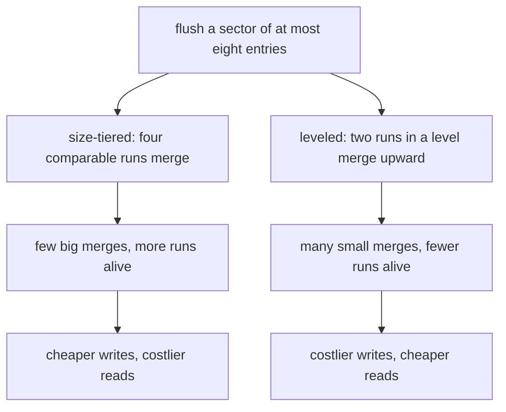
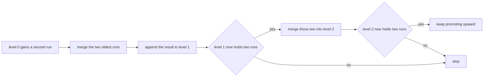
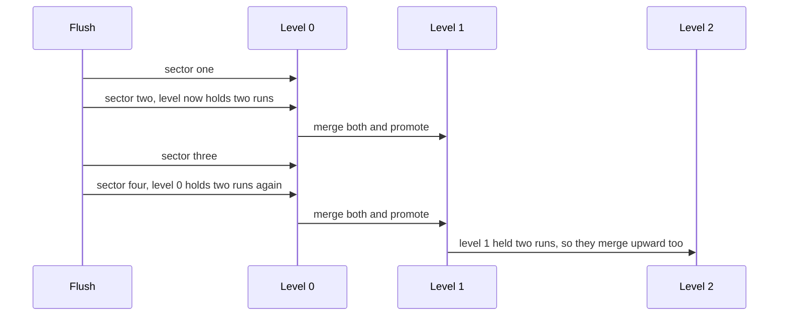

# 479 — Implement compaction strategies for LSM (levelled vs size-tiered).

> **Tier:** Advanced · **CTCI chapter:** Ch 14 — Databases
> **Task spec:** [479-implement-compaction-strategies-for-lsm-levelled-vs-size-tiered.md](../../../tasks/advanced/479-implement-compaction-strategies-for-lsm-levelled-vs-size-tiered.md)
> **Solutions:** [Python](../../../solutions/python/advanced/479-implement-compaction-strategies-for-lsm-levelled-vs-size-tiered/solution.py) ·
> [Java](../../../solutions/java/advanced/479-implement-compaction-strategies-for-lsm-levelled-vs-size-tiered/Solution.java) ·
> [JavaScript](../../../solutions/javascript/advanced/479-implement-compaction-strategies-for-lsm-levelled-vs-size-tiered/solution.js) ·
> [C#](../../../solutions/csharp/advanced/479-implement-compaction-strategies-for-lsm-levelled-vs-size-tiered/Solution.cs)

## 1. Problem restatement

**Input:** one fixed workload — `128` writes over a `256`-key space, flushed every `8` operations, so
`16` sectors of at most `8` entries each.

**Output:** two engines over that same workload, each maintaining a set of runs:

- **Size-tiered**: whenever four runs sit within a factor of `2` of each other's size, merge them.
- **Leveled** (binary fanout `2`): two runs in a level are merged into the next level, following a
  binary-counter schedule.

Both merge by key with the newest value winning, so both must equal a last-write-per-key oracle after
every flush. The documented outcome for this write-heavy parameterisation is a concrete trade-off:

| Metric | Size-tiered | Leveled |
| --- | --- | --- |
| entry writes (flushes plus merge outputs) | `357` | `600` |
| compactions | `5` | `15` |
| peak runs alive | `6` | `4` |
| peak entries stored | `115` | `112` |
| final state | one run of `107` keys | one run of `107` keys at the last level |

and the assertions state the qualitative reading of those numbers: leveled rewrites more entries
(higher write amplification), leveled compacts more often in smaller steps, size-tiered keeps more
runs alive (higher read amplification), and size-tiered temporarily stores more copies. All counts are
hand-checked from the deterministic merge logs, and the test also asserts `len(oracle) == 107` — the
number of keys that were actually written.

## 2. Intuition

With a fixed merge fanout — task 478 merges the four oldest tables — the question of *which* runs to
merge disappears. Real engines have to choose, and the choice is a trade between two costs:

- **Write amplification**: how many times each entry gets rewritten by compactions.
- **Read amplification**: how many runs a read has to probe before it finds the answer.

Size-tiered compaction optimises writes. When four runs of comparable size exist, they are merged in
one pass; the merged output is roughly four times larger, so the new run waits until enough siblings
of similar size accumulate. Few entries are rewritten, but runs of many different sizes coexist, so a
read may have to look at several of them.

Leveled compaction optimises reads. Runs are organised into levels, and a run only promotes upward
when its level holds two of them — a binary counter. The invariant is that few runs are live at any
moment, so a read probes fewer places, but the same entry is rewritten on every promotion, so the
write cost climbs.



The factor-of-two rule in size-tiered compaction is what makes "comparable" precise: sorting the runs
by size and merging any four consecutive sizes where the largest is at most twice the smallest keeps
merges from mixing a tiny run with a huge one.

## 3. Algorithm

**Size-tiered engine**

1. `flush(memtable)`: append the memtable as a run, add its entry count to `total_written`, then
   compact.
2. `_compact`: repeatedly sort runs by size and look for four consecutive runs where
   `sizes[i + 3] <= 2 * sizes[i]`. If none exist, stop. Otherwise merge those four **in chronological
   order** so that newer values overwrite older ones, add the merged entry count to `total_written`,
   count a compaction, and put the merged run in place of the four.
3. `materialize()`: replay the runs in chronological order, each overwriting the previous, which gives
   the newest value per key.

**Leveled engine**

1. `flush(memtable)`: append the memtable to level `0` and add its entry count to `total_written`.
2. `_compact`: while some level holds two or more runs, merge that level's two oldest runs (older
   first, then newer) into the next level, add the merged size to `total_written`, and count a
   compaction.
3. `materialize()`: replay levels from the highest down to level `0`, since higher levels hold older
   data.

```text
procedure size_tiered_flush(engine, memtable)
    append copy of memtable to engine.runs
    engine.total_written ← engine.total_written + size of memtable
    loop
        sizes ← runs sorted by length
        target ← none
        for i ← 0 to length(sizes) - 4 do
            if size of sizes[i + 3] <= FACTOR * size of sizes[i] then
                target ← the four run indices sizes[i .. i + 3]
                break
            end
        end
        if target is none then
            return
        end
        merged ← empty map
        for index in target in chronological order do
            merged.update(engine.runs[index])
        end
        engine.total_written ← engine.total_written + size of merged
        engine.merge_count ← engine.merge_count + 1
        replace the four target runs by merged in engine.runs
    end
end

procedure leveled_flush(engine, memtable)
    append copy of memtable to level 0
    engine.total_written ← engine.total_written + size of memtable
    loop
        for each level i in order do
            if length of level i is at least 2 then
                merged ← empty map
                merged.update(level i run 0)
                merged.update(level i run 1)
                engine.total_written ← engine.total_written + size of merged
                engine.merge_count ← engine.merge_count + 1
                remove the two oldest runs from level i
                append merged to level i + 1
                continue with the outer loop
            end
        end
        return
    end
end
```

Both engines share the merge primitive — newest value wins per key — and differ only in *which* runs
they pick. That is why the correctness assertions are identical for the two and only the counters
differ.



The cascade is the binary counter: one flush can trigger `1`, `2`, `4` or `8` merges depending on how
many levels were already full, and over `16` flushes the schedule adds up to `8 + 4 + 2 + 1 = 15`
compactions.

## 4. Worked example

Run both engines over the same `16` flushes and compare the counters the file asserts:

| Metric | Size-tiered | Leveled |
| --- | --- | --- |
| flushes | `16` | `16` |
| compactions | `5` | `15` |
| entry writes | `357` | `600` |
| peak runs alive | `6` | `4` |
| peak entries stored | `115` | `112` |
| final runs | `1` run of `107` keys | `1` run of `107` keys in level `4` |

The size-tiered schedule is documented merge by merge: the four `<= 8`-entry runs merge at flushes
`4`, `8`, `12` and `16`, and the last flush performs **two** merges because the resulting `~30`-entry
runs are themselves within a factor of two of each other and four of them now exist. That gives `5`
compactions in total, each of which folds away runs of similar size.

The leveled schedule is a binary counter: level `0` fills and promotes, level `1` fills and promotes
two at a time, and so on, producing `8 + 4 + 2 + 1 = 15` merges and leaving the final single run at
level `4` — hence the assertion that the engine ends with exactly `5` levels, all empty except the
last.



The `peak_runs` metric is where the two strategies visibly diverge: size-tiered reaches `6` live runs
because a merged run has to wait for three comparable siblings, while leveled never exceeds `4`,
because a level is drained as soon as it holds a second run. A read that must probe every run pays for
that difference — which is exactly the read-amplification argument stated in the docstring.

The `total_written` counters are equally direct: `357` versus `600` entry writes for the same `128`
input writes. The ratio to the input is the write amplification, roughly `2.8` for size-tiered against
`4.7` for leveled, and it is the concrete price of the smaller live-run count. Neither number is
estimated — both are the sums of the flush sizes and the merge output sizes recorded during the run.

## 5. Complexity

Let `W` be the number of writes (`128`), `S = W / 8 = 16` the number of flushes, and `K = 107` the
number of live keys.

| Measure | Size-tiered | Leveled |
| --- | --- | --- |
| Time, one compaction | O(entries in the merged runs) | O(entries in the two merged runs) |
| Compactions | `5` | `15` |
| Entry writes | `357` | `600` |
| Write amplification | `357 / 128 ≈ 2.8` | `600 / 128 ≈ 4.7` |
| Peak runs live | `6` | `4` |
| Peak entries stored | `115` | `112` |
| Space, final state | one run of `107` | one run of `107` |
| Read cost | proportional to the runs probed | proportional to the runs probed |
| Oracle check | after every flush, `materialize() == oracle` | the same |

The table is the point of the exercise: there is no single winner. Leveled compaction wins on the
read side because a read probes at most a few levels, and loses on the write side because every
promotion rewrites its inputs. Size-tiered does the reverse, and the measured numbers quantify the
trade for this workload. Note also that `115 >= 112` in peak entries — the assertion states the
qualitative fact that size-tiered temporarily holds more copies, and it holds here by `3` entries.

## 6. Pitfalls and edge cases

- **Merge order decides the answer.** Both engines replay runs chronologically so newer values win.
  Merging in the wrong order silently keeps stale values, and the per-flush oracle comparison catches
  it immediately.
- **The factor rule needs sorted sizes.** The size-tiered search sorts runs by length and takes four
  consecutive ones with `largest <= 2 * smallest`; picking any four runs by position can merge a tiny
  run with a huge one and destroy the size-tiering property.
- **The last flush performs two merges.** The size-tiered engine's compaction loop must keep going
  after a merge, because the output may immediately form a new group of four comparable runs. A single
  merge per flush would produce a different count and a different final state.
- **Leveled promotes the two oldest runs.** The engine must remove exactly those two runs and append
  the merged output to the next level; leaving a stale copy behind double-counts entries and inflates
  `total_written`.
- **Higher levels hold older data.** `materialize()` for the leveled engine replays levels from the
  highest down so that newer levels overwrite older ones; replaying from level `0` upward inverts the
  precedence and returns stale values.
- **Empty levels are legitimate.** The final state has four empty levels and one non-empty level, and
  the assertion `len(lv.levels) == 5` with only the last populated depends on that.
- **Both engines must agree with the oracle.** Every flush is checked, not just the final state, which
  is what catches a merge that temporarily loses a key.
- **The counters are deterministic.** The workload is generated by the LCG from seed `24680`, so the
  exact values `357`, `600`, `5`, `15`, `6`, `4`, `115` and `112` are reproducible and are asserted
  rather than merely reported.
- **Peak measurement points matter.** The peak counters are sampled right after each flush and its
  compactions, which is the moment the run set is largest; sampling before compaction would report
  different peaks and break the comparison.

## 7. Variants and follow-ups

- **The engine underneath.** [478-implement-log-structured-merge-tree-lsm-basic-flush-merge-simula.md](../../../tasks/advanced/478-implement-log-structured-merge-tree-lsm-basic-flush-merge-simula.md)
  builds the memtable, flush and merge machinery with a fixed fanout; this task chooses the policy.
- **Tuning the policy.** [777-implement-write-optimized-lsm-tuning-simulation-for-read-write-t.md](../../../tasks/expert/777-implement-write-optimized-lsm-tuning-simulation-for-read-write-t.md)
  sweeps the same parameters against an explicit cost model.
- **Skipping runs on read.** [482-implement-bloom-filter-per-sstable-prototype-and-test.md](../../../tasks/advanced/482-implement-bloom-filter-per-sstable-prototype-and-test.md)
  attaches a filter per table so the read amplification measured here is partly neutralised.
- **The in-place comparison.** [477-implement-b-tree-leaf-range-query-and-insert-basics.md](../../../tasks/advanced/477-implement-b-tree-leaf-range-query-and-insert-basics.md)
  pays no write amplification at all and gives up the sequential write path.
- **External merge machinery.** [438-implement-external-memory-sort-outline-multiway-merge.md](../../../tasks/advanced/438-implement-external-memory-sort-outline-multiway-merge.md)
  is the same multiway-merge primitive used at a different layer of the stack.

## 8. Check yourself

1. Which strategy would you choose for a write-heavy ingest pipeline, and what does the table say you
   pay for it?

<details><summary>Show answer</summary>

Size-tiered, because it rewrites fewer entries: `357` versus `600` entry writes for the same `128`
input writes. The price is read amplification — it peaks at `6` live runs against `4` for leveled — so
every read may have to probe more runs. Which side matters more depends on the read/write ratio, which
is exactly why both strategies exist.

</details>

2. Why does leveled compaction end with five levels while size-tiered ends with one run?

<details><summary>Show answer</summary>

Because they organise runs differently. Leveled compaction preserves a level structure as a binary
counter, so the final merged run sits at the highest level reached (level `4`) with all lower levels
drained. Size-tiered has no levels at all — a run is just a run — so once the last comparable groups
have been merged there is a single run left holding all `107` keys.

</details>

3. What role does the factor of two play in size-tiered compaction?

<details><summary>Show answer</summary>

It defines "comparable sizes". Runs are sorted by length and four consecutive ones merge only when the
largest is at most twice the smallest, so a merge combines runs of similar size and the output is
roughly four times bigger. Without the factor, a merge could fold a single-entry run together with a
hundred-entry run, which wastes the rewrite and defeats the scheme's amortisation.

</details>

4. Why is `total_written` a fair measure of write amplification here?

<details><summary>Show answer</summary>

Because it counts every entry written by a flush or a merge output, and the input is fixed at `128`
writes. The ratio of the two is therefore exactly how many times each entry is written over the
workload: `357 / 128` for size-tiered and `600 / 128` for leveled. No estimation is involved — the
numbers are sums taken from the deterministic merge logs.

</details>

5. The final state of both engines is a single run of `107` keys, yet the workload contained `128`
   writes. Why the difference?

<details><summary>Show answer</summary>

Because the writes cover a `256`-key space and many of them repeat, so only `107` distinct keys were
ever written. The oracle assertion `len(oracle) == 107` records that, and both engines must converge to
exactly those live keys: merging by key with the newest value winning removes the duplicates while
keeping every key that was written at least once.

</details>
