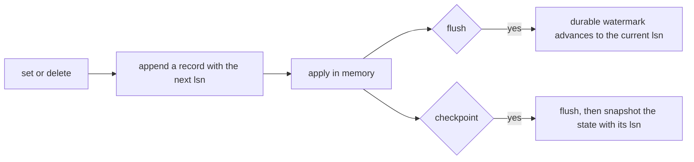
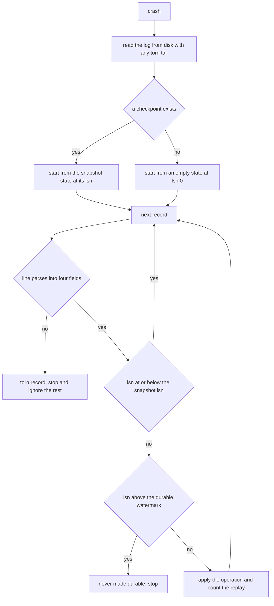
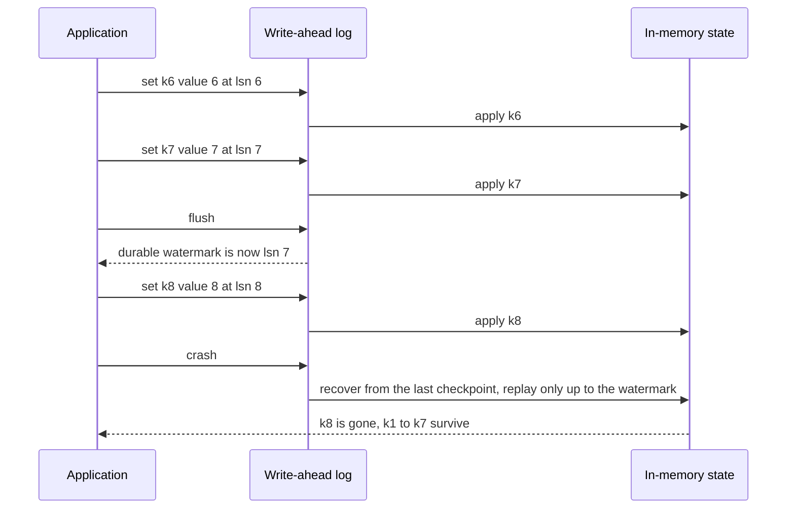
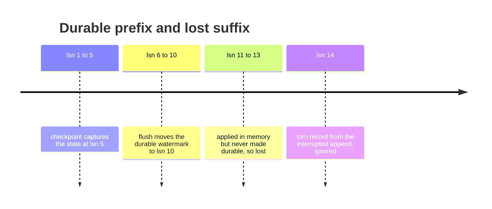

# 480 — Implement write-ahead logging (WAL) + crash recovery simulation.

> **Tier:** Advanced · **CTCI chapter:** Ch 14 — Databases
> **Task spec:** [480-implement-write-ahead-logging-wal-crash-recovery-simulation.md](../../../tasks/advanced/480-implement-write-ahead-logging-wal-crash-recovery-simulation.md)
> **Solutions:** [Python](../../../solutions/python/advanced/480-implement-write-ahead-logging-wal-crash-recovery-simulation/solution.py) ·
> [Java](../../../solutions/java/advanced/480-implement-write-ahead-logging-wal-crash-recovery-simulation/Solution.java) ·
> [JavaScript](../../../solutions/javascript/advanced/480-implement-write-ahead-logging-wal-crash-recovery-simulation/solution.js) ·
> [C#](../../../solutions/csharp/advanced/480-implement-write-ahead-logging-wal-crash-recovery-simulation/Solution.cs)

## 1. Problem restatement

**Input:** a sequence of `set`, `delete`, `flush`, `checkpoint` and `crash` operations against an
in-memory key-value state.

**Output:** a write-ahead log engine plus a recovery routine. Every mutation appends a record
`lsn|op|key|value` to the log and applies it in memory; `flush` advances a durable watermark; a
checkpoint stores a snapshot of the state together with the LSN it corresponds to; a crash discards all
memory and recovers by replaying the durable suffix of the log on top of the latest checkpoint.

The contract is fixed by the assertions, starting with three direct parser checks on the literal log

```text
1|set|a|1
2|set|b|2
3|del|a|
4|set|c|3
5|set|d          <- torn: only three fields
```

| Call | Result | Why |
| --- | --- | --- |
| `recover(text, 4, None)` | `{"b": 2, "c": 3}`, `4` replayed | the torn line ends the scan |
| `recover(text, 2, None)` | `{"a": 1, "b": 2}`, `2` replayed | LSNs above the watermark are lost |
| `recover(text, 5, ({"z": 9}, 3))` | `{"z": 9, "c": 3}`, `1` replayed | the snapshot covers LSNs up to `3` |

and then with a full engine trace:

| Operation | Asserted state |
| --- | --- |
| `set k1..k5`, `checkpoint_now()` | `durable_lsn == 5`, `checkpoint_count == 1` |
| `set k6..k10`, `flush()`, `set k11`, `delete k3`, `set k12` | `lsn == 13`, `durable_lsn == 10` |
| `crash(torn_tail = "14|set|k13")` | state `{k1..k10}`, `last_replay_count == 5`, `lsn == 10` |
| `set k100`, `flush()`, `crash()` | `{k1..k10, k100}`, `last_replay_count == 6` |
| `set x 1`, `flush()`, `set x 2`, `crash()` | `{"x": 1}` — the unflushed write is lost |
| four sets, one `flush()`, `crash()` with no checkpoint | all four keys recovered, `4` replayed |
| `run_random()` (60 actions, seed `8642`) | `9` crashes, `11` checkpoints, oracle matched at every crash |

## 2. Intuition

An in-memory write is invisible after a crash unless it was written somewhere durable *before* the
crash — and that "before" is the ordering the algorithm is named for. The rule is: **write the log
record, make it durable, then apply it in memory**. If the process dies at any point, the log tells
recovery exactly which operations happened.

Two watermarks make recovery cheap and precise:

- The **durable watermark** (`durable_lsn`) is the highest LSN that is known to be on disk. Records
  above it may exist in memory only and must be forgotten.
- The **checkpoint** stores the whole state together with the LSN it corresponds to, so recovery can
  start from a snapshot instead of from the first record ever written.



Recovery is then a short, strictly ordered scan. It starts from the snapshot, skips everything the
snapshot already covers, stops at the first record beyond the durable watermark (that write was never
made durable, so it never happened), and stops at the first **torn** record — a partially written line
from a crash in the middle of an append.



The torn-record case is the reason the check is "four fields" and not "parse the LSN": a crash during
an append can leave a line like `5|set|d` that is syntactically a prefix of a valid record. Treating it
as valid would apply a half-written operation.

## 3. Algorithm

1. `set(key, value)`: increment the LSN, append `(lsn, "set", key, value)` to the log, apply the value
   in memory. `delete(key)` does the same with op `del` and removes the key.
2. `flush()`: set `durable_lsn` to the current LSN, i.e. declare everything appended so far durable.
3. `checkpoint_now()`: flush, then store a copy of the state and the LSN it corresponds to, and count
   the checkpoint.
4. `wal_text(torn_tail)`: serialise each record as `lsn|op|key|value`, joining with newlines and a
   trailing newline, then append the optional torn tail.
5. `crash(torn_tail)`: capture the on-disk text plus the tail, read the durable LSN, call `recover`,
   replace the state with the recovered one, set the LSN to the durable watermark, truncate the
   in-memory log to that watermark, and count the crash.
6. `recover(text, durable_lsn, checkpoint)`: start from the checkpoint snapshot (or empty), then scan
   lines in order — stop at a torn line, skip records at or below the snapshot LSN, stop at the first
   record above the durable watermark, and apply everything in between.

```text
procedure set(engine, key, value)
    engine.lsn ← engine.lsn + 1
    append (engine.lsn, "set", key, value) to engine.wal
    engine.state[key] ← value
end

procedure flush(engine)
    engine.durable_lsn ← engine.lsn
end

procedure checkpoint(engine)
    flush(engine)
    engine.checkpoint ← (copy of engine.state, engine.lsn)
    engine.checkpoint_count ← engine.checkpoint_count + 1
end

procedure crash(engine, torn_tail)
    on_disk ← serialise engine.wal plus torn_tail
    durable ← engine.durable_lsn
    (state, replayed) ← recover(on_disk, durable, engine.checkpoint)
    engine.state ← state
    engine.last_replay_count ← replayed
    engine.lsn ← durable
    engine.wal ← engine.wal[0 : durable]
    engine.durable_lsn ← durable
    engine.crash_count ← engine.crash_count + 1
end

function recover(text, durable_lsn, checkpoint)
    if checkpoint is nothing then
        state ← empty map
        snapshot_lsn ← 0
    else
        state ← copy of the checkpoint snapshot
        snapshot_lsn ← the checkpoint lsn
    end
    replayed ← 0
    for line in lines of text do
        if line is empty then
            continue
        end
        parts ← split line on the pipe character
        if length(parts) is not 4 then
            break
        end
        lsn ← integer value of parts[0]
        if lsn <= snapshot_lsn then
            continue
        end
        if lsn > durable_lsn then
            break
        end
        if parts[1] is "set" then
            state[parts[2]] ← integer value of parts[3]
        else
            remove parts[2] from state
        end
        replayed ← replayed + 1
    end
    return (state, replayed)
end
```

All three stopping conditions are load-bearing: torn means "the write was interrupted", above the
watermark means "the write was never made durable", and at or below the snapshot LSN means "the
snapshot already covers this". Only the records between the snapshot and the watermark are replayed.



## 4. Worked example

**The engine trace, step by step.**

| Step | Operation | `lsn` | `durable_lsn` | State |
| --- | --- | --- | --- | --- |
| 1 | `set k1..k5` | `5` | `0` | `{k1..k5}` in memory only |
| 2 | `checkpoint_now()` | `5` | `5` | snapshot `{k1..k5}` at LSN `5` |
| 3 | `set k6..k10` | `10` | `5` | snapshot plus five new writes |
| 4 | `flush()` | `10` | `10` | everything so far is durable |
| 5 | `set k11`, `delete k3`, `set k12` | `13` | `10` | three writes beyond the watermark |
| 6 | `crash("14|set|k13")` | `10` | `10` | `{k1..k10}`, `last_replay_count == 5` |

Step 6 is the whole algorithm in one line of output. The log on disk holds records `1..13` plus a torn
`14`, but only records `6..10` are both above the snapshot LSN (`5`) and at or below the watermark
(`10`) — so exactly `5` records replay, `k11` and `k12` are lost, and `k3` is still present because the
`delete k3` at LSN `12` was never durable either. After recovery the engine's LSN is `10`, matching the
durable prefix, so the next write continues from there.



**The other three engine cases.**

| Scenario | Log | Watermark | Recovered |
| --- | --- | --- | --- |
| `set k100`, `flush`, `crash` | `1..11` durable | `11` | `{k1..k10, k100}` with `6` replayed |
| `set x 1`, `flush`, `set x 2`, `crash` | `x=1` durable only | `1` | `{"x": 1}` — the second write is lost |
| four sets, `flush`, `crash`, no checkpoint | `a0..a3` durable | `4` | all four keys, `4` replayed |

The second row is the durability contract stated negatively: a write that was never flushed is gone,
and the engine's state after recovery is the committed prefix rather than a mix.

**The randomized workload.** `run_random()` interleaves `set`, `delete`, `flush`, `checkpoint` and
`crash` for 60 actions from seed `8642`, maintaining an oracle that tracks both the live state and the
last durable state. At every crash it asserts `eng.state == oracle_durable`, and the fixtures record
`9` crashes (the actions where `seed mod 10 == 9`, at positions `5, 9, 15, 24, 27, 32, 47, 51, 55`) and
`11` checkpoints (ten from `seed mod 10 == 8` plus one final settling checkpoint). Recovery must agree
with the oracle at every one of the nine crashes, not merely at the end.

## 5. Complexity

Let `R` be the number of records in the log, `S` the size of the state, and `r` the number of records
actually replayed.

| Measure | Bound | Why it holds |
| --- | --- | --- |
| Time, `set` / `delete` | O(1) | one append and one map update |
| Time, `flush` | O(1) | it only moves a watermark |
| Time, `checkpoint` | O(S) | the state is copied into the snapshot |
| Time, `crash` | O(R + S + r) | serialise the log, copy the snapshot, replay `r` records |
| Time, `recover` | O(R) worst case, O(r) useful | the scan may walk the prefix but only applies `r` records |
| Space, log | O(R) | truncated to the watermark after recovery |
| Space, checkpoint | O(S) | one snapshot per checkpoint here, not a chain |
| Replay in the trace | `5` of `13` records | only those strictly between the snapshot LSN and the watermark |

The interesting bound is the gap between `O(R)` and `O(r)`: recovery has to scan the serialised log to
find where the snapshot ends, but the number of operations it actually *applies* is the short suffix
between the checkpoint and the watermark — `5` records in the trace. Checkpoints are what keep that
suffix short, and they are why a long-running system does not take longer to recover as it ages.

## 6. Pitfalls and edge cases

- **Torn records must end the scan.** A line like `5|set|d` has only three fields and must be rejected,
  because it is a prefix of a valid record that was never completed. Continuing past it would apply
  half an operation or misparse the next line.
- **Writes above the watermark are lost.** They may be in memory and even in the on-disk file buffer,
  but if they were never flushed they did not happen: the `x = 1, flush, x = 2, crash` case asserts the
  recovered value is `1`.
- **The snapshot is a copy, not a reference.** A checkpoint that stored the live dictionary would be
  mutated by later writes, and recovery would resurrect state from after the crash.
- **Snapshot LSN records are skipped, not applied.** Applying records at or below the snapshot LSN is
  harmless but wrong to count, and the parser check `recover(text, 5, ({"z": 9}, 3))` returns exactly
  `1` replayed to pin down the boundary as `lsn <= snapshot_lsn`.
- **Recovery resets the LSN to the watermark.** After a crash the engine continues from the durable
  prefix, so new records reuse LSNs above it; leaving the counter at the pre-crash value would leave a
  gap in the sequence that the next recovery would treat as a hole.
- **The log is truncated at the watermark.** Anything beyond it is discarded from memory, which is why
  a later crash cannot be contaminated by the lost writes.
- **Repeated crashes are idempotent.** Crashing with nothing in flight leaves the state unchanged, and
  the randomized phase's final `checkpoint_now()` plus `crash()` asserts exactly that.
- **Deletes need to be durable too.** The `delete k3` at LSN `12` never made the watermark, so `k3`
  survives in the recovered state; a delete is only permanent once its record is durable.

## 7. Variants and follow-ups

- **Where the log is used.** [478-implement-log-structured-merge-tree-lsm-basic-flush-merge-simula.md](../../../tasks/advanced/478-implement-log-structured-merge-tree-lsm-basic-flush-merge-simula.md)
  describes the memtable this log protects, and
  [663-implement-snapshot-based-log-compaction-and-recovery-for-replica.md](../../../tasks/expert/663-implement-snapshot-based-log-compaction-and-recovery-for-replica.md)
  compacts the log itself.
- **Checkpointing at scale.** [721-implement-checkpoint-compression-and-incremental-checkpointing.md](../../../tasks/expert/721-implement-checkpoint-compression-and-incremental-checkpointing.md)
  makes checkpoints incremental and compressed; this task takes a full snapshot each time.
- **Transactions on top of the log.** [476-implement-snapshot-isolation-simulator-for-transactions-conceptu.md](../../../tasks/advanced/476-implement-snapshot-isolation-simulator-for-transactions-conceptu.md)
  supplies the isolation rules that a durable store must preserve, and
  [802-implement-fully-acid-transactional-key-value-store-with-mvcc-and.md](../../../tasks/master/802-implement-fully-acid-transactional-key-value-store-with-mvcc-and.md)
  combines MVCC with durability and recovery.

## 8. Check yourself

1. Why is the torn record the last thing recovery sees, rather than something it tries to repair?

<details><summary>Show answer</summary>

Because a torn record is evidence that the process died mid-append, so everything after it is either
absent or unreliable. The record is a prefix such as `5|set|d`, which cannot be completed from the log
alone, and any later bytes could be stale data from a previous write to the same file region. Stopping
the scan at the first malformed line is the only safe policy, and the parser checks assert it.

</details>

2. In the engine trace, `13` records exist on disk but only `5` are replayed. Which five?

<details><summary>Show answer</summary>

Records `6` through `10`. Everything up to LSN `5` is already inside the checkpoint snapshot, so it is
skipped; `k11` at `11`, the `delete k3` at `12` and `k12` at `13` are all above the durable watermark
of `10` and were never made durable, so they are dropped; the torn `14` is never reached. That leaves
exactly the five durable post-checkpoint writes, which is the asserted `last_replay_count == 5`.

</details>

3. The `delete k3` at LSN `12` is in the log, yet `k3` is present in the recovered state. Why?

<details><summary>Show answer</summary>

Because the delete is above the durable watermark. The watermark is `10`, so recovery stops before
LSN `12` and never replays it, which leaves `k3` at the value the checkpoint captured. A delete is only
one of a key's effects once its record becomes durable — the recovered state is `{k1..k10}`, exactly
the committed prefix.

</details>

4. What would go wrong if the checkpoint kept a reference to the live state dictionary instead of a
   copy?

<details><summary>Show answer</summary>

The snapshot would keep changing. Later `set` and `delete` calls mutate the same dictionary, so the
snapshot would reflect writes made after the checkpoint was taken — exactly the writes that recovery
must *not* treat as durable. Recovery would then resurrect state from beyond the watermark and the
oracle comparisons would fail. Copying at checkpoint time is what makes the snapshot a point-in-time
image.

</details>
