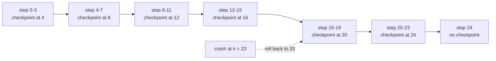
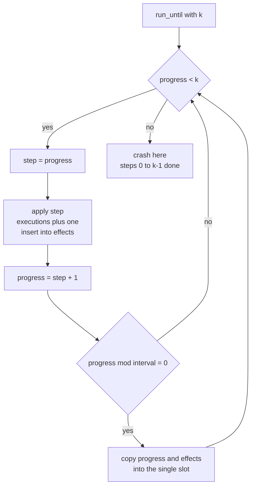
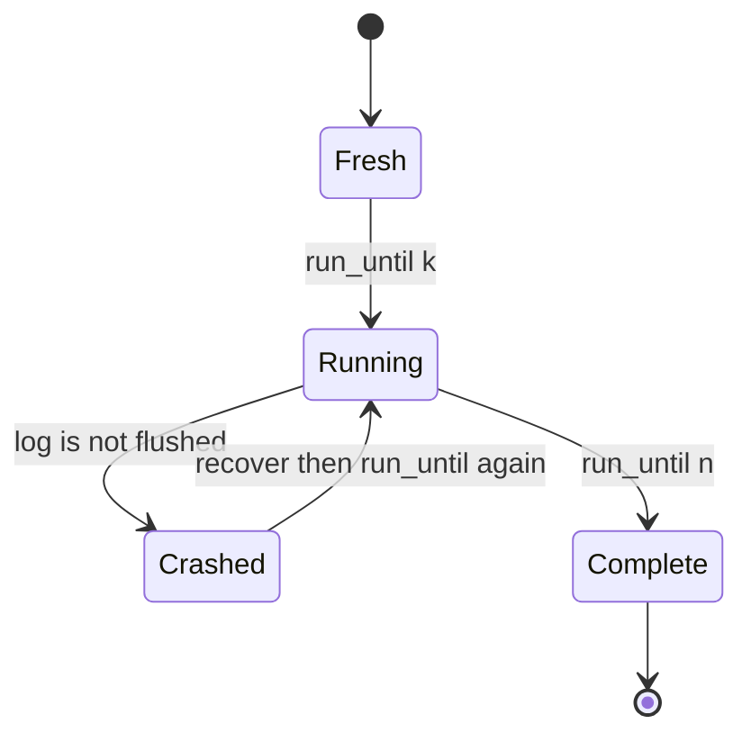
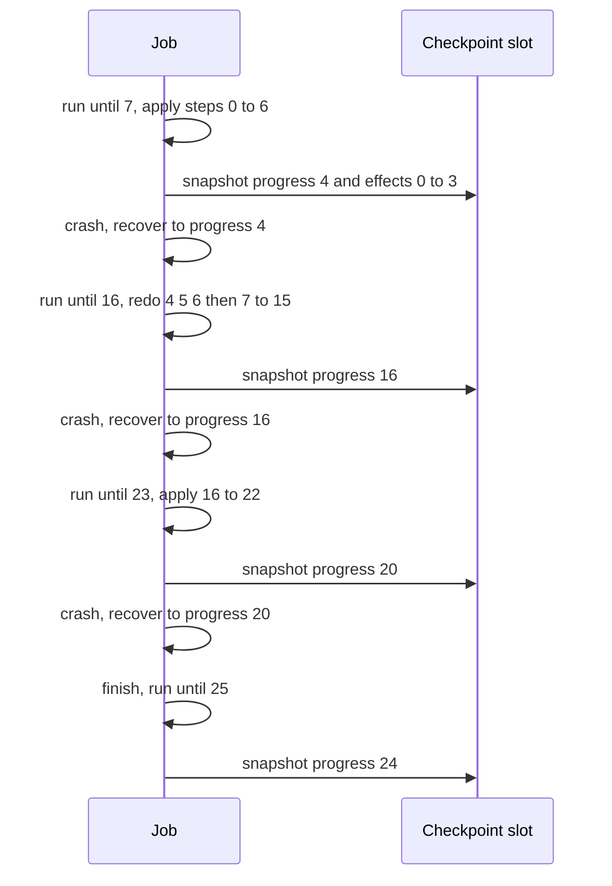

# 481 — Implement optimistic checkpointing/restart simulation.

> **Tier:** Advanced · **CTCI chapter:** Ch 14 — Databases
> **Task spec:** [481-implement-optimistic-checkpointing-restart-simulation.md](../../../tasks/advanced/481-implement-optimistic-checkpointing-restart-simulation.md)
> **Solutions:** [Python](../../../solutions/python/advanced/481-implement-optimistic-checkpointing-restart-simulation/solution.py) ·
> [Java](../../../solutions/java/advanced/481-implement-optimistic-checkpointing-restart-simulation/Solution.java) ·
> [JavaScript](../../../solutions/javascript/advanced/481-implement-optimistic-checkpointing-restart-simulation/solution.js) ·
> [C#](../../../solutions/csharp/advanced/481-implement-optimistic-checkpointing-restart-simulation/Solution.cs)

## 1. Problem restatement

**Input:** a job of `n` steps (step ids `0 .. n-1`) and a checkpoint `interval`. Each step applies
one *effect*, and effects are idempotent: applying step `s` inserts the effect id `s` into a set,
so re-applying it changes nothing.

**Output:** a simulated run that survives crashes. The job exposes:

- `progress` — how many steps have *executed* (not how many are committed),
- `effects` — the set of effect ids applied since the last recovery,
- a single checkpoint slot holding `(checkpoint_progress, checkpoint_effects)`,
- counters `checkpoint_count` and `executions`, and the derived quantity `redone`.

The documented semantics come straight from the solution headers:

- After every `interval` completed steps the job snapshots `(progress, effects)` into the one
  checkpoint slot, **overwriting** the previous snapshot. A checkpoint is taken when
  `progress % interval == 0`.
- "Crash while about to start step `k`" means steps `0 .. k-1` executed and the slot holds the last
  snapshot taken among them.
- Recovery rolls back to that slot: effects of steps executed after the last checkpoint are *lost*
  (they were optimistic, uncommitted), while everything at or before the last checkpoint survives.
- Recovered progress is exactly `(k / interval) * interval`, so redone work is `k - recovered < interval`.

Concrete expected results, all asserted by the four solution files:

| Scenario | Expected | Why |
| --- | --- | --- |
| `n = 25`, `interval = 4`, crash at `k = 7` | recovered progress `4`, effects `{0,1,2,3}` | last boundary at or below 7 is 4 |
| crash at `k = 16` | recovered progress `16`, effects `{0..15}` | `k` is itself a boundary, nothing is lost |
| crash at `k = 23` | recovered progress `20`, effects `{0..19}` | last boundary at or below 23 is 20 |
| `k = 0` | recovered progress `0` | the job never started; recovery is a no-op |
| redone count | `(7-4) + (23-20) = 6` | only the two non-boundary crashes redo work |

The Python file additionally pins the hand case: `executions == 7 + 12 + 7 + 5`, `checkpoint_count == 6`
and a final checkpoint of `(24, 0..23)`.

## 2. Intuition

The naive durable job checkpoints *every* step. That is safe but pays a snapshot per step: with
`n` steps you write `n` snapshots, and each snapshot copies the whole effect set, so the cost is
quadratic in `n`. The other extreme — never checkpointing — is cheap until the first crash, at
which point the job restarts from step 0 and redoes everything.

Optimistic checkpointing takes the middle road. Snapshot only at multiples of `interval`, keep the
snapshot in one slot, and accept the consequence: a crash between two boundaries throws away the
steps executed after the last boundary. Because effects are idempotent, redoing them is harmless —
the set never grows a duplicate.

The key insight is that **the boundary arithmetic is the whole contract**. If the crash happens
while about to start step `k`, the newest checkpoint the job could possibly have taken is at
`floor(k / interval) * interval`. That value is knowable without consulting any log, which is why
recovery is a rollback plus a `while` loop rather than a log replay.



Read the picture as the price of a crash: rollback distance is always shorter than `interval`,
never a multiple of it. A crash at 23 lands on 20 and rediscards three steps; a crash at 24 lands
on 24 and discards nothing.

The second insight is that **the effect set and the execution counter must be tracked separately**.
`effects` is a set, so a redone step leaves it unchanged; `executions` counts every `apply` call,
including repeats. Their difference is exactly the amount of redundant work, and that is how the
simulation measures the redo bound instead of trusting the formula.

## 3. Algorithm

1. Initialise `progress = 0`, `effects = {}`, `checkpoint = (0, {})`, `executions = 0`,
   `checkpoint_count = 0`.
2. `apply(step)`: increment `executions`; if `step` is not already in `effects`, add it.
3. `run_until(k)`: while `progress < k`, set `step = progress`, `apply(step)`, then
   `progress = step + 1`; if `progress % interval == 0`, store `(progress, copy of effects)` into
   the slot and increment `checkpoint_count`.
4. `recover()`: `progress = checkpoint.progress`, `effects = copy of checkpoint.effects`.
5. `finish()`: `run_until(n)` — replay to the end.
6. `redone`: `executions - size(effects)`.

```text
procedure run_until(k)
    while progress < k do
        step ← progress
        apply(step)
        progress ← step + 1
        if progress mod interval = 0 then
            checkpoint ← (progress, copy of effects)
            checkpoint_count ← checkpoint_count + 1
        end
    end
end

procedure recover()
    progress ← checkpoint.progress
    effects ← copy of checkpoint.effects
end

procedure finish()
    run_until(n)
end
```

Note that the checkpoint is taken **after** the step is applied and after `progress` advances, so a
snapshot always describes a whole number of completed steps. `recover()` rebuilds `effects` from the
snapshot rather than deleting the tail, which is what makes rollback safe regardless of how many
steps were in flight.



The lifecycle of a job, with recovery as a transition that always re-enters the running state at an
interval boundary:



`Crashed` is the only state that can lose work, and it can only lose work that was never
checkpointed. `Complete` is reachable only after rollback or plain execution; both end with the same
effect set.

## 4. Worked example

Trace the hand case in the Python `main`: `n = 25`, `interval = 4`, crashes at `k = 7`, `16`, `23`.

| Phase | Action | `progress` after | `effects` after | `checkpoint` slot | `executions` |
| --- | --- | --- | --- | --- | --- |
| start | new job | 0 | `{}` | `(0, {})` | 0 |
| 1 | `run_until(7)` | 7 | `{0,1,2,3,4,5,6}` | `(4, {0,1,2,3})` | 7 |
| 2 | `recover()` | 4 | `{0,1,2,3}` | unchanged | 7 |
| 3 | `run_until(16)` | 16 | `{0..15}` | `(16, {0..15})` | 19 |
| 4 | `recover()` | 16 | `{0..15}` | unchanged | 19 |
| 5 | `run_until(23)` | 23 | `{0..22}` | `(20, {0..19})` | 26 |
| 6 | `recover()` | 20 | `{0..19}` | unchanged | 26 |
| 7 | `finish()` | 25 | `{0..24}` | `(24, {0..23})` | 31 |

Three facts fall out of the table and are asserted directly:

- **Recovered progress.** Rows 2, 4 and 6 give `4`, `16`, `20` — exactly `floor(k/4) * 4` for
  `k = 7, 16, 23`.
- **No committed effect is lost.** Every recovery keeps a prefix `{0 .. recovered-1}`: the four
  effects after the boundary at 4 are discarded at row 2, but `{0,1,2,3}` survives.
- **Redo bound.** `executions` ends at `31` while `effects` holds `25`, so `redone = 6`, which is
  `(7-4) + (23-20)`. The crash at 16 sits on a boundary and contributes nothing.

Row 3 is worth a closer look: it executes 12 steps (`4 .. 15`), not 9, because the rollback at row 2
obliged the job to redo steps `4, 5, 6` before reaching new work. That is the 3-step redo the final
count attributes to the first crash.



`checkpoint_count` reads 6 from that same schedule: boundaries `4, 8, 12, 16, 20, 24`. The boundary
at 8, 12 and 4 are each written once even though some of those steps were executed more than once —
overwriting is what keeps the slot count at one.

The test suite then sweeps every crash point `k` in `{0, 3, 7, 8, 16, 23}` for `n = 25`,
`interval = 4`, and pins the boundary table `[(3,0), (7,4), (8,8), (16,16), (23,20)]`. A final sweep
uses 20 pseudo-random crash points from an LCG (`seed = seed * 75 + 74 mod 65537`, then `mod 26`)
and re-checks the same invariants, plus `interval` values `1`, `3` and `5` over `n = 20` with
`k = 0 .. 20`.

## 5. Complexity

Let `n` be the total steps and `interval` the checkpoint period.

| Measure | Bound | Why it holds |
| --- | --- | --- |
| Time, clean run | O(n · e) | `n` steps; each `apply` scans the effect list, so insert cost is `O(e)` with `e ≤ n` |
| Time, with crashes | O((n + redone) · e) | every crash adds `k - floor(k/interval) * interval` executions, taped back on by `run_until` |
| Time, checkpoint write | O(e) per boundary | the slot copies the whole effect list; `ceil(n / interval)` boundaries |
| Space | O(n) | the effect list holds at most `n` ids and the slot duplicates it once |
| Space, extra per checkpoint | O(e) | one snapshot, because the slot is overwritten rather than appended |
| Redo, worst case | `interval - 1` steps | recovered progress is `floor(k/interval) * interval`, so `k - recovered < interval` |
| Redo, interval = 1 | 0 steps | every `k` is a boundary; the sweep for `interval = 1` asserts `redone == 0` |

The alternative — checkpointing every step — has redo 0 but writes O(n) snapshots of size O(e), i.e.
O(n²) work for the `n = 25` case; the interval version writes 6 snapshots and redoes 6 steps. The
other alternative, no checkpointing at all, writes nothing but redoes up to `k` steps on every
crash. Optimistic checkpointing trades a bounded, tunable amount of redo for a bounded amount of
snapshot traffic, and the bound is exactly `interval - 1`.

## 6. Pitfalls and edge cases

- **`k = 0` (crash before the first step).** `run_until(0)` executes nothing, `recover()` sets
  `progress = 0` and `effects = {}`. The sweep includes `k = 0` and asserts
  `progress == 0` and `set(effects) == set(range(0))`.
- **Crash exactly on a boundary (`k = 8`, `k = 16`).** Recovered progress equals `k`, so
  `redone == k - k == 0`. Treating the boundary as "just after the checkpoint but before it is
  written" would lose committed work here; the solution takes the snapshot *after* `progress`
  advances, which is what makes this case exact.
- **`k` not a multiple of `interval`.** The tail after the last boundary is discarded, e.g.
  `k = 3` with `interval = 4` recovers to `0` and loses effects `{0,1,2}`. That loss is the
  documented optimistic behaviour, not a bug.
- **Non-idempotent effects.** `apply` is a set insert precisely so replay cannot duplicate effect
  `step`. If a real effect were not idempotent, redoing `k - recovered` steps would double-apply,
  and the whole scheme would need a dedup key.
- **`interval = 1`.** Redo is always 0; the sweep over `interval` values asserts
  `redone < interval`, which for `interval = 1` forces `redone == 0`. A checkpoint per step is
  correct but writes `n` snapshots.
- **`interval > n`.** No boundary other than `0` is ever written, so every crash recovers to 0. The
  simulation never divides by the interval except in the recovery formula, so this is safe.
- **Unsigned division.** The recovery formula is integer division of a non-negative `k`;
  `(k / interval) * interval` in Java, C# and JavaScript (via `Math.floor`) matches Python's `//`
  because `k` is never negative. A negative `k` would break the floor identity in languages that
  truncate toward zero.
- **Counter vs set.** `executions` counts repeats and `effects` does not, so `redone` is
  `executions - len(effects)`. Comparing `executions` to `n` instead would make the redo count
  wrong on the very first crash.

## 7. Variants and follow-ups

- **Write-ahead logging instead of snapshotting.**
  [480-implement-write-ahead-logging-wal-crash-recovery-simulation.md](../../../tasks/advanced/480-implement-write-ahead-logging-wal-crash-recovery-simulation.md)
  replaces the optimistic rollback with a redo log: nothing is lost, but recovery replays every
  record after the last flush point.
- **Durability inside a storage engine.**
  [484-implement-simple-key-value-store-with-memtable-sstable.md](../../../tasks/advanced/484-implement-simple-key-value-store-with-memtable-sstable.md)
  turns the checkpoint slot into a memtable flush and keeps committed data in SSTables.
- **Snapshots that stay readable while writes continue.**
  [483-implement-consistent-snapshot-retrieval-using-mvcc.md](../../../tasks/advanced/483-implement-consistent-snapshot-retrieval-using-mvcc.md)
  keeps multiple versions alive instead of one overwritten slot, which is what a reader needs.
- **Choosing the interval.** A larger `interval` writes fewer snapshots and rediscards more work on
  each crash; the redo bound `interval - 1` is the knob. Cache-structure analogues of the same
  trade-off appear in [485-implement-cache-eviction-policies-lru-lfu-arc-simulate.md](../../../tasks/advanced/485-implement-cache-eviction-policies-lru-lfu-arc-simulate.md).

## 8. Check yourself

**Q1.** For `n = 25`, `interval = 4` and a crash at `k = 23`, how many steps are redone?

<details><summary>Show answer</summary>

Recovered progress is `floor(23/4) * 4 = 20`, and the redo bound is `23 - 20 = 3` steps: steps
`20`, `21`, `22` run again. The assertions check `job.redone() == 23 - 20` and
`job.redone() < interval`.
</details>

**Q2.** Why can recovery work out the rollback target without reading a log?

<details><summary>Show answer</summary>

Because checkpoints are taken at multiples of `interval`, the newest possible snapshot at a crash
before step `k` is `floor(k / interval) * interval`. That closed form is exactly what `recover()`
verifies against `job.progress`, so no scan of history is needed.
</details>

**Q3.** The hand case ends with `executions == 31` but only 25 steps exist. Explain the 6.

<details><summary>Show answer</summary>

`redone = executions - len(effects) = 31 - 25 = 6`. The crashes at `k = 7` and `k = 23` rolled back
to 4 and 20, so steps `4,5,6` and `20,21,22` were executed twice. The crash at `k = 16` sits on a
boundary and contributes zero.
</details>

**Q4.** What happens if `interval` is 1, and why is `redone < interval` still a useful assertion?

<details><summary>Show answer</summary>

With `interval = 1` every `k` is a boundary, so recovery always lands on `k` and `redone` is 0. The
sweep still asserts `redone < interval`, which for `interval = 1` pins the count at exactly 0 — the
bound tightens as the checkpoint frequency rises.
</details>

**Q5.** A step's effect is "append 1 to a counter". Would this simulation still be correct?

<details><summary>Show answer</summary>

No. `apply` models effects as a *set insert*, so replaying a step is a no-op. An incrementing
counter is not idempotent: redoing `4,5,6` after recovery would add 3 extra units, and the final
value would depend on the crash schedule. Real systems pair redo with a dedup key or a
last-applied sequence number for exactly this reason.
</details>
