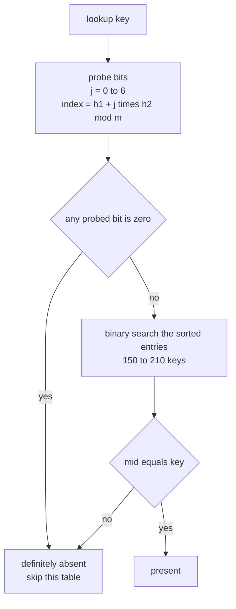
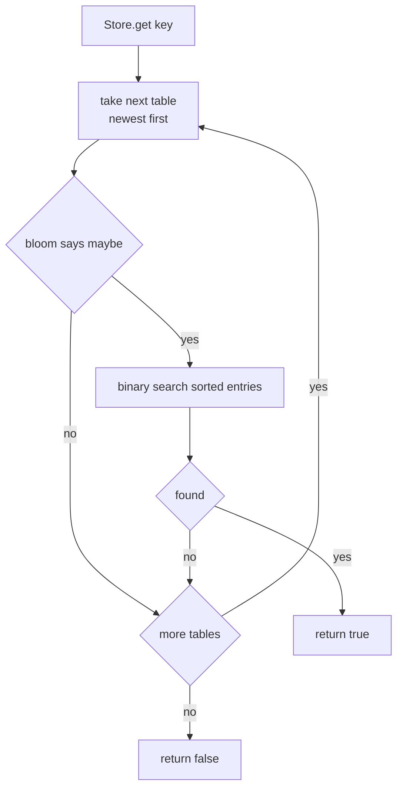
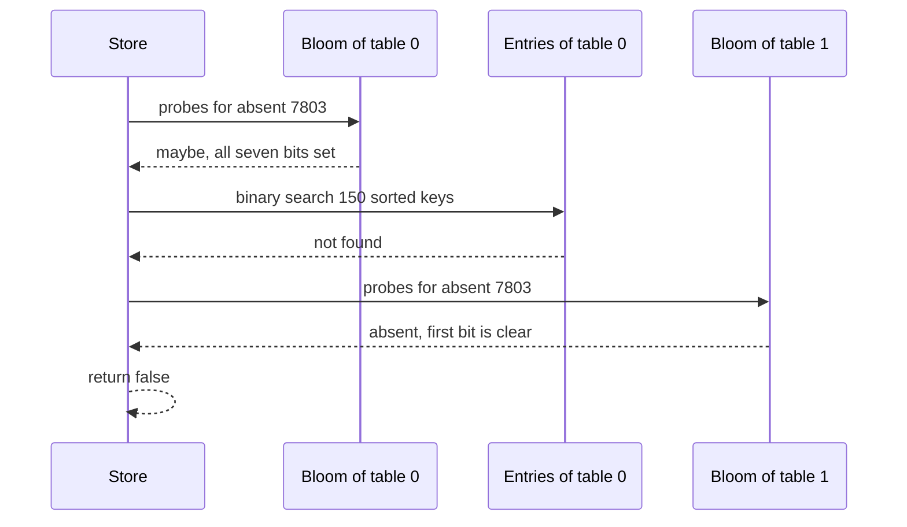

# 482 — Implement bloom filter per SSTable prototype and test.

> **Tier:** Advanced · **CTCI chapter:** Ch 14 — Databases
> **Task spec:** [482-implement-bloom-filter-per-sstable-prototype-and-test.md](../../../tasks/advanced/482-implement-bloom-filter-per-sstable-prototype-and-test.md)
> **Solutions:** [Python](../../../solutions/python/advanced/482-implement-bloom-filter-per-sstable-prototype-and-test/solution.py) ·
> [Java](../../../solutions/java/advanced/482-implement-bloom-filter-per-sstable-prototype-and-test/Solution.java) ·
> [JavaScript](../../../solutions/javascript/advanced/482-implement-bloom-filter-per-sstable-prototype-and-test/solution.js) ·
> [C#](../../../solutions/csharp/advanced/482-implement-bloom-filter-per-sstable-prototype-and-test/Solution.cs)

## 1. Problem restatement

**Input:** a set of immutable SSTables. Each table owns the sorted list of its keys plus a bloom
filter sized to 10 bits per key with `k = 7` double-hashed probes.

**Output:** a `Store.get(key)` that answers "does this key exist anywhere?" while asking each table
as little as possible:

1. Ask the table's bloom filter. A **no** is final — the key is definitely not in that table.
2. A **maybe** is confirmed with an exact binary search over the sorted entries.

Every number below is pinned by the four solution files, and all four agree byte for byte because
the construction is deterministic (FNV-1a hashing, no randomness at query time):

| Scenario | Expected |
| --- | --- |
| `BloomFilter(64, 4)` with `"alpha"` added | `maybe_contains("alpha")` is true |
| same-shaped filter with nothing added | `maybe_contains("alpha")` is false |
| 3 tables of 150 / 180 / 210 keys | bit sizes `1500`, `1800`, `2100`, all with `k = 7` |
| every inserted key (540 of them) | reported by its own filter and by `Store.get` — **zero false negatives** |
| 200 absent-key lookups drawn from the stored union | every one rejected |
| 240 distinct absent keys | per-table false positives `[2, 1, 1]`, union `4` |
| theory `p = (1 - e^(-k·n/m))^k` | `0.0082` per table, union `1 - prod(1 - p_t) = 0.0244` |
| bits actually set | `[768, 905, 1052]`, each below its `m`, so no table is saturated |

The filters are built with a deterministic rotation of the insertion order
(`rotation = seed % size`, `seed = (seed * 75 + 74) mod 65537`), so insertion order differs from
sorted order and the pinned counts are reproducible in every language.

## 2. Intuition

A store with `t` SSTables that has no filter must binary-search each table: `O(t log n)` per miss,
and misses are the common case for a key that does not exist. A hash table of every key would answer
in `O(1)` but costs a full copy of the key set — for 540 keys that is strictly more memory than the
5 400 bits the three filters use together.

The bloom filter buys most of the rejection power for a fraction of the space. It keeps one bit per
probe position and *never clears a bit*: adding a key only turns bits on, so the filter's answers
drift monotonically from "definitely not present" toward "maybe present".

- If any of the key's 7 probe bits is 0, the key was certainly never added — **no false negatives**.
- If all 7 are 1, either the key was added or 7 other keys happened to light exactly those bits — a
  false positive.

The key insight is that a false positive is *cheap but must never be trusted*: the layout pairs the
filter (a fast, lossy pre-check) with the sorted entry list (a slow, exact confirmation). The
filter only decides when to skip work, never the final answer.



Two probes are derived from one key by hashing it twice: `h1 = fnv1a(key)` and
`h2 = fnv1a(key + "!") | 1`. The `| 1` forces `h2` odd, and odd is what matters: with an odd step,
`(h1 + j·h2) mod m` keeps visiting new positions as `j` grows instead of collapsing onto a single
bit. When `m` is a power of two, an odd `h2` is also what makes the probe sequence walk *every*
index — visible in the tiny example below, where the four probes of `"alpha"` come out as
`43, 42, 41, 40`.

## 3. Algorithm

1. **Hash.** `fnv1a(text)` folds the ASCII bytes with the FNV-1a 32-bit constants
   (`h = 2166136261`, then `h ^= byte; h = (h * 16777619) and 0xFFFFFFFF`).
2. **Probe.** `probes(key)` returns `k` indices `(h1 + j · h2) mod m` for `j = 0 .. k-1`, with
   `h2` forced odd.
3. **Add.** Set bit `idx` in the byte array `words` at `words[idx >> 3]`, `1 << (idx & 7)`.
   Increment `count`.
4. **Maybe-contains.** Return false on the first probed bit that is 0; true only if all `k` bits are
   1.
5. **Build a table.** Sort the entries, allocate `bits_per_key * size` bits, add every key.
6. **Exact confirmation.** `contains_exact(key)` is a plain binary search over the sorted entries.
7. **Table lookup.** `contains(key) = maybe_contains(key) and contains_exact(key)`.
8. **Store lookup.** Return true at the first table whose `contains` is true, else false.

```text
function fnv1a(text)
    h ← 2166136261
    for each byte b of text do
        h ← h xor b
        h ← (h * 16777619) mod 2^32
    end
    return h
end

procedure probes(key)
    h1 ← fnv1a(key)
    h2 ← fnv1a(key + "!") or 1
    return [ (h1 + j * h2) mod m for j in 0 .. k - 1 ]
end

procedure add(key)
    for idx in probes(key) do
        words[idx div 8] ← words[idx div 8] or (1 shifted left by (idx mod 8))
    end
    count ← count + 1
end

function maybe_contains(key)
    for idx in probes(key) do
        if bit idx of words is 0 then
            return false
        end
    end
    return true
end

function contains(key)
    return maybe_contains(key) and contains_exact(key)
end
```

The `and` in `contains` is short-circuiting, so a filter hit that is really a false positive is the
only path that pays for the binary search. The whole point of the structure is that this path is
rare: the theoretical per-table rate is `0.0082`, and the test allows the measured rate to be up to
3× that before failing.



## 4. Worked example

**Part 1 — the tiny filter.** `BloomFilter(64, 4)`, one key `"alpha"`:

| Step | Value | Note |
| --- | --- | --- |
| `h1 = fnv1a("alpha")` | `1569418667` | FNV-1a 32-bit of the ASCII bytes |
| `h2 = fnv1a("alpha!") or 1` | `3430772799` | already odd, so `or 1` is a no-op |
| probe `j = 0` | `1569418667 mod 64 = 43` | |
| probe `j = 1` | `(1569418667 + 3430772799) mod 64 = 42` | step is `-1` mod 64 |
| probe `j = 2` | `41` | |
| probe `j = 3` | `40` | four distinct bits, added to `words` |

`maybe_contains("alpha")` re-computes the same four indices and finds all four bits set → true,
then `contains_exact` confirms it in the sorted entry list. A filter built the same way but with
nothing added finds bit 43 clear on the first probe → false, one probe instead of four. For
`"beta"` the probes are `7, 26, 45, 0`: bit 7 is clear in a filter holding only `"alpha"`, so that
query costs exactly one bit test.

**Part 2 — a real false positive.** Of the 240 absent keys, table 0 reports `2`, table 1 reports `1`
and table 2 reports `1`, and the union of the three filters reports `4`. Trace `absent:7803` through
table 0, which holds 150 keys with `m = 1500`, `k = 7`:

| Step | Result |
| --- | --- |
| probe indices | `1252, 1435, 118, 301, 484, 667, 850` (step `183`) |
| bit check | all seven are already set by other keys (768 of 1500 bits are on) |
| `maybe_contains` | **true** — a false positive |
| `contains_exact` | binary search over `t0:0 … t0:99` finds no `absent:7803` → **false** |
| `Store.contains` | false, so the next table is asked |
| `Store.get` | tables 1 and 2 reject it on their first probe → the store returns **false** |

The estimate explains why the counts are this small. With `n` keys, `m = 10n` bits and `k = 7`,
the fraction of bits still 0 after insertion is `e^(-k·n/m) = e^(-0.7) ≈ 0.4966`, so
`p = (1 - 0.4966)^7 ≈ 0.0082` per table. Four false positives out of 240 queries is `0.0167` per
query, comfortably inside the allowed `3p + 3` slack, and the union estimate for three tables is
`1 - (1 - 0.0082)^3 ≈ 0.0244`.



The 540 present keys take the other branch and the assertions confirm the strong invariant: for
every one of them, `table.bloom.maybe_contains(key)` is true and `Store.get(key)` is true. The
filter never lies about a key that was inserted.

## 5. Complexity

Let `n` be the keys in a table, `m` its bit count, `k` the probe count and `t` the table count.

| Measure | Bound | Why it holds |
| --- | --- | --- |
| Time, add one key | O(k + len(key)) | one hash of the key, one of `key + "!"`, then `k` bit sets |
| Time, filter query | O(k + len(key)) | `k` bit tests, no early exit only when all bits are set |
| Time, missed table | O(k + len(key)) | the filter answers no; the sorted list is never touched |
| Time, confirmed hit | O(k + log n) | filter plus binary search over the sorted entries |
| Time, `Store.get` on an absent key | O(t·(k + len(key)) + false positives · log n) | every table is asked, but almost all reject at the first bit |
| Space, filter | `m = 10n` bits = O(n) | 1.25 bytes per key, versus a stored copy of the key for a hash set |
| Space, table | O(n log n) bits of keys | the sorted entries themselves dominate the filter |
| False-positive rate | `p = (1 - e^(-k·n/m))^k ≈ 0.0082` | closed form from the spec header; with `m = 10n`, `k = 7` the exponent is `-0.7` |
| Union rate | `1 - prod(1 - p_t) ≈ 0.0244` | independence across the three tables |

The alternative — no filter at all — costs `O(t log n)` per miss with no filter memory, but it does
the binary search for every absent key instead of for `0.8%` of them. The other alternative, a hash
set of every key, answers exactly in `O(1)` but stores every key in full; the filter trades a
`0.8%` chance of a wasted binary search for a 10-bits-per-key footprint.

## 6. Pitfalls and edge cases

- **Never clear a bit.** The filter is append-only; a "remove" operation would have to clear bits
  that other keys also set, breaking the no-false-negatives guarantee. The test asserts
  `maybe_contains` for all 540 inserted keys precisely to catch that mistake.
- **`h2` must be odd.** `| 1` guarantees it. An even `h2` can collapse the probe sequence onto a
  handful of positions when the bit count shares factors with `h2`, which hurts the rate and, in the
  worst case, wastes probes on one bit.
- **False positives must not answer the query.** `contains` is
  `maybe_contains and contains_exact`; dropping the binary search would turn the four pinned false
  positives into wrong answers.
- **Saturation kills the filter's value.** If the bit array fills, every query returns "maybe" and
  the structure degenerates to a full binary search. The test asserts the set-bit counts
  `[768, 905, 1052]` are each strictly below `m`, so no table is saturated.
- **Empty filter.** A fresh `BloomFilter(64, 4)` rejects `"alpha"` on the first probe. The
  hand-written case asserts this, because a buggy probe loop that returns no indices would make an
  empty filter claim everything.
- **Sizing is per table.** `SSTable` allocates `bits_per_key * len(entries)`, which is why the three
  tables get `1500 / 1800 / 2100` bits rather than one shared filter. Sharing one filter for all
  keys would be *smaller* but answer the same way for every table, losing the per-table rejection
  that makes LSM lookups cheap.
- **Non-ASCII keys.** `fnv1a` folds `key.encode("ascii")`, so a non-ASCII key raises in Python
  instead of silently hashing some other byte sequence. The Java/C#/JS ports iterate UTF-16 code
  units, which agree with ASCII input and would not agree with UTF-8 beyond it.
- **Insertion order does not matter.** The build rotates the key order before inserting so sorted
  order and insertion order differ; the pinned false-positive counts come out identical, which the
  test relies on.
- **The measurement is deterministic.** The absent keys are generated by an LCG
  (`seed = (seed * 75 + 74) mod 65537`, then `mod 65537`), so `[2, 1, 1]` and `4` are exact
  expectations rather than statistical hopes; the 3×-theory bound is the safety net around them.

## 7. Variants and follow-ups

- **Composing it with a count-min sketch.**
  [493-implement-probabilistic-data-structure-composition-bloom-cmsketc.md](../../../tasks/advanced/493-implement-probabilistic-data-structure-composition-bloom-cmsketc.md)
  pairs the membership filter with a frequency estimator, so one structure answers "in the set?" and
  the other answers "how often?".
- **Where the filter sits in a storage engine.**
  [484-implement-simple-key-value-store-with-memtable-sstable.md](../../../tasks/advanced/484-implement-simple-key-value-store-with-memtable-sstable.md)
  builds the memtable and SSTable layout this prototype sketches, with tombstones instead of filters
  as the mechanism that hides older data.
- **Durability around the table.** [481-implement-optimistic-checkpointing-restart-simulation.md](../../../tasks/advanced/481-implement-optimistic-checkpointing-restart-simulation.md)
  covers what happens to the in-memory part when the process dies before a flush.
- **Choosing `k`.** The number of probes is a knob: too few and the filter admits too much, too many
  and the bits fill up. With 10 bits per key the optimum sits near 7, which is why the header
  documents `k = 7` and the tests pin that value.

## 8. Check yourself

**Q1.** Why can a bloom filter never report a false negative?

<details><summary>Show answer</summary>

Because `add` only turns bits on and nothing ever clears them. If a key was inserted, then at the
time of insertion all `k` of its probe bits were set, and they stay set forever. A query that finds
any of them clear proves the key was never inserted.
</details>

**Q2.** `absent:7803` passes table 0's filter but the store still returns false. Which code path
handles that, and what does it cost?

<details><summary>Show answer</summary>

`contains` evaluates `maybe_contains(key) and contains_exact(key)`. The filter returned true, so the
binary search runs over the 150 sorted keys of `t0:…`, finds nothing, and `get` moves on to table 1,
whose filter rejects on the first probe. The false positive costs one `O(log n)` search, never a
wrong answer.
</details>

**Q3.** The three filters hold 1 500, 1 800 and 2 100 bits, and the inserted keys number 540. Why is
the total bit count not `10 · 540 = 5400` in a single array?

<details><summary>Show answer</summary>

Sizing is per table: `bits_per_key * len(entries)`, so table bit counts are
`10 · 150 = 1500`, `10 · 180 = 1800` and `10 · 210 = 2100` — the total is 5 400, but split three
ways. Keeping one filter per table is what lets `Store.get` skip a table without searching it;
after a compaction (see task 484) the surviving table would get a single filter sized to its own key
count.
</details>

**Q4.** What does the assertion `set_bits[i] < m` protect against?

<details><summary>Show answer</summary>

Saturation. The measured set-bit counts are `[768, 905, 1052]` for `m = 1500 / 1800 / 2100`, so
roughly half the bits are still 0 and the filters still reject most absent keys. If a bug had made
the filters fill up, `maybe_contains` would answer true for everything, the false-positive counts
would jump far above `[2, 1, 1]`, and the 3×-theory assertion would fail.
</details>

**Q5.** The per-table estimate is `0.0082` but the union estimate is `0.0244`. Why is the union
larger than any single table's rate?

<details><summary>Show answer</summary>

`Store.get` returns true if *any* table's filter answers maybe and confirms. The union of three
independent-ish events has probability `1 - prod(1 - p_t) = 1 - (1 - 0.0082)^3 ≈ 0.0244`, roughly
three times the single-table rate. That matches the pinned union count of 4 false positives out of
240 queries.
</details>
