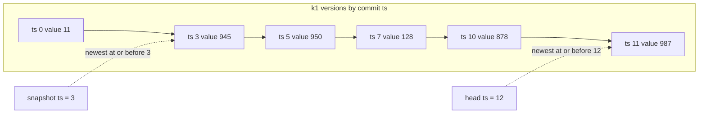
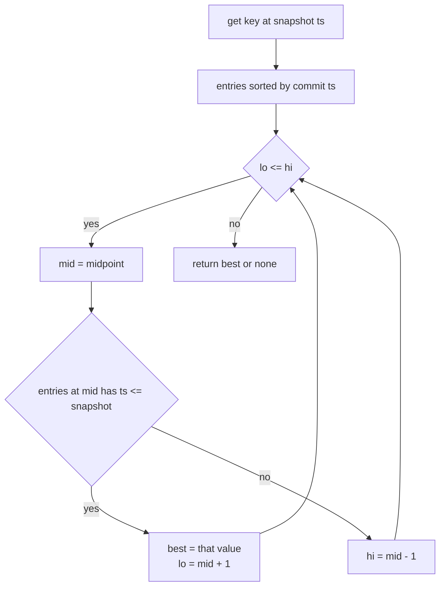
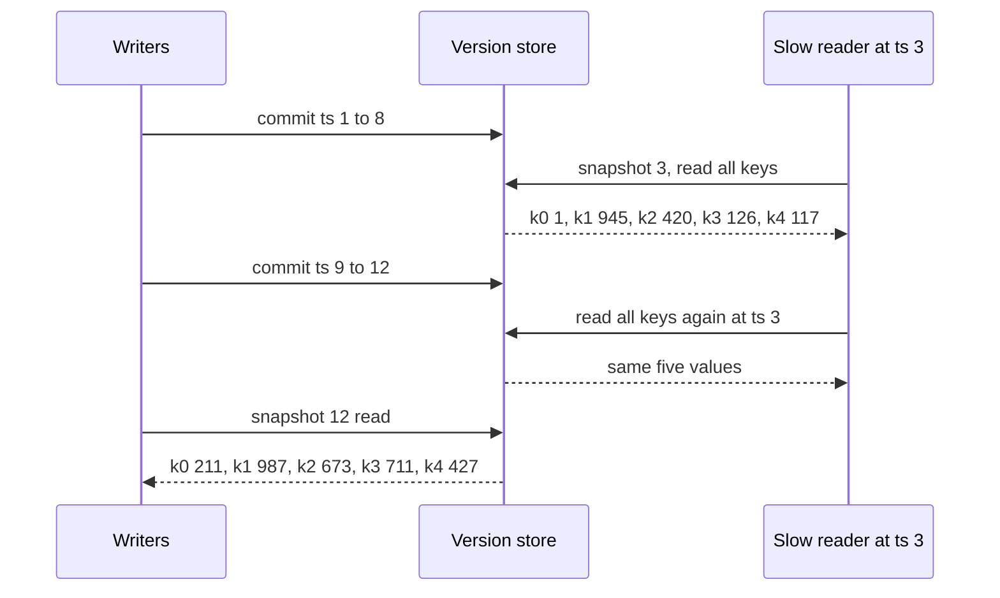

# 483 — Implement consistent snapshot retrieval using MVCC.

> **Tier:** Advanced · **CTCI chapter:** Ch 14 — Databases
> **Task spec:** [483-implement-consistent-snapshot-retrieval-using-mvcc.md](../../../tasks/advanced/483-implement-consistent-snapshot-retrieval-using-mvcc.md)
> **Solutions:** [Python](../../../solutions/python/advanced/483-implement-consistent-snapshot-retrieval-using-mvcc/solution.py) ·
> [Java](../../../solutions/java/advanced/483-implement-consistent-snapshot-retrieval-using-mvcc/Solution.java) ·
> [JavaScript](../../../solutions/javascript/advanced/483-implement-consistent-snapshot-retrieval-using-mvcc/solution.js) ·
> [C#](../../../solutions/csharp/advanced/483-implement-consistent-snapshot-retrieval-using-mvcc/Solution.cs)

## 1. Problem restatement

**Input:** a multi-version key/value store. Every key holds the full list of `(commit_ts, value)`
versions ever written for it, appended in commit order. A transaction commits by stamping all of
its writes with one shared timestamp.

**Output:** a read that returns the state of the whole store **as of one instant**:

- `get(key, snapshot_ts)` returns the newest version of `key` with `commit_ts <= snapshot_ts`, or
  `None` if no such version exists.
- `snapshot(ts)` packages that timestamp into a reader object whose `get(key)` always uses `ts`.
- `head_ts()` is the newest commit timestamp in the store.

The documented semantics, taken from the solution headers: because one transaction stamps all of its
writes with the same `ts`, a snapshot never observes a torn transaction — it sees every key of the
transaction or none of it.

The scripted history is deterministic: base versions at `ts = 0`, then 12 LCG-driven transactions at
`ts = 1 .. 12`, each writing `1 + t mod 2` keys (so 1 or 2, alternating) for 18 writes in all.

| Scenario | Expected |
| --- | --- |
| history length / transaction count | `5 + 18 = 23` records, `13` groups with `transactions[0][0] = 0` |
| slow reader at `ts = 3`, opened after commits `1..8` | reads `k0:1, k1:945, k2:420, k3:126, k4:117` |
| same reader after commits `9..12` land | **identical** values to the first read |
| each of those values | equal to the brute-force oracle scan of the raw history |
| `head_ts()` | `12`, and a fresh snapshot at 12 reads `k0:211, k1:987, k2:673, k3:711, k4:427` |
| `versions` per key | `{"k0": 3, "k1": 6, "k2": 4, "k3": 3, "k4": 7}`, sum `23` |
| every `(key, ts)` for `ts = -1 .. 13` | matches the oracle, including `None` for `ts = -1` |

The four files assert snapshot isolation against an oracle (`oracle_value`, a linear scan for the
last record with `ts <= snapshot`), read-your-writes at every transaction boundary, and that writers
keep committing while the slow reader is open.

## 2. Intuition

The naive design overwrites a key in place. Then a long-running reader that reads `k0` early and
`k4` later can mix state from two different moments — exactly the anomaly a consistent snapshot must
prevent. Locking every key for the duration of the read would fix it by freezing writers, which the
spec explicitly rules out ("writers are never blocked or hidden").

Multi-version storage fixes it without locks: keep *every* version and tag each with the timestamp
of the commit that produced it. A read then becomes a search problem rather than a locking problem —
"give me the last version at or before my snapshot timestamp". Old versions stay readable, so a slow
reader is simply one that keeps using an old timestamp, and new writers append rather than overwrite.

The key insight is the **shared timestamp**. If each write got its own timestamp, a reader could
still pair one key from before a transaction with another key from after it. Because a transaction
stamps all of its writes with one `ts`, the cut "at or before `s`" falls between transactions, never
inside one. Consistency of the whole snapshot follows from that single stamping rule.



A second insight makes the search cheap: versions for a key are appended in commit order, and commit
timestamps are non-decreasing, so each key's list is **sorted by `ts`**. Finding the newest version
at or before the snapshot is therefore a binary search, not a scan. The oracle in the tests does the
linear scan on purpose — it is the reference the binary search is checked against.

## 3. Algorithm

1. **Initialise.** `versions[key] = []` for every key; `commit_count = 0`.
2. **Commit.** For each `(key, value)` of the transaction, append `(ts, value)` to `versions[key]`;
   one stamp for the whole transaction. Increment `commit_count`.
3. **Point read.** Binary search the key's version list for the last entry with `commit_ts <= s`:
   keep a `best` as you go, move right while the condition holds, left otherwise.
4. **Snapshot.** `snapshot(ts)` returns a reader that remembers `ts` and forwards every `get(key)`
   to step 3 with that same `ts`.
5. **Head.** `head_ts()` is the maximum timestamp over all versions, or `0` when the store is empty.

```text
function get(key, snapshot_ts)
    entries ← versions[key]
    lo ← 0
    hi ← length(entries) - 1
    best ← none
    while lo <= hi do
        mid ← (lo + hi) div 2
        if entries[mid].ts <= snapshot_ts then
            best ← entries[mid].value
            lo ← mid + 1
        else
            hi ← mid - 1
        end
    end
    return best
end

procedure commit(ts, writes)
    for each (key, value) in writes do
        versions[key] ← versions[key] + [ (ts, value) ]
    end
    commit_count ← commit_count + 1
end

function snapshot(ts)
    return reader that answers get(key) with get(key, ts)
end
```

The loop is a standard "last index satisfying a predicate" binary search. It never stops early on an
exact match, because it is looking for the *newest* version at or before `s`, and a later version
may still qualify. Returning `none` when no version qualifies is what makes a snapshot before the
first commit read as an empty store.



## 4. Worked example

The scripted history for seed 483 is fixed, so the trace is exact. Base versions at `ts = 0`:
`k0:1, k1:11, k2:21, k3:31, k4:41`.

| ts | writes | live state after commit |
| --- | --- | --- |
| 1 | `k2:244`, `k4:117` | both stamped 1 |
| 2 | `k3:126` | single-key transaction |
| 3 | `k1:945`, `k2:420` | both stamped 3 — **one atomic cut** |
| 4 | `k4:330` | |
| 5 | `k1:950`, `k4:694` | |
| 6 | `k0:657` | |
| 7 | `k3:711`, `k1:128` | |
| 8 | `k4:616` | |

A reader opens at `ts = 3` after commits `1..8` exist and reads every key. The version lists it
searches are:

- `k0`: `[(0,1), (6,657), (11,211)]`
- `k1`: `[(0,11), (3,945), (5,950), (7,128), (10,878), (11,987)]`
- `k2`: `[(0,21), (1,244), (3,420), (9,673)]`
- `k3`: `[(0,31), (2,126), (7,711)]`
- `k4`: `[(0,41), (1,117), (4,330), (5,694), (8,616), (9,694), (12,427)]`

For `k1` the binary search walks `lo = 0, hi = 5`: `mid = 2` holds `ts = 5 > 3` so `hi = 1`;
`mid = 0` holds `ts = 0 <= 3` so `best = 11, lo = 1`; `mid = 1` holds `ts = 3 <= 3` so
`best = 945, lo = 2`; `lo > hi`, stop. The snapshot reads `k1 = 945` — the version written by
transaction 3, not the newer one at `ts = 5`.

| Key | Snapshot `ts = 3` | Reader's read after `ts = 12` | Fresh snapshot `ts = 12` |
| --- | --- | --- | --- |
| `k0` | `1` | `1` | `211` |
| `k1` | `945` | `945` | `987` |
| `k2` | `420` | `420` | `673` |
| `k3` | `126` | `126` | `711` |
| `k4` | `117` | `117` | `427` |

The middle column is the whole point: commits 9 through 12 land while the reader is open
(`k2:673`, `k4:694`, `k1:878`, `k1:987`, `k0:211`, `k4:427`), and the reader still sees the `ts = 3`
state. The right column shows the writers did move the store — the test asserts that at least one
key differs between the snapshot and the head.

Torn transactions are excluded structurally. Transaction 3 wrote `k1` and `k2` under the same stamp,
so the snapshot reads `k1 = 945` and `k2 = 420` together; no snapshot can ever see one of those pair
matches without the other. The read-your-writes check pins the boundary from both sides:
`snapshot(3)` sees `945` and `420`, while `snapshot(2)` still sees `k1 = 11`, `k2 = 244`.



The exhaustive sweep backs this up for every cut, not just this one: for each key and each
`ts = -1 .. 13`, `store.get(key, ts)` must equal the oracle's linear scan. At `ts = -1` all five keys
are `None`, because even the base versions at `ts = 0` are newer than the snapshot.

## 5. Complexity

Let `V` be the number of versions of a key, `K` the number of keys and `W` the writes in a
transaction.

| Measure | Bound | Why it holds |
| --- | --- | --- |
| Time, commit (point read) | O(log V) | binary search over the key's version list, which is sorted by `ts` |
| Time, full snapshot read | O(K log V) | one binary search per key, with `K = 5` in the scripted store |
| Time, commit (write) | O(W) | one append per write, plus O(1) for the counter |
| Time, `head_ts` | O(K · V) | scans every version list for the maximum; the tests call it once |
| Space | O(K · V) | every version is retained, and the per-key counts are pinned at `3, 6, 4, 3, 7` for 23 records |
| Oracle comparison | O(K · V) per read | the brute-force scan of raw history the binary search must match |
| Readers blocked | none | reads never take a lock; a reader is just an old timestamp |

The table shows the central trade-off of MVCC: reads get a consistent, lock-free view at the price
of retaining history. Keeping all 23 records is fine here, but in a real engine versions must be
reclaimed once no reader can still need them — that is garbage collection against the oldest live
snapshot. Compared with the alternative of locking keys for the duration of a read, this turns a
waiting cost on writers into a storage cost, which is why the header can promise that writers are
never blocked or hidden.

## 6. Pitfalls and edge cases

- **Snapshot older than everything.** For `ts = -1` none of the base versions at `ts = 0` qualify, so
  `get` returns `None` for all five keys. The sweep includes `-1` explicitly; returning the oldest
  version "for convenience" would be wrong.
- **Timestamp cutoff is inclusive.** The condition is `commit_ts <= snapshot_ts`, which is what makes
  read-your-writes work: a snapshot taken exactly at a transaction's `ts` sees that transaction, and
  a snapshot one step earlier sees the previous state for the same keys.
- **Same value committed twice.** `k4` is written `694` at `ts = 5` and again `694` at `ts = 9`, and
  the store keeps both entries. Versions are keyed by timestamp, not by value, so de-duplicating
  equal values would break the ordering the binary search relies on.
- **Sorted lists are load-bearing.** `get` is a binary search, so versions for one key must be
  appended in non-decreasing `ts` order. Committing an old timestamp after a newer one (a
  backdated write) would silently break the search.
- **Deletes are not modelled.** The spec has no tombstone, so an absent key and a not-yet-written key
  are indistinguishable — both read as `None`. Task 484 shows the tombstone mechanism that
  distinguishes them.
- **Torn transactions are prevented by one stamp per transaction.** If each write got its own
  timestamp, a snapshot could see half a transaction. The test checks that every transaction writes
  `1` or `2` distinct keys at one shared `ts`, and validates each write against the oracle.
- **`head_ts` on an empty store.** The default is `0`; the tests never build an empty store, but a
  reader at `head_ts()` of an empty store must still work because `get` returns `None` for any `ts`
  below the first commit.
- **Writers are not starved.** After the slow reader finishes, two more commits (`ts = 13` with
  `k0:777`, `ts = 14` with `k1:888`) succeed immediately and `commit_count` grows by two; the older
  snapshots `ts = 12` and `ts = 13` still see the pre-commit values.

## 7. Variants and follow-ups

- **Deletes and shadowing.**
  [484-implement-simple-key-value-store-with-memtable-sstable.md](../../../tasks/advanced/484-implement-simple-key-value-store-with-memtable-sstable.md)
  adds tombstones to a write path, which is the storage half of what a versioned store does in
  memory.
- **Crash recovery around committed state.**
  [481-implement-optimistic-checkpointing-restart-simulation.md](../../../tasks/advanced/481-implement-optimistic-checkpointing-restart-simulation.md)
  covers what survives a restart when the newest writes have no durable home yet.
- **Skipping tables instead of searching them.**
  [482-implement-bloom-filter-per-sstable-prototype-and-test.md](../../../tasks/advanced/482-implement-bloom-filter-per-sstable-prototype-and-test.md)
  is the complementary read-side trick: one structure makes a lookup cheap when the key is absent,
  the other makes it consistent when the key has many versions.
- **Interval snapshots instead of per-commit versions.** Keeping one version per `interval` of
  commits is a space-saving approximation of the same idea; the checkpoint slot in task 481 is a
  single-version special case.

## 8. Check yourself

**Q1.** Why does the reader at `ts = 3` keep returning `k1 = 945` after commits 9–12 land?

<details><summary>Show answer</summary>

Because `k1`'s version list keeps the `ts = 3` entry. `get("k1", 3)` binary-searches for the newest
entry with `commit_ts <= 3`, and the entries at `ts = 5, 7, 10, 11` are all newer, so `945` remains
the answer. The reader never consults the head of the store.
</details>

**Q2.** What makes it impossible for a snapshot to see half of transaction 3?

<details><summary>Show answer</summary>

Both writes of transaction 3 (`k1:945`, `k2:420`) carry the same `commit_ts = 3`. The cutoff
`commit_ts <= s` is therefore decided once for both keys: a snapshot with `s < 3` misses both, and
one with `s >= 3` sees both. There is no `s` that catches only one of them.
</details>

**Q3.** The version counts are `3, 6, 4, 3, 7` and sum to 23. What does that number measure?

<details><summary>Show answer</summary>

Every retained version: 5 base records at `ts = 0` plus 18 writes spread over 12 transactions
(`1 + t mod 2` writes each), i.e. `5 + 18 = 23`. `k1` has the most versions at 6 and `k0`/`k3` the
fewest at 3, which is what the non-uniform LCG key choice produces.
</details>

**Q4.** Why is `contains`-style early exit wrong in the binary search for a snapshot?

<details><summary>Show answer</summary>

The search wants the *newest* matching version, not any matching version. Stopping at the first
entry with `commit_ts <= s` could return an old value while a newer qualifying version sits to the
right — and entries to the right can legitimately share the same `ts`. So the loop records the
candidate in `best` and keeps moving `lo` right, narrowing toward the last qualifying index.
</details>

**Q5.** What does the oracle comparison add beyond reading the values in the scripted case?

<details><summary>Show answer</summary>

It checks the *rule*, not one example. For each key and each `ts` from `-1` to `13` the store's
binary-search answer must equal a linear scan of the raw commit history. That covers cuts that no
scripted read touches, including `ts` values with no commit at all and `ts = -1`, where the correct
answer is `None`.
</details>
