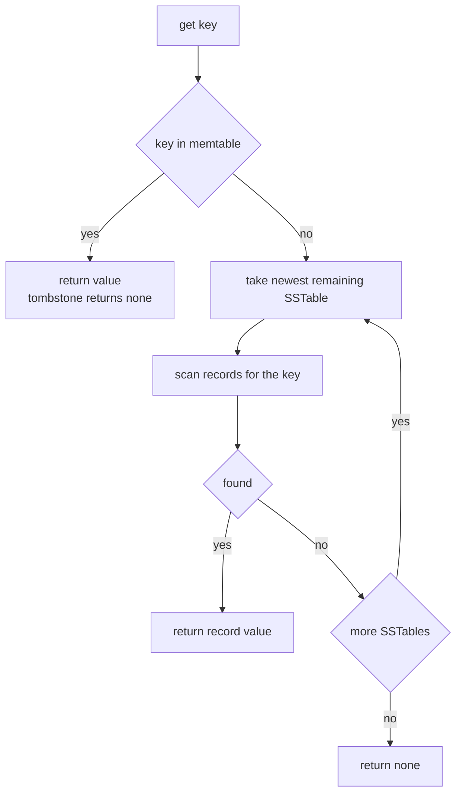
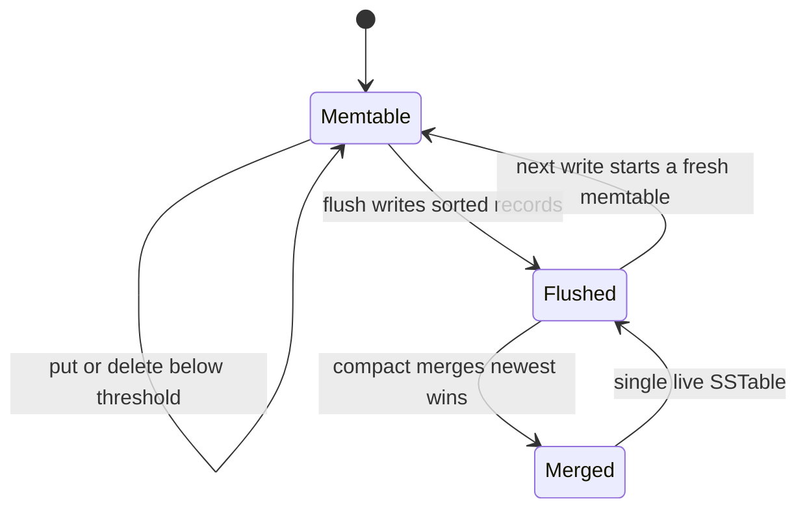

# 484 — Implement simple key-value store with memtable + SSTable.

> **Tier:** Advanced · **CTCI chapter:** Ch 14 — Databases
> **Task spec:** [484-implement-simple-key-value-store-with-memtable-sstable.md](../../../tasks/advanced/484-implement-simple-key-value-store-with-memtable-sstable.md)
> **Solutions:** [Python](../../../solutions/python/advanced/484-implement-simple-key-value-store-with-memtable-sstable/solution.py) ·
> [Java](../../../solutions/java/advanced/484-implement-simple-key-value-store-with-memtable-sstable/Solution.java) ·
> [JavaScript](../../../solutions/javascript/advanced/484-implement-simple-key-value-store-with-memtable-sstable/solution.js) ·
> [C#](../../../solutions/csharp/advanced/484-implement-simple-key-value-store-with-memtable-sstable/Solution.cs)

## 1. Problem restatement

**Input:** a sequence of `put(key, value)`, `get(key)` and `delete(key)` operations.

**Output:** an LSM-style store with the semantics the solution headers document:

- Writes land in an in-memory **memtable** (`key -> value`). A delete writes a **tombstone** marker
  into the memtable instead of removing anything.
- When the memtable reaches `flush_threshold` entries it **flushes** to a new immutable **SSTable**:
  the records are written sorted by key and appended to the table list, oldest first.
- `get(key)` probes the memtable, then the SSTables **from newest to oldest**, and the first record
  for the key wins. A tombstone means "deleted" (returns `None`) and must shadow older values in
  older SSTables — that is what makes deletes correct without rewriting data.
- `compact()` flushes the memtable, merges all SSTables newest-wins into a single one, and drops
  tombstones plus every record they shadow, so the result holds exactly the live keys.

Every expectation below is asserted by all four files:

| Scenario | Expected |
| --- | --- |
| hand case: `put a=1`, `put b=2` with `flush_threshold = 2` | `flushes == 1`, memtable empty, three SSTables after the next flushes |
| `delete b` then `get b` | `None` (the memtable tombstone answers first) |
| after compacting the hand case | `sstables == [[("a", 5)]]`, `compactions == 1` |
| compacting again | identical layout — idempotent |
| 240 LCG-driven ops over `k0..k11` | `get` equals the oracle after **every** operation |
| op counts | `84` gets, `71` deletes, so `85` puts |
| flush / compaction counts | `flushes == 35`, `compactions == 4` |

The oracle is a plain dictionary of live keys (`Oracle.put`, `Oracle.delete`, `Oracle.get`), which
never sees a tombstone, a memtable or an SSTable; it exists purely to define the right answer.

## 2. Intuition

The naive store is a dictionary: perfect until it must survive a restart, at which point the whole
thing has to be written somewhere. Rewriting the whole dictionary on every write is quadratic, and
updating files in place is how databases corrupt themselves after a crash.

The LSM shape solves both problems by never modifying what has been written:

1. writes go to memory and are cheap,
2. memory is spilled, once, as a **sorted immutable file**,
3. reads look in memory first and then walk the spill list **newest first**,
4. `compact` periodically rewrites the live set into one file and reclaims space.

The one hard part is deletes. An immutable file cannot have a record removed from it, so a delete
must instead write something *stronger* than the old value — a **tombstone** — into a newer place.
During a read, the tombstone is found before the old value because newer stores are probed first,
and it answers "deleted", hiding the stale record behind it.

The key insight is that **newest-wins is the entire correctness argument**. A read is just "find the
first record for this key in the newest-to-oldest order", and both memtable-first probing and
compaction's merge order are instances of that same rule.


Reading the picture right to left is the read path: newest data is closest to the writer, and an
older record only gets consulted when nothing newer mentions the key.

## 3. Algorithm

1. **Put.** `memtable[key] = value`; if the memtable now holds `flush_threshold` entries, flush.
2. **Delete.** `memtable[key] = TOMBSTONE`; same flush check. Nothing is removed from disk.
3. **Flush.** If the memtable is empty, do nothing. Otherwise emit `sorted(memtable.items())` as a
   new record list appended to the end of the SSTable list (oldest first) and replace the memtable
   with an empty one; increment `flushes`.
4. **Get.** If the key is in the memtable, return that value immediately (it may be a tombstone, in
   which case the answer is `None`). Otherwise walk the SSTables from newest to oldest and return
   the value of the first record whose key matches — again possibly a tombstone.
5. **Compact.** Flush first, then merge: walk the SSTables newest to oldest and keep the first value
   seen per key; drop tombstones and everything they shadow; replace the table list with the single
   sorted live set (or an empty list if nothing is live); increment `compactions`.

```text
procedure put(key, value)
    memtable[key] ← value
    maybe_flush()
end

procedure delete(key)
    memtable[key] ← TOMBSTONE
    maybe_flush()
end

procedure maybe_flush()
    if size(memtable) >= flush_threshold then
        flush()
    end
end

procedure flush()
    if memtable is empty then
        return
    end
    sstables ← sstables + [ sorted(memtable as list of pairs) ]
    memtable ← empty table
    flushes ← flushes + 1
end

function get(key)
    if key in memtable then
        return memtable[key]
    end
    for records in sstables from newest to oldest do
        for (rkey, value) in records do
            if rkey = key then
                return value
            end
        end
    end
    return none
end

procedure compact()
    flush()
    newest ← empty table
    for records in sstables from newest to oldest do
        for (key, value) in records do
            if key not in newest then
                newest[key] ← value
            end
        end
    end
    live ← sorted pairs of newest where value is not TOMBSTONE
    sstables ← [ live ] if live is non-empty else empty list
    compactions ← compactions + 1
end
```

Two details carry the semantics. `newest[key]` is only assigned when the key is **absent**, so the
iteration order (newest first) is what implements newest-wins. And the `is not TOMBSTONE` filter
runs after the merge, which is why a tombstone and the value it shadows disappear together.



## 4. Worked example

**Hand case**, `flush_threshold = 2`:

| Step | Op | Memtable after | SSTables after (oldest first) | `get` results |
| --- | --- | --- | --- | --- |
| 1 | `put("a", 1)` | `{a: 1}` | `[]` | — |
| 2 | `put("b", 2)` | `{}` (flushed) | `[[(a,1),(b,2)]]` | — |
| 3 | `get("a")`, `get("b")` | `{}` | unchanged | `1`, `2` |
| 4 | `put("a", 5)` | `{a: 5}` | unchanged | — |
| 5 | `flush()` | `{}` | `[[(a,1),(b,2)], [(a,5)]]` | — |
| 6 | `delete("b")` | `{b: TOMBSTONE}` | unchanged | `get("b")` → `None` |
| 7 | `flush()` | `{}` | `[[(a,1),(b,2)], [(a,5)], [(b,TOMBSTONE)]]` | `get("a")` → `5`, `get("b")` → `None` |
| 8 | `compact()` | `{}` | `[[(a,5)]]` | `get("a")` → `5`, `get("b")` → `None` |

Row 6 is where the tombstone earns its keep: `b` is not in the memtable after the flush at row 7,
yet `get("b")` returns `None` rather than the stale `2`, because the newest table mentions `b` and
its record is a tombstone. The test pins both sides of that with the record-level helper:
`find_record([sstables[-1]], "b")` is the tombstone while `find_record([sstables[0]], "b")` is still
`2` — the old value is physically present and logically invisible.

Row 8 shows compaction cleaning up exactly that pair: the merge takes `a = 5` from the middle table
and `b = TOMBSTONE` from the newest, keeps the first value per key, and then drops `b` because it is
a tombstone — which also drops the `b = 2` it was hiding. The result `[[(a, 5)]]` holds one record
per live key and no tombstones, and a second `compact()` reproduces it unchanged.



**Randomized case.** The script drives 240 operations from the LCG
(`seed = (seed * 75 + 74) mod 65537`, then `kind = seed mod 3`, `key = seed mod 12`,
`value = seed mod 1000`) with `flush_threshold = 4`, and after **every** step it re-reads all 12 keys
and compares against the oracle. The pinned totals are `84` gets, `71` deletes (so `85` puts),
`35` flushes and `4` compactions, one every 60 steps.

| Observation | Value | Why |
| --- | --- | --- |
| distinct stores probed per `get` | memtable, then up to 35 tables | a key can hide in any of them until a compaction merges them |
| flushes | `35` for `85 + 71 = 156` memtable writes | the threshold counts *distinct keys*, so repeated puts to one key do not trigger a flush |
| compactions | `4` in-loop plus 1 after | the script compacts when `step mod 60 == 59`, then flushes and merges at the very end |
| final layout | one SSTable equal to the sorted live oracle entries | after the last compaction, every tombstone and shadowed value is gone |

The oracle comparison is what makes this a real test: 240 operations create interleavings where a
value for a key sits in the memtable, in a middle SSTable, and behind a tombstone in the newest one
at the same time. Correct newest-first probing is the only way all 12 probes match at every step.

## 5. Complexity

Let `R` be the total records on disk, `t` the number of SSTables, `B` the batch flushed (roughly
`flush_threshold` distinct keys) and `K` the number of live keys.

| Measure | Bound | Why it holds |
| --- | --- | --- |
| Time, `put` / `delete` | O(1) amortised, O(t · B log B) when a flush fires | one table insert; a flush sorts the small batch |
| Time, `flush` | O(B log B) | sorts the memtable's distinct keys |
| Time, `get` (miss) | O(t + R) worst case | the naive scan walks every table's records; the spec's prototype makes no index |
| Time, `get` (hit in memtable) | O(1) | the memtable is a dictionary |
| Time, `compact` | O(R log R) | a flush plus a newest-wins merge of all records and one sort of the live set |
| Space | O(R + B) | every record is retained, including tombstones, plus the in-memory batch |
| Space after compaction | O(K) | tombstones and shadowed values are dropped, so the result is exactly the live keys |
| Number of flushes | O(total writes / distinct keys per batch) | a flush needs `flush_threshold` distinct keys, which is why 156 writes gave 35 flushes |

The obvious upgrade is to give each SSTable a sorted index and binary-search it — the exact search
step that [482-implement-bloom-filter-per-sstable-prototype-and-test.md](../../../tasks/advanced/482-implement-bloom-filter-per-sstable-prototype-and-test.md)
implements, where a bloom filter first skips tables that cannot contain the key. That turns the miss
path from `O(R)` into `O(t log B)` plus a small number of false-positive searches, which is the
reason real engines pair the two.

## 6. Pitfalls and edge cases

- **A tombstone must not be "no record".** `get` distinguishes a missing key from a tombstone only by
  the value it finds: the tombstone is stored as `None`/`null` and returned, which the caller reads
  as deleted. Removing the record instead of writing a tombstone would resurrect the older value in
  the next SSTable.
- **Newest-first is required, not optional.** Iterating `sstables` in append order would let the
  stale `b = 2` win over the tombstone. The same order governs the compaction merge, where
  `if key not in newest` is what picks the newest value.
- **Compaction must drop tombstones *and* what they shadow.** The merge collects the newest value
  per key, then the `is not TOMBSTONE` filter removes the marker; because the marker came first in
  the merge, the value it hid never made it into the result.
- **Compaction is idempotent.** Running it twice on the hand case yields `[[(a, 5)]]` both times, and
  the randomized case asserts the same for the final state. A compaction that appended instead of
  replacing the table list would grow the store.
- **Flushing an empty memtable is a no-op.** `compact()` calls `flush()` unconditionally, so a store
  with an empty memtable must not emit an empty SSTable; the early return is what keeps the
  post-compaction layout at exactly one table.
- **The threshold counts distinct keys.** `put` overwrites the dictionary entry, so 156 memtable
  writes produced only 35 flushes. Counting *operations* instead of entries would flush far more
  often than the pinned number.
- **Deleting a key that was never written.** The tombstone is written anyway and `get` returns
  `None`; the oracle's `delete` is `pop(key, None)`, so both agree. The tombstone simply has nothing
  to shadow.
- **Reads during a flush.** The memtable is replaced by an empty one only after its records are
  appended, so a reader that probes the memtable first and the tables second never misses a record
  that was in flight.
- **Unicode and key ordering.** Records are sorted with the language's default string comparison
  (byte order for ASCII keys here). The randomized script uses ASCII keys `k0..k11`, so the four
  languages produce the same sorted order; locale-aware collation would not.

## 7. Variants and follow-ups

- **Bloom filters per SSTable.**
  [482-implement-bloom-filter-per-sstable-prototype-and-test.md](../../../tasks/advanced/482-implement-bloom-filter-per-sstable-prototype-and-test.md)
  is the read optimisation for exactly the "walk the tables" step in `get`.
- **Consistent reads across many versions.**
  [483-implement-consistent-snapshot-retrieval-using-mvcc.md](../../../tasks/advanced/483-implement-consistent-snapshot-retrieval-using-mvcc.md)
  keeps multiple versions of a key readable at one timestamp, which is what a long-running reader
  needs when compaction would otherwise merge state out from under it.
- **Making the in-memory part durable.**
  [480-implement-write-ahead-logging-wal-crash-recovery-simulation.md](../../../tasks/advanced/480-implement-write-ahead-logging-wal-crash-recovery-simulation.md)
  logs writes before they reach the memtable, and
  [481-implement-optimistic-checkpointing-restart-simulation.md](../../../tasks/advanced/481-implement-optimistic-checkpointing-restart-simulation.md)
  shows the rollback behaviour when the log is ahead of the last snapshot.
- **Tuning the flush threshold.** A larger threshold flushes less often but leaves more data in
  memory and lengthens the compaction merge; the pinned `35` flushes for `156` writes is just this
  knob at `flush_threshold = 4`.

## 8. Check yourself

**Q1.** In the hand case the SSTables still contain `b = 2` after the delete. Why does `get("b")`
return `None`?

<details><summary>Show answer</summary>

Because it finds the tombstone first. `get` probes the memtable and then the tables newest to
oldest; the newest table holds `(b, TOMBSTONE)` for `b`, so the search stops there and returns the
tombstone value, which means deleted. The record `(b, 2)` is only reachable if the newest tables are
skipped, which is exactly the bug the newest-first order prevents.
</details>

**Q2.** Why is `flush()` a no-op when the memtable is empty?

<details><summary>Show answer</summary>

Because `compact()` flushes before merging, and an empty memtable would otherwise append an empty
SSTable. The hand case asserts `len(sstables) == 1` right after a compaction, so an extra empty table
would fail the test; the early return keeps the layout at one live table.
</details>

**Q3.** The script performs 156 memtable writes but only 35 flushes. Explain the gap.

<details><summary>Show answer</summary>

The threshold counts *distinct keys in the memtable*, and `put` overwrites in place. Repeated writes
to the same key (including repeated deletes of the same key) keep the memtable size flat, so the
store flushes only when the current batch accumulates `flush_threshold` distinct keys — 35 times
over the 240-step run.
</details>

**Q4.** What exactly does `compact()` remove, and why can it do so safely?

<details><summary>Show answer</summary>

It removes every tombstone and every record that a tombstone shadows. After the newest-wins merge,
a tombstone's presence in `newest` proves that no newer record for that key exists, so the older
values it hid can never be read again. The hand case checks the result is exactly `[("a", 5)]`:
`a` survives with its newest value, `b` disappears entirely.
</details>

**Q5.** Why compare against an oracle instead of expected literal values in the randomized script?

<details><summary>Show answer</summary>

Because the interleaving is generated by an LCG and the interesting failures are *ordering* failures —
a value read from an older table than it should be, or a tombstone ignored. A plain dictionary of
live keys defines the correct answer for any key after any prefix of operations, so the test can
assert `get == oracle` after all 240 steps and for all 12 keys, which pins the ordering rule rather
than one hand-picked sequence.
</details>
