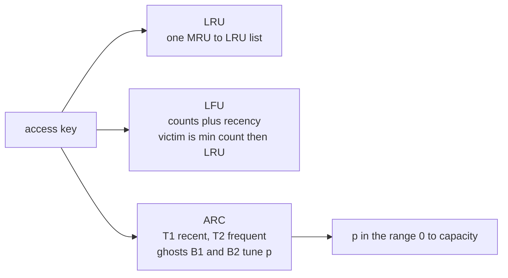
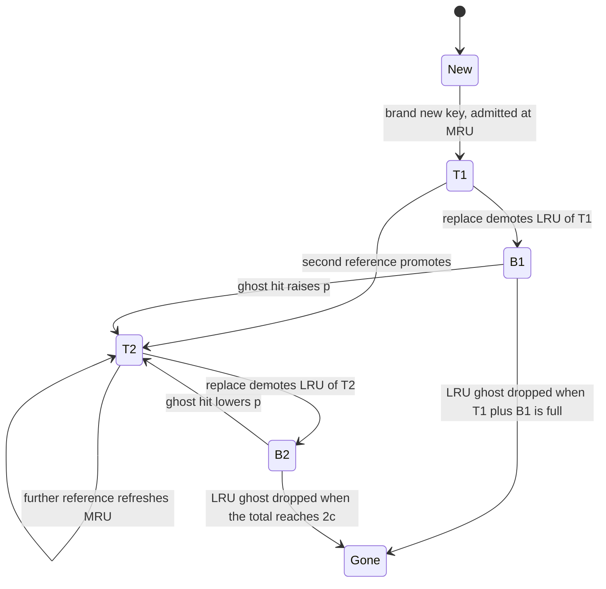
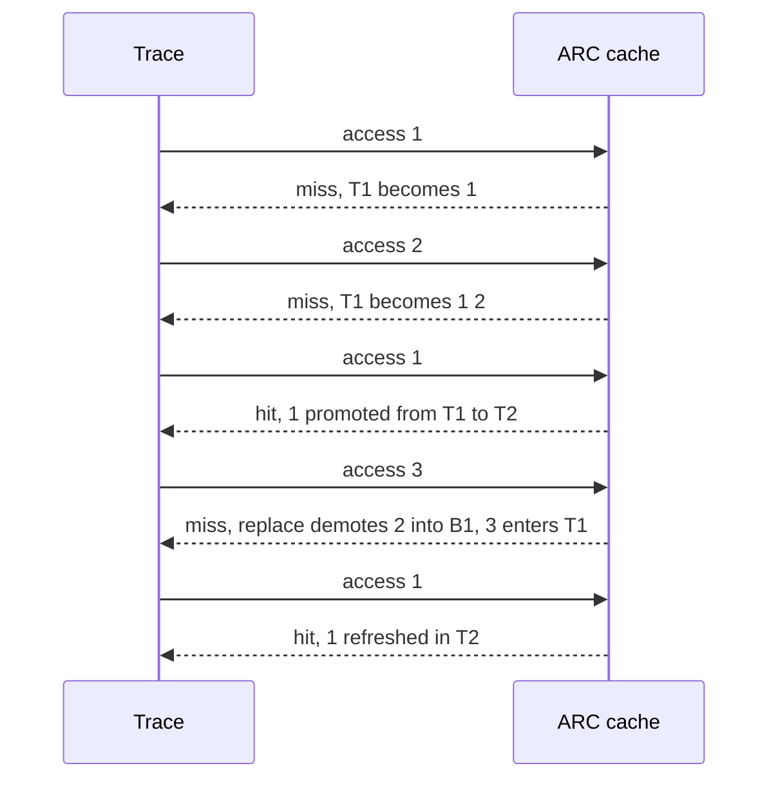

# 485 — Implement cache eviction policies: LRU, LFU, ARC (simulate).

> **Tier:** Advanced · **CTCI chapter:** Ch 14 — Databases
> **Task spec:** [485-implement-cache-eviction-policies-lru-lfu-arc-simulate.md](../../../tasks/advanced/485-implement-cache-eviction-policies-lru-lfu-arc-simulate.md)
> **Solutions:** [Python](../../../solutions/python/advanced/485-implement-cache-eviction-policies-lru-lfu-arc-simulate/solution.py) ·
> [Java](../../../solutions/java/advanced/485-implement-cache-eviction-policies-lru-lfu-arc-simulate/Solution.java) ·
> [JavaScript](../../../solutions/javascript/advanced/485-implement-cache-eviction-policies-lru-lfu-arc-simulate/solution.js) ·
> [C#](../../../solutions/csharp/advanced/485-implement-cache-eviction-policies-lru-lfu-arc-simulate/Solution.cs)

## 1. Problem restatement

**Input:** a `capacity` `c` and a trace of key accesses. `c` is the maximum number of **distinct
keys** the cache may hold — cache-as-main-memory, no separate disk tiers in this simulation.

**Output:** three caches, each exposing `access(key)` that returns a hit/miss flag, plus `hits`,
`size()` and `contents()`:

- **LRU.** A hit moves the key to the most-recently-used end; a miss inserts at MRU and, when the
  cache is over capacity, evicts the least-recently-used key.
- **LFU.** Every hit increments the key's count and refreshes its recency; a miss on a full cache
  evicts the key with the smallest count, **ties broken by least-recently-used**.
- **ARC** (Megiddo & Modha). A `p`-adaptive split of `T1` (recent) and `T2` (frequent); misses that
  hit the ghost lists `B1`/`B2` adjust `p`, and `replace` demotes within the real lists. Cache
  contents are `T1 + T2`.

Each policy is additionally implemented a second time as a **naive reference** (`lru_reference`,
`lfu_reference`, `arc_reference`) using plain lists and linear scans. The tests require the
`OrderedDict` implementation and the reference to produce identical hit vectors, size vectors and
totals.

| Scenario | Expected |
| --- | --- |
| hand trace `1, 2, 1, 3, 1` at `c = 2` | `F, F, T, F, T` for **all three** policies, `hits == 2`, `contents == [1, 3]` |
| references on the hand trace | `2` hits each |
| uniform trace (400 accesses, 20 keys, seed 485) | LRU `70`, LFU `64`, ARC `64` |
| locality trace (400 accesses, 24 keys, seed 486, repeat 7) | LRU `296`, LFU `291`, ARC `290` |
| hot-scan trace (24 rounds, 4 hot keys, 8-wide scan) | LRU `92`, LFU `161`, ARC `161` |
| every pinned run at `c = 4` | `overflows == 0`, `max(size) == 4`, final size `4` |

All nine pinned totals are asserted alongside the reference agreement, and the last line of the
suite pins the ordering claim behind ARC's design: `ARC > LRU` on the hot-scan trace.

## 2. Intuition

Eviction policy is a bet about the future. LRU bets that the least recently used key is the least
likely to be needed; LFU bets that the least *frequently* used key is. Both are right on traces that
match their bet and badly wrong on traces that do not.

A pure scan is the classic counterexample. Walking 8 fresh keys through a 4-key cache evicts
everything useful on the way past, so the next access to a hot key misses. On the hot-scan trace the
gap is stark: LRU scores `92` hits where LFU and ARC score `161`, because the scan keys are seen
once and never deserve to displace a key that is seen in every round.

LFU's fix is to remember how often a key was used, but a plain frequency counter has the opposite
failure: a key that was hot early keeps an inflated count forever, and the locality trace shows the
consequence — LFU `291` versus LRU `296`, the scan-resistant policy now paying for stale popularity
and for ties (a brand-new key has count 1 and loses those ties to any key with a longer history).

ARC's fix is to keep both signals and choose between them **adaptively**. It maintains a target `p`
for how much of the cache should be devoted to the recent list `T1`, and it learns `p` from evidence
that it guessed wrong: evictions are remembered in ghost lists `B1` and `B2`, and when a ghost entry
is requested again, that is proof the cache evicted something it needed. A `B1` hit raises `p` (keep
more recent keys), a `B2` hit lowers it (keep more frequent keys).



The key insight is that **a ghost list is free information about a mistake**. Keeping the evicted
key's identity (but not its value) costs one entry, and a later reference to it is a labelled example
of the cache mispredicting. That is why ARC can be both scan-resistant and adaptive: the ghost hits
tell it which way to move `p`, and on the adaptive trace in [task 486](../../../tasks/advanced/486-implement-adaptive-replacement-cache-arc-outline-test.md)
the pinned instrumentation shows `p` climbing to the full capacity `4` and returning to `0`.

## 3. Algorithm

**LRU** (one structure, an order-preserving map):

1. On access, if the key is present, move it to the MRU end and count a hit.
2. Otherwise insert at MRU; if the size now exceeds `c`, drop the LRU end.

**LFU** (counts plus a recency clock):

1. Increment a global `tick`.
2. On a hit, bump the key's count and set `recency[key] = tick`.
3. On a miss with a full cache, find the victim minimising `(count, recency)` and delete it.
4. Insert the new key with count `1` and `recency = tick`.

**ARC** (four lists, one parameter):

1. Hit in `T1` → remove from `T1`, insert into `T2` (a key seen twice becomes frequent).
2. Hit in `T2` → move to the MRU end of `T2`.
3. Hit in `B1` → raise `p` by `max(1, |B2| // |B1|)`, clamped to `c`; run `replace`; move the key
   from `B1` to `T2`.
4. Hit in `B2` → lower `p` by `max(1, |B1| // |B2|)`, clamped to `0`; run `replace`; move the key
   from `B2` to `T2`.
5. Brand-new key → keep the list sizes inside the documented bounds (drop the LRU ghost of `B1`,
   drop the LRU ghost of `B2` when the total would reach `2c`, or demote the LRU of `T1`), then
   insert into `T1`.
6. `replace(key)`: if `T1` is non-empty and (`key` is a `B2` ghost with `|T1| == p`, or
   `|T1| > p`), demote the LRU of `T1` to `B1`; otherwise demote the LRU of `T2` to `B2`.

```text
function access(key)                                  -- ARC
    if key in t1 then
        remove key from t1
        t2[key] ← MRU
        return hit
    end
    if key in t2 then
        move key to MRU of t2
        return hit
    end
    if key in b1 then
        p ← min(c, p + max(1, size(b2) div size(b1)))
        replace(key)
        remove key from b1
        t2[key] ← MRU
    else if key in b2 then
        p ← max(0, p - max(1, size(b1) div size(b2)))
        replace(key)
        remove key from b2
        t2[key] ← MRU
    else
        if size(t1) + size(b1) = c then
            if size(t1) &lt; c then
                drop LRU of b1
                replace(key)
            else
                drop LRU of t1
            end
        else if size(t1) + size(b1) &lt; c then
            total ← size(t1) + size(t2) + size(b1) + size(b2)
            if total &gt;= c then
                if total = 2 * c then
                    drop LRU of b2
                end
                replace(key)
            end
        end
        t1[key] ← MRU
    end
    return miss
end

procedure replace(key)
    if t1 is not empty and ((key in b2 and size(t1) = p) or size(t1) &gt; p) then
        move LRU of t1 to b1
    else if t2 is not empty then
        move LRU of t2 to b2
    end
end
```

The four lists must stay inside the documented bounds: `|T1| + |T2| <= c`, `|T1| + |B1| <= c` and
`|T1| + |T2| + |B1| + |B2| <= 2c`. The `else` branch above is exactly the bookkeeping that keeps
them there; `replace` never evicts anything from a real list into nothing — a demoted key always
lands in a ghost list.



## 4. Worked example

The hand trace is `1, 2, 1, 3, 1` with `c = 2`, expected `F, F, T, F, T` and final contents
`[1, 3]`.

**LRU:**

| Access | Hit? | List after (LRU → MRU) | `hits` |
| --- | --- | --- | --- |
| `1` | no | `[1]` | 0 |
| `2` | no | `[1, 2]` | 0 |
| `1` | yes | `[2, 1]` | 1 |
| `3` | no | insert → `[2, 1, 3]` over capacity → evict `2` → `[1, 3]` | 1 |
| `1` | yes | `[3, 1]` | 2 |

**LFU:**

| Access | Hit? | `counts` / `recency` after | Victim |
| --- | --- | --- | --- |
| `1` | no | `{1: 1}`, `{1: 1}` | — |
| `2` | no | `{1: 1, 2: 1}`, `{1: 1, 2: 2}` | — |
| `1` | yes | `{1: 2, 2: 1}`, `{1: 3, 2: 2}` | — |
| `3` | no | `{1: 2, 3: 1}`, `{1: 3, 3: 4}` | `2` (count 1 beats `1`'s count 2) |
| `1` | yes | `{1: 3, 3: 1}`, `{1: 5, 3: 4}` | — |

**ARC**, `c = 2`, starting `p = 0`, all lists empty:

| Access | List state after | `p` | Note |
| --- | --- | --- | --- |
| `1` | `T1 = [1]` | 0 | new key; `|T1| + |B1| = 0 < c` and total `0 < c`, so nothing is demoted |
| `2` | `T1 = [1, 2]` | 0 | total `1 < c`, straight admit |
| `1` | `T1 = [2]`, `T2 = [1]` | 0 | hit in `T1` promotes to `T2`, cache size still 2 |
| `3` | `T1 = [3]`, `B1 = [2]`, `T2 = [1]` | 0 | total `2 >= c`, so `replace(3)` demotes the LRU of `T1` (since `|T1| = 1 > p = 0`) into `B1` |
| `1` | `T1 = [3]`, `T2 = [1]` | 0 | hit in `T2`, refreshed in place |

Access 4 is the interesting one: the new key must be admitted, and the decision "which list gives up
a slot" is made by `replace` using `p`. With `p = 0` the cache is saying "no reserved slots for
recent one-shot keys", so `|T1| = 1 > p` holds and the LRU of `T1` — key `2`, admitted at access 2
and never referenced again — is demoted to the ghost list `B1`. `T2` held `1`, the key that *had*
been referenced twice, so it was never at risk.



All three policies therefore agree on the hand trace (`2` hits, contents `[1, 3]`) despite
reachable-state differences: LRU and LFU keep `3` because they evicted `2`, and ARC keeps `3` in
`T1` while `1` sits in `T2`.

The three pinned traces differ in character, and the totals show each policy's bet:

| Trace | Shape | LRU | LFU | ARC |
| --- | --- | --- | --- | --- |
| `uniform` | 400 accesses over 20 keys, no locality | `70` | `64` | `64` |
| `locality` | 400 accesses over 24 keys, next key repeats previous when `seed mod 10 < 7` | `296` | `291` | `290` |
| `hot-scan` | 24 rounds of `[0..3, 8 fresh scan keys, 0..3]` | `92` | `161` | `161` |

The uniform trace is the "no exploitable structure" case and LRU wins there (`70` vs `64`), because
with a capacity of 4 and 20 equally likely keys every policy is mostly missing and LFU's tie rules
cost it a few hits. The locality trace rewards recency, and there LRU edges ahead (`296`). The
hot-scan trace rewards scan resistance by a factor of `1.75×`, and there the two frequency-aware
policies tie at `161` while LRU thrashes. No policy wins everywhere — which is the reason ARC learns
instead of choosing.

## 5. Complexity

Let `c` be the capacity, `n` the trace length and `k` the distinct keys seen. The `OrderedDict` /
`LinkedHashMap` implementations are the ones the tests measure; the reference implementations are the
deliberately naive baselines.

| Measure | Bound | Why it holds |
| --- | --- | --- |
| Time, LRU access | O(1) expected | a hash lookup plus a move-to-end on a doubly linked order |
| Time, LFU access | O(c) for a miss | the victim is found by a linear `min` over `(count, recency)` |
| Time, ARC access | O(1) expected | membership tests on four maps, plus at most one demotion in `replace` |
| Time, reference LRU / LFU / ARC | O(c) per access | list `remove`, `min` scans and `pop(0)` — the naive baselines the fast versions must match |
| Space, LRU / LFU | O(c) | one entry per cached key |
| Space, ARC | O(c) real + O(c) ghost = O(c) total, at most `2c` entries | `|T1| + |T2| <= c` and all four lists together `<= 2c` |
| Invariant checks per run | O(n) | each access records a hit and a size; the tests assert `overflows == 0` and `max(size) == c` |

The interesting inequality is that ARC does strictly better than LRU on the hot-scan trace (`161`
vs `92`) while paying only double the bookkeeping space — ghost entries hold keys, never values. The
space bound is what makes the comparison fair: all three policies are capped at `c` distinct keys of
*data*, so the differences in the table above are about lookup work, not about cache size.

## 6. Pitfalls and edge cases

- **Capacity means distinct keys.** `size()` counts entries, and every access re-checks
  `size <= capacity`; the suite asserts `overflows == 0` and `max(size_vector) == 4` on all nine
  pinned runs. A policy that inserts before evicting would show a size of `c + 1` on that vector.
- **LFU's tie rule is part of the contract.** Victims minimise `(count, recency)`, so among keys with
  equal counts the least recently used one goes. That is why the hand trace evicts `2` rather than
  `1` at access 4, and a different tie rule would change the pinned totals for LFU.
- **LFU counters never decay.** A key that was hot early keeps its count, which is exactly what the
  locality trace exposes: LFU scores `291` against LRU's `296`. Counting is a memory that outlives
  its usefulness.
- **A hit must refresh the order.** For LRU, `access` must move the key to the MRU end; for LFU, it
  must refresh `recency` and bump the count; for ARC, a `T1` hit must *promote* to `T2`. Skipping any
  of these changes hit vectors, not just totals.
- **Ghost lists hold identities, not data.** `B1` and `B2` have no values, so a ghost hit is a miss:
  the key must be fetched and admitted to `T2`. Treating a ghost hit as a cache hit is the classic
  ARC implementation bug.
- **`p` stays in `[0, c]`.** Both updates are clamped; the ghost-hit steps also use `max(1, ...)` so
  `p` always moves by at least one. A division by zero would occur if the ghost lists were empty,
  which cannot happen on the branch that reads their sizes.
- **`replace` needs both guards.** The condition is `T1` non-empty *and* (`|T1| > p`, or the key is a
  `B2` ghost with `|T1| == p`); without the `T2` fallback a cache with an empty `T1` would fail to
  make room at all.
- **`contents()` is a set view.** It returns sorted `T1 + T2`, and the tests assert four distinct
  keys, each of which appears in the trace. Ghost keys must **not** appear in `contents()`, or the
  "everything in the cache was requested" check would still pass but the contents comparison would
  drift from the reference.
- **Two implementations must agree exactly.** Each policy is checked against its naive reference on
  the hit vector, the size vector and the total. This catches the subtle bugs (a wrong tie rule, a
  ghost that is not dropped) that a totals-only comparison would hide.

## 7. Variants and follow-ups

- **ARC in depth.** [486-implement-adaptive-replacement-cache-arc-outline-test.md](../../../tasks/advanced/486-implement-adaptive-replacement-cache-arc-outline-test.md)
  focuses on ARC alone, adds per-access invariant checks, counts `B1`/`B2` hits and tracks how `p`
  moves between `0` and `c` on an adaptive trace.
- **Hiding the eviction cost behind prefetching.**
  [487-implement-prefetching-simulation-for-sequential-access-patterns.md](../../../tasks/advanced/487-implement-prefetching-simulation-for-sequential-access-patterns.md)
  attacks the same scan problem from the other side, by fetching ahead instead of choosing victims
  better.
- **Eviction inside a storage engine.**
  [484-implement-simple-key-value-store-with-memtable-sstable.md](../../../tasks/advanced/484-implement-simple-key-value-store-with-memtable-sstable.md)
  shows a cache whose entries must be flushed rather than dropped, and
  [488-implement-compression-aware-storage-layout-simulation.md](../../../tasks/advanced/488-implement-compression-aware-storage-layout-simulation.md)
  shows what the fallen-through level looks like when bytes, not entries, are the budget.
- **Deciding on incomplete evidence.** The bandit tasks
  [494-implement-thompson-sampling-simulator-for-bandit-problems.md](../../../tasks/advanced/494-implement-thompson-sampling-simulator-for-bandit-problems.md)
  and [495-implement-ucb-upper-confidence-bound-algorithm-simulation.md](../../../tasks/advanced/495-implement-ucb-upper-confidence-bound-algorithm-simulation.md)
  frame "learn from feedback instead of fixing a rule" as an explicit algorithm.

## 8. Check yourself

**Q1.** Why do LFU and ARC both score `161` on the hot-scan trace while LRU manages only `92`?

<details><summary>Show answer</summary>

The scan walks 8 fresh keys through a 4-key cache once per round, and LRU evicts the hot keys to make
room for keys that are never used again; by the time the round returns to `0..3`, half of them are
gone. LFU keeps hot keys because their counts are high, and ARC keeps them because `p` adapts so the
scan is absorbed by the recent list and its ghosts. Both are scan resistant, so both land on `161`.
</details>

**Q2.** In the hand trace, at access `2` the new key enters the cache. Why does `replace` not evict
anything?

<details><summary>Show answer</summary>

Because the cache is not yet full. `|T1| + |B1| = 1 < c = 2`, and the four-list total is `1 < c`, so
neither bound triggers and the key is admitted directly to `T1`. `replace` only runs when admitting
the key would break a documented bound.
</details>

**Q3.** What does the ghost-list hit tell ARC that a plain miss does not?

<details><summary>Show answer</summary>

It says the cache *recently evicted* this key, i.e. it made a mistake of a specific kind. A `B1` hit
means a one-shot-but-reused key was evicted from the recent list, so `p` grows to give `T1` more
room; a `B2` hit means a frequent key was evicted from `T2`, so `p` shrinks. A plain miss carries no
such signal, which is why ARC needs no tuning to be scan resistant.
</details>

**Q4.** Why does the locality trace make LFU (`291`) slightly worse than LRU (`296`)?

<details><summary>Show answer</summary>

Because LFU never forgets. Keys that were popular during an earlier burst keep high counts and hold
cache slots long after the trace has moved on, and tied keys (all new keys start at count 1) are
resolved by recency only after the count comparison. LRU has no such memory: it tracks recency alone,
which matches the locality trace's actual structure.
</details>

**Q5.** The suite runs each policy twice, once via `OrderedDict` and once via a naive list reference.
What class of bug does that catch?

<details><summary>Show answer</summary>

Implementation bugs that preserve the total hit count by luck: a miss-move in LRU, a wrong LFU tie
rule, a ghost that is not dropped or is counted as a hit, a `replace` that demotes from the wrong
list. The reference is written the simplest possible way (lists and linear scans), so an exact
agreement of hit vectors, size vectors and totals means the fast version really computes the
documented policy.
</details>
