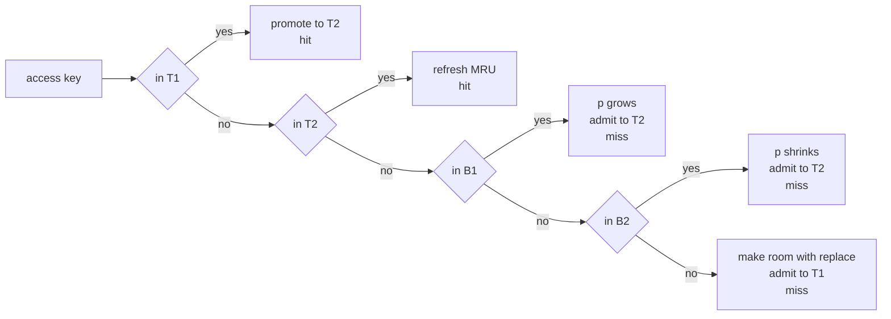
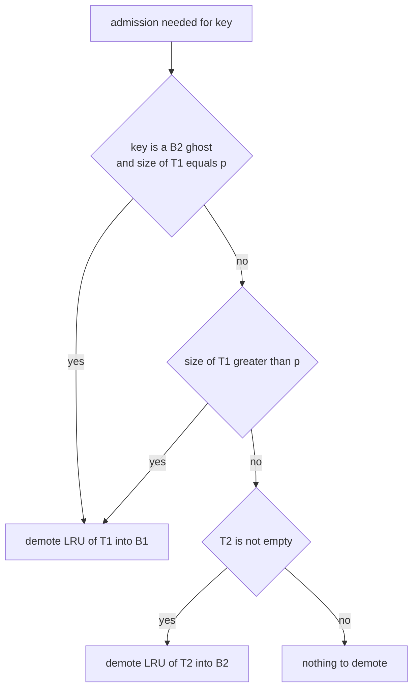
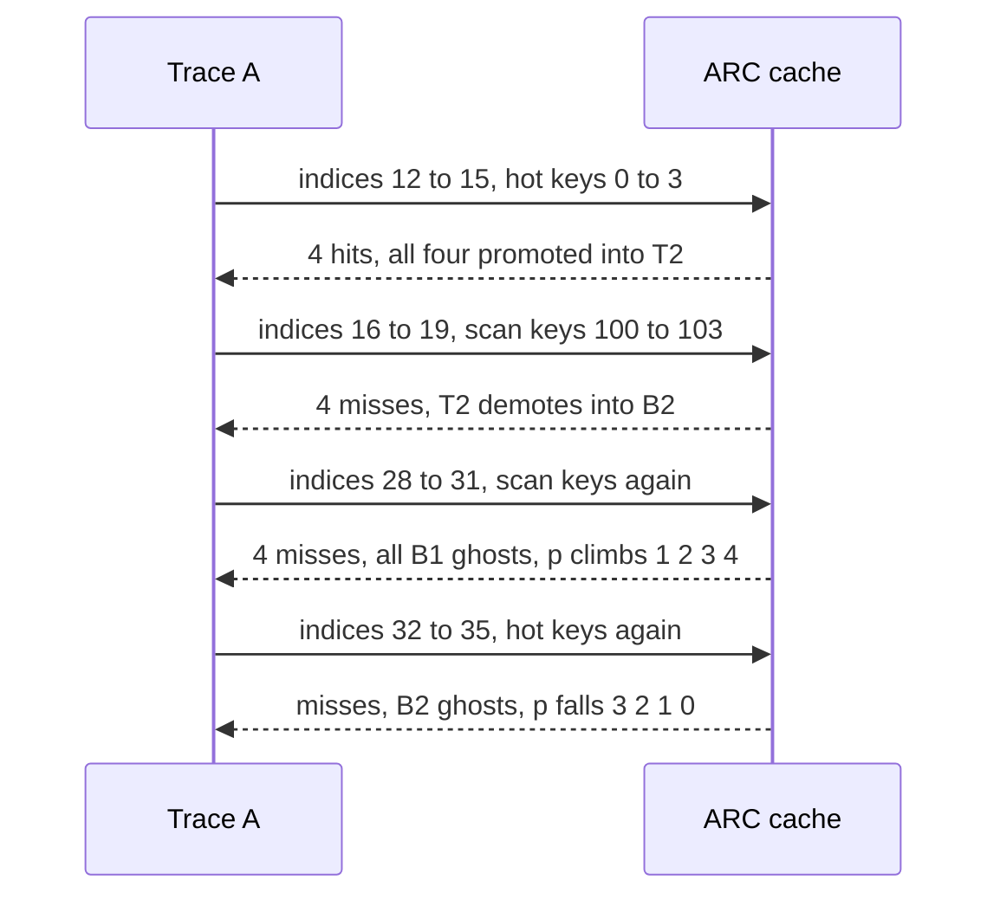

# 486 — Implement adaptive replacement cache (ARC) outline & test.

> **Tier:** Advanced · **CTCI chapter:** Ch 14 — Databases
> **Task spec:** [486-implement-adaptive-replacement-cache-arc-outline-test.md](../../../tasks/advanced/486-implement-adaptive-replacement-cache-arc-outline-test.md)
> **Solutions:** [Python](../../../solutions/python/advanced/486-implement-adaptive-replacement-cache-arc-outline-test/solution.py) ·
> [Java](../../../solutions/java/advanced/486-implement-adaptive-replacement-cache-arc-outline-test/Solution.java) ·
> [JavaScript](../../../solutions/javascript/advanced/486-implement-adaptive-replacement-cache-arc-outline-test/solution.js) ·
> [C#](../../../solutions/csharp/advanced/486-implement-adaptive-replacement-cache-arc-outline-test/Solution.cs)

## 1. Problem restatement

**Input:** a capacity `c` and a trace of key accesses.

**Output:** one ARC cache (Megiddo & Modha 2003) with four ordered lists and one parameter, as the
solution headers document it:

- **Real lists.** `T1` (keys seen once recently) and `T2` (keys seen at least twice). Cache contents
  are `T1 + T2` with `|T1| + |T2| <= c`.
- **Ghost lists.** `B1` (recently evicted from `T1`) and `B2` (evicted from `T2`), holding only
  identities: `|T1| + |B1| <= c` and `|T1| + |T2| + |B1| + |B2| <= 2c`.
- **Transitions.** A request found in `T1` is promoted to `T2`; in `T2` it is refreshed to MRU; in a
  ghost list it adapts the target size `p` for `T1` (`p` grows on a `B1` hit, shrinks on a `B2` hit,
  always clamped to `[0, c]`) and the key is admitted to `T2`; a brand-new request is admitted to
  `T1` after `replace` makes room.
- **`replace(key)`.** Demotes the LRU of `T1` to `B1` when `T1` is non-empty and (`key` is a `B2`
  ghost with `|T1| == p`, or `|T1| > p`); otherwise demotes the LRU of `T2` to `B2`.

The task is an **outline plus a test harness**: the cache carries instrumentation (`hits`, `p_max`,
`p_min`, `b1_hits`, `b2_hits`) and exposes `check_invariants(key)`, which the test calls after
**every** access. An independent list-based `arc_reference` recomputes the hit count *and the
per-step cache contents*, and an `lru_hits` helper provides the baseline ARC must beat.

| Scenario | Expected |
| --- | --- |
| hand trace `1, 2, 1, 3, 1` at `c = 2` | `F, F, T, F, T`, `hits == 2`, `contents == [1, 3]` |
| trace S: 20 rounds of `[0..3, 8-key scan, 0..3]` (`c = 4`, 320 accesses) | ARC `133` vs LRU `76`; `p_max == 0`, `b1_hits == 0`, `b2_hits == 19` |
| trace A: 20 rounds of `[0..3, 4-key scan, 0..3]` (`c = 4`, 240 accesses) | ARC `79` vs LRU `76`; `p_max == 4`, `p_min == 0`, final `p == 0` |
| trace A ghost hits | `b1_hits == 4`, `b2_hits == 141` |
| both traces, final state | `contents == [0, 1, 2, 3]` |
| every access | key is in `T1` or `T2`, all four size bounds hold, `0 <= p <= c`, and `T1`, `T2`, `B1`, `B2` are pairwise disjoint |

The per-step contents vector must equal the reference's contents vector at every step, not just at
the end, so an implementation that reaches the right final cache by a different route fails.

## 2. Intuition

ARC answers a question LRU and LFU both answer badly: *how much of the cache should be reserved for
keys seen only once?* `p` is that reservation, expressed as the target size of the recent list `T1`.
The remaining `c - p` slots are effectively promised to `T2`, the frequent list.

The mechanism that makes this self-tuning is the ghost list. When ARC evicts a key it does not
forget the key's *name*: it moves the identity into `B1` (if the key came from the recent list) or
`B2` (if from the frequent list). A later request for a ghost key is a measurable prediction error:

- a **`B1` hit** means "a recent, one-shot key was evicted and then needed again" → `p` grows, making
  room for more recent keys;
- a **`B2` hit** means "a frequent key was evicted and then needed again" → `p` shrinks, protecting
  more of the frequent set.



The two pinned traces show both regimes, and the contrast is the point of the task:

- **Trace S** scans 8 distinct keys per round. With `c = 4`, a scan key is pushed out of `B1` before
  it can ever be requested again, so `b1_hits == 0` and `p` never leaves `0`. ARC is still
  scan-resistant — it scores `133` hits against LRU's `76` — because the four hot keys, once
  promoted, live in `T2` while the scan churns through `T1` and its ghost list.
- **Trace A** scans only 4 distinct keys, cycling `mod 4`. Those keys *do* come back, so `B1` hits
  fire and `p` climbs to `c = 4`; the frequent keys are then also re-requested and the `B2` hits pull
  `p` back down to `0`. Both effects are visible in the instrumentation.

The key insight is that **`p` is learned from misses, not from a heuristic**. ARC never needs to know
whether the workload is scan-heavy or frequency-heavy; the ghost-hit stream tells it, one step at a
time, and the bounds on the four lists guarantee the answer stays inside `[0, c]`.

## 3. Algorithm

1. Initialise `p = 0`, four empty ordered lists, `hits = 0`, `p_max = p_min = 0`, `b1_hits = b2_hits = 0`.
2. Hit in `T1` → remove from `T1`, insert at the MRU end of `T2`, count a hit.
3. Hit in `T2` → move to the MRU end of `T2`, count a hit.
4. Hit in `B1` → `p = min(c, p + max(1, |B2| // |B1|))`, `replace(key)`, remove the key from `B1`,
   insert at the MRU end of `T2`, count a `B1` ghost hit.
5. Hit in `B2` → `p = max(0, p - max(1, |B1| // |B2|))`, `replace(key)`, remove the key from `B2`,
   insert at the MRU end of `T2`, count a `B2` ghost hit.
6. Brand-new key → keep the bounds: if `|T1| + |B1| == c` then either drop the LRU ghost of `B1`
   and `replace(key)`, or (when `|T1| == c`) drop the LRU of `T1`; otherwise, while
   `|T1| + |B1| < c`, if the four-list total is `>= c` then drop the LRU ghost of `B2` when the total
   equals `2c` and `replace(key)`; finally insert at the MRU end of `T1`.
7. After handling the access, update `p_max`, `p_min` and re-check the invariants.

```text
function access(key)                                  -- ARC
    if key in t1 then
        remove key from t1
        append key to t2
        hits ← hits + 1
        return true
    end
    if key in t2 then
        move key to MRU in t2
        hits ← hits + 1
        return true
    end
    if key in b1 then
        p ← min(c, p + max(1, size(b2) div size(b1)))
        b1_hits ← b1_hits + 1
        replace(key)
        remove key from b1
        append key to t2
    else if key in b2 then
        p ← max(0, p - max(1, size(b1) div size(b2)))
        b2_hits ← b2_hits + 1
        replace(key)
        remove key from b2
        append key to t2
    else
        if size(t1) + size(b1) = c then
            if size(t1) &lt; c then
                drop LRU of b1
                replace(key)
            else
                drop LRU of t1
            end
        else if size(t1) + size(b1) &lt; c then
            total ← size(t1) + size(t2) + size(b1) + size(b2)
            if total &gt;= c then
                if total = 2 * c then
                    drop LRU of b2
                end
                replace(key)
            end
        end
        append key to t1
    end
    p_max ← max(p_max, p)
    p_min ← min(p_min, p)
    return false
end

procedure replace(key)
    if t1 is not empty and ((key in b2 and size(t1) = p) or size(t1) &gt; p) then
        move LRU of t1 to b1
    else if t2 is not empty then
        move LRU of t2 to b2
    end
end
```

`replace` is called on every admission path — a ghost hit or a brand-new key — and is the only place
that touches the LRU ends of the real lists. The order of the checks matters: `T1` gives up a slot
only when it is holding more than its target `p`, otherwise the eviction comes from `T2`.



The invariant checker that runs after every access is the specification made executable:

```text
procedure check_invariants(key)
    assert key in t1 or key in t2
    assert size(t1) + size(t2) &lt;= c
    assert size(t1) + size(b1) &lt;= c
    assert size(t1) + size(t2) + size(b1) + size(b2) &lt;= 2 * c
    assert 0 &lt;= p &lt;= c
    assert the four lists are pairwise disjoint
end
```

## 4. Worked example

**Hand case**, `c = 2`, trace `1, 2, 1, 3, 1`. Every state below is the exact state after the access:

| Access | Hit? | `T1` | `T2` | `B1` | `B2` | `p` |
| --- | --- | --- | --- | --- | --- | --- |
| `1` | miss | `[1]` | `[]` | `[]` | `[]` | 0 |
| `2` | miss | `[1, 2]` | `[]` | `[]` | `[]` | 0 |
| `1` | hit | `[2]` | `[1]` | `[]` | `[]` | 0 |
| `3` | miss | `[3]` | `[1]` | `[2]` | `[]` | 0 |
| `1` | hit | `[3]` | `[1]` | `[2]` | `[]` | 0 |

The promotion at access 3 is what saves key `1`: it moves from `T1` to `T2`, and when access 4 needs
room `replace` looks at `|T1| = 1 > p = 0`, so it demotes from `T1` (key `2`) rather than touching
`T2`. Contents end at `[1, 3]`, size 2, `hits == 2` — and both the `arc_reference` and the pure-LRU
baseline agree on the count for this trace.

**Trace A**, `c = 4`: `20` rounds of `[0, 1, 2, 3]`, four scan keys `100 + (r*4 + j) mod 4`, then
`[0, 1, 2, 3]` again. The interesting window is indices 12–35:

| Index | Key | Result | `T1` | `T2` | `B1` | `B2` | `p` |
| --- | --- | --- | --- | --- | --- | --- | --- |
| 12 | `0` | hit | `[1, 2, 3]` | `[0]` | `[]` | `[]` | 0 |
| 15 | `3` | hit | `[]` | `[0, 1, 2, 3]` | `[]` | `[]` | 0 |
| 16 | `100` | miss | `[100]` | `[1, 2, 3]` | `[]` | `[0]` | 0 |
| 19 | `103` | miss | `[103]` | `[1, 2, 3]` | `[100, 101, 102]` | `[0]` | 0 |
| 20 | `0` | miss (`B2` ghost) | `[]` | `[1, 2, 3, 0]` | `[100, 101, 102, 103]` | `[]` | 0 |
| 28 | `100` | miss (`B1` ghost) | `[]` | `[1, 2, 3, 100]` | `[101, 102, 103]` | `[0]` | **1** |
| 29 | `101` | miss (`B1` ghost) | `[]` | `[2, 3, 100, 101]` | `[102, 103]` | `[0, 1]` | **2** |
| 30 | `102` | miss (`B1` ghost) | `[]` | `[3, 100, 101, 102]` | `[103]` | `[0, 1, 2]` | **3** |
| 31 | `103` | miss (`B1` ghost) | `[]` | `[100, 101, 102, 103]` | `[]` | `[0, 1, 2, 3]` | **4** |
| 32 | `0` | miss (`B2` ghost) | `[]` | `[101, 102, 103, 0]` | `[]` | `[1, 2, 3, 100]` | **3** |
| 35 | `3` | miss (`B2` ghost) | `[]` | `[0, 1, 2, 3]` | `[]` | `[100, 101, 102, 103]` | **0** |

Read the table as ARC learning. Indices 12–15 are the hot keys promoted into `T2`. The scan at
16–19 pushes each new key into `T1` and evicts from `T2` (the LRU end of `T2` goes to `B2`), because
`T1` holds at most one key. At index 20 the hot key `0` is requested while sitting in `B2`, which is
a `B2` ghost hit — `p` would shrink, but it is already `0`, so it stays there.

The scan keys come round again at 28–31 (the cycle is `mod 4`) and all four are found in `B1`. Those
are the four `b1_hits` the instrumentation pins, and each one raises `p` by `max(1, |B2| // |B1|)`,
which is exactly `1` here: `p` steps `0 → 1 → 2 → 3 → 4`. With `p = c = 4`, `replace` now prefers
`T2` whenever `T1` is not larger than `p`, so the next round of hot keys (`0..3` at 32–35) pushes the
scan keys out of `T2` instead: all four of those accesses are `B2` ghost hits, and each shrinks `p`
by one, landing back at `0` by index 35 with the four scan keys now the ghosts. The cache has swung
from "all recent" to "all frequent" and back, driven entirely by which ghost list was hit.



Totals over the whole runs match that story. On trace A, `160` of the `240` accesses are hot-key
accesses and ARC hits `79` of them while LRU hits `76` — a small margin, because the 4-key scan is
short enough that LRU's damage is limited. On trace S, whose 8-key scan is twice as wide, ARC keeps
the hot set resident and scores `133` hits against LRU's `76`; in both traces every one of ARC's hits
is a hot-key hit, and the scans themselves never hit.

## 5. Complexity

Let `c` be the capacity and `n` the trace length.

| Measure | Bound | Why it holds |
| --- | --- | --- |
| Time, access | O(1) expected per branch | membership tests on four hash-backed orders, plus one `replace` demotion |
| Time, ghost hit | O(1) expected | one parameter update, one `replace`, one removal, one insertion |
| Time, invariant check | O(c) per access | the four lists are compared pairwise for disjointness, `O(c²)` set work at `c = 4` |
| Time, reference | O(c) per access | `arc_reference` uses lists with `remove`, `pop(0)` and linear membership |
| Time, LRU baseline | O(c) per access | `lru_hits` also uses a list |
| Space, real lists | O(c) | `|T1| + |T2| <= c` |
| Space, ghosts | O(c) | `|T1| + |B1| <= c` and the four-list total `<= 2c`, so at most `2c` entries |
| Hits, trace S | ARC `133` vs LRU `76` | the 8-key scan keeps evicting LRU's hot keys; ARC's `T2` holds them |
| Hits, trace A | ARC `79` vs LRU `76` | the 4-key scan wastes less of LRU, and ARC spends part of its capacity on adaptation |

The cost model is deliberately flat: everything ARC does per access is a constant number of
dictionary operations, and the only non-constant work is the invariant sweep, which the test pays for
on purpose. The space bound is the interesting one — at most `2c` stored keys, with the extra `c`
entries holding identities only, which is what buys the adaptivity.

## 6. Pitfalls and edge cases

- **Ghost hits are misses with information.** A hit in `B1` or `B2` must still fetch the value, admit
  the key to `T2`, and return *miss*; it only happens to be counted separately. Returning true would
  corrupt both the hit count and the cache contents.
- **`B2` ghost hits in the brand-new branch.** The new-key path reads `key in b2` inside the `replace`
  condition even though `key` is not a ghost in that branch; the conditions are evaluated together,
  and moving them apart changes which list is demoted when `|T1| == p`.
- **`p` moves by at least one.** Both updates use `max(1, ...)`, so integer division, which is `0`
  whenever one ghost list is smaller than the other, never freezes `p`. The instrumentation pins
  `p_max == 4` and `p_min == 0` on trace A, so a frozen `p` would fail.
- **Clamping is part of the specification.** `p` is `min(c, ...)` going up and `max(0, ...)` going
  down. Trace A reaches both ends: `p = c = 4` at index 31, back to `0` at index 35.
- **Bounds are checked after every access, not at the end.** `check_invariants` verifies
  `|T1| + |T2| <= c`, `|T1| + |B1| <= c`, the four-list total `<= 2c`, `0 <= p <= c`, that the
  requested key ended up in a real list, and that `T1`, `T2`, `B1`, `B2` are pairwise disjoint. A key
  in two lists at once is the classic double-accounting bug this catches.
- **Contents are compared per step.** `contents_vector == reference_contents` compares the sorted
  `T1 + T2` after every access, so an implementation that lags the reference by one step (evicting
  after inserting, for example) fails even if the totals agree.
- **Ghost keys never appear in `contents()`.** Only `T1 + T2` is returned. The final contents are
  pinned as `[0, 1, 2, 3]` on both traces; a ghost leaking into the view would also break the
  four-distinct-keys check.
- **The trace generator controls whether `p` moves at all.** Trace S cycles 8 scan keys, so no scan
  key survives in `B1` long enough to be re-requested (`b1_hits == 0`, `p_max == 0`); trace A cycles
  4 keys and produces exactly 4 `B1` hits. The adaptivity claim is a property of the *trace*, not of
  ARC, which is why the test pins the counts per trace.
- **ARC is not automatically better.** On trace A the margin is `79` versus LRU's `76`; the suite
  asserts `cache.hits >= expected_lru`, a lower bound rather than a claim of dominance. The strong
  scan-resistance result is trace S's `133` versus `76`.
- **`p_min` starts at `0`.** A cache that never raises `p` reports `p_min == p_max == 0`, which is
  trace S's expected instrumentation; the initialisation must not make `p_min` look like a bug.

## 7. Variants and follow-ups

- **ARC among its peers.** [485-implement-cache-eviction-policies-lru-lfu-arc-simulate.md](../../../tasks/advanced/485-implement-cache-eviction-policies-lru-lfu-arc-simulate.md)
  runs LRU, LFU and ARC side by side on three traces and shows where each one wins.
- **Making scans cheap instead of making eviction smart.**
  [487-implement-prefetching-simulation-for-sequential-access-patterns.md](../../../tasks/advanced/487-implement-prefetching-simulation-for-sequential-access-patterns.md)
  detects sequential runs and fetches ahead, which is the complementary answer to the hot-scan trace
  here.
- **Caches whose contents must be flushed, not dropped.**
  [484-implement-simple-key-value-store-with-memtable-sstable.md](../../../tasks/advanced/484-implement-simple-key-value-store-with-memtable-sstable.md)
  replaces the eviction decision with a write-out decision, and
  [488-implement-compression-aware-storage-layout-simulation.md](../../../tasks/advanced/488-implement-compression-aware-storage-layout-simulation.md)
  shows the storage layout that receives those bytes.
- **Learning from delayed feedback.** The bandit simulators
  [494-implement-thompson-sampling-simulator-for-bandit-problems.md](../../../tasks/advanced/494-implement-thompson-sampling-simulator-for-bandit-problems.md)
  and [495-implement-ucb-upper-confidence-bound-algorithm-simulation.md](../../../tasks/advanced/495-implement-ucb-upper-confidence-bound-algorithm-simulation.md)
  generalise the "adjust a parameter from observed mistakes" pattern that `p` uses here.

## 8. Check yourself

**Q1.** Why does `p` stay at `0` for the whole of trace S but climb to `4` on trace A?

<details><summary>Show answer</summary>

`p` only moves on **ghost** hits, and trace S's scan cycles 8 distinct keys with `c = 4`, so by the
time a scan key is referenced again its `B1` entry has already been dropped: `b1_hits == 0`. Trace A's
scan cycles only 4 keys, so all four come back while still in `B1` — the four pinned `b1_hits` at
indices 28–31 — and each raises `p` by one until it saturates at `c = 4`.
</details>

**Q2.** Trace S still scores `133` hits against LRU's `76` even though `p` never leaves `0`. Where
does that advantage come from?

<details><summary>Show answer</summary>

From the `T1`/`T2` split, not from `p`. Hot keys referenced twice are promoted into `T2`, and with
`p = 0` every `replace` demotes the LRU of `T1` first, so the scan churns through `T1` and its ghost
list while the four hot keys stay resident in `T2`. All `133` hits are hot-key accesses out of the
`160` hot accesses in the trace.
</details>

**Q3.** In the hand case, key `1` survives the eviction at access `3`. Which line of `replace`
decides that?

<details><summary>Show answer</summary>

`size(T1) > p`, i.e. `1 > 0`. Because `1` was promoted to `T2` by the hit at access 3, `T1` held only
key `2`, and the demotion took the LRU of `T1` (key `2` → `B1`). Had `T1` been empty, the branch
would have demoted the LRU of `T2` instead.
</details>

**Q4.** What is the point of comparing the *per-step* contents vector with `arc_reference` instead of
just the final contents?

<details><summary>Show answer</summary>

It pins the eviction decisions themselves, not just the outcome. Two implementations can end with
`[0, 1, 2, 3]` while making different choices along the way (which list to demote, when to drop a
ghost). Requiring the contents to match after every access — `contents_vector == reference_contents` —
turns each of those choices into a checked observable.
</details>

**Q5.** The four-list space bound is `|T1| + |T2| + |B1| + |B2| <= 2c`. Why does ARC get away with
holding up to twice the capacity in keys?

<details><summary>Show answer</summary>

Because ghost entries hold only identities, never values: `|T1| + |T2| <= c` is the data bound, and
the ghost lists are bounded separately by `|T1| + |B1| <= c` plus the `2c` total. The extra `c`
entries are the memory ARC spends to learn whether its recent/frequent split is right — and they are
dropped LRU-first, so the cost is bounded by the capacity rather than by the trace length.
</details>
