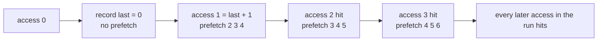
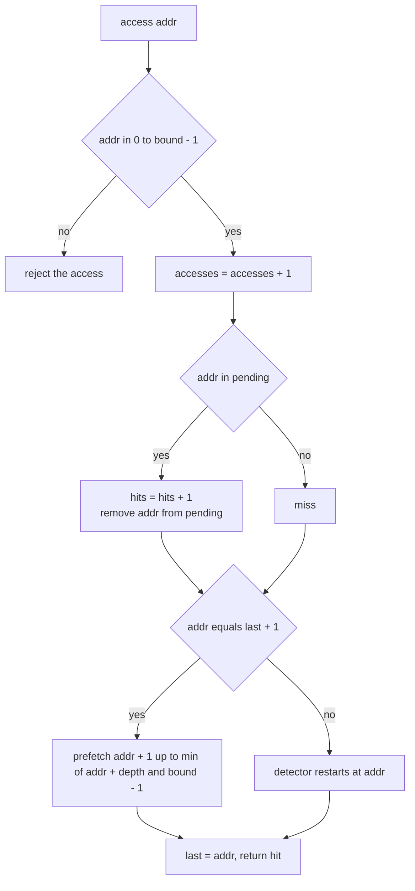
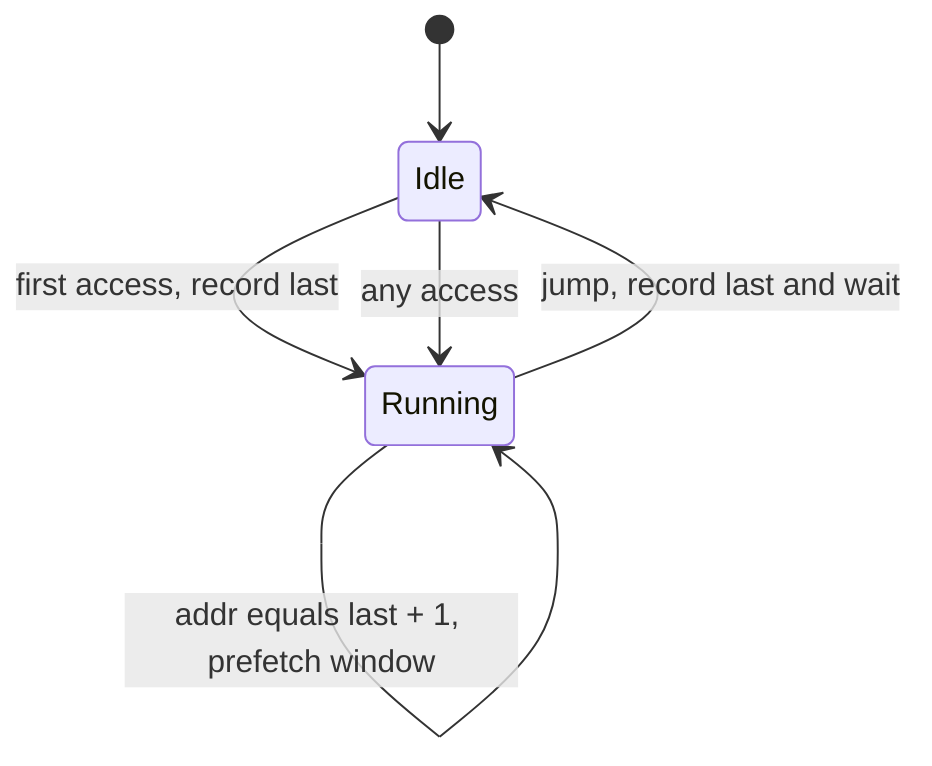
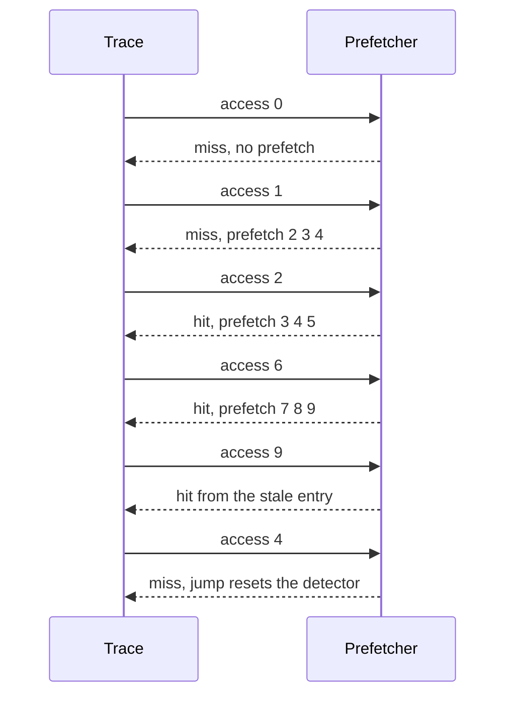

# 487 — Implement prefetching simulation for sequential access patterns.

> **Tier:** Advanced · **CTCI chapter:** Ch 14 — Databases
> **Task spec:** [487-implement-prefetching-simulation-for-sequential-access-patterns.md](../../../tasks/advanced/487-implement-prefetching-simulation-for-sequential-access-patterns.md)
> **Solutions:** [Python](../../../solutions/python/advanced/487-implement-prefetching-simulation-for-sequential-access-patterns/solution.py) ·
> [Java](../../../solutions/java/advanced/487-implement-prefetching-simulation-for-sequential-access-patterns/Solution.java) ·
> [JavaScript](../../../solutions/javascript/advanced/487-implement-prefetching-simulation-for-sequential-access-patterns/solution.js) ·
> [C#](../../../solutions/csharp/advanced/487-implement-prefetching-simulation-for-sequential-access-patterns/Solution.cs)

## 1. Problem restatement

**Input:** a simulated address space `[0, bound)`, a prefetch `depth`, and a trace of memory
accesses.

**Output:** a `Prefetcher` that tracks

- `accesses` — how many times `access(addr)` was called,
- `hits` — how many of those accesses found the address already in the prefetched set,
- `pending` — the set of speculative addresses (one entry per address),
- `issued` — how many prefetch operations were issued,
- `max_prefetch` — the highest address ever prefetched (initialised to `-1`, so "nothing yet" is
  distinguishable from address `0`).

The documented semantics from the solution headers:

- Every access and every prefetched address must lie inside `[0, bound)`; the prefetcher clips at
  `bound - 1` so it can never read past the array.
- The sequential detector only records the first access of a run. Every following access with
  `addr == last + 1` continues the run and issues speculative prefetches for
  `addr + 1 .. min(addr + depth, bound - 1)`. Any non-consecutive access restarts the detector.
- A prefetch **hit** is an access to an address sitting in the prefetched set, and the hit
  **consumes** the entry. Stale entries may serve later runs, which only raises the ratio.
- Documented lower bound: a **cold** run of length `L >= 2` yields at least `L - 2` prefetch hits,
  because the run's first access and its immediate successor cannot be covered.

| Scenario | Expected |
| --- | --- |
| hand case: `bound = 10`, `depth = 3`, accesses `0..6` | hits `F,F,T,T,T,T,T`; `hits == 5`; `pending == {7, 8, 9}`; `issued == 18`; `max_prefetch == 9` |
| then access `9` | `True` — a stale entry from access `6` still counts |
| then access `4` (jump backwards) | `False`, and `issued` stays `18`: no prefetch on a jump |
| full run `0..9` at `bound = 10`, `depth = 3` | `F,F` then `T` eight times; `pending == {}`; `max_prefetch == 9` |
| fresh run of length `40`, `depth = 4` | `hits == 38`, ratio `0.95`, `max_prefetch == 43` |
| mixed trace: 4 segments of length `32` at jumps `39, 62, 2, 22`, `bound = 128` | `30` hits each, total `120` hits over `128` accesses, `issued == 496` |
| any trace | every access inside `[0, bound)`, `max_prefetch < bound`, `hits <= accesses` |

## 2. Intuition

A cache answers "what should I keep?" A prefetcher answers a different question: "what will be asked
next?" The cheapest useful answer comes from the one pattern that needs no machine learning — a
sequential run. If the last address was `a` and the current one is `a + 1`, the next access is very
likely `a + 2`, and often `a + depth` more after that.

The naive implementation is to fetch nothing and take a miss on every cold address. Prefetching
trades a bounded amount of speculative work (`depth` addresses per continued step) for turning
almost every subsequent access in the run into a hit. The detector is deliberately tiny: it keeps
one variable, `last`, and a set of speculative addresses.

The subtle part is the **ramp-up**. A run of length `L` can never score `L` hits:

- the **first** access has no predecessor, so nothing was prefetched and no run is even detected;
- the **second** access continues the run, but the prefetch it triggers only covers `addr + 1` and
  beyond, so the second access itself was never covered.

That leaves `L - 2` as the ceiling on a fresh run, and the solutions' tests pin exactly that: a
`40`-address run yields `38` hits, and each `32`-address segment of the mixed trace yields `30`.



The key insight is that **the detector needs only two addresses of history**. `addr == last + 1` is
a one-bit prediction, and it is right often enough that the double miss at the start of a run is
easily repaid: a `32`-address run converts `30` of `32` accesses into hits, a ratio of `0.9375`,
above the documented `0.9` threshold.

## 3. Algorithm

1. Start with `last = none`, `pending = {}`, `hits = accesses = issued = 0`, `max_prefetch = -1`.
2. `access(addr)`: check `0 <= addr < bound` — the simulated memory cannot be addressed outside its
   own bounds.
3. Increment `accesses`. A hit is `addr` in `pending`; if so, increment `hits` and remove `addr` from
   `pending` (a consumed entry cannot serve two accesses).
4. Compute `continues = (last is not none) and (addr == last + 1)`, then set `last = addr`
   **regardless** of the result, so a jump restarts the detector from the new address.
5. If `continues`, issue `addr + 1 .. min(addr + depth, bound - 1)` into `pending`, bumping `issued`
   once per address and updating `max_prefetch`.
6. Return the hit flag.

```text
function access(addr)
    assert 0 &lt;= addr &lt; bound
    accesses ← accesses + 1
    hit ← addr in pending
    if hit then
        hits ← hits + 1
        remove addr from pending
    end
    continues ← last is not none and addr = last + 1
    last ← addr
    if continues then
        for nxt ← addr + 1 to min(addr + depth, bound - 1) do
            add nxt to pending
            issued ← issued + 1
            max_prefetch ← max(max_prefetch, nxt)
        end
    end
    return hit
end
```

Step 5 runs *after* the hit check, so an address can be both a prefetch target for this access and
the accessed address of the next one — the run keeps feeding itself. The `min(addr + depth, bound - 1)`
clip is the only thing standing between the detector and an out-of-bounds read.



The detector as a small state machine — note that `Idle` and `Running` differ only in whether the
next consecutive access triggers prefetches:



## 4. Worked example

**Hand case**, `bound = 10`, `depth = 3`, addresses `0 .. 6`:

| Access | `last` before | Hit? | `pending` after | `issued` | Why |
| --- | --- | --- | --- | --- | --- |
| `0` | none | no | `{}` | 0 | first access: no predecessor, so no prefetch |
| `1` | 0 | no | `{2, 3, 4}` | 3 | continues the run; window is `min(1+3, 9) = 4` |
| `2` | 1 | **yes** | `{3, 4, 5}` | 6 | hit consumes `2`; `3, 4, 5` re-issued (set semantics, `issued` counts calls) |
| `3` | 2 | **yes** | `{4, 5, 6}` | 9 | window slides one address |
| `4` | 3 | **yes** | `{5, 6, 7}` | 12 | |
| `5` | 4 | **yes** | `{6, 7, 8}` | 15 | |
| `6` | 5 | **yes** | `{7, 8, 9}` | 18 | the clip at `bound - 1 = 9` allows exactly three addresses |

Five hits out of seven accesses, and the run stops with three speculative addresses still pending.
Those entries are **stale** in the sense that no access has claimed them yet, which is exactly the
behaviour the next assertion checks: `access(9)` returns `True` even though `9` was prefetched three
accesses earlier, taking `hits` to `6` and leaving `pending = {7, 8}`. The access after that, `4`,
is a backwards jump: it is not in `pending` (which only holds `7` and `8`), it does not continue the
run, and it therefore issues nothing — `issued` stays at `18`.

The `bound` clip gets its own case. Running `0 .. 9` with `depth = 3` gives `F, F` followed by eight
hits: nothing beyond `9` can ever be prefetched, so the last address in the array is a hit even
though its window would have run past the end. `pending` ends empty and `max_prefetch` is exactly
`9` — one below `bound`.



**Mixed trace.** Four sequential segments of length `32` are laid down at the LCG-chosen jumps
`39, 62, 2, 22` inside `bound = 128`, each with `depth = 4`:

| Segment | Addresses | Hits | Ratio | Note |
| --- | --- | --- | --- | --- |
| 1 | `39 .. 70` | `30` | `0.9375` | the two uncoverable accesses are `39` and `40` |
| 2 | `62 .. 93` | `30` | `0.9375` | overlaps segment 1, so addresses `62 .. 70` are already pending and hit |
| 3 | `2 .. 33` | `30` | `0.9375` | backwards jump; the detector restarts cleanly |
| 4 | `22 .. 53` | `30` | `0.9375` | overlaps segment 3 |

The totals are pinned: `120` hits over `128` accesses (`issued == 496 = 124 × 4`, i.e. four
prefetches per continued step) and `max_prefetch == 97`, since the highest continued address is `93`
in segment 2. Every segment lands exactly on the `L - 2` bound, which is what the per-segment
assertion `got >= 30` and `got / 32 >= 0.9` is checking: the documented bound is not just an
asymptotic claim, it is tight on these traces.

The last generated case interleaves `30` LCG-chosen addresses with the two addresses that follow
each of them, and asserts only the safety properties — every access inside `[0, 64)`,
`max_prefetch <= 63`, `pending` a subset of the address space and `hits <= accesses`. Traces that mix
random jumps with short runs are where the clipping and the detector reset matter more than the
ratio.

## 5. Complexity

Let `n` be the number of accesses and `d` the prefetch depth.

| Measure | Bound | Why it holds |
| --- | --- | --- |
| Time, access (jump) | O(1) expected | one set lookup, one comparison, one assignment |
| Time, access (continued) | O(d) expected | up to `d` insertions into `pending` |
| Time, whole trace | O(n · d) | every access is O(1) or O(d); the mixed trace issues `496` prefetches for `128` accesses at `d = 4` |
| Space, `pending` | O(n · d) worst case, O(bound) in practice | entries are addresses, one per address, never duplicated; the set is bounded by the address space |
| Space, state | O(1) | `last`, five counters, one set |
| Hits, cold run of length `L` | at least `L - 2`, exactly `(L - 2) / L` ratio | the first access and its immediate successor cannot be covered |
| Hits, at `L = 32`, `d = 4` | `30` of `32` = `0.9375` | measured on all four segments of the mixed trace |
| Hits, at `L = 40`, `d = 4` | `38` of `40` = `0.95` | asserted directly on a fresh run |

The interesting comparison is against **no prefetching at all**: that policy has zero speculative
traffic and a `0` hit ratio on every run, and it must wait for each access in turn. Prefetching pays
`d` speculative issues per continued step to convert everything after the second address into hits,
and the ratio bound `(L - 2)/L` is the honest statement of that deal — it never reaches 1, and for a
run of length 2 it yields nothing at all.

## 6. Pitfalls and edge cases

- **The clip is not optional.** The window is `addr + 1 .. min(addr + depth, bound - 1)`. Without the
  clip, a run at the end of the array prefetches past the end; the suite asserts `max_prefetch < bound`
  and that every prefetched address lies in `[0, bound)`.
- **`last` updates even when the access is not consecutive.** A jump must reset the detector, or the
  next `.` access would be compared against an address from two runs ago and produce a spurious
  "continue".
- **A hit consumes its entry.** `pending` is a set with one entry per address, and a hit removes the
  address. Without the removal an address could be counted as a hit twice, breaking
  `hits <= accesses`.
- **Stale entries are still hits.** The hand case pins `access(9) == True` three accesses after the
  window `{7, 8, 9}` was issued, and `pending` drops to `{7, 8}`. Discarding un-consumed entries at
  the end of a run would lose those hits.
- **The first two accesses of a cold run are always misses.** They are the `L - 2` in the bound. A
  test that expected `L` hits, or a ratio of `1.0`, would be demanding something the detector cannot
  do — the run is not even known to be sequential until the second access arrives.
- **Single-access runs score zero.** `L = 2` gives `L - 2 = 0` hits; a run of length 1 never triggers
  a prefetch at all. The threshold `>= 0.9` only applies to the pinned long segments.
- **`max_prefetch` starts at `-1`.** Address `0` is a legal prefetch target, so an initial value of
  `0` would make "nothing prefetched yet" indistinguishable from "prefetched address 0". The suite
  asserts `max_prefetch == 9` for the clipped run, where a `0` sentinel would still pass — but not
  for a trace that only ever prefetches address `0`.
- **Prefetch ratio is per segment, not global.** The mixed trace measures hits *added by each
  segment* (`got = hits_after - hits_before`) and requires `got / 32 >= 0.9` for each of the four.
  A global ratio could hide one badly served segment behind three good ones.
- **Overlapping segments help and cannot hurt.** Segment 2 starts inside segment 1, so several of
  its addresses are already pending; the ratio stays at exactly `0.9375` because those hits would
  have been scored anyway once the run reached them.
- **Out-of-range access is an error, not a miss.** `access` asserts `0 <= addr < bound` and the tests
  never feed an out-of-range address; a silent miss here would let a caller read outside the array
  and never notice.

## 7. Variants and follow-ups

- **Choosing what to keep when the cache is full.**
  [485-implement-cache-eviction-policies-lru-lfu-arc-simulate.md](../../../tasks/advanced/485-implement-cache-eviction-policies-lru-lfu-arc-simulate.md)
  and [486-implement-adaptive-replacement-cache-arc-outline-test.md](../../../tasks/advanced/486-implement-adaptive-replacement-cache-arc-outline-test.md)
  attack the same cold-data problem from the eviction side, and their hot-scan traces are exactly the
  workload this detector is built for.
- **Where the bytes actually go.**
  [488-implement-compression-aware-storage-layout-simulation.md](../../../tasks/advanced/488-implement-compression-aware-storage-layout-simulation.md)
  simulates the storage layout a prefetcher would be reading from, including the cost model that makes
  sequential reads cheap.
- **Fetching into a durable structure.**
  [484-implement-simple-key-value-store-with-memtable-sstable.md](../../../tasks/advanced/484-implement-simple-key-value-store-with-memtable-sstable.md)
  shows the read path a prefetched block would eventually serve.
- **Stride and multi-stream detectors.** The natural generalisations replace `addr == last + 1` with
  `addr == last + stride` (for strided traversal) or with several independent detectors (for
  interleaved streams). The trickiest part is unchanged: deciding when a detection is stale enough to
  discard.

## 8. Check yourself

**Q1.** Why does a cold run of length `L` score at most `L - 2` prefetch hits?

<details><summary>Show answer</summary>

The first access has no predecessor, so no prefetch is issued before it arrives and the run is not
yet detected. The second access is what triggers the first prefetch window, and that window starts at
`addr + 1` — so the second access itself was never covered. Every access from the third on can hit,
giving `L - 2`. The `40`-address run scores `38` and each `32`-address segment scores `30`.
</details>

**Q2.** In the hand case, `access(9)` returns `True` even though nothing sequential was happening.
Why?

<details><summary>Show answer</summary>

Because address `9` was prefetched during the run that ended at access `6` (`pending == {7, 8, 9}`)
and was never consumed. A prefetch hit only requires that the address is in `pending` — it does not
care whether the access continues the run that issued it. That is the documented "stale entries may
serve later runs" behaviour, and the entry is removed, leaving `{7, 8}`.
</details>

**Q3.** `issued == 18` after the seven-access hand run. Where does `18` come from?

<details><summary>Show answer</summary>

Six continued accesses (`1` through `6`) each issue a window of `depth = 3` addresses, and
`6 × 3 = 18`. Access `0` issues nothing because there is no predecessor. Note that the same address
can be issued more than once (access `2` re-issues `3, 4, 5`), which is why `issued` counts calls
while `pending` counts distinct addresses.
</details>

**Q4.** What would go wrong without the `min(addr + depth, bound - 1)` clip?

<details><summary>Show answer</summary>

A run near the end of the array would prefetch addresses at or past `bound`, i.e. read outside the
simulated memory. The tests assert that every prefetched address is in `[0, bound)`, that
`max_prefetch < bound`, and that `pending` is a subset of the address space; the run `0..9` at
`bound = 10` pins `max_prefetch == 9`.
</details>

**Q5.** Why is the ratio measured per segment rather than over the whole mixed trace?

<details><summary>Show answer</summary>

Because a global `120 / 128` could be assembled from wildly unequal segments — three good runs
covering a pathological one. The suite records `hits` before each segment and requires
`got >= 30` and `got / 32 >= 0.9` for each of the four in turn, so the documented per-run bound
`(L - 2)/L` is what is actually checked, and it comes out tight at `30` every time.
</details>
