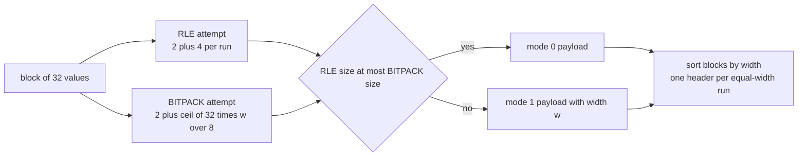
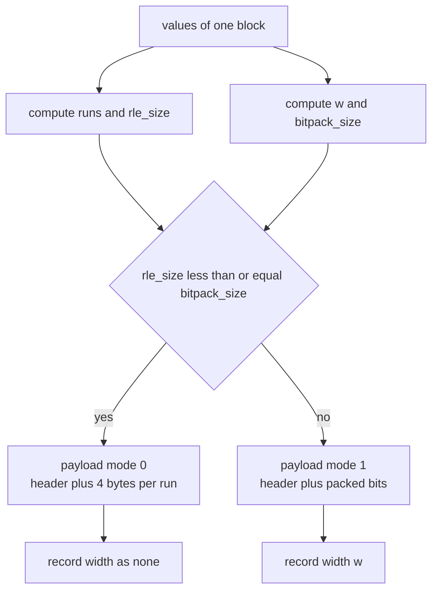
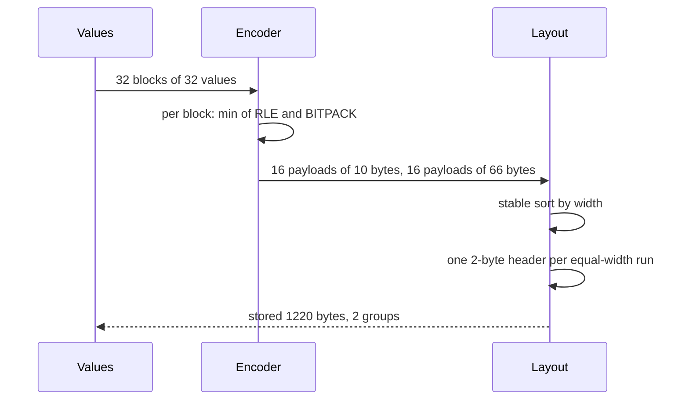

# 488 — Implement compression-aware storage layout simulation.

> **Tier:** Advanced · **CTCI chapter:** Ch 14 — Databases
> **Task spec:** [488-implement-compression-aware-storage-layout-simulation.md](../../../tasks/advanced/488-implement-compression-aware-storage-layout-simulation.md)
> **Solutions:** [Python](../../../solutions/python/advanced/488-implement-compression-aware-storage-layout-simulation/solution.py) ·
> [Java](../../../solutions/java/advanced/488-implement-compression-aware-storage-layout-simulation/Solution.java) ·
> [JavaScript](../../../solutions/javascript/advanced/488-implement-compression-aware-storage-layout-simulation/solution.js) ·
> [C#](../../../solutions/csharp/advanced/488-implement-compression-aware-storage-layout-simulation/Solution.cs)

## 1. Problem restatement

**Input:** a flat list of non-negative 16-bit integers, cut into blocks of `32` (the last block may
be shorter).

**Output:** an encoded layout plus the exact byte count `stored_bytes`, with the rules the solution
headers document:

- **RLE.** Header of 2 bytes (`mode = 0`, run count) plus 4 bytes per run (16-bit value, 16-bit run
  length).
- **BITPACK.** Header of 2 bytes (`mode = 1`, bit width `w`) plus `ceil(count * w / 8)` bytes,
  packed LSB-first, where `w = max(1, max bit length of the block's values)`. For values below
  `2^31`, bit packing with `w <= 31` is never worse than a raw 32-bit copy, so raw mode is not needed.
- **Cheaper wins**, decided by exact byte count, with a documented **tie rule: RLE first**.
- **Compression-aware layout.** Blocks are grouped by similarity — a stable sort by bit width puts
  similar blocks next to each other, and consecutive blocks sharing a width cost **one** 2-byte group
  header for the whole run instead of per-block overhead. `stored_bytes` counts group headers plus
  per-block payloads only.

| Scenario | Expected |
| --- | --- |
| `[7] * 32` | RLE, `1` run, payload `6` bytes, round-trips |
| `[0] * 32` | RLE, payload `6` bytes — a tie with bit packing at `w = 1`, and RLE wins |
| `[0, 1, 2, 3] * 8` | BITPACK with `w = 2`, payload `2 + 8 = 10` bytes |
| `[65535, 0, 12345, 65534] * 8` | BITPACK with `w = 16`, payload `2 + 64 = 66` bytes |
| `list(range(1, 33))` | BITPACK with `w = 6` (RLE would need `32` runs and `130` bytes) |
| 1024 ints in `{0..3}` seeded from an LCG | 32 blocks, `groups == 1`, `stored == 32 * 10 + 2 == 322`, and `322 <= 4096 // 3` |
| 512 narrow + 512 full-range ints | `groups == 2`, `stored == 16 * 10 + 16 * 66 + 2 * 2 == 1220` |
| `[5] * 33` | blocks of lengths `[32, 1]`, `groups == 2`, `stored == 6 + 3 + 2 + 2 == 13` |

Every case asserts an exact round-trip: `decode_layout(layout, lengths)` must reproduce the original
blocks value for value.

## 2. Intuition

The naive layout writes every value as a 32-bit integer, so 1 024 small values cost 4 096 bytes even
though each one fits in two bits. Generic byte-oriented compressors recover some of that, but they
must first build dictionaries and match windows; a columnar store already knows the structure of its
data and can choose an encoding per block, deterministically and cheaply.

Two encodings cover the two shapes columnar data actually takes:

- **repetition** — a block of `[7] * 32` is one run, and RLE says so in 6 bytes;
- **narrow values** — a block of `[0, 1, 2, 3] * 8` has no repetition worth encoding, but every value
  fits in 2 bits, so bit packing says so in 10 bytes.

Choosing between them needs no heuristic: both sizes are computable exactly before encoding, so the
chooser is a comparison. The `w = max(1, ...)` clamp matters here because `bit_length(0) == 0`, and a
block of zeros must still occupy a byte-aligned payload rather than a zero-bit one.

The second half of the task is where "compression-aware" pays off twice. Two blocks need not be
similar in *values* — only in *width* — to share infrastructure. The layout sorts blocks by width and
charges one 2-byte group header per run of equal widths, so a table whose columns have two distinct
cardinalities ends up with two groups and no per-block headers at all.



The key insight is that **the encoding choice and the layout choice are both exact byte
comparisons**. There is no sampling, no statistics and no fallback: `rle_size <= bitpack_size` picks
the mode, and the stable sort by width picks the neighbours. That is what makes the layout
reproducible byte for byte in four languages.

## 3. Algorithm

1. **Run-length encode the block.** Scan the values, extending the last run when the value repeats,
   else starting a new run. `rle_size = 2 + 4 * run_count`.
2. **Size the bit-packed form.** `w = max(1, max bit_length(value))` over the block;
   `bitpack_size = 2 + ceil(count * w / 8)`.
3. **Choose.** If `rle_size <= bitpack_size`, emit mode `0` with the header `(mode, run_count)` and
   each run as two little-endian 16-bit halves; otherwise emit mode `1` with the header `(mode, w)`
   and the values packed LSB-first.
4. **Pack LSB-first.** Accumulate `acc |= value << bits`, and flush whole bytes as they fill; after
   the loop, flush the remaining partial byte if any, then assert the payload length matches
   `bitpack_size`.
5. **Group.** Encode every block, then order block indices by `(width or -1, original index)` — a
   stable sort, so RLE blocks (`width = none`, key `-1`) come first and equal widths keep their
   relative order.
6. **Assemble.** Walk the ordered blocks; when the width differs from the previous one, start a new
   group and add a 2-byte header. Add each payload length to `stored_bytes`.
7. **Decode.** Use the recorded `index` to place every block back in its original position and the
   recorded lengths to know each block's `count`.

```text
function bit_length(value)
    return number of bits needed to write value in binary
end

function encode_block(values)
    runs ← run-length encode values
    rle_size ← 2 + 4 * length(runs)
    w ← max(1, max bit_length over values)
    bitpack_size ← 2 + ceil(length(values) * w / 8)
    if rle_size &lt;= bitpack_size then
        payload ← bytes [0, length(runs)] then for each run its value and length as 16-bit pairs
        return record with mode 0, width none, payload, run_count
    end
    payload ← bytes [1, w] then values packed LSB-first at w bits each
    assert length(payload) = bitpack_size
    return record with mode 1, width w, payload, run_count none
end

function build_layout(blocks)
    infos ← map encode_block over blocks
    order ← indices sorted stably by (width or -1, index)
    layout ← empty list
    stored ← 0
    groups ← 0
    previous_width ← none
    for index in order do
        width ← infos[index].width or -1
        if width is not previous_width then
            groups ← groups + 1
            stored ← stored + 2
            previous_width ← width
        end
        stored ← stored + length(infos[index].payload)
        append (index, groups - 1, infos[index]) to layout
    end
    return layout, stored, groups
end
```

Two details do the real work. In step 3 the comparison is `<=`, which is the documented tie rule that
makes `[0] * 32` RLE (both forms cost 6 bytes). In step 5 the sort key is a tuple whose first element
is `-1` for RLE blocks, so all RLE blocks land in one contiguous group ahead of the bit-packed ones.



## 4. Worked example

**Choosing a mode.** All sizes below are exact and come straight from the formulas:

| Values | Runs | `rle_size` | `w` | `bitpack_size` | Chosen |
| --- | --- | --- | --- | --- | --- |
| `[7] * 32` | 1 | `2 + 4 = 6` | 3 | `2 + 12 = 14` | RLE (6 bytes) |
| `[0] * 32` | 1 | `6` | `max(1, 0) = 1` | `2 + 4 = 6` | RLE — the tie rule |
| `[0, 1, 2, 3] * 8` | 32 | `2 + 128 = 130` | 2 | `2 + 8 = 10` | BITPACK |
| `[65535, 0, 12345, 65534] * 8` | 32 | `130` | 16 | `2 + 64 = 66` | BITPACK |
| `range(1, 33)` | 32 | `130` | 6 | `2 + 24 = 26` | BITPACK |

The second row is the only tie in the suite, and it is worth reading twice: a constant block of zeros
has `bit_length(0) = 0`, so the clamp `max(1, ...)` sets `w = 1`, the packed payload becomes
`32 * 1 / 8 = 4` bytes, and both encodings land on 6 bytes total. The tie rule resolves it to RLE,
which is why the test asserts `mode == MODE_RLE` for both `[7] * 32` and `[0] * 32`.

The third row shows the crossover. RLE pays 4 bytes per run, so a perfectly alternating block costs
`130` bytes — thirteen times what bit packing needs for the same block. Bit packing does not care
about repetition at all; it only cares that the values are narrow, and 2 bits each is `8` bytes for
the whole block.

**Grouping into a layout.** The skewed case writes 1 024 values in `{0..3}` (the first sixteen are
`2, 3, 3, 0, 2, 1, 1, 3, 1, 2, 2, 2, 0, 0, 3, 1`) and cuts them into 32 blocks of 32:

| Property | Value | Why |
| --- | --- | --- |
| distinct widths | `{2}` | every value is below 4, so 2 bits suffice for every block |
| payload per block | `10` bytes | `2` header bytes + `ceil(32 · 2 / 8) = 8` |
| groups | `1` | the stable sort puts all 32 equal-width blocks in one run |
| group headers | `2` bytes | one header for the whole run |
| `stored_bytes` | `322` | `32 · 10 + 2` |
| raw size | `4096` | `1024 · 4` |

That is `7.9%` of raw, and the assertion `stored <= raw // 3` states the same thing as a bound. The
mixed case splits 1 024 values into 512 narrow and 512 full-range ones, giving 16 blocks of width `2`
(`10` bytes each) and 16 of width `16` (`66` bytes each). Sorting by width puts the narrow blocks
first, so the layout has exactly two groups, and the total is
`16 · 10 + 16 · 66 + 2 · 2 = 1220` bytes against `4096` raw. The test also counts the *transitions* in
the payload-order width sequence and requires `changes == groups - 1 == 1`, which is the assertion
that similar blocks really are adjacent rather than merely co-located somewhere.



**The short trailing block.** `[5] * 33` splits into a 32-value block and a 1-value block. The first
is a constant run: RLE costs 6 bytes and bit packing at `w = 3` costs `2 + 12 = 14`, so RLE wins. The
second has a single value, so RLE costs `2 + 4 = 6` while bit packing at `w = 3` costs
`2 + ceil(3 / 8) = 3` — and this time BITPACK wins. Two modes, two widths (`none` and `3`), so two
groups and `stored == 6 + 3 + 2 + 2 == 13`, with the round-trip still exact because `decode_layout`
is given the per-block `count` from the length list.

## 5. Complexity

Let `B` be the number of blocks, `n = 32B` the number of values, `r` the runs in a block and
`w` its bit width.

| Measure | Bound | Why it holds |
| --- | --- | --- |
| Time, `encode_block` | O(n + r) | one pass for runs, one pass for the maximum bit length, one pass to pack |
| Time, `build_layout` | O(B log B + total bytes) | a stable sort over `B` keys plus a linear assembly pass |
| Time, `decode_block` | O(n) | unpacking reads each value once; RLE expands runs directly |
| Space, payload | `2 + 4r` bytes (RLE) or `2 + ceil(32w/8)` bytes (BITPACK) per block | the two documented formulas |
| Space, layout | O(total payload + groups) | group headers are amortised: one 2-byte header per run of equal widths |
| Space, raw comparison | `4n` bytes | 32-bit values, the baseline the skewed case beats by more than 3× |

The saving comes from *both* formulas being value-dependent. RLE's cost grows with the number of
runs, so it wins on repetition; bit packing's cost grows with the width, so it wins on narrow values.
The layout's group headers shrink the last fixed cost: with one group, 32 blocks share a single
2-byte header instead of paying 2 bytes each. Against the raw alternative the skewed case stores
`322` bytes where `4096` were needed, and the general bound the test asserts is
`stored <= raw / 3`.

## 6. Pitfalls and edge cases

- **The tie rule is load-bearing.** `rle_size <= bitpack_size` picks RLE, which puts a constant
  `[0] * 32` block in mode `0` at 6 bytes rather than mode `1` at 6 bytes. Reversing the comparison
  would still round-trip but would fail the pinned `mode` assertions.
- **`max(1, ...)` for the width.** `bit_length(0)` is `0`, and a width of `0` would produce a
  payload of the header alone — a block that cannot be decoded. The clamp is why `[0] * 32` sizes at
  `w = 1`.
- **LSB-first packing needs a final partial flush.** Packing accumulates `value << bits` and flushes
  whole bytes as they fill; the leftover bits must be flushed once after the loop, and the assertion
  `len(payload) == bitpack_size` is what catches a missing or extra byte.
- **The last block may be short.** `[5] * 33` produces blocks of `32` and `1`, and the layout stores
  no length per block — `decode_layout` is handed the lengths. A decoder that assumes 32 would read
  past the payload.
- **RLE blocks group under the sentinel `-1`.** Their width is `none`, which sorts as `-1` so all RLE
  blocks form the first group. Using `0` instead would not break this dataset (real widths are at
  least `1`) but would silently merge different shapes if a zero-width encoding were ever added.
- **The sort must be stable.** Equal widths keep their original relative order, which keeps the
  layout deterministic and lets `decode_layout` recover positions from the stored `index`. An
  unstable sort would make the byte stream language-dependent.
- **Group headers are counted once per run.** `stored_bytes` adds 2 bytes when the width changes, not
  per block; the skewed case pins `322 = 320 + 2`, so double-counting would show up immediately.
- **Values are non-negative and fit 16 bits.** RLE stores each value as two little-endian bytes, so a
  negative or over-`65535` value would silently truncate; the tests only use values in range.
- **The run count is one byte.** The RLE header stores `run_count` in a single byte, which is
  comfortable for 32-value blocks (at most 32 runs) but would need care for larger blocks.
- **Round-trips are exact, not approximate.** Every case asserts `decode_layout(...) == blocks`,
  including the mixed case where RLE and BITPACK blocks sit in the same layout. A decoder that
  ignored `mode` would drift onto the wrong byte boundary immediately.

## 7. Variants and follow-ups

- **Reading what the layout stores.**
  [484-implement-simple-key-value-store-with-memtable-sstable.md](../../../tasks/advanced/484-implement-simple-key-value-store-with-memtable-sstable.md)
  is where these blocks would live, and
  [487-implement-prefetching-simulation-for-sequential-access-patterns.md](../../../tasks/advanced/487-implement-prefetching-simulation-for-sequential-access-patterns.md)
  is the access pattern that makes sequential block reads cheap.
- **Deciding what stays in memory.**
  [485-implement-cache-eviction-policies-lru-lfu-arc-simulate.md](../../../tasks/advanced/485-implement-cache-eviction-policies-lru-lfu-arc-simulate.md)
  and [486-implement-adaptive-replacement-cache-arc-outline-test.md](../../../tasks/advanced/486-implement-adaptive-replacement-cache-arc-outline-test.md)
  govern the level above the layout, where the trade-off is entries rather than bytes.
- **More encodings.** A dictionary encoding for low-cardinality string columns, delta encoding for
  sorted integers and frame-of-reference encoding for narrow ranges all follow the same shape: compute
  the exact size of each candidate and take the cheaper one. The tie rule and the "no raw mode needed"
  argument are specific to the two encodings implemented here.
- **Similarity beyond width.** The grouping rule uses bit width as the similarity key. A real engine
  might group by dictionary identity or by sortedness instead — the mechanism (stable sort, one header
  per run) stays the same.

## 8. Check yourself

**Q1.** Why is `[0] * 32` encoded as RLE and not bit packing, when both cost 6 bytes?

<details><summary>Show answer</summary>

Because the chooser is `if rle_size <= bitpack_size` — the documented tie rule gives RLE the win. The
sizes are equal for this block: one run of 32 zeros costs `2 + 4 = 6` bytes, and bit packing with the
clamped width `w = max(1, 0) = 1` costs `2 + ceil(32 · 1 / 8) = 6` bytes.
</details>

**Q2.** A block of `[0, 1, 2, 3] * 8` needs `130` bytes as RLE but only `10` as BITPACK. Which half of
each formula causes that?

<details><summary>Show answer</summary>

RLE pays per **run**: 32 runs of length 1 cost `4 · 32 = 128` bytes plus the 2-byte header. BITPACK
pays per **bit of width**: all four values fit in 2 bits, so `32 · 2 / 8 = 8` payload bytes plus the
header. Repetition is what RLE exploits and this block has none; narrowness is what BITPACK exploits
and this block has plenty.
</details>

**Q3.** The skewed layout stores 322 bytes for 1024 values. Account for every byte.

<details><summary>Show answer</summary>

`32` blocks, each `10` bytes: a 2-byte header (`mode = 1`, `w = 2`) plus `ceil(32 · 2 / 8) = 8`
packed bytes, so `32 · 10 = 320`. The single width group adds one 2-byte group header, giving `322`.
That is `7.9%` of the `4096` bytes the values would take as raw 32-bit integers.
</details>

**Q4.** What does the assertion `changes == groups - 1` prove about the mixed layout?

<details><summary>Show answer</summary>

It proves the blocks are actually *grouped by similarity*. `changes` counts adjacent width
transitions in payload order; a correct layout has exactly one transition per group boundary, i.e.
`groups - 1`. The mixed case has `2` groups and one transition — all 16 width-2 blocks, then all 16
width-16 blocks — so no equal-width run is broken up by an out-of-place block.
</details>

**Q5.** Why does the header not need to store each block's value count?

<details><summary>Show answer</summary>

Because the decoder is given the lengths: `decode_layout(layout, lengths)` looks up
`lengths[entry["index"]]`, and RLE additionally asserts that expanding the runs produced exactly
`count` values. The block size is `32` for every block except a possibly shorter last one, so storing
it per block would be redundant overhead — and overhead is exactly what this task measures.
</details>
