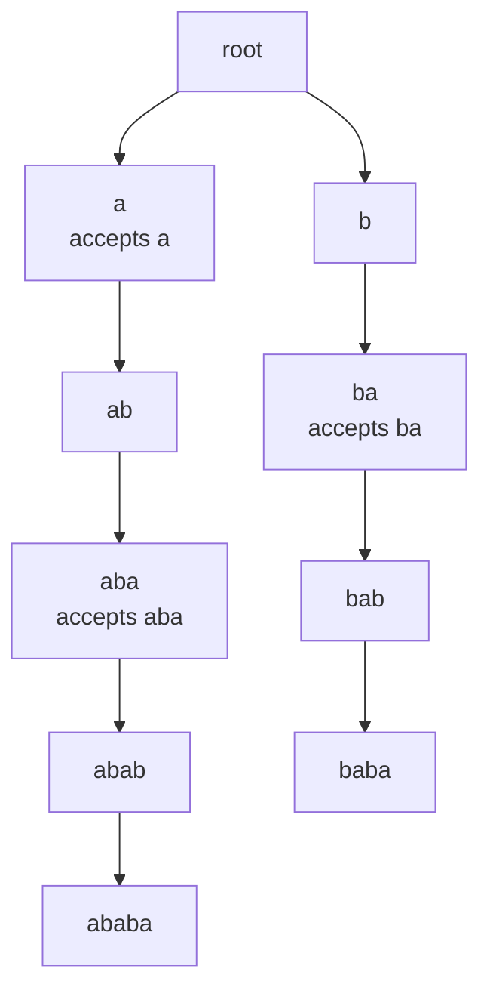
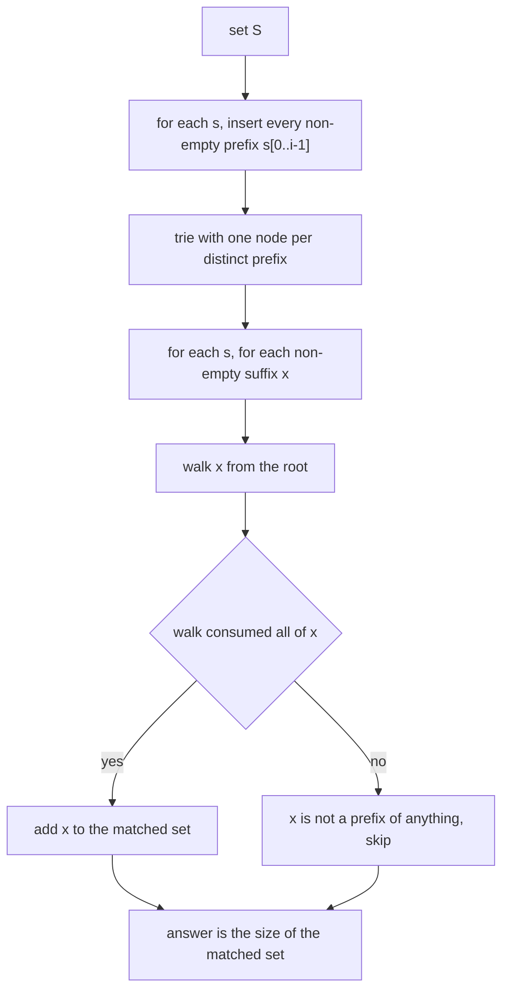
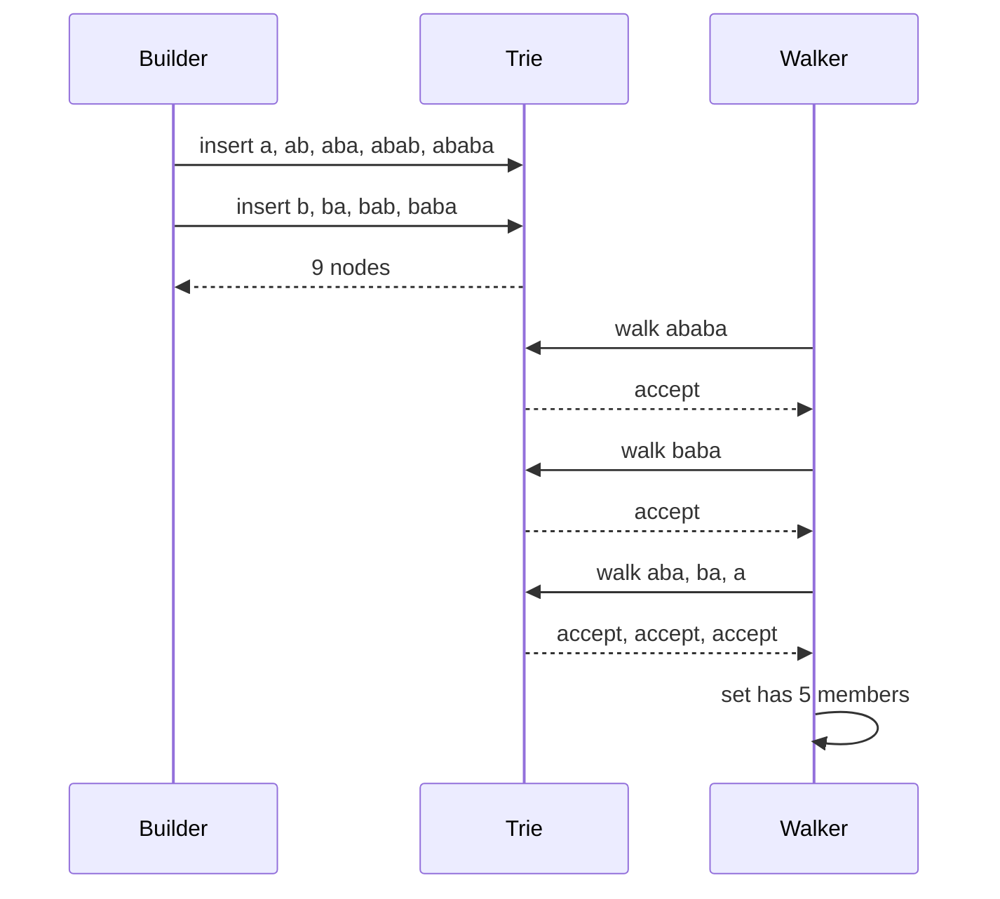

# 489 — Implement suffix-prefix automaton based string counting (advanced).

> **Tier:** Advanced · **CTCI chapter:** Beyond — Advanced Data Structures & Algorithms
> **Task spec:** [489-implement-suffix-prefix-automaton-based-string-counting-advanced.md](../../../tasks/advanced/489-implement-suffix-prefix-automaton-based-string-counting-advanced.md)
> **Solutions:** [Python](../../../solutions/python/advanced/489-implement-suffix-prefix-automaton-based-string-counting-advanced/solution.py) ·
> [Java](../../../solutions/java/advanced/489-implement-suffix-prefix-automaton-based-string-counting-advanced/Solution.java) ·
> [JavaScript](../../../solutions/javascript/advanced/489-implement-suffix-prefix-automaton-based-string-counting-advanced/solution.js) ·
> [C#](../../../solutions/csharp/advanced/489-implement-suffix-prefix-automaton-based-string-counting-advanced/Solution.cs)

## 1. Problem restatement

**Input:** a finite set `S` of strings.

**Output:** the number of **distinct** strings `x` that are simultaneously a non-empty prefix of some
`s` in `S` and a non-empty suffix of some `s` in `S` — that is, `|P ∩ Q|` where

- `P = { s[:i] : s in S, 1 <= i <= |s| }` (non-empty prefixes),
- `Q = { s[j:] : s in S, 0 <= j < |s| }` (non-empty suffixes).

`count_prefix_suffix_intersection(strings)` returns the count along with two diagnostics: `walked`
(the number of suffixes fed to the automaton) and `trie.size` (the number of automaton nodes).

| Call | Result | Set |
| --- | --- | --- |
| `["ababa", "baba"]` | `5` | `{a, aba, ba, baba, ababa}` |
| `["abc"]` | `1` | `{abc}` |
| `["a"]` | `1` | `{a}` |
| `["ab", "ba"]` | `4` | `{a, b, ab, ba}` |
| `["aaaa"]` | `4` | `{a, aa, aaa, aaaa}` |
| 30 LCG sets of 5 strings over `{a, b}`, lengths 1..12 | total `330` across the sets | each checked against brute force |
| 6 LCG strings over `{a, b, c}`, lengths 1..14 (seed 777) | `11` | `{a, aa, aaa, c, ca, cb, acca, cbccccb, aaacacbbc, caaabcbabaaa, cbbbabcabaabcb}` |

The tests also assert that the automaton accepts **exactly** `P` (its node count equals `|P|`), that
`walked` equals the sum of all string lengths, and that duplicate strings collapse: counting
`["abc", "abc", "abc"]` gives the same answer as `["abc"]`.

## 2. Intuition

The brute-force reading of the problem is: build the set `P`, build the set `Q`, intersect them.
That is correct and short, and it is exactly what `brute_prefix_suffix_intersection` does in the
tests — but it materialises every prefix and every suffix as a separate string. For a string of
length `m` that is `m` strings totalling `m(m+1)/2` characters in each set, so the naive structure
costs `O(Σ|s|²)` **space** before the intersection even starts.

A trie of the prefixes removes that duplication. Inserting every `s[:i]` into a trie shares all the
common heads, so the structure has at most `Σ|s|` nodes and, more importantly, it *is* a recogniser:
the label of the path from the root to a node is a prefix of some string in `S`. That is what the
tests pin — `trie.size == len(prefixes)` and `trie.accepts(x)` for every `x in P`.

Once the trie is the recogniser, the intersection stops being a set operation and becomes a walk:
for each suffix `x = s[j:]`, follow `x` from the root. If every step succeeds, `x` is in `P`, and
since `x` is by construction in `Q`, it belongs to `P ∩ Q`. A set collects the accepted `x` so each
distinct string is counted once.



The picture is the prefix automaton of `{"ababa", "baba"}`: nine nodes for the nine members of `P`,
and the two nodes labelled with accepting examples are the ones a suffix walk can land on. Reading a
suffix down from the root either reaches a node — accepted, the path label is in `P` — or tries to
follow a missing child and is rejected. The walk needs no extra memory beyond the current node.

The key insight is that **a shared-prefix trie is already an automaton for "is a prefix"**. The
question "is `x` a prefix of something in `S`?" is answered by "does the trie have a path labelled
`x`?", which costs `O(|x|)` time and no per-query allocation.

## 3. Algorithm

1. **Build the prefix set implicitly.** For every `s` in `S` and every `i` from `1` to `|s|`, insert
   the prefix `s[:i]` into a trie. Inserting shares paths, so the trie has exactly `|P|` nodes.
2. **Walk every suffix.** For every `s` in `S` and every `j` from `0` to `|s| - 1`, take the suffix
   `x = s[j:]` and walk it from the root of the trie.
3. **Record the acceptances.** If the walk consumes all of `x`, add `x` to a set of matches.
4. **Answer.** Return the size of that set, plus the number of walks and the node count.

```text
procedure insert(root, word)
    node ← root
    for ch in word do
        if ch is not a child of node then
            add a new child for ch to node
            root.size ← root.size + 1
        end
        node ← child of node for ch
    end
end

function accepts(root, word)
    node ← root
    for ch in word do
        node ← child of node for ch
        if node is none then
            return false
        end
    end
    return true
end

function count_prefix_suffix_intersection(strings)
    root ← new trie node
    for s in strings do
        for i ← 1 to length(s) do
            insert(root, s[0 .. i - 1])
        end
    end
    matched ← empty set
    walked ← 0
    for s in strings do
        for j ← 0 to length(s) - 1 do
            x ← s[j .. end]
            walked ← walked + 1
            if accepts(root, x) then
                add x to matched
            end
        end
    end
    return (size(matched), walked, root.size)
end
```

Two bounds are worth reading off the pseudocode. The insert loop starts at `i = 1`, so the **empty
prefix is never inserted**; the walk loop runs `j < |s|`, so the **empty suffix is never tested** —
the problem asks for non-empty `x` on both sides, and both loops enforce it structurally. The set
`matched` is what turns the walk results into a distinct count: `["abc", "abc"]` walks `abc` twice
and counts it once.



The whole computation is one pass of insertions followed by one pass of walks — there is no second
set to intersect, and no string is ever materialised outside the input.

## 4. Worked example

Take `S = {"ababa", "baba"}`. The prefix set is
`P = {a, ab, aba, abab, ababa, b, ba, bab, baba}` — nine strings — and the trie above has exactly
nine nodes, which is the `trie.size == len(prefixes)` invariant the tests assert.

Walking every suffix from the root:

| Walk | Suffix `x` | Path in the trie | Accepted? | Matched so far |
| --- | --- | --- | --- | --- |
| 1 | `ababa` | a → ab → aba → abab → ababa | yes | `{ababa}` |
| 2 | `baba` | b → ba → bab → baba | yes | `{ababa, baba}` |
| 3 | `aba` | a → ab → aba | yes | `{ababa, baba, aba}` |
| 4 | `ba` | b → ba | yes | `{ababa, baba, aba, ba}` |
| 5 | `a` | a | yes | `{ababa, baba, aba, ba, a}` |
| 6 | `baba` | b → ba → bab → baba | yes | unchanged — `baba` is already counted |
| 7 | `aba` | a → ab → aba | yes | unchanged |
| 8 | `ba` | b → ba | yes | unchanged |
| 9 | `a` | a | yes | unchanged |

`walked == 9` (five suffixes of `ababa`, four of `baba`) and the matched set has five members, so the
answer is `5`. Walks 6–9 re-derive strings already in the set, which is exactly why the answer is a
size of a *set* and not a count of acceptances: the same suffix can appear in several strings, and
the two identical suffixes `baba`/`aba`/`ba`/`a` of `ababa` are also suffixes of `baba`.

A trace with rejections is more informative. For `S = {"abc", "cba", "bac"}`:

| Walk | Suffix | Path | Accepted? |
| --- | --- | --- | --- |
| 1 | `abc` | a → ab → abc | yes |
| 2 | `bc` | b → bc: no child after `b` | **no** |
| 3 | `c` | c | yes |
| 4 | `cba` | c → cb → cba | yes |
| 5 | `ba` | b → ba | yes |
| 6 | `a` | a | yes |
| 7 | `bac` | b → ba → bac | yes |
| 8 | `ac` | a → ac: no child after `a` | **no** |
| 9 | `c` | c | yes (already counted) |

Seven of the nine walks are accepted, and the matched set is `{abc, c, cba, ba, a, bac}` — five
members, because walks 3 and 9 both accept `c`. Walk 2 fails at the second character: `bc` is not a
prefix of anything in `S`. That failure is what makes the automaton worth building: the trie answers
"no" in two steps instead of searching a list of nine prefixes.



The LCG-generated cases exercise the same code on sets where most suffixes are rejected. Thirty sets
of five strings over `{a, b}` with lengths in `1..12` sum to a pinned total of `330` matches, and each
individual answer is compared against the brute-force intersection. The larger case uses a third
letter, six strings of up to length `14` (seed 777), and pins `11` matches over `48` walks and `42`
trie nodes — fewer nodes than characters inserted, because the strings share prefixes.

## 5. Complexity

Let `S = {s_1, ..., s_k}` and write `Σ|s|` for the total input length.

| Measure | Bound | Why it holds |
| --- | --- | --- |
| Time, build | O(Σ|s|²) | every prefix `s[:i]` is inserted character by character, and prefix lengths sum to `m(m+1)/2` per string |
| Time, walks | O(Σ|s|²) | every suffix `s[j:]` is walked character by character; the suffixes of one string also sum to `m(m+1)/2` |
| Time, total | O(Σ|s|²) | both phases are quadratic per string, and the header documents this as fine for the small sets used here |
| Space, automaton | O(|P|) nodes, so O(Σ|s|) | shared prefixes collapse; the larger case has `42` nodes for `48` characters |
| Space, matched set | O(|P ∩ Q|) strings | only accepted suffixes are stored, and each only once |
| Space, brute force | O(Σ|s|²) characters | the naive version stores every prefix and every suffix in full before intersecting |

The asymptotic time of the two approaches is the same — both walk every prefix-suffix pair in the
worst case — so the automaton's win is in **space and allocation**. The naive version materialises
`P` and `Q` as sets of strings, which for a length-`m` string means `m` strings and `m(m+1)/2`
characters per set; the trie materialises `|P|` nodes and reuses them for every walk. The tests make
that comparison explicit by running both and requiring equal answers.

## 6. Pitfalls and edge cases

- **Both sides must be non-empty.** The insert loop starts at `i = 1` (no empty prefix) and the walk
  loop stops at `j = |s| - 1` (no empty suffix). Including the empty string would add it to `P ∩ Q`
  for every non-empty input and shift every pinned count by one.
- **A string is a prefix and suffix of itself.** So `["abc"]` yields `1` and `["aaaa"]` yields `4`
  (`a`, `aa`, `aaa`, `aaaa`), never `0` — the full string always qualifies.
- **Repeated suffixes must be counted once.** `S = {"ababa", "baba"}` walks `aba` twice and `a` twice;
  the answer is the size of a set, `5`, not the nine acceptances. The test
  `count(["abc", "abc", "abc"]) == count(["abc"])` pins the duplicate-string version of the same rule.
- **Duplicate input strings collapse.** The problem is over a *set* `S`; inserting `abc` three times
  adds no nodes and walking its suffixes three times adds nothing new to the matched set.
- **The trie node count is the prefix count.** The tests assert `trie.size == len(prefixes)` and that
  every member of `P` is accepted, plus `not trie.accepts("zzz")` for a string that cannot be a
  prefix of anything in `S`.
- **`walked` is the suffix count, not the answer.** It equals `sum(len(s) for s in strings)`, which
  the tests check on every generated set — a useful way to detect a loop that accidentally skips the
  last suffix.
- **Rejection is cheap and early.** The walk returns false the moment a child is missing, so `bc` in
  the `{"abc", "cba", "bac"}` example costs two steps rather than a comparison against every prefix.
- **Alphabet size is not fixed.** Children are stored in a map keyed by character, so `{a, b}` and
  `{a, b, c}` traces use the same code. Characters are compared as single units, so this is a
  code-unit automaton, not a Unicode-collation-aware one.
- **Single-character inputs.** `["a"]` gives one trie node and one walk, answer `1`; the walk `a` finds
  the child immediately. `["ab", "ba"]` gives four nodes and four walks, all accepted.
- **The brute force is the oracle.** Every generated set is checked against the set-intersection
  implementation, so a bug in the walk (a missing prefix, a wrong suffix range) shows up as a count
  mismatch on one of the thirty sets rather than as a silently different total.

## 7. Variants and follow-ups

- **Counting distinct substrings with a suffix automaton.**
  [404-implement-suffix-automaton-and-count-different-substrings.md](../../../tasks/advanced/404-implement-suffix-automaton-and-count-different-substrings.md)
  builds the same "one state per distinct substring" idea on the suffix side, which is the automaton
  this task would use if the prefix set were too large for a trie.
- **Recognising a whole set at once.**
  [405-implement-minimal-dfa-for-string-set-conceptual.md](../../../tasks/advanced/405-implement-minimal-dfa-for-string-set-conceptual.md)
  minimises a trie into a DFA, and
  [314-implement-aho-corasick-for-multiple-pattern-match-outline.md](../../../tasks/intermediate/314-implement-aho-corasick-for-multiple-pattern-match-outline.md)
  matches many patterns against a text in one pass — the dual of walking many substrings against one
  automaton.
- **The same trie, shared prefixes, different question.**
  [309-longest-common-prefix-among-many-strings-trie-or-divide-conquer.md](../../../tasks/intermediate/309-longest-common-prefix-among-many-strings-trie-or-divide-conquer.md)
  reads the trie's structure rather than walking queries through it.
- **Membership in bounded space.** When the exact answer is not needed, a probabilistic filter can
  answer "have I seen this prefix?" with a tiny footprint — see
  [482-implement-bloom-filter-per-sstable-prototype-and-test.md](../../../tasks/advanced/482-implement-bloom-filter-per-sstable-prototype-and-test.md),
  whose probe walk is the same idea with one bit per probe instead of one node per prefix.

## 8. Check yourself

**Q1.** Why does the automaton have exactly `|P|` nodes?

<details><summary>Show answer</summary>

Because every node is reached by exactly one path label from the root, and the set of path labels is
precisely the set of prefixes inserted. Two strings sharing a head share those nodes, so a node is
created once per *distinct* prefix — `9` nodes for `{"ababa", "baba"}` and `42` for the six-string
`{a, b, c}` case. The tests assert both directions: `trie.size == len(prefixes)` and
`accepts(x)` for every prefix `x`.
</details>

**Q2.** Nine walks in the `{"ababa", "baba"}` example produce nine acceptances but the answer is `5`.
Why?

<details><summary>Show answer</summary>

Because the answer counts *distinct* strings in `P ∩ Q`. The suffixes `baba`, `aba`, `ba` and `a`
appear in both input strings, so walks 6–9 re-derive strings already matched. The accepted strings go
into a set, and the answer is that set's size: `{a, aba, ba, baba, ababa}`.
</details>

**Q3.** The brute-force implementation returns the same answers. What does the automaton buy?

<details><summary>Show answer</summary>

Space and allocation, not asymptotic time. Both approaches cost `O(Σ|s|²)` per-string work, but the
naive one materialises every prefix and every suffix as a full string — `m(m+1)/2` characters per set
for a length-`m` string — while the trie shares prefixes and stores `O(Σ|s|)` nodes. The walk then
costs only the characters of the query.
</details>

**Q4.** What would break if the insert loop started at `i = 0`?

<details><summary>Show answer</summary>

The empty string would join `P` (via an insertion that adds no nodes) and the walk loop would still
never test it, so the *count* would be unchanged — but the invariant `trie.size == len(prefixes)`
would fail, because `len(prefixes)` as computed by the brute-force helper uses `i` from `1`. More
importantly the contract says non-empty prefixes, so inserting the empty string would be a silent
spec violation that only the diagnostic assertions catch.
</details>

**Q5.** Where does the `walked == sum(len(s) for s in strings)` assertion come in useful?

<details><summary>Show answer</summary>

It verifies that every suffix of every string was fed to the automaton exactly once. A loop bound bug
(`range(len(s) - 1)` instead of `range(len(s))`, say) would drop the single-character suffixes and
produce a lower answer on traces where those suffixes are prefixes, such as `["ab", "ba"]`; the
`walked` count catches the loop bug directly instead of leaving the failure to be inferred from a
wrong total.
</details>
