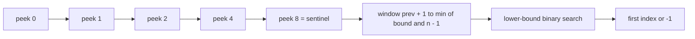
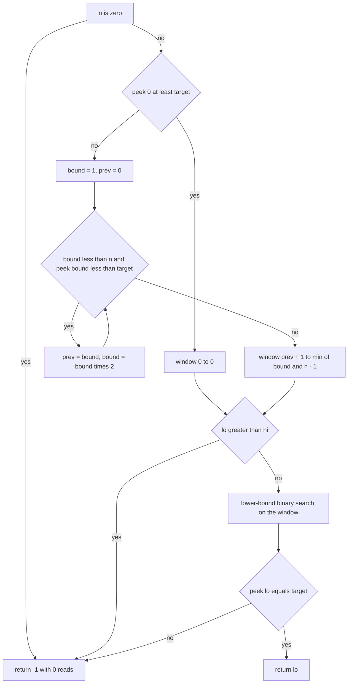
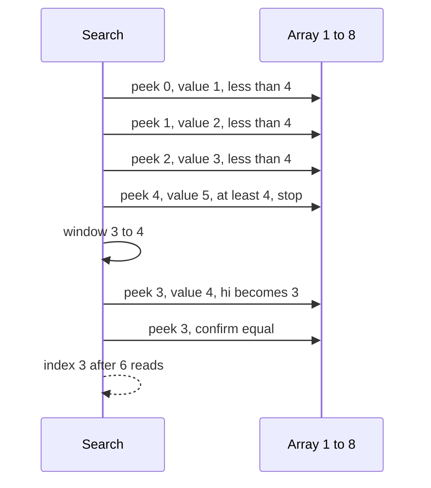

# 490 — Implement exponential search for unbounded arrays.

> **Tier:** Advanced · **CTCI chapter:** Ch 10 — Sorting and Searching
> **Task spec:** [490-implement-exponential-search-for-unbounded-arrays.md](../../../tasks/advanced/490-implement-exponential-search-for-unbounded-arrays.md)
> **Solutions:** [Python](../../../solutions/python/advanced/490-implement-exponential-search-for-unbounded-arrays/solution.py) ·
> [Java](../../../solutions/java/advanced/490-implement-exponential-search-for-unbounded-arrays/Solution.java) ·
> [JavaScript](../../../solutions/javascript/advanced/490-implement-exponential-search-for-unbounded-arrays/solution.js) ·
> [C#](../../../solutions/csharp/advanced/490-implement-exponential-search-for-unbounded-arrays/Solution.cs)

## 1. Problem restatement

**Input:** an array sorted ascending in which the search must **not** need to know the length, and a
`target`.

**Output:** `exponential_search(arr, target)` returns a triple `(index, reads, max_index)`:

- `index` — the **first** index holding `target`, or `-1`;
- `reads` — how many element peeks the search performed;
- `max_index` — the largest real index that was ever touched.

The documented model, straight from the solution headers:

- A **sentinel** `+infinity` sits at the virtual index `n`, so the doubling phase may "look at"
  index `n` without ever reading past `n - 1`. The `peek(idx)` helper returns the sentinel for
  `idx >= n` and records `max_index`.
- The search is **cold start**: it begins at index `0` with no knowledge of `n`.
- After the doubling phase the answer, if present, lies in `[prev + 1, min(bound, n - 1)]`, and the
  search finishes with an ordinary lower-bound style binary search over that window.

| Call | Result |
| --- | --- |
| `exponential_search([], 5)` | `(-1, 0, -1)` |
| `exponential_search([5], 5)` | `(0, 2, 0)` |
| `exponential_search([5], 4)` | `-1` |
| `exponential_search([5], 6)` | `(-1, 1, 0)` |
| `[1..8]`, target `1` | `(0, 2, 0)` |
| `[1..8]`, target `4` | `(3, 6, 4)` |
| `[1..8]`, target `8` | `(7, 6, 7)` |
| `[1..8]`, target `0` or `9` | `-1` (`2` and `6` reads) |
| `[2, 2, 2, 2]`, target `2` | `(0, ...)` — the *first* of the four duplicates |
| `[2, 2, 2, 2]`, target `3` | `(-1, 4, 3)` |
| `[1, 3, 3, 3, 5]`, target `3` | `(1, 3, 1)` — first occurrence, not `2` or `3` |

The suite also runs 5 LCG arrays of 64 sorted values (seeds `490..494`, values `mod 50`) against 88
targets each — the 64 stored values plus `-1`, `100`, `49`, `50` and 20 drawn values — for 440
comparisons against brute force, splitting into a pinned `389` found and `51` absent. A large case
with `n = 4096` asserts the probe envelope `2 * ceil(log2(n + 1)) + 2`.

## 2. Intuition

A plain binary search needs `hi = n - 1` before it can start. If the array length is unknown — or if
the cost of finding it is not worth paying — the usual approach is a linear scan from index `0`,
which costs `O(i)` probes to find the element at index `i` and `O(n)` to prove absence. For a small
`i` in a huge array that is a bad trade: the answer is nearby, but the scan insists on touching
everything before it.

Exponential search removes the need for `n` by growing a probe index geometrically. Probe index `1`,
then `2`, then `4`, then `8`, and so on until the probe lands on a value `>= target` (or runs past the
array). At that moment the answer is bracketed: the last probe that was still `< target` was at index
`prev`, so the first occurrence is in `(prev, bound]`. A binary search over that window finishes the
job.

The sentinel is what lets the doubling phase be written as if the array were infinite. `peek(n)`
returns `+infinity`, so a probe at or past the end behaves exactly like a probe on a value larger
than any target: the doubling stops, and nothing out of bounds is ever read. The `bound < n` loop
guard keeps the doubling from walking past the sentinel forever.



The key insight is that **the doubling phase pays only for the target's own neighbourhood**. For a
hit at index `i`, the probes are `1, 2, 4, ..., ~i`, so the phase costs `O(log i)` — not `O(i)` for
a scan and not `O(log n)` for a search that has to be handed `n` before it starts.

## 3. Algorithm

1. **Handle the empty array.** If `n == 0`, return `-1` immediately with `reads == 0` — no probe is
   needed and no sentinel is consulted.
2. **Probe index 0.** If `peek(0) >= target`, the target cannot occur later (the array is sorted), so
   the window is `[0, 0]`.
3. **Double.** Otherwise set `bound = 1` and `prev = 0`; while `bound < n` and `peek(bound) < target`,
   record `prev = bound` and double `bound`.
4. **Bracket.** The window is `[prev + 1, min(bound, n - 1)]`. If `lo > hi` the window is empty and
   the answer is `-1`.
5. **Narrow.** Run a lower-bound binary search: while `lo < hi`, take `mid`, and if `peek(mid) < target`
   move `lo = mid + 1`, else `hi = mid`. This converges on the **first** index whose value is
   `>= target`.
6. **Confirm.** Return `lo` if `peek(lo) == target`, else `-1`.

```text
function peek(idx)
    reads ← reads + 1
    if idx &gt;= n then
        return INFINITY          -- sentinel at the virtual index n
    end
    max_index ← max(max_index, idx)
    return arr[idx]
end

function exponential_search(arr, target)
    n ← length(arr)
    reads ← 0
    max_index ← -1
    if n = 0 then
        return (-1, reads, max_index)
    end
    if peek(0) &gt;= target then
        lo ← 0
        hi ← 0
    else
        bound ← 1
        prev ← 0
        while bound &lt; n and peek(bound) &lt; target do
            prev ← bound
            bound ← bound * 2
        end
        lo ← prev + 1
        hi ← min(bound, n - 1)
    end
    if lo &gt; hi then
        return (-1, reads, max_index)
    end
    while lo &lt; hi do
        mid ← (lo + hi) div 2
        if peek(mid) &lt; target then
            lo ← mid + 1
        else
            hi ← mid
        end
    end
    if peek(lo) = target then
        return (lo, reads, max_index)
    end
    return (-1, reads, max_index)
end
```

Step 5 is a *lower-bound* search, not an equality search: it never returns early on a match, because
with duplicates the first occurrence is what the contract asks for. Step 6 then decides whether the
converged position holds the target at all, which is what distinguishes "found" from "the insertion
point".



## 4. Worked example

**Hitting the middle.** `arr = [1, 2, 3, 4, 5, 6, 7, 8]`, `target = 4`:

| Phase | Probe | Value | Comparison | `prev` | `bound` / window |
| --- | --- | --- | --- | --- | --- |
| start | `0` | `1` | `1 < 4`, so double | 0 | `bound = 1` |
| doubling | `1` | `2` | `2 < 4`, so double | 1 | `bound = 2` |
| doubling | `2` | `3` | `3 < 4`, so double | 2 | `bound = 4` |
| doubling | `4` | `5` | `5 >= 4`, stop | 2 | window `[3, min(4, 7)] = [3, 4]` |
| binary | `3` | `4` | `4 >= 4`, so `hi = 3` | — | `lo = hi = 3` |
| confirm | `3` | `4` | `4 == 4` | — | return `3` |

Six reads, and `max_index == 4` is the furthest real index touched. The doubling phase never looked
at `5`, `6`, `7` or `8`: the bracket `[3, 4]` was found in four probes, which is the whole point of
starting from index `0` instead of from `n - 1`.

**Hitting the last element.** The same array with `target = 8`:

| Phase | Probe | Value | Comparison | `prev` | `bound` |
| --- | --- | --- | --- | --- | --- |
| start | `0` | `1` | `1 < 8` | 0 | 1 |
| doubling | `1` | `2` | `2 < 8` | 1 | 2 |
| doubling | `2` | `3` | `3 < 8` | 2 | 4 |
| doubling | `4` | `5` | `5 < 8` | 4 | 8 |
| stop | — | — | `bound < n` fails (`8 < 8` is false) | 4 | window `[5, min(8, 7)] = [5, 7]` |
| binary | `6` | `7` | `7 < 8`, so `lo = 7` | — | `lo = hi = 7` |
| confirm | `7` | `8` | `8 == 8` | — | return `7` |

Also six reads. Note the loop stops because `bound < n` fails, not because a probe saw something
`>= 8` — the array is fully within reach of the doubling, so the window's right end is clipped to
`n - 1 = 7` rather than to `bound = 8`. The sentinel would have answered `+infinity` at index `8`,
which is legal to peek but never necessary here.

**Boundary and absent targets.** The remaining hand cases are all decided before or without the
window search:

| Input | Target | Trace | Result |
| --- | --- | --- | --- |
| `[1..8]` | `1` | `peek(0) = 1 >= 1` → window `[0, 0]` → confirm | `(0, 2, 0)` |
| `[1..8]` | `0` | `peek(0) = 1 >= 0` → window `[0, 0]` → `1 != 0` | `-1`, 2 reads |
| `[1..8]` | `9` | doubling to `bound = 8`, window `[5, 7]`, `8 != 9` | `-1`, 6 reads |
| `[5]` | `5` | `peek(0) = 5 >= 5` → window `[0, 0]` → confirm | `(0, 2, 0)` |
| `[5]` | `6` | `peek(0) = 5 < 6`, then `bound = 1` fails `bound < n` | `-1`, **1** read |
| `[]` | `5` | `n == 0` short-circuit | `-1`, 0 reads |

`[5]` with target `6` is the smallest interesting case: the doubling loop's condition is false
immediately, so the window is `[prev + 1, min(bound, n - 1)] = [1, 0]`, `lo > hi`, and the search
returns `-1` after a single peek. That is the empty-window path, and it is the reason `bound < n` is
part of the loop guard rather than just `bound < something`.

**Duplicates.** `[1, 3, 3, 3, 5]` with `target = 3` stops doubling at `bound = 1` (since
`peek(1) = 3 >= 3`), giving the window `[1, 1]` and returning index `1` after 3 reads — the first of
the three equal values. The lower-bound loop guarantees this: even if the window were wider, a match
at `mid` sets `hi = mid` instead of returning, so the search keeps walking left until `lo` and `hi`
meet on the earliest qualifying position. On the LCG arrays (values `mod 50`, so 64 sorted values
contain only 34 distinct ones) that distinction decides 389 found answers.



**Cost on a large array.** With `n = 4096` the asserted envelope is
`2 * ceil(log2(n + 1)) + 2 = 28` reads, and the search never has to reach it: probes scale with the
target index, so an early hit costs almost nothing and a late one costs a few more probes. The
absent-target case is the expensive one — a target above every element drives the doubling all the
way to `bound >= n`, and the window search then covers the tail of the array. `max_index` is asserted
to stay below `n` in every one of those runs, which is the check that the sentinel really did replace
an out-of-range read.

## 5. Complexity

Let `i` be the index of the target (or the length when it is absent) and `n` the array length.

| Measure | Bound | Why it holds |
| --- | --- | --- |
| Time, best | O(1) | `peek(0) >= target` decides in one comparison, as in `[2, 2, 2, 2]` with target `2` |
| Time, average | O(log i) | the doubling phase probes `1, 2, 4, ..., ~i`, then the window search halves an interval of size at most `i` |
| Time, worst | O(log n) | when nothing is at or above the target inside the array the doubling reaches `bound >= n` and the window is the whole tail |
| Time, empty array | O(1) | the `n == 0` short-circuit returns before any peek |
| Peek budget | at most `1 + ceil(log2(i + 1))` doubling peeks plus at most `ceil(log2(i))` window steps for a hit at index `i` | documented in the header, and the suite asserts the overall envelope `2 * ceil(log2(n + 1)) + 2` |
| Space | O(1) | four scalars (`lo`, `hi`, `prev`, `bound`) plus two counters |
| Reads, linear scan | O(i) | the alternative it replaces, which also cannot know `n` in advance |

The comparison that matters is against the two obvious alternatives. A linear scan is `O(i)` and
needs no bracket at all; a plain binary search is `O(log n)` but requires `hi = n - 1` up front,
which is exactly the knowledge an unbounded array does not provide. Exponential search keeps the
`O(log i)` cost of the former's early exit while paying the latter's logarithmic factor once the
bracket is found — and the doubling phase's sentinel makes the bracket computation safe on an array
whose end is only reachable through `peek`.

## 6. Pitfalls and edge cases

- **The sentinel is virtual.** `peek(idx)` returns `+infinity` for `idx >= n` and *never* reads
  `arr[idx]`. The suite asserts `max_index < n` for every one of the 440 generated comparisons and
  for the 4096-element case, so an implementation that peeks `arr[n]` fails on the bookkeeping even
  when the language would not fault.
- **Empty array returns before probing.** `n == 0` gives `(-1, 0, -1)`; a version that peeked index
  `0` first would read out of bounds and report one read.
- **`bound < n` is part of the loop guard.** Without it, doubling on a target above every element
  would keep peeking the sentinel until the counter overflowed. With it, the loop stops and the
  window's right end is clipped by `min(bound, n - 1)`.
- **An empty window is a valid outcome.** `[5]` with target `6` produces `[1, 0]`, and `lo > hi` must
  return `-1` without entering the binary loop — entering it would compute `mid` outside the array.
- **First occurrence, not any occurrence.** The binary loop must be lower-bound style: a match sets
  `hi = mid` rather than returning. `[1, 3, 3, 3, 5]` with target `3` returns `1`, and the LCG arrays
  (`64` values, only `34` distinct) pin the same rule for 389 found answers.
- **Confirm, don't assume.** After the lower-bound loop, `peek(lo)` may be the insertion point of an
  absent target. The final comparison is what turns a bracket into an answer, and it is why `[1..8]`
  with target `9` costs six reads and still returns `-1`.
- **The initial peek is not free.** It is counted in `reads`, so the target `0` case reports 2 reads
  (`peek(0)` in the test and again in the confirm step) rather than 1.
- **Duplicates and the `peek(0) >= target` shortcut.** When `arr[0] == target` the window collapses to
  `[0, 0]` and the answer is index `0` in two reads, which is also the first occurrence — the
  shortcut cannot skip past an earlier duplicate because index `0` is the earliest index there is.
- **Doubling overflow.** `bound <<= 1` is safe for the sizes tested here (`n = 4096` stops at `8`),
  but a 32-bit `bound` would overflow before reaching `n` near `2^30`. Using a wider type or capping
  the shift at `n` is the portable fix; the `bound < n` guard is what keeps the loop from probing
  beyond the sentinel in the meantime.
- **Ties in the confirm step are exact.** The comparison is `peek(lo) == target` on a sorted array of
  integers; a near-miss like `4` versus `5` falls through to `-1` rather than to the neighbouring
  index.

## 7. Variants and follow-ups

- **The same doubling idea on an array with a turning point.**
  [491-implement-search-in-bitonic-array.md](../../../tasks/advanced/491-implement-search-in-bitonic-array.md)
  finds the peak and then bisects both slopes, which replaces the "sorted" precondition this search
  relies on.
- **Searching where the predicate, not the data, is monotone.**
  [448-implement-parametric-search-for-optimizing-monotone-predicates.md](../../../tasks/advanced/448-implement-parametric-search-for-optimizing-monotone-predicates.md)
  applies the same bracket-then-narrow structure to a feasibility test, and
  [445-implement-fractional-cascading-for-multiple-binary-searches.md](../../../tasks/advanced/445-implement-fractional-cascading-for-multiple-binary-searches.md)
  is about making *many* such searches share their probes.
- **Skipping regions entirely instead of probing into them.**
  [482-implement-bloom-filter-per-sstable-prototype-and-test.md](../../../tasks/advanced/482-implement-bloom-filter-per-sstable-prototype-and-test.md)
  rejects a whole table with a handful of bit tests; the trade is a small false-positive rate in
  exchange for not touching the sorted data at all.
- **Unbounded reads underneath.** A search that reads a stream whose end is not known in advance
  needs the same bracket as `peek`: ask the source for the next element, and treat "past the end" as
  `+infinity`.

## 8. Check yourself

**Q1.** Why does the search never need to know `n` before it starts?

<details><summary>Show answer</summary>

Because the doubling phase discovers a bracket instead of assuming one. Probing `1, 2, 4, ...` finds a
`bound` whose value is at least the target (or the sentinel at the virtual index `n`), and the answer
must then lie in `[prev + 1, min(bound, n - 1)]`. `n` appears only in the loop guard and the clipping
of `hi`, never as a starting point.
</details>

**Q2.** `[1..8]` with target `4` takes six reads but only touches indices `0, 1, 2, 4, 3, 3`. Where
does the sixth read come from?

<details><summary>Show answer</summary>

The confirm step. The reads are `peek(0)`, `peek(1)`, `peek(2)`, `peek(4)` in the doubling phase, then
`peek(3)` in the binary loop (which sets `hi = 3` and ends the loop because `lo == hi`), then `peek(3)`
again to check `arr[3] == target`. The binary loop can end without a value in hand, so the confirm
comparison is necessary — but it does repeat the last peek.
</details>

**Q3.** Why is the loop guard `bound < n` and not simply `true` until a probe is `>= target`?

<details><summary>Show answer</summary>

Because for a target greater than every element no probe inside the array ever succeeds, and the
doubling would keep probing the sentinel at the virtual index `n` — a legal `peek` that never stops
the loop. The `bound < n` condition terminates the phase, and `min(bound, n - 1)` clips the window's
right end so the binary search stays inside the array. `[1..8]` with target `9` is exactly this path.
</details>

**Q4.** The arrays in the randomized suite have 64 values drawn from `mod 50`, so only 34 are
distinct. What does that exercise?

<details><summary>Show answer</summary>

The lower-bound rule. With duplicates, several indices can hold the target, and the contract asks for
the first; the binary loop therefore moves `hi = mid` on a match instead of returning it, and the
confirm step reads the converged position. `[1, 3, 3, 3, 5]` with target `3` returns index `1` after
three reads, and all 389 found answers in the sweep are checked against a brute-force first-occurrence
scan.
</details>

**Q5.** What does `max_index` protect against, given that the sentinel supposedly makes out-of-bounds
peeks impossible?

<details><summary>Show answer</summary>

It is the proof that the sentinel branch was actually taken. `peek` records the largest *real* index it
returned, and the suite asserts `max_index < n` on every run — 440 generated comparisons plus the
4096-element case. If an implementation read `arr[idx]` before checking `idx >= n`, the language might
still return something (or fault), but `max_index` would be `>= n` and the check would fail, which is
what makes the sentinel behaviour testable rather than merely asserted in a comment.
</details>
