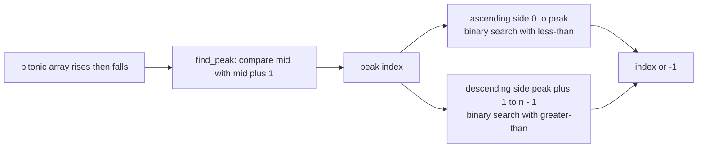
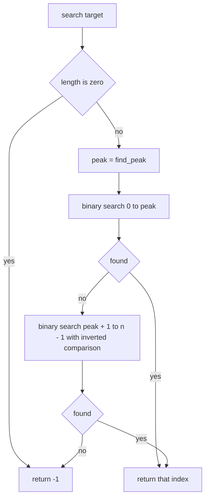
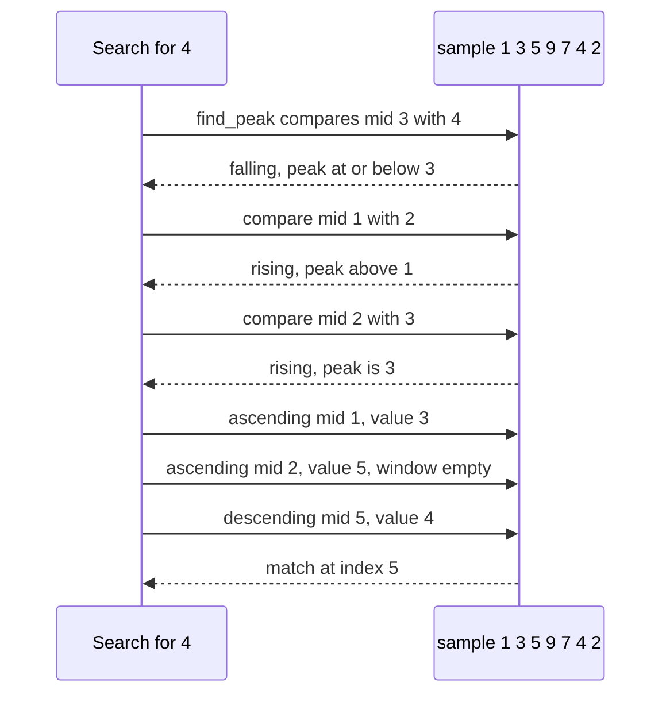

# 491 — Implement search in bitonic array.

> **Tier:** Advanced · **CTCI chapter:** Ch 10 — Sorting and Searching
> **Task spec:** [491-implement-search-in-bitonic-array.md](../../../tasks/advanced/491-implement-search-in-bitonic-array.md)
> **Solutions:** [Python](../../../solutions/python/advanced/491-implement-search-in-bitonic-array/solution.py) ·
> [Java](../../../solutions/java/advanced/491-implement-search-in-bitonic-array/Solution.java) ·
> [JavaScript](../../../solutions/javascript/advanced/491-implement-search-in-bitonic-array/solution.js) ·
> [C#](../../../solutions/csharp/advanced/491-implement-search-in-bitonic-array/Solution.cs)

## 1. Problem restatement

**Input:** a **bitonic** array — it strictly rises to a single peak and then strictly falls, with the
peak allowed at either end. A purely increasing or purely decreasing array is therefore a degenerate
bitonic array. Also a `target`.

**Output:** two functions, both `O(log n)`:

- `find_peak(values)` — the index of the unique maximum.
- `search(values, target)` — the index holding `target`, or the documented sentinel `SENTINEL = -1`
  when it is absent. Indices are non-negative, so `-1` is unambiguous.

| Call | Result |
| --- | --- |
| `find_peak([1, 3, 5, 9, 7, 4, 2])` | `3` |
| `search([1, 3, 5, 9, 7, 4, 2], v)` for each `v` in the array | its own index (`0` through `6`) |
| `search([1, 3, 5, 9, 7, 4, 2], t)` for `t` in `{0, 6, 8, 10, -5}` | `-1` |
| `find_peak([5])`, `search([5], 5)`, `search([5], 4)` | `0`, `0`, `-1` |
| `find_peak([1, 2, 3, 4])` (fully increasing) | `3` |
| `find_peak([4, 3, 2, 1])` (fully decreasing) | `0` |
| every `n` in `1..17` with every peak position | `153` arrays, peak and every element verified against a linear oracle |
| `n = 256` peak `100`, `n = 257` peak `0`, `n = 255` peak `254`, `n = 300` peak `150` | peaks `100, 0, 254, 150`, spot-checked elements exact |

The randomized arrays are built by `lcg_bitonic(n, seed, peak)`: draw `n` distinct LCG values
(`seed = (seed * 75 + 74) mod 65537`, value `seed mod 1000`), sort them, and mirror the tail so the
overall maximum lands at index `peak`. For `n = 7`, `peak = 3` that yields
`[433, 587, 639, 790, 362, 348, 111]`.

## 2. Intuition

Plain binary search needs a direction it can trust: at any probe, the target is either left or right
depending on whether the value is smaller or larger. A bitonic array has both directions in it — the
left slope ascending, the right slope descending — so a binary search does not know which way to go
until it knows which slope it is standing on.

The naive fix is a linear scan, `O(n)`. The structural fix uses the shape of the array: *find the
peak first*, in `O(log n)`, and the array splits into two monotone halves, each of which supports a
plain binary search. The peak search itself needs only a local observation — comparing `values[mid]`
with its right neighbour tells you whether the slope at `mid` is rising or falling:

- `values[mid] < values[mid + 1]` means the peak is at `mid + 1` or further right, so move `lo` up;
- otherwise the slope is falling, so the peak is at `mid` or further left, so move `hi` down.



The key insight is that **one shape query replaces the missing sort order**. The ascending side
`[0, peak]` is sorted ascending and the descending side `(peak, n - 1]` is sorted descending, so each
side is a monotone array — and monotone arrays are exactly what binary search wants. Nothing about
the target is needed to split the array; the split is a property of the data.

## 3. Algorithm

1. **Find the peak.** Set `lo = 0`, `hi = n - 1`. While `lo < hi`: take `mid`; if `values[mid] <
   values[mid + 1]` set `lo = mid + 1`, else `hi = mid`. When the loop ends, `lo` is the peak index.
2. **Handle the empty array.** Return `-1` before touching any element.
3. **Search the ascending side** `[0, peak]` with an ordinary binary search: `==` returns, `<` moves
   `lo` up, `>` moves `hi` down.
4. **Search the descending side** `(peak, n - 1]` with the comparison inverted: `==` returns, `>` moves
   `lo` up, `<` moves `hi` down.
5. **Report absence.** If neither side matched, return `SENTINEL`.

```text
function find_peak(values)
    lo ← 0
    hi ← length(values) - 1
    while lo &lt; hi do
        mid ← (lo + hi) div 2
        if values[mid] &lt; values[mid + 1] then
            lo ← mid + 1
        else
            hi ← mid
        end
    end
    return lo
end

function search(values, target)
    n ← length(values)
    if n = 0 then
        return SENTINEL
    end
    peak ← find_peak(values)
    lo ← 0
    hi ← peak
    while lo &lt;= hi do                      -- ascending side
        mid ← (lo + hi) div 2
        if values[mid] = target then
            return mid
        end
        if values[mid] &lt; target then
            lo ← mid + 1
        else
            hi ← mid - 1
        end
    end
    lo ← peak + 1
    hi ← n - 1
    while lo &lt;= hi do                      -- descending side
        mid ← (lo + hi) div 2
        if values[mid] = target then
            return mid
        end
        if values[mid] &gt; target then
            lo ← mid + 1
        else
            hi ← mid - 1
        end
    end
    return SENTINEL
end
```

The two loops differ only in the inequality on the third branch, and that inversion is the entire
difference between searching an ascending and a descending array. Both loops use `lo <= hi` with
explicit `return` on equality, which is safe here because the array is **strictly** bitonic: no value
appears twice, so the first match is the only match.



## 4. Worked example

Use `sample = [1, 3, 5, 9, 7, 4, 2]`. Indices `0..6`, peak value `9` at index `3`.

**Finding the peak** — three probes:

| Step | `lo` | `hi` | `mid` | `values[mid]` vs `values[mid+1]` | Action |
| --- | --- | --- | --- | --- | --- |
| 1 | 0 | 6 | 3 | `9` vs `7`: not less | `hi = 3` |
| 2 | 0 | 3 | 1 | `3` vs `5`: less | `lo = 2` |
| 3 | 2 | 3 | 2 | `5` vs `9`: less | `lo = 3` |
| stop | 3 | 3 | — | `lo == hi` | peak is `3` |

The comparison is local and cheap, and each step discards half of the remaining candidates: after
step 1 the peak is known to be at index `3` or lower, after step 2 it is at `2` or higher, and step 3
pins it.

**Searching for `4`** — the target lives on the descending side, so the ascending side runs to
exhaustion first:

| Phase | `lo` | `hi` | `mid` | `values[mid]` | Action |
| --- | --- | --- | --- | --- | --- |
| ascending | 0 | 3 | 1 | `3` | `3 < 4`, so `lo = 2` |
| ascending | 2 | 3 | 2 | `5` | not equal, not less, so `hi = 1` |
| ascending | 2 | 1 | — | `lo > hi` | side exhausted |
| descending | 4 | 6 | 5 | `4` | equal — return `5` |

**Searching for `9`** stops inside the ascending side at the peak itself: `mid = 1` gives `3`, `mid = 2`
gives `5`, `mid = 3` gives `9` and returns index `3`, in three probes.

**Searching for an absent value** — `target = 6` walks both sides completely:

| Phase | `mid` sequence | Values seen | Outcome |
| --- | --- | --- | --- |
| ascending `[0, 3]` | `1`, `2`, `3` | `3`, `5`, `9` | `5 < 6` pushes `lo` up, `9 > 6` pushes `hi` down, `lo > hi` |
| descending `[4, 6]` | `5`, `4` | `4`, `7` | `4 < 6` moves `hi` down, `7 > 6` moves `lo` up, `lo > hi` |

Both sides exhaust and the function returns `-1`. Targets below `values[0]` (such as `0`) fail at the
first ascending probe with `values[mid] > target` driving `hi` below `lo`, and targets above the peak
(such as `10`) fail on both sides the same way.

A generated array behaves identically, just with wider indices — `n = 9`, peak `4` gives
`[612, 697, 706, 719, 941, 535, 286, 175, 149]`; `find_peak` lands on `4`, the ascending side covers
`612..941` and the descending side `535..149`.



**Degenerate shapes.** `[1, 2, 3, 4]` has the peak at index `3`, so the descending side is empty and
every search happens on the ascending side — `search(..., 4)` returns `3`, `search(..., 0)` returns
`-1`. `[4, 3, 2, 1]` has the peak at index `0`, so the ascending side is the single element `4` and
everything else is searched with the inverted comparison: `search(..., 1)` returns `3`. A
single-element array makes `lo == hi` immediately in `find_peak`, so the peak is index `0` and one
comparison decides the search. The suite covers all of these shapes by construction: every size from
`1` to `17` is paired with every peak position, which is `153` arrays, and each one is checked
element by element against the linear oracle.

## 5. Complexity

Let `n` be the array length and `p` the peak index.

| Measure | Bound | Why it holds |
| --- | --- | --- |
| Time, `find_peak` | O(log n) | the loop halves `[lo, hi]` every iteration and stops when the interval is a single index |
| Time, ascending search | O(log(p + 1)) | ordinary binary search over `p + 1` elements |
| Time, descending search | O(log(n - p)) | reached only when the ascending side failed |
| Time, `search` total | O(log n) | three nested halvings, so at most about `3 log2 n` probes |
| Time, best | O(log n) | the peak still has to be located before any value can be compared |
| Space | O(1) | four index variables; both searches are iterative |
| Linear-scan alternative | O(n) | the oracle implementation, which the suite uses to verify every element |
| Degenerate peak | one side is empty | `p = 0` or `p = n - 1` skips a whole loop, but the bound is unchanged |

Splitting the array into two monotone halves is what buys the logarithmic bound: without the peak,
a bitonic array gives a binary search no usable direction. The cost is one extra `log n` phase, so the
total is larger than a single binary search by a small constant factor — and the ascending side is
tried first, which means the common case of a target on the rising slope never touches the descending
loop at all.

## 6. Pitfalls and edge cases

- **Strictness is required.** The peak is unique only if both slopes are strict. With a plateau such
  as `[1, 3, 3, 2]`, `values[mid] < values[mid + 1]` is false at the plateau and `find_peak` returns
  the first of the tied maxima; a non-strict binary search on the sides could then miss the other one.
  The suite's `lcg_bitonic` draws distinct values precisely to keep the invariant true.
- **The peak may be at either end.** A purely increasing array has `p = n - 1` and an empty descending
  side; a purely decreasing array has `p = 0` and a single-element ascending side. Both are asserted
  (`[1, 2, 3, 4]` → `3`, `[4, 3, 2, 1]` → `0`, plus the `n = 257, peak = 0` and `n = 255, peak = 254`
  generated cases).
- **The descending comparison is inverted.** `values[mid] > target` moves `lo` up on the descending
  side, because larger values lie to the left there. Copying the ascending branch without flipping the
  inequality is the classic bug, and it shows up as `-1` for values that are present.
- **Half-open coverage.** The ascending side includes the peak (`[0, peak]`) and the descending side
  excludes it (`(peak, n-1]`), so every index is searched exactly once. Making both halves inclusive
  would search the peak twice, which is harmless here but breaks the moment duplicates are allowed.
- **Empty arrays.** `search([], t)` returns `-1` before `find_peak` is called, because
  `values[mid + 1]` on an empty array is out of bounds. The suite exercises the single-element case
  (`[5]`) but the guard is what makes `n = 0` safe.
- **Absence has one representation.** The sentinel is `-1`, chosen because real indices are
  non-negative — and the test probes deliberately include `-1` itself as a *target* to confirm that
  `search(values, -1) == -1` means absent and not "index -1".
- **Absent probes must fail on both sides.** The randomized sweep checks `values[0] - 1`,
  `values[peak] + 1`, `1000`, `-1` and `65537` for every one of the `153` generated arrays, so both a
  below-everything and an above-everything target are covered, along with values outside the LCG's
  `mod 1000` range.
- **Early return is safe here.** Both loops return on the first equality, unlike the lower-bound
  search of [task 490](../../../tasks/advanced/490-implement-exponential-search-for-unbounded-arrays.md).
  That is only correct because "strictly bitonic" implies distinct values, so there is no earlier
  occurrence to prefer.
- **Peak probing touches `mid + 1`.** The comparison `values[mid] < values[mid + 1]` is safe because
  the loop only runs while `lo < hi`, which implies `mid < hi <= n - 1` and therefore `mid + 1 <= n - 1`.
  A version that used `mid` against `mid - 1` would need a different guard.

## 7. Variants and follow-ups

- **Searching without a known length.**
  [490-implement-exponential-search-for-unbounded-arrays.md](../../../tasks/advanced/490-implement-exponential-search-for-unbounded-arrays.md)
  is the sibling technique: a doubling phase finds a bracket, and the same lower-bound binary search
  finishes the job.
- **Two monotone arrays instead of one bent one.**
  [261-median-of-two-sorted-arrays-log-min-n-m-algorithm.md](../../../tasks/intermediate/261-median-of-two-sorted-arrays-log-min-n-m-algorithm.md)
  solves a harder search problem over two sorted inputs by partitioning rather than by locating a peak.
- **First and last occurrences.**
  [077-find-first-occurrence-of-target-in-sorted-array-with-duplicates.md](../../../tasks/beginner/077-find-first-occurrence-of-target-in-sorted-array-with-duplicates.md)
  and [079-find-insert-position-for-target-in-sorted-array.md](../../../tasks/beginner/079-find-insert-position-for-target-in-sorted-array.md)
  show the lower-bound style loops that this task's early-return version deliberately avoids.
- **Search over a predicate instead of a value.**
  [448-implement-parametric-search-for-optimizing-monotone-predicates.md](../../../tasks/advanced/448-implement-parametric-search-for-optimizing-monotone-predicates.md)
  generalises "is the target to the left or right?" to "does this parameter satisfy the predicate?".

## 8. Check yourself

**Q1.** Why can a plain binary search not be run directly on a bitonic array?

<details><summary>Show answer</summary>

Because it has no single direction to trust. In a sorted array, comparing the probed value with the
target tells you which half can be discarded; in a bitonic array the values to the right may be
larger or smaller depending on which side of the peak you are standing on. The peak search supplies
that missing information by splitting the array into one ascending and one descending region, each of
which is monotone.
</details>

**Q2.** `find_peak([1, 3, 5, 9, 7, 4, 2])` takes three probes. Explain what each one rules out.

<details><summary>Show answer</summary>

`mid = 3` compares `9` with `7`: falling, so the peak is at index `3` or to the left and everything to
the right is discarded. `mid = 1` compares `3` with `5`: rising, so the peak is at index `2` or to the
right, discarding indices `0..1`. `mid = 2` compares `5` with `9`: rising, so `lo` becomes `3` and
`lo == hi` ends the loop with the peak found.
</details>

**Q3.** What changes in the descending-side search compared with the ascending one?

<details><summary>Show answer</summary>

Only the direction test: on the descending side the loop uses `if values[mid] > target then lo = mid + 1`
instead of `values[mid] < target`. Equality still returns immediately. `[1, 3, 5, 9, 7, 4, 2]` with
target `4` finds index `5` this way after the ascending side is exhausted.
</details>

**Q4.** Which shapes make one of the two searches vacuous, and what does that cost?

<details><summary>Show answer</summary>

A fully decreasing array puts the peak at index `0`, so the ascending side is a single element and
essentially all work happens on the descending side; a fully increasing array puts it at index `n - 1`,
so the descending side is empty and is skipped after the failure path. Neither changes the `O(log n)`
bound — the skipped loop simply runs zero iterations — and both are asserted for small arrays and
generated ones (`n = 257, peak = 0` and `n = 255, peak = 254`).
</details>

**Q5.** The suite checks the answer against a linear oracle for every element of every generated
array. Why is that stronger than checking a few targets?

<details><summary>Show answer</summary>

It pins the *index* for every value, not just the presence of the value: a search that returned the
right value at the wrong index, or that confused the ascending and descending branches, would fail on
one of the `153` arrays' elements. Since `lcg_bitonic` places the maximum at a chosen index, the array
set also covers every peak position for every small size — and the same generator is why the `n = 257,
peak = 0` and `n = 255, peak = 254` cases exist as explicit degenerate checks.
</details>
