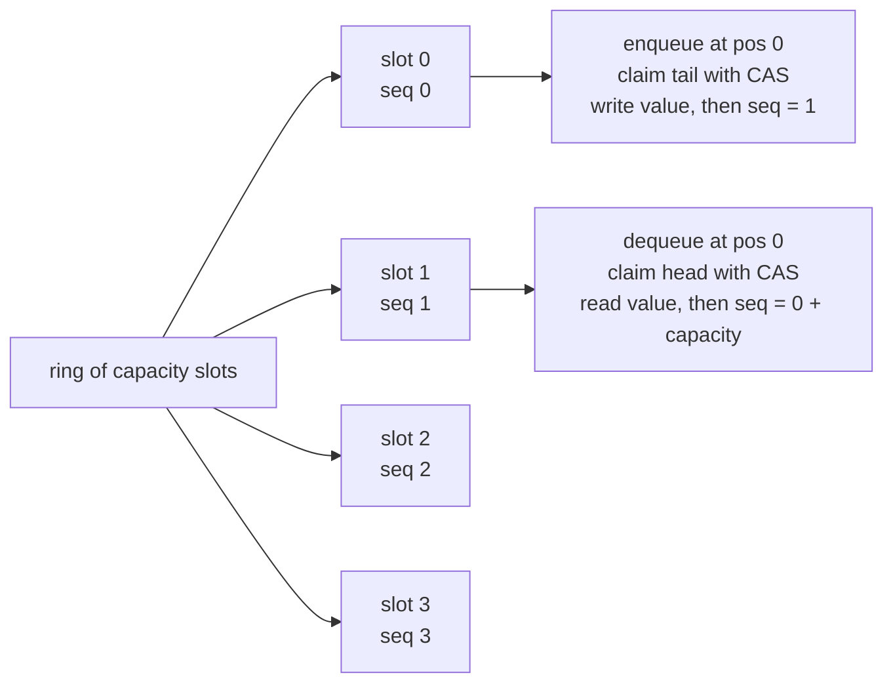
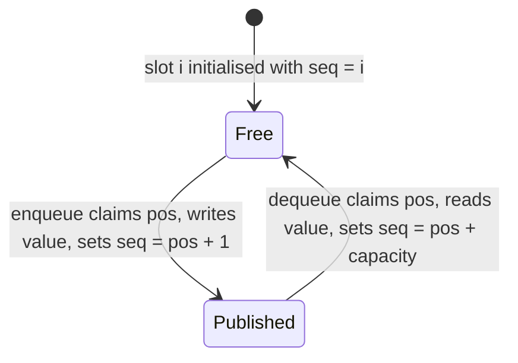
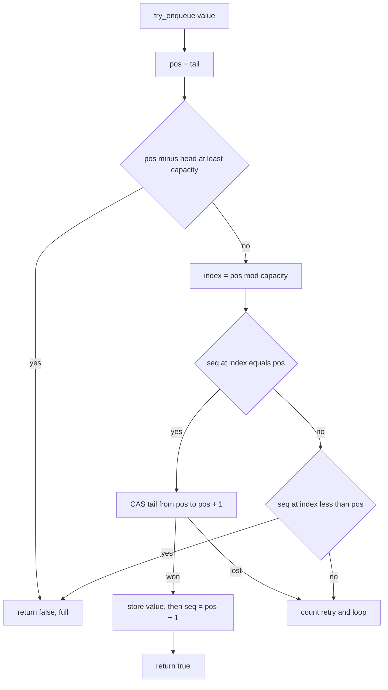
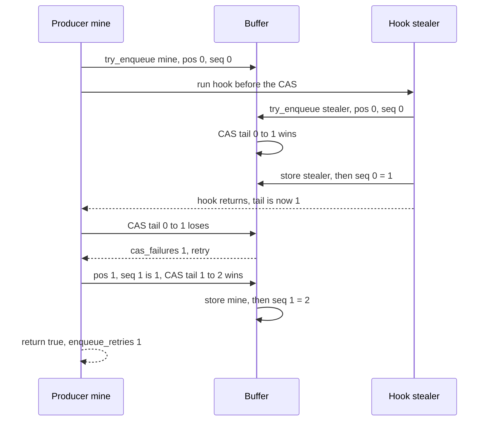

# 492 — Implement circular buffer with lock-free design (atomic).

> **Tier:** Advanced · **CTCI chapter:** Ch 15 — Threads and Locks
> **Task spec:** [492-implement-circular-buffer-with-lock-free-design-atomic.md](../../../tasks/advanced/492-implement-circular-buffer-with-lock-free-design-atomic.md)
> **Solutions:** [Python](../../../solutions/python/advanced/492-implement-circular-buffer-with-lock-free-design-atomic/solution.py) ·
> [Java](../../../solutions/java/advanced/492-implement-circular-buffer-with-lock-free-design-atomic/Solution.java) ·
> [JavaScript](../../../solutions/javascript/advanced/492-implement-circular-buffer-with-lock-free-design-atomic/solution.js) ·
> [C#](../../../solutions/csharp/advanced/492-implement-circular-buffer-with-lock-free-design-atomic/Solution.cs)

## 1. Problem restatement

**Input:** a positive `capacity` and a sequence of `try_enqueue(value)` / `try_dequeue()`
operations, possibly from many threads at once.

**Output:** a bounded MPMC ring buffer in the **Vyukov style**, with these documented rules:

- `capacity` slots each carry a **sequence number**; slot `i` starts at `i`.
- `head` (next dequeue position) and `tail` (next enqueue position) are advanced **only by
  compare-and-swap**; every operation retries when its CAS loses the race.
- A slot is publishable for enqueuing when `seq == pos` and consumable when `seq == pos + 1`. The
  claimer overwrites the slot and then stores `seq = pos + 1` (enqueue) or `seq = pos + capacity`
  (dequeue), which re-publishes the slot one lap later.
- One extra occupancy check (`tail - head >= capacity` means full) is required, because **for
  `capacity == 1` the final lap's free and published sequence values coincide**; for `capacity >= 2`
  the slot sequence alone decides.
- Neither operation blocks: `try_enqueue` reports `False` (full) and `try_dequeue` reports `None`
  (empty), so callers spin outside.

| Scenario | Expected |
| --- | --- |
| `capacity 4`: enqueue `1..4`, then enqueue `5` | four `True`, then `False` (full) |
| dequeue four times, then once more | `[1, 2, 3, 4]`, then empty |
| enqueue `5`, `6` and dequeue twice | `[5, 6]` — positions wrapped twice, slot `0` reused |
| `capacity 1`: `a`, `b`, dequeue, `b`, dequeue | `True`, `False`, `"a"`, `True`, `"b"` |
| forced hook at position `0` (`capacity 8`) | `cas_failures == 1`, `enqueue_retries == 1`, dequeue order `"stealer"`, `"mine"` |
| SPSC, `capacity 8`, `10000` items | the dequeued stream is exactly `0, 1, ..., 9999` |
| MPMC, `capacity 16`, 4 producers × 300 items, 3 consumers | `1200` deliveries, claimed positions a permutation of `0..1199`, per-producer FIFO, `cas_attempts >= 1200` |

The documented per-language handling of the "atomic" part is part of the contract: **Java** uses
`AtomicLong` / `AtomicLongArray` with real `compareAndSet` and real threads, **C#** uses `Interlocked`
and real threads, **Python** has no hardware CAS in CPython and therefore emulates it with a tiny lock
around *only* the compare-and-store pair while the retry loops, sequence protocol and spin loops run
on real threads, and **JavaScript** runs one thread per process, so concurrency is the documented
simulation: a plain compare-and-store that the event loop cannot preempt, with producers and
consumers as virtual coroutines that yield between operations.

## 2. Intuition

The naive lock-free ring buffer keeps `head` and `tail` and lets producers and consumers claim
`tail % capacity` and `head % capacity`. That works for exactly one producer and one consumer, but
with several of each two threads can claim the same position, and nothing in the slot tells them who
won.

A second naive fix is an occupancy counter, but then there are three shared variables to keep
consistent, and a producer that increments the counter before filling the slot publishes a value
that is not there yet.

Vyukov's construction removes the ambiguity by giving every slot its own sequence number, and by
making the **position claim** the only contended operation. Only the thread that wins the CAS on
`tail` (or `head`) may touch the slot; the slot's own `seq` then says whether it is ready to be
written or ready to be read. One CAS per operation, on one variable, with the slot sequence
carrying the state:



The order inside the claim matters: the value is written **before** `seq = pos + 1` is stored, so a
consumer that observes the published sequence can trust the data. That is the release/acquire pairing
the whole structure rests on — the sequence number is the publication flag, not just a lap counter.



The key insight is that **a slot is owned by whoever wins the CAS on the position counter**, and the
slot's sequence number is the hand-off between the producer that fills it and the consumer that empties
it, exactly one lap apart. No lock is needed for the data itself, and a losing thread simply rereads
the counter and tries the next position.

## 3. Algorithm

1. **Initialise.** `slots = [None] * capacity`, `seq = [0, 1, ..., capacity - 1]`, `head = tail = 0`;
   reject `capacity <= 0`.
2. **`cas(holder, name, expected, new_value)`** — one indivisible compare-and-store. Increment
   `cas_attempts`; if the field still equals `expected`, store `new_value` and return true; otherwise
   increment `cas_failures` and return false.
3. **`try_enqueue(value)`** loop: read `pos = tail`; if `pos - head >= capacity`, return `False`;
   look at `seq[pos % capacity]`. If it equals `pos`, the slot is ours: CAS `tail` from `pos` to
   `pos + 1`; on success write `slots[...] = value` and then `seq[...] = pos + 1`, and return `True`.
   If the sequence is less than `pos`, the previous lap has not caught up, so return `False`. Otherwise
   another producer claimed the position; count a retry and loop again.
4. **`try_dequeue(on_claim)`** loop: read `pos = head`; look at `seq[pos % capacity]`. If it equals
   `pos + 1`, the slot holds a published value: CAS `head` from `pos` to `pos + 1`; on success read
   the value, store `seq[...] = pos + capacity` to reopen the slot, and return the value. If the
   sequence is still short of `pos + 1`, return `None` (empty). Otherwise another consumer took the
   position; count a retry and loop again.

```text
function cas(holder, name, expected, new_value)
    atomically do
        attempts ← attempts + 1
        if holder.name = expected then
            holder.name ← new_value
            return true
        end
        failures ← failures + 1
        return false
    end
end

function try_enqueue(value)
    while true do
        pos ← tail
        if pos - head &gt;= capacity then
            return false                     -- occupancy guard, required at capacity 1
        end
        index ← pos mod capacity
        if seq[index] = pos then
            if cas(self, "tail", pos, pos + 1) then
                slots[index] ← value          -- data first
                seq[index] ← pos + 1          -- then publish
                return true
            end
        else if seq[index] &lt; pos then
            return false                     -- previous lap has not caught up
        end
        enqueue_retries ← enqueue_retries + 1
    end
end

function try_dequeue()
    while true do
        pos ← head
        index ← pos mod capacity
        if seq[index] = pos + 1 then
            if cas(self, "head", pos, pos + 1) then
                value ← slots[index]
                seq[index] ← pos + capacity   -- reopen one lap later
                return value
            end
        else if seq[index] &lt; pos + 1 then
            return none                      -- nothing published: empty
        end
        dequeue_retries ← dequeue_retries + 1
    end
end
```

Every loop iteration either returns a definitive answer, performs at most one successful CAS, or
counts a retry. The retry counters are diagnostics: they tell the tests that the retry path was
actually reached, but no correctness argument depends on them.



## 4. Worked example

**Single-threaded wraparound**, `capacity = 4`. The table shows the state after each operation; `seq`
is the four slot sequence numbers, and `h` / `t` are `head` / `tail`:

| Operation | Result | `seq` after | `slots` after | `h`, `t` |
| --- | --- | --- | --- | --- |
| `enqueue 1` | `True` | `1, 1, 2, 3` | `1, -, -, -` | 0, 1 |
| `enqueue 2` | `True` | `1, 2, 2, 3` | `1, 2, -, -` | 0, 2 |
| `enqueue 3` | `True` | `1, 2, 3, 3` | `1, 2, 3, -` | 0, 3 |
| `enqueue 4` | `True` | `1, 2, 3, 4` | `1, 2, 3, 4` | 0, 4 |
| `enqueue 5` | `False` | unchanged | unchanged | 0, 4 |
| `dequeue` ×4 | `1, 2, 3, 4` | `4, 5, 6, 7` | `-, -, -, -` | 4, 4 |
| `dequeue` | `None` | unchanged | unchanged | 4, 4 |
| `enqueue 5` | `True` | `5, 5, 6, 7` | `5, -, -, -` | 4, 5 |
| `enqueue 6` | `True` | `5, 6, 6, 7` | `5, 6, -, -` | 4, 6 |
| `dequeue`, `dequeue` | `5, 6` | `8, 9, 6, 7` | `-, -, -, -` | 6, 6 |
| `dequeue` | `None` | unchanged | unchanged | 6, 6 |

Read the two "wrapped" rows against the first four: after the four dequeues the slot sequences are
`pos + capacity = 4, 5, 6, 7`, so slot `0` is free again at position `4`. The enqueue at position `4`
finds `seq[0] == 4 == pos` and claims it, and the full check `pos - head >= capacity` is what stops
the fifth enqueue earlier (`4 - 0 >= 4`). The empty check is symmetric: at `h = t = 4`, slot `0` has
`seq = 4`, which is not `pos + 1 = 5`, so `try_dequeue` reports empty rather than a stale value.

**`capacity = 1`** is the case the occupancy check exists for: after `dequeue` at position `0`, the
slot's reopen value is `pos + capacity = 1`, which is **the same number** as a published sequence for
position `0`. Without the guard, an enqueue at position `1` would look at slot `0` (`1 % 1 = 0`), see
`seq == 1 == pos`, and overwrite a slot that has not been read yet. With the guard, `pos - head = 1 >= 1`
returns full first — which is why the test asserts `enqueue("b") is False` right after `enqueue("a")`.

**Forced CAS failure.** `capacity = 8`, and the buffer is constructed with a hook that fires once,
immediately before the outer CAS. `try_enqueue("mine")` reads `pos = 0`, checks `seq[0] == 0`, then
runs the hook, which calls `try_enqueue("stealer")` from "another producer":



The stale CAS fails exactly once, one retry lap is taken, and FIFO order is preserved: dequeuing
returns `"stealer"` (position `0`) then `"mine"` (position `1`), because the loser retried at the
*next* position rather than jumping the queue. The hook asserts `head == 0` and `tail == pos + 1`
while it runs, so the steal is complete before the outer CAS is attempted.

**Real threads.** The SPSC test pushes `10000` values through a `capacity = 8` buffer, with the
producer spinning on `False` and the consumer spinning on `None`; the dequeued stream must be exactly
`0..9999`. The MPMC test runs 4 producers of 300 tagged items and 3 consumers against `capacity = 16`;
each consumer records the position claimed by its successful head CAS (`on_claim`), and the merged
records must be a permutation of positions `0..1199` with each producer's own items in the order that
producer enqueued them. That accounting is what proves **exactly-once** delivery: a slot consumed
twice would duplicate a position, and a slot skipped would leave a hole.

## 5. Complexity

Let `c` be the capacity, `n` the number of operations and `k` the number of threads.

| Measure | Bound | Why it holds |
| --- | --- | --- |
| Time, `try_enqueue` / `try_dequeue`, uncontended | O(1) | one counter read, one modulo, one compare, one successful CAS |
| Time, contended | O(1) retries amortised | a losing CAS costs one loop iteration, and each iteration is a constant number of operations |
| Space | O(c) | `c` slots plus `c` sequence numbers; nothing is allocated per operation |
| Blocking | none | `False` / `None` are returned immediately; spinning is the caller's choice |
| Buffered items | at most `c` | enforced by the occupancy check before any slot is claimed |
| Test-side accounting | `cas_attempts >= 1200` | the MPMC run asserts that every one of the `1200` enqueues and dequeues went through the CAS path |
| Retry diagnostics | `cas_failures`, `enqueue_retries`, `dequeue_retries` | counters for the tests; the forced-hook case pins them at exactly `1` |

The cost model is deliberately flat: every operation is a constant number of atomic read-modify-write
steps on two shared counters, and the worst case is more retries rather than more work per retry. The
structure is bounded and allocation-free, which is what makes it usable as a hot-path queue between
producers and consumers, and the price is that callers must handle `False`/`None` themselves instead
of blocking.

## 6. Pitfalls and edge cases

- **The occupancy guard is not optional at `capacity 1`.** The reopen value `pos + capacity` collides
  with the published value `pos + 1` when `capacity == 1`, so the slot sequence can no longer
  distinguish full from empty. `pos - head >= capacity` covers that case; dropping the guard lets an
  enqueue overwrite an unread slot, which the `enqueue("b") is False` assertion catches.
- **Publish order inside the claim.** The value must be written *before* `seq = pos + 1`. Inverting the
  two stores lets a consumer read a half-written slot — the failure the sequence protocol is designed
  to prevent.
- **Never touch a slot you did not claim.** Both loops read the sequence, then CAS the counter, and
  only the winner writes the slot. A thread that writes after losing the CAS corrupts the winner's
  value.
- **`False` is not a failure.** `try_enqueue` returning `False` means full and `try_dequeue` returning
  `None` means empty; the tests' workers spin on those values. Treating them as errors would deadlock
  every producer the moment the buffer filled.
- **Retries must reread the counter.** After a lost CAS the loop restarts from `pos = tail` (or
  `head`): reusing the stale `pos` would produce an infinite loop of failing CASes on the same value.
- **`capacity <= 0` is rejected.** The constructor raises on a non-positive capacity rather than
  creating a buffer that can never hold anything.
- **`on_claim` is a witness, not protocol.** In the MPMC test the callback receives the claimed
  position right after the head CAS and is used purely to record the linearization order; the buffer
  behaves identically without it. The forced-failure test's hook is likewise test-only scaffolding.
- **The emulated CAS is documented, not hidden.** CPython offers no hardware compare-and-swap, so the
  Python solution wraps *only* the compare-and-store pair in a small lock; JavaScript has no threads
  at all, so it models producers and consumers as coroutines that yield between operations. In both
  cases the retry loops, sequence protocol and spin loops are the real mechanism under test, and the
  Java (`AtomicLong`) and C# (`Interlocked`) versions run the same protocol with genuine atomics.
- **Threads must terminate.** Every join carries a timeout and is followed by an `is_alive` check, so
  a lost wake-up or a spinning worker surfaces as a failed assertion instead of a hanging test run.
- **Lap arithmetic is unbounded.** `tail - head` grows without wrapping — positions are never taken
  modulo anything except to find a slot index — so there is no ABA-style ambiguity between a slot's
  value from lap `k` and its value from lap `k + 1`. Wrapping the counters would reintroduce exactly
  that bug.
- **Exactly-once delivery is a consequence of the head CAS.** Two consumers that both saw
  `seq == pos + 1` cannot both win `head`; the loser retries at the next position. The permutation
  assertion over `0..1199` is the check that no position was delivered twice or skipped.

## 7. Variants and follow-ups

- **Atomic primitives by themselves.**
  [354-implement-wait-free-counter-sketch-atomic-operations.md](../../../tasks/intermediate/354-implement-wait-free-counter-sketch-atomic-operations.md)
  is the building block this buffer is assembled from, and it is the task the headers point to for the
  emulated-CAS discussion.
- **Durability instead of lock-freedom.**
  [481-implement-optimistic-checkpointing-restart-simulation.md](../../../tasks/advanced/481-implement-optimistic-checkpointing-restart-simulation.md)
  handles the case where the buffer's contents must survive a crash rather than just a race.
- **Buffering inside a store.**
  [484-implement-simple-key-value-store-with-memtable-sstable.md](../../../tasks/advanced/484-implement-simple-key-value-store-with-memtable-sstable.md)
  is the same "bounded in-memory stage, spill when full" idea at a different level of a database.
- **Bounded probabilistic stages.** A ring buffer bounds *space*; a count-min sketch bounds error in
  exchange for space per item — see
  [493-implement-probabilistic-data-structure-composition-bloom-cmsketc.md](../../../tasks/advanced/493-implement-probabilistic-data-structure-composition-bloom-cmsketc.md)
  for structures whose correctness is statistical rather than exact.

## 8. Check yourself

**Q1.** Why does each slot need its own sequence number when `head` and `tail` already exist?

<details><summary>Show answer</summary>

Because the counters only say *which position* is next, not whether the slot at that position currently
holds a published value. With multiple producers or consumers, two threads can compute the same slot
index, and the sequence number arbitrates: only the thread whose CAS wins the position gets to touch
the slot, and `seq == pos` (ready for enqueue) versus `seq == pos + 1` (ready for dequeue) tells the
claimant what state the slot is in.
</details>

**Q2.** `capacity = 1` needs an extra check that larger capacities do not. Why?

<details><summary>Show answer</summary>

Because the dequeue reopen value is `pos + capacity` and the enqueue publish value is `pos + 1`, and
they are the *same number* when `capacity == 1`. Slot `0` therefore cannot distinguish "free" from
"published" by sequence alone after a lap, so `pos - head >= capacity` is required to detect full
before an enqueue overwrites an unread slot.
</details>

**Q3.** In the forced-failure test, what exactly fails, and what proves the buffer recovered?

<details><summary>Show answer</summary>

The outer call's CAS on `tail` fails, because the hook's nested `try_enqueue` claimed position `0`
first and advanced `tail` to `1`. The counters pin it — `cas_failures == 1` and `enqueue_retries == 1`
— and the recovery is visible in the dequeue order: `"stealer"` at position `0` then `"mine"` at
position `1`, which is FIFO rather than the loser jumping the queue.
</details>

**Q4.** The MPMC test checks that claimed positions form a permutation of `0..1199`. Why is that the
right assertion for exactly-once delivery?

<details><summary>Show answer</summary>

Because the position claimed by a successful head CAS is the linearization point of that dequeue. If
two consumers had taken the same position, `1200` deliveries could not cover `0..1199` distinctly; if
one had been skipped, a position would be missing while the tally still reached `1200`. The
permutation check therefore catches double delivery and skipped slots simultaneously — and the
separate per-producer subsequence check catches ordering violations within one producer's items.
</details>

**Q5.** What changes between the Java, C#, Python and JavaScript versions of this buffer?

<details><summary>Show answer</summary>

Only the atomic primitive, as the headers document it. Java uses `AtomicLong` and `AtomicLongArray`
`compareAndSet` with real threads; C# uses `Interlocked` with real threads; Python has no hardware CAS
in CPython, so it wraps only the compare-and-store pair in a small lock while the retry loops and spin
loops run on real threads; JavaScript runs one thread per process, so it models the operation as a
non-preemptible compare-and-store with virtual coroutines that yield. The sequence protocol, the
occupancy guard and the retry behaviour are identical in all four.
</details>
