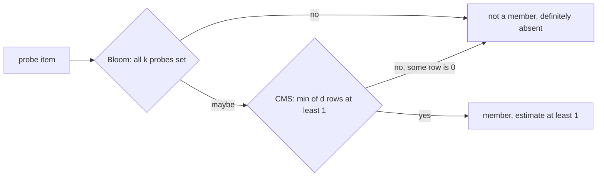
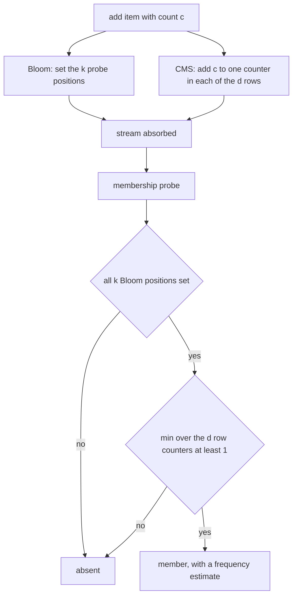
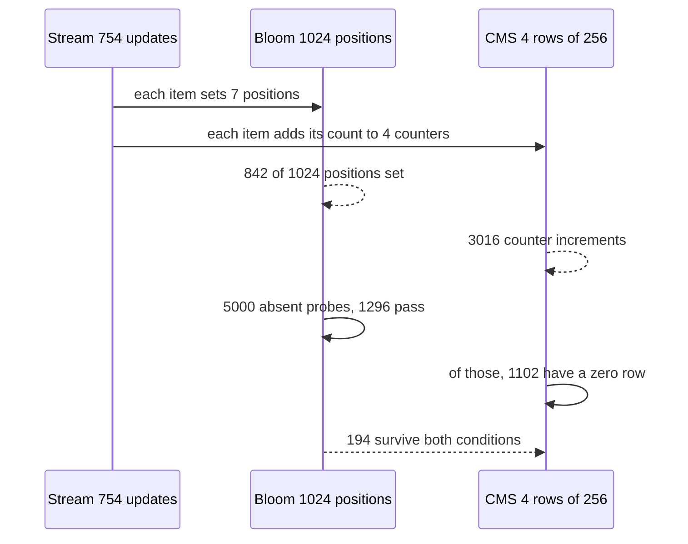

# 493 — Implement probabilistic data structure composition (bloom + cmsketch).

> **Tier:** Advanced · **CTCI chapter:** Beyond — Advanced Data Structures & Algorithms
> **Task spec:** [493-implement-probabilistic-data-structure-composition-bloom-cmsketc.md](../../../tasks/advanced/493-implement-probabilistic-data-structure-composition-bloom-cmsketc.md)
> **Solutions:** [Python](../../../solutions/python/advanced/493-implement-probabilistic-data-structure-composition-bloom-cmsketc/solution.py) ·
> [Java](../../../solutions/java/advanced/493-implement-probabilistic-data-structure-composition-bloom-cmsketc/Solution.java) ·
> [JavaScript](../../../solutions/javascript/advanced/493-implement-probabilistic-data-structure-composition-bloom-cmsketc/solution.js) ·
> [C#](../../../solutions/csharp/advanced/493-implement-probabilistic-data-structure-composition-bloom-cmsketc/Solution.cs)

## 1. Problem restatement

**Input:** a stream of items with a multiplicity each (the stream `key-<j>` with `1 + seed % 5`
copies, 250 items, 754 total updates), then a batch of probes.

**Output:** a `SketchPipeline` composing two sketches over the same stream:

- a **Bloom filter** (relaxed membership, `m = 1024` positions, `k = 7` probes), and
- a **Count-Min sketch** (frequency estimation, `d = 4` rows of `w = 256` counters),

with

```text
membership(item) = bloom.maybe_contains(item) and cms.estimate(item) >= 1
```

so a positive answer always implies an estimated frequency of at least one, and a Bloom false
positive whose every CMS counter is still empty is rejected. The pipeline therefore **tightens
membership without ever introducing a false negative**.

Hashing is the stable task-254 scheme, identical in all four languages: `fnv1a` folded with `fmix32`,
`h1 = fmix32(fnv1a(item))` and `h2 = fmix32(fnv1a(item + "#")) | 1` for the Bloom probes, and per-row
`fmix32(fnv1a(item + "|" + row))` for the Count-Min sketch. All arithmetic is masked to 32 bits.

| Quantity | Pinned value |
| --- | --- |
| distinct items / total updates | `250` / `754` |
| Bloom positions set (`popcount`) | `842` of `1024`, for both configurations |
| CMS counter total | `3016` = `4 × 754` |
| absent probes | `5000` |
| Bloom false positives among them | `1296` (tolerance `1400`, the documented 28%) |
| pipeline false positives (`w = 256`) | `194` (tolerance `200`) |
| pipeline false positives (`w = 1024`) | `5` |
| documented CMS error bound | `epsilon · N = (e / w) · 754 = 8.006` at `w = 256`, and `<= 1` per item at `w = 1024` |
| single-item sanity case | `estimate("solo") == 3` and `cms.total() == 12` |

Every inserted item must satisfy `membership(item) is True`, `estimate >= true_count`, and
`estimate <= true_count + epsilon·N`.

## 2. Intuition

A Bloom filter answers "have I seen this?" with a "no" that is always right and a "maybe" that is
sometimes wrong. A Count-Min sketch answers "how often have I seen this?" with an estimate that never
undershoots. Used alone, each has a characteristic failure: the Bloom filter's false-positive rate is
set by how full the bit array is, and the sketch's error grows with the traffic it has absorbed.

Composing them fixes the Bloom filter's failure mode almost for free. Inserting an item increments
`d` CMS counters, one per row, each by at least one. So for any item that was actually inserted, every
row's counter is positive, and therefore `cms.estimate(item) >= 1`. The contrapositive is the useful
half: **if the sketch's estimate is 0, the item was never inserted** — so a Bloom "maybe" with a zero
estimate must be a Bloom false positive, and the pipeline can reject it without any risk of a false
negative.



The measured effect on `5000` absent probes is `1296` Bloom hits down to `194` pipeline hits at
`w = 256` — `1102` Bloom false positives rejected by the cold-counter condition. Widening the sketch
to `w = 1024` (same Bloom filter, fewer collisions per row) leaves only `5`.

The key insight is that **both structures err in the same direction**, and that is what makes the
conjunction safe. The Bloom filter never says "no" for something inserted; the Count-Min sketch never
estimates below the true count. Requiring both conditions to hold can therefore only remove false
positives — it cannot create a false negative, which is exactly the invariant the tests assert for
all 250 inserted items.

## 3. Algorithm

1. **Hash.** `fnv1a(text)` folds characters into a 32-bit accumulator; `fmix32(x)` applies the
   murmur-style finalizer (xor-shift 16, multiply `0x85EBCA6B`, xor-shift 13, multiply `0xC2B2AE35`,
   xor-shift 16), all masked to 32 bits.
2. **Bloom positions.** `h1 = fmix32(fnv1a(item))`, `h2 = fmix32(fnv1a(item + "#")) | 1` (forced odd
   so the probe sequence does not collapse), positions `(h1 + i · h2) mod m` for `i = 0..k-1`.
3. **Bloom add / query.** `add` sets every position; `maybe_contains` requires every position to be
   set.
4. **CMS column.** Row `r` uses `fmix32(fnv1a(item + "|" + r)) mod w`, so each row has its own hash.
5. **CMS add / estimate.** `add(item, delta)` increments the chosen counter in every row by `delta`;
   `estimate(item)` is the **minimum** over the rows, which is what makes underestimation impossible.
6. **Pipeline add.** Add to both sketches — the Bloom filter once per call, the CMS by `count`.
7. **Pipeline membership.** `bloom.maybe_contains(item) and cms.estimate(item) >= 1`.

```text
function fmix32(x)
    x ← x xor (x shifted right 16)
    x ← (x * 0x85EBCA6B) mod 2^32
    x ← x xor (x shifted right 13)
    x ← (x * 0xC2B2AE35) mod 2^32
    x ← x xor (x shifted right 16)
    return x
end

procedure bloom_add(item)
    h1 ← fmix32(fnv1a(item))
    h2 ← fmix32(fnv1a(item + "#")) or 1
    for i ← 0 to k - 1 do
        p ← (h1 + i * h2) mod m
        bits[p] ← 1
    end
end

function bloom_maybe_contains(item)
    h1 ← fmix32(fnv1a(item))
    h2 ← fmix32(fnv1a(item + "#")) or 1
    for i ← 0 to k - 1 do
        if bits[(h1 + i * h2) mod m] = 0 then
            return false
        end
    end
    return true
end

procedure cms_add(item, delta)
    for row ← 0 to d - 1 do
        column ← fmix32(fnv1a(item + "|" + row)) mod w
        counters[row][column] ← counters[row][column] + delta
    end
end

function cms_estimate(item)
    best ← infinity
    for row ← 0 to d - 1 do
        column ← fmix32(fnv1a(item + "|" + row)) mod w
        best ← min(best, counters[row][column])
    end
    return best
end

function membership(item)
    return bloom_maybe_contains(item) and cms_estimate(item) &gt;= 1
end
```

The `min` in `cms_estimate` is the whole guarantee: a counter can only be inflated by collisions,
never deflated, so the smallest counter across rows is the closest estimate and can never fall below
the true count. The `or 1` in the Bloom hash plays the same role for the probe sequence that an odd
step played in the per-table filter of
[task 482](../../../tasks/advanced/482-implement-bloom-filter-per-sstable-prototype-and-test.md).



## 4. Worked example

The stream has `250` items and `754` updates: item `key-<j>` is added with count `1 + seed % 5`,
which sets its 7 Bloom positions once and adds that count to one CMS counter in each of the 4 rows.

**An inserted item, exactly.** `key-0` has true count `5`, its four row counters are `10, 5, 10, 11`,
and the estimate is `min = 5` — exact. Row 1 is the one that landed on a counter with no other items
in it.

**An inserted item, overestimated.** `key-95` has true count `1` but its row counters read
`10, 6, 5, 14`, so the estimate is `5` and the error is `4`. That is inside the documented additive
bound `epsilon · N = (e / 256) · 754 = 8.006`. The error is pure collision: other items hashed into
the same row counters, and the minimum over four rows is the best available defence — the largest row
counter (`14`) is three times the estimate.

**An absent item, correctly rejected although the filter liked it.** `probe-6` has all 7 Bloom
positions set, so the filter says "maybe", but its row counters are `0, 5, 9, 0` and the estimate is
`0`. The pipeline rejects it. This is the composition earning its keep: `1102` of the `1296` Bloom
false positives die here.

**An absent item that survives.** `probe-3` has Bloom positions
`738, 487, 236, 1009, 758, 507, 256` all set (the array is `842 / 1024` full) and row counters
`1, 5, 13, 1`, so its estimate is `1` and `membership` returns true — a pipeline false positive.
With the wider sketch (`w = 1024`) its counters become `1, 5, 4, 1` and the estimate is still `1`, so
it survives there too; it is one of the `5` survivors in that configuration.

**An item never seen at all.** `never-seen` has row counters `0, 9, 0, 0`: two rows have collisions,
but the minimum is `0`, so its estimate is exactly `0` and membership is false. That asymmetry — some
rows busy, the minimum still zero — is why the estimate is a minimum rather than an average.

| Probe | Bloom verdict | CMS rows | Estimate | `membership` |
| --- | --- | --- | --- | --- |
| `key-0` (true 5) | maybe | `10, 5, 10, 11` | `5` | true, exact |
| `key-95` (true 1) | maybe | `10, 6, 5, 14` | `5` | true, error `4 <= 8.006` |
| `probe-6` (absent) | maybe | `0, 5, 9, 0` | `0` | **false** — empty counter |
| `probe-3` (absent) | maybe | `1, 5, 13, 1` | `1` | true — false positive |
| `never-seen` (absent) | maybe or no | `0, 9, 0, 0` | `0` | false |

Aggregated over the `5000` absent probes the pipeline's rate is `194 / 5000 = 3.88%`, against the
Bloom filter's `1296 / 5000 = 25.9%`; the documented Bloom tolerance for this configuration is `1400`.



The single-item sanity case isolates the mechanism: `solo` added with count `3` gives
`estimate("solo") == 3` and `cms.total() == 12`, because each of the 4 rows received 3.

## 5. Complexity

Let `k` be the Bloom probe count, `d` and `w` the CMS dimensions, and `N` the total updates.

| Measure | Bound | Why it holds |
| --- | --- | --- |
| Time, `add` | O(k + d + len(item)) | 7 Bloom positions plus one column per row, each needing a hash |
| Time, `membership` | O(k + d + len(item)) | all Bloom positions must be tested, then the `d` row estimates |
| Time, `estimate` | O(d) | one column lookup per row, then a minimum |
| Space, Bloom | O(m) positions | `1024` positions, one byte each in this implementation |
| Space, CMS | O(d · w) counters | `4 × 256 = 1024` counters |
| Space, exact alternative | O(distinct items × key size) | a dictionary of 250 keys with exact counts |
| Bloom false-positive rate | documented ~`25.6%` at `k·n/m = 1.71`; measured `1296 / 5000 = 25.9%` | rate grows with array occupancy, here `842 / 1024` |
| CMS error | `<= epsilon · N` with `epsilon = e / w`, `delta = e^(-d)` | `8.006` at `w = 256`; the measured worst case on the 250 items is `4` |
| Pipeline error | never a false negative | both conditions must hold, and both are one-sided |

The comparison with an exact dictionary is the point of the exercise: the pipeline stores `1024`
Bloom bytes plus `1024` counters for 250 keys, and answers with a `25.9%` Bloom rate tightened to
`3.88%`, while a dictionary would answer exactly for whatever memory the keys need. The composition
buys accuracy with counters that are already there — the CMS is paid for by the frequency query, and
the membership tightening comes free.

## 6. Pitfalls and edge cases

- **The conjunction must be `and`, and the estimate test must be `>= 1`.** Membership is defined as
  both conditions; weakening it to the Bloom filter alone restores the `1296` false positives, and
  strengthening the estimate test to `>= true` would need the true value it is trying to avoid
  knowing.
- **The CMS must never underestimate.** `estimate` takes the minimum over rows precisely because
  collisions can only add. A sum or average over rows would break the guarantee that
  `estimate >= true_count` for all 250 inserted items.
- **Collision is one-sided.** `key-95` has true count `1` and estimate `5`; nothing ever estimates
  below the truth, so overestimation is the only error mode and the additive bound
  `epsilon · N = 8.006` is the honest statement of its size.
- **A zero estimate is proof of absence.** `probe-6` has some busy rows (`5` and `9`) but a zero in
  two others, so the minimum is `0`. Taking the maximum would have accepted it; the minimum is what
  makes the pipeline's rejection sound.
- **Hashing must be identical everywhere.** `fnv1a` then `fmix32`, the `"#"` suffix for the second
  Bloom hash, the `"|" + row` suffix for the CMS columns, `| 1` to force `h2` odd, and 32-bit
  masking after every multiply. The pinned `popcount == 842` and the false-positive counts `1296` and
  `194` are cross-language constants, so any deviation shows up immediately.
- **`add(item, count)` treats the structures differently.** The Bloom filter records presence once
  regardless of `count`, while the CMS adds `count`. That is why the Bloom array holds 250 inserts'
  worth of bits (`842` set) while the CMS absorbs 754 updates (`3016` total across 4 rows).
- **Bloom positions are one byte each here.** `positions(item)` returns values modulo `m = 1024` and
  the bit array has `1024` bytes, so `popcount` is a sum over bytes. The packed-bit variant is
  [task 482](../../../tasks/advanced/482-implement-bloom-filter-per-sstable-prototype-and-test.md);
  the pinned counts here belong to this layout.
- **The Bloom filter alone is already over its nominal rate.** `25.9%` measured against the header's
  documented `~25.6%`, inside the `1400` (28%) tolerance — the array is `82%` full, which is exactly
  the regime a Bloom filter is supposed to be avoided in.
- **Widening the sketch does not fix membership.** `w = 1024` cuts the pipeline false positives from
  `194` to `5`, but the surviving `5` are still false positives, and the Bloom rate is unchanged at
  `1296` because the filter's parameters did not move.
- **Guarantees are per operation, not per batch.** `membership` never returns false for an inserted
  item, and `estimate` is never below the truth, whether the query arrives before or after later
  items are added; the tests check both across the whole inserted set and then again for the
  single-item pipeline.

## 7. Variants and follow-ups

- **The Bloom filter as a standalone structure.**
  [482-implement-bloom-filter-per-sstable-prototype-and-test.md](../../../tasks/advanced/482-implement-bloom-filter-per-sstable-prototype-and-test.md)
  covers the packed-bit layout, per-table sizing and the false-positive estimate in isolation, and
  [254-implement-bloom-filter-insert-check-probabilistic.md](../../../tasks/intermediate/254-implement-bloom-filter-insert-check-probabilistic.md)
  is the elementary version whose hashing scheme the pipeline reuses.
- **The Count-Min sketch on its own.**
  [465-implement-count-min-sketch-for-frequency-estimation.md](../../../tasks/advanced/465-implement-count-min-sketch-for-frequency-estimation.md)
  develops the frequency estimator that this task treats as one half of a pipeline.
- **Running sketches inside a lock-free stage.**
  [492-implement-circular-buffer-with-lock-free-design-atomic.md](../../../tasks/advanced/492-implement-circular-buffer-with-lock-free-design-atomic.md)
  is the kind of bounded, contention-free buffer that would carry this stream between threads — where
  the sketches' `min` and `or` operations are the only shared state that matters.
- **Choosing between estimates.** [494-implement-thompson-sampling-simulator-for-bandit-problems.md](../../../tasks/advanced/494-implement-thompson-sampling-simulator-for-bandit-problems.md)
  and [495-implement-ucb-upper-confidence-bound-algorithm-simulation.md](../../../tasks/advanced/495-implement-ucb-upper-confidence-bound-algorithm-simulation.md)
  take a different route to the same theme: act on incomplete information and pay for it in regret
  rather than in false positives.

## 8. Check yourself

**Q1.** Why can the pipeline never produce a false negative?

<details><summary>Show answer</summary>

Because both conditions are one-sided. The Bloom filter only turns positions on, so an inserted item
has all `k` of them set; the Count-Min sketch only adds to counters, so an inserted item has a
positive counter in every row and its estimate is at least `1`. Both `and`-ed conditions are therefore
always true for an inserted item, and conjoining them can only remove answers, never remove true ones.
</details>

**Q2.** `probe-6` passes the Bloom filter but `membership` returns false. What made the difference,
and how often does it happen?

<details><summary>Show answer</summary>

Its CMS row counters are `0, 5, 9, 0`, so the estimate is `0` and the `estimate >= 1` condition fails.
That happened for `1102` of the `1296` Bloom false positives on the `5000` absent probes; the
remaining `194` have a positive counter in every row. The rejection is sound because a zero counter
means no inserted item ever hashed there, which in turn means the Bloom hit was a pure coincidence.
</details>

**Q3.** `key-95` has true count `1` but estimates to `5`. Is the sketch broken?

<details><summary>Show answer</summary>

No. The Count-Min guarantee is one-sided: collisions can only inflate a counter, never deflate it, so
the estimate is never below the true count. `5` is within the documented additive bound
`epsilon · N = (e / 256) · 754 = 8.006`. Taking the minimum over the 4 rows is what keeps the error as
small as it is — the worst single row for that item reads `14`.
</details>

**Q4.** The Bloom filter and the CMS see the same stream, yet the Bloom array records `250` inserts
and the CMS absorbs `754` updates. Why?

<details><summary>Show answer</summary>

Because presence and frequency are different questions. `add(item, count)` sets the Bloom filter's
positions once — a bit has no notion of multiplicity — while adding `count` to one counter per CMS
row. Hence `popcount == 842` of `1024` positions from `250` distinct items, and
`cms.total() == 3016 == 4 × 754` counter increments from the same stream.
</details>

**Q5.** Widening the CMS from `w = 256` to `w = 1024` leaves the Bloom false positives at `1296` but
cuts the pipeline's to `5`. What does that isolate?

<details><summary>Show answer</summary>

It isolates the source of each structure's error. The Bloom array is untouched, so its rate cannot
change. The CMS collisions shrink as `w` grows, so fewer probes find a positive counter in every row
and the estimate `>= 1` filter rejects almost everything — `5` survivors instead of `194`, against the
same `1296` Bloom hits. The measured worst-case CMS error on the inserted items also drops to `0`
there, against the asserted per-item bound of `1`.
</details>
