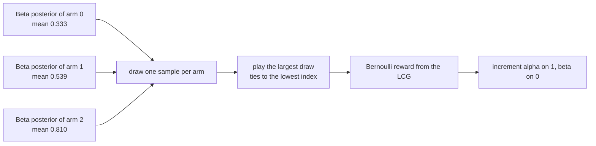
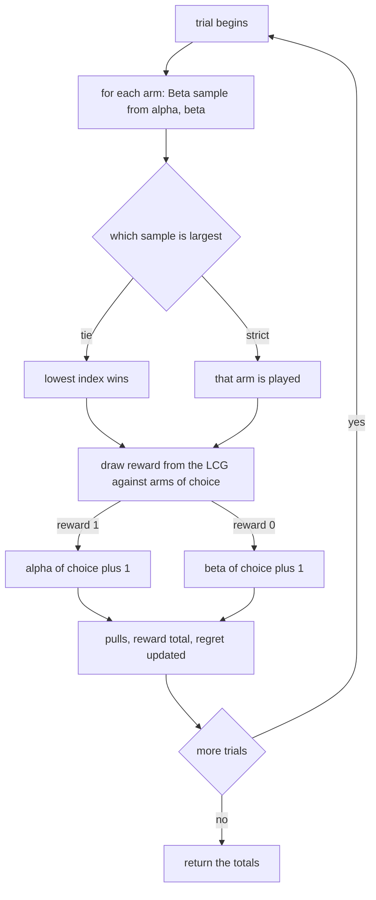
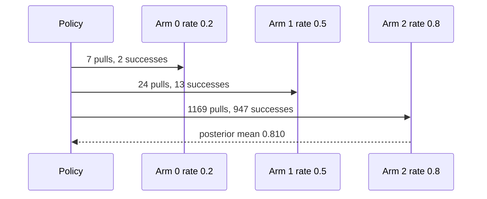

# 494 — Implement Thompson sampling simulator for bandit problems.

> **Tier:** Advanced · **CTCI chapter:** Beyond — Machine Learning & AI
> **Task spec:** [494-implement-thompson-sampling-simulator-for-bandit-problems.md](../../../tasks/advanced/494-implement-thompson-sampling-simulator-for-bandit-problems.md)
> **Solutions:** [Python](../../../solutions/python/advanced/494-implement-thompson-sampling-simulator-for-bandit-problems/solution.py) ·
> [Java](../../../solutions/java/advanced/494-implement-thompson-sampling-simulator-for-bandit-problems/Solution.java) ·
> [JavaScript](../../../solutions/javascript/advanced/494-implement-thompson-sampling-simulator-for-bandit-problems/solution.js) ·
> [C#](../../../solutions/csharp/advanced/494-implement-thompson-sampling-simulator-for-bandit-problems/Solution.cs)

## 1. Problem restatement

**Input:** a planted three-armed bandit with fixed payout probabilities `arms = (0.2, 0.5, 0.8)`,
`1200` trials, and a fixed LCG seed `42`.

**Output:** a Beta-Bernoulli Thompson sampling simulator. Each trial:

1. draws a success-rate sample for every arm from its Beta posterior (prior `Beta(1, 1)`),
2. plays the **sampled argmax**, ties going to the lowest index,
3. observes a Bernoulli reward drawn from the fixed LCG,
4. updates the chosen arm's posterior.

Sampling is exact for integer parameters: `Gamma(a, 1)` is built as the sum of `a` unit exponentials
`-ln(u)` with `u` uniform, and `Beta(a, b)` is `x / (x + y)` with `x ~ Gamma(a, 1)`,
`y ~ Gamma(b, 1)`. No random source is needed beyond the LCG, whose step is
`seed = (seed * 75 + 74) mod 65537` producing `(seed + 0.5) / 65537` in `(0, 1)`.

The pinned run, with all of its documented expectations:

| Quantity | Value | Documented expectation |
| --- | --- | --- |
| pull counts | `[7, 24, 1169]` | best arm picked `>= 85%` of the time; `pulls[2] > pulls[1] > pulls[0]` |
| best-arm frequency | `1169 / 1200 = 0.974` | `>= 0.85` |
| cumulative regret `R` | `11.4` | `<= 100` |
| total reward | `962` | an integer in `[0, 1200]` |
| posterior `alpha` / `beta` | `[3, 14, 948]` / `[6, 12, 223]` | — |
| posterior mean of arm 2 | `948 / 1171 = 0.8096` | within `0.05` of `0.8`, and inside `[0.75, 0.85]` |
| re-run with the same seed | identical `pulls` and posterior means | bit-for-bit reproducibility |
| one-arm case `(0.9,)`, 200 trials | `[200]` | every trial on the only arm |
| two-arm case `(0.3, 0.7)`, 600 trials | `[8, 592]` | the better arm takes `>= 80%` |
| tied arms `(0.5, 0.5)`, 600 trials | `[230, 370]` | `min(pulls) >= 100`, neither arm starved |

## 2. Intuition

A bandit policy is a bet about the future made with incomplete information: pull the arm that looks
best, or pull another one to learn more about it? A greedy policy never learns and can lock onto a
lucky arm; a uniform policy learns but pays for it in reward.

Thompson sampling answers the dilemma by *sampling the answer from the posterior*. Keep a probability
distribution over each arm's true payout rate; every trial, draw one plausible value from each arm's
distribution and play whichever draw was highest. An arm whose posterior is uncertain produces widely
spread draws, so it occasionally wins the comparison and gets explored; an arm that has been measured
a lot produces narrow draws near its mean, so it wins exactly as often as it deserves.

The Beta distribution makes this cheap: `Beta(1 + successes, 1 + failures)` is the exact posterior for
a Bernoulli likelihood with a `Beta(1, 1)` prior, so the "statistics" are two counters per arm. With
`Beta(1, 1)` the prior is uniform, which is why the very first draws are spread across `(0, 1)` and
the first few choices are close to random.



The key insight is that **uncertainty itself does the exploring**. There is no exploration parameter to
tune and no schedule to anneal: an arm is pulled whenever a plausible world exists in which that arm
is the best, and as the posteriors tighten those worlds disappear. The pinned run shows the effect —
`7`, `24` and `1169` pulls — with a cumulative regret of only `11.4` against a bound of `100`.

## 3. Algorithm

1. **State.** `alpha = [1, 1, 1]`, `beta = [1, 1, 1]`, `pulls = [0, 0, 0]`; keep the LCG seed.
2. **`uniform()`** — advance `seed = (seed * 75 + 74) mod 65537` and return `(seed + 0.5) / 65537`,
   which is strictly inside `(0, 1)` so `ln` never sees zero.
3. **`gamma_unit(shape)`** — return the sum of `shape` unit exponentials `-ln(uniform())`. Exact for
   integer shape.
4. **`beta_sample(a, b)`** — `x = gamma_unit(a)`, `y = gamma_unit(b)`, return `x / (x + y)`.
5. **`run(trials)`** — for each trial: sample once per arm from its current posterior, pick the
   largest sample (ties to the lowest index), draw a Bernoulli reward from the chosen arm's true rate,
   then `alpha[choice] += reward`, `beta[choice] += 1 - reward`, `pulls[choice] += 1`. Accumulate the
   reward total and the regret `best - arms[choice]`.
6. **`posterior_mean(arm)`** — `alpha / (alpha + beta)`.

```text
function uniform()
    seed ← (seed * 75 + 74) mod 65537
    return (seed + 0.5) / 65537
end

function gamma_unit(shape)
    total ← 0
    repeat shape times do
        total ← total - ln(uniform())
    end
    return total
end

function beta_sample(a, b)
    x ← gamma_unit(a)
    y ← gamma_unit(b)
    return x / (x + y)
end

function run(trials)
    best ← max(arms)
    reward_total ← 0
    regret ← 0
    repeat trials times do
        samples ← [ beta_sample(alpha[i], beta[i]) for each arm i ]
        choice ← index of the largest sample, lowest index on ties
        reward ← 1 if uniform() &lt; arms[choice] else 0
        alpha[choice] ← alpha[choice] + reward
        beta[choice] ← beta[choice] + 1 - reward
        pulls[choice] ← pulls[choice] + 1
        reward_total ← reward_total + reward
        regret ← regret + best - arms[choice]
    end
    return (reward_total, regret)
end
```

Two details are the whole posterior update: `alpha` counts successes (including the prior's `1`) and
`beta` counts failures (also plus the prior). The reward draw uses the **same** LCG as the sampling, so
a single seed controls both the exploration and the observed outcomes — that is what makes the pinned
pull vector reproducible.



## 4. Worked example

**The first six trials** of the pinned run, with all three posterior samples shown. Because every arm
starts at `Beta(1, 1)`, the draws are spread across the whole unit interval and the choices are close
to arbitrary:

| Trial | samples for arms `0, 1, 2` | Choice | Uniform for the reward | `arms[choice]` | Reward |
| --- | --- | --- | --- | --- | --- |
| 1 | `0.891, 0.921, 0.221` | `1` | `0.682` | `0.5` | `0` |
| 2 | `0.929, 0.536, 0.917` | `0` | `0.975` | `0.2` | `0` |
| 3 | `0.580, 0.267, 0.110` | `0` | `0.308` | `0.2` | `0` |
| 4 | `0.557, 0.029, 0.182` | `0` | `0.123` | `0.2` | `1` |
| 5 | `0.457, 0.023, 0.321` | `0` | `0.705` | `0.2` | `0` |
| 6 | `0.089, 0.542, 0.183` | `1` | `0.372` | `0.5` | `1` |

The best arm (`0.8`) is not played at all in these six trials, yet its samples are not zero — it simply
lost three close comparisons, by `0.030` in trial 1 and `0.012` in trial 2. That is exactly how
Thompson sampling explores: an arm keeps getting drawn if any plausible world makes it the best, and
the posterior only narrows once the arm has been played. After six trials the state is
`pulls = [4, 2, 0]`, `alpha = [2, 2, 1]`, `beta = [4, 2, 1]`.

**The end state.** Over `1200` trials the same mechanism concentrates almost completely:

| Arm | True rate | Pulls | `alpha` | `beta` | Posterior mean |
| --- | --- | --- | --- | --- | --- |
| `0` | `0.2` | `7` | `3` | `6` | `0.333` |
| `1` | `0.5` | `24` | `14` | `12` | `0.538` |
| `2` | `0.8` | `1169` | `948` | `223` | `0.810` |

Arm `0` was played seven times and won one of them; its posterior mean sits above its true rate
because seven samples is not much evidence, and it kept being sampled only through the wide spread of
its own uncertainty. Arm `2`'s posterior has narrowed to `0.810`, within `0.05` of the truth, and the
pull order `7 < 24 < 1169` is the assertion the tests make about the ordering.

**Regret.** The cumulative regret `R = sum(max(arms) - arms[chosen])` comes out at `11.4` over `1200`
trials, against a documented bound of `100`. It is dominated by the early exploratory trials: each of
the `7` pulls of arm `0` costs `0.6`, and each of the `24` pulls of arm `1` costs `0.3`, which already
explains `4.2 + 7.2 = 11.4` — the `1169` pulls of the best arm cost nothing at all. The two arms'
regret contributions are pinned by the pull vector, and the bound is the documented slack around this
deterministic run.



**Smaller cases.** A single-armed bandit needs no decisions: `(0.9,)` over `200` trials gives
`pulls == [200]`. A wider gap concentrates faster: `(0.3, 0.7)` over `600` trials gives `[8, 592]`,
comfortably past the documented `80%`. And when the arms are tied at `(0.5, 0.5)` there is no best arm
to converge on, so the required property is different: over `600` trials the split is `[230, 370]`,
and `min(pulls) >= 100` asserts that neither arm is starved — with identical posteriors, exploration
never stops.

**Determinism.** Re-running the pinned configuration with seed `42` reproduces `pulls` and every
posterior mean exactly, because both the posterior draws and the reward draws come from the same LCG.
There is no wall-clock or entropy input anywhere in the simulation.

## 5. Complexity

Let `T` be the number of trials and `A` the number of arms.

| Measure | Bound | Why it holds |
| --- | --- | --- |
| Time, one `beta_sample(a, b)` | O(a + b) | `gamma_unit` sums `shape` exponentials, so the cost grows with how often the arm has been played |
| Time, one trial | O(A + sum of the chosen arm's counters) | one sample per arm, one reward draw, one posterior update |
| Time, whole run | O(T · A + T²/2) worst case | the counter sums grow linearly with the trials played, so the naive Gamma construction is quadratic overall |
| Time, reward draw | O(1) | one LCG step and one comparison |
| Time, `posterior_mean` | O(1) | one division |
| Space | O(A) | two counters, one pull count and one true rate per arm |
| Regret, measured | `11.4` over `1200` trials | bounded in the test by `100`; the best arm costs nothing to play |
| Best-arm frequency | `0.974` | bounded in the test by `0.85` |

The quadratic term is the honest cost of sampling Gamma from scratch as a sum of exponentials: an arm
played `n` times needs `n + 1` exponentials per draw, so the cumulative sampling work grows with the
square of the trials. The structured alternative is a proper Gamma sampler or a normal approximation
once the posteriors are tight; the simulation here keeps the exact construction because it needs no
random source beyond the LCG and is therefore reproducible in four languages.

## 6. Pitfalls and edge cases

- **Ties go to the lowest index.** The choice loop only replaces the incumbent on a strict `>`, which
  the tests rely on for the tied-arms case where the two posteriors are statistically identical.
- **Prior counts are part of the posterior.** `alpha` and `beta` start at `1`, so the state after
  `T` successful pulls is `Beta(1 + wins, 1 + losses)`. Dropping the prior would make
  `posterior_mean` undefined before the first pull and change every pinned value.
- **The reward draw must use the same LCG.** Both the posterior samples and the observed rewards come
  from the one stream, which is why re-running with seed `42` reproduces `pulls` exactly. Adding an
  independent entropy source would break the reproducibility assertion without changing any
  expectation in the header.
- **`uniform()` never returns 0 or 1.** The mapping `(seed + 0.5) / 65537` keeps `u` strictly inside
  `(0, 1)`, so `-ln(u)` is finite; using `seed / 65537` would let `u` hit `0` and produce an infinite
  sample.
- **Regret is cumulative, not average.** The measured value is `11.4` for the whole run; the documented
  bound `100` applies to that sum (`0.0095` per trial). Reading it as an average would make the
  assertion look trivially loose.
- **Exploration looks like failure early on.** The best arm is unplayed for the first six trials and
  loses trial 1 by `0.030`; a policy that forced early exploitation would score lower on the pinned
  regret, not higher.
- **Starving an arm is a real failure mode.** The tied case asserts `min(pulls) >= 100` over `600`
  trials, precisely because "the arms are equal" is the situation where a sampler that has locked onto
  one posterior would stop exploring.
- **Arm ordering is asserted, not assumed.** `pulls[2] > pulls[1] > pulls[0]` catches a sampler whose
  posteriors drifted even when its best-arm frequency still passed the `85%` threshold.
- **The "empirical rate equals the posterior mean" check is an identity.** `posterior_mean(arm)` is
  `alpha / (alpha + beta)`, and `alpha` was incremented once per success while `beta` once per failure,
  so it *is* the observed success rate of that arm's pulls. The test asserts it is within `0.05` of
  `0.8`, which is a statement about how many pulls the arm received, not about a separate estimator.
- **Small arms are cheap to get wrong.** The one-arm case must pull the single arm every time
  (`[200]`), and the two-arm case must clear `80%` (`[8, 592]`); both run on shifted seeds
  (`SEED + 1`, `SEED + 2`) so they are not just the pinned trajectory truncated.

## 7. Variants and follow-ups

- **The deterministic-optimism alternative.**
  [495-implement-ucb-upper-confidence-bound-algorithm-simulation.md](../../../tasks/advanced/495-implement-ucb-upper-confidence-bound-algorithm-simulation.md)
  replaces the sampled argmax with a confidence bonus, trading the randomness of probability matching
  for an explicit exploration term.
- **Gradient methods instead of posteriors.**
  [496-implement-online-convex-optimization-simple-gradient-descent-dem.md](../../../tasks/advanced/496-implement-online-convex-optimization-simple-gradient-descent-dem.md)
  updates a parameter vector from each observation's gradient, which is the same online-learning shape
  with a different objective.
- **Cheap memory for the same stream.**
  [493-implement-probabilistic-data-structure-composition-bloom-cmsketc.md](../../../tasks/advanced/493-implement-probabilistic-data-structure-composition-bloom-cmsketc.md)
  answers membership and frequency from bounded sketches, which is what a bandit over a huge action set
  would need instead of per-arm counters.
- **Reproducible randomness.** Every stochastic task in this repository builds its stream from the same
  LCG step so the four language implementations agree bit for bit; the pinned pull vectors are checks
  on that agreement as much as on the policy.

## 8. Check yourself

**Q1.** Why does an arm with a poor posterior mean still get played occasionally?

<details><summary>Show answer</summary>

Because the decision uses a *draw* from the posterior, not the mean. Arm `0` ends with posterior mean
`0.333`, but its posterior is wide (only `9` observations total), so a draw above `0.8` is possible; if
the other draws come in low, it wins the comparison. Uncertainty is the exploration mechanism — no
separate epsilon or schedule is needed.
</details>

**Q2.** The pinned regret is `11.4` with a bound of `100`. Where does `11.4` come from?

<details><summary>Show answer</summary>

Almost entirely from the two suboptimal arms' pull counts: `7` pulls of the `0.2` arm cost
`7 × 0.6 = 4.2`, and `24` pulls of the `0.5` arm cost `24 × 0.3 = 7.2`, for `11.4` in total. The
`1169` pulls of the best arm cost nothing, because the regret of an optimal pull is `0`.
</details>

**Q3.** Why is `Gamma(a, 1)` implemented as a sum of unit exponentials?

<details><summary>Show answer</summary>

Because the solution needs an *exact* Beta draw with no random source other than the LCG. For integer
`a`, `Gamma(a, 1)` is exactly the sum of `a` independent unit exponentials, so `-ln(u)` with `u`
uniform gives each term and the sum is exact. That keeps the sample reproducible in all four languages
— at the cost of `O(a + b)` work per draw, which is the quadratic term in the run's complexity.
</details>

**Q4.** With arms `(0.5, 0.5)` the run splits `[230, 370]` over `600` trials. Why is that the expected
shape rather than a failure?

<details><summary>Show answer</summary>

Because no arm is better, so there is nothing to converge on: both posteriors keep being sampled with
similar means, and the split is a random walk driven by the LCG. The assertion is the weaker but
correct property — `min(pulls) >= 100` — that neither arm is starved, which is what an over-confident
sampler would violate.
</details>

**Q5.** The tests assert `abs(posterior_mean(2) - 0.8) <= 0.05`. Is that a statement about the
algorithm's accuracy?

<details><summary>Show answer</summary>

It is a statement about the posterior after `1169` pulls: `948 / 1171 = 0.8096` is the observed success
rate of those pulls, and it lands within `0.05` of the true `0.8` because the sample size is large. The
identity `posterior_mean = alpha / (alpha + beta)` means the check measures how much evidence the arm
accumulated — which in turn is what the best-arm-frequency threshold `0.85` is about.
</details>
