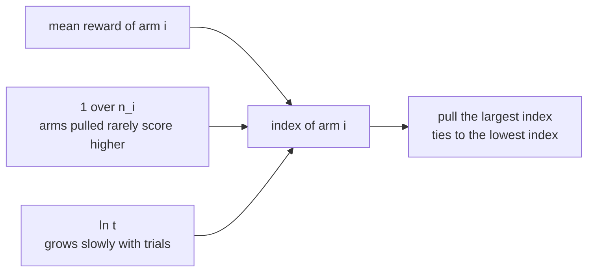
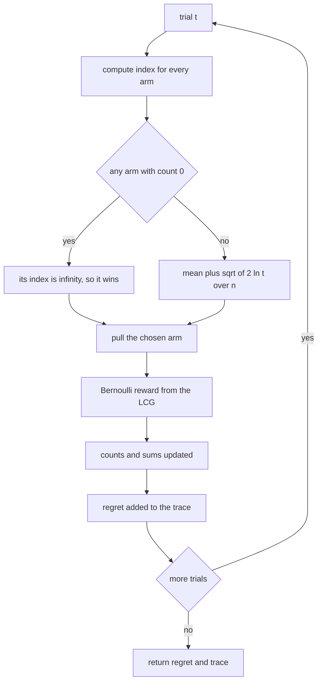
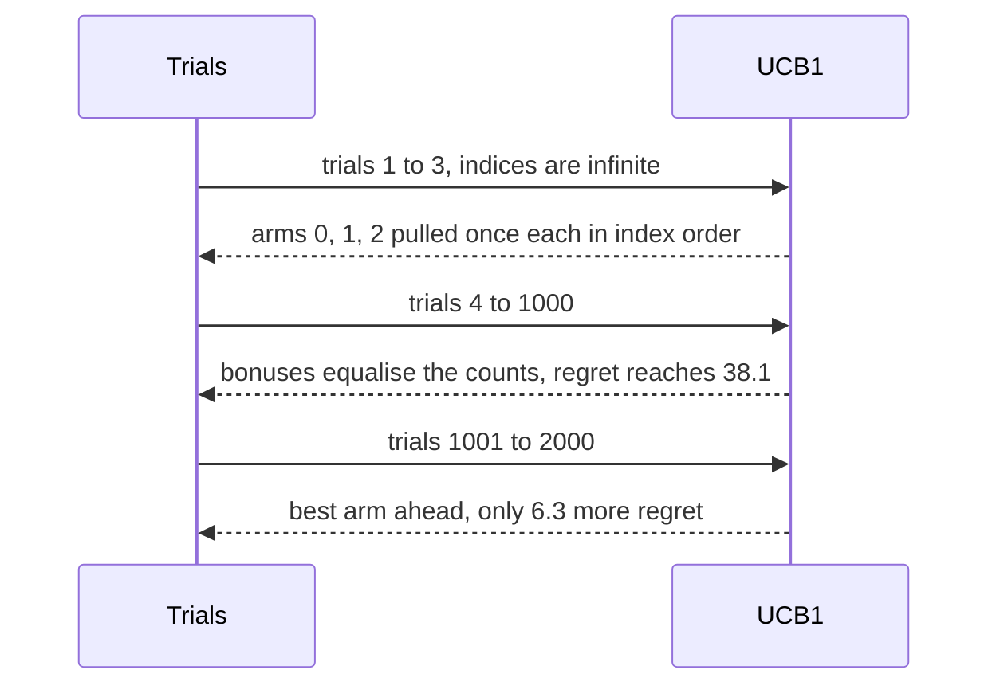

# 495 — Implement UCB (upper confidence bound) algorithm simulation.

> **Tier:** Advanced · **CTCI chapter:** Beyond — Machine Learning & AI
> **Task spec:** [495-implement-ucb-upper-confidence-bound-algorithm-simulation.md](../../../tasks/advanced/495-implement-ucb-upper-confidence-bound-algorithm-simulation.md)
> **Solutions:** [Python](../../../solutions/python/advanced/495-implement-ucb-upper-confidence-bound-algorithm-simulation/solution.py) ·
> [Java](../../../solutions/java/advanced/495-implement-ucb-upper-confidence-bound-algorithm-simulation/Solution.java) ·
> [JavaScript](../../../solutions/javascript/advanced/495-implement-ucb-upper-confidence-bound-algorithm-simulation/solution.js) ·
> [C#](../../../solutions/csharp/advanced/495-implement-ucb-upper-confidence-bound-algorithm-simulation/Solution.cs)

## 1. Problem restatement

**Input:** a planted three-armed bandit with fixed payout probabilities `arms = (0.2, 0.5, 0.8)`,
`2000` trials, and a fixed LCG seed `99`.

**Output:** a UCB1 simulator. Every trial

1. pulls `argmax(mu_hat[i] + sqrt(2 ln t / n_i))` over the arms, ties going to the lowest index,
   where `t` counts trials so far,
2. observes a Bernoulli reward drawn from the fixed LCG
   (`seed = (seed * 75 + 74) mod 65537`, reward when `(seed + 0.5) / 65537 < p_arm`),
3. updates that arm's count and reward sum.

Each arm is pulled once to initialise its average, in index order, because the index of an untried arm
is `+infinity`. The run is fully deterministic: one seed drives every reward. The pseudo-regret uses
the known true means, `R(T) = sum over trials of (max(mu) - mu[a_t])`.

| Quantity | Value | Documented expectation |
| --- | --- | --- |
| pull counts | `[32, 84, 1884]` | best arm picked `>= 80%`; strict ordering `pulls[2] > pulls[1] > pulls[0]` |
| best-arm frequency | `1884 / 2000 = 0.942` | `>= 0.80` |
| total pseudo-regret | `44.4` | `<= 100` |
| regret per trial, first half | `0.0381` | second half must be strictly lower |
| regret per trial, second half | `0.0063` | — |
| uniform-random baseline | `595.8` | UCB1 must beat `2 × 44.4` |
| empirical means after the run | `0.1875, 0.4643, 0.8025` | — |
| warm-up | after `3` pulls, `counts == [1, 1, 1]`; after `10`, `min(counts) >= 1` | — |
| two-arm case `(0.3, 0.7)`, 1000 trials | `[52, 948]` | better arm `>= 90%` |
| re-run with the same seed | identical `pulls` and regret | determinism |

## 2. Intuition

A greedy bandit policy is `argmax(mu_hat)` — play whatever looks best. It has no reason to try
anything else, so an arm that looked good early by luck is played forever. UCB1 adds one term to the
comparison and thereby makes exploration automatic:

```text
index(i) = mean reward of arm i  +  sqrt(2 · ln(t) / n_i)
```

The first term is exploitation: arms with a good observed average rank high. The second is
exploration written as optimism: `n_i` is how many times arm `i` has been pulled, so an arm that has
been pulled rarely carries a large bonus, and `ln(t)` grows slowly with the trial count so the bonus
does not decay to nothing. An arm that has never been tried gets `+infinity`, which is why the first
`A` trials visit each arm exactly once, in index order — the warm-up is not a special case in the code
but a consequence of the formula.



The regret definition makes the cost visible: playing the second-best arm costs `0.3`, playing the
worst costs `0.6`, and playing the best costs nothing. Summed over the pinned run that is `44.4`, and
the split across halves shows the learning: `0.0381` per trial in the first half, `0.0063` in the
second — UCB1 spends its early trials probing and its later trials exploiting.

The key insight is that **optimism about uncertain arms is enough to explore correctly**. The bonus
`sqrt(2 ln t / n_i)` is not a tuning knob: it is the width of a confidence interval around the sample
mean, so UCB1 plays the arm whose reward *could* be the best rather than the arm whose average
currently is. That is also why no randomness is needed in the policy itself — the only random input is
the reward stream.

## 3. Algorithm

1. **State.** `counts = [0, 0, 0]`, `sums = [0.0, 0.0, 0.0]`, `pulls = [0, 0, 0]`, and the LCG seed.
2. **`reward(p)`** — step the LCG and return `1` when `(seed + 0.5) / 65537 < p`, else `0`.
3. **`index(arm, t)`** — `+infinity` when `counts[arm] == 0`; otherwise
   `sums[arm] / counts[arm] + sqrt(2 · ln(t) / counts[arm])`.
4. **`run(trials)`** — for `t = 1..trials`: choose the largest index (ties to the lowest index), draw
   the reward for the chosen arm's true rate, increment `counts`, `sums` and `pulls`, accumulate the
   regret against `max(arms)`, and append the running regret to a trace.
5. **Baseline** — the same bandit, same seed, but the arm is chosen uniformly at random.

```text
function index(arm, t)
    if counts[arm] = 0 then
        return infinity
    end
    mean ← sums[arm] / counts[arm]
    return mean + sqrt(2 * ln(t) / counts[arm])
end

function run(trials)
    best ← max(arms)
    regret ← 0
    trace ← empty list
    for t ← 1 to trials do
        choice ← 0
        for i ← 1 to number of arms - 1 do
            if index(i, t) &gt; index(choice, t) then
                choice ← i
            end
        end
        r ← reward(arms[choice])
        counts[choice] ← counts[choice] + 1
        sums[choice] ← sums[choice] + r
        pulls[choice] ← pulls[choice] + 1
        regret ← regret + best - arms[choice]
        append regret to trace
    end
    return (regret, trace)
end

function reward(p)
    seed ← (seed * 75 + 74) mod 65537
    if (seed + 0.5) / 65537 &lt; p then
        return 1
    end
    return 0
end
```

Three details of the pseudocode carry the behaviour. The `counts[arm] = 0` branch returns `infinity`,
which is what forces the warm-up; the comparison is a strict `>` so a tie keeps the lower index; and
`ln(t)` uses the running trial number so the bonus grows slowly and never vanishes.



## 4. Worked example

**Warm-up and ties.** The first six trials, showing each arm's index before the pull:

| Trial `t` | index of arm `0` | index of arm `1` | index of arm `2` | Choice | Reward |
| --- | --- | --- | --- | --- | --- |
| 1 | `inf` | `inf` | `inf` | `0` | `1` |
| 2 | `2.177` | `inf` | `inf` | `1` | `0` |
| 3 | `2.482` | `1.482` | `inf` | `2` | `1` |
| 4 | `2.665` | `1.665` | `2.665` | `0` | `1` |
| 5 | `2.269` | `1.794` | `2.794` | `2` | `0` |
| 6 | `2.339` | `1.893` | `1.839` | `0` | `0` |

Trial 1 is a three-way tie at `infinity`, and the lowest-index rule breaks it in favour of arm `0`.
Trial 4 is a genuine two-way tie at `2.665`: arm `0` (mean `1.0`, one pull, bonus `sqrt(2 ln 4) = 1.665`)
and arm `2` (same mean and count) are level, and again the tie goes to the lower index. Trial 5 shows
the bonus working in the other direction: arms `1` and `2` each have one pull and a bonus of `1.794`,
while arm `0` has two pulls and only `1.269`, so arm `2` edges ahead despite arm `0` having collected a
reward and arm `2` having none.

The warm-up assertion reads directly off the first three rows: after `3` trials `counts == [1, 1, 1]`.

**Convergence.** Over the full `2000` trials the counts become `[32, 84, 1884]` with sums
`[6, 39, 1512]`, so the empirical means are:

| Arm | True rate | Pulls | Reward sum | Empirical mean |
| --- | --- | --- | --- | --- |
| `0` | `0.2` | `32` | `6` | `0.1875` |
| `1` | `0.5` | `84` | `39` | `0.4643` |
| `2` | `0.8` | `1884` | `1512` | `0.8025` |

The middle arm's estimate sits lowest relative to its truth (`0.464` versus `0.5`), which is the
signature of an arm that is pulled just often enough to keep being ruled out: the bonus keeps it in
contention, so it never disappears, but its mean stays below the best arm's so it is rarely chosen.

**The regret trace.** Regret is a cumulative sum of non-negative gaps, so the trace is monotone
non-decreasing — the test asserts that pairwise over all `2000` entries. Its *rate*, however, falls:

| Point | Cumulative regret | Regret per trial |
| --- | --- | --- |
| trial `10` | `3.3` | `0.330` |
| trial `100` | `11.4` | `0.114` |
| trial `1000` | `38.1` | `0.0381` |
| trial `2000` | `44.4` | `0.0222` |

The half-split assertion is the extracted claim: the first `1000` trials cost `38.1` (`0.0381` each)
and the second `1000` cost only `6.3` (`0.0063` each) — six times cheaper per trial. That is UCB1
learning: by the halfway point the best arm's index is far ahead of the others, and almost every
remaining trial plays it.



**Control experiment.** The uniform-random baseline starts from the same seed, consumes two LCG steps
per trial (one to choose an arm, one to draw its reward) and pays `595.8` — more than thirteen times
UCB1's `44.4`. The assertion is written as a factor of two, which the measured gap clears with room to
spare. The two-arm case with a larger gap concentrates even faster: `(0.3, 0.7)` over `1000` trials
gives `[52, 948]`, past the documented `90%`.

## 5. Complexity

Let `T` be the number of trials and `A` the number of arms.

| Measure | Bound | Why it holds |
| --- | --- | --- |
| Time, one trial | O(A) | one index evaluation per arm plus one reward draw and one update |
| Time, whole run | O(T · A) | with `A = 3` and `T = 2000` that is a few thousand index evaluations |
| Time, warm-up | O(A) | the first `A` trials are the untried arms, each with an `infinity` index |
| Space | O(A) | two counters per arm for the mean, one pull count, and the regret trace of length `T` |
| Space, trace | O(T) | the running regret is recorded per trial for the half-split assertion |
| Baseline cost | O(T) | uniform choice plus one reward draw, so cheaper per trial and far worse in regret |
| Measured regret | `44.4 <= 100` | with `0.0381` per trial in the first half and `0.0063` in the second |

The comparison with the baseline is what gives the regret number meaning: `595.8` for uniform sampling
against `44.4` for UCB1 on the same bandit and seed. UCB1 pays a constant factor of `A` work per trial
to evaluate the optimism bonus and recovers it many times over in reward — the pseudo-regret the tests
bound is the price of the exploration it performs while learning which arm is best.

## 6. Pitfalls and edge cases

- **Untried arms need the `infinity` branch.** Without it the index divides by `counts[arm] == 0`.
  The branch is also what makes the warm-up deterministic: `counts == [1, 1, 1]` after exactly three
  pulls, in index order, because the comparison is `>` and equal infinities keep the lower index.
- **Ties go to the lowest index.** Trial 4 of the pinned run is a real tie at `2.665` between arms `0`
  and `2`; the strict `>` comparison keeps arm `0`. Using `>=` would flip the whole trajectory and
  change every pinned number.
- **`t` counts trials within a run.** The bonus is `sqrt(2 ln t / n_i)` with `t` starting at `1`, so
  the first trial's bonus is exactly zero (`ln 1 = 0`) and untried arms are still selected by the
  `infinity` branch rather than by the bonus. Calling `run` twice restarts `t`, which is why the
  warm-up test runs `3` trials and then `7` more and checks only the totals.
- **The regret trace must be non-decreasing.** Each entry adds a gap `max(mu) - mu[a_t]` that is
  never negative; the test asserts monotonicity pairwise across all `2000` entries, which catches a
  trace that records a per-trial value instead of the running sum.
- **The half-split comparison is strict.** `second_rate < first_rate` is the documented "regret rate
  decreases" claim, and it is measured, not assumed: `0.0063 < 0.0381` on this seed. A policy that
  kept exploring at a constant rate would fail it.
- **Pseudo-regret uses information the policy does not have.** `max(arms)` and `arms[choice]` come from
  the planted probabilities; UCB1 only ever sees Bernoulli rewards. That is why the quantity is
  pseudo-regret and why it can be computed exactly in the test harness.
- **`counts` and `pulls` are parallel counters.** Both are incremented together and asserted equal;
  keeping only one would work, and the duplication is a documentation aid for the two roles
  (`counts` feeds the index, `pulls` is reported).
- **The baseline's stream differs from the policy's.** `RandomBaseline` restarts from the same seed but
  consumes two LCG steps per trial (choice and reward), so it is a control run over the same *generator*,
  not a replay of UCB1's rewards. The comparison is still meaningful because both bands are the same
  planted bandit.
- **Determinism covers both the policy and the rewards.** Re-running with seed `99` reproduces `pulls`
  and the regret exactly, because the only randomness is the LCG and the policy itself is
  deterministic.
- **An arm is never permanently abandoned.** Arms `0` and `1` end with `32` and `84` pulls: as their
  counts grow their bonus shrinks, but it never reaches zero because `ln t` keeps growing, so the
  strict ordering `pulls[2] > pulls[1] > pulls[0]` coexists with continued exploration.

## 7. Variants and follow-ups

- **Sampling instead of optimism.**
  [494-implement-thompson-sampling-simulator-for-bandit-problems.md](../../../tasks/advanced/494-implement-thompson-sampling-simulator-for-bandit-problems.md)
  solves the same planted bandit by drawing each arm's rate from a Beta posterior; on the identical
  reward structure the sampled approach reaches `1169 / 1200` pulls of the best arm with regret
  `11.4`, while UCB1's determinism makes its trajectory reproducible without any sampler.
- **Learning a parameter vector online.**
  [496-implement-online-convex-optimization-simple-gradient-descent-dem.md](../../../tasks/advanced/496-implement-online-convex-optimization-simple-gradient-descent-dem.md)
  generalises the per-arm update to a gradient step, which is what a contextual bandit needs.
- **Estimating what cannot be counted.**
  [493-implement-probabilistic-data-structure-composition-bloom-cmsketc.md](../../../tasks/advanced/493-implement-probabilistic-data-structure-composition-bloom-cmsketc.md)
  provides bounded sketches for membership and frequency, the tools a bandit over a huge arm set would
  use in place of exact counters.
- **Regret as a budget.** The `<= 100` bound and the half-split rate are the template for measuring any
  online policy in this repository: fix the stream, fix the seed, and compare against a control.

## 8. Check yourself

**Q1.** Why is the first arm pulled always arm `0`?

<details><summary>Show answer</summary>

Because every untried arm's index is `+infinity`, so trial 1 is a three-way tie and the strict
`>` comparison keeps the incumbent — arm `0`. Trials 2 and 3 then compare against a finite index for
arm `0` but `infinity` for arms `1` and `2`, so they pick arm `1` and then arm `2`. After three pulls
`counts == [1, 1, 1]`.
</details>

**Q2.** Trial 4 has arm `0` and arm `2` both at index `2.665`. How is the tie resolved, and why does
it matter?

<details><summary>Show answer</summary>

To the lowest index: the choice loop only replaces the incumbent on a strict `>`, so arm `0` is
pulled. It matters because the reward drawn then differs, and the whole deterministic trajectory —
`pulls == [32, 84, 1884]` and regret `44.4` — depends on it. Reversing the comparison to `>=` would
produce a different, still-legal run that fails every pinned assertion.
</details>

**Q3.** The regret trace grows to `44.4` but its rate falls from `0.0381` to `0.0063` per trial. What
is the rule being tested?

<details><summary>Show answer</summary>

That UCB1's exploration slows down as it learns. The trace is a cumulative sum of non-negative gaps,
so it can only increase; the test therefore measures the *increment over each half* and asserts
`second_rate < first_rate`. The first half's `38.1` covers the warm-up and the measuring phase, and the
second half's `6.3` shows the best arm's index has pulled clear of the others.
</details>

**Q4.** What would break if the `counts[arm] == 0` branch returned `0` instead of `infinity`?

<details><summary>Show answer</summary>

The index would divide by zero, and even with a guard the untried arm would score `mean + bonus` with
no evidence behind the mean — so the warm-up invariant `counts == [1, 1, 1]` after three pulls and the
"no arm is skipped" check would both fail. The `infinity` branch is the warm-up, not a special case
bolted on.
</details>

**Q5.** Why does the uniform baseline pay `595.8` when a perfect policy pays `0`?

<details><summary>Show answer</summary>

Because uniform choice ignores what it has learned: it pulls the worst arm (`0.2`) about a third of the
time, costing `0.6` per pull, the middle arm (`0.5`) about a third of the time at `0.3`, and the best
arm the remaining third at no cost — roughly `0.3` per trial, which over `2000` trials lands near
`595.8`. UCB1's `44.4` is the same accounting with the early exploration concentrated into the first
few hundred trials.
</details>
