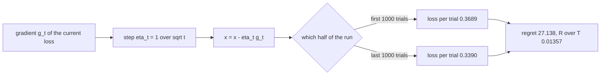
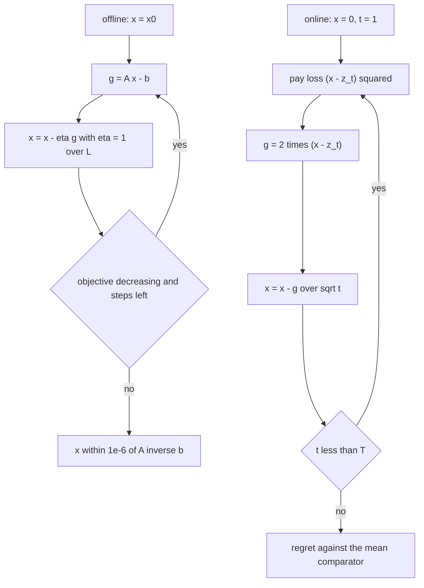
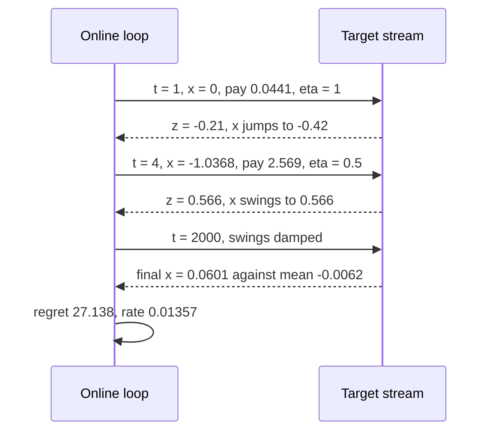

# 496 — Implement online convex optimization simple gradient descent demo.

> **Tier:** Advanced · **CTCI chapter:** Beyond — Machine Learning & AI
> **Task spec:** [496-implement-online-convex-optimization-simple-gradient-descent-dem.md](../../../tasks/advanced/496-implement-online-convex-optimization-simple-gradient-descent-dem.md)
> **Solutions:** [Python](../../../solutions/python/advanced/496-implement-online-convex-optimization-simple-gradient-descent-dem/solution.py) ·
> [Java](../../../solutions/java/advanced/496-implement-online-convex-optimization-simple-gradient-descent-dem/Solution.java) ·
> [JavaScript](../../../solutions/javascript/advanced/496-implement-online-convex-optimization-simple-gradient-descent-dem/solution.js) ·
> [C#](../../../solutions/csharp/advanced/496-implement-online-convex-optimization-simple-gradient-descent-dem/Solution.cs)

## 1. Problem restatement

**Input:** two optimisation problems, both fixed by the solution constants.

**Part 1 — offline gradient descent** on the convex quadratic

```text
f(x) = 0.5 · xᵀ A x − bᵀ x,   A = [[3, 1, 0], [1, 3, 1], [0, 1, 3]],   b = [1, −2, 0.5]
```

starting from `x0 = [2, 2, 2]`, with the documented step size `eta = 1 / L` where `L` is the largest
eigenvalue of `A` (found by power iteration) and `300` iterations.

**Part 2 — online convex optimisation** on the loss stream `f_t(x) = (x − z_t)²` for LCG targets
`z_t` in `[-1, 1]` (`seed = (seed * 75 + 74) mod 65537`, `z = (seed mod 2001) / 1000 − 1`), with the
schedule `eta_t = 1 / sqrt(t)` and the pseudo-regret against the best fixed comparator,

```text
R(T) = sum over t of f_t(x_t) − min over x of sum over t of f_t(x).
```

| Quantity | Value | Documented expectation |
| --- | --- | --- |
| `λ_max(A)` | `4.4142136` | sanity range `(4, 5)` |
| step size `eta = 1 / L` | `0.2265409` | the monotonicity proof requires `eta <= 1 / L` |
| exact minimiser `A⁻¹ b` | `[0.6904762, −1.0714286, 0.5238095]` | Gaussian elimination, gradient `<= 1e-12` |
| `f(x0)` → `f(x_final)` | `27.0` → `−1.5476190` | monotonically decreasing until within `1e-9` of `f*` |
| final distance to the minimiser | `~5.1e-16` | `<= 1e-6` asserted |
| control: `eta = 1`, 25 steps | max `f` about `1.3e+28` | no monotonicity guarantee at that step size |
| online regret `R(2000)` | `27.138` | `<= 100`, and `R/T = 0.01357 <= 0.05` |
| online loss rate, first / second half | `0.3689` / `0.3390` | second half strictly lower |
| final iterate vs the target mean | `0.060105` vs `−0.006226` | within `0.1` |
| target range | `[−0.998, 1.0]` | inside `[-1, 1]` |

## 2. Intuition

Part 1 is the textbook picture. On a convex quadratic the gradient is `A x − b`, the curvature is
`A`, and the step size has a hard ceiling: with `eta = 1 / L`, where `L` is the largest eigenvalue,
substituting into `f` gives

```text
f(x − eta·g) <= f(x) − (eta − 0.5·eta²·L)·||g||²  =  f(x) − ||g||² / (2L),
```

so every step removes at least `||g||² / (2L)` from the objective. Nothing about the direction
matters beyond its length — the entire guarantee comes from the step size being small enough relative
to the curvature.

Part 2 removes the fixed objective. Each round presents a different loss `f_t(x) = (x − z_t)²` and the
iterate moves *before* seeing how wrong it was. Comparing against the best single fixed `x` in
hindsight gives the pseudo-regret, which can never be negative and would be unbounded with a constant
step size: the noise from recent targets would never average out. The schedule `eta_t = 1 / sqrt(t)`
fixes that — steps shrink slowly enough to keep tracking the drift and fast enough that the noise
accumulates sublinearly.



The key insight is that **both demos are the same loop with a different definition of "better"**. In
the offline case, "better" means a lower objective value, and convergence is measured by distance to
the exact minimiser. In the online case, "better" means a lower cumulative loss than the best fixed
comparator, and convergence is measured by the regret rate. The gradient, the step, and the update are
identical in shape; only the step schedule and the yardstick change.

## 3. Algorithm

1. **Objective and gradient.** `objective(A, b, x) = 0.5·xᵀ(A x) − bᵀx`; `gradient(A, b, x) = A x − b`.
2. **Largest eigenvalue.** Power iteration from the all-ones vector: repeatedly `v ← A v`, normalise,
   for `100` iterations, then return `vᵀ A v` as `lambda_max`.
3. **Exact minimiser (oracle).** Gaussian elimination with partial pivoting on the augmented system
   `[A | b]`; back-substitution yields `x* = A⁻¹ b`.
4. **Offline descent.** With `eta = 1 / lambda_max`, repeat `300` times: `g = gradient(x)`,
   `x = x − eta·g`, record `objective(x)`.
5. **Online targets.** Generate the `T` targets from the LCG, mapped into `[-1, 1]`.
6. **Online loop.** For `t = 1..T`: record `f_t(x_t)`, compute `g = 2(x_t − z_t)`, take the step with
   `eta_t = 1 / sqrt(t)`.
7. **Regret.** `R(T) = sum(f_t(x_t)) − sum((mean(z) − z_t)²)`, because for squared loss the best fixed
   comparator is the mean of the targets.

```text
function objective(A, b, x)
    return 0.5 * dot(x, matvec(A, x)) - dot(b, x)
end

function gradient(A, b, x)
    return matvec(A, x) - b
end

function largest_eigenvalue(A, iterations)
    v ← normalised all-ones vector
    repeat iterations times do
        v ← normalise(A * v)
    end
    return dot(v, matvec(A, v))
end

function gd_offline(eta, steps)
    x ← x0
    values ← [ objective(A, b, x) ]
    repeat steps times do
        g ← gradient(A, b, x)
        x ← x - eta * g
        append objective(A, b, x) to values
    end
    return (x, values)
end

function online_loop(trials, seed)
    targets ← []
    repeat trials times do
        seed ← (seed * 75 + 74) mod 65537
        append (seed mod 2001) / 1000 - 1 to targets
    end
    x ← 0
    losses ← []
    for t ← 1 to trials do
        z ← targets[t]
        append (x - z) * (x - z) to losses
        g ← 2 * (x - z)
        eta ← 1 / sqrt(t)
        x ← x - eta * g
    end
    mean_z ← average of targets
    comparator ← sum over t of (mean_z - targets[t]) * (mean_z - targets[t])
    return (x, targets, losses, sum(losses) - comparator, mean_z)
end
```

Two structural details matter. The offline loop records the objective **after** each update, so the
first recorded value is `f(x0) = 27` and monotonicity is checked across consecutive entries. The
online loop records the loss of the current iterate **before** the update, which is the definition of
regret: you pay for the decision you already made, with the gradient arriving afterwards.



## 4. Worked example

**Curvature first.** Power iteration on `A = [[3,1,0],[1,3,1],[0,1,3]]` from the all-ones vector
converges to the eigenvector `[0.5, 0.7071, 0.5]` with `λ_max = 4.4142136`, so the step size is
`eta = 1 / 4.4142136 = 0.2265409`. The sanity assertion is that `λ_max` lands strictly inside `(4, 5)`.

**The first steps of the offline demo:**

| Step | `x` before | `g = A x − b` | `x` after | `f(x)` |
| --- | --- | --- | --- | --- |
| 0 | `[2, 2, 2]` | — | — | `27.0` |
| 1 | `[2, 2, 2]` | `[7, 12, 7.5]` | `[0.414214, −0.718491, 0.300943]` | `−1.347947` |
| 2 | `[0.414214, −0.718491, 0.300943]` | `[−0.4759, 0.5597, −0.3157]` | `[0.522013, −0.845282, 0.372453]` | `−1.466299` |
| 3 | `[0.522013, −0.845282, 0.372453]` | `[−0.2792, 0.3586, −0.2279]` | `[0.585273, −0.926524, 0.424087]` | `−1.514299` |

The first step alone takes the objective from `27.0` to `−1.348`, because the quadratic is a bowl whose
far side is steep; the remaining `299` steps close the last `0.2` on the way to `f* = −1.5476190`. The
gradient norms shrink geometrically, which is what the monotonicity guarantee predicts: each step
removes at least `||g||² / (2L)`, so the objective can never rise, and it stops improving only when
`||g||` is at the floating-point noise floor.

| Iterate | Value |
| --- | --- |
| final `x` | `[0.6904762, −1.0714286, 0.5238095]` |
| exact `A⁻¹ b` | `[0.6904762, −1.0714286, 0.5238095]` |
| `‖x_final − x*‖` | `5.1e-16` (asserted `<= 1e-6`) |
| `f(x_final)` vs `f*` | `−1.5476190` vs `−1.5476190`, within `1e-9` |

**The control.** Running the same descent with `eta = 1.0` for 25 steps drives the objective to about
`1.3e+28`: the step exceeds `2 / L`, so the update overshoots the bowl and the divergence compounds.
That is the reason the demo derives `eta` from the spectrum instead of picking a constant.

**The online loop.** The first five rounds, with the loss paid before the update:

| `t` | `z_t` | `x_t` at the start | loss `(x_t − z_t)²` | `eta_t = 1/sqrt(t)` | `x` after |
| --- | --- | --- | --- | --- | --- |
| 1 | `−0.210` | `0.0` | `0.0441` | `1.000` | `−0.420` |
| 2 | `−0.303` | `−0.420` | `0.0137` | `0.707` | `−0.2545` |
| 3 | `−0.932` | `−0.2545` | `0.459` | `0.577` | `−1.0368` |
| 4 | `0.566` | `−1.0368` | `2.569` | `0.500` | `0.566` |
| 5 | `0.381` | `0.566` | `0.0342` | `0.447` | `0.4005` |

The first step is a full jump: `eta_1 = 1` and `g = 2(x − z_1)` take `x` from `0` to `2·z_1 = −0.42`,
overshooting the round's minimiser `z_1 = −0.21` by the same distance it started with — at `eta = 1`
the error `x − z` simply changes sign instead of shrinking. Round 4 shows the schedule settling: there
`eta_4 = 0.5`, so the update is `x − 0.5·2(x − z_4) = z_4` and the iterate lands exactly on that
target (`0.566`). Round 4's loss of `2.569` is the worst of the early rounds because the iterate was
near `−1.04` when the target jumped to `0.566`. As `eta_t` keeps shrinking the swings damp out and the
iterate settles.

| Online quantity | Value |
| --- | --- |
| final iterate | `0.060105` |
| mean of the targets | `−0.006226` |
| gap | `0.0663`, inside the documented `0.1` |
| loss per trial, trials `1..1000` | `0.3689` |
| loss per trial, trials `1001..2000` | `0.3390` |
| regret `R(2000)` | `27.138`, i.e. `R/T = 0.01357` |

The regret is non-negative by construction and far below the documented `100`. Its rate is what the
`R/T <= 0.05` assertion formalises: the per-trial cost of learning is trending to zero, which is the
sublinearity the `1 / sqrt(t)` schedule is chosen for.



## 5. Complexity

Let `n` be the dimension (here `3`), `S` the offline steps (`300`) and `T` the online trials (`2000`).

| Measure | Bound | Why it holds |
| --- | --- | --- |
| Time, one offline step | O(n²) | the gradient is a dense matrix-vector product |
| Time, offline run | O(S · n²) | `300` steps of the same cost |
| Time, power iteration | O(P · n²) | `P = 100` iterations of a matrix-vector product plus a normalisation |
| Time, exact oracle | O(n³) | Gaussian elimination with partial pivoting, run once |
| Time, one online step | O(1) | one subtraction, one square, one square root for the schedule |
| Time, online run | O(T) | the targets and the losses are both length-`T` vectors |
| Space, offline | O(n) plus `S` recorded values | the objective trace exists for the monotonicity check |
| Space, online | O(T) | targets and per-round losses are kept to compute the comparator and the half split |

Both demos are dominated by different terms: the offline one by the `S · n²` matrix products (with an
`n³` one-off for the oracle), the online one by the linear scan over `T` rounds. The online loop is
`O(1)` per round precisely because the loss is a scalar quadratic, which is what makes a `2000`-round
regret study cheap enough to run with a fixed seed in four languages.

## 6. Pitfalls and edge cases

- **The step size is bounded by the curvature.** `eta = 1 / L` is what makes the monotonicity proof
  work; the `eta = 1.0` control reaches `1.3e+28` in `25` steps. Too small a step is safe but slow, too
  large diverges.
- **Monotonicity has a floating-point allowance.** The assertion is strict decrease only while
  `|f − f*| > 1e-9`, and otherwise `current <= previous + 1e-12 · max(1, |previous|)`. Once the
  objective is flat at the minimum, rounding can nudge it up by an ulp, and the documented allowance
  is what keeps that from failing the test.
- **Never compare distances to the oracle loosely.** The final iterate is asserted within `1e-6` of
  `A⁻¹ b`, while the measured distance is `5.1e-16` — the assertion is a floor for correctness, not a
  claim about the typical accuracy.
- **The oracle must be independent.** `x*` comes from Gaussian elimination, not from a longer gradient
  run; the gradient at `x*` is asserted below `1e-12`, which is what makes it an oracle rather than a
  second approximation.
- **Power iteration needs its own accuracy.** `100` iterations from the all-ones vector give
  `λ_max = 4.4142136`; a sloppy estimate would make `eta` slightly too large and eat into the
  monotonicity margin. The sanity assertion `4 < λ_max < 5` catches an outright wrong value.
- **The online loss is paid before the update.** Recording the loss after the step would report the
  post-decision cost and produce a meaningless regret; the update order in the loop is the definition.
- **The comparator is the mean of the targets.** For squared loss `sum((x − z_t)²)` is minimised at
  `x = mean(z)`, so the best fixed comparator is computed in closed form. Using the last target, or the
  first, would inflate or deflate the regret.
- **`eta_t = 1 / sqrt(t)` starts at `1`.** The first round's step is a full jump onto `z_1`, which is
  why the early losses swing widely (`2.569` at round 4). A schedule that started much smaller would
  pay less early but track the drift more slowly.
- **Targets stay inside `[-1, 1]`.** The mapping `(seed mod 2001) / 1000 − 1` is asserted to keep
  `min(z) >= −1` and `max(z) <= 1`, which bounds the gradient and hence the early swing.
- **Regret is non-negative.** `min over x` cannot do worse than the actual trajectory, so `R >= 0`; a
  negative value would mean the comparator was computed wrongly.
- **The two halves measure rate, not totals.** The first half's `0.3689` per trial against the second
  half's `0.3390` is the documented "regret rate decreases" claim; comparing raw totals would just
  restate that the run is 2000 trials long.

## 7. Variants and follow-ups

- **Regret with a decision, not just a step.**
  [495-implement-ucb-upper-confidence-bound-algorithm-simulation.md](../../../tasks/advanced/495-implement-ucb-upper-confidence-bound-algorithm-simulation.md)
  and [494-implement-thompson-sampling-simulator-for-bandit-problems.md](../../../tasks/advanced/494-implement-thompson-sampling-simulator-for-bandit-problems.md)
  measure regret against the best fixed *arm*, so the same accounting appears with a combinatorial
  choice in place of a real-valued iterate.
- **Projection and constraints.** A constrained online problem adds a projection step after the
  gradient step, and the regret bound then depends on the diameter of the feasible set rather than on
  the initial distance alone.
- **Iterative clustering as an alternating update.**
  [498-implement-k-means-clustering-kmeans-initialization.md](../../../tasks/advanced/498-implement-k-means-clustering-kmeans-initialization.md)
  replaces the gradient step with an exact minimisation of the current assignment, which is the
  "closed-form rather than gradient" branch of the same optimisation family.
- **Sketching the gradient's inputs.**
  [493-implement-probabilistic-data-structure-composition-bloom-cmsketc.md](../../../tasks/advanced/493-implement-probabilistic-data-structure-composition-bloom-cmsketc.md)
  bounds the memory a frequency-based optimisation objective would need per feature.

## 8. Check yourself

**Q1.** Why is the step size derived from `λ_max(A)` rather than tuned by trial and error?

<details><summary>Show answer</summary>

Because the guarantee has a closed form. Substituting `x − eta·g` into a quadratic with curvature `A`
gives `f(x − eta·g) <= f(x) − (eta − 0.5·eta²·L)·||g||²` with `L = λ_max(A)`, and at `eta = 1 / L` the
bracket is exactly `1/(2L)`, so every step removes `||g||²/(2L)`. Any larger step makes the bracket
negative and the guarantee vanishes — the `eta = 1` control reaches `1.3e+28` in `25` steps.
</details>

**Q2.** The offline demo's first step drops the objective from `27.0` to `−1.348`. Why is the rest of
the run so much less dramatic?

<details><summary>Show answer</summary>

Because the objective is a quadratic bowl and the starting point `[2, 2, 2]` is far from the minimum
`[0.6904762, −1.0714286, 0.5238095]`. The first step takes the largest available reduction, from a
gradient of norm `sqrt(7² + 12² + 7.5²)`; afterwards the gradient shrinks geometrically, so each step
removes a fixed proportion of what remains. The last `0.2` of the journey takes the remaining `299`
iterations, and the final distance to the oracle is `5.1e-16`.
</details>

**Q3.** In the online loop, why does the first update overshoot the target instead of landing on it?

<details><summary>Show answer</summary>

Because `eta_1 = 1` is twice the step that the squared loss wants. The update is
`x − eta·2(x − z)`, which for `eta = 1` gives `2z − x`: with `x = 0` and `z_1 = −0.21` the iterate goes
to `−0.42`, i.e. the error `x − z` changes sign without shrinking. At `eta = 1/2` — which the schedule
reaches at `t = 4` — the update becomes `x − (x − z) = z` and the iterate lands exactly on the target,
which is what makes the later swings damp out as `eta_t = 1 / sqrt(t)` keeps decreasing.
</details>

**Q4.** What is the best fixed comparator for the online stream, and why is it not the final iterate?

<details><summary>Show answer</summary>

For the squared loss `sum((x − z_t)²)` the minimiser is the mean of the targets, `mean(z) = −0.006226`
for this stream. The final iterate is `0.060105`, which is within the documented `0.1` of that mean but
not equal to it: the online algorithm never sees the whole stream at once, so its job is to keep the
*gap* small, and the regret `27.138` is exactly the excess loss of the adaptive trajectory over that
oracle comparator.
</details>

**Q5.** Why does the schedule `1 / sqrt(t)` matter for the regret bound?

<details><summary>Show answer</summary>

Because a constant step size makes the trajectory chase the most recent target forever, so the excess
loss per round never decays and the regret grows linearly. With `eta_t = 1 / sqrt(t)` the steps shrink
just fast enough for the accumulated tracking error to grow sublinearly: the measured regret is
`27.138` over `2000` rounds (`R/T = 0.01357`), and the second half's loss rate `0.3390` is below the
first half's `0.3689`, which is the observed signature of that sublinearity.
</details>
