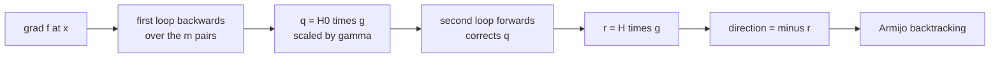
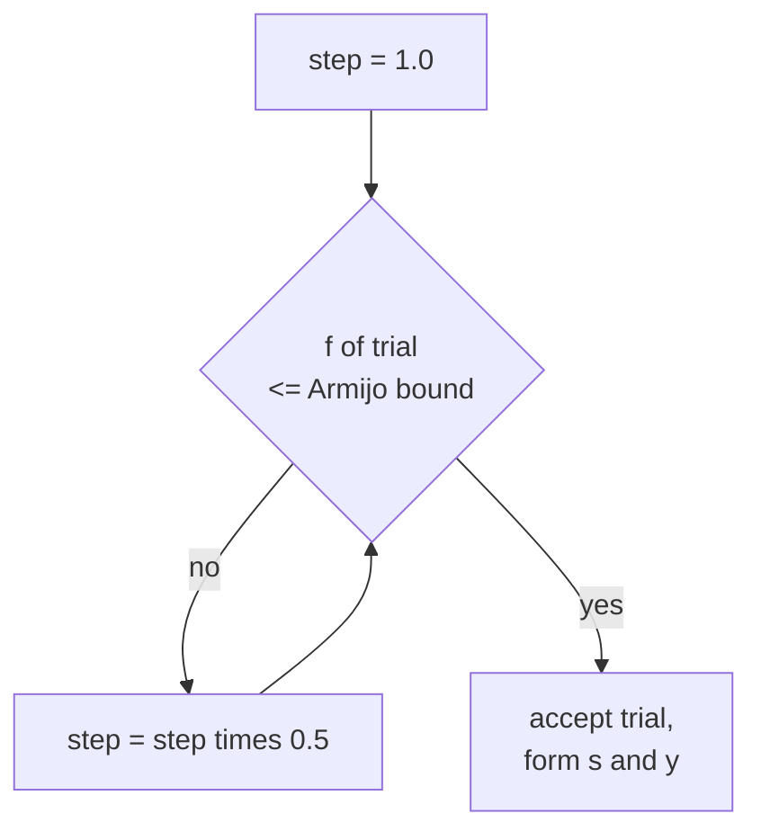
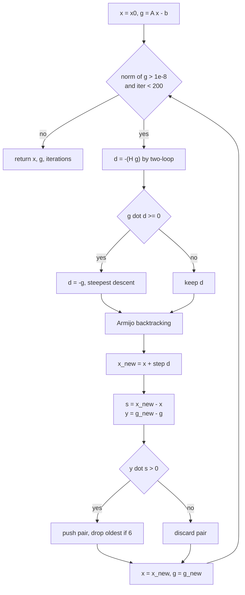
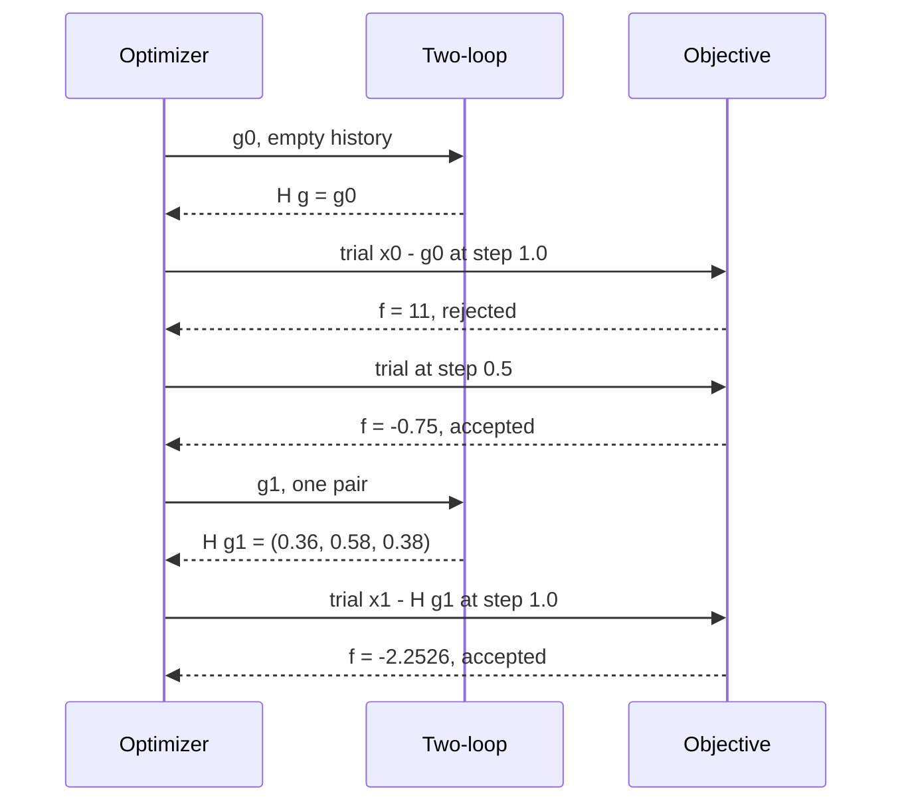

# 497 — Implement L-BFGS numeric optimizer skeleton for small dims.

> **Tier:** Advanced · **CTCI chapter:** Beyond — Machine Learning & AI
> **Task spec:** [497-implement-l-bfgs-numeric-optimizer-skeleton-for-small-dims.md](../../../tasks/advanced/497-implement-l-bfgs-numeric-optimizer-skeleton-for-small-dims.md)
> **Solutions:** [Python](../../../solutions/python/advanced/497-implement-l-bfgs-numeric-optimizer-skeleton-for-small-dims/solution.py) ·
> [Java](../../../solutions/java/advanced/497-implement-l-bfgs-numeric-optimizer-skeleton-for-small-dims/Solution.java) ·
> [JavaScript](../../../solutions/javascript/advanced/497-implement-l-bfgs-numeric-optimizer-skeleton-for-small-dims/solution.js) ·
> [C#](../../../solutions/csharp/advanced/497-implement-l-bfgs-numeric-optimizer-skeleton-for-small-dims/Solution.cs)

## 1. Problem restatement

**Input:** the convex quadratic model problem

- `A = [[4, 1, 0], [1, 3, 1], [0, 1, 2]]`, `b = [1, 2, 3]`, start `x0 = [0, 0, 0]`,
- `f(x) = 0.5 · xᵀ A x − bᵀ x`, and therefore `grad f(x) = A x − b`.

**Output:** a minimiser `x` of `f`, plus the machinery that makes the run checkable: the
iteration count, the final gradient norm, and the exact reference solution `x* = A⁻¹ b` computed
by Gaussian elimination with partial pivoting (that solve is the oracle used by every assertion).

The skeleton is fixed by the four solution headers:

| Knob | Value | Meaning |
| --- | --- | --- |
| memory `m` | 5 | at most five `(s, y)` correction pairs are kept |
| `max_iter` | 200 | hard cap on the outer loop |
| stop test | `‖grad f‖ <= 1e-8` | checked **before** a direction is computed |
| Armijo `c1` | `1e-4` | sufficient-decrease constant |
| backtracking `rho` | `0.5` | each rejected trial halves the step |
| first trial step | `1.0` | the quasi-Newton step is tried at full length first |
| GD step `eta` | `1 / L` | `L` = largest eigenvalue of `A` by power iteration (100 sweeps) |
| GD cap | 20000 | the comparison run is capped, not the L-BFGS run |

Documented outcome on this fixed problem (all four files assert it): `‖x − x*‖ <= 1e-6`,
`|f − f*| <= 1e-9`, `‖grad f‖ <= 1e-8`, and **9 iterations**. The reference run of plain gradient
descent, started at the same `x0` and stopped at the looser `‖grad f‖ <= 1e-6`, needs **46
iterations** — more than four times as many, which is what the Python file asserts
(`gd_iters > 4 * lb_iters`).

| Call | Result | Why |
| --- | --- | --- |
| `two_loop_direction(g0, [], [])` | `g0` | with no pairs `H = I`, so `H·g = g` |
| `lbfgs()` | `x = (0.2222, 0.1111, 1.4444)`, 9 iterations | `x* = A⁻¹ b = (2/9, 1/9, 13/9)` |
| `f(lbfgs())` | `−2.388888…` | equals `f* = −43/18` to `1e-9` |
| `gd(1e-6)` | `x = (0.22222208, 0.11111149, 1.44444392)`, 46 iterations | same minimiser, far more steps |
| `lbfgs()` again | identical iterate and iteration count | the run is deterministic |

## 2. Intuition

Gradient descent only knows the direction `−grad f`. On a quadratic with condition number
`κ = L / λ_min` it converges at the linear rate `1 − 1/κ` per step, and here the eigenvalues of
`A` are `1.268`, `3` and `4.732` (the characteristic polynomial factors as
`(λ − 3)(λ² − 6λ + 6)`), so `κ ≈ 3.73`. Even on this benign problem the fixed step `eta = 1/L`
needs 46 steps to reach `‖g‖ <= 1e-6`.

Newton's method would jump straight to `x*` — it needs `H⁻¹ grad f` where `H = A` — but forming
and factoring the Hessian costs `O(n³)` per iteration and a general objective does not hand you a
Hessian at all.

Quasi-Newton takes the middle road: **measure** the curvature you have already walked through.
Each accepted step produces a displacement `s = x_new − x` and a gradient change `y = g_new − g`.
For the quadratic these satisfy `y = A s`, so the pair `(s, y)` is a rank-one slice of the
Hessian, and `sᵀy / yᵀy` is a Rayleigh-quotient estimate of the curvature along `y`. L-BFGS stores
the last `m = 5` pairs instead of an `n × n` matrix and rebuilds the product `H·g` on demand.



The two loops are the whole trick. Because the BFGS update is a product of rank-two corrections,
`H·g` can be evaluated by replaying those corrections — `m` dot products each way — without ever
materialising `H`.

The second half of the intuition is the **line search**. A quasi-Newton direction is a good
*shape* but not a guaranteed *length*, so the code tries the full step `1.0` and halves it while
the Armijo test

```text
f(x + step·d) <= f(x) + c1 · step · (g·d)
```

fails. The first iteration of the trace below shows the test doing real work: the step `1.0` makes
`f` jump from `0` to `11`, which is not `<= −0.0014`, so the step is halved to `0.5` and `f` drops
to `−0.75`.



## 3. Algorithm

1. `x = x0`, `g = A x − b`, empty pair lists, `iterations = 0`.
2. While `iterations < 200` and `‖g‖ > 1e-8`: build `r = H·g` with the two-loop recursion, set
   `d = −r`.
3. Safeguard: if `g·d >= 0` (not a descent direction, which floating point can produce once the
   pairs are stale) replace `d` with `−g` and set `g·d = −‖g‖²`.
4. Armijo backtracking: `step = 1.0`; while the trial is worse than the bound, `step *= 0.5`.
5. Accept `x_new = x + step·d`, compute `g_new`, form `s = x_new − x` and `y = g_new − g`.
6. Append `(s, y)` only if `sᵀy > 0`, then drop the oldest pair if more than `m` are stored.
7. `x, g = x_new, g_new`, `iterations += 1`, loop.

```text
procedure two_loop_direction(g, s_hist, y_hist)
    q ← g
    alphas ← empty list
    for (s, y) in reverse of the pairs do
        rho ← 1 / (y · s)
        alpha ← rho · (s · q)
        append alpha to alphas
        q ← q - alpha · y
    end
    if pairs exist then
        s_last ← last s; y_last ← last y
        gamma ← (s_last · y_last) / (y_last · y_last)
    else
        gamma ← 1
    end
    r ← gamma · q
    for (s, y) in the pairs, with alpha taken from alphas in reverse do
        rho ← 1 / (y · s)
        beta ← rho · (y · r)
        r ← r + s · (alpha - beta)
    end
    return r
end
```

```text
procedure lbfgs(A, b, x0, m, max_iter)
    x ← x0
    g ← A · x - b
    s_hist ← empty; y_hist ← empty
    iterations ← 0
    while iterations < max_iter and norm(g) > 1e-8 do
        d ← -(two_loop_direction(g, s_hist, y_hist))
        if g · d >= 0 then
            d ← -g
        end
        step ← 1.0
        while objective(x + step · d) > objective(x) + c1 · step · (g · d) do
            step ← step · rho
        end
        x_new ← x + step · d
        g_new ← A · x_new - b
        s ← x_new - x
        y ← g_new - g
        if y · s > 0 then
            append (s, y) to the histories
            if length of histories > m then
                drop the oldest pair
            end
        end
        x ← x_new; g ← g_new
        iterations ← iterations + 1
    end
    return x, g, iterations
end
```

The guard in step 3 is not cosmetic: it is the only thing standing between a numerically stale
`H` and a run that walks uphill. The curvature test in step 6 protects the same quantity from the
other side — a pair with `sᵀy <= 0` would make the implied Hessian indefinite.



## 4. Worked example

Start at `x0 = (0, 0, 0)`, so `g0 = A·0 − b = (−1, −2, −3)` and `‖g0‖ = 3.74166`.

**Iteration 1.** The history is empty, so the recursion returns `g0` itself and `d = −g0 = (1, 2, 3)`.
The trial step `1.0` gives `x = (1, 2, 3)` with `f = 11`, while the Armijo bound is
`0 + 1e-4 · 1 · (−14) = −0.0014`; rejected. The step halves to `0.5`, giving `x1 = (0.5, 1.0, 1.5)`,
`f = −0.75 <= −0.0007`; accepted. Then `g1 = A x1 − b = (2, 3, 1)`,
`s1 = (0.5, 1, 1.5)`, `y1 = (3, 5, 4)`, and `s1·y1 = 12.5 > 0`, so the pair is stored.

**Iteration 2.** Now `m = 1` pair, so the recursion does real work. With `g1 = (2, 3, 1)` and
`rho = 1/12.5 = 0.08`:

| Stage | Expression | Value |
| --- | --- | --- |
| initial `q` | `g1` | `(2, 3, 1)` |
| `alpha` | `0.08 · (s1·q1) = 0.08 · 5.5` | `0.44` |
| shrink `q` | `q1 − 0.44·y1` | `(0.68, 0.8, −0.76)` |
| `gamma` | `12.5 / 50` | `0.25` |
| `r` before the second loop | `0.25 · q` | `(0.17, 0.2, −0.19)` |
| `beta` | `0.08 · (y1·r) = 0.08 · 0.75` | `0.06` |
| `r` after the correction | `r + s1·(0.44 − 0.06)` | `(0.36, 0.58, 0.38)` |
| direction | `−r` | `(−0.36, −0.58, −0.38)` |

The full step `1.0` is accepted this time: `x2 = (0.14, 0.42, 1.12)`, `f = −2.2526`, and the
Armijo bound is `−0.75 + 1e-4 · (−2.84) = −0.7503`. The gradient drops to
`g2 = (−0.02, 0.52, −0.34)`, `‖g2‖ = 0.62161`. Note how much of the work one stored pair already
does: the second direction is not `−g1 = (−2, −3, −1)` but a curvature-corrected version of it.

Continuing the same run (verified against the shipped Python file):

| Iteration | `‖g‖` at entry | step | `f` after | `x` after |
| --- | --- | --- | --- | --- |
| 1 | 3.74166 | 0.5 | −0.75 | `(0.5, 1.0, 1.5)` |
| 2 | 3.74166 | 1.0 | −2.2526 | `(0.14, 0.42, 1.12)` |
| 3 | 0.621611 | 1.0 | −2.33078 | `(0.1416, 0.2971, 1.2216)` |
| 4 | 0.388394 | 1.0 | −2.38836 | `(0.2283, 0.1034, 1.4277)` |
| 5 | 0.0558364 | 0.5 | −2.38884 | `(0.2178, 0.1097, 1.4446)` |
| 6 | 0.0210489 | 1.0 | −2.38889 | `(0.2219, 0.1109, 1.4443)` |
| 9 | 3.82707e-07 | 1.0 | −2.38889 | `(0.2222222, 0.1111111, 1.4444444)` |

After iteration 9 the entry gradient norm is `3.83e-07 <= 1e-8` on the next test, so the loop stops
with 9 iterations. `f = −2.388888888888889` and `x = (0.22222222236, 0.11111111114, 1.44444444444)`
match `x* = (2/9, 1/9, 13/9)` and `f* = −43/18` well inside the documented tolerances.



## 5. Complexity

Let `n = 3` be the dimension, `m = 5` the memory, and `k` the number of accepted iterations.

| Measure | Bound | Why it holds |
| --- | --- | --- |
| Time per iteration | `O(n·m + n²)` | the recursion is `2m` dot products of length `n`; the objective/gradient use a dense mat-vector product |
| Armijo cost | `O(n²)` per trial | each trial re-evaluates `f` (and the Python code evaluates it twice: trial and reference) |
| Time, this problem | 9 iterations, 11 objective evaluations | 8 iterations took step 1.0, iteration 1 tried two steps |
| Space | `O(n·m)` | only `m` pairs of vectors, never an `n × n` matrix |
| Full BFGS | `O(n²)` space, `O(n²)` per update | it stores and refactors the whole `H` |
| Newton | `O(n³)` per iteration | forms and factorises the Hessian |
| Gradient descent | `O(n²)` per iteration, 46 iterations here | one mat-vector product per step, no pair bookkeeping |

The asymptotic edge of L-BFGS over full BFGS is the space term: `O(n·m)` beats `O(n²)` once `n`
grows past `m`. At `n = 3` all three methods are trivially fast, so the honest argument for
L-BFGS here is the **iteration count** (9 versus 46), not the constant factor.

## 6. Pitfalls and edge cases

- **Empty history must act as `H = I`.** `two_loop_direction(g0, [], []) == g0` is asserted in the
  Python file; if `gamma` were `0` or the loops mishandled `m = 0`, iteration 1 would take
  `d = 0` and the run would stall at `f = 0`.
- **Curvature condition.** Pairs are stored only when `sᵀy > 0`. Dropping the test is the classic
  bug: a pair with `sᵀy <= 0` makes BFGS's `H` indefinite, and the next direction points uphill.
- **Non-descent safeguard.** The code checks `g·d >= 0` *after* the recursion and falls back to
  `−g`, adjusting the reported `descent` to `−‖g‖²` so the Armijo bound stays consistent.
- **Armijo comparison is strict `>`.** A trial whose `f` exactly equals the bound is accepted, and
  the backtracking loop has no iteration cap of its own — termination rests on `c1 < 1` and
  `rho = 0.5` shrinking the step geometrically.
- **Gradient scale.** The stop test uses `‖g‖`, not `‖g‖²`; `‖g‖² = 1e-16` would be an entirely
  different (unreachable in `float64`) threshold.
- **Pivot ties.** `solve_linear` picks the row with the largest absolute pivot; ties are broken by
  the first maximum, which keeps the oracle deterministic across the four languages.
- **Power iteration first vector.** `largest_eigenvalue` starts from `(1, 1, 1)` normalised, which
  is not orthogonal to the dominant eigenvector of `A` — the usual prerequisite for power
  iteration to converge.
- **Determinism.** The Python file re-runs `lbfgs()` and asserts the same iterate **bit for bit**.
  Reordering the sums in the dot products, or iterating the pairs in a different order, can change
  the last digits and break that assertion.
## 7. Variants and follow-ups

- **Full BFGS.** Same two-loop structure with the pair lists replaced by an explicit `n × n` `H`.
  Drop the `m` cap and the recursion collapses into matrix-vector products.
- **Trust region instead of line search.** Replace step 5 with a subproblem that caps `‖d‖`; the
  safeguard in step 3 becomes unnecessary because the model is bounded by construction.
- **Wolfe line search.** The Armijo test only enforces decrease; adding the curvature condition
  `g_new·d >= c2 · g·d` guarantees the accepted pair satisfies `sᵀy > 0`, which removes the need to
  discard pairs in step 6.
- **Where `L` comes from.** The comparison run needs the largest eigenvalue of `A`, computed here
  by power iteration — the same idea as
  [501-implement-pca-via-power-iteration-for-largest-eigenvector.md](../../../tasks/advanced/501-implement-pca-via-power-iteration-for-largest-eigenvector.md)
  and
  [502-implement-randomized-svd-basic-using-power-method.md](../../../tasks/advanced/502-implement-randomized-svd-basic-using-power-method.md).
- **Validation of hand-written gradients.** L-BFGS is only as good as the `gradient` function it
  is handed; [512-implement-gradient-check-numerical-derivative-utility.md](../../../tasks/advanced/512-implement-gradient-check-numerical-derivative-utility.md)
  is the companion utility that verifies one against finite differences.
- The chapter walkthrough in [Arrays and Strings](../../ctci/01-arrays-and-strings.md) is a good
  reminder that most of the code here is index arithmetic over flat arrays rather than strings.

## 8. Check yourself

1. Why does the first L-BFGS direction equal `−g0` exactly?

<details><summary>Show answer</summary>

Because the history is empty, `two_loop_direction` walks neither loop body, sets `gamma = 1`, and
returns `q = g0` unchanged. `H = I` is the documented initial approximation, and the Python file
asserts the identity `two_loop_direction(g0, [], []) == g0`.

</details>

2. What do the two loops actually compute, given that no matrix is ever formed?

<details><summary>Show answer</summary>

The product `H·g` where `H` is the BFGS approximation implied by the stored pairs. The first loop
walks the pairs newest-to-oldest accumulating `alpha` values and shrinking `q` by `alpha·y`; the
second walks oldest-to-newest adding `s·(alpha − beta)` corrections. Each pass costs `m` dot
products, so the whole product is `O(n·m)`.

</details>

3. The first trial step on iteration 1 is rejected. Which number decides that?

<details><summary>Show answer</summary>

The Armijo bound `f(x) + c1 · step · (g·d)`. With `f(x0) = 0`, `c1 = 1e-4`, `step = 1` and
`g0·d = −14`, the bound is `−0.0014`, while the trial at `x = (1, 2, 3)` gives `f = 11`. Since
`11 > −0.0014` the step is halved to `0.5`, where the trial `x = (0.5, 1.0, 1.5)` gives `f = −0.75`
and passes.

</details>
