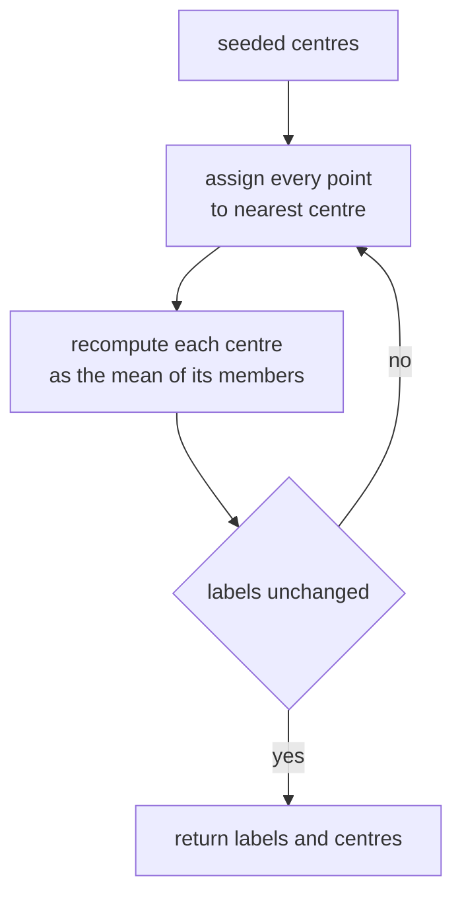
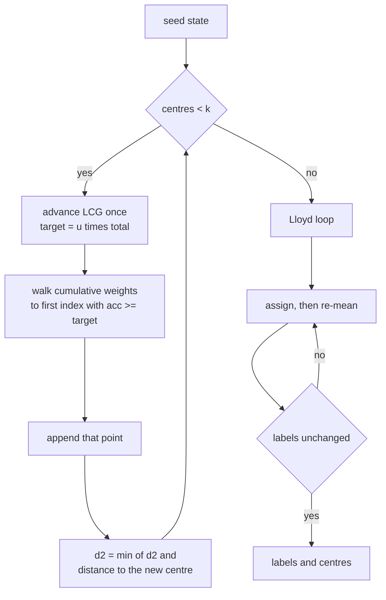
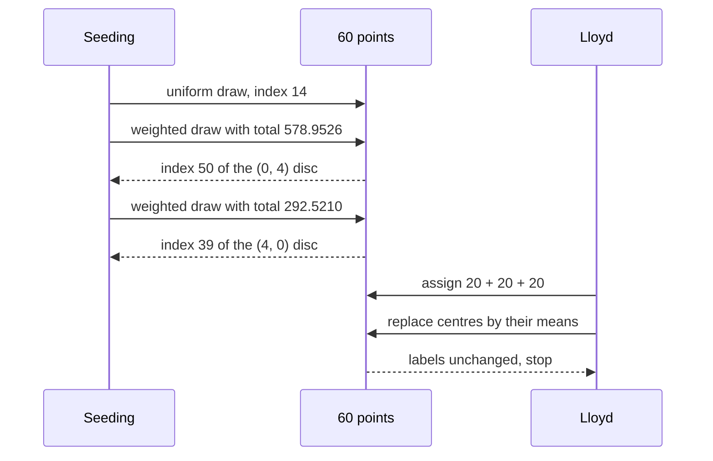

# 498 — Implement k-means clustering (kmeans++) initialization.

> **Tier:** Advanced · **CTCI chapter:** Beyond — Machine Learning & AI
> **Task spec:** [498-implement-k-means-clustering-kmeans-initialization.md](../../../tasks/advanced/498-implement-k-means-clustering-kmeans-initialization.md)
> **Solutions:** [Python](../../../solutions/python/advanced/498-implement-k-means-clustering-kmeans-initialization/solution.py) ·
> [Java](../../../solutions/java/advanced/498-implement-k-means-clustering-kmeans-initialization/Solution.java) ·
> [JavaScript](../../../solutions/javascript/advanced/498-implement-k-means-clustering-kmeans-initialization/solution.js) ·
> [C#](../../../solutions/csharp/advanced/498-implement-k-means-clustering-kmeans-initialization/Solution.cs)

## 1. Problem restatement

**Input:** three planted discs of 2-D points — centres `(0, 0)`, `(4, 0)` and `(0, 4)`, 20 points
each, coordinates jittered in `0.01` steps over `±0.5` by a fixed LCG
(`seed = (seed · 75 + 74) mod 65537`, then `x = cx + (seed mod 101 − 50) / 100`). The generator is
seeded with `7`, so the 60-point data set is a constant.

**Output:** for `k = 3`, a label per point and three centres, produced by:

- **k-means++ seeding** — the first centre is the data point at index `(seed · 75 + 74) mod 65537 mod n`;
  each further centre is drawn with probability proportional to `D(x)²`, the squared distance to the
  nearest centre already chosen. The draw is one LCG uniform compared against the cumulative `D²`
  weights, so the whole seeding is deterministic and ties cannot occur.
- **Lloyd iterations** — alternate exact assignment (squared Euclidean distance, ties to the lowest
  cluster index) with mean updates; an empty cluster keeps its old centre; stop when the labels stop
  changing (`max_iter = 100`).

**Objective:** the within-cluster sum of squares `Σ_points min_cluster sqdist(p, c)`.

Everything below is asserted by the four solution files:

| Check | Result |
| --- | --- |
| labels for the 60-point set | three non-empty clusters of exactly 20 points each |
| purity | every cluster draws from a single planted blob, and the three blobs are used once each |
| k-means++ objective | `10.61308` |
| first random restart (seed `9100`) | `176.3798` — so `kpp <= first_random` |
| best of 100 random restarts (seeds `1000 + 17r`) | `10.61308` — so `kpp <= 1.05 · best` |
| re-run with the same seed | identical labels **and** bit-identical centroids |
| centre structure | every centre is one of the input points, all distinct; `k = n` yields `n` centres |
| duplicate freedom | `len(set(points)) == len(points)` — the jitter never repeats a point |
| tiny 8-point two-blob set, `k = 2`, seed `55` | labels `[1,1,1,1,0,0,0,0]`, centres `(3.05, 3.05)` and `(0.05, 0.05)`, objective `0.04` |

## 2. Intuition

Lloyd's algorithm is a local search: it never leaves the basin of the initial centres. Random
initialisation therefore decides the answer. On this data set a uniformly random start picks all
three centres inside one disc often enough that the objective lands at `176.3798`, about sixteen
times the optimal `10.61308`, while the best of a hundred random restarts does reach `10.61308` —
at a hundred times the cost.

k-means++ removes most of that variance by making each new centre **avoid the neighbourhood of the
centres already chosen**. A point that is already close to a centre has a small `D(x)²` and is
unlikely to be picked; a point in an unexplored blob has a large `D(x)²` and is very likely to be
picked. Weighting by `D²` rather than `D` is deliberate: it is the `D²` that appears in the
k-means objective, so biasing the sample by it approximates sampling a centre from the current
residual mass.


The second half of the intuition is the **Lloyd loop**, which is coordinate descent on the
objective: fixing the centres gives the optimal assignment, and fixing the assignment gives the
optimal centres (their means). Each half never increases the objective, so the pair converges —
here it converges immediately, because the seeding is good enough that no point ever changes
cluster.



## 3. Algorithm

1. Generate the 60 points and their planted blob ids with the LCG.
2. Seed: `seed = (seed · 75 + 74) mod 65537`; the first centre is `points[seed mod n]`.
3. Compute `d2[i] = sqdist(points[i], centre₁)`.
4. While fewer than `k` centres: `total = Σ d2`; advance the LCG and set
   `target = (seed + 0.5) / 65537 · total`; walk the cumulative sum until `acc >= target` and take
   that index as the next centre (falling back to `n − 1` if the walk never reaches the target);
   then `d2[i] = min(d2[i], sqdist(points[i], new centre))`.
5. Lloyd: repeat until the labels repeat — assign each point to the lowest-index nearest centre,
   then set each centre to the mean of its members (keep the old centre when a cluster is empty).
6. Return the labels, the centres, and the objective.

```text
procedure kmeans_plus_plus(points, k, seed)
    n ← length(points)
    seed ← (seed · 75 + 74) mod 65537
    centers ← [ points[seed mod n] ]
    d2 ← [ sqdist(p, centers[0]) for p in points ]
    while length(centers) < k do
        total ← sum of d2
        seed ← (seed · 75 + 74) mod 65537
        target ← (seed + 0.5) / 65537 · total
        acc ← 0
        choice ← n - 1
        for i ← 0 to n - 1 do
            acc ← acc + d2[i]
            if acc >= target then
                choice ← i
                break
            end
        end
        append points[choice] to centers
        for i ← 0 to n - 1 do
            d2[i] ← min(d2[i], sqdist(points[i], centers[last]))
        end
    end
    return centers
end
```

```text
procedure lloyd(points, centers)
    labels ← none
    repeat up to 100 times
        new_labels ← [ lowest index c minimising sqdist(p, centers[c]) for p in points ]
        for c ← 0 to length(centers) - 1 do
            members ← points whose new label is c
            if members is not empty then
                new_centers[c] ← mean of members
            else
                new_centers[c] ← centers[c]
            end
        end
        if labels equals new_labels then
            centers ← new_centers
            stop
        end
        labels ← new_labels
        centers ← new_centers
    end
    return labels, centers
end
```

```text
procedure kmeans(points, k, seed)
    centers ← kmeans_plus_plus(points, k, seed)
    labels, centers ← lloyd(points, centers)
    return labels, centers
end
```

Step 4's `min` update is what makes the seeding incremental: after choosing a centre, the only
distances that change are the ones to that centre, so one pass over the data updates every weight.
The loop that walks the cumulative sum is a discrete inverse-CDF sample — it spends `O(n)` per
draw, which is why seeding costs `O(n·k)` overall.



## 4. Worked example

`n = 60`, `k = 3`, seeding seed `8`. The trace below is the actual seeding run of the shipped code:

| Draw | LCG state | `total` | `target` | `acc` at the hit | Index | Point |
| --- | --- | --- | --- | --- | --- | --- |
| 0 | `674` | — | — | — | `674 mod 60 = 14` | `(0.13, 0.26)` |
| 1 | `50624` | `578.9526` | `447.215861` | `453.819400` | `50` | `(-0.34, 4.04)` |
| 2 | `61265` | `292.5210` | `273.455381` | `287.669000` | `39` | `(4.17, -0.29)` |

Read draw 1 carefully. The first centre sits in the `(0, 0)` disc, so `total = 578.9526` is the sum
of squared distances to *that* single point, dominated by the two untouched discs. The uniform
draw is `u = 50624.5 / 65537 = 0.7724`, which lands `target = 447.22` units into the cumulative
weight; the walk finds the crossing at index `50`, a point of the `(0, 4)` disc. Draw 2 then
recomputes `d2` with two centres: `total` drops to `292.5210` because the `(0, 4)` disc is now
absorbed, and the sampled index `39` lands in the `(4, 0)` disc.

The seeded partition is already perfect — assignments by the three seeded centres give cluster
counts `[20, 20, 20]`, and Lloyd's first assignment reproduces exactly the same labels. The centres
still move once, from data points to cluster means:

| Cluster | Seeded centre | Final centre (mean) | Members | Planted blob |
| --- | --- | --- | --- | --- |
| 0 | `(0.13, 0.26)` | `(0.018, -0.047)` | 20 | blob around `(0, 0)` |
| 1 | `(-0.34, 4.04)` | `(-0.084, 4.047)` | 20 | blob around `(0, 4)` |
| 2 | `(4.17, -0.29)` | `(3.847, -0.067)` | 20 | blob around `(4, 0)` |

Notice the label-to-blob mapping: cluster `1` holds blob `2` and cluster `2` holds blob `1`, because
the labels follow the order in which the centres were seeded, not the order the blobs were
generated. The purity assertion therefore checks that each cluster maps to exactly one blob *and*
that the three clusters use three different blobs — not that cluster numbering equals blob
numbering.



On the tiny 8-point example (`k = 2`, seed `55`) the toy data has no LCG jitter, and the same code
returns labels `[1, 1, 1, 1, 0, 0, 0, 0]` with centres `(3.05, 3.05)` and `(0.05, 0.05)` — the two
blobs split exactly, objective `0.04`. The point indices `0..3` got the higher label simply because
the first weighted draw landed in the far blob.

## 5. Complexity

Let `n` be the point count, `k` the cluster count, `d` the dimension (2 here) and `t` the number of
Lloyd passes.

| Measure | Bound | Why it holds |
| --- | --- | --- |
| Seeding | `O(n·k·d)` | one `n`-scan per centre: one cumulative-weight walk plus one `d2` update |
| One Lloyd pass | `O(n·k·d)` | assignment compares every point against every centre; the re-mean is `O(n·d)` |
| Total | `O(n·k·d·t)` | `t` is bounded by the label-stability test, capped at `max_iter = 100` |
| Space | `O(n + k·d)` | the points, the labels, the centres and the `d2` array |
| Random-restart baseline | `100 ×` the Lloyd cost | the comparison run performs a full k-means per restart |
| Naive worse | `O(n²·d)` per pass | recomputing all pairwise distances instead of point-to-centre |

The empirical payoff is the objective rather than the running time: the seeding costs one extra
`O(n·k)` pass and reaches `10.61308` directly, whereas the random-restart baseline needs a hundred
full runs to see the same value and `176.3798` on its very first try.

## 6. Pitfalls and edge cases

- **Empty clusters.** The mean of an empty member list is undefined; the code keeps the previous
  centre instead. Returning `k − 1` centres silently changes the shape of the result, and every
  downstream loop over `range(len(centers))` would misalign with the label range.
- **Ties in assignment.** `assign` keeps the first strictly smaller distance, so a point equidistant
  from two centres goes to the lower index. That single rule is what makes the labels reproducible
  across the four languages.
- **All weights zero.** If every remaining point coincides with a chosen centre, `total = 0` and
  `target = 0`; no `acc >= target` hit happens before the first iteration, so the fallback
  `choice = n − 1` fires. Duplicate-heavy data can reach that path, which is exactly why
  `k = n` (every point its own centre) is asserted.
- **Duplicates.** The jittered data set is duplicate-free (`len(set(points)) == len(points)`), but
  the assertion exists precisely because k-means++ centres must be *distinct data points*; two
  identical centres would leave a permanently empty cluster.
- **Determinism is arithmetic-level.** The LCG is integer arithmetic with `mod 65537`, and the
  uniform is `(seed + 0.5) / 65537`. Using a language's built-in random generator, or reordering
  the accumulation of `d2`, changes the sampled indices and voids the bit-for-bit re-run assertion.
- **Convergence test.** The loop stops when the *labels* repeat, not when the centres move less than
  a threshold; comparing floating-point centres could fail to ever trigger on some data. Note the
  centre update still happens on the final pass (`centers = new_centers` before the break).
- **Objective definition.** `objective` sums `min` squared distance per point — SSE, not RMSE; the
  `5%` assertion compares the same quantity for both methods, so it is scale-consistent.
- **`k` larger than the number of distinct points** makes the seeding loop pick a point with
  `d2 = 0`; the fallback path yields `n − 1` and therefore duplicate centres. Only `k <= n` is
  meaningful here.

## 7. Variants and follow-ups

- **k-means|| (scalable k-means++).** Sample `O(k)` candidates per round with the same `D²`
  weighting instead of one, then weight them by how many points they attract — the standard fix
  when `n` does not fit in memory.
- **Mini-batch k-means.** Update centres from a random subset per pass; identical Lloyd skeleton,
  `O(batch·k·d)` per pass, at the price of a slightly noisier objective.
- **Choosing `k`.** The seeding code assumes `k` is given. Elbow plots and silhouettes both read the
  same `objective` helper this task already provides.
- **Clustering without a `k`.** [499-implement-dbscan-clustering-grid-based-accelerate.md](../../../tasks/advanced/499-implement-dbscan-clustering-grid-based-accelerate.md)
  grows clusters from density instead of splitting the data into a fixed number of balls, and
  [500-implement-spectral-clustering-small-example-eigen-decomposition.md](../../../tasks/advanced/500-implement-spectral-clustering-small-example-eigen-decomposition.md)
  uses the spectrum of a similarity matrix — the latter replaces exact distance comparisons
  with a graph.
- **Scaling up the nearest-centre search.** Assignment is the `O(n·k·d)` bottleneck;
  [503-implement-locality-sensitive-hashing-for-cosine-similarity-simha.md](../../../tasks/advanced/503-implement-locality-sensitive-hashing-for-cosine-similarity-simha.md)
  is the hashing counterpart for cosine similarity.

## 8. Check yourself

1. Why does the second draw use `total = 578.9526` when the third uses `292.5210`?

<details><summary>Show answer</summary>

Because `total` is `Σ D(x)²` with `D` measured to the *nearest centre chosen so far*. After the
first centre (inside the `(0, 0)` disc) both other discs contribute almost all of the mass, so the
total is large. The second centre lands in the `(0, 4)` disc, so that disc's contribution collapses
to a min over a nearby centre and the total falls to `292.5210`.

</details>

2. The seeded partition already has counts `[20, 20, 20]` and Lloyd changes no label. Why run Lloyd
   at all?

<details><summary>Show answer</summary>

Because the seeded centres are *data points*, not means, so they sit at the edge of their discs
(`(0.13, 0.26)` against a mean of `(0.018, -0.047)`). Lloyd's mean update moves them to the cluster
centroids and confirms the labels are a fixed point; only then is the objective `10.61308`.

</details>

3. How would you detect a k-means++ implementation bug from the assertions alone?

<details><summary>Show answer</summary>

Two checks stand out. First, the objective assertion: a broken seeding tends to produce a cluster
that spans two discs, which drives the objective far above the best of 100 random restarts, so
`kpp <= 1.05 · best_random` fails. Second, the purity assertion: if the weighted draw ignores `D²`,
a later centre can land inside an already covered disc, and one cluster will then mix two planted
blobs.

</details>

4. What goes wrong if the assignment rule breaks ties toward the highest index instead of the
   lowest?

<details><summary>Show answer</summary>

The partition can stay perfect on well-separated blobs, but any point exactly equidistant from two
centres switches cluster. Since cluster sizes feed the means, the centres differ in the last bits
and the bit-for-bit re-run assertion (`repeat_centers == centers`) becomes implementation-defined —
exactly the kind of cross-language divergence the assertion is there to catch.

</details>