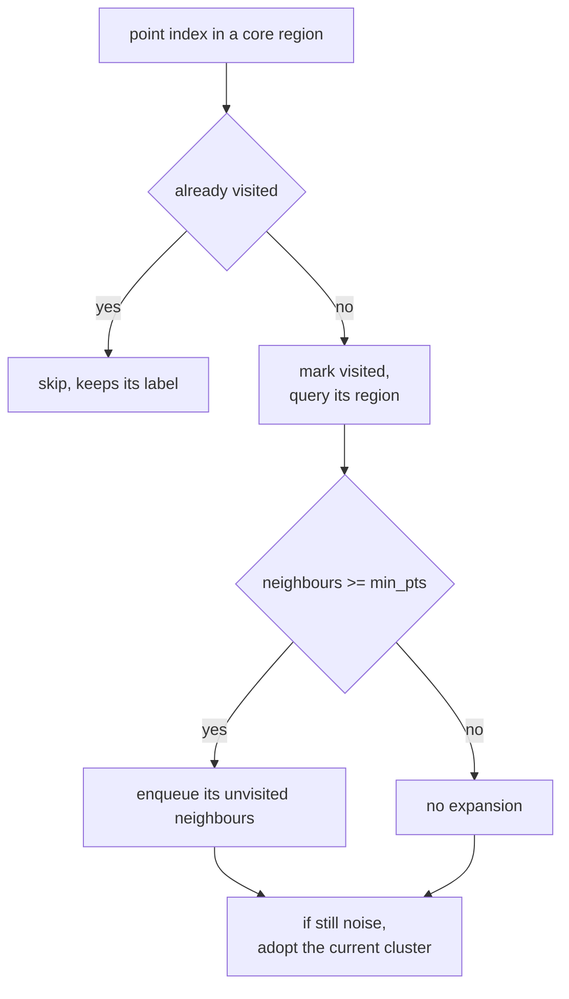
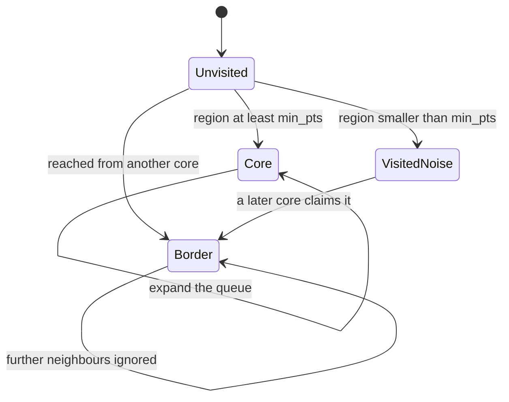
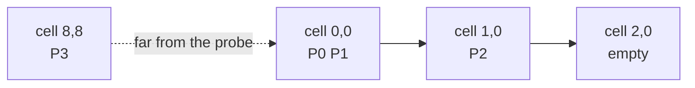

# 499 — Implement DBSCAN clustering (grid-based accelerate).

> **Tier:** Advanced · **CTCI chapter:** Beyond — Machine Learning & AI
> **Task spec:** [499-implement-dbscan-clustering-grid-based-accelerate.md](../../../tasks/advanced/499-implement-dbscan-clustering-grid-based-accelerate.md)
> **Solutions:** [Python](../../../solutions/python/advanced/499-implement-dbscan-clustering-grid-based-accelerate/solution.py) ·
> [Java](../../../solutions/java/advanced/499-implement-dbscan-clustering-grid-based-accelerate/Solution.java) ·
> [JavaScript](../../../solutions/javascript/advanced/499-implement-dbscan-clustering-grid-based-accelerate/solution.js) ·
> [C#](../../../solutions/csharp/advanced/499-implement-dbscan-clustering-grid-based-accelerate/Solution.cs)

## 1. Problem restatement

**Input:** a list of 2-D points (`float` coordinates, duplicates allowed), a radius `eps` and a core
threshold `min_pts`. A point `q` is a **neighbour** of `p` when `sqdist(p, q) <= eps²` — the
comparison is inclusive, so two points exactly `eps` apart are mutual neighbours.

**Output:** one label per point: `0, 1, 2, …` for cluster membership and `-1` for noise. Clusters
grow from **core** points (at least `min_pts` neighbours, the point itself included) by a
breadth-first queue expansion; a non-core point reached from a core point becomes a **border**
point of that cluster; anything never reached stays noise.

The task asks for two interchangeable neighbourhood engines with **identical results**:

- `NaiveEngine` — `region(i)` scans all `n` points and counts every distance evaluation.
- `GridEngine` — points are hashed into cells of side `eps` by `(int(x / eps), int(y / eps))`;
  `region(i)` probes only the `3 × 3` block of cells around the query's cell, then sorts the hits
  ascending to reproduce the naive order exactly.

Facts asserted by the four solution files (measured values are from running them):

| Test set | `n` | `eps` | `min_pts` | clusters | noise | naive checks | grid checks |
| --- | --- | --- | --- | --- | --- | --- | --- |
| `dense` (seed 11) | 60 | 3.0 | 3 | 7 | 34 | 3600 | 210 |
| `fine` (seed 23) | 80 | 2.0 | 2 | 13 | 52 | 6400 | 204 |
| `coarse` (seed 37) | 50 | 5.0 | 4 | 3 | 22 | 2500 | 382 |
| `sparse` (seed 53, limit 100) | 40 | 1.5 | 5 | 0 | 40 | 1600 | 42 |
| `duplicates` (seed 67, limit 10) | 30 | 2.0 | 3 | 2 | 4 | 900 | 308 |

Every row must satisfy three conditions: the two engines agree **label for label** after
renumbering clusters by first appearance, they agree as an order-insensitive partition (sets of
point-index sets plus the noise set), and `grid_checks < naive_checks` — in fact the suite asserts
`grid_checks <= naive_checks / 2` for all five sets.

Three hand-checkable cases pin the semantics:

| Input | Parameters | Expected labels |
| --- | --- | --- |
| chain `(0,0) (1,0) (2,0) (10,10)` | `eps = 1.2`, `min_pts = 2` | `[0, 0, 0, -1]` |
| same chain | `eps = 1.2`, `min_pts = 3` | `[0, 0, 0, -1]` — only the middle point is core, the ends attach as border |
| pair `(0,0) (2,0) (20,20)` | `eps = 2.0`, `min_pts = 2` | `[0, 0, -1]` |
| same pair | `eps = 1.999`, `min_pts = 2` | `[-1, -1, -1]` — just inside the radius |
| `lcg_points(12, 5, limit = 1000)` | `eps = 1.0`, `min_pts = 3` | all `-1` |

## 2. Intuition

DBSCAN's definition is entirely local: a point's label depends on who is within `eps` of it. The
naive engine answers that question by comparing the query against all `n` points, so the whole run
costs `O(n²)` distance evaluations — 3600 for the 60-point dense set, all of them recomputed
several times because `region` is called for every core point and several border points.

The key insight is that **a radius query only has to look in the query's own neighbourhood of the
plane**. Partition the plane into cells of side `eps`. Two points within `eps` of each other can sit
in cells whose indices differ by at most `1` in each axis, because a shift of one full cell already
exceeds the radius. So the query only needs the `3 × 3` block of cells centred on its own cell:


That is the whole acceleration: the grid does not change *which* points are neighbours, it changes
**how many candidates are examined** before the distance test. On the dense set that is 210 checks
instead of 3600 — a 17× reduction, with the identical partition as the output.

The second insight is that the two engines are only comparable if they agree on the **order** of the
returned neighbours. Clusters grow by a queue, and a point reachable from two growing clusters is
claimed by whichever reaches it first; if the grid engine returned its hits in hash order, two
border points could flip between clusters. Sorting the `3 × 3` hits ascending makes the grid engine
produce byte-identical label vectors, which is what the strongest assertion tests.



## 3. Algorithm

1. Build the engine: `NaiveEngine` stores `eps²`; `GridEngine` also hashes every point into a cell
   key `(int(x / eps), int(y / eps))`.
2. `region(i)` returns the neighbour indices: the naive engine scans `0 .. n − 1`; the grid engine
   iterates the nine cells around `i`'s cell and then **sorts** the hits.
3. `dbscan`: `labels = [-1] * n`, `visited = [False] * n`, `cluster = 0`.
4. For each `start` in index order: skip if visited. Mark visited and query `region(start)`.
5. If `len(region) < min_pts` the point is not core — leave it as provisional noise and continue.
   It may still be claimed later as a border point.
6. Otherwise the point opens cluster `cluster`: label it, seed a queue with its neighbours (minus
   itself), and pop from the head.
7. For each `current`: if unvisited, mark it and query its region; if that region is a core region,
   append its unvisited members to the queue. Then, if `labels[current]` is still noise, set it to
   `cluster`.
8. `cluster += 1` and continue the outer scan.

```text
procedure region_of_point(index)            // engine dependent
    if engine is naive then
        return all j with sqdist(points[index], points[j]) &lt;= eps squared
    else
        cx, cy ← cell of points[index]
        hits ← empty
        for gx in cx - 1 .. cx + 1 do
            for gy in cy - 1 .. cy + 1 do
                for j in cells of key (gx, gy) do
                    if sqdist(points[index], points[j]) &lt;= eps squared then
                        append j to hits
                    end
                end
            end
        end
        sort hits ascending
        return hits
    end
end
```

```text
procedure dbscan(points, eps, min_pts, engine)
    labels ← array of n filled with -1
    visited ← array of n filled with false
    cluster ← 0
    for start ← 0 to n - 1 do
        if visited[start] then continue
        visited[start] ← true
        neighbours ← engine.region(start)
        if length(neighbours) &lt; min_pts then continue end
        labels[start] ← cluster
        queue ← neighbours without start
        head ← 0
        while head &lt; length(queue) do
            current ← queue[head]
            head ← head + 1
            if not visited[current] then
                visited[current] ← true
                current_neighbours ← engine.region(current)
                if length(current_neighbours) &gt;= min_pts then
                    for q in current_neighbours do
                        if not visited[q] then append q to queue end
                    end
                end
            end
            if labels[current] = -1 then
                labels[current] ← cluster
            end
        end
        cluster ← cluster + 1
    end
    return labels
end
```

Two details in step 7 carry the semantics. The `labels[current] = cluster` assignment happens
*outside* the core test, so a border point with too few neighbours still joins the cluster that
reached it. And the queue is unbounded — a point may be appended several times before it is
visited, which is harmless because the `visited` flag makes the second visit a no-op.



## 4. Worked example

Trace the chain under the naive engine with `eps = 1.2` (`eps² = 1.44`) and `min_pts = 2`:
`P0 = (0,0)`, `P1 = (1,0)`, `P2 = (2,0)`, `P3 = (10,10)`.

| Step | Action | Region found | Decision | Labels |
| --- | --- | --- | --- | --- |
| start 0 | `region(0)` | `[0, 1]` (distances 0 and 1) | size 2 `>= 2`, core | `[0, -, -, -]` |
| pop 1 | unvisited, `region(1)` | `[0, 1, 2]` (0, 1, 1) | core, enqueue `2` | `[0, 0, -, -]` |
| pop 2 | unvisited, `region(2)` | `[1, 2]` (1, 0) | core, nothing new | `[0, 0, 0, -]` |
| start 3 | `region(3)` | `[3]` (distance 0) | size 1 `< 2`, provisional noise | `[0, 0, 0, -1]` |

The chain is one cluster; `P3` is 12.7 away from its nearest neighbour and stays noise. Re-running
the same input with `min_pts = 3` gives the same labels by a different route: `region(0)` has only
2 members, so `P0` is provisional noise; `P1` then opens the cluster (its region has 3 members), and
`P0` and `P2` are claimed as **border** points when the expansion reaches them — they are labelled
even though their own regions are too small.

The `<=` boundary shows up in the pair test: with `P0 = (0,0)`, `P1 = (2,0)` and `eps = 2.0`,
`sqdist = 4.0 = eps²` passes and the answer is `[0, 0, -1]`; with `eps = 1.999` the same squared
distance is larger than `eps² = 3.996` and all three points are noise.

Now the grid engine on the same chain. With `eps = 1.2` the cell of `P0` and `P1` is `(0, 0)`
(`1 / 1.2 = 0.83` truncates to `0`), `P2` lands in `(1, 0)` and `P3` in `(8, 8)`:

| Query | Cell | Cells probed | Candidate points | Distance tests |
| --- | --- | --- | --- | --- |
| `P1` | `(0, 0)` | `(-1..1, -1..1)` | `P0, P1, P2` | 3 of the naive 4 |
| `P3` | `(8, 8)` | `(7..9, 7..9)` | `P3` only | 1 of the naive 4 |

That is the whole speed-up in miniature: `P2` is found from `P1` even though it lives in the *next*
cell, because the probe covers the neighbouring cells; `P3`'s probe never touches the chain at all.



The five generated sets show the same effect at scale, with the two engines required to agree on
every label:

| Set | Partition produced | naive checks | grid checks | ratio |
| --- | --- | --- | --- | --- |
| `dense` | 7 clusters, 34 noise | 3600 | 210 | 17.1× |
| `fine` | 13 clusters, 52 noise | 6400 | 204 | 31.4× |
| `coarse` | 3 clusters, 22 noise | 2500 | 382 | 6.5× |
| `sparse` | no clusters, all 40 points noise | 1600 | 42 | 38.1× |
| `duplicates` | 2 clusters, 4 noise | 900 | 308 | 2.9× |

The `duplicates` set is the informative one: 30 points drawn with `limit = 10` collapse onto a few
dozen distinct cells, so almost every point shares a cell with many others and the grid's advantage
shrinks to 2.9× — still comfortably inside the asserted "grid saves at least half" bound. The
`sparse` set is at the other extreme: with `limit = 100` and `eps = 1.5`, most probes find only the
query itself, so 42 checks replace 1600 and nothing is dense enough to be core.
## 5. Complexity

Let `n` be the point count, `c` the average number of points per `3 × 3` cell block, and `k` the
number of core points whose regions are queried.

| Measure | Bound | Why it holds |
| --- | --- | --- |
| Naive region | `O(n)` | every query compares against all `n` points |
| Naive run | `O(n²)` | `region` is called for each core point (and each newly visited point) |
| Grid region | `O(c + 9)` average, `O(n)` worst | nine dictionary lookups plus the distance tests for the candidates in those cells |
| Grid run | `O(n·c)` average | the cell size `eps` keeps `c` proportional to the local density |
| Grid worst case | `O(n²)` | all points in one cell (dense duplicates) degenerates to the naive scan |
| Space | `O(n)` | the cell dictionary holds one index per point, plus the queue |
| Counting | `+O(1)` per distance test | both engines increment a counter, which is what the assertions compare |

The degenerate case is visible in the measurements: the `duplicates` set (30 points inside `limit =
10`) squeezes the block occupancy up and the ratio down to 2.9×. The grid is an average-case
accelerator whose worst case is the naive engine's only case — which is exactly why the tests keep
both engines and assert agreement rather than replacing one with the other.

## 6. Pitfalls and edge cases

- **Inclusive radius.** `sqdist <= eps²`, so points exactly `eps` apart cluster. The pair test
  (`eps = 2.0` versus `1.999` on points 2 apart) exists because an exclusive comparison flips the
  whole result to noise.
- **Floating-point cell keys.** `int(x / eps)` truncates toward zero, so negative coordinates
  round toward `0` instead of `-∞`; a point at `x = -0.2` with `eps = 1` lands in cell `0`, not
  `-1`. Using `floor` instead would still be self-consistent, but it must be the same choice in all
  four languages or the two engines would probe different blocks.
- **Neighbour order decides border ownership.** The grid engine must `sort` its hits. Without the
  sort, a point equidistant from two growing clusters can be claimed by either, and the
  label-for-label assertion fails even though the partition is unchanged.
- **min_pts counts the point itself.** `min_pts = 2` on an isolated pair means each point's region
  has size 2 and both are core; `min_pts = 3` on a two-point isolated pair leaves both noise.
- **Provisional noise is not final.** A point whose region is too small is skipped in the outer
  loop, but it can still be adopted as a border point later — the label assignment sits outside the
  core test for exactly that reason.
- **Duplicate points are first-class.** They share a cell, inflate `c`, and make the grid's worst
  case reachable. The `duplicates` set is included to keep the acceleration claim honest.
- **Everything-noise inputs.** With `sparse` (0 clusters, 40 noise) and the `lonely` control set
  (`limit = 1000`, `eps = 1.0`, `min_pts = 3`), `set(labels) == {-1}` — the code must not crash on
  an empty cluster list, and `canonical` must not renumber anything.
- **Cluster numbering is not canonical by itself.** Two engines may number clusters identically
  only because the outer scan goes in index order; `canonical` renumbers by first appearance before
  comparison, and `partition` compares sets of index sets, so the test does not depend on that
  accident.
- **Repeated queue entries.** A point can be enqueued many times before being popped; the
  `visited` flag keeps the work linear in the number of appends, not in `n²`.

## 7. Variants and follow-ups

- **HNSW / LSH for the radius query.** The grid is the simplest spatial index; replacing it with a
  locality-sensitive hash gives sublinear queries in higher dimensions. See
  [503-implement-locality-sensitive-hashing-for-cosine-similarity-simha.md](../../../tasks/advanced/503-implement-locality-sensitive-hashing-for-cosine-similarity-simha.md)
  and [504-implement-approximate-nearest-neighbor-with-product-quantization.md](../../../tasks/advanced/504-implement-approximate-nearest-neighbor-with-product-quantization.md).
- **The same distance pair pattern without a grid.** Nearest-pair style problems on trees use the
  same "restrict the candidate set" idea through decomposition:
  [425-implement-centroid-decomposition-for-k-distance-pairs.md](../../../tasks/advanced/425-implement-centroid-decomposition-for-k-distance-pairs.md)
  and [424-implement-small-to-large-merging-on-trees-for-frequency-queries.md](../../../tasks/advanced/424-implement-small-to-large-merging-on-trees-for-frequency-queries.md).
- **Choosing `eps` and `min_pts`.** Standard practice is the `k`-distance elbow plot for `eps`; both
  parameters are inputs here, and the `sparse` versus `dense` rows show how sharply the answer
  changes with them.
- **Clustering that does not need `eps`.** [498-implement-k-means-clustering-kmeans-initialization.md](../../../tasks/advanced/498-implement-k-means-clustering-kmeans-initialization.md)
  and [500-implement-spectral-clustering-small-example-eigen-decomposition.md](../../../tasks/advanced/500-implement-spectral-clustering-small-example-eigen-decomposition.md)
  are the fixed-`k` and spectral counterparts.
- **Counting the checks, not just the result.** The `checks` counters are a lightweight example of
  instrumenting a data structure to prove an asymptotic claim — the same technique the sketch tasks
  use, for example [465-implement-count-min-sketch-for-frequency-estimation.md](../../../tasks/advanced/465-implement-count-min-sketch-for-frequency-estimation.md).

## 8. Check yourself

1. Why is the `3 × 3` block guaranteed to contain every neighbour within `eps`?

<details><summary>Show answer</summary>

Because a cell is `eps` wide. If two points are within `eps`, their coordinates differ by less than
one cell width in each axis, and truncating a coordinate into cells can shift the cell index by at
most `1`. So the neighbour is in the query's cell, or in one of the eight adjacent cells.

</details>

2. Both engines return identical labels on all five generated sets. What does that prove?

<details><summary>Show answer</summary>

That the acceleration is purely a candidate-pruning step, aligned with the neighbour-order
requirement: after `sort`, the `3 × 3` probe returns the same index list the naive scan would, in
the same order, so the queue expansion makes the same decisions. The tests assert this twice — once
label-for-label and once as an order-insensitive partition — so an order bug cannot hide behind a
lucky renumbering.

</details>

3. On the `duplicates` set the grid saves only 2.9×. Why not more?

<details><summary>Show answer</summary>

Because with 30 points drawn in a `10 × 10` coordinate range and `eps = 2.0`, many points share cells
and each `3 × 3` probe returns a large fraction of the data set. The grid's `c` (candidates per
block) approaches `n`, so it converges to the naive scan — the documented worst case.

</details>