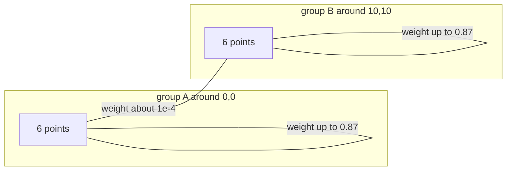
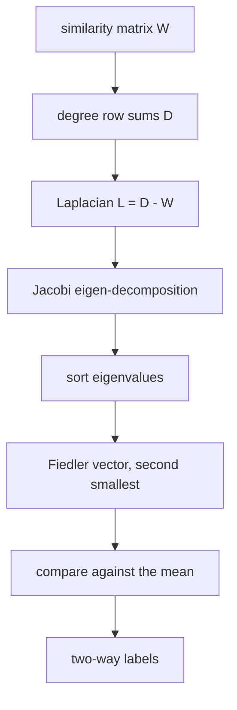
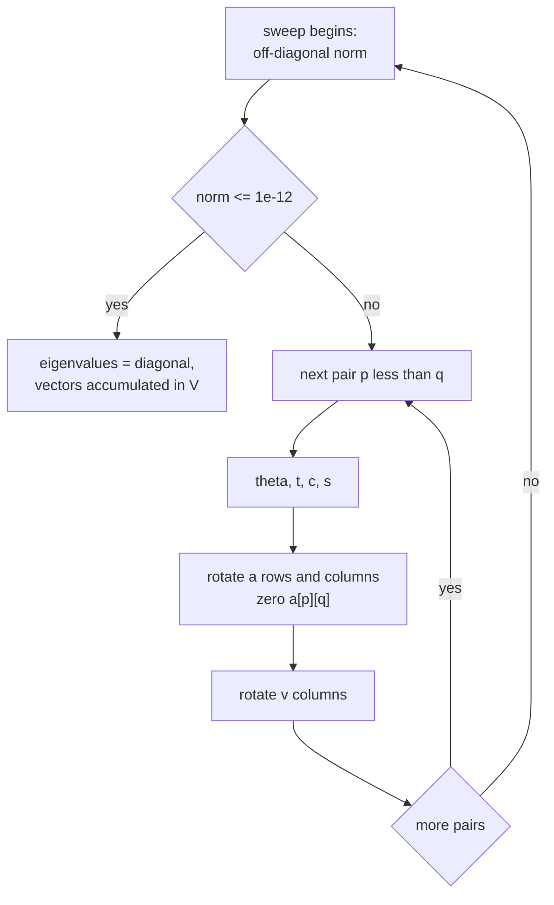
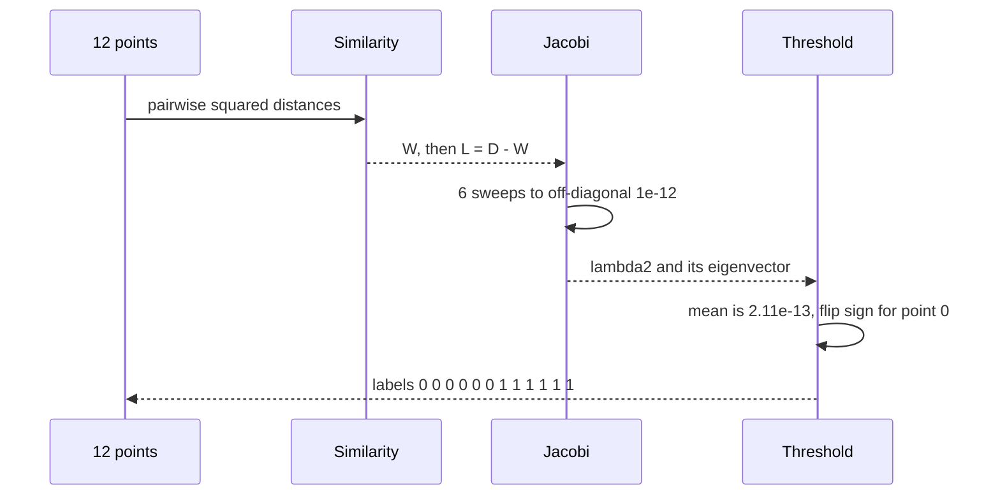

# 500 — Implement spectral clustering small example (eigen decomposition).

> **Tier:** Advanced · **CTCI chapter:** Beyond — Machine Learning & AI
> **Task spec:** [500-implement-spectral-clustering-small-example-eigen-decomposition.md](../../../tasks/advanced/500-implement-spectral-clustering-small-example-eigen-decomposition.md)
> **Solutions:** [Python](../../../solutions/python/advanced/500-implement-spectral-clustering-small-example-eigen-decomposition/solution.py) ·
> [Java](../../../solutions/java/advanced/500-implement-spectral-clustering-small-example-eigen-decomposition/Solution.java) ·
> [JavaScript](../../../solutions/javascript/advanced/500-implement-spectral-clustering-small-example-eigen-decomposition/solution.js) ·
> [C#](../../../solutions/csharp/advanced/500-implement-spectral-clustering-small-example-eigen-decomposition/Solution.cs)

## 1. Problem restatement

**Input:** a handful of 2-D points, and a bandwidth `sigma`. The canonical example is two six-point
groups around `(0, 0)` and `(10, 10)`:

```text
(0,0) (1,0) (0,1) (1,1) (0.5,1.5) (1.5,0.5)      and
(10,10) (11,10) (10,11) (11,11) (10.5,10.5) (9.5,10.5)
```

with `sigma = 3.0`. A second example is two LCG-jittered four-point blobs around `(0, 0)` and
`(3, 0)` (`±0.4` jitter in `0.01` steps, seed `2024`) with `sigma = 0.5`.

**Output:** a two-way split of the points, plus the numbers that make the split auditable —
`lambda2`, the residual `‖L v − lambda2 · v‖`, the orthogonality error `|Σ v_i|`, and the Jacobi
sweep count.

**Pipeline** (fixed by the four solution headers):

1. Gaussian similarity `W_ij = exp(−‖x_i − x_j‖² / (2 sigma²))`, symmetric, unit diagonal.
2. Combinatorial Laplacian `L = D − W`, where `D` holds the row sums of `W`.
3. Eigen-decomposition of `L` by **cyclic Jacobi rotations**, sweeping until the off-diagonal
   Frobenius norm drops below `1e-12`, with a documented cap of `100` sweeps.
4. Take the eigenvector of the **second-smallest** eigenvalue — the **Fiedler vector**.
5. Split at the **mean** of that vector (`v_i >= mean` → cluster `0`), after flipping the sign of
   the whole vector so that point `0` is at or above the mean.

Measured on the shipped code:

| Quantity | Canonical, `sigma = 3.0` | Tiny LCG blobs, `sigma = 0.5` |
| --- | --- | --- |
| `lambda2` (Fiedler value) | `4.8473e-04` | `7.0868e-06` |
| residual `‖L v − lambda2 v‖` | `2.86e-15` | within `1e-9` (asserted) |
| `|Σ v_i|` | `2.53e-12` | `7.45e-11` |
| Jacobi sweeps | `6` | `5` |
| labels | `[0,0,0,0,0,0,1,1,1,1,1,1]` = planted truth | `[0,0,0,0,1,1,1,1]` = planted truth |
| cut weight | `0.0014542387…` | — |

The assertions add the structural checks: the smallest eigenvalue is `4.53e-17 ≈ 0` (the graph is
connected, so exactly one zero eigenvalue), `asc[1] < asc[2]` makes the Fiedler eigenvalue strictly
second, `asc[1] <= 1e-2 · asc[2]` records how cleanly it separates, `sweeps <= 100`, the spectral
cut equals the brute-force minimum over all balanced `6|6` cuts (`0.0014542387…`), that cut is below
`1e-3 · ΣW` (`ΣW = 55.8746`), and a Jacobi sanity check on the matrix `[[2, 1], [1, 2]]` returns the
eigenvalues `1` and `3` to `1e-12`.

## 2. Intuition

Clustering by distance fails when clusters are elongated or when some inter-cluster distances are
smaller than some intra-cluster ones. Spectral clustering abandons geometry after building a graph:
two points are connected by an edge of weight `exp(−d² / 2 sigma²)`, and the question becomes
**which edge set to delete**. The weight of a cut is the similarity mass crossing it, so a good
split is a cheap cut.

Minimising a cut over all balanced splits is NP-hard in general, but the problem relaxes nicely. If
`s` is an indicator vector of a split (`+1` on one side, `−1` on the other), then `sᵀL s` equals
`2 · cut(s)` up to a constant — the Laplacian turns cut weight into a quadratic form. Minimising
that form subject to `s ⊥ 1` gives a generalised eigenproblem whose answer is the eigenvector of the
second-smallest eigenvalue: the Fiedler vector. Because `s` is relaxed from `±1` to real numbers,
the result is a continuous score per point, and the practical rule is a threshold — here the mean.

With `sigma = 3.0`, the two groups are `√200 ≈ 14.1` apart while points inside a group are at most
`≈ √2` apart, so cross-group similarities are near zero: the largest cross-block weight is
`1.23e-04`, while the smallest within-block weight is `0.8703`. The graph is effectively two
disjoint cliques glued by `1e-4`-sized edges.



That is exactly the regime the Fiedler vector is built for. When the graph is two nearly disconnected
pieces, the second-smallest eigenvector is nearly piecewise constant: on this input the measured
values are `−0.2887` on the six first-group points and `+0.2887` on the six second-group points,
i.e. `∓1/√12` to three decimals.



## 3. Algorithm

1. Build `W` for `i < j` and mirror it; the diagonal stays `1.0` (the form used here keeps
   `exp(0) = 1` rather than clearing it).
2. `D_i = Σ_j W_ij`; `L_ij = D_i − W_ij` when `i = j`, otherwise `L_ij = −W_ij`.
3. Jacobi: repeat up to `100` sweeps; stop when the off-diagonal Frobenius norm is `<= 1e-12`. In
   one sweep, for every pair `p < q` with `|L_pq| > 1e-300`: compute the rotation
   `theta = (L_qq − L_pp) / (2 L_pq)`, then
   `t = 1 / (|theta| + sqrt(theta² + 1))`, negated when `theta < 0`, `c = 1 / sqrt(t² + 1)`,
   `s = t · c`; apply the rotation to rows/columns `p` and `q` of `L` and to columns `p`, `q` of
   the accumulated eigenvector matrix `V`.
4. The eigenvalues are the diagonal of the converged `L`; eigenvector `k` is column `k` of `V`.
5. Sort indices by `(eigenvalue, index)` so ties break deterministically, and take `order[1]`.
6. `v =` that column; if `v[0] < mean(v)`, negate `v`; label `0` where `v_i >= mean(v)`, else `1`.
7. Report `lambda2 = values[order[1]]`, the residual, `|Σ v_i|`, and the sweep count.

```text
procedure jacobi_eigh(matrix, max_sweeps, tol)
    a ← copy of matrix
    v ← identity
    sweeps ← 0
    repeat up to max_sweeps times
        off ← Frobenius norm of the off-diagonal entries of a
        if off &lt;= tol then stop end
        sweeps ← sweeps + 1
        for p ← 0 to n - 2 do
            for q ← p + 1 to n - 1 do
                if |a[p][q]| &lt;= 1e-300 then continue end
                theta ← (a[q][q] - a[p][p]) / (2 · a[p][q])
                t ← 1 / (|theta| + sqrt(theta · theta + 1))
                if theta &lt; 0 then t ← -t end
                c ← 1 / sqrt(t · t + 1)
                s ← t · c
                rotate rows and columns p and q of a        // a[p][q] becomes 0
                rotate columns p and q of v
            end
        end
    end
    return diagonal of a, v, sweeps
end
```

```text
procedure spectral_split(points, sigma)
    w ← similarity(points, sigma)
    lmat ← laplacian(w)
    values, vectors, sweeps ← jacobi_eigh(lmat, 100, 1e-12)
    order ← indices sorted by eigenvalue, ties by index
    fiedler ← order[1]
    lambda2 ← values[fiedler]
    vec ← column fiedler of vectors
    mean ← (sum of vec) / n
    if vec[0] &lt; mean then vec ← -vec end
    labels ← [ 0 if vec[i] &gt;= mean else 1 for each i ]
    return labels, lambda2, residual, |sum of vec|, sweeps
end
```

Two implementation choices deserve naming. The rotation formula computes `t` from `|theta|` and
fixes the sign afterwards, which is the numerically stable form (`theta² + 1` never cancels). And
the `sorted(key = (value, index))` tie-break matters: when the graph has several zero eigenvalues
because it is disconnected, "the second smallest" is only well defined with a deterministic
tie-break rule.



## 4. Worked example

**Step 1, verify Jacobi on a 2 × 2 case.** For `[[2, 1], [1, 2]]`: `theta = (2 − 2) / (2 · 1) = 0`,
so `t = 1`, `c = s = 1/√2 = 0.70710678`. One rotation annihilates the off-diagonal:

| Entry | Formula | Result |
| --- | --- | --- |
| `a[0][0]` | `c²·2 − 2cs·1 + s²·2` | `1.0` |
| `a[1][1]` | `s²·2 + 2cs·1 + c²·2` | `3.0` |
| `v` column 0 | `(c, −s)` | `(0.70710678, −0.70710678)` |

The code returns eigenvalues `0.9999999999999998` and `2.999999999999999` in one sweep, matching
the asserted `{1, 3}` to `1e-12`, with the eigenvector for `lambda = 1` being `(1, −1)/√2` — already
orthogonal to the constant vector, the property the Fiedler vector must have.

**Step 2, the canonical 12-point example.** After 6 sweeps the sorted spectrum begins
`4.53e-17`, `4.8473e-04`, `5.3898`, `5.3951`, … so `lambda2 = 4.8473e-04` and `lambda3 = 5.3898`.
The gap `lambda3 / lambda2 ≈ 1.1e4` is the numerical signature of two nearly disconnected groups.

The raw Fiedler vector comes out with the first group negative:

| Index | Point | `v_i` (raw) | `v_i` after sign flip | Label (`>= mean`) |
| --- | --- | --- | --- | --- |
| 0 | `(0, 0)` | `−0.28870` | `+0.28870` | `0` |
| 5 | `(1.5, 0.5)` | `−0.28866` | `+0.28866` | `0` |
| 6 | `(10, 10)` | `+0.28865` | `−0.28865` | `1` |
| 11 | `(9.5, 10.5)` | `+0.28865` | `−0.28865` | `1` |
| mean | — | `2.11e-13` | same | — |

Point `0` sits below the mean in the raw vector, so the sign rule flips all twelve entries. The
resulting labels `[0,0,0,0,0,0,1,1,1,1,1,1]` equal the planted truth. Note how close the split is to
the arbitrary threshold: every entry is `∓1/√12` and the mean is `2.11e-13`, so the margin is
essentially the whole vector — this is a well-conditioned split, not a lucky threshold.

**Step 3, is the split actually minimal?** Brute force over balanced `6|6` cuts (point `0` pinned to
side `0`, mirror duplicates skipped) gives

| Cut | Weight |
| --- | --- |
| spectral split | `0.0014542387…` |
| brute-force minimum balanced cut | `0.0014542387…` |
| `ΣW` (total similarity mass) | `55.8746` |

They agree to `1e-9`, and the cut is `2.6e-5` of the total mass. The largest single cross-group
weight is `1.2341e-04` (a nearby pair across the gap) while the distant pair `(0,0)`–`(10,10)`
carries only `1.4945e-05` — together those twelve tiny edges are the entire cut.

**Step 4, the tiny example.** Eight LCG-jittered points around `(0, 0)` and `(3, 0)` with
`sigma = 0.5` converge in 5 sweeps to `lambda2 = 7.0868e-06`, with labels `[0,0,0,0,1,1,1,1]` — the
planted partition again, and a deterministic re-run.



## 5. Complexity

Let `n` be the point count and `t` the number of Jacobi sweeps (6 here, capped at 100).

| Measure | Bound | Why it holds |
| --- | --- | --- |
| Similarity matrix | `O(n²)` time, `O(n²)` space | one `exp` per upper-triangular pair, mirrored |
| Laplacian | `O(n²)` | row sums plus one subtraction per entry |
| One Jacobi sweep | `O(n³)` | `n(n−1)/2` rotations, each touching `O(n)` entries of `L` and of `V` |
| Full decomposition | `O(n³ · t)` | the sweep loop repeats until the off-diagonal norm is `1e-12` |
| Split + residual | `O(n²)` | one threshold test, then one mat-vector product for the residual |
| Brute-force cut check | `O(C(n−1, n/2−1) · n²)` | 462 balanced splits for `n = 12`, each cut weight `O(n²)` |
| Alternative: Lanczos / `ARPACK` | `O(n² · iterations)` | only the extreme eigenpairs are needed, not the whole spectrum |

The brute-force column is the reason the test is small: enumerating balanced cuts is exponential, so
it can only be used as an oracle for `n = 12`. The Jacobi route is cubic per sweep but the sweep
count is tiny on small dense matrices, and it returns the *full* spectrum — the code needs
`lambda3` to assert `lambda2 < lambda3` and the ratio `lambda2 <= 1e-2 · lambda3`.

## 6. Pitfalls and edge cases

- **`sigma` too large.** A big bandwidth makes every pair similar, so `lambda2` shrinks toward the
  Jacobi tolerance `1e-12` and the "second smallest" eigenvalue becomes indistinguishable from the
  zero one.
- **Sign of the eigenvector is arbitrary.** Both `v` and `−v` satisfy the eigenproblem. The code
  fixes the ambiguity by requiring `v[0] >= mean`; without it the labels are inverted on even runs
  and odd runs.
- **The threshold is the mean, not zero.** The mean is `2.11e-13` here rather than exactly `0`, and
  the mean is also the `s = ±1` midpoint when the vector has unequal mass. Using `>= 0` would work
  on this input and fail on asymmetric ones.
- **Degenerate eigenvalues.** In disconnected graphs `lambda2` may repeat; the sorted-by-index
  tie-break keeps the choice reproducible but does not make the *split* unique — a genuinely
  ambiguous input is a data problem, not a bug.
- **Jacobi termination is on the off-diagonal norm**, not on individual entries, so a single large
  entry can survive many sweeps; the `1e-300` skip exists to avoid dividing by a denormal, not to
  accept sloppy convergence.
- **Residual, not just eigenvalues.** The test checks `‖L v − lambda2 v‖ <= 1e-9`; a rotation bug
  that leaves the eigenvalues right but the vector matrix unsynchronised shows up here and nowhere
  else.
- **Orthogonality to the constant vector.** `|Σ v_i| <= 1e-8` is asserted because the Fiedler vector
  of `L = D − W` is orthogonal to `1` in exact arithmetic; any drift means the rotation is not
  unitary.
- **Diagonal convention.** This implementation keeps `W_ii = 1`, so `L_ii` is the degree minus one.
  Under the alternative convention (`W_ii = 0`) the diagonal shifts by one and every eigenvalue
  with it — a silent inconsistency if two languages disagree.
- **Diagonalisation cost is quadratic in memory.** `V` is a second `n × n` matrix; on large inputs
  the full eigen-decomposition is what forces the switch to iterative methods.

## 7. Variants and follow-ups

- **Normalised spectral clustering.** Replace `L = D − W` by `I − D^{-1/2} W D^{-1/2}` (or the random
  walk `D^{-1} L`); the eigenvectors are scaled differently, so the threshold rule changes from the
  mean to zero, and degree heterogeneity stops dominating the cut.
- **More than two clusters.** Take the `k` smallest non-zero eigenvectors, stack them as columns and
  run k-means on the rows — see
  [498-implement-k-means-clustering-kmeans-initialization.md](../../../tasks/advanced/498-implement-k-means-clustering-kmeans-initialization.md).
- **Only the extremes of the spectrum.** Power iteration finds the *largest* eigenvalue; the Fiedler
  vector is the second smallest. Shift the matrix (`sigma·I − L`) to reuse power iteration
  ([501-implement-pca-via-power-iteration-for-largest-eigenvector.md](../../../tasks/advanced/501-implement-pca-via-power-iteration-for-largest-eigenvector.md)),
  or approximate the whole range with a randomized method
  ([502-implement-randomized-svd-basic-using-power-method.md](../../../tasks/advanced/502-implement-randomized-svd-basic-using-power-method.md)).
- **When the graph is the input, not the points.** On weighted graphs the same cut question is solved
  exactly by [450-implement-stoer-wagner-minimum-cut-algorithm.md](../../../tasks/advanced/450-implement-stoer-wagner-minimum-cut-algorithm.md)
  (global min cut, no balance constraint) and
  [449-implement-global-min-cut-karger-randomized-algorithm.md](../../../tasks/advanced/449-implement-global-min-cut-karger-randomized-algorithm.md)
  (randomised contraction).
- **Density-based alternatives.** [499-implement-dbscan-clustering-grid-based-accelerate.md](../../../tasks/advanced/499-implement-dbscan-clustering-grid-based-accelerate.md)
  needs no similarity matrix at all and handles non-convex shapes the Fiedler cut cannot express.

## 8. Check yourself

1. Why is the second-smallest eigenvalue the one that defines the split, and not the smallest?

<details><summary>Show answer</summary>

The smallest eigenvalue of `D − W` is `0` with the constant eigenvector `1`, which carries no split
information — it is the trivial "all points together" solution. Minimising `sᵀL s` subject to
`s ⊥ 1` rules that direction out, and the constrained optimum is the eigenvector of the next
eigenvalue, `lambda2` (the Fiedler value). On this input `lambda2 = 4.8473e-04` while the zero
eigenvalue is `4.53e-17`.

</details>

2. The raw Fiedler vector has `v_0 = −0.2887`. Does the sign rule change the split?

<details><summary>Show answer</summary>

No. Negating the vector flips every entry, so the expression `v_i >= mean` flips *all* labels; the
partition into two sets is unchanged, only the numbering swaps. The rule exists so that the labels —
and therefore the assertion comparing them to the planted truth — are reproducible.

</details>

3. What does the `lambda2 <= 1e-2 · lambda3` assertion tell you about the data?

<details><summary>Show answer</summary>

That the second eigenvalue is at least a hundred times smaller than the third: measured,
`4.8473e-04` against `5.3898`, a ratio of `9.0e-5`. That gap is what makes the Fiedler vector nearly
piecewise constant, which in turn is why a simple mean threshold recovers the planted two-group
structure instead of cutting through a group.

</details>