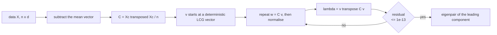
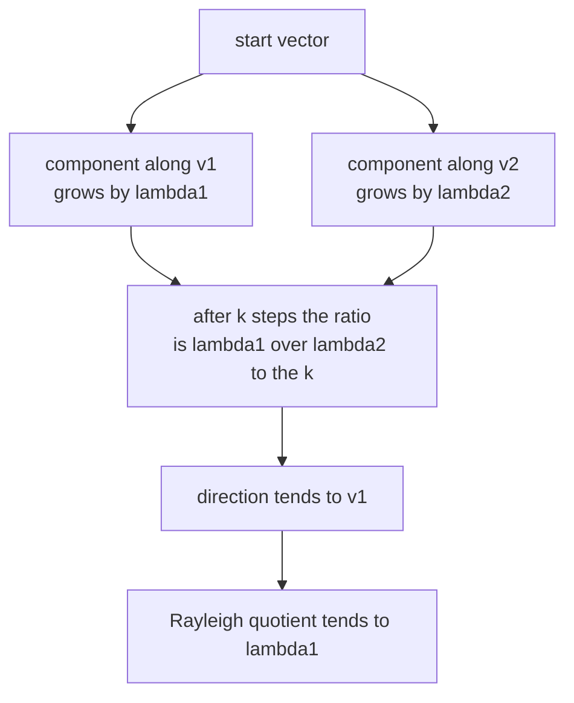
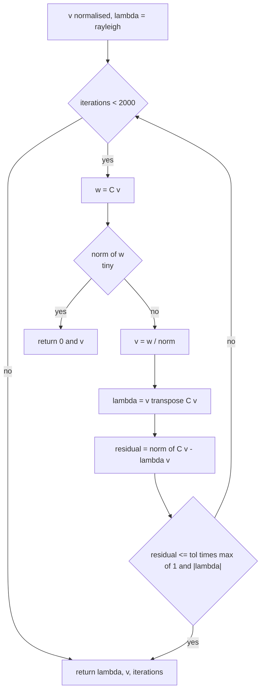
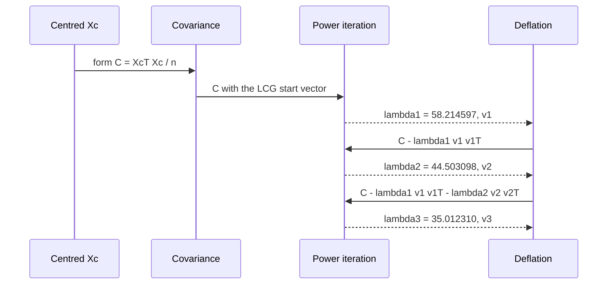

# 501 — Implement PCA via power iteration for largest eigenvector.

> **Tier:** Advanced · **CTCI chapter:** Beyond — Machine Learning & AI
> **Task spec:** [501-implement-pca-via-power-iteration-for-largest-eigenvector.md](../../../tasks/advanced/501-implement-pca-via-power-iteration-for-largest-eigenvector.md)
> **Solutions:** [Python](../../../solutions/python/advanced/501-implement-pca-via-power-iteration-for-largest-eigenvector/solution.py) ·
> [Java](../../../solutions/java/advanced/501-implement-pca-via-power-iteration-for-largest-eigenvector/Solution.java) ·
> [JavaScript](../../../solutions/javascript/advanced/501-implement-pca-via-power-iteration-for-largest-eigenvector/solution.js) ·
> [C#](../../../solutions/csharp/advanced/501-implement-pca-via-power-iteration-for-largest-eigenvector/Solution.cs)

## 1. Problem restatement

**Input:** an `n × d` data matrix `X` (the tests use `n = 40`, `d = 5` LCG integers in `[-10, 10]`,
seed `17`, and a hand-built `4 × 2` set).

**Output:** the leading principal components of `X` — pairs `(lambda, v)` sorted by descending
eigenvalue — produced by this fixed pipeline:

1. **Mean-centre** by the population means: `Xc = X − 1·muᵀ` (the Python file asserts `mu` equals the
   column averages to `1e-12`).
2. **Covariance:** `C = Xcᵀ Xc / n` — divide by `n`, not `n − 1`, so this is the population
   covariance. Only the upper triangle is accumulated, then mirrored.
3. **Power iteration** on `C`: `v` starts from a deterministic LCG vector, then repeats
   `w = C v`, `v = w / ‖w‖`, `lambda = vᵀ C v` (the Rayleigh quotient) until the residual
   `‖C v − lambda·v‖ <= tol · max(1, |lambda|)` with `tol = 1e-13`, cap `2000` iterations.
4. **Deflation** for further components: `C' = C − lambda·v vᵀ`, then run step 3 again on `C'`.

Documented checks, with the values the shipped code produces:

| Check | Value |
| --- | --- |
| hand set `[[2,1],[2,−1],[−2,1],[−2,−1]]` → covariance | `diag(4, 1)`, off-diagonal exactly `0.0` |
| dominant eigenpair of that covariance | `lambda = 4.0`, `v = (1, 0)` (measured `v₂ = −3.67e-14`), 19 iterations |
| residual and Rayleigh consistency | `‖C v − lambda v‖ <= 1e-9`, `vᵀ C v == lambda` |
| rank-one line data `(t, 3t)`, `t = −3,−1,0,2,5` | `lambda1 = 74.4 = 10 · s²` with `s² = 7.44`; second eigenvalue `3.15e-15 <= 1e-9` |
| 5-D LCG data, top three eigenvalues | `58.214597`, `44.503098`, `35.012310` |
| independent Jacobi spectrum of the same `C` | `58.214597`, `44.503098`, `35.012310`, `23.555336`, `18.017783` |
| agreement with Jacobi | `<= 1e-8` per eigenvalue; eigenvectors agree up to sign to `1e-6` |
| orthonormality of the returned basis | `<= 1e-9` |
| deflated `C − lambda1 v1 v1ᵀ` tail | reproduces the Jacobi tail to `1e-8` |
| trace identity | `179.303125 == Σ Jacobi eigenvalues` |
| variance captured by the top three | `0.7681` of the total, and `kept == Σ values` to `1e-9` |
| full basis (`k = d`) | reconstructs `Xc` to `1e-8` |
| constant data `[[3, −1, 7]] × 6` | zero covariance, `|lambda| <= 1e-15` |

## 2. Intuition

The covariance matrix `C` is symmetric and positive semi-definite, so it has an orthonormal basis of
eigenvectors and the variance along `v` is exactly `vᵀ C v`. PCA is the observation that the largest
eigenvalue's eigenvector is the direction of maximum variance.

Computing the whole eigen-decomposition is `O(d³)` and unnecessary when only a few components are
wanted. Power iteration exploits a simple fact: applying `C` repeatedly to any vector that is not
orthogonal to the dominant eigenvector amplifies the dominant component relative to the rest by
`lambda1 / lambda2` per application. After `k` applications the contaminating components carry a
factor `(lambda2 / lambda1)^k`, so the direction converges geometrically.



On the hand example the covariance is already diagonal with eigenvalues `4` and `1`, so the observed
residual ratio is exactly `lambda2 / lambda1 = 0.25` per iteration: `7.576e-03`, `1.894e-03`,
`4.735e-04`, `1.184e-04`. That measured ratio *is* the documented convergence rate, and it is why
the method stalls when the top two eigenvalues are nearly equal — the ratio approaches `1`.



The second half of the idea is **deflation**. Once `(lambda1, v1)` is known, subtracting
`lambda1 v1 v1ᵀ` removes exactly the component along `v1` and leaves every other eigenvalue
untouched: the modified matrix has the same eigenvectors with `lambda1` replaced by `0`. Re-running
power iteration on the deflated matrix therefore yields the second component, and so on.

## 3. Algorithm

1. `mu = column means of X`; `Xc = X − mu`.
2. Accumulate `C[i][j] += Xc[r][i] · Xc[r][j]` for `j >= i`, skipping rows whose `i`-th entry is
   exactly `0.0`; divide by `n`; mirror to the lower triangle.
3. Start vector: for `i = 0 .. d − 1`, advance the LCG and set
   `v[i] = (seed mod 200 − 100) / 100 + 0.5`; normalise `v`.
4. `lambda = vᵀ C v`; then loop up to `2000` times: `w = C v` (return `(0, v)` if `‖w‖ <= 1e-300`,
   which is the deflated-to-zero case), `v = w / ‖w‖`, `lambda = vᵀ C v`, and break when
   `‖C v − lambda v‖ <= tol · max(1, |lambda|)`.
5. `deflate(C, lambda, v)` returns `C − lambda · v vᵀ`; `top_components` repeats steps 3–5 `k` times.
6. `project(Xc, vectors)` returns the coordinates `Xc · v_i` — the principal-component scores.

```text
procedure power_iteration(a, tol, max_iters, seed)
    v ← deterministic start vector from the LCG, normalised
    lambda ← rayleigh(a, v)
    iterations ← 0
    while iterations &lt; max_iters do
        iterations ← iterations + 1
        w ← a · v
        if norm(w) &lt;= 1e-300 then
            return 0, v, iterations        // the matrix is numerically zero
        end
        v ← w / norm(w)
        lambda ← dot(v, a · v)
        if norm(a · v - lambda · v) &lt;= tol · max(1, |lambda|) then
            stop
        end
    end
    return lambda, v, iterations
end
```

```text
procedure top_components(xc, k, tol)
    c ← covariance(xc)
    values ← empty; vectors ← empty
    repeat k times
        lambda, v, _ ← power_iteration(c, tol)
        append lambda to values
        append v to vectors
        c ← deflate(c, lambda, v)          // c[i][j] - lambda · v[i] · v[j]
    end
    return values, vectors
end
```

Note the stopping test is a *residual*, not a change in `lambda`: the vector can stop moving while
`lambda` still drifts in the last digits, and the residual is the quantity the assertions bound.



## 4. Worked example

**Hand example.** `X = [[2,1],[2,−1],[−2,1],[−2,−1]]`, `mu = (0, 0)`, and the accumulated covariance
is exactly `[[4, 0], [0, 1]]`. The deterministic start vector normalises to
`(0.99994899, −0.01010049)`. Iterating:

| Iteration | `v` | `lambda = vᵀ C v` | residual |
| --- | --- | --- | --- |
| 1 | `(0.999997, −0.002525)` | `3.99998087` | `7.576e-03` |
| 2 | `(1.0, −0.000631)` | `3.99999880` | `1.894e-03` |
| 3 | `(1.0, −0.000158)` | `3.99999993` | `4.735e-04` |
| 4 | `(1.0, −0.000039)` | `4.00000000` | `1.184e-04` |
| 19 | `(1.0, −3.67e-14)` | `4.0` | passes the `1e-13` test |

Each row divides the previous residual by `4`: with a diagonal covariance the second component
decays as `(lambda2 / lambda1)^k = (1/4)^k`, so reaching `1e-13` needs about `19` iterations. On the
5-D data, where the ratio is `44.5031 / 58.2146 = 0.764`, convergence is much slower per iteration —
the same formula, different spectral gap.

**Rank-one data.** The points `(−3,−9)`, `(−1,−3)`, `(0,0)`, `(2,6)`, `(5,15)` all lie on `y = 3x`.
Centring gives coordinate `t − mean(t) = t − 0.6`, and the covariance along the direction `(1, 3)`
is `10 · s² = 10 · 7.44 = 74.4`, which is exactly the measured `lambda1`. Power iteration on the
deflated matrix then finds `3.15e-15` — numerically zero, confirming that one direction explains the
data completely.

**5-D LCG data.** `n = 40`, `d = 5`, seed `17`, `mu = (−0.475, 0.9, 0.6, 1.475, 0.775)`:

| Component | Power iteration | Jacobi (independent) | Share of trace |
| --- | --- | --- | --- |
| 1 | `58.214597` | `58.214597` | `32.5%` |
| 2 | `44.503098` | `44.503098` | `24.8%` |
| 3 | `35.012310` | `35.012310` | `19.5%` |
| 4 | — (not requested) | `23.555336` | `13.1%` |
| 5 | — | `18.017783` | `10.0%` |
| sum | `137.730005` (top 3) | `179.303125` (trace) | `76.81%` kept |

The three requested components match an independent Jacobi eigendecomposition to well inside `1e-8`,
the eigenvalues sum to `137.730005` which is `76.81%` of the trace `179.303125`, and projecting the
centred data onto those three directions reproduces exactly the same number as `Σ values` — the
analytic `var(v) = Σ eigenvalues` identity, checked to `1e-9`.



The deflation chain is checked against the Jacobi tail: deflating the four components off `C` and
running power iteration at each stage reproduces `44.503098`, `35.012310`, `23.555336`, `18.017783`
in order, i.e. deflation adds no error.

## 5. Complexity

Let `n` be the point count, `d` the dimension, and `t` the power-iteration count per component.

| Measure | Bound | Why it holds |
| --- | --- | --- |
| Centring | `O(n·d)` | one column-mean pass plus one subtraction per entry |
| Covariance | `O(n·d²)` | every row contributes a rank-one block to `C` |
| One power iteration | `O(d²)` | one mat-vector product plus two dot products |
| One component | `O(t·d²)` | `t = 19` on the hand set; capped at `2000` |
| Top `k` components | `O(k·t·d²)` | plus `O(k·d²)` for the deflations |
| Space | `O(d² + n·d)` | the covariance and the centred data |
| Full eigen-decomposition | `O(d³)` | Jacobi sweeps, independent of `k` |
| Projection / variance identity | `O(n·k·d)` | `n` rows times `k` components |

The comparison is the point of the method: for `n = 40`, `d = 5`, `k = 3`, power iteration costs
three times `O(t·d²)` while Jacobi pays `O(d³ · sweeps)` and returns all five eigenpairs. The trade
is visible in the assertions — power iteration only needs the *first three* eigenvalues to match, but
it is compared against the full spectrum.

## 6. Pitfalls and edge cases

- **Division by `n` versus `n − 1`.** This implementation uses the population covariance, so the
  eigenvalues are the population variances. Mixing the two shifts every number by `n / (n − 1)` and
  breaks the `lambda = 4.0` assertion on the hand set.
- **Nearly equal top eigenvalues.** The convergence rate is `lambda2 / lambda1`; if the two are
  equal the iteration stalls at the `2000`-iteration cap and returns whatever the start vector's
  mixture was. The header states the caveat explicitly.
- **Start vector orthogonal to the dominant eigenvector.** With an exact zero component along `v1`,
  power iteration converges to something else entirely. The LCG start makes this improbable but not
  impossible; the `norm(w) <= 1e-300` branch handles the fully degenerate zero-matrix case.
- **Constant data.** Every centred row is `0`, so `C` is the zero matrix: `w = 0`, the guard fires,
  and the run returns `lambda = 0` — asserted as `|lambda| <= 1e-15`. Do not divide by `‖w‖` here.
- **Sign of the eigenvector.** `v` and `−v` are both valid eigenvector for the same eigenvalue, so
  every comparison against the Jacobi reference accepts either `v − v_jacobi` or `v + v_jacobi`.
- **Repeated eigenvalues of the deflated matrix.** Deflation sets the found eigenvalue to `0`
  exactly, so a *later* component with eigenvalue near `0` is indistinguishable from the deflated
  direction — which is why the rank-one test only asserts `lambda2 <= 1e-9`.
- **Tiny residuals in absolute terms.** The stop test scales with `max(1, |lambda|)`, so a data set
  with variance of order `1e-6` still gets a meaningful relative tolerance instead of never
  converging.
- **Symmetry drift.** `covariance` mirrors the upper triangle instead of computing both halves, and
  `mat_vec` assumes symmetry; writing an asymmetric matrix would silently produce complex-looking
  behaviour in the residual.
- **Deflation destroys the matrix for reuse.** `deflate` returns a new matrix; `top_components`
  reassigns `c`, so the original covariance is still available for the reconstruction checks.

## 7. Variants and follow-ups

- **Only the top few directions of a huge matrix.** [502-implement-randomized-svd-basic-using-power-method.md](../../../tasks/advanced/502-implement-randomized-svd-basic-using-power-method.md)
  draws a random test matrix and runs power iterations *inside* the range finder, which is the same
  amplification idea applied to `A` without ever forming `AᵀA`.
- **Asking for the Fiedler vector instead.** [500-implement-spectral-clustering-small-example-eigen-decomposition.md](../../../tasks/advanced/500-implement-spectral-clustering-small-example-eigen-decomposition.md)
  needs the *second smallest* eigenvalue of a Laplacian; power iteration targets the largest, so
  that task shifts the spectrum and uses Jacobi for the full decomposition.
- **Where the covariance lands in an optimizer.** The comparison step size in
  [497-implement-l-bfgs-numeric-optimizer-skeleton-for-small-dims.md](../../../tasks/advanced/497-implement-l-bfgs-numeric-optimizer-skeleton-for-small-dims.md)
  is `eta = 1/L`, and `L` is computed by exactly this kind of power iteration.
- **Checking the gradient you differentiate.** A PCA built on matrix calculus is easy to get wrong;
  [512-implement-gradient-check-numerical-derivative-utility.md](../../../tasks/advanced/512-implement-gradient-check-numerical-derivative-utility.md)
  is the finite-difference companion.
- **Incremental PCA.** Streaming updates of `C` (or of a low-rank sketch) replace the one-shot
  covariance when the data does not fit in memory; the eigen-solver itself is unchanged.

## 8. Check yourself

1. Why does the residual fall by a factor of exactly `4` per iteration on the hand example?

<details><summary>Show answer</summary>

Because the residual is proportional to the contamination along the second eigenvector, which is
multiplied by `lambda2 / lambda1` each iteration. Here `C = diag(4, 1)`, so the ratio is `1/4`; the
measured residuals `7.576e-03 → 1.894e-03 → 4.735e-04 → 1.184e-04` follow that factor.

</details>

2. Why is the covariance divided by `n` rather than `n − 1` in this implementation?

<details><summary>Show answer</summary>

The header calls it the *population* covariance (`C = Xᵀ X / n`), and the tests are written against
that convention: the hand set's variance along `x` is `(2² + 2² + (−2)² + (−2)²) / 4 = 4`. Dividing
by `n − 1 = 3` would give `5.333…` and fail the `abs(c[0][0] − 4.0) <= 1e-12` assertion.

</details>

3. What does deflation do to the remaining eigenvalues?

<details><summary>Show answer</summary>

`C − lambda v vᵀ` keeps every other eigenpair unchanged and maps `v` to `0`. The Python file verifies
this directly by deflating four components off the 5-D covariance and checking that power iteration
at each stage reproduces the Jacobi tail `44.503098, 35.012310, 23.555336, 18.017783` to `1e-8`.

</details>

4. The rank-one data set reports `lambda2 = 3.15e-15`. Is that a bug?

<details><summary>Show answer</summary>

No. All five points lie on one line, so the centred data has rank one and the true second eigenvalue
is `0`. What remains is floating-point round-off from subtracting `lambda1 v1 v1ᵀ`, which is why the
assertion is `lambda2 <= 1e-9` rather than an equality.

</details>

5. When would you choose Jacobi over power iteration here?

<details><summary>Show answer</summary>

When you need the whole spectrum or a reliable ordering of small eigenvalues. Jacobi is `O(d³)` per
sweep but independent of `k` and of the spectral gap, and it is what the tests use as the oracle.
Power iteration wins when `k` is small and the top eigenvalues are well separated — on this data,
three components totalling `76.81%` of the trace cost three `O(t·d²)` runs.

</details>
