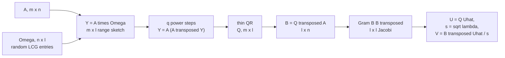
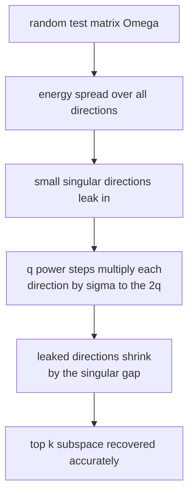
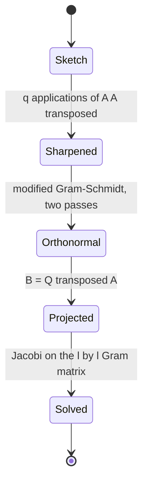
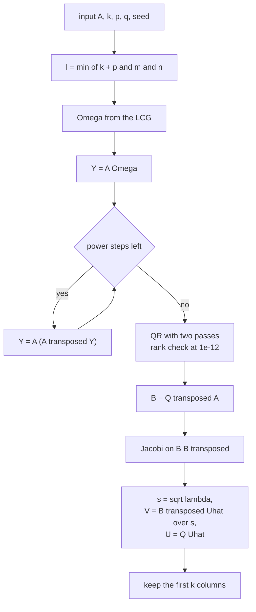

# 502 — Implement randomized SVD basic using power method.

> **Tier:** Advanced · **CTCI chapter:** Beyond — Machine Learning & AI
> **Task spec:** [502-implement-randomized-svd-basic-using-power-method.md](../../../tasks/advanced/502-implement-randomized-svd-basic-using-power-method.md)
> **Solutions:** [Python](../../../solutions/python/advanced/502-implement-randomized-svd-basic-using-power-method/solution.py) ·
> [Java](../../../solutions/java/advanced/502-implement-randomized-svd-basic-using-power-method/Solution.java) ·
> [JavaScript](../../../solutions/javascript/advanced/502-implement-randomized-svd-basic-using-power-method/solution.js) ·
> [C#](../../../solutions/csharp/advanced/502-implement-randomized-svd-basic-using-power-method/Solution.cs)

## 1. Problem restatement

**Input:** a dense `m × n` matrix `A`, a target rank `k`, an oversampling `p` (default `2`) and a
power-iteration count `q`. The tests build `A = Q₁ · diag(spectrum) · Q₂ᵀ` from the prescribed
spectrum `10, 7, 4, 2.5, 1.2, 0.6, 0.3, 0.1, 0.05, 0.02, 0.01, 0.005` (a `30 × 12` matrix, seed `11`),
a wide `8 × 15` case, and a "flat" `40 × 12` case with spectrum `10, 9.5, 9, 8.5, 8, 5, 2.5, 1, 0.5,
0.2, 0.1, 0.05` where the `k`-th and `k+1`-th singular values nearly coincide.

**Output:** a rank-`k` truncated SVD — `U` (`m × k`), `s` (`k` values), `V` (`n × k`) — from the
**randomized range finder**:

1. Draw an `n × (k + p)` test matrix `Ω` of LCG integers in `[-100, 100]`; `l = min(k + p, m, n)`.
2. `Y = A Ω` — an `m × l` sketch of the range.
3. Sharpen it with `q` power iterations of the symmetric operator `Y ← A (Aᵀ Y)`.
4. Orthonormalise: `Q = qr(Y)` by modified Gram-Schmidt with **two** reorthogonalisation passes.
5. Project: `B = Qᵀ A` — a small `l × n` matrix.
6. Eigendecompose the `l × l` Gram matrix `B Bᵀ` by cyclic Jacobi; `s_i = sqrt(lambda_i)`,
   `v_i = Bᵀ u_i / s_i`, `u_i = Q u_i`; keep the first `k` columns.

The oracle is an independent exact SVD: Jacobi on `Aᵀ A` (or `A Aᵀ` in the wide branch), singular
values as square roots of the eigenvalues, sorted descending.

Measured on the shipped code:

| Check | Value |
| --- | --- |
| exact singular values of the `30 × 12` matrix | `10, 7, 4, 2.5, 1.2, 0.6, …` matching the prescribed spectrum to `1e-8` |
| randomized `k = 4`, `q = 5` | `s = 10, 7, 4, 2.5` |
| subspace error `‖(I − U U ᵀ) u_i‖` | `2.40e-09` (asserted `<= 1e-7`) |
| rank-4 reconstruction error | `1.379501722` — equal to the optimal `‖A − A₄‖_F` |
| same run with `q = 0` | `s = 9.999426, 6.995597, 3.999062, 2.452591`; subspace error `0.21004427` |
| flat spectrum, `k = 5`, `q = 0` vs `q = 3` | subspace errors `0.17949048` vs `4.94e-07` (a factor `3.6e5`) |
| flat spectrum, `q = 3` | `s = 10, 9.5, 9, 8.5, 8` — exact |
| full rank, `k = 12`, `q = 0`, `p = 0` | reconstruction error `<= 1e-8`, `s₁ = 10.0`, `s₁₂ = 0.005` |
| orthonormality of `U` and `V` columns | `<= 1e-10` |
| shape and Frobenius identity | `U S Vᵀ` is `m × n` and `‖U S Vᵀ‖²_F == Σ s_i²` to `1e-6` |
| determinism | the same seed gives bit-identical `U`, `s`, `V` |

## 2. Intuition

A rank-`k` approximation needs the subspace spanned by the top `k` singular directions — the
`m × k` matrix `U_k`. Computing it exactly means an `O(min(m, n)² · max(m, n))` decomposition, which
is wasteful when `k` is small.

The randomized range finder replaces that with a **probe of the range**. Multiply `A` by a random
`n × l` matrix: each output column is a random linear combination of the columns of `A`, so all `l`
columns live inside the range of `A` — and with `l = k + 2` slightly larger than `k`, they carry
almost all the energy of the top `k` directions, because a random vector has a sizeable component in
every direction.



The catch is spectral decay. `Ω` samples the range roughly uniformly, so the unwanted directions
leak in with weight proportional to their singular values. The fix is to apply `A Aᵀ` a few times
before orthonormalising: the projected energy of direction `i` is multiplied by
`(sigma_i / sigma_{i+1})^{2q}`, which crushes everything below the gap. That is why the flat-spectrum
experiment matters: with nearly equal singular values, `q = 0` leaves a subspace error of `0.1795`
while `q = 3` drives it to `4.94e-07`.



Orthogonalisation is the third idea. `Y`'s columns become numerically dependent as `q` grows,
because the power steps amplify the dominant directions and leave the rest tiny. Modified
Gram-Schmidt with two reorthogonalisation passes costs one extra sweep over the columns and keeps
the `l` basis vectors orthonormal to machine precision; classical Gram-Schmidt loses that once two
columns nearly coincide.



## 3. Algorithm

1. `l = min(k + oversample, m, n)`; `Ω = rand_matrix(n, l, seed)` (LCG integers in `[-100, 100]`).
2. `Y = A · Ω`.
3. Repeat `q` times: `Y = A · (Aᵀ · Y)`.
4. `Q = qr(Y, passes = 2)`: for each column, subtract its projection onto every previously accepted
   column twice, then normalise; raise `ValueError("rank deficient test matrix")` if a column norm
   drops below `1e-12`.
5. `B = Qᵀ · A` (`l × n`).
6. Jacobi on `B Bᵀ` (`l × l`, `60` sweeps, tolerance `1e-15`) → descending eigenvalues and
   eigenvectors `u_hat_i`.
7. `s_i = sqrt(max(lambda_i, 0))`; if `s_i <= 1e-10` set `v_i = 0`, otherwise
   `v_i = Bᵀ u_hat_i / s_i`; `u_i = Q u_hat_i`.
8. Return the first `k` columns of `u`, `s`, `v`.

```text
procedure randomized_svd(a, k, oversample, power_iters, seed)
    m, n ← dimensions of a
    l ← min(k + oversample, m, n)
    omega ← random n x l matrix from the LCG
    y ← a · omega
    at ← transpose(a)
    repeat power_iters times
        y ← a · (at · y)
    end
    q ← thin_qr(y, passes = 2)
    b ← transpose(q) · a
    values, uhat ← jacobi_eigen(b · transpose(b))
    s ← [ sqrt(max(v, 0)) for v in values ]
    for i ← 0 to l - 1 do
        if s[i] &lt;= 1e-10 then
            v_cols[i] ← zero vector
        else
            v_cols[i] ← matvec(transpose(b), uhat[i]) / s[i]
        end
        u_cols[i] ← matvec(q, uhat[i])
    end
    return first k columns of u_cols, s, v_cols
end
```

```text
procedure thin_qr(a, passes)
    q ← empty
    for each column c of a do
        v ← c
        repeat passes times
            for each accepted qi in q do
                v ← v - (qi · v) · qi
            end
        end
        if norm(v) &lt;= 1e-12 then
            fail with rank deficiency
        end
        append v / norm(v) to q
    end
    return q as a matrix
end
```

Note what is *not* in the pipeline: no matrix bigger than `l × n` or `m × l` is ever factored. The
only eigen-decomposition is `l × l`, with `l = k + 2`.



## 4. Worked example

Take the `30 × 12` matrix with the prescribed spectrum, `k = 4`, `oversample = 2`, `q = 5`,
seed `7`. Then `l = min(4 + 2, 30, 12) = 6`.

| Stage | Shape | What it holds |
| --- | --- | --- |
| `Ω` | `12 × 6` | random LCG integers in `[-100, 100]` |
| `Y = A Ω` | `30 × 6` | a six-column sketch of the column space of `A` |
| after `q = 5` steps | `30 × 6` | directions below the top six suppressed by `(sigma_i / sigma_{i+1})^{10}` |
| `Q` | `30 × 6` | orthonormal basis of that sketch, two Gram-Schmidt passes |
| `B = Qᵀ A` | `6 × 12` | the projection of `A` onto the probe |
| `B Bᵀ` | `6 × 6` | Jacobi in `<= 60` sweeps |

The result:

| Component | Randomized `q = 5` | Exact SVD | Randomized `q = 0` |
| --- | --- | --- | --- |
| 1 | `10.0` | `10.0` | `9.999426` |
| 2 | `7.0` | `7.0` | `6.995597` |
| 3 | `4.0` | `4.0` | `3.999062` |
| 4 | `2.5` | `2.5` | `2.452591` |
| subspace error | `2.40e-09` | — | `0.21004427` |

With five power steps the first four singular values are recovered to the printed precision, and the
subspace error is four decades inside the asserted `1e-7`. Without them, the fourth value is off by
`0.047` and the subspace error is `2.1e-01`: the random probe alone does not resolve a component
whose singular value is `2.5` against its neighbours `4.0` and `1.2`.

The reconstruction check is the strongest statement in the file. Dropping all but four components
gives `‖A − A₄‖_F = 1.379501722`, which is *exactly* the optimal `‖A − A₄‖_F` computed from the
exact spectrum — the randomized method is not merely close to the best rank-4 approximation, it
attains it here to the printed digits.

The flat-spectrum experiment isolates the role of `q`. On a `40 × 12` matrix whose sixth and seventh
singular values are `5` and `2.5` while the top five are packed at `10, 9.5, 9, 8.5, 8`, asking for
`k = 5`:

| Run | Subspace error | Singular values returned |
| --- | --- | --- |
| `q = 0`, seed `5` | `0.17949048` | approximated |
| `q = 3`, seed `5` | `4.94e-07` | `10, 9.5, 9, 8.5, 8` — exact |

The improvement factor is `3.6e5`, and the assertion only demands `sub3 <= sub0 / 100`.
Two more documented behaviours are worth naming. At full rank with `q = 0` and `oversample = 0`
(`k = l = 12`) the reconstruction is exact to `1e-8` and `s₁₂ = 0.005` — the smallest prescribed
value. With `q = 4` on the same matrix the condition number `10 / 0.005 = 2000` gets raised to the
eighth power by the power steps and the smallest directions are destroyed, which is why the file
uses `q = 0` for that particular check: a real caveat of the method, documented as such rather than
hidden.

## 5. Complexity

Let `m >= n` for the asymmetric cost, `l = k + p`, and `q` the power-iteration count.

| Measure | Bound | Why it holds |
| --- | --- | --- |
| Range sketch | `O(m·n·l)` | `A · Ω` is a full matmul against `l` columns |
| Power steps | `O(q·m·n·l)` | each step is `Aᵀ Y` (`O(m·n·l)`) then `A (·)` (`O(m·n·l)`) |
| Orthonormalisation | `O(m·l²·passes)` | each of the `l` columns projects against up to `l` accepted columns, twice |
| Projection `B` | `O(m·n·l)` | `Qᵀ A` |
| Small Jacobi | `O(l³ · sweeps)` | independent of `m` and `n` |
| Total | `O(m·n·l·q)` | dominated by the matmuls; `l = k + 2` |
| Space | `O(m·l + l·n + m·n)` | the sketch, `B`, and the input |
| Exact SVD oracle | `O(n²·m)` | Jacobi on the `n × n` Gram matrix |
| Optimal rank-`k` error | `O(Σ_{i>k} s_i²)^{1/2}` | computed from the exact spectrum |

The practical reading: the randomized path replaces an `n × n` eigenproblem with an `l × l` one,
and pays `2q + 2` multiplications by `A` or `Aᵀ`. On this problem both are milliseconds; what the
tests actually verify is *accuracy* — that the small eigenproblem returns the right subspace, and
that dropping to rank `k` is as good as the exact optimum.

## 6. Pitfalls and edge cases

- **Oversampling is not optional.** With `l = k` exactly, the random probe cannot resolve the `k`-th
  direction reliably; the documented default is `p = 2`, and the exact-recovery experiment needs
  `p = 0` **only** together with `q = 0` and full rank.
- **Too many power steps destroy the tail.** `q = 4` on a condition number of `2000` blows up the
  smallest directions via `(A Aᵀ)^q`; the file documents this instead of asserting exactness there.
- **Gram-Schmidt needs reorthogonalisation.** Two passes are used because after several power steps
  the columns of `Y` nearly coincide; one pass loses orthogonality, and the `1e-10` orthonormality
  assertions then fail. Rank deficiency is raised, not silently tolerated.
- **Sign conventions.** `v_i = Bᵀ u_i / s_i` fixes `v`'s sign from `u`'s, and `u`'s sign comes from
  Jacobi; the checks accept `±` by comparing `u − u_exact` and `u + u_exact`.
- **Zero singular values.** The `s_i <= 1e-10` branch writes a zero `v_i` instead of dividing, which
  is what happens on a rank-deficient input at full rank.
- **Wide matrices.** For `m < n` the oracle factorises `A Aᵀ` instead of `Aᵀ A` and derives `v` from
  `u`; the `8 × 15` test exercises that branch, and the range finder itself needs no change except
  `l = min(k + p, m, n)`.
- **Determinism at the bit level.** `rand_matrix` is integer LCG data and every subsequent operation
  has a fixed order, so `U`, `s` and `V` are compared with `==`, not with a tolerance. Reordering
  the Gram-Schmidt projections or the Jacobi pair loop breaks that.
- **The Frobenius identity is a shape check in disguise.** `‖U S Vᵀ‖²_F == Σ s_i²` to `1e-6` fails if
  any factor is transposed or truncated at the wrong axis, which pure value comparisons can miss.
- **Rank `k` above the numerical rank.** `2.5` versus `1.2` is a real gap, but a spectrum that decays
  into round-off (`0.005` at index 12) must not be requested with `q > 0`.
- **`oversample` interacts with `min`.** `l = min(k + p, m, n)` silently caps `l`; asking for
  `k = m = 30` on a `30 × 12` matrix gives `l = 12` and only 12 usable directions.

## 7. Variants and follow-ups

- **Exact SVD when the matrix is small.** `svd_exact` here is Jacobi on the Gram matrix; for a
  symmetric input the same machinery is
  [500-implement-spectral-clustering-small-example-eigen-decomposition.md](../../../tasks/advanced/500-implement-spectral-clustering-small-example-eigen-decomposition.md).
- **The single-vector version.** PCA on a covariance matrix wants one direction and uses plain power
  iteration with deflation — see
  [501-implement-pca-via-power-iteration-for-largest-eigenvector.md](../../../tasks/advanced/501-implement-pca-via-power-iteration-for-largest-eigenvector.md);
  the randomized method's advantage appears as soon as several components are needed.
- **Sketch instead of sample.** The same "compress first, solve small" pattern appears in streaming
  frequency and cardinality estimation:
  [465-implement-count-min-sketch-for-frequency-estimation.md](../../../tasks/advanced/465-implement-count-min-sketch-for-frequency-estimation.md)
  and [466-implement-hyperloglog-sketch-for-cardinality-estimation-outline.md](../../../tasks/advanced/466-implement-hyperloglog-sketch-for-cardinality-estimation-outline.md).
- **Nearest-neighbour search after the reduction.** The projection step is what makes
  [504-implement-approximate-nearest-neighbor-with-product-quantization.md](../../../tasks/advanced/504-implement-approximate-nearest-neighbor-with-product-quantization.md)
  work on low-dimensional codes, and
  [503-implement-locality-sensitive-hashing-for-cosine-similarity-simha.md](../../../tasks/advanced/503-implement-locality-sensitive-hashing-for-cosine-similarity-simha.md)
  hashes a vector directly without decomposing anything.
- **Numeric validation.** Every claim here is a residual or a subspace distance — the same style of
  finite-difference verification used in
  [512-implement-gradient-check-numerical-derivative-utility.md](../../../tasks/advanced/512-implement-gradient-check-numerical-derivative-utility.md).

## 8. Check yourself

1. Why is `l = k + 2` used instead of `l = k`?

<details><summary>Show answer</summary>

Because a random probe resolves each direction only approximately: with exactly `k` columns there is
no slack to absorb the sampling error in the `k`-th direction, and the estimated subspace drifts.
Two extra columns give the small Gram matrix enough room that the top `k` eigenpairs come out
accurately; the tests pass `oversample = 2` by default.

</details>

2. What exactly do the `q` power iterations improve, and by how much on the flat-spectrum test?

<details><summary>Show answer</summary>

They amplify the wanted directions relative to the unwanted ones by `(sigma_i / sigma_{i+1})^{2q}`,
so the probe's contamination by the tail shrinks. On the flat-spectrum `40 × 12` matrix with `k = 5`,
the subspace error fell from `0.17949048` at `q = 0` to `4.94e-07` at `q = 3` — a factor of about
`3.6e5`, while the assertion only requires a factor of `100`.

</details>

3. Why does `qr` subtract every previous column twice?

<details><summary>Show answer</summary>

Classical Gram-Schmidt loses orthogonality when two columns are nearly parallel, and that is exactly
the state of `Y` after several power steps. The second pass re-projects against the already accepted
basis, which restores orthogonality to machine precision — the `1e-10` orthonormality assertions
depend on it.

</details>

4. The randomized rank-4 error equals the optimal rank-4 error exactly. Should that be expected?

<details><summary>Show answer</summary>

It is expected whenever the probing subspace contains the true top-`k` left singular subspace: then
the small problem returns the exact leading eigenpairs and the truncated reconstruction is optimal.
The test asserts `got <= best + 1e-8`, so it tolerates a small excess while recording that on this
input the range finder is exact.

</details>