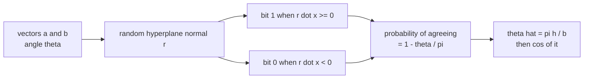
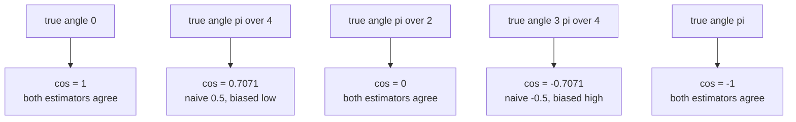
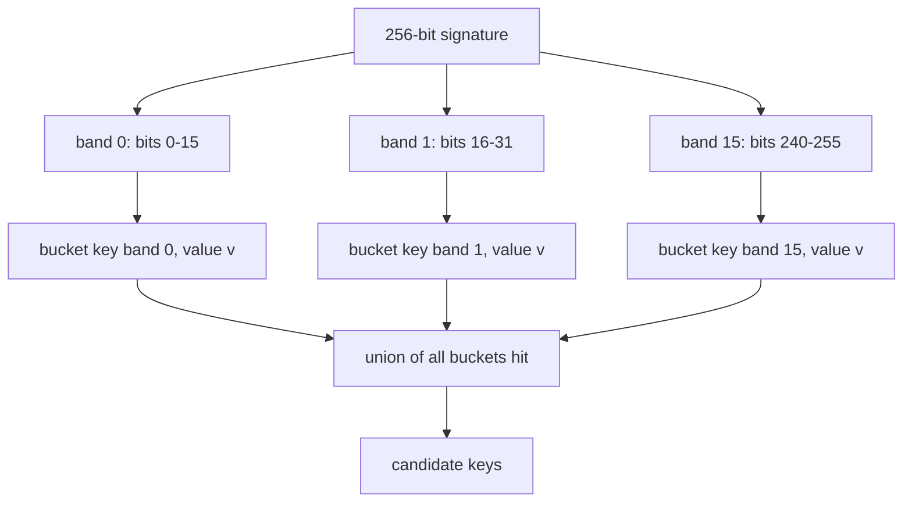
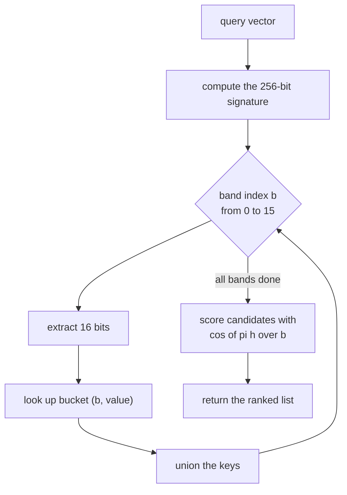

# 503 — Implement locality-sensitive hashing for cosine similarity (simhash).

> **Tier:** Advanced · **CTCI chapter:** Beyond — Advanced Data Structures & Algorithms
> **Task spec:** [503-implement-locality-sensitive-hashing-for-cosine-similarity-simha.md](../../../tasks/advanced/503-implement-locality-sensitive-hashing-for-cosine-similarity-simha.md)
> **Solutions:** [Python](../../../solutions/python/advanced/503-implement-locality-sensitive-hashing-for-cosine-similarity-simha/solution.py) ·
> [Java](../../../solutions/java/advanced/503-implement-locality-sensitive-hashing-for-cosine-similarity-simha/Solution.java) ·
> [JavaScript](../../../solutions/javascript/advanced/503-implement-locality-sensitive-hashing-for-cosine-similarity-simha/solution.js) ·
> [C#](../../../solutions/csharp/advanced/503-implement-locality-sensitive-hashing-for-cosine-similarity-simha/Solution.cs)

## 1. Problem restatement

**Input:** vectors in `DIM = 16` dimensions (small LCG integers in `[-5, 5]`), and a fixed set of
`BITS = 256` random hyperplane normals. The normals are standard normal deviates produced by a
deterministic `splitmix64` stream (`z + 0.5) / 2⁶⁴` uniforms fed through Box-Muller), so the
directions are isotropic and the run is reproducible from `seed = 7`.

**Output:**

- a `b`-bit **signature** per vector: bit `i` is `1` when `r_i · x >= 0` (ties count as `+1`);
- similarity estimates from the Hamming distance `h`:
  `agreement = 1 − h/b`, `theta_hat = pi · h / b`, `cosine_estimate = cos(theta_hat)`;
  the naive `hash_similarity = 1 − 2h/b` is kept only for comparison;
- **retrieval candidates** from a banded index that cuts the `b` bits into `BANDS = 16` disjoint
  bands of `BAND_BITS = 16` bits each: two vectors become candidates when they agree on at least one
  whole band ("AND inside a band, OR across bands").

Everything below is measured on the shipped code and asserted by it:

| Check | Value |
| --- | --- |
| identical vectors | Hamming `0`, `cosine_estimate` exactly `1.0` |
| positive rescaling (`x` → `7x`) | identical signature, bit for bit |
| negation | complements all `256` bits, `cosine_estimate = −1.0` |
| per-bit agreement at `pi/4`, `pi/2`, `3pi/4` over `2000` planes | `0.7400`, `0.5070`, `0.2540` against the theoretical `1 − theta/pi = 0.7500`, `0.5000`, `0.2500` (tolerance `0.03`) |
| angle estimates | `0.8168`, `1.5488`, `2.3436` against `0.7854`, `1.5708`, `2.3562` (tolerance `0.05`) |
| cosine estimates | `0.6845`, `0.0220`, `−0.6982` against `0.7071`, `0.0000`, `−0.7071` (tolerance `0.05`) |
| naive `1 − 2h/b` at `pi/4`, `256` bits | `0.4766` — asserted to be more than `0.1` away from `cos(pi/4)`, while `cos(theta_hat)` gives `0.6806` |
| 20 LCG pairs, `16` dims, `256` bits | mean absolute error `0.0598` (`<= 0.08`), worst `0.1484` (`<= 0.25`), every clearly positive/negative cosine keeps its sign |
| corpus of `40` vectors with `5` planted near-duplicates | near-duplicate cosines `0.9464 … 0.9589` (asserted `>= 0.9`), all retrieved for every query |
| candidate list sizes | average `1.3`, maximum `2`, against a corpus of `40` (asserted below `20%` of the corpus) |
| bucket accounting | `640` entries `== 40 · 16` bands, exactly |
| signature size | `256` bits instead of `16` doubles |

## 2. Intuition

Cosine similarity is an angle. Never materialise the angle: instead, draw a random hyperplane through
the origin with normal `r` and record which side each vector falls on. That single bit is a coin flip
whose bias depends on the angle between the two vectors. For vectors `a` and `b` separated by angle
`theta`, the two hyperplane normals `r ⊥ a` and `r ⊥ b` cut the unit circle into four wedges, and
the bits disagree exactly when `r` lands in the two wedges of total measure `theta`:



So `P[bit agrees] = 1 − theta/pi`, and the signature is a `b`-sample Bernoulli experiment on the
angle. Inverting that expectation gives the estimator this task uses: `theta_hat = pi · h / b`, and
then `cos(theta_hat)` for the cosine.

The subtle point the header insists on is that you must go **through the angle**. The popular
`1 − 2h/b` is also linear in `h`, but it equals the cosine only at `theta = 0`, `pi/2` and `pi`. In
between it is shrunk toward zero: at `pi/4` its expectation is `1 − 2·0.25 = 0.5` while the true
cosine is `0.7071`, a bias of about `0.207`. The measured 256-bit draw lands at `0.4766`; the
angle-based route gives `0.6806`, within `0.0265` of the truth.



The second half of the design is retrieval. A `256`-bit code is not directly searchable, so the bits
are cut into bands and the index demands **all** bits of at least one band. Identical vectors agree
in every band and always collide; unrelated vectors agree in one specific band with probability
`2^-16`, so a random vector lands in `16 · 2^-16 ≈ 2.4e-4` of the buckets a query probes. That is why
the measured candidate list averages `1.3` entries out of a 40-vector corpus.



Note the asymmetry of the rule: **AND inside a band** (all 16 bits must match) and **OR across
bands** (any band is enough). Banding more finely than 16 bits would produce more collisions;
fewer bands would make collisions rarer but also miss near-duplicates that differ in one bit of every
band.

## 3. Algorithm

1. `make_planes(bits, dim, seed)`: keep calling `splitmix64`/`uniform` (two uniforms per coordinate
   through Box-Muller: `radius = sqrt(−2 ln u1)`, `angle = 2 pi u2`) until a `dim`-long vector is
   filled; collect `bits` such normals.
2. `signature(vec, planes, bits)`: for each `i`, compute `r_i · vec` and set bit `i` when the dot
   product is `>= 0.0`.
3. `hamming(a, b) = popcount(a XOR b)` — the Kernighan loop `value &= value − 1`.
4. `agreement`, `angle_estimate`, `cosine_estimate`, `hash_similarity` as in section 1.
5. `bands_of(sig)`: `[(band, (sig >> (band · band_bits)) & mask) for band in range(bands)]`.
6. `SimHashIndex.add(key, vec)`: compute the signature, store it, and append `key` to the bucket of
   every band, counting one `entry` per band.
7. `SimHashIndex.candidates(vec)`: signature, then the union of the buckets for the 16 band keys.
8. `SimHashIndex.similarity(key_a, key_b)`: `cosine_estimate` on the stored signatures.

```text
procedure signature(vec, planes, bits)
    sig ← 0
    for i ← 0 to bits - 1 do
        if dot(planes[i], vec) &gt;= 0 then
            sig ← sig OR (1 shifted left by i)
        end
    end
    return sig
end
```

```text
procedure candidates(vec)
    sig ← signature(vec, planes, bands · band_bits)
    found ← empty set
    for band ← 0 to bands - 1 do
        value ← (sig shifted right by band · band_bits) AND (2^band_bits - 1)
        add every key in buckets[(band, value)] to found
    end
    return found
end
```

```text
procedure angle_estimate(sig_a, sig_b, bits)
    return pi · hamming(sig_a, sig_b) / bits
end

procedure cosine_estimate(sig_a, sig_b, bits)
    return cos(angle_estimate(sig_a, sig_b, bits))
end

procedure agreement(sig_a, sig_b, bits)
    return 1 - hamming(sig_a, sig_b) / bits
end
```



## 4. Worked example

**Bit-level invariants.** Take `v = (3, −4, 5, 1, …)`. Its signature is some 256-bit integer `sig_v`.
Then:

| Operation | Result | Why |
| --- | --- | --- |
| `signature(v)` twice | Hamming `0`, `cosine_estimate = 1.0` | the same vector gives the same 256 signs |
| `signature(7v)` | bit-identical to `sig_v` | scaling `x` by a positive constant does not change `sign(r · x)` |
| `signature(−v)` | `((1 << 256) − 1) XOR sig_v` | every dot product changes sign, every bit flips |
| `cosine_estimate(sig_v, sig_neg)` | `−1.0` | Hamming `256`, `theta_hat = pi`, `cos(pi) = −1` |

**The angle sweep.** With `2000` hyperplanes in two dimensions and `a = (1, 0)`,
`b = (cos theta, sin theta)`:

| `theta` | theoretical `1 − theta/pi` | measured agreement | `theta_hat` | `cos(theta_hat)` | true `cos(theta)` |
| --- | --- | --- | --- | --- | --- |
| `pi/4` | `0.7500` | `0.7400` | `0.8168` | `0.6845` | `0.7071` |
| `pi/2` | `0.5000` | `0.5070` | `1.5488` | `0.0220` | `0.0000` |
| `3pi/4` | `0.2500` | `0.2540` | `2.3436` | `−0.6982` | `−0.7071` |

The measured agreement is the empirical probability that one random bit matches, and it tracks
`1 − theta/pi` inside `0.01` on `2000` samples. The angle estimate inherits the sampling error
(`0.8168` versus `0.7854`, an error of `0.031`, inside the asserted `0.05`), and the cosine estimate
is `0.6845` against `0.7071`.

**Why the naive estimator is not used.** On the same `pi/4` pair with the full `256`-bit signature,
`h = 67` bits differ: `hamming / b = 0.2617`. Then `1 − 2h/b = 0.4766` while `cos(theta_hat) =
0.6806`. The heuristic's expectation at this angle is `0.5` — a downward bias of `0.207` — so the
file asserts only that it is off by more than `0.1`, and that the angle-based estimate is within
`0.1` of the truth.

**Twenty LCG pairs.** With `weight = (seed mod 11 − 5) / 5` mixing `a` and `c`, so that the pairs
range over many angles:

| Quantity | Measured | Asserted |
| --- | --- | --- |
| mean absolute error of `cos(theta_hat)` | `0.0598` | `<= 0.08` |
| worst-case error | `0.1484` | `<= 0.25` |
| sign of every clearly positive/negative cosine | preserved | required |
| ordering of a close pair versus a far pair | correct, averaged over `8` independent hyperplane draws | required |

**The banded index.** The corpus is `40` vectors of `16` integer dimensions; entries `25 … 29`
(`vectors[5 + i]` for `i < 5`) are copies of the first five vectors with `+3` added at index `2` and
`−3` at index `9`, making them near-duplicates:

| Quantity | Measured |
| --- | --- |
| cosine of each planted near-duplicate pair | `0.9464`, `0.9550`, `0.9494`, `0.9589`, `0.9475` |
| all five retrieved for their query | yes, for every query |
| average candidate list | `1.3` |
| maximum candidate list | `2` |
| bucket entries | `640 = 40 · 16` |
| a vector's own key always in its candidate set | yes |

Every query's own key is in the candidate set by construction (Hamming `0` in every band), and the
only other entry that shows up is the planted near-duplicate, because a shifted vector that still
agrees on all 16 bits of at least one band collides.
## 5. Complexity

Let `d` be the dimension, `b` the number of bits, `n` the corpus size, and `B` the number of bands.

| Measure | Bound | Why it holds |
| --- | --- | --- |
| Signature | `O(b·d)` | `b` dot products of length `d` |
| Hamming distance | `O(b / 64)` | XOR plus a popcount over machine words |
| Index insert | `O(b·d + B)` | one signature plus `B` bucket appends |
| Index lookups per query | `O(b·d + B + c)` | one signature, `B` dictionary probes, `c` candidates |
| Candidate scoring | `O(c · b)` | Hamming against each candidate |
| Space | `O(n·b)` bits plus `O(n·B)` keys | the signatures and the bucket lists |
| Naive linear scan | `O(n·d)` per query | full cosine against every corpus vector |

The measured candidate size (`1.3` of `40`) is the entire point: the candidate stage replaces `40`
cosine computations with 16 dictionary probes, and the expensive `O(c · d)` work is only done for
`c` survivors. Note the compactness claim too: `256` bits versus `16` doubles is a `4×` reduction
here, and the ratio grows linearly with the dimension.

## 6. Pitfalls and edge cases

- **The naive estimator.** `1 − 2h/b` is linear in `h`, and the cosine is not — using it biases every
  estimate between the three fixed points toward the origin. The file keeps the function and asserts
  its error, which is a much better reminder than deleting it.
- **Ties in the sign test.** `dot >= 0.0` sends zero and ties to bit `1`. The choice is harmless as
  long as it is consistent, but it must be the same in all four languages or signatures differ on
  orthogonal vectors.
- **Sign invariance is one-sided.** Positive scaling preserves every bit; negation flips every bit.
  A vector with a zero component cannot be "rescaled" to fix that.
- **Band width is a trade-off.** With `BAND_BITS = 16` an unrelated vector collides with probability
  `2^-16` per band. Narrower bands collide more often (bigger candidate lists); wider bands make the
  "any one band matches" rule too strict and start missing near-duplicates.
- **A vector always finds itself.** Hamming `0` means it agrees on every band, so the self key is in
  its own candidate list; a legitimate result (and asserted), not a bug.
- **Bucket accounting.** `entries` counts one append per band per vector, so it must equal
  `n · B = 640`. A band-count or bit-shift bug shows up here even when the candidate lists look fine.
- **`hamming` needs the whole word.** `popcount` uses `value &= value − 1`, so it terminates after
  `h` iterations; on a 256-bit integer that is fine, but a language that yields a signed 32-bit
  value would silently truncate the XOR.
- **Deterministic normals.** The hyperplanes come from `splitmix64` plus Box-Muller, not from a
  language RNG. Any port that substitutes its own generator produces different signatures and fails
  every Hamming assertion.
- **Very short vectors or zero vectors.** A zero vector has `r · 0 = 0 >= 0` for every plane, so its
  signature is all ones and its cosine estimate against anything is meaningless — angle estimation
  assumes non-zero inputs.
- **Sampling error is not a bug.** With `b = 256` the standard error of `h` is a few bits, which is
  why the tolerances are `0.03` for agreement and `0.05` for the estimates rather than `1e-9`.
- **`similarity` uses the full `BANDS · BAND_BITS` width.** Signatures stored by the index are cut
  to `16 · 16 = 256` bits; comparing them against signatures built from more planes would divide by
  the wrong `b`.

## 7. Variants and follow-ups

- **Hamming-distance variants.** SimHash is designed for cosine. For Euclidean distance the same
  banded-index machinery works over quantised projections (E2LSH), and for sets, MinHash gives
  `P[agree] = Jaccard` with the identical "AND inside a band, OR across bands" retrieval rule.
- **Compressing the vectors instead of hashing them.** [504-implement-approximate-nearest-neighbor-with-product-quantization.md](../../../tasks/advanced/504-implement-approximate-nearest-neighbor-with-product-quantization.md)
  keeps `M · log2 K` bits per vector by quantising coordinate blocks, which trades exact codes for
  better distance estimates; the two are often combined (PQ codes hashed into buckets).
- **Randomness done right.** The hyperplanes are drawn from a `splitmix64` stream rather than a
  language RNG, the same determinism discipline the matrix tasks use —
  [502-implement-randomized-svd-basic-using-power-method.md](../../../tasks/advanced/502-implement-randomized-svd-basic-using-power-method.md)
  draws its test matrix from an LCG for the same reason.
- **Counting what the index saves.** The `entries` counter and the candidate-list measurement are a
  lightweight example of the instrumentation used by the sketch structures
  ([465-implement-count-min-sketch-for-frequency-estimation.md](../../../tasks/advanced/465-implement-count-min-sketch-for-frequency-estimation.md),
  [466-implement-hyperloglog-sketch-for-cardinality-estimation-outline.md](../../../tasks/advanced/466-implement-hyperloglog-sketch-for-cardinality-estimation-outline.md)).
- **Radius queries without hashing.** When the neighbourhood is spatial and low-dimensional, a grid
  index is simpler and exact — see
  [499-implement-dbscan-clustering-grid-based-accelerate.md](../../../tasks/advanced/499-implement-dbscan-clustering-grid-based-accelerate.md).

## 8. Check yourself

1. Why is `P[bit agrees] = 1 − theta/pi` and not something quadratic in `theta`?

<details><summary>Show answer</summary>

The bit disagrees when the random normal falls strictly between the two hyperplanes orthogonal to the
vectors, and the angle between those two hyperplanes is exactly `theta`. A uniform direction on the
circle therefore lands in that wedge with probability `theta/pi`, leaving `1 − theta/pi` for
agreement.

</details>

2. `theta_hat` at `pi/4` measured `0.8168` with `2000` planes. Is the estimator biased?

<details><summary>Show answer</summary>

No — that is sampling noise. `h` is a Binomial(`b`, `0.75`) variable, so with `b = 2000` its standard
deviation is about `sqrt(2000 · 0.75 · 0.25) ≈ 19.4` bits, i.e. `pi · 19.4 / 2000 ≈ 0.03` radians of
angle. The measured error `0.031` is one standard deviation; the assertion allows `0.05`.

</details>

3. Why does the index need *all* bits of a band to match, rather than a majority?

<details><summary>Show answer</summary>

Because the collision probability has to be predictable and tiny: a full 16-bit agreement has
probability `2^-16` for unrelated vectors, which keeps candidate lists short (measured average `1.3`
of `40`). A majority rule would require storing all `2^16` sub-patterns or would collide with
probability near `1/2`, destroying the index.

</details>

4. What would happen if `BANDS` were `1` with `BAND_BITS = 256`?

<details><summary>Show answer</summary>

The index degenerates into an exact-match hash table: a candidate must agree on all `256` bits, which
essentially only the query itself does. Near-duplicates that differ in a single bit would never be
retrieved — the measured near-duplicate cosines `0.9464 … 0.9589` all differ in several bits, so the
retrieval assertions would fail.

</details>