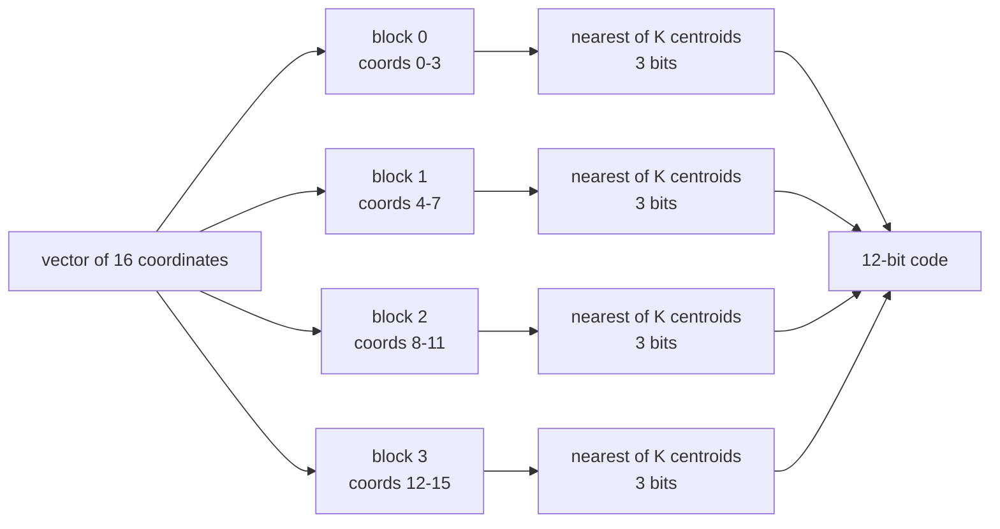
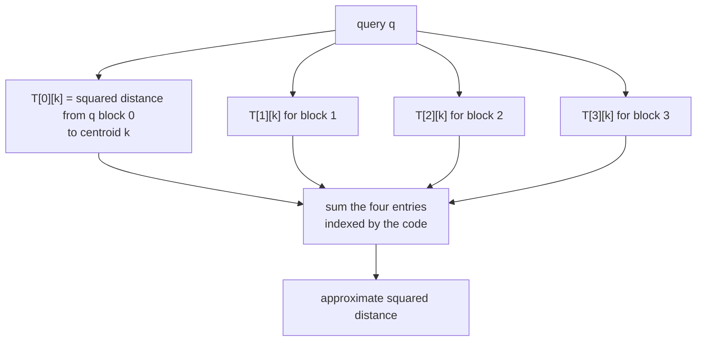
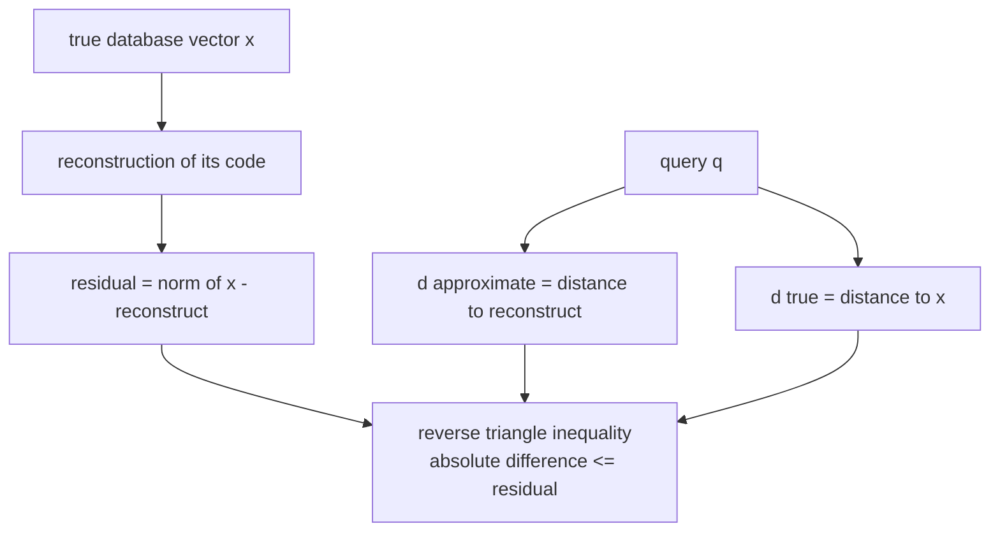
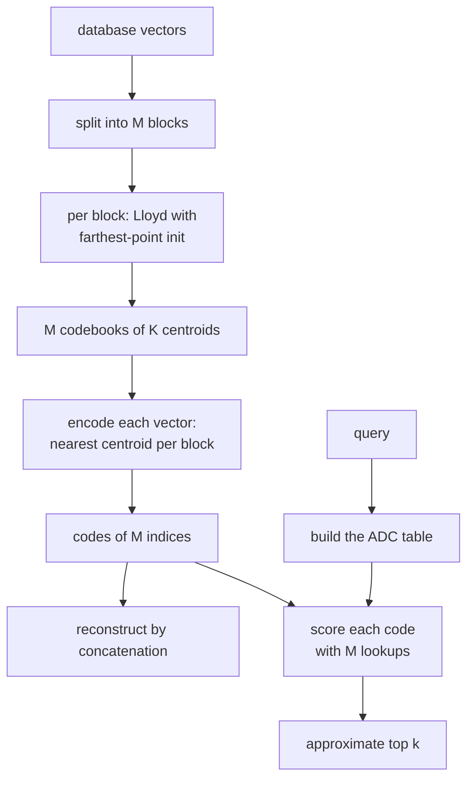

# 504 — Implement approximate nearest neighbor with product quantization outline.

> **Tier:** Advanced · **CTCI chapter:** Beyond — Advanced Data Structures & Algorithms
> **Task spec:** [504-implement-approximate-nearest-neighbor-with-product-quantization.md](../../../tasks/advanced/504-implement-approximate-nearest-neighbor-with-product-quantization.md)
> **Solutions:** [Python](../../../solutions/python/advanced/504-implement-approximate-nearest-neighbor-with-product-quantization/solution.py) ·
> [Java](../../../solutions/java/advanced/504-implement-approximate-nearest-neighbor-with-product-quantization/Solution.java) ·
> [JavaScript](../../../solutions/javascript/advanced/504-implement-approximate-nearest-neighbor-with-product-quantization/solution.js) ·
> [C#](../../../solutions/csharp/advanced/504-implement-approximate-nearest-neighbor-with-product-quantization/Solution.cs)

## 1. Problem restatement

**Input:** a database of dense vectors — `DIM = 16` coordinates, `120` points for the main set, small
integers from the shared `75/74` LCG (seed `41`) — plus a **codebook size** `K` per subspace and a
query with `top_k`.

**Output:** the encoded database, a reconstruction per code, and an approximate `top_k` list. The
documented pipeline:

- **Split** the space into `M = 4` disjoint subspaces of `dsub = 4` coordinates each.
- **Train** one codebook per subspace: `K` centroids from Lloyd's algorithm with deterministic
  **farthest-point initialisation** (first centroid = point `0`, each next centroid = the point with
  the largest minimum distance to the centroids already chosen), assign/recompute until the
  assignments stop changing or the distortion improves by less than `1e-12`, capped at `60` rounds.
  An empty cluster keeps its previous centroid.
- **Encode** a vector as `M` centroid indices — `M · log2 K` bits, `12` bits for `K = 8`.
- **Reconstruct** by concatenating the chosen centroids.
- **Search** with **asymmetric distance computation** (ADC): build the table
  `T[m][k] = ‖q_m − c_{m,k}‖²` once for the query, after which the approximate squared distance of
  any code is `Σ_m T[m][code[m]]` — `M` table lookups instead of `DIM` subtractions.

The task asks for an *outline*; the shipped code is a working, deliberately simplified version —
dense arrays, standard library only, and a full scan of the codes (no inverted lists, no IVF
clustering, no re-ranking of the ADC candidates).

Measured checks, all asserted:

| Check | Value |
| --- | --- |
| 1-D special case against the exact DP optimum | `k = 1`: `173.192250`; `k = 2`: `23.092083`; `k = 3`: `0.081667`; `k = 10`: `0.0` — Lloyd equals the DP optimum every time |
| well-separated 1-D data, `k = 2` | distortion `5940.0`, equal to DP; round history `[5940.0, 5940.0]` (non-increasing) |
| five identical points, `k = 1` | distortion `0` |
| ADC identity | code `[0, 0, 0, 0]` for `data[0]` at `K = 8`: `Σ T[m][code[m]] = 624.1708934380335 = ‖q − reconstruct(code)‖²` |
| reverse triangle inequality | `abs(d_approx − d_true) <= ‖x − reconstruct(x)‖ = 24.983412365768483` for every database point |
| reconstruction error as `K` grows | `650.794630` (`K = 1`), `586.518363` (`K = 2`), `490.501091` (`K = 4`), `378.760079` (`K = 8`), `292.200692` (`K = 16`) |
| storage | `12` bits per code at `K = 8` against `16 · 64 = 1024` bits raw — about ninety times smaller |
| retrieval quality | every query returns a top-1 from its own blob, recall@10 `>= 0.5` and strictly better at `K = 32` than at `K = 8` |
| determinism | two training runs produce identical codebooks |

## 2. Intuition

Exact nearest neighbour compares a query against every database vector, `O(n · D)` floating-point
operations and `n · D` floats of storage. Product quantisation attacks both: it **compresses the
storage** by replacing each vector with a few centroid indices, and it **compresses the comparison**
by precomputing the query's distances to those centroids.

The construction is Cartesian: split the `D` coordinates into `M` blocks and quantise each block
independently with its own small codebook. With `K` centroids per block the code has `M · log2 K`
bits, and the number of distinct reconstructions is `K^M` — a product of `K` choices per block rather
than `K^M` stored centroids.



The distance estimate then factorises. Because the blocks are disjoint coordinate sets, the squared
Euclidean distance is a **sum over blocks**, so a single table of block distances answers every code:



Building the table costs `M · K · dsub` distance computations — `4 · 8 · 4 = 128` for `K = 8` — and
after that each of the `n` codes costs `M = 4` lookups and adds. The classic framing is that the
table turns `n · D` multiplications into `n · M` additions.

The price is quantisation error and the **reverse triangle inequality**, which is what makes the
answers trustworthy: the ADC distance is `‖q − reconstruct(code)‖²`, and since `reconstruct(code)`
differs from the true vector by a bounded amount, the true distance and the estimate cannot drift
apart by more than that reconstruction residual.



## 3. Algorithm

1. `pq_train(vectors, K, M, dsub)`: for each block `m`, take `block(v) = v[m·dsub .. m·dsub+dsub)` of
   every vector and run `kmeans` on those `dsub`-dimensional points; collect `M` codebooks.
2. `kmeans(points, K)`: farthest-point init, then repeat up to `60` rounds — assign every point to
   its nearest centroid (ties to the lowest index), recompute each centroid as the mean of its
   members (empty cluster keeps the old centroid), recompute the distortion, assert it did not
   increase, and stop when nothing changed or the improvement is `<= 1e-12`.
3. `pq_encode(codebooks, vector)`: for each block, the index of the nearest centroid.
4. `pq_reconstruct(codebooks, code)`: concatenate `codebooks[m][code[m]]` over `m`.
5. `pq_tables(codebooks, query)`: `T[m][k] = sqdist(block(query, m), codebooks[m][k])`.
6. `pq_adc(tables, code) = Σ_m tables[m][code[m]]`.
7. `pq_search(...)`: build the table once, score every code, sort ascending, return the top `k`
   alongside the exact brute-force top `k` for comparison.

```text
procedure pq_encode(codebooks, vector)
    code ← empty
    for m ← 0 to length(codebooks) - 1 do
        block ← coordinates m · dsub to m · dsub + dsub - 1 of vector
        best ← 0
        best_distance ← infinity
        for c ← 0 to length(codebooks[m]) - 1 do
            d ← sqdist(block, codebooks[m][c])
            if d &lt; best_distance then
                best ← c
                best_distance ← d
            end
        end
        append best to code
    end
    return code
end
```

```text
procedure pq_tables(codebooks, query)
    tables ← empty
    for m ← 0 to length(codebooks) - 1 do
        block ← coordinates m · dsub to m · dsub + dsub - 1 of query
        tables[m] ← [ sqdist(block, c) for c in codebooks[m] ]
    end
    return tables
end

procedure pq_adc(tables, code)
    total ← 0
    for m ← 0 to length(code) - 1 do
        total ← total + tables[m][code[m]]
    end
    return total
end
```

```text
procedure pq_search(codebooks, codes, query, top_k)
    tables ← pq_tables(codebooks, query)
    scored ← [ (pq_adc(tables, code), index) for each code ]
    sort scored ascending
    return the first top_k entries
end
```

Farthest-point initialisation inside `kmeans` is what keeps the codebook deterministic: the first
centroid is `points[0]` and every subsequent one is the point maximising the minimum distance to the
current centroids, so no randomness enters training.



## 4. Worked example

**The 1-D oracle.** Product quantisation's training step is Lloyd's algorithm, so the file checks it
against the exact optimum on 1-D data, where the optimal clusters are contiguous intervals and a
dynamic program over `dp[t][j]` computes the true minimum:

| `k` | Lloyd distortion | DP optimum |
| --- | --- | --- |
| 1 | `173.192250` | `173.192250` |
| 2 | `23.092083` | `23.092083` |
| 3 | `0.081667` | `0.081667` |
| 10 | `0.000000` | `0.000000` |

With `values = [0.1, 0.2, 0.25, 4.0, 4.2, 4.1, 9.9, 10.0, 10.2, 10.1]` the three planted groups are
`{0.1, 0.2, 0.25}`, `{4.0, 4.1, 4.2}` and `{9.9, 10.0, 10.1, 10.2}`, and the farthest-point start
finds exactly them: the first centroid is `0.1`, the farthest point from it is `9.9`, and the
farthest from both is `4.0`. On the well-separated set (`0, 6, …, 54` plus `200, 206, …, 254`) the
distortion is `5940.0`, again equal to the DP optimum, with the round history `[5940.0, 5940.0]`
showing the descent property — Lloyd never increases the distortion.

**The ADC identity.** Train on `120` vectors of `16` dimensions with `K = 8` and `M = 4`:

| Step | Result |
| --- | --- |
| codebooks | `4` codebooks of `8` centroids, each centroid `4`-dimensional |
| code of `data[0]` | `[0, 0, 0, 0]` |
| `Σ T[m][code[m]]` for query `data[0]` | `624.1708934380335` |
| `‖q − reconstruct(code)‖²` | `624.1708934380335` |
| reconstruction residual | `24.983412365768483` |

The all-zero code is not a coincidence: farthest-point initialisation starts each block's codebook at
`data[0]`'s block, so the first database vector always encodes to zeros. The ADC value agrees with
the exact squared distance to the reconstruction to `1e-9` — that identity is what the whole search
rests on. The residual `24.98` bounds the search error from above by the reverse triangle
inequality: `abs(d_approx − d_true) <= 24.98` for every point, which the file checks for all `120`.

**More centroids, less error.** Re-training with growing `K` on the same data set:

| `K` | Bits per code | Reconstruction error `‖x − reconstruct(x)‖` |
| --- | --- | --- |
| 1 | `0` | `650.794630` |
| 2 | `4` | `586.518363` |
| 4 | `8` | `490.501091` |
| 8 | `12` | `378.760079` |
| 16 | `16` | `292.200692` |

Strictly decreasing, and every step costs one more bit per block. At `K = 8` the code is `12` bits
against `1024` bits for the raw `16` doubles — a factor of about `85`. The error does not vanish at
`K = 16` because the codebooks are shared by all `120` points, exactly the trade-off the outline is
about: a million distinct reconstructions (`K^M = 8⁴ = 4096` at `K = 8`, `65536` at `K = 16`) cannot
represent `120` arbitrary vectors exactly.
**Retrieval quality.** On five well-separated blobs the approximate top-1 is always from the query's
own blob, but it is the *exact* point only about a quarter of the time: with `K = 8` the whole blob
can share one code, so many database vectors are indistinguishable to the index. Recall@10 against
the exact brute-force list is asserted to be at least `0.5` and to improve strictly from `K = 8` to
`K = 32`. That is the honest summary of PQ: it gets the neighbourhood right and mixes up points
inside it, which is acceptable when the next stage re-ranks a handful of candidates.

## 5. Complexity

Let `n` be the database size, `D` the dimension, `M` the number of subspaces, `dsub = D / M`, `K` the
codebook size, `R` the Lloyd rounds, and `c` the candidate count.

| Measure | Bound | Why it holds |
| --- | --- | --- |
| Training | `O(M · n · K · dsub · R)` | each subspace runs Lloyd over all `n` blocks |
| Encoding | `O(n · M · K · dsub)` | nearest-centroid search per block |
| Storage | `O(n · M · log2 K)` bits, plus `O(M · K · dsub)` floats | measured `12` bits versus `1024` raw |
| Table build | `O(M · K · dsub)` per query | `128` squared distances at `K = 8` |
| Scoring one code | `O(M)` lookup-and-add | `4` additions, no multiplications |
| Full scan search | `O(n · M)` per query | `480` additions for `n = 120` |
| Brute-force exact search | `O(n · D)` per query | `1920` subtractions *and* multiplications |
| Reconstruction | `O(M · dsub) = O(D)` | concatenation of the chosen centroids |
| 1-D oracle | `O(k · n²)` | the DP over all interval splits |

Two honest caveats about those bounds. The full scan is still linear in `n` — PQ accelerates the
*per-comparison* cost and the storage, and only an inverted-file structure on top of the codes makes
the scan sublinear. And the DP oracle is quadratic in `n`, which is why it is only usable in one
dimension as a correctness check.

## 6. Pitfalls and edge cases

- **Empty clusters keep their centroid.** In `kmeans`, a cluster that loses all members retains its
  old position — otherwise the code `K` shrinks and the bit budget changes silently.
- **`K` cannot exceed the point count**, and `K = 1` is legal but useless: it replaces each block by
  its mean and produces the `650.79` error with zero bits.
- **Distortion is non-increasing, not strictly decreasing.** Lloyd's two half-steps each never
  increase the objective; the loop stops on assignment stability or an improvement below `1e-12`,
  and the assertion is `new_distortion <= distortion + 1e-9`.
- **`dsub` must divide `D`.** `M = 4`, `D = 16` gives `dsub = 4`; a ragged split would break the
  block-distance factorisation that makes the table valid.
- **Sharing codes loses identity.** With `K = 8` many points in one dense blob can share a single
  `12`-bit code, which is why top-1 returns the right blob but often the wrong point. Increasing `K`
  fixes the resolution at one bit per block per doubling.
- **The bits claim needs both sides.** `M · log2 K` is compared against `D · 64` because the raw
  vectors are stored as doubles; comparing against `D · 32` would change the ratio by a factor of two.
- **Recall needs the right `top_k`.** Recall@10 is measured against the exact top-10; comparing an
  approximate list of length 10 against an exact list of length 1 would make the metric meaningless.

## 7. Variants and follow-ups

- **Inverted file (IVF) on top of the codes.** Assign database vectors to a coarse quantiser first
  and probe only the nearest few cells; that is the change from `O(n · M)` to sublinear per query,
  left out of this outline deliberately.
- **Optimised PQ (OPQ).** Learn a rotation of the space before splitting it, so that energy is spread
  more evenly across blocks; the split in section 3 is axis-aligned and often uneven.
- **Re-ranking candidates.** The quarter-accurate exact-match rate is why real systems keep the
  original vectors for the `c` ADC candidates and re-score them exactly — the same two-stage pattern
  as [503-implement-locality-sensitive-hashing-for-cosine-similarity-simha.md](../../../tasks/advanced/503-implement-locality-sensitive-hashing-for-cosine-similarity-simha.md).
- **Quantising for storage only.** [501-implement-pca-via-power-iteration-for-largest-eigenvector.md](../../../tasks/advanced/501-implement-pca-via-power-iteration-for-largest-eigenvector.md)
  and [502-implement-randomized-svd-basic-using-power-method.md](../../../tasks/advanced/502-implement-randomized-svd-basic-using-power-method.md)
  reduce the *dimension* before quantising, which composes with PQ; the two together are the usual
  recipe for very large indexes.
- **Approximate nearest neighbours by hashing.** SimHash answers "which vectors have small angle to
  the query" with `256` bits and no codebook training at all — cheaper to build, worse distance
  estimates. Compare the two on the same corpus if you need to choose.
- **The clustering it depends on.** [498-implement-k-means-clustering-kmeans-initialization.md](../../../tasks/advanced/498-implement-k-means-clustering-kmeans-initialization.md)
  is the full k-means with k-means++ seeding; PQ reuses the far simpler farthest-point variant per
  small block.

## 8. Check yourself

1. Why does ADC avoid computing distances to the original database vectors?

<details><summary>Show answer</summary>

Because the squared distance decomposes over disjoint blocks:
`‖q − x̂‖² = Σ_m ‖q_m − c_{m,code[m]}‖²`, and each term depends only on the query's block and one
centroid. The table `T[m][k]` precomputes every term, so scoring a code is `M` lookups — measured:
`624.1708934380335` from four table entries, matching the exact distance to the reconstruction to
`1e-9`.

</details>

2. What does the `24.983412365768483` residual buy you?

<details><summary>Show answer</summary>

A bound on the search error. `reconstruct(code)` is a fixed point in space, so for any query
`abs(‖q − x̂‖ − ‖q − x‖) <= ‖x − x̂‖` — the reconstruction residual. The file asserts exactly this
for all `120` database points and three queries, which is what makes an ADC ranking defensible rather
than merely fast.

</details>

3. Why does the reconstruction error not go to zero as `K` grows here?

<details><summary>Show answer</summary>

Because `K = 16` gives at most `16⁴ = 65536` distinct reconstructions for `120` vectors in a
16-dimensional space, and the four block codebooks are trained independently on a random cloud.
Uniform random integer data has no cluster structure to exploit, so the error falls steadily
(`650.79 → 586.52 → 490.50 → 378.76 → 292.20`) without reaching zero.

</details>