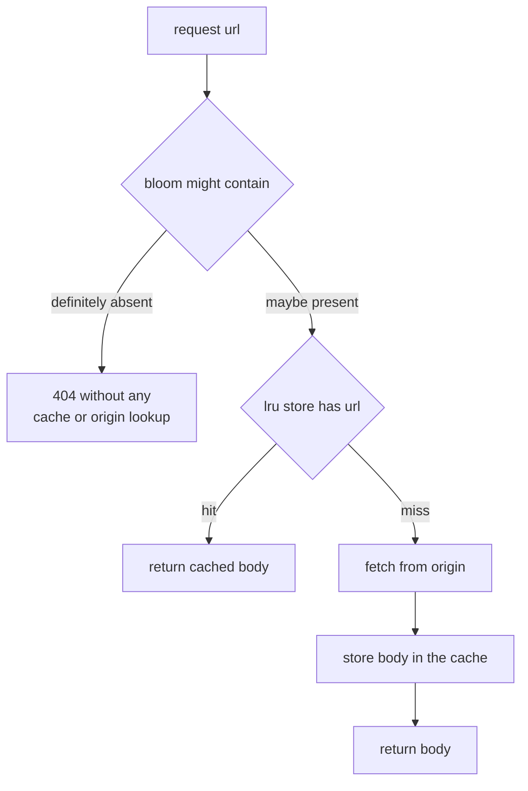
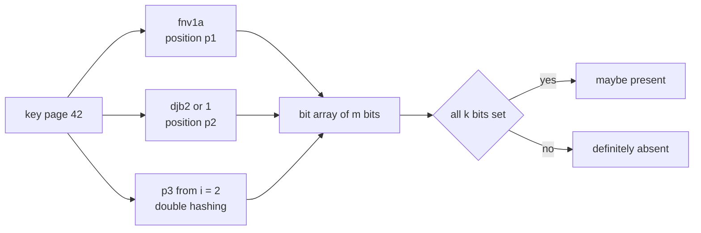
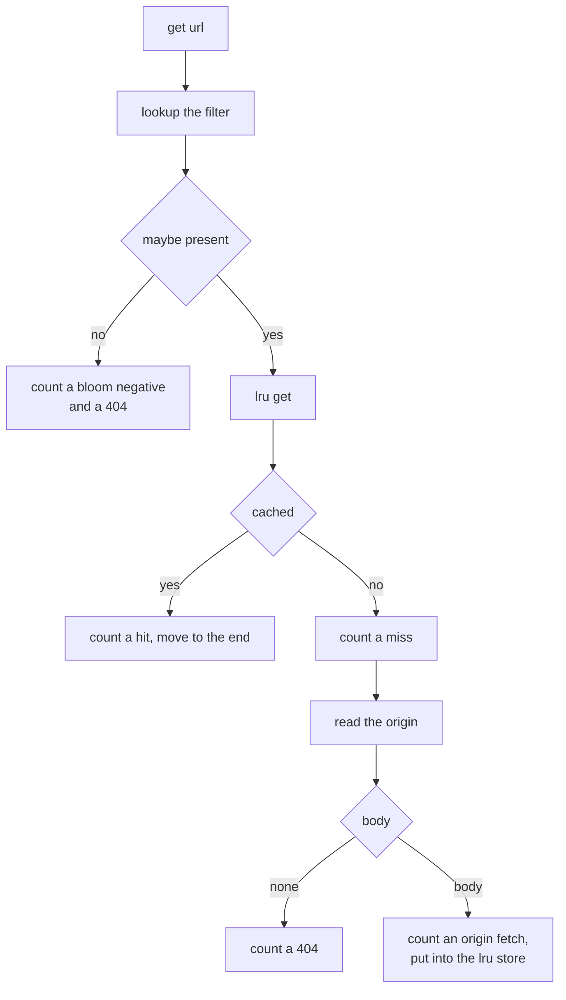
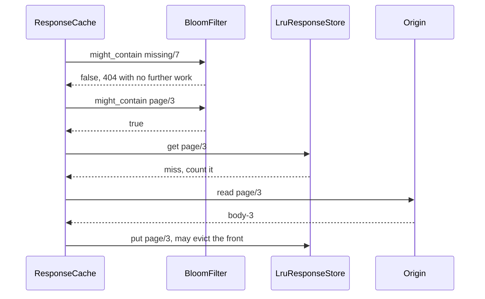

# 505 — Implement bloom-filter-backed cache for web responses simulation.

> **Tier:** Advanced · **CTCI chapter:** Ch 9 — System Design and Scalability
> **Task spec:** [505-implement-bloom-filter-backed-cache-for-web-responses-simulation.md](../../../tasks/advanced/505-implement-bloom-filter-backed-cache-for-web-responses-simulation.md)
> **Solutions:** [Python](../../../solutions/python/advanced/505-implement-bloom-filter-backed-cache-for-web-responses-simulation/solution.py) ·
> [Java](../../../solutions/java/advanced/505-implement-bloom-filter-backed-cache-for-web-responses-simulation/Solution.java) ·
> [JavaScript](../../../solutions/javascript/advanced/505-implement-bloom-filter-backed-cache-for-web-responses-simulation/solution.js) ·
> [C#](../../../solutions/csharp/advanced/505-implement-bloom-filter-backed-cache-for-web-responses-simulation/Solution.cs)

## 1. Problem restatement

**Input:** an origin holding web pages (the test uses `120` known URLs `page/0 … page/119` and `60`
URLs `missing/0 … missing/59` that were never published), a request stream of `1200` URLs (`30%` of
them for absent pages, LCG seed `271`), a response cache of `capacity = 32` and a negative filter of
`bits = 4096`, `hashes = 3`.

**Output:** a served body or a 404 per request, from a two-level design:

- **bottom layer** — `LruResponseStore`: a dictionary `url → body` plus an explicit recency list with
  the most recently used entry last; `get` moves a hit to the end, `put` evicts the front entry when
  the store is at capacity, and `hits`, `misses`, `evictions` are counted.
- **top layer** — `BloomFilter`: a bit array of `m` bits written by `k` positions from double hashing
  `h_i(key) = (fnv1a(key) + i · djb2(key) + i²) mod m`, with `djb2(key) | 1` so the second hash is
  odd. It answers "definitely absent" or "maybe present".
- **`ResponseCache.get(url)`** — ask the filter first. A negative answer returns 404 **without
  touching the cache or the origin**; anything else checks the LRU store, and on a miss fetches from
  the origin, populates the cache and returns the body.

Measured on the shipped code:

| Quantity | Value |
| --- | --- |
| `size_for(0.01, 2000)` | `m = 19171` bits, `k = 7` hashes |
| textbook rate `(1 − e^{−kn/m})^k` | `0.01004` (asserted `<= 0.012`) |
| false negatives over the `2000` inserted keys | `0` |
| measured false-positive rate over `2000` absent keys | `0.01450` (within `0.03` of theory) |
| bits set / distinct positions (consistency) | `9999` / `9999` |
| `m / n` and `(m/n) ln 2` | `9.5855` and `6.644` → best `k = 7` |
| measured rate at the doubled `k = 14` | `0.03850` — `2.66×` the rate at `k = 7` |
| `1200`-request run | `396` hits, `461` misses, `429` evictions |
| origin fetches | `461` — exactly one per cache miss |
| Bloom negatives / 404s | `343` / `343`, all answered without a cache lookup |
| filter lookups | `1200` — one per request, no more |
| trace versus an independent `OrderedDict` LRU model | identical, event for event |

## 2. Intuition

A cache miss is expensive whether or not the object exists: the request has to reach the origin, and
the origin then has to admit that it has nothing. In the measured stream `343` of `1200` requests
(`30%`) are for URLs that were never published, so more than a quarter of the traffic can be
answered without any cache or origin work at all — *if* there were a cheap way to be sure that a URL
does not exist.

That is exactly what a Bloom filter promises asymmetrically: `might_contain` may say "maybe" for a
key that is absent (a false positive), but it can never say "absent" for a key that is present.
Because the negative path never has to be right about absence in the presence of real data, the
cache can trust it and skip work:



The cost of the safety property is false positives: a URL that does not exist can pass the filter,
and then the request pays the full cache-miss-plus-origin-miss path anyway. That is the price of the
`0.01450` measured rate at `m = 19171`, `k = 7` — and the rate is governed by the textbook formula,
which is why the test insists the measured value sits within `0.03` of
`(1 − e^{−kn/m})^k`.



`m` and `k` are not hand-picked: `size_for(p, n)` inverts the formula with
`m = ceil(−n ln p / (ln 2)²)` and `k = round((m / n) ln 2)`. For `p = 0.01` and `n = 2000` that is
`19171` and `7`, and the measured `k = 7` really is the minimum of the closed form over
`k = 1 … 20` (the continuous optimum would be `(m/n) ln 2 = 6.644`).

## 3. Algorithm

1. Size the filter from the target rate: `bits, hashes = size_for(target_rate, items)`.
2. `publish(url, body)`: store the body in the origin and `add` the URL to the filter. Everything the
   origin can serve must be in the filter — that is what rules out false negatives.
3. `add(key)`: compute the `k` positions, set the corresponding bits, record them in `set_positions`
   and increment `inserted`.
4. `might_contain(key)`: compute the same `k` positions; return `False` at the first clear bit,
   otherwise `True`.
5. `ResponseCache.get(url)`: increment `requests` and `filter_lookups`; on a filter negative count
   `bloom_negatives` and `not_found`, and return `None`; otherwise ask the LRU store.
6. On an LRU hit return the body. On a miss read the origin: if it has nothing, count `not_found` and
   return `None` (this is the false-positive path); otherwise count an `origin_fetch`, `put` the body
   in the cache and return it.

```text
procedure add(key)
    for pos in positions(key) do
        set bit pos of the bit array
        record pos in set_positions
    end
    inserted ← inserted + 1
end

procedure might_contain(key)
    for pos in positions(key) do
        if bit pos is clear then
            return false
        end
    end
    return true
end

procedure positions(key)
    h1 ← fnv1a(key)
    h2 ← djb2(key) OR 1
    return [ (h1 + i * h2 + i * i) mod bits for i in 0 .. hashes - 1 ]
end
```

```text
procedure cache_get(url)
    requests ← requests + 1
    filter_lookups ← filter_lookups + 1
    if not filter.might_contain(url) then
        bloom_negatives ← bloom_negatives + 1
        not_found ← not_found + 1
        return none
    end
    cached ← store.get(url)                 // counts a hit or a miss and moves the key
    if cached is not none then
        return cached
    end
    body ← origin.get(url)
    if body is none then
        not_found ← not_found + 1           // bloom false positive: the origin decides
        return none
    end
    origin_fetches ← origin_fetches + 1
    store.put(url, body)
    return body
end
```



The LRU layer is deliberately simple: a dictionary plus a list, with the most recently used key at
the end. That makes the model easy to reimplement independently — which the test does, with
`collections.OrderedDict`, and requires the two event sequences to match exactly.

## 4. Worked example

**Filter fundamentals.** Insert `2000` keys into a filter sized for a `1%` target:

| Quantity | Measured |
| --- | --- |
| bit array / hashes | `19171` bits (`m / n = 9.5855`), `k = 7` |
| false negatives over the inserted keys | `0` |
| bits set | `9999`, equal to the number of distinct positions |
| false positives over `2000` absent keys | `29`, i.e. `0.01450` |
| textbook rate | `0.01004` |
| rate with `k` doubled to `14` | `0.03850`, a factor `2.66` worse |

The last row is the sanity check on `k` itself: the closed form is minimised at `k = 7` among
`k = 1 … 20`, and moving away from the optimum *hurts measurably* rather than being a free
trade-off.

**The request stream.** `1200` requests, `32`-entry cache, `4096`-bit filter with `3` hashes:

| Counter | Value | Reading |
| --- | --- | --- |
| requests | `1200` | one filter lookup each |
| unknown URLs in the stream | `343` | all answered by the filter |
| bloom negatives | `343` | no cache lookup, no origin fetch |
| hits | `396` | served from the LRU store |
| misses | `461` | `396 + 461 = 857` known-URL requests |
| origin fetches | `461` | exactly one per miss |
| evictions | `429` | capacity `32` against `120` known pages |
| 404s | `343` | `bloom_negatives == not_found` |

Every 404 in the run came from the filter, which is asserted for each request individually, and the
`hits + misses == requests − bloom_negatives` identity closes the books. The interesting number is
the `343` work-free answers: without the filter each of them would have been an LRU miss followed by
a fruitless origin read.



Note what a false positive looks like in the same trace: the filter says `true`, the LRU store says
miss, the origin says nothing, and the request is counted as a `not_found`. The result is still
correct — the filter is allowed to be pessimistic, never optimistic.

## 5. Complexity

Let `m` be the filter bits, `k` the hash count, `n` the number of published URLs and `C` the cache
capacity.

| Measure | Bound | Why it holds |
| --- | --- | --- |
| `add` | `O(k)` | `k` positions, each a hash plus a bit write |
| `might_contain` | `O(k)` | same positions, one bit test each |
| `size_for` | `O(1)` | closed-form arithmetic in `m` and `k` |
| LRU hit | `O(1)` dictionary plus `O(C)` list move | the shipped store keeps an explicit Python list, so the recency update is linear in the capacity |
| LRU insert | `O(1)` average, `O(C)` on the list | `put` appends and pops the front |
| Per request, negative path | `O(k)` | no cache or origin access at all |
| Space | `O(m/8 + C + n)` | bit array, cache entries, origin bodies |

The honest reading of the LRU column: the *policy* is constant-time, but this implementation pays
`O(C)` per hit because it removes a key from a plain list. With `C = 32` that is invisible; a
production cache uses a doubly linked list (or `OrderedDict.move_to_end`) to get `O(1)`.

## 6. Pitfalls and edge cases

- **No false negatives, ever.** The filter may be pessimistic but not optimistic: if a published URL
  were missing from the filter, a real page would be answered with a 404 and never reach the cache.
  The `2000`-key sweep asserting `might_contain == True` for every inserted key is the guard.
- **False positives must fall through.** When the filter says "maybe", the origin decides. Skipping
  that fall-through would answer existing pages with 404s.
- **Population order.** `publish` writes the origin *and* the filter; adding only to the cache on a
  fetch would leave later requests unprotected, and adding to the filter without a body would create
  phantom pages.
- **Nothing can be deleted from a Bloom filter.** Un-publishing a page cannot be reflected, so an
  expired URL still passes the filter and pays the origin round-trip. Counting Bloom filters or
  cuckoo filters are the usual fixes.
- **`k` around the optimum, not far from it.** Measured: doubling `k` to `14` raised the
  false-positive rate from `0.01450` to `0.03850`. The formula, not intuition, sets `k`.
- **Sizing is a target, not a guarantee.** `size_for(0.01, 2000)` produced a *theoretical* rate of
  `0.01004` and a *measured* `0.01450`; the assertion tolerance is `0.03`, so quote the measured
  number or the formula, never a "1% filter" as if it were exact.
- **Bit-level bookkeeping.** `bits_set()` recomputes the popcount from the byte array and compares it
  with the size of `set_positions`; the two match at `9999`, which is how a bit-index bug is caught.
- **Cache lookup versus body truth.** The store returns `None` for a miss, so a legitimately empty
  body would be indistinguishable from a miss if bodies could be empty; this simulation always
  publishes a non-empty `body-<i>`.
- **Eviction accounting.** `429` evictions for `32` slots over `120` pages is expected; an
  implementation that evicts on `len(data) > capacity` *after* insertion and one that evicts before
  must agree on which key leaves, or the independent `OrderedDict` model diverges.
- **Recency order on hits.** A hit must move the key to the end, otherwise the eviction order changes
  and the trace comparison fails; the test asserts the just-touched key is last and that the recency
  list is a permutation of the stored keys.
- **Identical hashes for short keys.** `djb2(key) | 1` guarantees an odd second hash, so consecutive
  double-hash positions cannot collapse to a single bit for short keys.
- **Capacity smaller than the working set.** `capacity = 32` against `120` pages means the cache is
  mostly a miss machine; the filter, not the cache, is what saves the 404 traffic here.

## 7. Variants and follow-ups

- **Bloom filters in storage engines.** [482-implement-bloom-filter-per-sstable-prototype-and-test.md](../../../tasks/advanced/482-implement-bloom-filter-per-sstable-prototype-and-test.md)
  uses one filter per SSTable to skip files that cannot contain a key — the same negative-lookup idea
  with a different consumer.
- **Other sketches for other questions.** Cardinality and frequency estimation trade exactness for
  space in the same way:
  [466-implement-hyperloglog-sketch-for-cardinality-estimation-outline.md](../../../tasks/advanced/466-implement-hyperloglog-sketch-for-cardinality-estimation-outline.md)
  and [465-implement-count-min-sketch-for-frequency-estimation.md](../../../tasks/advanced/465-implement-count-min-sketch-for-frequency-estimation.md).
- **Deletable members.** Counting Bloom filters replace each bit with a small counter and support
  removal; cuckoo filters store fingerprints with relocation, giving deletion and better locality.
- **Cheaper negative lookups at the edge.** [503-implement-locality-sensitive-hashing-for-cosine-similarity-simha.md](../../../tasks/advanced/503-implement-locality-sensitive-hashing-for-cosine-similarity-simha.md)
  is the similarity-preserving counterpart: it answers "is anything *like* this here" rather than
  "does this exist".
- **Protecting the origin from load rather than from misses.** [506-implement-rate-limited-queue-with-leaky-bucket-test-harness.md](../../../tasks/advanced/506-implement-rate-limited-queue-with-leaky-bucket-test-harness.md)
  and [507-implement-throttling-middleware-simulation-sliding-window-counte.md](../../../tasks/advanced/507-implement-throttling-middleware-simulation-sliding-window-counte.md)
  sit in front of the same origin and bound the request rate instead of the request cost.
- **Correctness under partial failure.** Checkpoint-and-restart semantics
  ([481-implement-optimistic-checkpointing-restart-simulation.md](../../../tasks/advanced/481-implement-optimistic-checkpointing-restart-simulation.md))
  is the storage-side analogue of "the origin decides when the filter is unsure".

## 8. Check yourself

1. Why can the cache skip its own lookup when the filter says "absent"?

<details><summary>Show answer</summary>

Because a Bloom filter has no false negatives. If the URL had ever been published, all `k` of its
bits would still be set and `might_contain` would have to return `True`. So a `False` answer means
the key was never inserted, and neither the cache nor the origin can have it — the 404 is final.
The run confirms it: `bloom_negatives == not_found == 343`, and no real page was ever answered
negatively.

</details>

2. What does the `0.01450` measured false-positive rate cost, and to whom?

<details><summary>Show answer</summary>

It costs the origin and the cache a wasted lookup. A false positive sends the request down the normal
path (cache miss, origin miss, `not_found`), so correctness is untouched and only work is repeated.
With `2000` absent keys the measured `29` false positives are `29` avoidable round-trips, against
`1971` requests that were answered by the filter for the price of `k = 7` bit tests.

</details>

3. `size_for` is told a target of `1%`, yet the measured rate is `1.45%`. Is the sizing broken?

<details><summary>Show answer</summary>

No. `size_for` solves for `m` and `k` so that the *expected* rate is about `p`; the realised rate
depends on the actual hash positions and the actual key set, which is why the test asserts
`|measured − theory| <= 0.03` rather than equality. Here theory is `0.01004` and the measured value
`0.01450` — inside the tolerance.

</details>