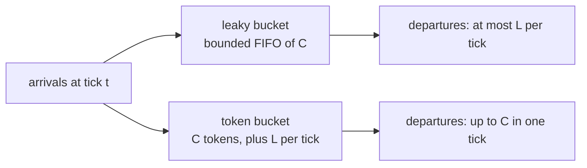
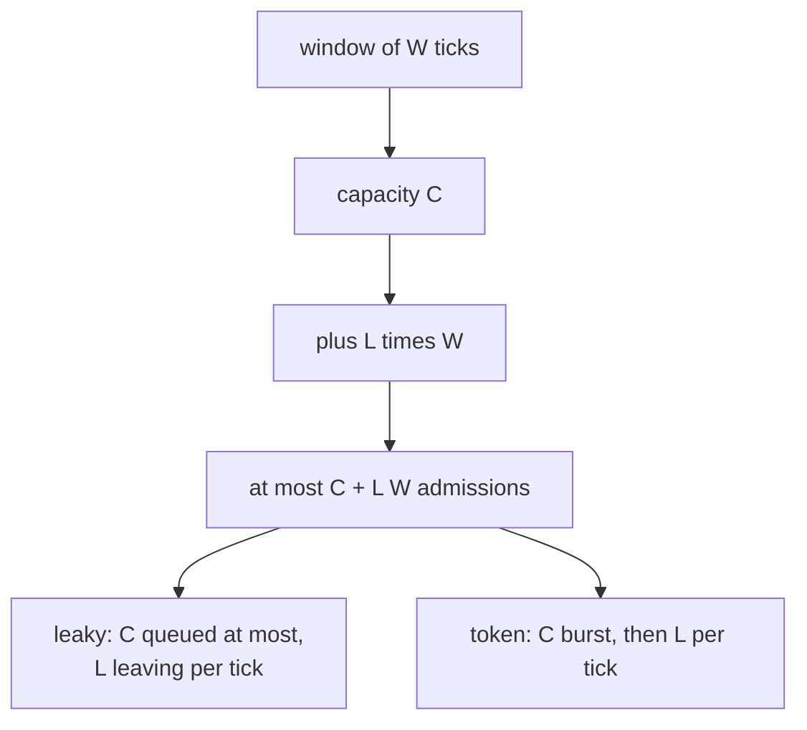
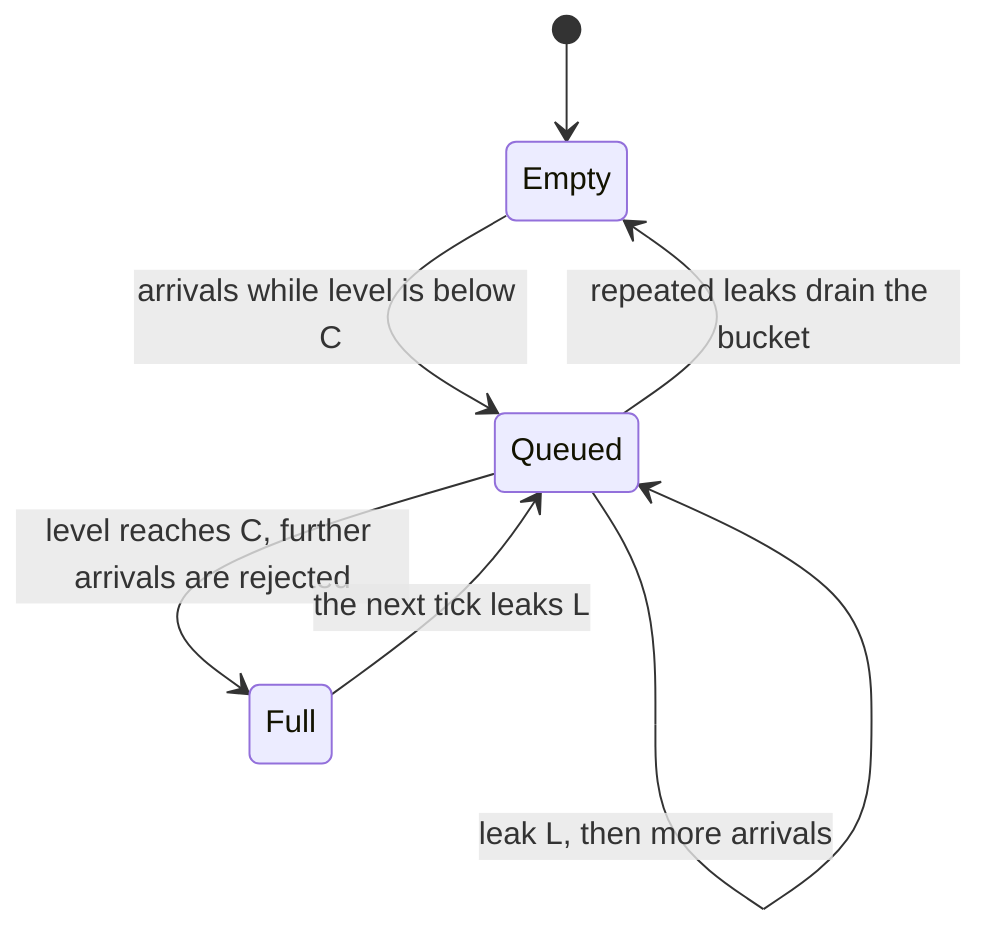
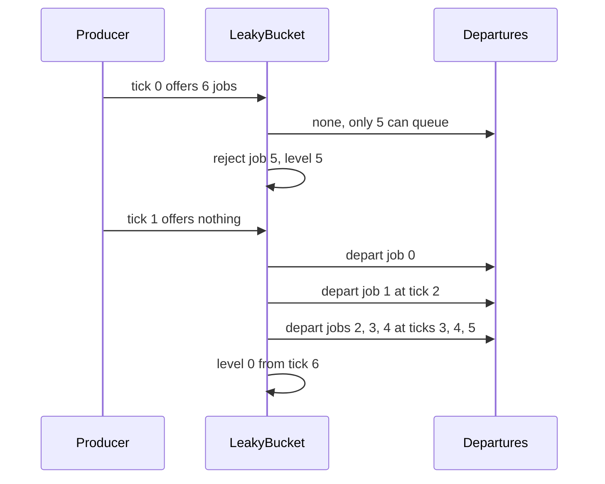

# 506 — Implement rate-limited queue with leaky-bucket test harness.

> **Tier:** Advanced · **CTCI chapter:** Ch 9 — System Design and Scalability
> **Task spec:** [506-implement-rate-limited-queue-with-leaky-bucket-test-harness.md](../../../tasks/advanced/506-implement-rate-limited-queue-with-leaky-bucket-test-harness.md)
> **Solutions:** [Python](../../../solutions/python/advanced/506-implement-rate-limited-queue-with-leaky-bucket-test-harness/solution.py) ·
> [Java](../../../solutions/java/advanced/506-implement-rate-limited-queue-with-leaky-bucket-test-harness/Solution.java) ·
> [JavaScript](../../../solutions/javascript/advanced/506-implement-rate-limited-queue-with-leaky-bucket-test-harness/solution.js) ·
> [C#](../../../solutions/csharp/advanced/506-implement-rate-limited-queue-with-leaky-bucket-test-harness/Solution.cs)

## 1. Problem restatement

**Input:** two parameters — `capacity C` and a per-tick rate `L` — plus an arrival pattern, i.e. a
list of jobs offered at each tick of a discrete virtual clock.

**Output:** two classic limiters and the harness that drives them:

- **`LeakyBucketQueue(C, L)`** — a bounded FIFO. Every tick first **leaks** up to `L` jobs from the
  front (those depart at that tick), then offers the arrivals: a job is accepted when the queue is
  below capacity and **dropped** otherwise. A job accepted at tick `t` with `p` jobs ahead of it
  departs at the closed-form time `departure_tick(t, p) = t + ceil((p + 1) / L)`.
- **`TokenBucket(C, L)`** — a token count refilled by `L` per tick up to `C`; an arrival consumes a
  token and departs **immediately**, otherwise it is rejected.

Both satisfy the same admission law: at most `C + L · W` jobs pass in any window of `W` ticks. The
difference is shape — the leaky bucket **smooths** (never more than `L` departures per tick, whatever
the burst), the token bucket **polices** (a burst of `C` may leave in a single tick).

Asserted and measured facts:

| Check | Value |
| --- | --- |
| hand schedule, `C = 5`, `L = 1`, 6 jobs offered at tick `0` | `[0,1,2,3,4]` accepted, job `5` rejected, `level == 5` |
| the next ticks | departures `[0]`, `[1]`, `[2]`, `[3]`, `[4]`, `[]`, `[]` at ticks `1 … 7` |
| queue state after that | `level == 0`, `departures == [(1,0),(2,1),(3,2),(4,3),(5,4)]` |
| `window_max` | `1` for `W = 1`, `5` for `W = 5`, `5` for `W = 20` |
| closed form, `L = 1` | `departure_tick(0, p) = 1, 2, 3, 4` — matches the trace |
| closed form, `L = 3`, 9 jobs | `[1,1,1,2,2,2,3,3,3]` — three departures per tick |
| backlogged producer, `C = 5`, `L = 1` over 31 ticks | every tick admits exactly `1` job, `level` pinned at `5`, `window_max(10) == 10` |
| LCG stream, 200 ticks, up to 4 arrivals, `C = 6`, `L = 2` | leaky `window_max`: `2`, `10`, `20` for `W = 1, 5, 10` against the law `8, 16, 26` |
| same stream, token bucket | `window_max`: `4`, `14`, `24` |
| conservation | accepted `+` rejected `== 391` jobs; departures `+` level `==` accepted |
| shape difference | token bucket `same_tick_burst == 4`; leaky bucket never exceeds `2` departures in a tick (`= L`) |

## 2. Intuition

Both limiters answer "how much traffic may leave per tick", but they place the queue in different
spots. The leaky bucket *holds* work: the bucket is a buffer that drains at a fixed rate, so an
arrival's departure time depends on how many jobs are already ahead of it. The token bucket *does
not hold* work: it holds permission, and an arrival either has a token (and leaves instantly) or is
rejected.



The consequence is worth stating precisely, because it is the whole reason both exist. With `C = 6`,
`L = 2` and a real arrival stream, the token bucket admitted `4` jobs in a single tick (its
`same_tick_burst`), while the leaky bucket never released more than `2` in a tick — its leak rate.
The token bucket therefore protects a downstream service only if that service tolerates bursts of
`C`; the leaky bucket protects it unconditionally.



The window law is the invariant both share, and it is stronger than it looks: it holds for *every*
window, not just aligned ones. The test brute-forces it by scanning every start tick of the
generated stream, which is why `window_max(W)` exists as a method on both classes.

## 3. Algorithm

`LeakyBucketQueue.step(arrivals)`:

1. Depart `min(leak, level)` jobs from the front; record `(now, job)` for each.
2. For each arrival in order: if `level < capacity`, record `(now, position)` in `accepted_at`, append
   the job and accept it; otherwise reject it.
3. `now += 1`; return `(accepted, departed)`.

`TokenBucket.step(arrivals)`:

1. If `now > 0`, `tokens = min(capacity, tokens + refill)`.
2. For each arrival: if `tokens >= 1`, consume a token, accept and record an immediate departure;
   otherwise reject.
3. Track the largest same-tick departure burst; `now += 1`; return the accepted jobs.

```text
procedure leaky_step(arrivals)
    departed ← pop up to leak jobs from the front of the queue
    record (now, job) for every departed job
    taken ← empty
    for job in arrivals do
        if length of queue &lt; capacity then
            accepted_at[job] ← (now, length of queue)
            append job to the queue
            append job to accepted
            append job to taken
        else
            append job to rejected
        end
    end
    now ← now + 1
    return taken, departed
end
```

```text
procedure token_step(arrivals)
    if now &gt; 0 then
        tokens ← min(capacity, tokens + refill)
    end
    taken ← empty
    for job in arrivals do
        if tokens &gt;= 1 then
            tokens ← tokens - 1
            append job to accepted
            record (now, job) as a departure
            append job to taken
        else
            append job to rejected
        end
    end
    same_tick_burst ← max(same_tick_burst, departures recorded at now)
    now ← now + 1
    return taken
end
```

```text
procedure departure_tick(accepted_tick, position)
    return accepted_tick + ceil((position + 1) / leak)
end

procedure window_max(window)
    return the largest number of departures in any half-open window of that many ticks
end
```

The order inside `leaky_step` is part of the contract: the leak happens **before** the offers, so a
job arriving at tick `t` cannot depart at tick `t` — the earliest possible departure is `t + 1`.



## 4. Worked example

**Hand schedule.** `LeakyBucketQueue(5, 1)` with six jobs offered at tick `0`:

| Tick | Level before leak | Leak | Departures | Arrivals offered | Accepted | Rejected | Level after |
| --- | --- | --- | --- | --- | --- | --- | --- |
| 0 | 0 | 0 | — | `0,1,2,3,4,5` | `0,1,2,3,4` | `5` | `5` |
| 1 | 5 | 1 | `0` | — | — | — | `4` |
| 2 | 4 | 1 | `1` | — | — | — | `3` |
| 3 | 3 | 1 | `2` | — | — | — | `2` |
| 4 | 2 | 1 | `3` | — | — | — | `1` |
| 5 | 1 | 1 | `4` | — | — | — | `0` |
| 6 | 0 | 0 | — | — | — | — | `0` |
| 7 | 0 | 0 | — | — | — | — | `0` |

The rejection is decided by `level < capacity`: five jobs fit, the sixth sees `level == 5` and is
dropped, and `accepted_at[4] == (0, 4)` records that job `4` was the fifth in line. `window_max(1)`
is `1` and `window_max(5)` is `5`, so the departures respect the leak rate and the capacity at the
same time.

**Closed form versus trace.** `departure_tick(t, p) = t + ceil((p + 1) / L)` reproduces the schedule:
positions `0 … 4` with `L = 1` give ticks `1, 2, 3, 4, 5`. With `L = 3` and nine jobs, positions
`0 … 8` give `ceil(1/3) = 1`, `ceil(2/3) = 1`, `ceil(3/3) = 1`, then `2, 2, 2`, then `3, 3, 3` —
measured departure ticks `[1,1,1,2,2,2,3,3,3]`, which is the shaping property in one line.

**Backlogged producer.** Offering one job per tick to `LeakyBucketQueue(5, 1)` for 31 ticks admits
exactly one job per tick (`set(accepted_sizes) == {1}`), with `30` departures and `level` pinned at
`1` after the initial fill — the closed form `C` at tick `0` then `L` per tick, from the other side.



**The two buckets side by side.** On a deterministic LCG stream of 200 ticks with up to `4`
arrivals per tick (`391` jobs, `C = 6`, `L = 2`):

| Window `W` | Law `C + L·W` | Leaky `window_max` | Token `window_max` |
| --- | --- | --- | --- |
| `1` | `8` | `2` | `4` |
| `5` | `16` | `10` | `14` |
| `10` | `26` | `20` | `24` |

Both stay inside the law; the token bucket always admits more, because its `C = 6` tokens can be
spent back to back (`same_tick_burst == 4` on this stream, bounded by `C`), whereas the leaky bucket
releases exactly `L = 2` per tick at most. Note also the bookkeeping identity on the same run:
`accepted + rejected == 391` and `departures + level == accepted`.

## 5. Complexity

Let `A` be the number of arrivals offered and `C`, `L` the bucket parameters.

| Measure | Bound | Why it holds |
| --- | --- | --- |
| Leaky tick | `O(L + A)` | up to `L` pops from the front plus one test per arrival |
| Token tick | `O(A)` | one refill plus one token check per arrival |
| Closed-form departure time | `O(1)` | integer arithmetic on the queue position |
| `window_max(W)` | `O(T²)` for `T` ticks | brute force over every window start, by design |
| Space | `O(C + A)` | the bounded queue, plus the accepted/rejected/departure logs |
| Compare with a queueing simulation | `O(A)` total | the whole run is one pass over the tick stream |

The `window_max` bound is deliberate: the harness is a checker, so it prefers `O(T²)` enumeration
over anything clever. It is the only expensive part of the file, and on 200 ticks it is trivial.

## 6. Pitfalls and edge cases

- **Leak before offers.** Moving the leak after the offers lets a job queued at tick `t` depart at
  tick `t`, which breaks the closed form and the `L = 1` schedule (`departures == [(1,0), …]`).
- **Drop, do not block.** Arrivals that do not fit are rejected and recorded; a blocking queue would
  change the meaning of "admitted" and break the `accepted + rejected == offered` conservation.
- **Full means `level == C`.** The test is `level < capacity`, so the bucket holds exactly `C` jobs
  and the sixth job of a six-job burst is rejected — not the seventh.
- **Order inside a tick is arrival order.** Jobs are appended in the offered order, which is what
  makes `accepted_at[job] == (now, position)` a usable oracle for the closed form.
- **`ceil`, not floor.** `departure_tick` rounds up: with `L = 3` the first three jobs all leave at
  tick `1`, so positions `0, 1, 2` must all give `1`.
- **Degenerate parameters.** `capacity <= 0`, `leak <= 0`, `refill <= 0` raise `ValueError`; a zero
  leak would never drain the bucket, and a zero capacity would reject everything.
- **Token bucket refills with the *capped* sum.** `tokens = min(capacity, tokens + refill)` — without
  the cap a long idle period would bank unlimited credit and permit an arbitrary burst.
- **Token bucket tick `0` has no refill.** The first tick starts with exactly `C` tokens
  (`if now > 0`), which is the documented `C` at tick `0` then `L` per tick behaviour.
- **Two admission notions.** The leaky bucket's `accepted` is "queued", the token bucket's is
  "admitted and already gone". Comparing their counters without that distinction mixes a queue depth
  with an immediate decision.
- **`same_tick_burst` is a maximum, not a count.** It records the worst tick seen so far, which is how
  the shaper-versus-policer difference is measured (`4` versus at most `L = 2`).
- **Window boundaries are half-open.** `window_max` counts `start <= tick < start + window`, so a
  window of `1` is a single tick and the `W = 1` readings are directly comparable to `L`.
- **Determinism.** The arrival stream comes from the `75/74` LCG (`count = seed % 5`, up to `4`
  arrivals), not from a language RNG, so every logged sequence is reproducible across the four
  solutions.

## 7. Variants and follow-ups

- **Sliding-window and counter limiters.** [507-implement-throttling-middleware-simulation-sliding-window-counte.md](../../../tasks/advanced/507-implement-throttling-middleware-simulation-sliding-window-counte.md)
  keeps the same window law but drops the queue entirely, trading exactness for `O(1)` state per key.
- **GCRA (the "virtual scheduling" formulation).** The leaky bucket expressed as a single
  theoretical-arrival-time variable; same admissions, no queue at all.
- **Retries behind the limiter.** A rejected job usually wants to be retried rather than dropped, which
  is where [508-implement-background-job-scheduler-with-retry-backoff-semantics.md](../../../tasks/advanced/508-implement-background-job-scheduler-with-retry-backoff-semantics.md)
  takes over — it schedules the next attempt with capped exponential backoff.
- **Admission control inside a bigger pipeline.** Jobs that pass the limiter still need ordering:
  [509-implement-dependency-graph-scheduling-topo-priorities.md](../../../tasks/advanced/509-implement-dependency-graph-scheduling-topo-priorities.md)
  and [510-implement-task-dag-executor-with-parallel-workers-respect-depend.md](../../../tasks/advanced/510-implement-task-dag-executor-with-parallel-workers-respect-depend.md).
- **Distributed rate limiting.** A single-process bucket becomes a shared counter (or a token lease)
  when several servers must respect one budget; the window law stays the same, the state does not.
- **Front-of-cache protection.** [505-implement-bloom-filter-backed-cache-for-web-responses-simulation.md](../../../tasks/advanced/505-implement-bloom-filter-backed-cache-for-web-responses-simulation.md)
  removes work from the origin by answering misses cheaply; a limiter removes work by refusing it.

## 8. Check yourself

1. Why does the sixth job in a six-job burst get rejected when `C = 5`?

<details><summary>Show answer</summary>

Because the arrival test is `level < capacity`. After the first five jobs the level is `5`, so the
sixth finds no space and is recorded in `rejected`. `accepted_at[4] == (0, 4)` records that the fifth
job was queued at position `4` — the last free slot.

</details>

2. Give the closed form for a job accepted at tick `t` with `p` jobs ahead of it.

<details><summary>Show answer</summary>

`t + ceil((p + 1) / L)`. The `+ 1` counts the job itself, because departures only start at the *next*
tick (the leak runs before arrivals). With `L = 1` and five jobs at tick `0` the positions `0 … 4`
leave at ticks `1 … 5`; with `L = 3` and nine jobs the ticks are `1, 1, 1, 2, 2, 2, 3, 3, 3`.

</details>

3. Both buckets obey `C + L·W`. What is the difference, then?

<details><summary>Show answer</summary>

Shape, not total budget. The token bucket may spend its whole capacity in one tick — measured
`same_tick_burst == 4` on the LCG stream — and then falls back to `L` per tick. The leaky bucket
*queues*, so it can never release more than `L` per tick; on the same stream its maximum was its leak
rate `2`. A shaper is required when the downstream service must never see a burst.

</details>

4. On the 200-tick stream the leaky bucket shows `window_max(10) == 20` while the law allows `26`.
   Does that mean the law is loose?

<details><summary>Show answer</summary>

The law is an upper bound that must hold for every stream, including a maximally adversarial one.
This stream offers at most `4` arrivals per tick, so the bucket never has enough queued work to
saturate the `C + L·W` budget. The bound is verified by the assertions; the measured values are what
this particular stream realises.

</details>

5. What does the `window_max(1) == 1` assertion in the hand schedule prove?

<details><summary>Show answer</summary>

That the leak rate is respected tick by tick: with `L = 1`, no tick may see two departures. Together
with `window_max(5) == 5` and `window_max(20) == 5` it also proves the `capacity` bound — the five
jobs cannot all leave early, and five is the most that ever existed. The pair of numbers is what
distinguishes "shaped" from "policed" in the tests.

</details>
