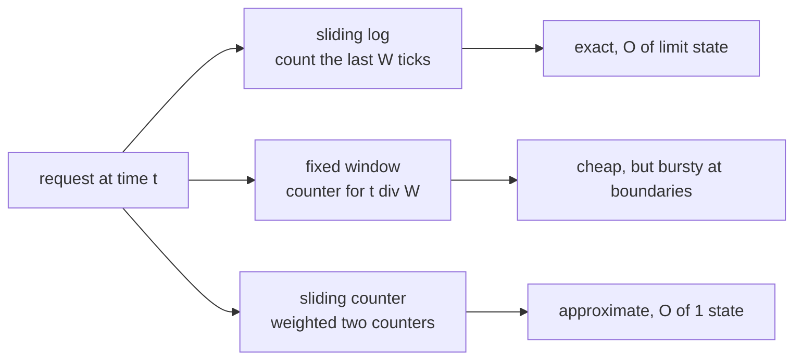
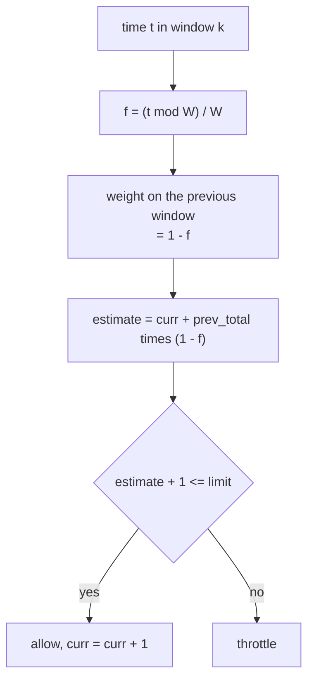
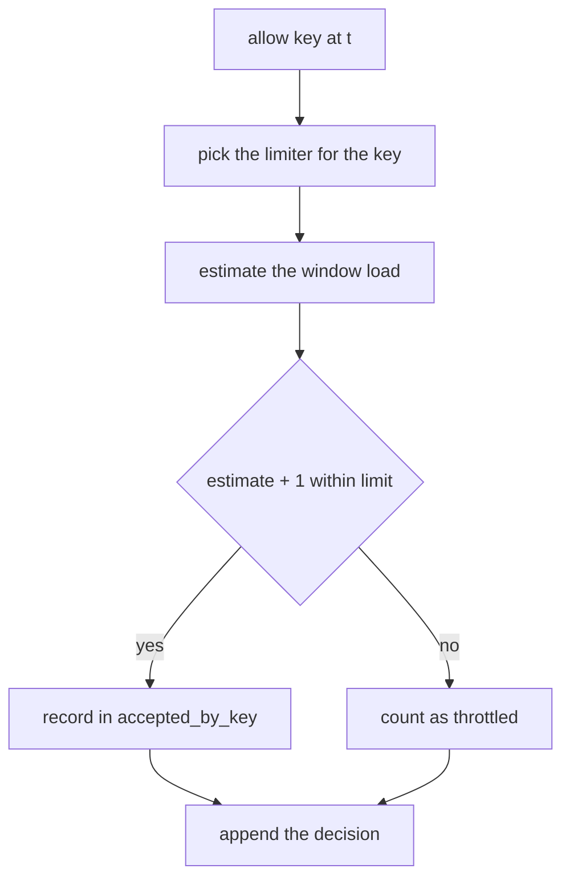
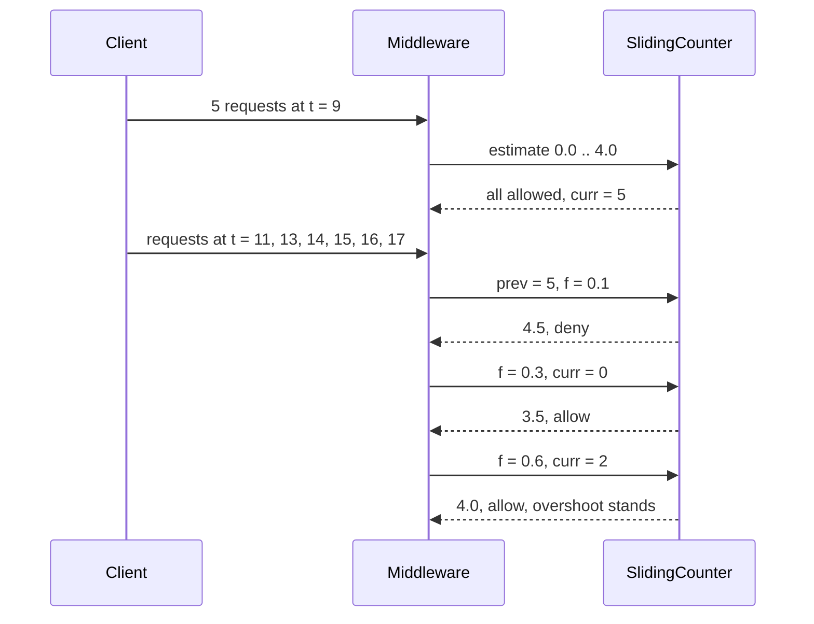

# 507 — Implement throttling middleware simulation (sliding window counters).

> **Tier:** Advanced · **CTCI chapter:** Ch 9 — System Design and Scalability
> **Task spec:** [507-implement-throttling-middleware-simulation-sliding-window-counte.md](../../../tasks/advanced/507-implement-throttling-middleware-simulation-sliding-window-counte.md)
> **Solutions:** [Python](../../../solutions/python/advanced/507-implement-throttling-middleware-simulation-sliding-window-counte/solution.py) ·
> [Java](../../../solutions/java/advanced/507-implement-throttling-middleware-simulation-sliding-window-counte/Solution.java) ·
> [JavaScript](../../../solutions/javascript/advanced/507-implement-throttling-middleware-simulation-sliding-window-counte/solution.js) ·
> [C#](../../../solutions/csharp/advanced/507-implement-throttling-middleware-simulation-sliding-window-counte/Solution.cs)

## 1. Problem restatement

**Input:** a `(key, t)` request stream on an integer virtual clock — three clients, gaps of `0 … 3`
ticks — plus a `limit` and a window `W`. The window is **half-open**: a request at time `t` sees the
interval `(t − W, t]`.

**Output:** an allow/deny decision per request from three interchangeable policies behind one
interface (`estimate(t)`, `allow(t)`, `state_size()`), driven by `ThrottlingMiddleware`, which records
every decision and the accepted timestamps per key:

- **`SlidingLogLimiter`** — a deque of accepted timestamps, expired entries dropped from the front.
  Exact, but `O(limit)` state per key.
- **`FixedWindowLimiter`** — one counter per `t // W`. `O(1)` state, but the window does not really
  slide.
- **`SlidingCounterLimiter`** — two integers per key and the weighted estimate
  `prev · (1 − elapsed_fraction) + curr`, where `elapsed_fraction = (t mod W) / W`.

Measured and asserted behaviour:

| Check | Value |
| --- | --- |
| sliding log on `400` requests, `limit = 5`, `W = 25`, seed `17` | `283` allowed, `117` throttled; brute-force `slots` per key never exceeds `5`; `window_max == 5` |
| state of the log on that run | at most `5` timestamps per key |
| fixed-window flaw, `limit = 5`, `W = 10` | five requests at `t = 9` and five at `t = 10` **all pass** — `10` accepted, `window_max == 10` |
| sliding log on the same edge stream | `5` accepted, `5` throttled, `window_max == 5` |
| counter on the same edge stream | `window_max <= 5` |
| adversarial pattern `[9]×5` then offers at `11, 13, 14, 15, 16, 17` | counter accepts `[9,9,9,9,9,13,14,16]`, so the 10-tick window `(6, 16]` holds **`8`** accepted requests with `limit = 5`; the log accepts `5` and never exceeds `5` |
| error bound (nine streams, four `(limit, W)` pairs) | `−prev_total <= estimate − exact <= (1 − f) · prev_total` at every admission |
| saturated window bound | `window_max <= 2 · limit − 1` |
| state size | counter always `2`; log at most `limit`; fixed window one bucket per observed window (`44` on a `300`-request stream) |
| half-open boundary, `limit = 1`, `W = 10` | `t = 0` allowed, `t = 9` denied, `t = 10` allowed, `t = 11` denied |
| ordinary traffic, `limit = 4`, `W = 30`, seed `777` | log allows `210`, counter allows `179` — the counter is the stricter of the two, inside a factor of two |
| determinism | replaying the same raw stream reproduces the same decision list |

## 2. Intuition

Every rate limiter answers one question: "how many of this key's requests are inside the last `W`
ticks?" The three policies differ only in how honestly they answer it.

The **sliding log** answers exactly: keep the accepted timestamps and count them. The price is
memory proportional to `limit` and a cleanup step on every request. The **fixed window** answers
cheaply but wrongly in one specific way: it counts requests from the whole window `t // W`, so a
client can spend the entire quota at the end of one window and the entire quota again at the start
of the next, with no rate violation detected. On a stream with `5` requests at `t = 9` and `5` at
`t = 10` the fixed window admits all `10` although a real 10-tick window contains every one of them.



The **sliding counter** is the middle ground. Instead of one number it keeps two: `curr`, the count
in the current window, and `prev_total`, the count in the previous window. At time `t` it estimates
the sliding count as `curr + prev_total · (1 − f)`, where `f` is how far into the current window `t`
sits. The idea is that the oldest part of the previous window has already aged out of `(t − W, t]`,
and the fraction of it still relevant shrinks linearly as `f` grows.



The estimate is two-sided, and that is the mathematically interesting part. Let `tail` be how many
of the previous window's requests actually fall inside `(t − W, t]`. Then the exact count is
`curr + tail`, the estimate substitutes `prev_total` for `tail`, and since `0 <= tail <= prev_total`
the error is bounded by `−prev_total <= estimate − exact <= (1 − f) · prev_total`. The lower side is
the dangerous one: the limiter can *over*-admit, which is exactly what the adversarial pattern
demonstrates.

## 3. Algorithm

`SlidingLogLimiter`:

1. `estimate(t)`: pop from the front while `times[0] <= t − W`, then return the deque length.
2. `allow(t)`: if `estimate(t) + 1 <= limit + 1e-12`, append `t` and return `True`, else `False`.

`FixedWindowLimiter`:

1. `key = t // W`; `estimate(t) = buckets.get(key, 0)`.
2. `allow(t)`: increment the bucket when `bucket + 1 <= limit`, else deny.

`SlidingCounterLimiter`:

1. `_roll(t)`: if the window id changed, move `current_count` into `previous_count`, reset
   `current_count` to `0`, and zero `previous_count` when the id jumped by more than `1`.
2. `estimate(t) = current_count + previous_count · (1 − (t mod W) / W)`.
3. `allow(t)`: if `estimate + 1 <= limit + 1e-12`, record `(t, estimate, prev_total, f)` in `history`
   and increment `current_count`.

```text
procedure log_allow(t)
    drop timestamps at or before t - window
    if length of times + 1 &lt;= limit then
        append t to times
        return true
    end
    return false
end
```

```text
procedure counter_allow(t)
    key ← t div window
    if current_id is none then current_id ← key end
    if key is not current_id then
        previous_count ← current_count
        current_id ← key
        current_count ← 0
        if key - previous_id &gt; 1 then previous_count ← 0 end
    end
    f ← (t mod window) / window
    estimate ← current_count + previous_count * (1 - f)
    if estimate + 1 &lt;= limit then
        record (t, estimate, previous_count, f) in history
        current_count ← current_count + 1
        return true
    end
    return false
end
```



The middleware keeps one limiter per key and records `allowed`, `throttled` and the exact
`decisions` list, so an independent re-scan of the accepted timestamps (`slots`, `window_max`) can
audit the policy after the fact.

## 4. Worked example

**The fixed-window flaw.** `limit = 5`, `W = 10`, with five requests at `t = 9` and five at `t = 10`:

| Policy | Admissions | `window_max(10)` |
| --- | --- | --- |
| fixed window | `10` (all of them) | `10` |
| sliding log | `5` | `5` |
| sliding counter | `<= 5` | `<= 5` |

`t = 9` is in window `0` and `t = 10` is in window `1`, so the fixed policy sees two half-full
buckets while a real 10-tick window `(1, 11]` contains all ten requests.

**The adversarial pattern against the counter.** Five requests at `t = 9` (the very end of window
`0`), then offers at `t = 11, 13, 14, 15, 16, 17`:

| `t` | Window | `f` | `prev_total` | `curr` | `estimate = curr + prev·(1−f)` | Decision |
| --- | --- | --- | --- | --- | --- | --- |
| `9` | `0` | `0.9` | `0` | `0` | `0.0` | allow (`curr → 1`) |
| `9` | `0` | `0.9` | `0` | `4` | `4.0` | allow (`curr → 5`) |
| `11` | `1` | `0.1` | `5` | `0` | `4.5` | deny (`5.5 > 5`) |
| `13` | `1` | `0.3` | `5` | `0` | `3.5` | allow (`curr → 1`) |
| `14` | `1` | `0.4` | `5` | `1` | `4.0` | allow (`curr → 2`) |
| `15` | `1` | `0.5` | `5` | `2` | `4.5` | deny (`5.5 > 5`) |
| `16` | `1` | `0.6` | `5` | `2` | `4.0` | allow (`curr → 3`) |
| `17` | `1` | `0.7` | `5` | `3` | `4.5` | deny (`5.5 > 5`) |

Accepted: `[9,9,9,9,9,13,14,16]` — and the window `(6, 16]` contains `8` of them, three above the
limit of `5`. The estimate never exceeded `4.5`, yet reality did: `prev_total` substituted for
`tail`, and at `t = 16` the true tail was all five of the `t = 9` requests, not the `5 · (1 − 0.6) =
2` the estimate assumed. On the same stream the sliding log admits `5` and `window_max` stays `5`.



**Ordinary traffic.** `limit = 4`, `W = 30`, a `400`-request stream (seed `777`, three clients):
the log admits `210` and the counter admits `179`, so the approximate policy is the *stricter* one
here, inside the asserted factor of two. On the `limit = 5`, `W = 25`, seed `17` stream the log
admits `283` of `400` and no key ever exceeds `5` in any 25-tick window — the exactness property that
`slots` re-checks per accepted timestamp.

**The half-open boundary.** `limit = 1`, `W = 10`:

| `t` | Window `(t − 10, t]` | Decision |
| --- | --- | --- |
| `0` | `(−10, 0]` | allowed |
| `9` | `(−1, 9]` contains `0` | denied |
| `10` | `(0, 10]` — `t = 0` has left | allowed |
| `11` | `(1, 11]` contains `10` | denied |

The boundary is `<= t − W` for expiry and `<= t` for inclusion: a timestamp exactly `W` old has left
the window, which is why `t = 10` is allowed.

## 5. Complexity

Let `L` be the limit, `W` the window, `n` the number of requests and `K` the number of keys.

| Measure | Bound | Why it holds |
| --- | --- | --- |
| Sliding log per request | `O(1)` amortised | each timestamp is appended once and popped once |
| Sliding log state | `O(L)` per key | the deque holds at most `limit` live timestamps |
| Fixed window per request | `O(1)` | one dictionary lookup and one increment |
| Fixed window state | `O(#windows)` per key | one bucket per observed `t // W` (measured `44` on a `300`-request stream) |
| Sliding counter per request | `O(1)` | two integers and one fraction |
| Sliding counter state | `O(1)` per key | asserted `state_size() == 2` |
| Middleware | `O(n)` total, `O(K)` limiters | one decision record per request |
| Audit (`slots`, `window_max`) | `O(n²)` | brute-force scan of the accepted timestamps, by design |

The table is the entire argument for the counter: exactness costs `O(L)` state and a cleanup step per
key, while the approximate policy costs two integers and no cleanup — at the price of the `8 > 5`
overshoot shown above.

## 6. Pitfalls and edge cases

- **Half-open windows.** Expiry is `timestamp <= t − W` and inclusion is `other <= t`, so a request
  exactly `W` ticks old is out and the current request is in. Getting either inequality wrong shifts
  the boundary by one tick and breaks the `t = 9 / 10 / 11` sequence.
- **The fixed-window flaw is structural.** It is not a bug to fix but the reason the policy exists in
  the comparison: measured `10 > 5` admissions in one real window.
- **The counter can over-admit.** `8` accepted in a 10-tick window with `limit = 5`. The bound
  `−prev_total <= estimate − exact` says how bad it can get, and `prev_total` is at most `limit − 1`,
  which is why the suite asserts `window_max <= 2 · limit − 1`.
- **`prev_total` must be zeroed on a gap.** When `key − previous_id > 1` the previous window is
  irrelevant; keeping a stale count would throttle a key forever.
- **Roll before estimating.** `estimate` calls `_roll` first, so a request in a new window sees the
  transferred counters, not the old ones.
- **Float comparison slack.** `estimate + 1 <= limit + 1e-12` absorbs binary rounding (`4.5` from
  `5 · 0.9`); without it a legitimate request on an exact boundary can be throttled.
- **`fraction` uses `t mod W`.** For `t = 9`, `W = 10` that is `0.9` — 90% of the current window has
  elapsed, so the previous window's mass is already mostly gone.
- **State is per key.** `ThrottlingMiddleware` creates one limiter per key; a shared limiter would let
  one client consume another's budget. Key cardinality, not per-key state, is what scales with
  traffic.
- **History is an audit log.** `history` records `(t, estimate, prev_total, f)` at each admission, and
  the test asserts it aligns with `accepted_by_key` — a cheap way to check that a policy's decisions
  can be reconstructed from what it stored.
- **Determinism.** Streams come from the `75/74` LCG, and the fixed policies have no randomness, so the
  `decisions` list is compared verbatim between two runs.
- **`window_max` is not the policy.** It re-scans accepted timestamps; on a `400`-request stream that
  is quadratic and only usable in a test, never in the request path.
- **Nothing refills.** Unlike a token bucket, these policies hold no credit: an idle key gets no
  burst allowance, which is the semantic difference from
  [506-implement-rate-limited-queue-with-leaky-bucket-test-harness.md](../../../tasks/advanced/506-implement-rate-limited-queue-with-leaky-bucket-test-harness.md).

## 7. Variants and follow-ups

- **Token and leaky buckets.** [506-implement-rate-limited-queue-with-leaky-bucket-test-harness.md](../../../tasks/advanced/506-implement-rate-limited-queue-with-leaky-bucket-test-harness.md)
  grants credit (`C` plus `L` per tick) instead of counting the last `W` ticks — better for bursty
  clients, worse for smooth ones.
- **GCRA.** Fold the sliding counter into a single "theoretical arrival time" variable; the same
  admission rule with no window bookkeeping at all.
- **Distributed counters.** The two-integer state is the reason the sliding counter is the usual
  choice for a shared store: `INCR` twice per window per key fits a key-value cache, whereas the log
  would need a sorted structure.
- **Limiting work, not just requests.** [508-implement-background-job-scheduler-with-retry-backoff-semantics.md](../../../tasks/advanced/508-implement-background-job-scheduler-with-retry-backoff-semantics.md)
  shapes retry pressure with capped exponential backoff, and
  [510-implement-task-dag-executor-with-parallel-workers-respect-depend.md](../../../tasks/advanced/510-implement-task-dag-executor-with-parallel-workers-respect-depend.md)
  limits concurrency rather than rate.
- **Cheap negative answers in front of the limiter.** [505-implement-bloom-filter-backed-cache-for-web-responses-simulation.md](../../../tasks/advanced/505-implement-bloom-filter-backed-cache-for-web-responses-simulation.md)
  removes work before it arrives; throttling removes work by refusing it.
- **Adaptive limiters.** Replace the fixed `limit` with a measured latency budget and the same
  middleware becomes load shedding; the policies themselves do not change.

## 8. Check yourself

1. Why is the fixed-window limiter's failure a property of the policy rather than a bug?

<details><summary>Show answer</summary>

Because it counts per `t // W` bucket, and a real sliding window can straddle two buckets. With
`limit = 5`, `W = 10`, five requests at `t = 9` fill bucket `0` and five at `t = 10` fill bucket `1`;
both buckets are legal, yet the window `(1, 11]` holds all ten. The measured `window_max` on that
stream is `10`.

</details>

2. Derive the two-sided error bound of the sliding counter.

<details><summary>Show answer</summary>

Write `exact = curr + tail`, where `tail` counts the previous window's requests inside `(t − W, t]`,
and `estimate = curr + prev_total · (1 − f)`. Since `0 <= tail <= prev_total`, subtracting gives
`−prev_total <= estimate − exact <= (1 − f) · prev_total`. The upper end is bounded by `prev_total`
and the lower end is negative, i.e. the estimate can be *below* reality — the overshoot direction.

</details>

3. The counter accepted `8` requests in a 10-tick window with `limit = 5`. Where did the extra three
   come from?

<details><summary>Show answer</summary>

From underestimating the tail. At each admission in the new window the estimate used
`prev_total · (1 − f)` — `4.5`, `3.5`, `4.0`, `4.5`, `4.0`, `4.5` for `t = 11 … 17` — while the true
tail was still all five requests from `t = 9` until `t = 19`. Three of the six offers were admitted,
so the window `(6, 16]` ended up with `5 + 3 = 8`.

</details>

4. What is the memory argument for choosing the sliding counter in production?

<details><summary>Show answer</summary>

Two integers per key, asserted as `state_size() == 2`, against up to `limit` timestamps per key for
the log. With three clients the difference is invisible; with millions of keys and a limit of
thousands, the log's state is proportional to the traffic it is supposed to limit. The counter pays
for that with the bounded-inaccuracy shown by the adversarial pattern.

</details>

5. Why does the test re-scan accepted timestamps with `slots` and `window_max` instead of trusting
   the limiter's own counters?

<details><summary>Show answer</summary>

Because the counters *are* the implementation under test. `slots` recomputes the exact count in
`(t − W, t]` from the raw accepted timestamps, so it can prove the log is exact (`<= 5` everywhere)
and can expose the counter's overshoot (`8`) without asking the policy to grade itself.

</details>
