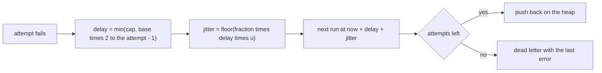
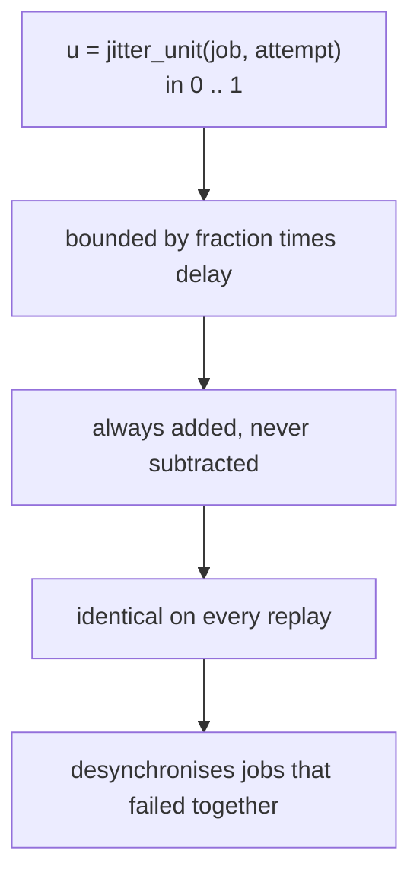
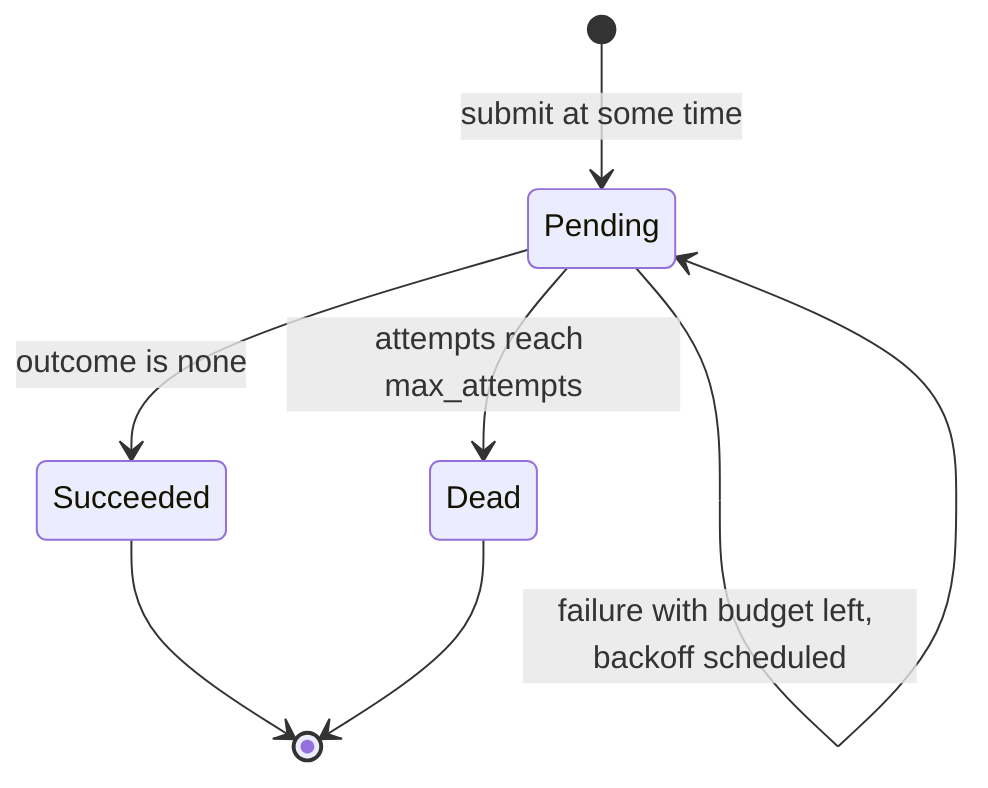
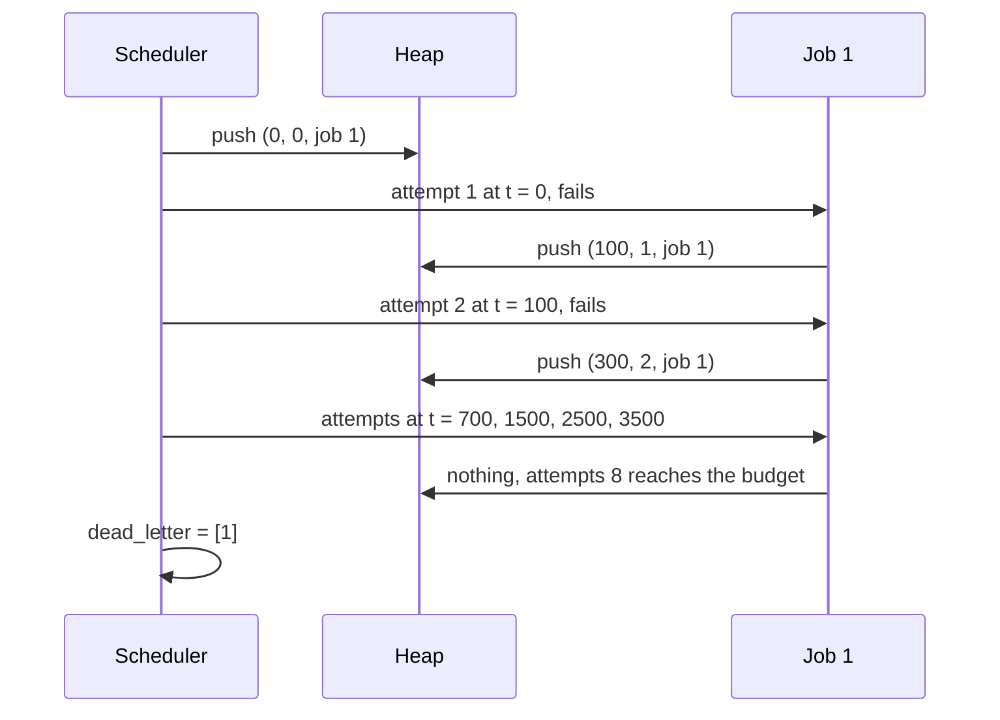

# 508 — Implement background job scheduler with retry/backoff semantics.

> **Tier:** Advanced · **CTCI chapter:** Ch 9 — System Design and Scalability
> **Task spec:** [508-implement-background-job-scheduler-with-retry-backoff-semantics.md](../../../tasks/advanced/508-implement-background-job-scheduler-with-retry-backoff-semantics.md)
> **Solutions:** [Python](../../../solutions/python/advanced/508-implement-background-job-scheduler-with-retry-backoff-semantics/solution.py) ·
> [Java](../../../solutions/java/advanced/508-implement-background-job-scheduler-with-retry-backoff-semantics/Solution.java) ·
> [JavaScript](../../../solutions/javascript/advanced/508-implement-background-job-scheduler-with-retry-backoff-semantics/solution.js) ·
> [C#](../../../solutions/csharp/advanced/508-implement-background-job-scheduler-with-retry-backoff-semantics/Solution.cs)

## 1. Problem restatement

**Input:** jobs, each carrying an attempt budget `max_attempts`, a backoff base `base_delay`, a cap
`max_delay` and a jitter fraction; plus an `outcomes` map `(job_id, attempt) → None` for success or an
error string for failure. Everything runs on a discrete virtual clock.

**Output:** a deterministic event trace. `Scheduler` keeps a binary heap keyed by
`(run_at, sequence)` — the sequence number is the tie-break, so two jobs due at the same instant run
in submission order — and pops events one at a time, advancing the clock to the popped timestamp. On
failure the next attempt is scheduled at

```text
now + min(max_delay, base_delay · 2^(attempt − 1)) + jitter
```

with `jitter = floor(fraction · delay · u)` and `u = jitter_unit(job_id, attempt)` a deterministic
value in `[0, 1)` from a small `75/74` LCG over `(job id, attempt)`. A job that exhausts its budget
goes to the **dead-letter** list with its attempt history and last error; a job that succeeds stops
retrying.

Measured on the shipped code:

| Check | Value |
| --- | --- |
| zero-jitter delays `base 100 / cap 1000` | `[100, 200, 400, 800, 1000, 1000, 1000]` |
| run times of a job that always fails (`max_attempts = 8`) | `[0, 100, 300, 700, 1500, 2500, 3500, 4500]` |
| doubling then capping | `delays[i] == 2 · delays[i − 1]` for the first three, then exactly `1000` |
| terminal state | `state == "dead"`, `dead_letter == [1]`, `last_error == "boom-1-8"`, `attempts == 8` |
| success on the `k`-th attempt, `base 50` | finishes at the closed-form time; `[0, 50, 150, 350]` for `k = 4` |
| jitter determinism | `jitter_for(a)` returns the same value on every call |
| jitter bounds | `0 <= jitter < fraction · delay` for every attempt |
| jitter example `job 7`, `base 200`, `cap 5000`, `fraction 0.5` | delays `[200, 400, 800, 1600, 3200, 5000]`, jitter `[48, 190, 170, 720, 598, 2119]` |
| event ordering | the trace is sorted by time and, within a time, by submission order |
| overtaking | an early job capped at `1000` runs at `0` and `1000`; a later job with `base 1` runs at `1` and `2` — `[(0,8), (1,9), (2,9), (1000,8)]` |
| conservation | `attempts == successes + failures + dead-letter attempts` |
| closed form | `closed_form_runs(job, k)` matches the observed timestamps for every job |

## 2. Intuition

Retrying immediately turns a transient fault into a stampede: the failing dependency is already
struggling, and every client re-hammers it at once. Exponential backoff spaces the attempts out —
`base`, `2·base`, `4·base`, … — and a cap stops the spacing from growing without bound, so a job that
recovers after an hour is still retried within `max_delay` of its last failure.



Jitter exists because backoff alone is *synchronised*: if a hundred jobs fail together they will also
retry together, at `base`, then at `3·base`, and so on. Adding a bounded random offset spreads that
wave. The subtle requirement is that the jitter must not be *random* in the reproducibility sense —
the tests need a deterministic run — so `u` is derived from the job id and the attempt number
through an LCG (`jitter_unit`). Jitter is also deliberately one-sided: it is added, never
subtracted, so a delay cannot become shorter than the backoff schedule.



The third idea is the **tie-break**. The heap is keyed by `(run_at, sequence)`, and `sequence`
increments on every push. Without it, two jobs due at the same timestamp would be ordered by
whatever the heap's internal comparison happened to do — Python compares the third tuple element,
which would compare job ids — and the trace could change between implementations. With it, jobs
run in submission order within a tick, and the whole trace is reproducible.

## 3. Algorithm

1. `Job(id, base_delay, max_delay, jitter_fraction, max_attempts)` starts `pending` with
   `next_run_at = 0`.
2. `Scheduler.submit(job, at)`: set `job.next_run_at = at`, push `(at, sequence, job_id)`, increment
   `sequence`, register the job.
3. `Scheduler.run()`: while the heap is non-empty, pop `(now, _, job_id)`; assert the job's last
   scheduled run is `now`; `attempts += 1` on both job and scheduler; look up
   `outcomes[(job_id, attempt)]`.
4. On success: mark `state = "succeeded"` and record `success_at`, and do not reschedule.
5. On failure: record `last_error`; if `attempts >= max_attempts`, mark `state = "dead"` and append to
   `dead_letter`; otherwise compute `plan_next(now, attempt)`, append it to `job.runs`, and push it
   back with a fresh sequence number.

```text
procedure delay_for(attempt)
    return min(max_delay, base_delay * 2 to the power (attempt - 1))
end

procedure jitter_for(attempt)
    u ← jitter_unit(job_id, attempt)
    return floor(jitter_fraction * delay_for(attempt) * u)
end

procedure plan_next(now, attempt)
    return now + delay_for(attempt) + jitter_for(attempt)
end
```

```text
procedure run()
    while the heap is not empty do
        now, _, job_id ← pop the smallest entry
        job ← jobs[job_id]
        assert job.runs[last] = now
        job.attempts ← job.attempts + 1
        attempts ← attempts + 1
        error ← outcomes.get((job_id, job.attempts))
        ok ← error is none
        record (now, job_id, job.attempts, ok, error) in the trace
        if ok then
            job.state ← succeeded
            job.success_at ← now
            continue
        end
        job.last_error ← error
        if job.attempts &gt;= job.max_attempts then
            job.state ← dead
            append job_id to dead_letter
            continue
        end
        next_at ← plan_next(now, job.attempts)
        append next_at to job.runs
        push (next_at, sequence, job_id)
        sequence ← sequence + 1
    end
end
```



`closed_form_runs(job, k)` recomputes the first `k` timestamps from the delay formulas alone —
`[0]`, then each next time as `previous + delay_for(attempt) + jitter_for(attempt)` — and the test
requires it to equal the observed trace. That is the separation between "the schedule came out right"
and "the heap did the right thing".

## 4. Worked example

**Zero jitter, `base = 100`, `cap = 1000`, `max_attempts = 8`, always failing.** The delays are
`[100, 200, 400, 800, 1000, 1000, 1000]` — doubling until the cap, then flat — and the run times are
their prefix sums:

| Attempt | `run_at` | Delay before it | Error |
| --- | --- | --- | --- |
| 1 | `0` | — | `boom-1-1` |
| 2 | `100` | `100` | `boom-1-2` |
| 3 | `300` | `200` | `boom-1-3` |
| 4 | `700` | `400` | `boom-1-4` |
| 5 | `1500` | `800` | `boom-1-5` |
| 6 | `2500` | `1000` | `boom-1-6` |
| 7 | `3500` | `1000` | `boom-1-7` |
| 8 | `4500` | `1000` | `boom-1-8` |

The eighth attempt exhausts the budget, so the job lands in `dead_letter == [1]` with
`state == "dead"` and `last_error == "boom-1-8"`. Note the accumulator effect: the delay is capped at
`1000`, yet the job runs at `4500` — the cap bounds the *gap*, not the total elapsed time.

**Success on the `k`-th attempt.** With `base = 50` and no jitter the closed form is
`0, 50, 150, 350, …` because the gaps double from `50`. The test runs the same scenario for
`success_on in (1, 2, 3, 6)` and asserts that `job.success_at` equals the closed-form time of the
successful attempt and that nothing reaches the dead-letter list.

**Deterministic jitter.** `job 7`, `base = 200`, `cap = 5000`, `fraction = 0.5`:

| Attempt | Delay | `u = jitter_unit(7, attempt)` | Jitter | Next gap |
| --- | --- | --- | --- | --- |
| 1 | `200` | `0.4807` | `48` | `248` |
| 2 | `400` | `0.9541` | `190` | `590` |
| 3 | `800` | `0.4275` | `170` | `970` |
| 4 | `1600` | — | `720` | `2320` |
| 5 | `3200` | — | `598` | `3798` |
| 6 | `5000` | — | `2119` | — |

Every jitter is below `fraction · delay` (`48 < 100`, `190 < 200`, `2119 < 2500`) and strictly
non-negative, and calling `jitter_for` twice for the same attempt returns the same integer — that is
the determinism the replay assertions rely on.



**Overtaking.** Jobs are ordered by due time, not by arrival: a job capped at `1000` submitted first
(`base = 1000`) runs at `0` and, after failing, at `1000`; a job submitted one tick later with
`base = 1` runs at `1` and `2`. The trace is `[(0, 8), (1, 9), (2, 9), (1000, 8)]` — the short-delay
job takes two slots before the long-delay job's second attempt.
## 5. Complexity

Let `J` be the number of jobs, `A` the total number of attempts across all jobs, and `A_max` the
largest attempt budget.

| Measure | Bound | Why it holds |
| --- | --- | --- |
| `submit` | `O(log J)` | one heap push |
| `run` | `O(A · log J)` | one pop and, on failure, one push per attempt |
| `delay_for` / `jitter_for` | `O(1)` | integer arithmetic on the attempt number |
| `closed_form_runs(job, k)` | `O(k)` | prefix sums of the delay formula |
| Trace size | `O(A)` | one entry per attempt |
| Space | `O(J + A)` | the heap, the job table, the trace and the dead-letter list |
| Attempt count per job | `<= max_attempts` | enforced by the budget check before rescheduling |

The heap is what makes the simulation an *event* loop rather than a tick loop: with `A` attempts and
`J` jobs the cost depends on the work actually done, not on the wall-clock span of the schedule
(`4500` virtual ticks in the example cost eight pops).

## 6. Pitfalls and edge cases

- **Ties need a deterministic order.** `(run_at, sequence)` — drop the sequence number and two jobs
  due at the same instant may swap places between languages, and the trace comparison fails.
- **Jitter is added after the cap.** `plan_next` uses the capped delay *plus* jitter, so a capped job
  runs at `1000 + jitter` gaps and can accumulate well past `max_delay` in total time (`4500` in the
  example). The header documents the cap as a bound on the delay, not on cumulative time.
- **Jitter never shortens a delay.** `floor(fraction · delay · u)` with `u >= 0` keeps the schedule
  monotone-friendly; subtracting jitter would let a retry land before the backoff intended.
- **Jitter must be reproducible.** `jitter_unit` is an LCG over `(job_id, attempt)`, not a language
  RNG; the test calls `jitter_for` twice and asserts equality, and replays the whole schedule.
- **Dead letter only at the budget.** A job enters it only when `attempts >= max_attempts`, and only
  after a failure — a job that succeeds on its last allowed attempt succeeds.
- **`attempts` counts both sides.** `job.attempts` and `scheduler.attempts` advance together, which is
  what makes `attempts == successes + failures + dead-letter attempts` checkable.
- **A job runs only at its scheduled time.** `run` asserts `job.runs[-1] == now`; a stale heap entry
  reused for a newer schedule would trip that immediately.
- **Missing outcomes mean success.** `outcomes.get((job_id, attempt))` returns `None` for anything not
  listed, so a test that forgets to register an error silently succeeds — the failure scenarios must
  enumerate attempts explicitly, which they do (`always_fails`).
- **Zero and huge jitter fractions.** `0.0` gives the exact closed form used by the first assertions;
  a fraction of `1.0` would approach `delay` from below but never reach it, since `u < 1`.
- **The heap is the only scheduler state.** Jobs themselves carry `next_run_at` and `runs`; the heap
  holds ids, so a job's history survives independent of the queue entry.
- **Determinism is order-of-operations level.** `sequence` increments on every push (including
  reschedules), so inserting jobs in a different order changes the tie-break and the trace.

## 7. Variants and follow-ups

- **Rate limiting the retries themselves.** Backoff spaces one job; a global budget needs
  [506-implement-rate-limited-queue-with-leaky-bucket-test-harness.md](../../../tasks/advanced/506-implement-rate-limited-queue-with-leaky-bucket-test-harness.md)
  or [507-implement-throttling-middleware-simulation-sliding-window-counte.md](../../../tasks/advanced/507-implement-throttling-middleware-simulation-sliding-window-counte.md)
  in front of the executor.
- **Jobs that depend on each other.** Backoff retries a single job; a dependency graph needs
  topological ordering with priorities —
  [509-implement-dependency-graph-scheduling-topo-priorities.md](../../../tasks/advanced/509-implement-dependency-graph-scheduling-topo-priorities.md).
- **Running the work in parallel.** [510-implement-task-dag-executor-with-parallel-workers-respect-depend.md](../../../tasks/advanced/510-implement-task-dag-executor-with-parallel-workers-respect-depend.md)
  adds worker slots to this event loop, with the same dependency constraints.
- **Surviving a crash mid-schedule.** [511-implement-checkpointed-parallel-map-reduce-worker-for-crash-reco.md](../../../tasks/advanced/511-implement-checkpointed-parallel-map-reduce-worker-for-crash-reco.md)
  and [481-implement-optimistic-checkpointing-restart-simulation.md](../../../tasks/advanced/481-implement-optimistic-checkpointing-restart-simulation.md)
  persist enough state to resume instead of restarting the retry sequence.
- **Jitter that spreads better.** Full jitter samples the whole interval `[0, delay]` (roughly what a
  `fraction` of `1.0` approximates), while equal jitter uses `delay/2 + U(0, delay/2)`; both keep the
  determinism property if the underlying `u` stays reproducible.

## 8. Check yourself

1. Why is the heap keyed by `(run_at, sequence)` rather than just `run_at`?

<details><summary>Show answer</summary>

Because two jobs can be due at the same instant, and the heap must then order them by submission
order to be reproducible. Without the sequence number the order would fall back to comparing job ids
(or be unspecified), so the trace could differ between runs or between the four language ports —
exactly what the "sorted by time and by submission order" assertion forbids.

</details>

2. The delay cap is `1000`, yet the eighth attempt runs at `4500`. Is the cap broken?

<details><summary>Show answer</summary>

No. `delay_for` caps the *gap* between consecutive attempts, not the cumulative time:
`[100, 200, 400, 800, 1000, 1000, 1000]` summed from `0` gives `0, 100, 300, 700, 1500, 2500, 3500,
4500`. The test asserts both statements separately: doubling until the cap, and exactly `1000`
afterwards.

</details>

3. Why must jitter be added rather than subtracted?

<details><summary>Show answer</summary>

Because the backoff schedule is a lower bound on the intended spacing. Subtracting would let a retry
land earlier than `base · 2^(attempt−1)`, defeating the purpose of backing off during an outage. The
assertion `0 <= jitter < fraction · delay` pins the one-sided policy, and the closed-form comparison
would fail for any attempt whose jitter went negative.

</details>

4. Two jobs fail at the same instant with identical parameters and `fraction = 0.5`. Do they retry
   together?

<details><summary>Show answer</summary>

No. `jitter_unit` depends on the job id as well as the attempt number, so the two jobs draw different
`u` values and receive different jitter — measured for job `7`: `48, 190, 170, 720, 598, 2119` for
attempts `1 … 6`. That desynchronisation is the point of jitter; without it every client that failed
during the same outage would retry in lockstep.

</details>

5. What does the `runs[-1] == now` assertion protect against?

<details><summary>Show answer</summary>

Stale heap entries. A job is pushed once per scheduled attempt, so the entry popped must carry the
timestamp the job most recently planned for. If a job were rescheduled without pushing, or pushed
twice for one attempt, the popped time and the job's own last planned time would disagree and the
assertion would fire before the trace silently contained a duplicate or missing attempt.

</details>
