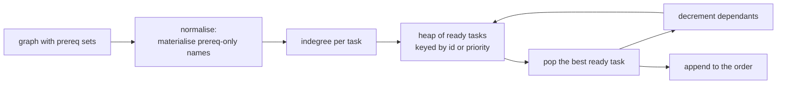
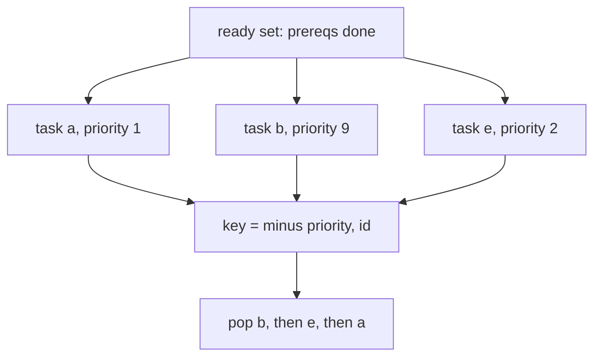
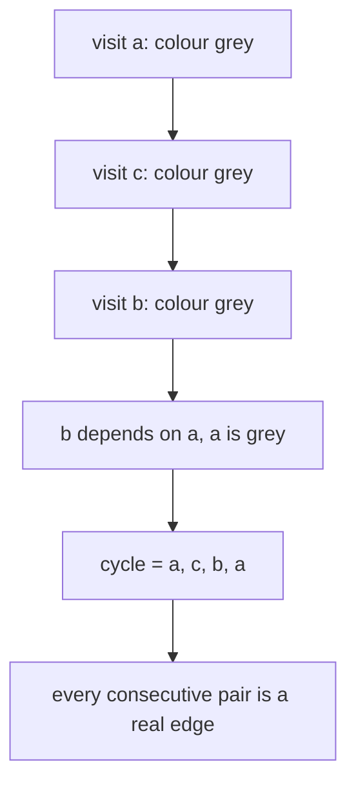
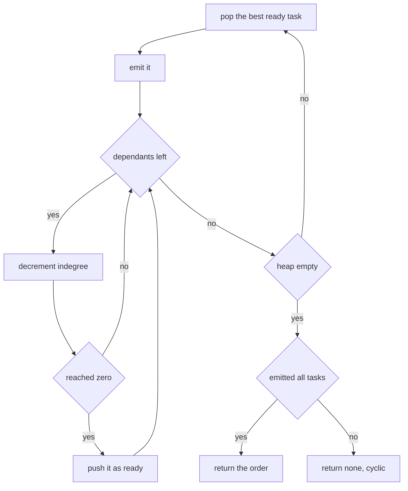

# 509 — Implement dependency graph scheduling (topo + priorities).

> **Tier:** Advanced · **CTCI chapter:** Ch 9 — System Design and Scalability
> **Task spec:** [509-implement-dependency-graph-scheduling-topo-priorities.md](../../../tasks/advanced/509-implement-dependency-graph-scheduling-topo-priorities.md)
> **Solutions:** [Python](../../../solutions/python/advanced/509-implement-dependency-graph-scheduling-topo-priorities/solution.py) ·
> [Java](../../../solutions/java/advanced/509-implement-dependency-graph-scheduling-topo-priorities/Solution.java) ·
> [JavaScript](../../../solutions/javascript/advanced/509-implement-dependency-graph-scheduling-topo-priorities/solution.js) ·
> [C#](../../../solutions/csharp/advanced/509-implement-dependency-graph-scheduling-topo-priorities/Solution.cs)

## 1. Problem restatement

**Input:** a DAG given as `task → list of prerequisites`, plus optional `priorities`. Unknown names
that appear only as prerequisites are materialised as prerequisite-free tasks, so a partial graph can
be scheduled without a separate sanitising pass, and duplicate edges collapse because prerequisites
are stored as sets.

**Output:** three things, each with a defined meaning:

- `topo_order(graph, use_priority=False)` — the **lexicographically smallest** topological order,
  produced by Kahn peeling out of a heap keyed by task id; `None` when the graph is cyclic.
- `topo_order(graph, use_priority=True, priorities=…)` — the same loop with the heap keyed by
  `(−priority, id)`: at every step the highest-priority task among those whose prerequisites are done,
  with the smallest id as the tie-break.
- `find_cycle(graph)` — a real closed walk `[v0, v1, …, v0]` of existing edges (or `None`), found by a
  three-colour DFS.

Measured on the shipped code:

| Graph | Orders | Lexicographic order |
| --- | --- | --- |
| chain `c ← b ← a` | `1` | `a, b, c` |
| diamond `a → b, c → d` | `2` | `a, b, c, d` |
| fan `root → x1, x2, x3 → sink` | `6` | `root, x1, x2, x3, sink` |
| LCG DAG `random_dag(8, 101)` | `76` | `t0, t1, t2, t3, t4, t5, t6, t7` |

| Behaviour | Value |
| --- | --- |
| priority example (`a:1, b:9, c:5, d:9, e:2`) | priority order `e, a, b, c, d`; lexicographic `a, b, c, d, e` — different, both valid |
| agreement with the independent greedy scan | exact, at every step, for every generated graph |
| cycle `a ← c, b ← a, c ← b` | `topo_order` returns `None`; `find_cycle` returns `a, c, b, a` |
| self-loop `s ← s` | `find_cycle` returns `s, s` |
| empty graph | `topo_order({}) == []` and `count_orders({}) == 1` |
| disconnected `a, b, c ← a, d ← b` | `a, b, c, d` |
| duplicate edges `b ← a, a` | `a, b` — the set collapses them |
| brute-force cross-check | `topo_order == min(valid permutations)` for `n <= 6`, and `count_orders == number of valid permutations` |

## 2. Intuition

A topological order is any sequence in which every prerequisite precedes its dependants. Kahn's
algorithm finds one by *peeling*: repeatedly take a task with no unfinished prerequisites, emit it,
and decrement its dependants. The only design decision is **which ready task to take next**, and
that is where the heap comes in.



With a heap keyed by task id, the loop always emits the smallest available task — and that greedy
choice produces the lexicographically smallest topological order, which the tests verify against
brute force over all `n!` permutations for `n <= 6`. With a heap keyed by `(−priority, id)` the same
loop becomes the classic **greedy priority scheduler**: it is optimal *at each step* (no other order
can run a higher-priority task first) but not globally optimal in any stronger sense.



Cycles are the failure mode that needs its own pass. Kahn's loop simply peels fewer tasks than exist
— detected by comparing the emitted count with the number of tasks — but that tells you *that* a
cycle exists, not *where*. A three-colour DFS (white unvisited, grey on the current stack, black
finished) reports the actual path: seeing a grey node again closes a cycle, and the segment of the
current stack from that node onward is the closed walk.



## 3. Algorithm

1. `normalise(graph)`: build `task → set(prerequisites)`, creating an empty set for any name that
   appears only as a prerequisite.
2. `topo_order`: compute `indegree = |prerequisites|`, invert the edges into `dependants`, and push
   every task with `indegree == 0` onto a heap with the chosen key.
3. Pop the smallest key, append the task to the order, and for each dependant (in sorted order)
   decrement its indegree, pushing it when the count reaches `0`.
4. If the emitted count is less than the task count, return `None` (the graph is cyclic).
5. `find_cycle`: three-colour DFS over the prerequisite edges; when a grey node is reached again, cut
   the current stack from its first occurrence and close the walk.
6. `count_orders`: bit-mask subset DP — `counts[mask | bit] += counts[mask]` for every task whose
   prerequisites are all inside `mask`.

```text
procedure topo_order(graph, use_priority, priorities)
    tasks ← normalise(graph)
    indegree ← length of the prerequisite set of each task
    dependants ← inverse edges
    heap ← empty
    for task in sorted(tasks) do
        if indegree[task] = 0 then
            key ← (-priorities[task], task) if use_priority else (task,)
            push key with task onto heap
        end
    end
    order ← empty
    while heap is not empty do
        task ← the task of the smallest key
        append task to order
        for next_task in sorted(dependants[task]) do
            indegree[next_task] ← indegree[next_task] - 1
            if indegree[next_task] = 0 then
                push its key onto heap
            end
        end
    end
    if length(order) is not length(tasks) then
        return none
    end
    return order
end
```

```text
procedure find_cycle(graph)
    tasks ← normalise(graph)
    colour ← empty
    for task in sorted(tasks) do
        if colour[task] is unvisited then
            found ← visit(task, empty stack)
            if found is not none then
                return found
            end
        end
    end
    return none
end

procedure visit(node, stack)
    colour[node] ← grey
    append node to stack
    for dep in sorted(tasks[node]) do
        if colour[dep] is grey then
            return the part of stack from dep, plus dep again
        end
        if colour[dep] is unvisited then
            found ← visit(dep, stack)
            if found is not none then
                return found
            end
        end
    end
    colour[node] ← black
    remove node from stack
    return none
end
```



`normalise` is what makes the partial-graph input work: a graph `{"leaf": []}` is one task, and
`{"e": ["orphan"], "orphan": []}` is two, with `orphan` becoming a real task that simply has no
prerequisites.

## 4. Worked example

**The `76`-order DAG.** `random_dag(8, 101)` generates edges only from a lower index to a higher one
(it walks `j < i` and keeps an edge with probability `30%`), so it is acyclic by construction:

```text
t0: []          t3: [t0, t2]            t6: [t3, t5]
t1: []          t4: [t0, t2]            t7: [t4]
t2: []          t5: [t0, t1, t3, t4]
```

Indegrees start at `t0: 0`, `t1: 0`, `t2: 0`, `t3: 2`, `t4: 2`, `t5: 4`, `t6: 2`, `t7: 1`:

| Step | Heap before | Popped | Indegree changes | Heap after |
| --- | --- | --- | --- | --- |
| 1 | `t0, t1, t2` | `t0` | `t3 → 1`, `t4 → 1`, `t5 → 3` | `t1, t2` |
| 2 | `t1, t2` | `t1` | `t5 → 2` | `t2` |
| 3 | `t2` | `t2` | `t3 → 0` push, `t4 → 0` push, `t5 → 1` | `t3, t4` |
| 4 | `t3, t4` | `t3` | `t5 → 0` push, `t6 → 1` | `t4, t5` |
| 5 | `t4, t5` | `t4` | `t7 → 0` push | `t5, t7` |
| 6 | `t5, t7` | `t5` | `t6 → 0` push | `t6, t7` |
| 7 | `t6, t7` | `t6` | — | `t7` |
| 8 | `t7` | `t7` | — | empty |

The order is `t0, t1, t2, t3, t4, t5, t6, t7` — the identity permutation, because the graph is dense
enough that every task only becomes ready in index order. The **count** is the more informative
number: `count_orders` (bit-mask subset DP) returns `76`, and the brute force over all `8! = 40320`
permutations agrees. Fewer edges would mean more orders: the fan has `6` (`3!` orderings of the
middle row), the diamond has `2`, the chain exactly `1`.
**Priorities change the schedule.** With `a:1, b:9, c:5, d:9, e:2` on
`d ← b, c; c ← a; b ← a; e`:

| Policy | Order |
| --- | --- |
| lexicographic | `a, b, c, d, e` |
| priority | `e, a, b, c, d` |

The priority order starts with `e` because `e` is ready from the beginning with priority `2`, and it
is taken before `a` (priority `1`) — but *after* nothing, since `d` and `b` (priority `9`) are not yet
ready. Both orders are valid topological orders, and the test asserts they differ, because a priority
knob that never changes the answer would prove nothing. The step-by-step check re-derives the
priority order independently: at each step, scan the whole ready set and take
`min(ready, key = (−priority, id))`.

**A cycle.** `{"a": ["c"], "b": ["a"], "c": ["b"], "d": []}`:

| Call | Result |
| --- | --- |
| `topo_order(cyclic)` | `None` — `4` tasks, only `1` peeled (`d`) |
| `topo_order(cyclic, use_priority=True, …)` | `None` |
| `greedy_priority_order(cyclic, {})` | `None` |
| `find_cycle(cyclic)` | `a, c, b, a` |

The DFS enters `a` (grey), descends to `c`, then `b`, and from `b` reaches `a` — which is still grey,
so the stack segment `a, c, b` plus the repeated `a` is the cycle. Each consecutive pair is asserted
to be a real edge in the dependency direction, and `sorted(set(cycle)) == ["a", "b", "c"]` confirms
`d` is not dragged in. `find_cycle({"s": ["s"]})` returns `s, s` — a cycle of length one.

## 5. Complexity

Let `V` be the number of tasks, `E` the number of prerequisite edges, and `P` the number of valid
orders.

| Measure | Bound | Why it holds |
| --- | --- | --- |
| `normalise` | `O(V + E)` | one pass over the adjacency map, sets collapse duplicates |
| `topo_order` | `O((V + E) log V)` | one heap push per task and per released edge, `O(log V)` each |
| `find_cycle` | `O(V + E)` | each node and edge visited once |
| `count_orders` | `O(2^V · V)` | one transition per (mask, task) pair over `2^V` masks |
| `brute_force_best` | `O(V! · E)` | all permutations, each validated in `O(E)`; usable to `V ≈ 7` |
| Space | `O(V + E)` for the schedulers, `O(2^V)` for the DP | the mask table dominates the count |

The exponential columns are the reason the tests scale them carefully: `count_orders` needs `2^V`
masks (fine at `V = 8`) and the permutation brute force needs `V!` (`40320` at `V = 8`, slow but
acceptable as a one-off oracle).

## 6. Pitfalls and edge cases

- **Prerequisite-only names.** A graph where a prerequisite was never declared as a key must still
  work; `normalise` materialises it with an empty prerequisite set. Skipping that step is the most
  common way to turn a valid graph into a `KeyError`.
- **Duplicate edges.** `b ← a, a` must behave like `b ← a`; storing prerequisites in a set does this
  for free, while a list would double-count the indegree decrement and deadlock the peel.
- **Cycle versus priority.** A cyclic graph must fail in *both* modes; a priority key cannot rescue a
  graph with no ready tasks.
- **Self-loops are cycles.** `s ← s` has indegree `1` forever, so `topo_order` returns `None` and
  `find_cycle` reports `s, s`. Only the DFS path is a useful diagnostic — the `None` alone does not
  say where.
- **The reported cycle must be real.** The DFS records the path rather than a node set, so the answer
  is a closed walk of existing edges in the dependency direction; the test checks every consecutive
  pair against `normalise(cyclic)[left]`.
- **Tie-breaks decide the answer.** `(−priority, id)` makes the result unique: without the id the heap
  would fall back to comparing tasks, and the "smallest order" property would be lost.
- **`is_valid_order` also checks the task set.** An order that omits a task or invents one fails even
  if every listed edge is respected, which catches partial peels that otherwise look fine.
- **Priorities are optional.** `priorities.get(task, 0)` gives every task a default priority, so the
  priority mode works on graphs with only some (or no) priorities supplied.
- **Empty and single-task graphs.** `topo_order({}) == []` and `count_orders({}) == 1` (the empty
  order), `topo_order({"only": []}) == ["only"]`.
- **Deterministic iteration.** Dependants are walked in `sorted` order and the initial ready set is
  built from `sorted(tasks)`, so the heap contents — and therefore the trace — do not depend on
  dictionary insertion order.
## 7. Variants and follow-ups

- **Several workers.** [510-implement-task-dag-executor-with-parallel-workers-respect-depend.md](../../../tasks/advanced/510-implement-task-dag-executor-with-parallel-workers-respect-depend.md)
  keeps the same DAG and ready-set but assigns tasks to `P` machines, where the makespan rather than
  the order becomes the objective.
- **DFS-based ordering.** Reverse postorder of a DFS is an alternative topological sort in `O(V + E)`
  with no heap; it does not, however, produce the lexicographically smallest order.
- **Critical-path priority.** Ranking ready tasks by the length of the longest path *from* them is the
  heuristic behind list scheduling and explains why a pure id order can be far from optimal.
- **Retrying failures.** Order alone does not handle failures; retry and backoff semantics live in
  [508-implement-background-job-scheduler-with-retry-backoff-semantics.md](../../../tasks/advanced/508-implement-background-job-scheduler-with-retry-backoff-semantics.md).
- **Recomputing after a crash.** A scheduled DAG must survive a restart, which is the checkpoint
  problem in [511-implement-checkpointed-parallel-map-reduce-worker-for-crash-reco.md](../../../tasks/advanced/511-implement-checkpointed-parallel-map-reduce-worker-for-crash-reco.md).
- **Graph traversals elsewhere in the repository.** The same `O(V + E)` colouring discipline appears
  in the tree and graph chapters, for example
  [428-implement-binary-lifting-for-lca-and-ancestor-queries.md](../../../tasks/advanced/428-implement-binary-lifting-for-lca-and-ancestor-queries.md)
  builds its ancestor table on a topological (parent-before-child) order.

## 8. Check yourself

1. Why does a heap keyed by task id produce the *lexicographically smallest* topological order?

<details><summary>Show answer</summary>

Because at every step the smallest task whose prerequisites are already emitted is chosen, and that is
exactly the greedy choice the lexicographic minimum requires: suppose the minimum order started with
some task `x` while a smaller ready task `y` existed — swapping `y` forward would still be valid and
smaller, a contradiction. The tests confirm it against brute force over all permutations for
`n <= 6`.

</details>

2. The `76`-order graph has one valid order per… what? Where does `76` come from?

<details><summary>Show answer</summary>

`76` is the number of topological orders counted by the bit-mask subset DP
(`counts[mask | bit] += counts[mask]`), and it matches the brute-force count over all `8! = 40320`
permutations. The number is a property of the graph's parallelism: the fan's `6` orders come from the
`3!` way of scheduling its middle row, the diamond's `2` from which of `b`, `c` goes first.

</details>

3. `topo_order` returns `None` for a cyclic graph, but `find_cycle` returns a path. Why keep both?

<details><summary>Show answer</summary>

They answer different questions. The `None` is a boolean "not schedulable" that the schedulers need —
and it is available for free by comparing the emitted count with `V`. The DFS path is a diagnostic: it
names the tasks and edges involved (`a, c, b, a`), which is what a human or a failure report needs.
Neither implies the other, and the test asserts both, including the length-one self-loop case.

</details>