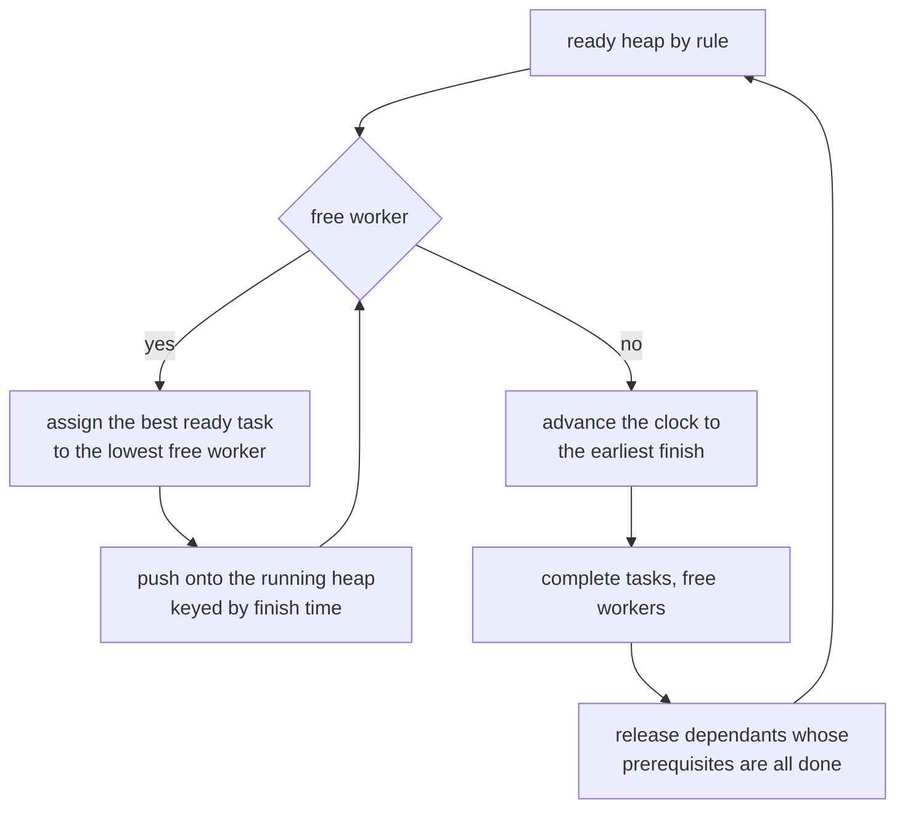
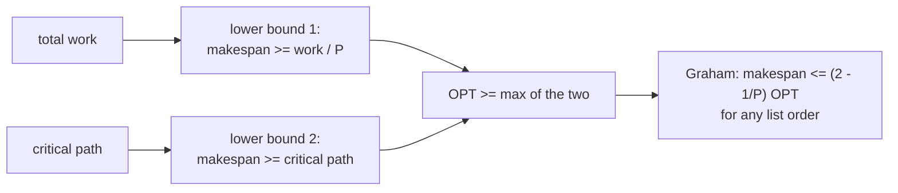
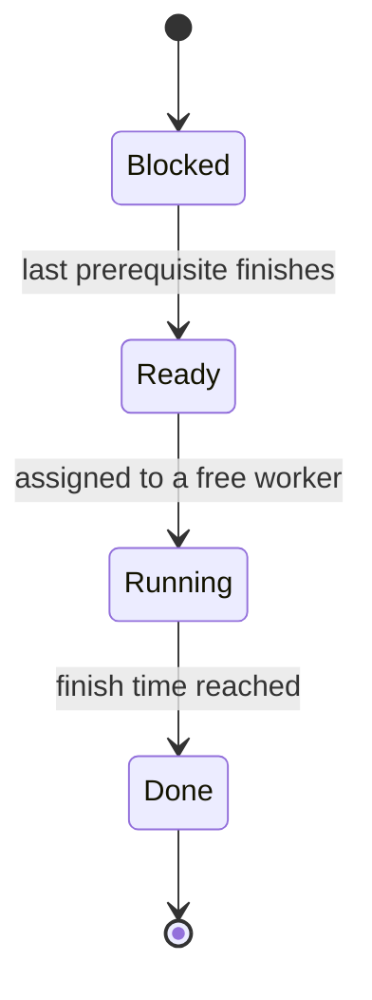
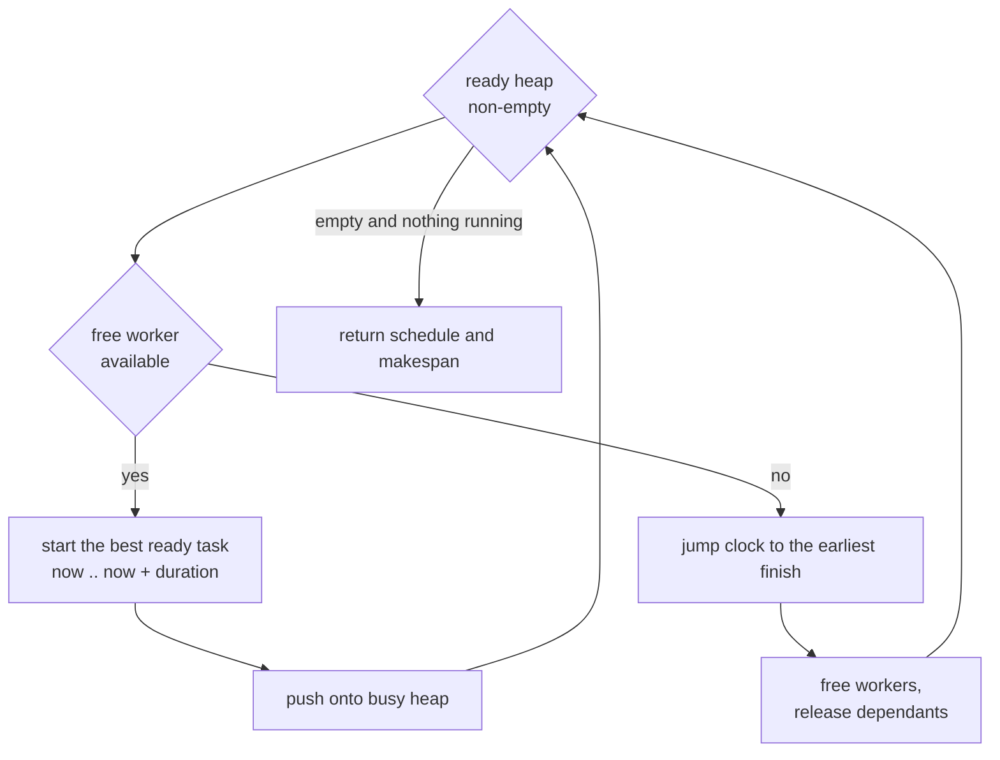

# 510 — Implement task DAG executor with parallel workers (respect dependencies).

> **Tier:** Advanced · **CTCI chapter:** Ch 9 — System Design and Scalability
> **Task spec:** [510-implement-task-dag-executor-with-parallel-workers-respect-depend.md](../../../tasks/advanced/510-implement-task-dag-executor-with-parallel-workers-respect-depend.md)
> **Solutions:** [Python](../../../solutions/python/advanced/510-implement-task-dag-executor-with-parallel-workers-respect-depend/solution.py) ·
> [Java](../../../solutions/java/advanced/510-implement-task-dag-executor-with-parallel-workers-respect-depend/Solution.java) ·
> [JavaScript](../../../solutions/javascript/advanced/510-implement-task-dag-executor-with-parallel-workers-respect-depend/solution.js) ·
> [C#](../../../solutions/csharp/advanced/510-implement-task-dag-executor-with-parallel-workers-respect-depend/Solution.cs)

## 1. Problem restatement

**Input:** a list of `Task(tid, duration, deps)` with unique ids, integer durations and prerequisite
ids that must exist, plus a worker count `P`. Two scheduling rules are provided:
`by_id_rule(task) = (tid,)` and `longest_first_rule(task) = (−duration, tid)` (LPT).

**Output:** a schedule `tid → (start, finish, worker)` and the resulting **makespan**, produced by
three independent formulations that must agree:

1. `simulate_event` — an event-driven loop: a heap of ready tasks keyed by the rule, a heap of running
   tasks keyed by finish time, the best ready task assigned to the lowest-numbered free worker, and
   the clock jumping to the next completion when no worker is free.
2. `simulate_tick` — a tick-by-tick simulation on integer durations that completes finished tasks,
   releases workers, then greedily fills them.
3. `threaded_run` — a real-thread executor where `P` threads pull ready tasks through a lock and
   condition variable; used to exercise the dependency handshake under arbitrary interleavings.

Measured on the shipped code:

| Instance | Result |
| --- | --- |
| hand example `A(3), B(2), C(4)`, `D(1) ← A,B`, `E(1) ← C`, `P = 2` | makespan **`7`**; `A 0-3` on worker `0`, `B 0-2` on worker `1`, `C 2-6` on worker `1`, `D 3-4` on worker `0`, `E 6-7` on worker `0` |
| event versus tick | element-wise identical schedules and makespans on every instance |
| `P = 1` on the hand example | makespan `11` = total work |
| `P = 5` (workers ≥ tasks) | makespan `5` = critical path |
| critical path | `5` (`C 4 + E 1`), cross-checked against brute-force path enumeration |
| LCG DAG `random_dag(6, 7)` | tasks `t0(6), t1(6), t2(2)←t0, t3(8)←t0,t1, t4(4)←t0,t2,t3, t5(5)←t1,t2,t3,t4`; total work `31`, critical path `23` |
| same DAG, `P = 1, 2, 3, 6` | makespans `31`, `23`, `23`, `23`; event and tick identical at every `P` |
| id rule versus LPT on the hand example, `P = 2` | `7` versus `6` — the rule changes the answer, and neither dominates |
| Graham bound | `makespan <= (2 − 1/P) · best_list_makespan` with `best_list_makespan` the minimum over all valid list orders (`23` at `P = 2`, bound `34.5`) |
| threaded run `random_dag(6, 7)`, `P = 3` | all six tasks executed once, every prerequisite before its dependant |
| cyclic graph | rejected by both simulations |

## 2. Intuition

List scheduling is the whole algorithm. Keep two sets — **ready** (prerequisites done, not yet
started) and **running** (assigned, not yet finished) — and at every decision point fill free workers
with the best ready tasks. When no worker is free, time jumps forward to the earliest completion.



Three facts make the results checkable rather than merely plausible:

- **Every schedule satisfies the constraints** — a task starts only after each prerequisite finishes,
  no worker runs two tasks at once, and `total_work <= P · makespan`.
- **The endpoints are closed forms**: with `P = 1` the makespan is exactly the total work (no
  parallelism, no idle time), and with `P >= n` it is exactly the critical path (everything that can
  run in parallel does).
- **The rule matters but neither rule dominates.** On the hand example, id order gives `7` and LPT
  gives `6`; on other instances LPT loses. That is why the tests compare *implementations* for
  equality and only bound the *quality* with Graham's theorem.



The event-driven and tick-by-tick formulations exist to cross-check each other: one jumps between
events, the other steps one time unit at a time, so a bug in the "jump the clock" logic shows up as a
schedule mismatch even when the makespan happens to agree.



## 3. Algorithm

`simulate_event(tasks, workers, rule)`:

1. `_prepare`: assert unique ids, build `by_id`, `indegree = |deps|`, and sorted `dependants`; raise on
   an unknown prerequisite id.
2. Push every task with `indegree == 0` onto the ready heap with key `rule(task)`; keep a min-heap of
   free worker indices.
3. While tasks remain: if a worker is free, pop the best ready task, assign it that worker with
   `start = now`, `finish = now + duration`, and push `(finish, tid)` onto the running heap; otherwise
   pop the earliest finish, set `now` to it, free its worker and release dependants whose indegree
   reached `0`.
4. Return the schedule and `makespan = max(finish)`.

```text
procedure simulate_event(tasks, workers, rule)
    by_id, indegree, dependants ← prepare(tasks)
    free ← min-heap 0 .. workers - 1
    ready ← min-heap of (rule(task), task id) for every task with indegree 0
    busy ← min-heap keyed by finish time
    schedule ← empty
    now ← 0
    while tasks remain do
        if free is not empty and ready is not empty then
            worker ← pop the lowest free worker
            task ← the task of the smallest ready key
            schedule[task] ← (now, now + task.duration, worker)
            push (now + task.duration, task) onto busy
        else
            now ← the finish time of the earliest running task
            for every task finishing at now do
                free its worker
                push the worker back onto free
                for next_task in dependants[task] do
                    indegree[next_task] ← indegree[next_task] - 1
                    if indegree[next_task] = 0 then
                        push its rule key onto ready
                    end
                end
            end
        end
    end
    return schedule, the largest finish time
end
```

```text
procedure critical_path(tasks)
    // longest chain of durations, computed once per task in topological order
    for task in topological order of the DAG do
        finish[task] ← task.duration + max over prerequisites of finish[prerequisite]
    end
    return the largest finish
end
```



`simulate_tick` walks the same state machine one time unit at a time (`for t in range(0, horizon)`),
completing tasks whose finish is `<= t`, releasing their workers and dependants, then filling free
workers greedily. It is slower but it never has to reason about idle time, which is exactly why it is
useful as an oracle.

## 4. Worked example

**Hand example on two workers.** `A(3)`, `B(2)`, `C(4)` are ready at `t = 0`; `D(1)` needs `A` and
`B`; `E(1)` needs `C`:

| Time | Worker 0 | Worker 1 | Event |
| --- | --- | --- | --- |
| `0` | `A` (0-3) | `B` (0-2) | both ready tasks start immediately |
| `2` | `A` | `C` (2-6) | `B` finishes, `C` takes the free worker (lowest free is `1`) |
| `3` | `D` (3-4) | `C` | `A` finishes, releasing `D` |
| `4` | idle | `C` | `D` finishes, nothing else is ready |
| `6` | `E` (6-7) | idle | `C` finishes, releasing `E` |
| `7` | — | — | makespan `7` |

The measured schedule is `A: (0,3,0)`, `B: (0,2,1)`, `C: (2,6,1)`, `D: (3,4,0)`, `E: (6,7,0)`.
Notice that the id rule started `A` and `B` and left `C` waiting for one tick, even though `C` is the
longest task — with LPT the same instance finishes at `6`:

| Rule | Schedule | Makespan |
| --- | --- | --- |
| by id | `A 0-3 (w0)`, `B 0-2 (w1)`, `C 2-6 (w1)`, `D 3-4 (w0)`, `E 6-7 (w0)` | `7` |
| LPT | `C 0-4 (w0)`, `A 0-3 (w1)`, `B 3-5 (w1)`, `E 4-5 (w0)`, `D 5-6 (w0)` | `6` |

`LPT` is better *here* because it front-loads the long task, but the header documents and the tests
only claim that the rules disagree — neither dominates in general.

**The closed forms.** On the hand example the total work is `3 + 2 + 4 + 1 + 1 = 11` and the critical
path is `C → E = 4 + 1 = 5`:

| `P` | Measured makespan | Closed form |
| --- | --- | --- |
| `1` | `11` | total work `11` |
| `5` | `5` | critical path `5` |

**A generated DAG.** `random_dag(6, 7)` produces `t0(6)`, `t1(6)`, `t2(2)←t0`, `t3(8)←t0,t1`,
`t4(4)←t0,t2,t3`, `t5(5)←t1,t2,t3,t4`:

| `P` | Makespan | Comment |
| --- | --- | --- |
| `1` | `31` | serial: total work `31` |
| `2` | `23` | equals the critical path `t1 → t3 → t4 → t5 = 6 + 8 + 4 + 5` |
| `3` | `23` | the chain saturates the critical path |
| `6` | `23` | unlimited workers, still the critical path |

At every `P` the event simulation and the tick simulation produced element-wise identical schedules
and makespans, and `is_valid_schedule` confirmed `start >= finish(prereq)` for every edge, at most one
task per worker at any instant, and `total_work <= P · makespan` (`31 <= 2 · 23`, `31 <= 6 · 23`).
**Graham's bound.** The test cannot compute `OPT` (that is NP-hard), so it uses
`best_list_makespan` — the minimum makespan over all valid list orders, enumerated for `n <= 6` — as a
*certified upper bound* on `OPT`, and asserts `makespan <= (2 − 1/P) · best_list_makespan`. On the
generated DAG at `P = 2` that bound is `1.5 · 23 = 34.5`, satisfied by the observed `23`. The
inequality stays valid because the minimum over feasible schedules is always at least `OPT`.

## 5. Complexity

Let `n` be the number of tasks, `E` the number of dependency edges, `P` the worker count, and
`D = Σ durations` the total work.

| Measure | Bound | Why it holds |
| --- | --- | --- |
| `_prepare` | `O(n + E)` | one pass over tasks and dependencies |
| `simulate_event` | `O(n log n + E log n)` | `O(n)` events, each a heap push/pop |
| `simulate_tick` | `O((makespan + n) · n)` | one scan per time unit over the running set |
| `critical_path` | `O(n + E)` | one pass in topological order |
| `brute_force_critical_path` | exponential | enumerates paths, used only as an oracle |
| `best_list_makespan` | `O(n! · n log n)` | all list orders, with a cutoff for `n > 6` |
| `threaded_run` | `O(n log n + E log n)` plus lock traffic | same work, contended handshake |
| Space | `O(n + E)` | schedules, heaps and adjacency |

The interesting column is `simulate_tick`: it is `O(makespan)` *unnecessarily* — the event version
skips idle intervals — but that is the point of having both. With `D = 31` and `P = 2` the difference
is invisible; with long idle gaps it is the difference between simulating time and simulating work.

## 6. Pitfalls and edge cases

- **Unknown prerequisites are an error.** Unlike the graph scheduler in
  [509-implement-dependency-graph-scheduling-topo-priorities.md](../../../tasks/advanced/509-implement-dependency-graph-scheduling-topo-priorities.md),
  the executor requires its prerequisite ids to name real tasks and raises `ValueError` otherwise;
  this model has no notion of an external dependency.
- **Duplicate ids.** `_prepare` asserts uniqueness, because the schedule is keyed by `tid`.
- **Zero workers.** `simulate_event` raises `ValueError`; a schedule with no machines is undefined.
- **`P = 1` is a closed form, not an approximation.** Exactly the total work, asserted directly.
- **`P >= n` is the critical path.** Also asserted directly, and the critical path itself is
  cross-checked against brute-force enumeration of all paths.
- **Idle time is legitimate.** `D` starts at `3` because `A` finishes then; the worker sits idle at
  `t = 4` because nothing is ready until `C` finishes. A "no idle time" invariant would be wrong.
- **Lowest-numbered free worker.** The assignment rule is part of the output (it is compared between
  formulations), so any tie-break change alters the schedule even when the makespan does not.
- **Ties inside the rule.** `by_id_rule` breaks ties by id and `longest_first_rule` by `(−duration, tid)`;
  without the id component two equally long tasks would be ordered arbitrarily.
- **Rule quality is not monotone.** LPT wins on the hand example (`6` versus `7`) and can lose on
  other instances; the tests never assert that the id rule is optimal, only that schedules are valid
  and inside Graham's bound.
- **Graham's bound needs a certified `OPT` bound.** Using `best_list_makespan` (a minimum over
  feasible schedules) keeps the inequality safe; substituting an underestimate of `OPT` would not.
- **Threads assert only stable invariants.** The real-thread executor checks "one execution per task"
  and "every prerequisite logged before its dependant" — it deliberately does not assert a particular
  interleaving, because the OS decides that.
- **Cyclic graphs are rejected.** Both simulations return failure rather than a partial schedule; the
  DAG assumption is enforced, not assumed.

## 7. Variants and follow-ups

- **Scheduling order without workers.** [509-implement-dependency-graph-scheduling-topo-priorities.md](../../../tasks/advanced/509-implement-dependency-graph-scheduling-topo-priorities.md)
  answers "which order is valid and lexicographically smallest"; this task answers "how long does it
  take".
- **Critical-path priority.** Ranking ready tasks by the longest remaining path (rather than by id or
  duration) is the standard improvement over both rules implemented here, at the cost of a `O(n + E)`
  pass per decision.
- **Work stealing.** Instead of a shared ready heap, idle workers steal from busy ones; the makespan
  properties and Graham's bound carry over, the bookkeeping does not.
- **Retry and failure.** A task that fails mid-run needs backoff and a dead-letter policy — see
  [508-implement-background-job-scheduler-with-retry-backoff-semantics.md](../../../tasks/advanced/508-implement-background-job-scheduler-with-retry-backoff-semantics.md).
- **Crash recovery.** If the executor dies, work already committed must not be redone:
  [511-implement-checkpointed-parallel-map-reduce-worker-for-crash-reco.md](../../../tasks/advanced/511-implement-checkpointed-parallel-map-reduce-worker-for-crash-reco.md).
- **Rate limits as a side constraint.** A worker pool can also be throttled by a global budget, which
  is the admission control of
  [506-implement-rate-limited-queue-with-leaky-bucket-test-harness.md](../../../tasks/advanced/506-implement-rate-limited-queue-with-leaky-bucket-test-harness.md).

## 8. Check yourself

1. Why is the makespan exactly the total work when `P = 1`?

<details><summary>Show answer</summary>

With one worker there is never a choice: the single worker runs one task at a time and never idles
while work is ready, so its busy time is `Σ durations = 11` on the hand example and `31` on the
generated DAG. The test asserts the equality rather than a bound, which makes it a strong check on the
accounting of durations.

</details>

2. Why is the makespan exactly the critical path when `P >= n`?

<details><summary>Show answer</summary>

Every task gets its own worker, so all ready tasks start at the earliest legal instant and each task's
start equals the maximum finish time of its prerequisites. The finish of the last task is then the
longest path of durations, i.e. the critical path (`5` on the hand example, `23` on the generated
DAG), and the test cross-checks that number against brute-force path enumeration.

</details>

3. The id rule and LPT disagree on the hand example. Which is correct?

<details><summary>Show answer</summary>

Neither — both are correct *schedules*: all dependencies are respected and no worker is double-booked.
`OPT` for that instance is `5` (the critical path with unlimited workers), but with `P = 2` the list
rules reach `7` and `6`, both inside Graham's bound. The header documents explicitly that the rules
matter and that neither dominates.

</details>

4. What is `best_list_makespan` used for, and why is it not simply called `OPT`?

<details><summary>Show answer</summary>

It is the minimum makespan over all *valid list orders*, enumerated by brute force for `n <= 6`. It
upper-bounds `OPT` (the true minimum over all feasible schedules), because every list order is a
feasible schedule but not conversely. Graham's bound is asserted as
`makespan <= (2 − 1/P) · best_list_makespan`, which is safe precisely because the right-hand side is
the larger quantity.

</details>

5. Why does the tick simulation exist if the event simulation is faster?

<details><summary>Show answer</summary>

As an independent oracle. The event version reasons about idle time by jumping the clock to the next
completion, which is exactly where off-by-one errors hide; the tick version advances one time unit at
a time and completes anything due at or before the current tick. Their element-wise agreement at
`P = 1, 2, 3, 6` is a much stronger statement than matching makespans alone.

</details>
