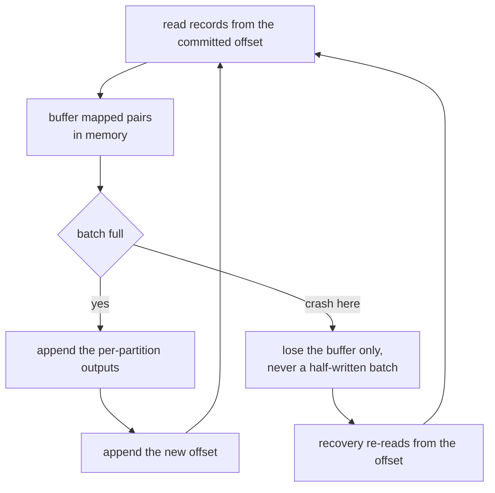
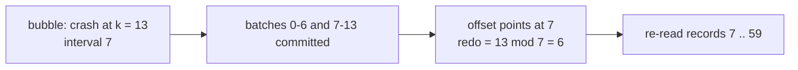
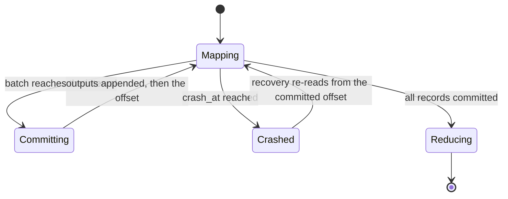
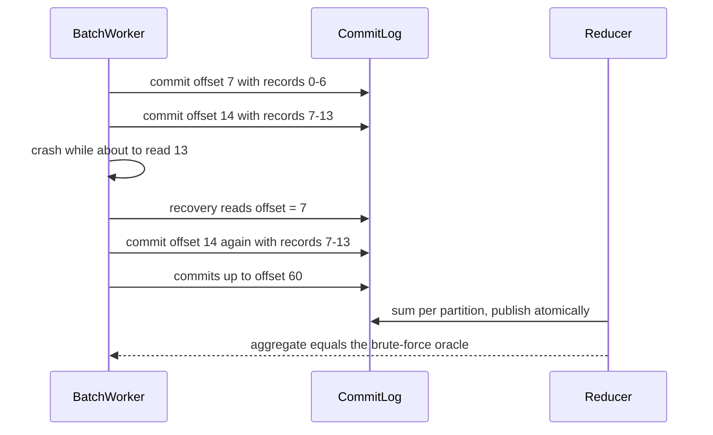

# 511 — Implement checkpointed parallel map-reduce worker for crash recovery.

> **Tier:** Advanced · **CTCI chapter:** Ch 9 — System Design and Scalability
> **Task spec:** [511-implement-checkpointed-parallel-map-reduce-worker-for-crash-reco.md](../../../tasks/advanced/511-implement-checkpointed-parallel-map-reduce-worker-for-crash-reco.md)
> **Solutions:** [Python](../../../solutions/python/advanced/511-implement-checkpointed-parallel-map-reduce-worker-for-crash-reco/solution.py) ·
> [Java](../../../solutions/java/advanced/511-implement-checkpointed-parallel-map-reduce-worker-for-crash-reco/Solution.java) ·
> [JavaScript](../../../solutions/javascript/advanced/511-implement-checkpointed-parallel-map-reduce-worker-for-crash-reco/solution.js) ·
> [C#](../../../solutions/csharp/advanced/511-implement-checkpointed-parallel-map-reduce-worker-for-crash-reco/Solution.cs)

## 1. Problem restatement

**Input:** a list of records (`60` word bags of `4` words from a `12`-word vocabulary, LCG seed `5`),
split contiguously across `workers = 3` (splits of `20, 20, 20`), a commit interval of `7` records, and
`partitions = 3` reducers. `map_record` emits `(word, 1)` pairs; `partition_of(key, n)` routes a key by
`sum(ord(ch)) mod n` (`alpha → 2`, `zeta → 1`).

**Output:** a durable, crash-recoverable run built from three pieces:

- **`CommitLog`** — an append-only store with per-split `offsets`, per-split `history`, per-partition
  `outputs`, a `commits` counter and the published `reduce_output`.
- **`BatchWorker`** — reads its split from the committed offset, buffers mapped records and commits a
  whole batch at once: **first** the per-partition output records, **then** the offset of the next
  record. `run(crash_at=k)` simulates a crash while reading record `k`.
- **`reduce_all`** — sums the committed outputs per partition; `brute_force_aggregate` computes the
  same aggregation straight from the raw records as an oracle.

Measured on the shipped code:

| Check | Value |
| --- | --- |
| crash-free run | `9` commits, final offset `60` — and `9 == ceil(60 / 7)` |
| reduce output | identical to `brute_force_aggregate` |
| every crash point in `0 … 59` | recovers; the final output still equals the brute-force aggregation |
| recomputation after a crash at `k` | exactly `k mod 7` records |
| measured crash points | `k = 0 → 0`, `k = 1 → 1`, `k = 3 → 3`, `k = 6 → 6`, `k = 7 → 0`, `k = 13 → 6`, `k = 59 → 3` |
| multi-crash `10` then `40` | recovers, total redo is the sum of the individual redos |
| offsets | monotone non-decreasing, ending at the split length |
| reduce during a crash | the aggregate is unchanged, because each partition is published atomically |
| three splits with crashes in different splits | each split's output intact — one split's log cannot corrupt another's |
| threaded run of the same three splits | same aggregate, with only interleaving-independent invariants asserted |

## 2. Intuition

The classic trick of fault-tolerant batch processing is that **recomputation is cheaper than
coordination**. Do not try to make the worker's memory durable; make its *input position* durable and
recompute whatever was lost.

A worker therefore commits in two steps, in this order: first the output records it produced for the
batch, then the offset of the next unread record. A crash between the two leaves a log whose outputs
contain the whole batch but whose offset still points at the beginning of that batch — so the
recovery re-reads those records and processes them again. Because `map` is deterministic and the
reduction is a sum, applying the same records twice is harmless in the output: the batch is written
once, the work is done twice.



This is **at-least-once processing with effectively-once output**. At-least-once, because a crash
replays a batch; effectively-once, because the durable outputs contain whole batches only and nothing
is committed twice. The price is exactly the redo the interval controls: a crash after `k` records of
work leaves `k mod interval` records to redo.



The reduce side has the same shape. Each partition's aggregate is *published atomically*, so a crash
in the middle of a reduce simply discards it and re-runs it from the committed map outputs. Nothing
about the map work needs to be repeated, which is what keeps the recovery cost proportional to the
uncommitted tail rather than to the whole split.

## 3. Algorithm

1. `split_records(records, workers)`: contiguous balanced splits (`size, extra = divmod(n, workers)`).
2. `BatchWorker.run(crash_at=None)`: loop with `offset = log.offsets[split_id]`; for each record,
   if `offset == crash_at` raise to simulate the crash, otherwise map it and append the pairs to the
   batch buffer; when `len(batch) == interval`, call `log.commit(split, offset + 1, batch)` and clear.
3. `CommitLog.commit(split, new_offset, batch)`: assert `new_offset >= offsets[split]`, append the
   records into `outputs[(split, partition)]`, append to `history[split]`, set the offset, and
   increment `commits`.
4. `run_split(worker, crashes)`: run, catch the simulated crash, then run again — this is recovery.
5. `reduce_all(log, partitions)`: sum every `(key, value)` per partition, publishing each partition's
   aggregate through `log.publish`.
6. `brute_force_aggregate(records, partitions)`: map and route every raw record directly, as the
   independent oracle.

```text
procedure run(crash_at)
    offset ← log.offsets[split_id]
    batch ← empty
    while offset &lt; length(records) do
        if offset = crash_at then
            raise crash                      // the buffer is lost with the process
        end
        for (key, value) in map(records[offset]) do
            append (partition_of(key), key, value) to batch
        end
        offset ← offset + 1
        if length(batch) &gt;= interval then
            log.commit(split_id, offset, batch)    // outputs first, then the offset
            batch ← empty
        end
    end
    if batch is not empty then
        log.commit(split_id, offset, batch)
    end
end
```

```text
procedure commit(split, new_offset, batch)
    assert new_offset &gt;= offsets[split]
    for (partition, key, value) in batch do
        append (key, value) to outputs[(split, partition)]
    end
    append (new_offset, length(batch)) to history[split]
    offsets[split] ← new_offset
    commits ← commits + 1
end
```

```text
procedure reduce_all(log, partitions)
    for partition in 0 .. partitions - 1 do
        totals ← empty
        for each split do
            for (key, value) in outputs[(split, partition)] do
                totals[key] ← totals[key] + value
            end
        end
        publish partition with totals        // atomic: a crash here re-runs the reduce
    end
    return the published aggregates
end
```



## 4. Worked example

**Batch structure for a `60`-record split with `interval = 7`.** Batches end after records
`6, 13, 20, 27, 34, 41, 48, 55` and the final partial batch after record `59`:

| Commit | New offset | Records in the batch |
| --- | --- | --- |
| 1 | `7` | `0 … 6` |
| 2 | `14` | `7 … 13` |
| 3 | `21` | `14 … 20` |
| 4 | `28` | `21 … 27` |
| 5 | `35` | `28 … 34` |
| 6 | `42` | `35 … 41` |
| 7 | `49` | `42 … 48` |
| 8 | `56` | `49 … 55` |
| 9 | `60` | `56 … 59` — the partial tail |

That is `9 = ceil(60 / 7)` commits, ending with `offsets[0] == 60`, exactly as asserted.

**Crash points and redo.** A crash at `k` happens while about to read record `k`, so the committed
offset is `floor(k / 7) · 7` and the redo is `k − floor(k / 7) · 7 = k mod 7`:

| Crash at `k` | Committed offset | Records redone | Output equals brute force |
| --- | --- | --- | --- |
| `0` | `0` | `0` | yes |
| `1` | `0` | `1` | yes |
| `3` | `0` | `3` | yes |
| `6` | `0` | `6` | yes |
| `7` | `7` | `0` | yes |
| `13` | `7` | `6` | yes |
| `59` | `56` | `3` | yes |

The `k = 7` and `k = 0` rows are the boundary cases: a crash exactly at a batch boundary redoes
nothing, because committing the outputs and the offset is the last thing that happens in a batch.
Every one of the `60` crash points recovers to the same final output, which is the strongest form of
the claim — not a sample, the whole set.

**The reduce oracle.** The three-partition aggregation of the run, computed by `reduce_all` and
matched against `brute_force_aggregate`:

| Partition | Word → count |
| --- | --- |
| `0` | `theta: 21, kappa: 22, iota: 18, epsilon: 26, delta: 20, lambda: 22` |
| `1` | `zeta: 24, beta: 17, mu: 12` |
| `2` | `eta: 26, gamma: 21, alpha: 11` |

`partition_of` is a pure function of the key, so every occurrence of `alpha` lands in partition `2` no
matter which split produced it — that is why summing per partition across splits is well defined.



**Multi-crash and cross-split isolation.** Two crashes in one run (`10` then `40`) recover with the
sum of the individual redos (`3 + 5 = 8` records re-read), and the output still matches the oracle.
With three splits, crashes in different splits leave each other's logs untouched: offsets, outputs and
history are all keyed by `split_id`, so a re-read in one split cannot perturb another's.

## 5. Complexity

Let `n` be the records per split, `I` the commit interval, `W` the number of splits, `P` the number of
partitions, and `C = ceil(n / I)` the commit count.

| Measure | Bound | Why it holds |
| --- | --- | --- |
| Crash-free run | `O(n · words)` | each record mapped once |
| Commits | `C = ceil(n / I)` | one commit per full batch plus the partial tail |
| Work per commit | `O(I · words)` | the batch is appended whole |
| Redo after a crash at `k` | `O((k mod I) · words)` | only the uncommitted tail is re-read |
| Multi-crash redo | sum of the individual redos | each recovery restarts from a committed offset |
| Reduce | `O(total records)` | one pass over the committed outputs |
| Space | `O(committed outputs)` | the log grows with the input, the buffer stays `O(I)` |

The design parameter is `I`: commit too rarely and the redo grows to `n`; commit too often and the
`O(C)` log appends dominate. The `k mod I` formula is what makes the trade-off measurable rather than
hand-wavy, and the tests assert it exactly.

## 6. Pitfalls and edge cases

- **Outputs before the offset.** Reversing the order would let a crash leave an offset past records
  whose outputs were never written — silent data loss instead of a redo.
- **A crash loses the whole batch, never half of it.** The buffer lives in memory and is committed in
  one call, so the durable state is always "whole batches committed, offset at a batch start".
- **Offsets must be monotone.** `commit` asserts `new_offset >= offsets[split]`; a decreasing offset
  would re-read committed records and double-count them in the reduce.
- **Partial batches still commit.** The `56 … 59` tail is committed even though it is shorter than the
  interval, which is why the final offset is exactly `60` and the commit count is `ceil(60 / 7)`.
- **Crash exactly at a boundary is free.** `k = 7` and `k = 0` redo `0` records; the crash happens
  before any work of the next batch.
- **The reduce must be idempotent per partition.** Publishing replaces the partition's aggregate
  wholesale; incrementing it would double-count after a reduce crash.
- **Determinism is required for replay.** `map_record` and `partition_of` are pure and the records come
  from a seeded LCG, so re-running a batch produces exactly the same pairs. A nondeterministic map
  would make the "same output after recovery" claim meaningless.
- **Per-split isolation.** Offsets, outputs, history and commits are all keyed by split; a crash in one
  split cannot corrupt another's log, which the multi-split scenario asserts explicitly.
- **Threads assert invariants, not schedules.** The threaded run checks that each record is processed
  at least once and that committed offsets stay monotone; asserting a particular interleaving would
  make the test flaky.
- **Recovery is not a rollback.** Records already committed are never undone; the job's guarantee is
  at-least-once processing with effectively-once *output*, not exactly-once execution.
- **The log grows with the input.** This model keeps every committed batch; compaction (keeping only
  the offset and the aggregates) is the production step left out here, and it is why the space column
  says `O(committed outputs)` rather than `O(I)`.

## 7. Variants and follow-ups

- **Optimistic checkpointing without a log.** [481-implement-optimistic-checkpointing-restart-simulation.md](../../../tasks/advanced/481-implement-optimistic-checkpointing-restart-simulation.md)
  snapshots progress every `interval` steps and rolls back to the last snapshot — the same
  `k mod interval` arithmetic with idempotent effects instead of a commit log.
- **Exactly-once with idempotent sinks.** If the downstream store can detect duplicate writes (a key,
  a sequence number), the batch can be committed twice safely and the redo becomes invisible.
- **Parallel workers on the same DAG.** [510-implement-task-dag-executor-with-parallel-workers-respect-depend.md](../../../tasks/advanced/510-implement-task-dag-executor-with-parallel-workers-respect-depend.md)
  schedules the units of work; this task is about what happens when one of them dies mid-unit.
- **Deciding what to run next.** The unit graph, including the retry policy for a unit that fails
  rather than crashes, is the scheduler's job —
  [509-implement-dependency-graph-scheduling-topo-priorities.md](../../../tasks/advanced/509-implement-dependency-graph-scheduling-topo-priorities.md)
  and [508-implement-background-job-scheduler-with-retry-backoff-semantics.md](../../../tasks/advanced/508-implement-background-job-scheduler-with-retry-backoff-semantics.md).
- **Caching the recomputation away.** A durable response cache with a Bloom-filter negative layer
  ([505-implement-bloom-filter-backed-cache-for-web-responses-simulation.md](../../../tasks/advanced/505-implement-bloom-filter-backed-cache-for-web-responses-simulation.md))
  is the complementary idea: avoid doing the work in the first place.

## 8. Check yourself

1. Why is the output "effectively once" when the processing is at least once?

<details><summary>Show answer</summary>

Because the commit is atomic at batch granularity: outputs and the new offset are written together, so
a recovered run only re-reads records whose outputs were never durably written. Those records are
processed again — that is the "at least once" — but the durable outputs contain each batch exactly
once, and the deterministic map plus the summing reduce makes the repeated CPU work irrelevant to the
final aggregate.

</details>

2. A crash happens while about to read record `13` with `interval = 7`. How much work is redone?

<details><summary>Show answer</summary>

`13 mod 7 = 6` records. Batches `0 … 6` and `7 … 13` were committed, so the offset is `7`, and the
records `7 … 12` are re-mapped in full even though batch `7 … 13` may already have been written by an
earlier commit — the offset, not the outputs, decides where to resume. The `k = 7` case redoes `0`,
which is the boundary worth memorising.

</details>

3. What would break if `commit` wrote the offset before the outputs?

<details><summary>Show answer</summary>

A crash between the two writes would leave an offset past records whose outputs were never durably
written. Recovery would resume after them, so those records would be silently missing from the
aggregate — data loss instead of a redo. The order is the whole correctness argument for the
at-least-once property.

</details>

4. Why does the test enumerate all `60` crash points instead of a few?

<details><summary>Show answer</summary>

Because the interesting failures are boundary cases. `k = 0` and `k = 7` redo nothing; `k = 6` and
`k = 13` redo everything in their batch; `k = 59` exercises the partial tail. A sample of three points
would miss at least one of those categories, and the full sweep is cheap (60 short runs).

</details>

5. How does the threaded run avoid flaky assertions?

<details><summary>Show answer</summary>

It asserts only interleaving-independent properties: every record is processed at least once, every
prerequisite output is logged before its dependant consumes it, and committed offsets are monotone.
The shared log is appended under a lock, so those invariants hold for *any* interleaving, whereas
asserting a particular order of execution would make the test fail intermittently depending on the OS
scheduler.

</details>
