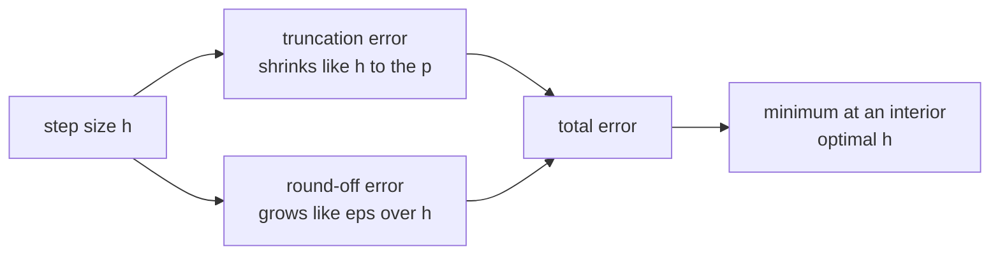
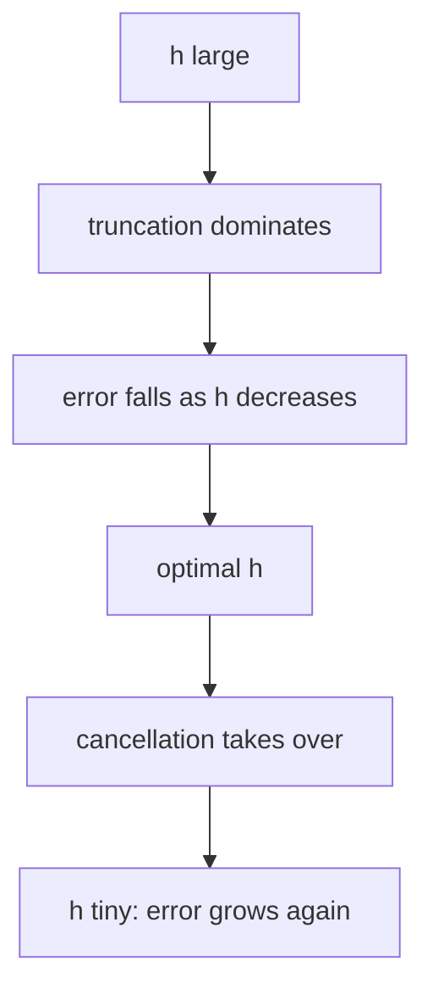
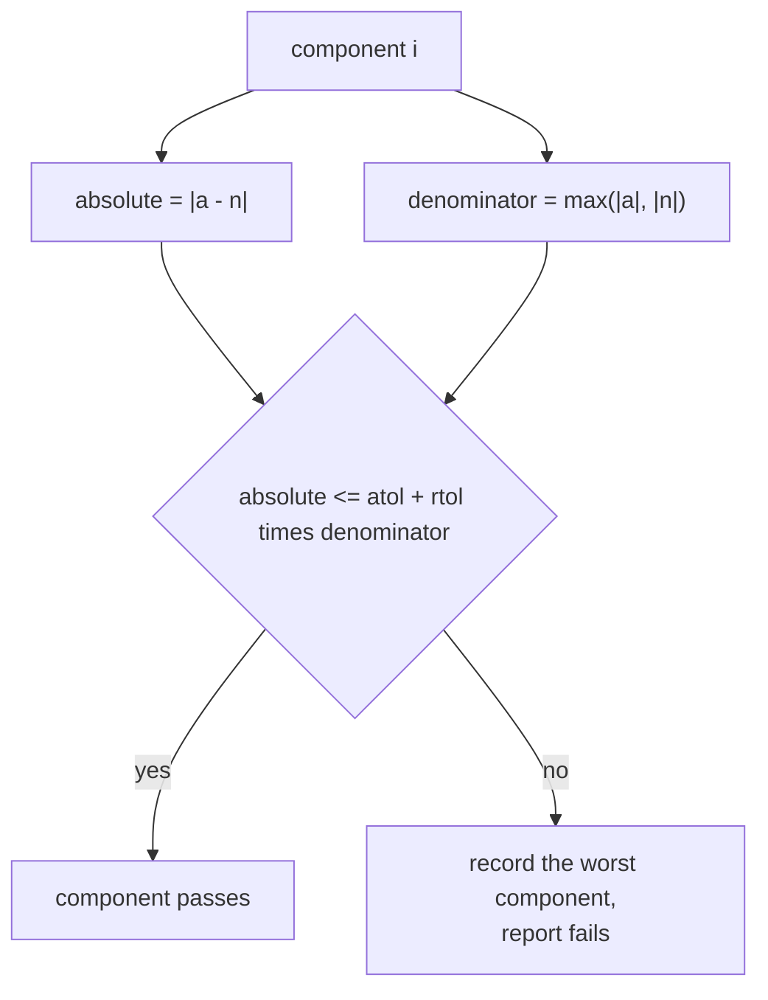
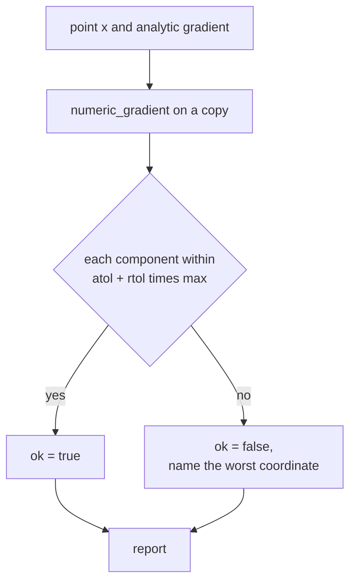

# 512 — Implement gradient check numerical derivative utility.

> **Tier:** Advanced · **CTCI chapter:** Beyond — Machine Learning & AI
> **Task spec:** [512-implement-gradient-check-numerical-derivative-utility.md](../../../tasks/advanced/512-implement-gradient-check-numerical-derivative-utility.md)
> **Solutions:** [Python](../../../solutions/python/advanced/512-implement-gradient-check-numerical-derivative-utility/solution.py) ·
> [Java](../../../solutions/java/advanced/512-implement-gradient-check-numerical-derivative-utility/Solution.java) ·
> [JavaScript](../../../solutions/javascript/advanced/512-implement-gradient-check-numerical-derivative-utility/solution.js) ·
> [C#](../../../solutions/csharp/advanced/512-implement-gradient-check-numerical-derivative-utility/Solution.cs)

## 1. Problem restatement

**Input:** a scalar function `f`, a vector-valued function, a point `x`, a step `h`, and an
**analytic** gradient to check.

**Output:** numeric derivatives, a comparison report, and a step-size sweep. The utility provides:

| Function | Definition |
| --- | --- |
| `forward_difference(f, x, i, h)` | `(f(x + h eᵢ) − f(x)) / h` — first-order accurate |
| `central_difference(f, x, i, h)` | `(f(x + h eᵢ) − f(x − h eᵢ)) / 2h` — second-order accurate |
| `richardson(f, x, i, h)` | `(−f(x + 2h eᵢ) + 8f(x + h eᵢ) − 8f(x − h eᵢ) + f(x − 2h eᵢ)) / 12h` — fourth-order accurate |
| `numeric_gradient(f, x, h, method)` | the stencil applied to every coordinate |
| `numeric_jacobian(f, x, h, method)` | row `r` is the gradient of output `r` |
| `gradient_error(analytic, numeric)` | `(max_abs, max_rel, worst_index)` |
| `check_gradient(f, grad_f, x, h, rtol, atol, method)` | `True` when `|a − n| <= atol + rtol · max(|a|, |n|)` for every component, plus a report |
| `sweep(f, grad_f, x, exponents, method)` | the absolute error for `h = 10⁻ᵏ`, `k = 1 … 16` |

Measured on the shipped code (default `h = 1e-5`, `rtol = 1e-5`, `atol = 1e-8`):

| Check | Value |
| --- | --- |
| `f = Σ xᵢ³` at `(1, 2, −3)`, analytic `(3, 12, 27)` | central error `2.562e-10` (`<= 1e-9`) |
| convergence order on `Σ xᵢ⁵` at `(1.5, −2, 0.5)`, halving `h` from `1e-2` to `5e-3` | forward `0.796 → 0.399` (factor `2.00`), central `4.000e-3 → 1.000e-3` (factor `4.00`), Richardson `4.000e-8 → 2.502e-9` (factor `15.99`) |
| Richardson on a cubic | `5.755e-13` — the fourth-order stencil is *exact* for degree ≤ 3, so only round-off remains |
| `sweep` on `Σ xᵢ³` at `(1, 2, −3)` | `h = 1e-1` gives `1.0e-2`, minimum `2.562e-10` at `h = 1e-5`, `h = 1e-16` gives `27.0` |
| `sweep` on `Σ xᵢ⁵` | minimum `2.300e-9` at `h = 1e-6` |
| `sweep` on `Σ xᵢ²` at `(1, 2, 3)` | `h = 1e-1` already gives `5.33e-15`, `h = 1e-16` gives `6.0` |
| Jacobian of `[x₀x₁, sin x₀ + x₁², e^{x₀} − x₁]` at `(0.5, 1.5)` | `[[1.5, 0.5], [0.877583, 3.0], [1.648721, −1.0]]` = `[[x₁, x₀], [cos x₀, 2x₁], [e^{x₀}, −1]]` |
| vector function at that point | `[0.75, 2.729426, 0.148721]` |
| correct analytic gradient | accepted: `max_abs 2.562e-10`, `max_rel 2.135e-11` |
| wrong analytic gradient (`3x₀² + 1` in coordinate `0`) | rejected, report names coordinate `0` with `(analytic 4.0, numeric 3.0)` |
| `f = exp(Σ x)` at `(8, 9, 10)` — `f = 5.32e11` | `max_abs = 10.37` but `max_rel = 1.95e-11`: relative error is the meaningful metric |
| `f = Σ xᵢ²` at the origin (truly zero gradient) | accepted with `max_abs = 0.0` and no worst coordinate |
| input mutation | `x` is unchanged after `numeric_gradient` and `numeric_jacobian` |

## 2. Intuition

An analytic gradient is invisible until it is wrong. A sign error in one coordinate passes every
sanity check a developer is likely to run — the loss decreases, the training proceeds, the model is
merely worse — so the only reliable test is to compare it against a numerically differentiated
reference on a small input.

Each stencil trades truncation error against round-off error. Taylor expansion gives the leading
truncation term: forward is `O(h)`, central is `O(h²)`, and the Richardson combination cancels the
`h²` and `h⁴` terms to leave `O(h⁶)` for smooth functions (measured as fourth-order behaviour on the
quintic: `4.000e-8 → 2.502e-9` when `h` halves). Round-off, meanwhile, grows like `eps / h` because
`f(x + h) − f(x)` loses significant digits. The sum of the two has an interior minimum, which is the
whole art of numerical differentiation.



On `Σ xᵢ³` the measured sweep shows exactly that shape: `1.0e-2` at `h = 1e-1`, a minimum of
`2.562e-10` at `h = 1e-5`, and `27.0` at `h = 1e-16`, where `f(x + h) − f(x)` is pure cancellation
noise on values of order `1`.



The third idea is **how to compare**. Absolute error is meaningless for a function whose gradient is
`1e11`: `exp(Σx)` at `(8, 9, 10)` has `max_abs = 10.37`, which looks terrible, yet `max_rel = 1.95e-11`.
Conversely a relative test is meaningless when the true derivative is zero — dividing by zero — which
is why `check_gradient` uses the mixed criterion
`|a − n| <= atol + rtol · max(|a|, |n|)` and reports both numbers. For a genuinely zero gradient the
absolute term carries the test, and `f = Σ xᵢ²` at the origin is accepted with `max_abs = 0.0`.



## 3. Algorithm

1. `_shifted(x, i, delta)` returns a **copy** of `x` with `x[i] += delta`; every stencil evaluates the
   function on fresh lists, so the caller's point is never mutated.
2. The three stencils evaluate `f` once (forward), twice (central) or four times (Richardson) per
   coordinate.
3. `numeric_gradient` applies the chosen stencil to every coordinate.
4. `numeric_jacobian` evaluates the vector function once, then builds a scalar closure per output row
   and applies the stencil coordinate-wise, giving an `outputs × inputs` matrix.
5. `gradient_error` returns `(max_abs, max_rel, worst_index)` with `worst` tracking the largest
   absolute error.
6. `check_gradient` computes the analytic and numeric gradients, applies the mixed tolerance per
   component, and fills a report with `max_abs`, `max_rel`, the worst `(index, analytic, numeric)`
   triple and `ok`.
7. `sweep` repeats `check_gradient`'s numeric half for `h = 10⁻ᵏ`, returning `(h, max_abs)` pairs.

```text
procedure numeric_gradient(f, x, h, method)
    return [ method(f, x, i, h) for i in 0 .. length(x) - 1 ]
end

procedure central_difference(f, x, i, h)
    plus ← f(shifted(x, i, h))
    minus ← f(shifted(x, i, -h))
    return (plus - minus) / (2 * h)
end

procedure richardson(f, x, i, h)
    numerator ← -f(shifted(x, i, 2h)) + 8 f(shifted(x, i, h))
                 - 8 f(shifted(x, i, -h)) + f(shifted(x, i, -2h))
    return numerator / (12 * h)
end
```

```text
procedure check_gradient(f, grad_f, x, h, rtol, atol, method)
    analytic ← grad_f(copy of x)
    numeric ← numeric_gradient(f, x, h, method)
    ok ← true
    max_abs ← 0; max_rel ← 0; worst ← none
    for index in 0 .. length(analytic) - 1 do
        a ← analytic[index]; n ← numeric[index]
        absolute ← |a - n|
        denominator ← max(|a|, |n|)
        relative ← absolute / denominator if denominator &gt; 0 else 0
        if absolute &gt; max_abs then
            max_abs ← absolute; worst ← (index, a, n)
        end
        max_rel ← max(max_rel, relative)
        if absolute &gt; atol + rtol * denominator then
            ok ← false
        end
    end
    return ok, report with max_abs, max_rel, worst
end
```



## 4. Worked example

**Order of accuracy.** `f = Σ xᵢ⁵` at `(1.5, −2, 0.5)`, comparing the error at `h = 1e-2` and
`h = 5e-3`:

| Stencil | Error at `h = 1e-2` | Error at `h = 5e-3` | Reduction | Order |
| --- | --- | --- | --- | --- |
| forward | `7.960e-01` | `3.990e-01` | `2.00` | `h¹` |
| central | `4.000e-03` | `1.000e-03` | `4.00` | `h²` |
| Richardson | `4.000e-08` | `2.502e-09` | `15.99` | `h⁴` |

The measured factors *are* the orders, which is exactly what the assertions check with bracket
tolerances. On a cubic the same comparison would be misleading: `Σ xᵢ³` has zero fourth derivative,
so the Richardson error at `h = 1e-2` is already `5.755e-13` — pure round-off, and halving `h` does not
improve it by `16`.

**The error curve.** `sweep` on `Σ xᵢ³` at `(1, 2, −3)`:

| `h` | `max_abs` | Regime |
| --- | --- | --- |
| `1e-1` | `1.000e-02` | truncation dominates |
| `1e-3` | `1.000e-06` | truncation still shrinking |
| `1e-5` | `2.562e-10` | minimum |
| `1e-8` | `~1e-8` | cancellation rising |
| `1e-16` | `27.0` | the subtraction is pure noise |

The minimum is strictly inside the sweep, as the test requires. The location is data-dependent: on
`Σ xᵢ⁵` it moves to `h = 1e-6` (error `2.300e-9`), and on the shallow `Σ xᵢ²` it sits at `h = 1e-1`
with `5.33e-15`, because the values are small enough that few digits are lost until `h` is
vanishingly small.

**The Jacobian.** A vector function and its measured derivative at `(0.5, 1.5)`, where the function
value is `[0.75, 2.729426, 0.148721]`:

| Row | Numeric Jacobian | Analytic | Formula |
| --- | --- | --- | --- |
| `x₀x₁` | `[1.5, 0.5]` | `[x₁, x₀]` | product rule |
| `sin x₀ + x₁²` | `[0.877583, 3.0]` | `[cos x₀, 2x₁]` | `cos 0.5 = 0.877583`, `2 · 1.5 = 3.0` |
| `e^{x₀} − x₁` | `[1.648721, −1.0]` | `[e^{x₀}, −1]` | `e^{0.5} = 1.648721` |

The matrix is `3 × 2` — outputs by inputs — and it is (correctly) not symmetric, which the test
asserts so that a transposed Jacobian cannot pass.
**Accept and reject.** For `Σ xᵢ³` at `(1, 2, −3)`:

| Analytic gradient | `ok` | `max_abs` | `max_rel` | Worst coordinate |
| --- | --- | --- | --- | --- |
| correct `(3x₀², 3x₁², 3x₂²) = (3, 12, 27)` | `True` | `2.562e-10` | `2.135e-11` | — |
| perturbed `(3x₀² + 1, 3x₁², 3x₂²)` | `False` | `1.0` | `0.25` | `0` with analytic `4.0` versus numeric `3.000000000064...` |

The report's `worst` triple is what makes the utility usable in practice: it names the coordinate and
shows both values, so a bug in one branch of a hand-written backward pass is located immediately.

**Absolute versus relative.** `f = exp(Σ x)` at `(8, 9, 10)` evaluates to `5.32e11` and has a gradient
of the same magnitude. The check passes with `max_abs = 10.37` — which would look like a failure under
an absolute-only test — because `max_rel = 1.95e-11`. Conversely the truly zero gradient of `Σ xᵢ²` at
the origin is accepted with `max_abs = 0.0`, where the relative test has nothing to divide by and the
`atol` term carries it.

## 5. Complexity

Let `d` be the dimension, `m` the number of outputs, and `cost(f)` the cost of one function
evaluation.

| Measure | Bound | Why it holds |
| --- | --- | --- |
| Forward stencil | `2 · cost(f)` per coordinate | one shifted call plus the base value |
| Central stencil | `2 · cost(f)` per coordinate | `x + h` and `x − h` |
| Richardson stencil | `4 · cost(f)` per coordinate | `±h` and `±2h` |
| `numeric_gradient` | `O(d · cost(f))` | one stencil per coordinate |
| `numeric_jacobian` | `O(m · d · cost(f))` | one scalar closure per output row |
| `check_gradient` | as the gradient plus `O(d)` | the comparison is linear |
| `sweep` | `16 ×` the gradient cost | `k = 1 … 16` |
| Space | `O(d)` plus the function's own | `_shifted` allocates one point per call |

The cost is why gradient checking is a development tool, not a training step: a central-difference
check of a parameter vector with `d = 10⁶` needs two million function evaluations. Practice is to check
a random subset of coordinates, or to use the complex-step trick, which costs one extra evaluation per
coordinate and has no subtractive cancellation at all.

## 6. Pitfalls and edge cases

- **`h` too large.** Truncation dominates: `h = 1e-1` gives `1.0e-2` on the cubic.
- **`h` too small.** Cancellation dominates: `h = 1e-16` gives `27.0` on the same function, because
  `f(x + h) − f(x)` is computed from numbers of order `1` that differ in the last bits.
- **The optimal `h` is problem-dependent.** `1e-5`, `1e-6` and `1e-1` are the measured minima for the
  cubic, quintic and squared-sum examples; there is no universal default, which is why `sweep` exists.
- **Do not test a fourth-order stencil on a cubic.** Richardson is exact for degree `<= 3`, so the
  measured `5.755e-13` is round-off and the `16×` reduction does not appear. Use a function with a
  non-zero fourth derivative (`Σ xᵢ⁵`) to see the order.
- **Absolute error lies for large values.** `max_abs = 10.37` on `exp(Σ x)` is a pass; quote `max_rel`.
- **Relative error lies for zero components.** `Σ xᵢ²` at the origin has a zero analytic gradient, so
  `check_gradient` falls back on `atol` — the measured report even has `worst = None`.
- **Never mutate the caller's point.** `_shifted` copies the list before adding `delta`; without that,
  `numeric_gradient` would leave `x` shifted and every later coordinate would be differentiated at
  the wrong point. The test compares the input before and after.
- **The base value should be reused.** `forward_difference` calls `f(x)` once per coordinate in this
  implementation (`f(list(x))`), which is simpler but costs an extra evaluation per coordinate; the
  central and Richardson stencils have no such redundancy.
- **Jacobian orientation.** `numeric_jacobian` returns `outputs × inputs`; a transposed matrix is not
  symmetric and the test asserts exactly that, so the convention is pinned down.
- **Ties in the worst component.** `worst` keeps the *first* component with the largest absolute error
  (strict `>`), so the report is deterministic; a gradient with two equally wrong entries names the
  lower index.
- **Length mismatch is an error.** Comparing gradients of different lengths raises rather than
  truncating, which is what catches a hand-written backward pass that forgot a bias term.
- **Vector functions need per-row closures.** The scalar stencils operate on `f: Rᵈ → R`, so
  `numeric_jacobian` wraps output `r` in a closure before differentiating.
- **Deterministic, but not exact.** The utility reports errors, it does not prove correctness; a
  gradient whose bug is smaller than the numeric error at any practical `h` is undetectable by this
  method.

## 7. Variants and follow-ups

- **Complex-step differentiation.** `Im(f(x + i·h eᵢ)) / h` with `h ≈ 1e-20` has no subtraction and
  therefore no cancellation, reaching machine precision for analytic `f`; it needs a holomorphic
  function and complex arithmetic in the tested code.
- **Automatic differentiation.** Forward- or reverse-mode AD gives exact derivatives at a constant
  factor, which is why modern frameworks use it and keep finite differences as a test of the AD
  itself.
- **Adaptive step selection.** Pick `h ≈ sqrt(eps) · max(1, |xᵢ|)` for central stencils (or the
  Richardson variant `eps^{1/3}`) instead of sweeping when running inside a test suite.
- **Where the gradients come from.** The analytic gradient checked here is the kind consumed by
  [497-implement-l-bfgs-numeric-optimizer-skeleton-for-small-dims.md](../../../tasks/advanced/497-implement-l-bfgs-numeric-optimizer-skeleton-for-small-dims.md),
  whose comparison step size `eta = 1/L` comes from the power iteration in
  [501-implement-pca-via-power-iteration-for-largest-eigenvector.md](../../../tasks/advanced/501-implement-pca-via-power-iteration-for-largest-eigenvector.md).
- **Numerically validated decompositions.** The same "compare against an independent oracle" discipline
  appears in [502-implement-randomized-svd-basic-using-power-method.md](../../../tasks/advanced/502-implement-randomized-svd-basic-using-power-method.md),
  where a randomized SVD is measured against an exact one.
- **Finite differences beyond gradients.** The same stencils produce Hessian-vector products and
  Jacobian-vector products, which is how second-order optimizers are tested when the Hessian is only
  available through products.

## 8. Check yourself

1. Why is the central difference more accurate than the forward difference at the same `h`?

<details><summary>Show answer</summary>

Because the `h¹` term cancels. Expanding both evaluations gives
`f(x + h) − f(x − h) = 2h f'(x) + (h³/3) f'''(x) + …`, so the leading error is `O(h²)` rather than
`O(h)`. Measured on `Σ xᵢ⁵`: halving `h` reduced the forward error by `2.00` and the central error by
`4.00`.

</details>

2. What happens to the numeric derivative as `h → 0`, and why?

<details><summary>Show answer</summary>

It gets *worse*. `f(x + h) − f(x)` subtracts two nearly equal numbers of order `|f|`, so about
`log10(|f| / h)` significant digits are lost before the division by `h`. The measured sweep on
`Σ xᵢ³` shows the error falling to `2.562e-10` at `h = 1e-5` and then rising to `27.0` at `h = 1e-16`.

</details>

3. When is a relative-error test the wrong criterion?

<details><summary>Show answer</summary>

When the true derivative is zero or near zero, because the denominator vanishes. `Σ xᵢ²` at the origin
has analytic and numeric gradients of exactly `(0, 0)`; the relative error is undefined, and the test
passes on the `atol` term with `max_abs = 0.0`. That is why `check_gradient` mixes the two
(`atol + rtol · max(|a|, |n|)`) instead of choosing one.

</details>

4. Why is the Richardson stencil a poor choice for verifying a fourth-order claim on a cubic?

<details><summary>Show answer</summary>

The stencil cancels the `h²` and `h⁴` error terms, so it is *exact* for polynomials of degree `<= 3`.
On `Σ xᵢ³` the measured error at `h = 1e-2` is `5.755e-13` — all round-off — and halving `h` does not
give a `16×` reduction. The order test uses `Σ xᵢ⁵`, whose fifth derivative is non-zero, and there the
factor is a clean `15.99`.

</details>