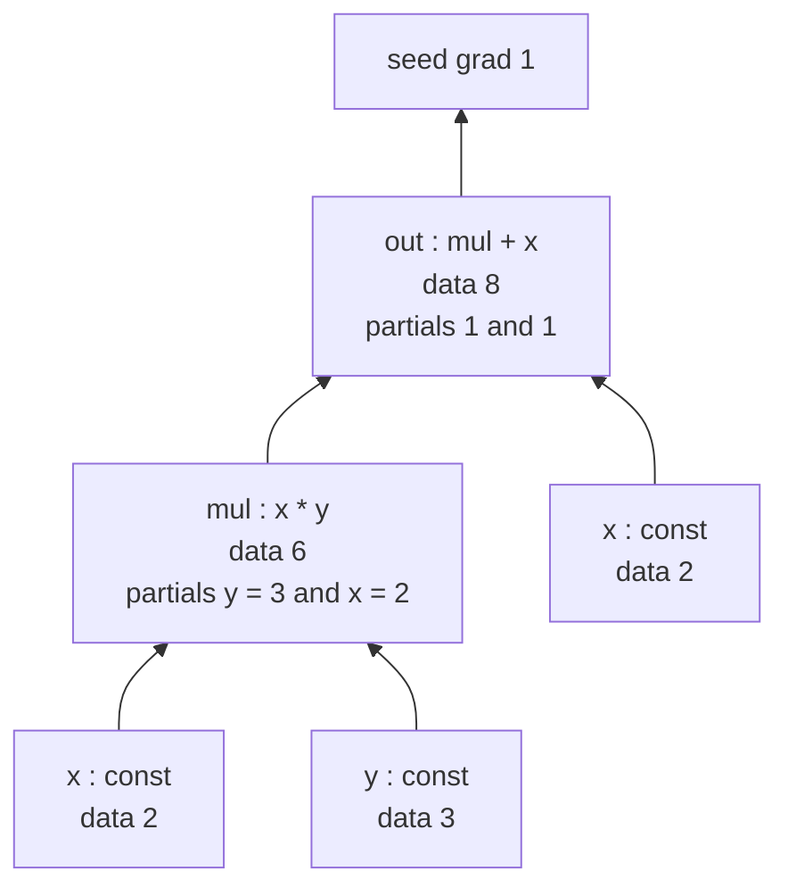
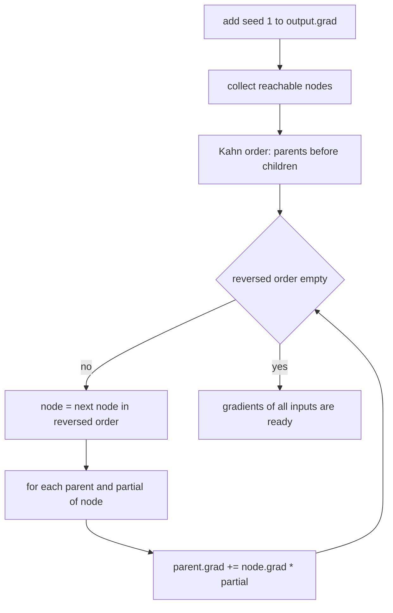
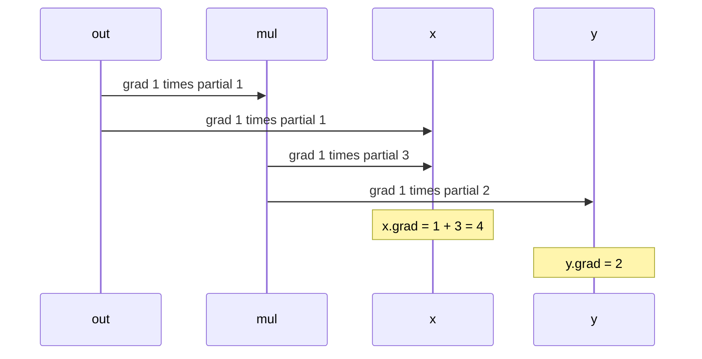
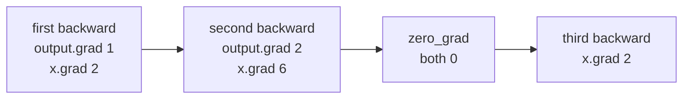

# 513 — Implement auto-differentiation simple reverse-mode for scalar functions.

> **Tier:** Advanced · **CTCI chapter:** Beyond — Machine Learning & AI
> **Task spec:** [513-implement-auto-differentiation-simple-reverse-mode-for-scalar-fu.md](../../../tasks/advanced/513-implement-auto-differentiation-simple-reverse-mode-for-scalar-fu.md)
> **Solutions:** [Python](../../../solutions/python/advanced/513-implement-auto-differentiation-simple-reverse-mode-for-scalar-fu/solution.py) ·
> [Java](../../../solutions/java/advanced/513-implement-auto-differentiation-simple-reverse-mode-for-scalar-fu/Solution.java) ·
> [JavaScript](../../../solutions/javascript/advanced/513-implement-auto-differentiation-simple-reverse-mode-for-scalar-fu/solution.js) ·
> [C#](../../../solutions/csharp/advanced/513-implement-auto-differentiation-simple-reverse-mode-for-scalar-fu/Solution.cs)

## 1. Problem restatement

**Input:** a scalar expression built at runtime out of a `Node` type. A node stores a floating
point `data`, a `grad`, and the list of `(parent, partial)` pairs that the operation which created
it produced. Operators `+`, `-`, `*`, `/`, `**` (constant exponent) and unary minus, plus the
functions `exp`, `log`, `tanh`, `relu`, `sin`, `cos` and `sqrt`, each allocate a new node whose
`parents` carry the local derivative `d(self)/d(parent)` evaluated at the forward values.

**Output:** after `output.backward()`, every node reachable from `output` holds the derivative of
`output` with respect to that node. The gradient of the output node itself is the seed `1`, and a
node consumed `k` times receives the sum of its `k` contributions.

There is no autodiff library involved: the four solution files implement the engine, then verify
it against hand-computed derivatives, against closed-form analytic derivatives and against
independent numerical differentiation. The contract is fixed by the assertions they ship:

| Expression | Forward value | Derivative asserted |
| --- | --- | --- |
| `output = x * y + x`, `x = 2`, `y = 3` | `8.0` | `dx = 4.0`, `dy = 2.0` |
| `z = x + y`, `square = z * z`, `x = 2`, `y = 3` | `25.0` | `dx = dy = 10.0`, and `dz = 10.0` |
| `fan = a + 2 * a + 3 * a`, `a = 4` | `24.0` | `da = 6.0` |
| `exp(x)` at `x = 0`, `log(x)` at `x = 1`, `tanh(x)` at `x = 0` | `1.0` | all `1.0` |
| `x ** 3` at `x = 2`, `x ** 2` at `x = -2`, `x ** 0` at `x = 5` | `8.0`, `4.0`, `1.0` | `12.0`, `-4.0`, `0.0` |

Constants are allowed anywhere (`2 * x + 4`, `10 / x`, `7 - x`), and `x * x + x` is the standard
sharing test: `x` reaches the output along two different paths, so its two contributions must be
added, not overwritten. Gradients accumulate across `backward()` calls until `zero_grad()` clears
them — the Python solution even asserts that `x * x` after two backward passes leaves
`output.grad = 2` and `x.grad = 6`.

## 2. Intuition

The obvious way to get a derivative is a finite difference: for each input `x_i`, evaluate the
function twice, `(f(x + h) - f(x - h)) / 2h`. That is simple and correct, but it costs two full
evaluations *per input*, it never gives the exact derivative, and it loses significant digits when
`h` is small. Symbolic differentiation avoids the error but rewrites the whole expression tree,
which usually blows up: naively differentiating `z * z` duplicates the subexpression `z`.

The insight behind **reverse mode** is that the forward pass already computes every intermediate
value, so every local partial derivative is a plain number that can be *stored* on the edge that
produced it. `d(x * y)/dx = y`, `d(x / y)/db = -x / y**2`, `d tanh(x)/dx = 1 - tanh(x)**2` — after
the forward pass there is nothing left to compute. What remains is the multivariable chain rule:

```text
dL/dv = sum over every child c of v of ( dL/dc * dc/dv )
```

Read right to left, that is a single sweep that starts at the output (with `dL/dL = 1`) and pushes
each node's accumulated gradient backwards along its parent edges. One forward pass plus one
backward pass yields the gradient with respect to *all* inputs at once — that is the whole reason
backpropagation beats finite differences.



The same value object `x` appears twice in the graph, once under `mul` and once under `out`, and
that is exactly why the backward pass must add.

## 3. Algorithm

1. **Forward.** Build the graph by executing the expression normally. Each operator reads its
   operands' `data`, computes the forward value and attaches one `(parent, partial)` edge per
   operand, with the partial evaluated from the forward values.
2. **Reachability.** From the output node, follow parent links to collect every reachable node
   exactly once (the Python engine keys this on object identity).
3. **Topological order.** Kahn's algorithm on the *reversed* edges: a node is ready when all of its
   parents have been emitted, so every parent appears before every node that depends on it.
4. **Backward.** Add the seed to the output's gradient, then walk the topological order *in
   reverse*. For each node and each `(parent, partial)` edge do `parent.grad += node.grad * partial`.
5. **Read.** The gradient of any input node is now in `node.grad`. `zero_grad()` clears the whole
   reachable component.

```text
procedure backward(output, seed = 1.0)
    output.grad ← output.grad + seed
    for node in reverse(topological(output)) do
        for (parent, partial) in node.parents do
            parent.grad ← parent.grad + node.grad * partial
        end
    end
end

procedure topological(output)
    nodes ← nodes_reachable_from(output)
    order ← []
    ready ← every node in nodes with no parents
    while ready is not empty do
        node ← ready.pop()
        order.append(node)
        for child in children_of(node) do
            indegree[child] ← indegree[child] - 1
            if indegree[child] == 0 then ready.append(child)
        end
    end
    return order
end
```

Processing in reverse topological order is what makes the accumulation correct: by the time a node
is visited, every path from the output down to it has already deposited its contribution, so a
single visit per node is enough even when the node has several children.



Two implementation notes that the solutions take seriously: the Java engine computes the order
**iteratively** so a 2000-node chain cannot overflow the call stack, and every language keeps the
partials as floats captured during the forward pass rather than as closures, which keeps `backward`
a pure accumulation loop.

## 4. Worked example

Take `x = 2`, `y = 3` and the expression `output = x * y + x`. The forward pass builds four nodes:

| Node | Op | `data` | `parents` with partials |
| --- | --- | --- | --- |
| `x` | const | `2.0` | — |
| `y` | const | `3.0` | — |
| `mul` | `*` | `6.0` | `(x, 3.0)`, `(y, 2.0)` |
| `out` | `+` | `8.0` | `(mul, 1.0)`, `(x, 1.0)` |

Kahn's algorithm on the reversed edges emits `x`, `y`, `mul`, `out`; the backward pass walks the
reverse of that order and accumulates.

| Step | Node visited | Action | `x.grad` | `y.grad` | `mul.grad` | `out.grad` |
| --- | --- | --- | --- | --- | --- | --- |
| 0 | — | seed `out.grad += 1` | 0 | 0 | 0 | 1 |
| 1 | `out` | `mul.grad += 1 * 1`; `x.grad += 1 * 1` | 1 | 0 | 1 | 1 |
| 2 | `mul` | `x.grad += 1 * 3`; `y.grad += 1 * 2` | 4 | 2 | 1 | 1 |
| 3 | `y` | no parents | 4 | 2 | 1 | 1 |
| 4 | `x` | no parents | 4 | 2 | 1 | 1 |

The result is `dx = 4 = y + 1` and `dy = 2 = x`: exactly the hand-computed values the solutions
assert, and exactly what the chain rule gives for `d(xy + x)/dx = y + 1`.



Now the sharing test, `x = 1` and `output = x * x`. Both edges of `mul` point at the same object
`x`, each with partial `1.0`; nothing special is needed, because the loop simply visits two edges.
The first `backward()` adds `1 * 1` twice and leaves `x.grad = 2`. Calling `backward()` again is
*not* idempotent — the seed line adds another `1` to `output.grad`, so the two edges now contribute
`2 * 1` each and `x.grad` becomes `2 + 4 = 6`, with `output.grad = 2`. Only `zero_grad()` resets the
component, after which a fresh `gradients(output, [x])` returns `[2.0]` again.



## 5. Complexity

Let `V` be the number of nodes reachable from the output and `E` the number of parent edges, so
`E <= 2V` for the binary operators here.

| Phase | Time | Notes |
| --- | --- | --- |
| Forward build | `O(1)` per operation | each operator allocates one node and up to two edges |
| Reachability + Kahn order | `O(V + E)` | one pass over nodes, one decrement per edge |
| Backward accumulation | `O(V + E)` | one visit per node, one multiplication-add per edge |
| Whole gradient | `O(V + E)` | independent of the number of inputs |
| Finite differences | `O(n * (V + E))` | `2n` forward evaluations for `n` inputs |
| Forward mode (dual numbers) | `O(n * (V + E))` | one forward sweep per input direction |
| Memory | `O(V + E)` | the graph itself; plus one float per node for `grad` |

The forward and backward costs are both linear in the size of the expression, which is why a
squared-error cost on three weights and a bias comes out of the Java engine exactly as
`dL/dw_i = 2 (pred - target) x_i` and `dL/db = 2 (pred - target)` — the shape a training loop needs.
Deep expressions are not a problem in themselves: the Java file documents a 2000-node chain that
differentiates to exactly `2` without overflowing the stack, because the topological order is built
iteratively.

## 6. Pitfalls and edge cases

- **Accumulate, never overwrite.** `parent.grad += ...`, not `=`. A node used `k` times appears on
  `k` edges and must receive `k` contributions; `a + 2 * a + 3 * a` therefore has gradient `6`.
- **Reset between queries.** Gradients are sticky by design; the Python solution's whole "second
  backward pass" check exists to prove that `x * x` accumulates to `6` before `zero_grad()` clears
  it. Python's `gradients(output, inputs)` helper calls `zero_grad()` first.
- **Visit each node once.** The reachability step deduplicates by identity, so a diamond-shaped
  graph does not multiply the work, and the topological order must be acyclic — the Python engine
  asserts the emitted order is as long as the node set.
- **Partials are captured, not re-derived.** They are computed from the *forward* values
  (`d(x*y)/dx = y.data`), which is only valid because the forward pass already ran.
- **Division by an exact zero raises.** The Python `/` operator raises `ZeroDivisionError` instead
  of returning infinity; `log` of a non-positive input raises `ValueError`; a node exponent raises
  `TypeError`, since this engine only differentiates constant powers.
- **`relu`'s kink.** The documented subgradient convention is `0` at `x = 0`, so
  `relu'(0) = 0` while `relu'(0.5) = 1` and `relu'(-0.5) = 0`.
- **Degenerate powers.** `x ** 1` has gradient `1`, and `x ** 0` has gradient `0` — the engine
  computes `exponent * x ** (exponent - 1)` without special-casing either.
- **`sqrt(0)`.** The local partial is `0.5 / value`, so the input `0` divides by zero; the domain
  choice is the caller's, and the Python engine simply lets the float division raise.
- **Unreachable nodes.** A node that is not an ancestor of the output is not in the reachable set
  and keeps whatever gradient it had; the C# file asserts that such a node stays at gradient `0`
  after a fresh backward pass.

## 7. Variants and follow-ups

- **Numeric verification.** Every solution cross-checks the analytic gradient: the Python file uses
  a 4th-order Richardson stencil `(-f(x+2h) + 8f(x+h) - 8f(x-h) + f(x-2h)) / 12h` with `h = 1e-3`
  and a plain central difference with `h = 1e-5`, Java uses `h = 1e-6`, C# uses `h = 1e-6` and
  agrees with the analytic values to `1e-7` relative. The tolerances are documented in the files.
- **Forward mode instead of reverse mode.** The C# solution also implements a dual-number evaluator
  and asserts that both engines agree exactly, which is the cheapest way to prove the tape is right
  when the number of inputs is small.
- **Higher-order derivatives.** The Java file differentiates the autodiff gradient itself with
  central differences and recovers the second derivative of `x ** 3` at `x = 2` as `12`.
- **Into a training loop.** The same node type is what makes a hand-written network trainable — see
  task [514-implement-small-neural-network-forward-backprop-demo-no-librarie.md](../../../tasks/advanced/514-implement-small-neural-network-forward-backprop-demo-no-librarie.md),
  which instead derives the same chain rule by hand, and
  [515-implement-minibatch-gradient-descent-training-loop-for-logistic.md](../../../tasks/advanced/515-implement-minibatch-gradient-descent-training-loop-for-logistic.md)
  for the batched version.
- **Consuming the gradients.** Optimizers such as
  [516-implement-sgd-with-learning-rate-schedule-decay.md](../../../tasks/advanced/516-implement-sgd-with-learning-rate-schedule-decay.md)
  and its adaptive counterpart
  [517-implement-adam-optimizer-skeleton.md](../../../tasks/advanced/517-implement-adam-optimizer-skeleton.md)
  are exactly the consumers of the `grad` field produced here.

## 8. Check yourself

**Q1.** For `output = x * y + x` with `x = 2`, `y = 3`, what are `x.grad` and `y.grad`, and why is
`x` visited on two different edges?

<details><summary>Show answer</summary>

`x.grad = 4 = y + 1` and `y.grad = 2 = x`. The node `x` is reached twice: once through `mul`
(partial `y.data = 3`) and once directly through the `+` (partial `1`), so the two contributions
`1 * 3` and `1 * 1` are added.

</details>

**Q2.** Why must the backward pass walk a topological order instead of a plain DFS from the output?

<details><summary>Show answer</summary>

In reverse topological order every consumer of a value is processed before the value itself, so all
paths from the output down to that value have already deposited their contribution when it is
visited. One visit per node therefore suffices, even for a node with many children — that is the
multivariable chain rule collapsed into a single accumulation loop.

</details>

**Q3.** `z = x * x` at `x = 1`. What is `x.grad` after one `backward()`, and what would it be if the
backward loop *assigned* instead of accumulating?

<details><summary>Show answer</summary>

`x.grad = 2 = 2x`. With assignment it would be `1`: both edges of `mul` point at the same node, so
whichever edge is processed last would overwrite the other. Accumulation is exactly what encodes
"sum over all paths".

</details>

**Q4.** Why is reverse mode preferred over central differences when the expression has many inputs?

<details><summary>Show answer</summary>

The reverse sweep costs `O(V + E)` time for the *whole* gradient, independent of the number of
inputs, whereas central differences need `2n` forward evaluations — `O(n * (V + E))` — and still
only approximate the derivative. Reverse mode wins as soon as the number of inputs is more than a
handful, which is the case for every model with parameters.

</details>

**Q5.** Where do the numbers `4.0` and `2.0` in the Python solution's `x * y + x` check come from?

<details><summary>Show answer</summary>

From hand differentiation: `d(xy + x)/dx = y + 1 = 4` and `d(xy + x)/dy = x = 2`. The solution
asserts `gradients(output, [x, y]) == [4.0, 2.0]` exactly, and the same partials are confirmed by
the independent Richardson stencil in the same file.

</details>
