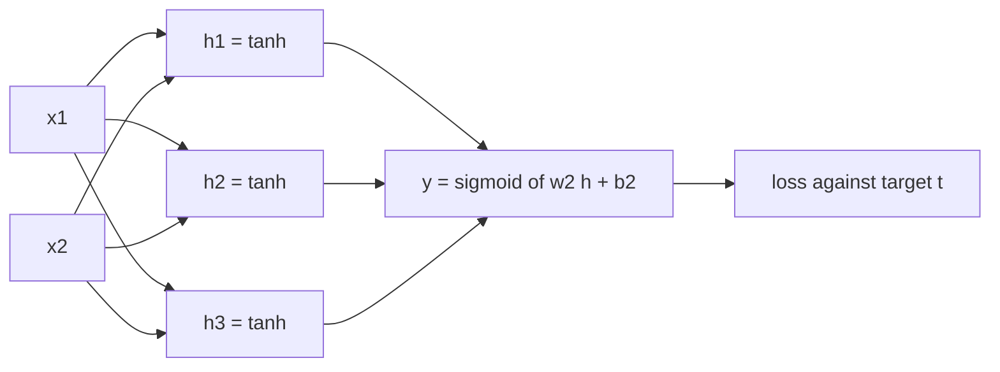
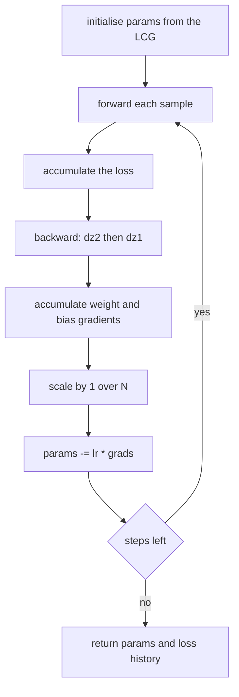
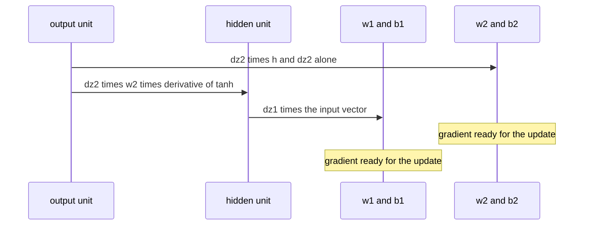

# 514 — Implement small neural-network forward/backprop demo (no libraries).

> **Tier:** Advanced · **CTCI chapter:** Beyond — Machine Learning & AI
> **Task spec:** [514-implement-small-neural-network-forward-backprop-demo-no-librarie.md](../../../tasks/advanced/514-implement-small-neural-network-forward-backprop-demo-no-librarie.md)
> **Solutions:** [Python](../../../solutions/python/advanced/514-implement-small-neural-network-forward-backprop-demo-no-librarie/solution.py) ·
> [Java](../../../solutions/java/advanced/514-implement-small-neural-network-forward-backprop-demo-no-librarie/Solution.java) ·
> [JavaScript](../../../solutions/javascript/advanced/514-implement-small-neural-network-forward-backprop-demo-no-librarie/solution.js) ·
> [C#](../../../solutions/csharp/advanced/514-implement-small-neural-network-forward-backprop-demo-no-librarie/Solution.cs)

## 1. Problem restatement

**Input:** the four XOR patterns and their labels, `[[0,0], [0,1], [1,0], [1,1]]` with targets
`[0, 1, 1, 0]`, plus a network shape. The default is two inputs, three hidden units, one output.

**Output:** a trained network — its parameter vector, the loss trace of full-batch gradient descent
and the four predictions — together with the analytic gradient of the loss with respect to *every*
parameter, checked against central differences. No library is used: the forward pass, the loss, the
backpropagation derivation and the parameter update are all written out by hand.

The four solutions agree on the architecture and differ in the details, which is worth knowing
before reading the code:

| File | Hidden layer | Loss | Training schedule | Documented numbers |
| --- | --- | --- | --- | --- |
| Python | `tanh`, 3 units | binary cross-entropy `-[t ln y + (1-t) ln(1-y)]` | 6000 steps at `lr = 0.5` | loss `> 0.6` at init, `< 0.05` and `< init/10` at the end |
| Java | `tanh`, 3 units | mean squared error `(1/N) sum (p - y)^2` | 20000 epochs | `0.2518` at init, `3.3e-5` at the end (asserted `< 0.01`) |
| JavaScript | `tanh`, `H` units | mean squared error | 20000 steps at `eta = 1.0` on XOR | `0.16995` at init, `1.92e-5` at the end |
| C# | `tanh` or sigmoid, 3 units | `sum (o - y)^2 / (2m)` | 5000 steps at `lr = 3.0` | loss `< 1e-3`, every prediction correct by a margin of `0.9` |

Two hand-computable facts are asserted by the files and are the best way to sanity-check an
implementation:

- With all parameters `0`, the mean squared error on XOR is exactly `0.25`, because `sigmoid(0) = 0.5`
  and each target is `0` or `1`: `(0.5 - 0)^2 = (0.5 - 1)^2 = 0.25`.
- In a fixed 2-2-1 network whose hidden weights are the identity, `h = [tanh(x1), tanh(x2)]`, and
  with output weights `[0.5, -0.5]` and bias `0` the logit is `0.5 tanh(x1) - 0.5 tanh(x2)`. At the
  input `(0, 0)` that is exactly `0`, hence `yhat = 0.5`; at `(1, 0)` it is `0.5 tanh(1) = 0.380796`
  and `yhat = 0.5940653340566603`.

## 2. Intuition

A single logistic unit computes `sigmoid(w . x + b)`, whose decision boundary is a straight line.
XOR's two classes cannot be separated by any line, so the linear model is stuck at a loss of `0.25`
no matter how long it trains — this is why the task needs a hidden layer at all. Three `tanh` units
turned by three different weight rows give the output unit three different *features*, and a linear
combination of those can carve the XOR shape out of the square.

Training means minimizing the loss by gradient descent, and the gradient is the chain rule applied
layer by layer. The key observation from reverse-mode differentiation carries over exactly: the
forward pass already stored the hidden activations, so the error signal at the output,
`dz2 = y - t` for the sigmoid/BCE pair (or `delta2 = (2/N) sum (p - y) p (1 - p)` for MSE), can be
pushed backwards through the output weights to produce the hidden error,
`dz1_j = dz2 w2_j (1 - h_j^2)`, where `1 - h_j^2` is the derivative of `tanh`. Multiplying the
error at a unit by the activation that fed it gives the weight gradient:
`dW2_j = dz2 h_j` and `dW1_jk = dz1_j x_k`.

Two details make the demo work rather than merely run:

- **Symmetry breaking.** If every hidden weight starts equal, all hidden units compute the same
  feature and the network is a linear model in disguise — the loss floor of `0.25` again. Hence the
  deterministic LCG initialiser (the Python and JavaScript files use `seed = seed * 75 + 74 mod 65537`)
  and the assertion that the hidden activations and weight rows stay pairwise distinct.
- **Reproducibility.** Nothing may come from `Math.random` or a time seed, otherwise no assertion
  about a loss trace could be written at all.



## 3. Algorithm

Full-batch gradient descent on the four XOR patterns, one epoch per iteration:

1. **Initialise** the 13 parameters (`2*3 + 3 + 3*1 + 1`) from the deterministic LCG, scaled into a
   small range so the `tanh` units start in their responsive zone and no two rows coincide.
2. **Forward** every sample: `z1_j = w1_j . x + b1_j`, `h_j = tanh(z1_j)`, `z2 = w2 . h + b2`,
   `y = sigmoid(z2)`. Keep `h` because the backward pass needs it.
3. **Loss**: accumulate the per-sample loss and divide by the batch size.
4. **Backward**: `dz2 = y - t`; `grad_w2_j += dz2 * h_j`; `grad_b2 += dz2`; then
   `dz1_j = dz2 * w2_j * (1 - h_j * h_j)`; `grad_b1_j += dz1_j`; `grad_w1_jk += dz1_j * x_k`. Finally
   scale every accumulated gradient by `1 / N`.
5. **Update**: `parameter -= learning_rate * gradient`.
6. **Record** the loss after each epoch so monotonicity and the final value can be asserted.

```text
procedure train(inputs, targets, hidden, learning_rate, steps)
    params ← deterministic_small_weights(hidden)
    history ← [loss(params)]
    for step ← 1 to steps do
        grads ← zero_like(params)
        for (x, t) in zip(inputs, targets) do
            z1_j ← dot(w1[j], x) + b1[j] for every j
            h_j ← tanh(z1_j)
            y ← sigmoid(dot(w2, h) + b2)
            dz2 ← y - t
            grads.b2 ← grads.b2 + dz2
            for j ← 0 to hidden - 1 do
                grads.w2[j] ← grads.w2[j] + dz2 * h[j]
                dz1 ← dz2 * w2[j] * (1 - h[j] * h[j])
                grads.b1[j] ← grads.b1[j] + dz1
                grads.w1[j][k] ← grads.w1[j][k] + dz1 * x[k] for every k
            end
        end
        scale every gradient by 1 / number_of_samples
        params ← params - learning_rate * grads
        history.append(loss(params))
    end
    return params, history
end
```

The gradient check reuses that structure with the analytic step replaced by central differences of
the scalar loss: pack the parameters into a flat vector, perturb coordinate `i` by `+h` and `-h`,
and form `(loss(v + h e_i) - loss(v - h e_i)) / 2h`. Because the check calls only the loss function,
it shares no code with the backpropagation and is a genuinely independent test.



## 4. Worked example

A 2-1-1 network makes the chain rule readable by hand. Take `x = [1, 0]`, target `t = 1`, hidden
weights `w1 = [0.5, -0.25]`, `b1 = 0.1`, output weights `w2 = [0.8]`, `b2 = -0.2`, and the Python
solution's loss, binary cross-entropy.

| Stage | Formula | Value |
| --- | --- | --- |
| pre-activation | `z1 = 0.5 * 1 + (-0.25) * 0 + 0.1` | `0.6` |
| hidden | `h = tanh(0.6)` | `0.5370495669980353` |
| logit | `z2 = 0.8 * h - 0.2` | `0.22963965359842825` |
| output | `y = sigmoid(z2)` | `0.5571589471343833` |
| loss | `L = -ln y` (since `t = 1`) | `0.5849047168647464` |

Now the backward pass, one line per chain-rule factor:

| Stage | Formula | Value |
| --- | --- | --- |
| output error | `dz2 = y - t` | `-0.4428410528656167` |
| output weight | `dL/dw2 = dz2 * h` | `-0.23782759569043352` |
| output bias | `dL/db2 = dz2` | `-0.4428410528656167` |
| hidden error | `dz1 = dz2 * w2 * (1 - h*h)` | `-0.2520926764639085` |
| input weights | `dL/dw1 = dz1 * x` | `[-0.2520926764639085, -0.0]` |
| hidden bias | `dL/db1 = dz1` | `-0.2520926764639085` |

The gradient with respect to `w1[1]` is exactly `0.0` because `x2 = 0`: an input that is switched
off contributes nothing to this sample's error, and averaging over the batch is what gives it a
gradient at all. One step with `learning_rate = 0.5` moves `w2` to `0.9189137978452168`, `b2` to
`0.02142052643280834`, `w1` to `[0.6260463382319542, -0.25]` and `b1` to `0.22604633823195425`.



The same arithmetic reproduces the JavaScript file's hand check on a 2-2-1 network: identity hidden
weights give `h = [tanh(1), tanh(0)]` at the input `(1, 0)`, the logit is `0.5 tanh(1)`, and the
prediction is `0.5940653340566603` — a value that a from-scratch implementation must hit exactly.

## 5. Complexity

Let `N` be the number of samples (4 for XOR), `H` the number of hidden units (3 by default), `W` the
number of parameters (`2H + H + H + 1 = 13`) and `E` the number of epochs.

| Phase | Time | Notes |
| --- | --- | --- |
| Forward, one sample | `O(H)` | `H` hidden units plus one output unit |
| Forward, one epoch | `O(N H)` | four samples, 13 multiply-adds per sample in the default shape |
| Backward, one epoch | `O(N H)` | one `dz1` per hidden unit per sample, same order as the forward pass |
| One epoch | `O(N H)` | forward, loss and backward together |
| Training | `O(E N H)` | Python: 6000 epochs; Java/JS: 20000; C#: 5000 |
| Gradient check | `O(W N H)` | `2W` loss evaluations, one per perturbed coordinate |
| Memory | `O(W + N H)` | parameter vector plus the cached activations of one batch |

The gradient check is the expensive part of the *test*, not of the algorithm: it costs one extra
forward pass per parameter, which is why it is only run at two points (before training and after
training) rather than inside the loop. Analytically, one backward pass produces all 13 partial
derivatives at roughly the cost of a forward pass, the same `O(1)`-per-edge result as the general
reverse-mode engine of
[513-implement-auto-differentiation-simple-reverse-mode-for-scalar-fu.md](../../../tasks/advanced/513-implement-auto-differentiation-simple-reverse-mode-for-scalar-fu.md).

## 6. Pitfalls and edge cases

- **Symmetry.** Identical hidden weight rows make the hidden layer redundant; the deterministic
  initialiser must produce distinct rows, and the Python solution asserts afterwards that the
  hidden activations of the four patterns are still four distinct vectors.
- **No global seeding of randomness.** Every file uses its own LCG (`75/74` in Python and
  JavaScript, `splitmix64` in C#) so that "the same seed gives bit-identical parameters" is a real
  assertion instead of a hope.
- **Monotonicity has a tolerance.** Gradient descent is only guaranteed to decrease the loss for a
  small enough step, so the trace assertions allow `1e-12` of slack; the aggressive learning-rate
  runs are asserted to violate monotonicity on purpose.
- **Learning rate regimes.** The Python file compares `0.1`, `0.5`, `5.0` and `20.0` on the same
  200-step budget: `0.1` is merely slow, `5.0` finishes lower than `0.5` but overshoots on the way,
  and `20.0` diverges (`final > initial`, and more than ten times the loss of the `0.5` run, with a
  maximum above `5.0`). The Java file documents a rate of `25` that overshoots its starting loss
  `2.4x` and drives the loss back up on 36 of its 199 steps; the C# file documents `lr = 0.5` as one
  descent step that reduces the loss.
- **`lr = 0`.** A zero step must leave every parameter bit-identical, which catches update code that
  mutates before computing the gradient.
- **Saturated units.** `tanh' = 1 - h^2` and `sigmoid' = y (1 - y)` both go to zero for large
  magnitudes, so a network pushed into saturation trains extremely slowly; keeping the initial
  parameters small (`|value| <= 1` in the Python check) avoids starting there.
- **Loss domain.** Binary cross-entropy needs `0 < y < 1`; the Python solution's `sigmoid` uses the
  numerically stable branch for negative arguments (`exp(v) / (1 + exp(v))`) rather than
  `1 / (1 + exp(-v))`, which would overflow for very negative `v`.
- **Degenerate target sets.** With all targets `0`, the loss minimum is the constant prediction
  `0`; the XOR set is used everywhere precisely because it is not linearly separable, so a
  too-small network (no hidden layer) stalls at the `0.25` floor instead of converging.
- **Activation range.** Hidden `tanh` activations stay strictly inside `(-1, 1)`, which the Python
  solution asserts, and a `sigmoid` hidden variant stays inside `(0, 1)`.

## 7. Variants and follow-ups

- **Wider hidden layer.** The JavaScript file repeats the gradient check for the shapes 2-1-1, 2-3-1
  and 2-8-1 on three data sets, with the analytic gradient required to match central differences
  (`h = 1e-6`) to `1e-7` relative — the worst measured error is `2.5e-11`.
- **Different hidden activation.** The C# file supports `sigmoid` or `tanh` hidden units and trains
  XOR to a loss below `1e-3` with both, so the block structure of `delta_hidden = (W^T delta) *
  activation'(z)` is exercised in two forms.
- **A different loss.** MSE and cross-entropy differ only in the very first factor of the backward
  pass, `delta2 = (2/N) sum (p - y) p (1 - p)` for MSE versus `dz2 = y - t` for the sigmoid/BCE
  pair; everything downstream is identical.
- **Bigger batches and better steps.** The same loop with mini-batches is
  [515-implement-minibatch-gradient-descent-training-loop-for-logistic.md](../../../tasks/advanced/515-implement-minibatch-gradient-descent-training-loop-for-logistic.md),
  the schedules that decay the step size are
  [516-implement-sgd-with-learning-rate-schedule-decay.md](../../../tasks/advanced/516-implement-sgd-with-learning-rate-schedule-decay.md),
  and the adaptive update that replaces the fixed `learning_rate` is
  [517-implement-adam-optimizer-skeleton.md](../../../tasks/advanced/517-implement-adam-optimizer-skeleton.md).
- **Evaluating the trained model.** Once the predictions are on the right side of `0.5`, the metrics
  in
  [519-implement-confusion-matrix-precision-recall-metrics-calculator.md](../../../tasks/advanced/519-implement-confusion-matrix-precision-recall-metrics-calculator.md)
  turn them into precision and recall.

## 8. Check yourself

**Q1.** Why does a network with all parameters set to `0` have a loss of exactly `0.25` on XOR, and
why can it never do better?

<details><summary>Show answer</summary>

Every logit is `0`, so `sigmoid(0) = 0.5`; each of the four targets is `0` or `1`, and
`(0.5 - 0)^2 = (0.5 - 1)^2 = 0.25`. All hidden units compute the same (constant) feature, so the
output is still a linear function of the input — the network cannot separate XOR, and the loss
stalls at that floor.

</details>

**Q2.** Where does the factor `1 - h_hidden^2` in the hidden error term come from?

<details><summary>Show answer</summary>

It is the derivative of the hidden activation, `d tanh(z)/dz = 1 - tanh(z)^2 = 1 - h^2`. The chain
rule multiplies the incoming error `dz2 * w2_j` by it, which is what makes the hidden error small
for saturated units.

</details>

**Q3.** The Python solution asserts that the loss never rises by more than `1e-12` during its 6000
steps, yet it also shows a run where the loss rises. Reconcile the two.

<details><summary>Show answer</summary>

The monotone trace is the default configuration (`lr = 0.5`, 6000 steps), where the step size is
small enough for the full-batch descent to be effectively monotone. The rising-loss run is the
deliberate `lr = 5.0` / `20.0` comparison, which documents that the same code diverges once the step
is too large.

</details>

**Q4.** Why is the gradient check done by perturbing a flat parameter vector instead of checking the
weight matrices in place?

<details><summary>Show answer</summary>

Central differences need to evaluate the loss at `v + h e_i` and `v - h e_i` and then restore `v`.
A flat vector makes that a copy-and-perturb of 13 numbers with no risk of leaving the model
modified, and it gives one indexable coordinate per parameter to report in failure messages.

</details>

**Q5.** The batch gradient of a weight is the *mean* of the per-sample gradients. Which line of the
backward pass implements that, and what breaks if it is omitted?

<details><summary>Show answer</summary>

The `scale = 1 / N` multiplication applied to every accumulated gradient after the sample loop. If it
is omitted the gradient is `N` times too large, which is exactly a learning rate four times larger
than intended for XOR — enough to push the documented runs into the non-monotone regime.

</details>
