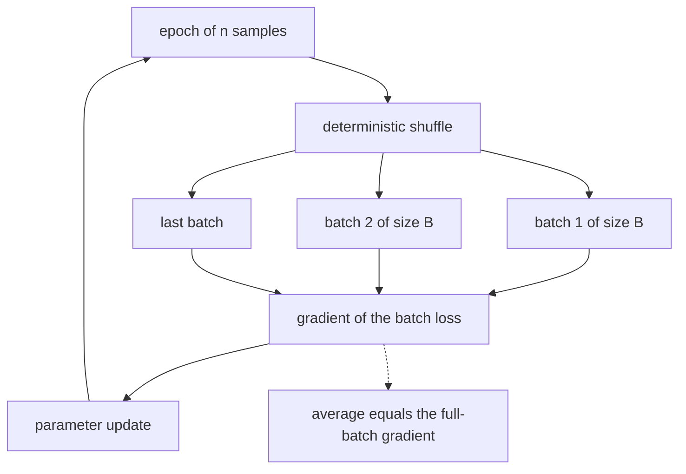
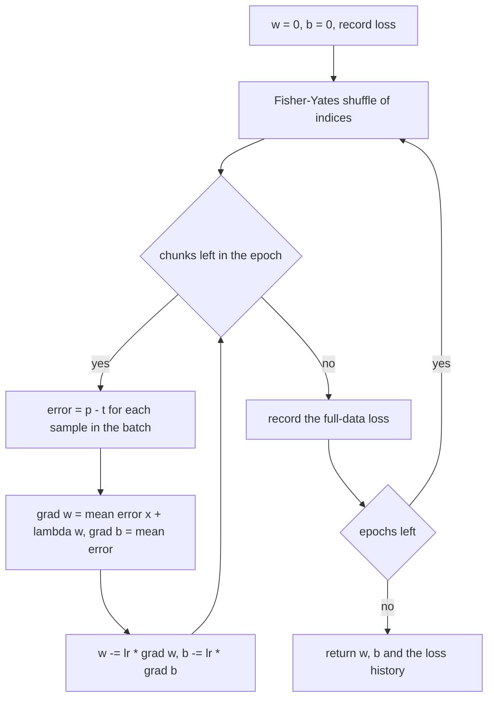
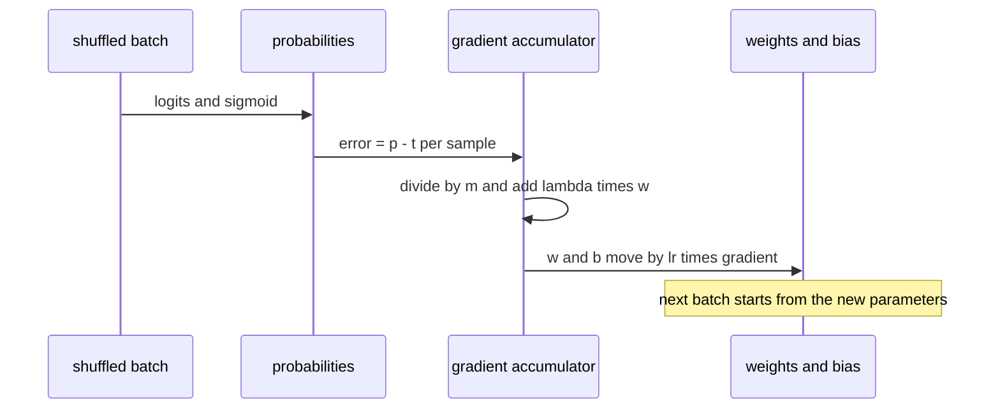

# 515 — Implement minibatch gradient descent training loop for logistic regression.

> **Tier:** Advanced · **CTCI chapter:** Beyond — Machine Learning & AI
> **Task spec:** [515-implement-minibatch-gradient-descent-training-loop-for-logistic.md](../../../tasks/advanced/515-implement-minibatch-gradient-descent-training-loop-for-logistic.md)
> **Solutions:** [Python](../../../solutions/python/advanced/515-implement-minibatch-gradient-descent-training-loop-for-logistic/solution.py) ·
> [Java](../../../solutions/java/advanced/515-implement-minibatch-gradient-descent-training-loop-for-logistic/Solution.java) ·
> [JavaScript](../../../solutions/javascript/advanced/515-implement-minibatch-gradient-descent-training-loop-for-logistic/solution.js) ·
> [C#](../../../solutions/csharp/advanced/515-implement-minibatch-gradient-descent-training-loop-for-logistic/Solution.cs)

## 1. Problem restatement

**Input:** a labelled data set `(x_i, y_i)` with `y_i` in `{0, 1}` (the C# file uses `{-1, +1}` and a
log-loss written as `log(1 + exp(-y w . x))`; both are the same objective), plus a batch size, a
learning rate, an L2 penalty and an epoch budget.

**Output:** the learned weights `w` and intercept `b` of
`p(y = 1 | x) = sigmoid(w . x + b)`, together with the loss measured after every epoch. The
objective is the mean binary cross-entropy plus `(lambda / 2) ||w||^2`; the bias is never penalised.

The default configuration in the Python solution is `batch = 8`, `learning_rate = 0.4`,
`lambda = 1e-4`, `120` epochs on 40 points drawn from two boxes centred at `(2, 2)` and `(-2, -2)`
with `+/-0.4` of jitter in `0.01` steps, so the true normal is `(1, 1)` and the geometry is known in
advance. Every other file builds its own deterministic data with a planted separator:

| File | Data | Documented outcome |
| --- | --- | --- |
| Python | 40 points, two boxes, true normal `(1, 1)`, 120 epochs | all 40 points classified, `cos(w, (1,1)) >= 0.95`, geometric margin at least half the planted one |
| Java | 400 points, margin `0.2`, planted direction `(0.6, -0.8)` | accuracy `1.0`, learned direction within `1e-3` radians, cross-entropy `0.234 -> 0.020` over 60 epochs |
| JavaScript | planted `(2, -1)`, bias `0.5`, `n = 200` separable | direction recovered to `0.0093` radians, `b / ||w|| = 0.1992` against the planted `0.2236`, final log-loss `0.0250` |
| C# | 400 points, planted separator plus deterministic noise | minibatch run within `0.03` of the IRLS optimum, loss within `2e-4` of it |

Everything is deterministic — the shuffle is driven by a linear congruential generator, never by
wall-clock time — so the assertions compare exact numbers rather than averages.

## 2. Intuition

Full-batch gradient descent computes one gradient from all `n` samples and takes one step, so an
epoch costs `O(n d)` time and produces exactly one update. Minibatching splits the epoch into `n / B`
batches: the cost of an epoch is still `O(n d)`, but the model takes `n / B` steps instead of one.
With `n = 40` and `B = 8` that is five updates per epoch, and with `B = 1` it is forty — the parameter
path becomes short and noisy rather than long and smooth.

The reason this is still a descent method and not a random walk is the identity that the files
assert directly: because the batches *partition* the epoch, the average of the `n / B` batch
gradients is exactly the full-batch gradient, to `1e-12` in Java and C#. Each batch gradient is an
unbiased estimator of the true gradient; the noise is a price paid for five times more updates per
pass over the data, and keeping the best iterate rather than the last one is a separate concern the
demo does not need because it records the loss per epoch.



The closed-form gradient is the other half of the story. Sigmoid followed by cross-entropy is a
famous simplification: the derivative of the loss with respect to the logit `z = w . x + b` is just
`p - t`, with no `p (1 - p)` factor left over, so

```text
dw = (1 / m) X_batch^T (p - t) + lambda * w
db = mean(p - t)
```

where `m` is the batch size. The penalty term is *not* divided by `m`, because the loss it came from
is not either — that detail is exactly what the "gradient with and without the L2 term" checks pin
down.

## 3. Algorithm

1. **Initialise** `w = 0`, `b = 0` (the loss at that point is `ln 2` per sample), record the initial
   loss, and build the index list `[0 .. n-1]`.
2. **Shuffle** the index list once per epoch with a Fisher-Yates pass whose random choices come from
   the 75/74 LCG, so the same epoch structure is reproduced on every run.
3. **Slice** the shuffled indices into consecutive chunks of size `B`; the final chunk may be short.
   A batch size of `0` (or any value `<= 0` in Python, or `>= n` in the other files) means one
   chunk containing the whole data set, i.e. full-batch descent.
4. **Gradient** of the batch: accumulate `error = p - t` over the batch, form
   `grad_w[k] = (1/m) sum error * x_k + lambda * w_k` and `grad_b = (1/m) sum error`.
5. **Update** every weight and the bias with `parameter -= learning_rate * gradient`, inside the
   batch loop so each batch moves the model.
6. **Record** the full-data loss after the epoch (never the batch loss), so the trace measures the
   real objective.

```text
procedure train(features, labels, batch_size, learning_rate, penalty, epochs)
    w ← zeros(dimension)
    b ← 0
    order ← [0 .. n - 1]
    history ← [full_loss(w, b)]
    for epoch ← 1 to epochs do
        fisher_yates_shuffle(order, lcg_state)
        for start ← 0 to n - 1 step batch_size do
            chunk ← order[start .. start + batch_size - 1]
            grad_w ← zeros(dimension)
            grad_b ← 0
            for index in chunk do
                error ← sigmoid(dot(w, features[index]) + b) - labels[index]
                grad_w[k] ← grad_w[k] + error * features[index][k] for every k
                grad_b ← grad_b + error
            end
            m ← length(chunk)
            grad_w[k] ← grad_w[k] / m + penalty * w[k] for every k
            grad_b ← grad_b / m
            w[k] ← w[k] - learning_rate * grad_w[k] for every k
            b ← b - learning_rate * grad_b
        end
        history.append(full_loss(w, b))
    end
    return w, b, history
end
```

The Fisher-Yates loop is the only place the generator is consumed, and it is consumed in exactly the
same order on every run, which is what makes "the whole trajectory is reproducible from the seed" a
testable claim.



## 4. Worked example

Take `w = [0.2, -0.1]`, `b = 0.05`, `lambda = 1e-4`, `learning_rate = 0.4`, and the following
three-sample batch: two positives `(2.1, 1.9)` and `(1.8, 2.2)`, and one negative `(-2.0, -1.9)`.

| Sample | `x` | `t` | logit `w . x + b` | `p` | `error = p - t` |
| --- | --- | --- | --- | --- | --- |
| 1 | `(2.1, 1.9)` | `1` | `0.28` | `0.569546223939229` | `-0.43045377606077095` |
| 2 | `(1.8, 2.2)` | `1` | `0.19` | `0.5473576181430894` | `-0.45264238185691064` |
| 3 | `(-2.0, -1.9)` | `0` | `-0.16` | `0.4600851154444343` | `0.4600851154444343` |

Sample 3 is misclassified (`p > 0.5` for a negative label), so its error is positive and pulls the
weights towards the positive class. Accumulating and dividing by `m = 3`:

| Quantity | Value |
| --- | --- |
| `sum error * x_1` | `-2.638879447958927` |
| `sum error * x_2` | `-2.6878371339450933` |
| `sum error` | `-0.4230110424732473` |
| `grad_w` with the penalty | `[-0.8796064826529757, -0.895955711315031]` |
| `grad_b` | `-0.14100368082441575` |
| new `w = w - 0.4 * grad_w` | `[0.5518425930611903, 0.2583822845260124]` |
| new `b = b - 0.4 * grad_b` | `0.10640147232976631` |

The batch loss falls from `0.5939731719665664` before the step to `0.17857008614013722` after it,
and the three probabilities become `0.852733`, `0.84133` and `0.184191` — the misclassified negative
sample has crossed to the correct side. Note the small `+2e-5` and `-1e-5` contributions of the L2 term inside
`grad_w`: penalisation is real but the data term dominates at this scale, and only a large `lambda`
changes the geometry.



## 5. Complexity

Let `n` be the number of samples, `d` the number of features, `B` the batch size and `E` the number of
epochs.

| Phase | Time | Notes |
| --- | --- | --- |
| Forward, one sample | `O(d)` | `d` multiplies for the dot product |
| One batch | `O(m d)` | `m = B`, except for the last chunk of the epoch |
| One epoch | `O(n d)` | each sample is used exactly once, shuffled |
| Training | `O(E n d)` | the shuffle adds `O(n)` per epoch |
| Full-batch reference | `O(E n d)` | identical per-epoch cost, one update instead of `n / B` |
| Gradient check | `O(W n d)` | `2W` full-data loss evaluations, `W = d + 1` parameters |
| IRLS oracle | `O(d^3 + n d^2)` per iteration | Gaussian elimination on the `d + 1` Hessian |
| Memory | `O(n + B d)` | one shuffled index array plus one batch of features |

The step-size bound the files document comes from `L`-smoothness of the loss: for the log-loss,
`L = 0.25 * lambda_max(X^T X) / n` (JavaScript, measured by power iteration) or with the penalty
added, `L = lambda_max(X^T X) / (4 n) + lambda` (C#). Descent is provably monotone for
`0 < learning_rate < 2 / L`: the JavaScript file asserts monotone descent at `eta = 0.5 / L` and
divergence at `eta = 8 / L`, the C# file at `0.9 / L` and `8 / L`, and the Java file reproduces
full-batch descent step for step when the batch size equals `n`.

## 6. Pitfalls and edge cases

- **Forgetting to shuffle.** Without the Fisher-Yates pass the batches are the same every epoch and
  the samples arrive in the order they were generated — the two boxes in the Python data set — so the
  gradient oscillates between classes instead of pointing at the boundary.
- **Averaging the penalty.** The L2 term must not be divided by the batch size; the loss is defined
  as the data mean plus `(lambda / 2) ||w||^2`, and the files assert the gradient against central
  differences both with and without the term.
- **Penalising the bias.** The Python and Java files apply weight decay to `w` only. Penalising `b`
  would pull the separating plane towards the origin and, on the sphere-like symmetric data used
  here, distort the recovered direction.
- **Batch size boundaries.** `B = 1` is plain SGD and still converges to full accuracy; `B >= n`
  collapses to full-batch descent and is asserted to reproduce it exactly; `B <= 0` in Python is
  documented as "use the whole data set". A partial last chunk must be averaged by `m`, not by `B`.
- **Sigmoid overflow.** For a large negative logit, `1 / (1 + exp(-z))` overflows to `inf`; the Java
  file clamps the exponent to `+/-60`, the Python and JavaScript files use the stable branch
  `exp(z) / (1 + exp(z))` for `z < 0`.
- **Loss at saturation.** `log(p)` with `p` rounded to exactly `0` or `1` is a domain error, so the
  stable sigmoid is not a cosmetic detail: a diverging run can otherwise produce `NaN` instead of a
  finite large loss.
- **Monotonicity is approximate.** Per-epoch loss may rise by the size of the minibatch noise; the
  Python check allows a rise only when the `1e-6` scale explains it, and requires the overall drop to
  exceed a factor of ten.
- **Step size beyond `2 / L`.** Documented divergences: the JavaScript file's `eta = 8 / L` produces
  100 increasing steps and ends at `1.5269` against the `0.5085` optimum; the C# file's `8 / L` grows
  by orders of magnitude.
- **Separable data and unbounded weights.** On linearly separable data the unpenalised optimum is at
  infinity in direction `(1, 1)`; the trained norm only stays bounded because of the L2 term and the
  finite epoch budget. The Java file shows the opposite extreme: `lambda = 1` collapses the weight
  norm from `57` to `0.18` and costs accuracy (`0.898`).
- **SGD noise floor.** The C# file documents that 100 and 500 epochs still improve the loss but 2000
  epochs no longer improve on 500 — a constant step size settles into a noise floor instead of
  converging, which is the motivation for the decaying schedules.

## 7. Variants and follow-ups

- **Batch size as a dial.** Batch `1`, `8` and `n` are all supported by the same loop; the Python
  file runs ``B = 1`` to show pure SGD still reaches full accuracy, the Java file runs `B = n` and
  asserts the identical parameter path to the full-batch reference.
- **A second-order oracle.** The JavaScript and C# files implement Newton-Raphson / IRLS with the
  exact Hessian `(1/n) X^T S X + lambda I`, `S = diag(p (1 - p))`, solved by Gaussian elimination,
  and use it as the target the first-order loops are measured against (Java/JavaScript agree with it
  to `1e-3`, C# to `0.03`).
- **Decaying and adaptive step sizes.** Constant-step SGD settles into the noise floor described
  above; [516-implement-sgd-with-learning-rate-schedule-decay.md](../../../tasks/advanced/516-implement-sgd-with-learning-rate-schedule-decay.md)
  replaces the constant `learning_rate` with a schedule and
  [517-implement-adam-optimizer-skeleton.md](../../../tasks/advanced/517-implement-adam-optimizer-skeleton.md)
  replaces the update rule itself.
- **A different model on the same loop.** The minibatch structure is the same one used by the
  hand-written network of
  [514-implement-small-neural-network-forward-backprop-demo-no-librarie.md](../../../tasks/advanced/514-implement-small-neural-network-forward-backprop-demo-no-librarie.md),
  where the gradient comes from backpropagation instead of a closed form.
- **Scoring the result.** Accuracy, precision and recall of the trained classifier are computed by
  [519-implement-confusion-matrix-precision-recall-metrics-calculator.md](../../../tasks/advanced/519-implement-confusion-matrix-precision-recall-metrics-calculator.md),
  and the ranking quality of its scores by
  [520-implement-roc-auc-estimator-from-predictions.md](../../../tasks/advanced/520-implement-roc-auc-estimator-from-predictions.md).

## 8. Check yourself

**Q1.** Why is the averaged minibatch gradient over one shuffled epoch exactly the full-batch
gradient, and which property of the shuffle does that depend on?

<details><summary>Show answer</summary>

Because the batches partition the index set: `sum over batches of (1/m) sum over the batch of error
* x` equals `(1/n) sum over all samples of error * x` when every sample appears in exactly one
batch. The shuffle matters only for *which* batch a sample lands in — it must be a permutation,
which Fisher-Yates guarantees.

</details>

**Q2.** In the worked example, why does `grad_w` point away from the negative class even though two
of the three samples have the correct label?

<details><summary>Show answer</summary>

Sample 3 is negative but has `p = 0.46`, still above `0.5`, so it is misclassified and its error
`p - t = +0.46` is large and positive; multiplying it by `x = (-2, -1.9)` gives a positive gradient,
so the update `w -= lr * grad_w` moves `w` in the opposite direction to `x`, i.e. towards the positive
class. The two correct positives contribute a much smaller correction in the same direction.

</details>

**Q3.** Why does a batch size of `n` reproduce full-batch descent *exactly* rather than
approximately?

<details><summary>Show answer</summary>

With one chunk per epoch the accumulated gradients *are* the full-batch sums, so after dividing by
`m = n` the update is bit-identical. The Java file asserts the two parameter paths are equal.

</details>

**Q4.** The Python default uses 120 epochs with batches of 8 on 40 points. How many parameter updates
does that perform, and how does the number change for `B = 1`?

<details><summary>Show answer</summary>

`40 / 8 = 5` updates per epoch, so `120 * 5 = 600` updates. With `B = 1` it becomes `40` per epoch
and `4800` updates in total — eight times more steps over the same data, at the cost of a much noisier
gradient.

</details>

**Q5.** What goes wrong if the penalty is divided by the batch size?

<details><summary>Show answer</summary>

The effective regularisation strength becomes `lambda / B`, which for the default `B = 8` silently
shrinks the penalty eightfold, and for `B = 1` in a full-batch run would disagree with the full-batch
gradient — breaking the "average of batch gradients equals the full-batch gradient" identity that the
solutions assert. The gradient check is run both with and without the L2 term precisely to catch this.

</details>
