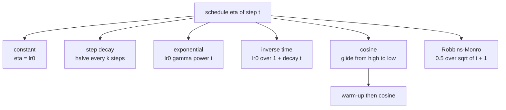
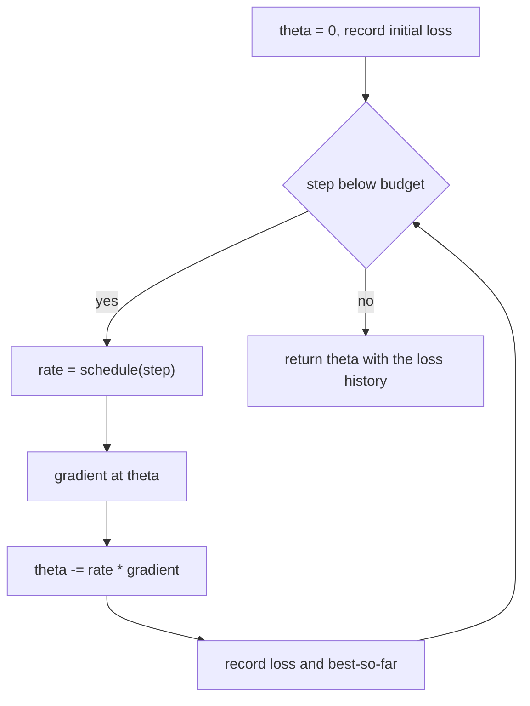
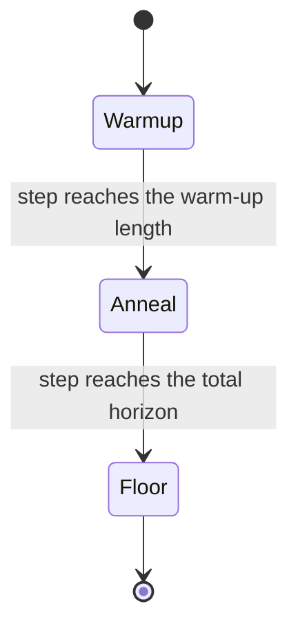

# 516 — Implement SGD with learning rate schedule (decay).

> **Tier:** Advanced · **CTCI chapter:** Beyond — Machine Learning & AI
> **Task spec:** [516-implement-sgd-with-learning-rate-schedule-decay.md](../../../tasks/advanced/516-implement-sgd-with-learning-rate-schedule-decay.md)
> **Solutions:** [Python](../../../solutions/python/advanced/516-implement-sgd-with-learning-rate-schedule-decay/solution.py) ·
> [Java](../../../solutions/java/advanced/516-implement-sgd-with-learning-rate-schedule-decay/Solution.java) ·
> [JavaScript](../../../solutions/javascript/advanced/516-implement-sgd-with-learning-rate-schedule-decay/solution.js) ·
> [C#](../../../solutions/csharp/advanced/516-implement-sgd-with-learning-rate-schedule-decay/Solution.cs)

## 1. Problem restatement

**Input:** an objective, an initial rate `lr0`, and a *schedule* — a function `eta(t)` that maps the
step index to the learning rate used by that step. The families the solutions implement are:

| Schedule | Formula | Files |
| --- | --- | --- |
| constant | `eta(t) = lr0` | all |
| step decay | `lr0 * drop ** floor(t / every)` | Python, Java, JavaScript, C# |
| exponential decay | `lr0 * gamma ** t` | Python, Java, JavaScript, C# |
| inverse time | `lr0 / (1 + decay * t)` | Python, Java, JavaScript, C# |
| cosine annealing | `low + 0.5 * (high - low) * (1 + cos(pi * t / T))` | all |
| warm-up then cosine | `high * t / warmup` for `t < warmup`, then cosine over `T - warmup` | Python, C# |
| polynomial decay | `lr0 * (1 - t / T)` | C# |
| Robbins-Monro | `0.5 / sqrt(t + 1)` or `1 / t` | JavaScript, C# |

**Output:** the parameters reached after a fixed number of steps, the loss after every step, and for
every schedule the exact numbers it is supposed to produce. The Python model is ordinary least
squares on a deterministic `40 x 3` design matrix with `theta_true = [1.5, -2.0, 0.5]` and `0.01` of
noise, so the objective, its gradient and its minimum are all known in closed form. The other files
train a logistic model (C#: 300 samples, 5 dimensions, ridge `0.05`), or a badly scaled quadratic
whose minimiser is `(1.5, -2.0, 0.5)` with Hessian `diag(3, 1, 0.5)` (JavaScript), or the 1-D
quadratic `0.5 a (w - w*)^2` with `a = 4`, `w* = 1.5` (Java).

The contract is pinned by exact schedule values rather than by vague claims:

- step decay with `drop = 0.5`, `every = 20` and `lr0 = 1`: `eta(0) = eta(19) = 1.0`,
  `eta(20) = eta(39) = 0.5`, `eta(40) = 0.25`.
- cosine annealing: `high` at `t = 0`, the midpoint at `t = T / 2`, and `low` exactly at `t = T`
  (the JavaScript file checks `0.2`, `0.105` and `0.01`).
- warm-up: the rate rises linearly and peaks exactly at the end of the warm-up.

## 2. Intuition

A constant step size has to satisfy two opposing requirements. Small enough to be stable, it is
slow; large enough to be fast, a single bad gradient sends the iterate flying. For a smooth objective
with Lipschitz gradient `L`, plain descent is provably monotone only for `lr < 2 / L`; the Python file
computes `L = 2 lambda_max(X^T X) / n` by power iteration and shows that `1.2 * (2 / L)` makes the
loss explode to at least a million times its initial value, while the *same* oversize value under
inverse-time decay converges to the minimum.

The point of a schedule is to get both: start where progress is fast and end where noise is small.
Classical stochastic approximation makes that precise — Robbins and Monro's conditions,

```text
sum of eta(t) over all t = infinity      and      sum of eta(t)^2 over all t is finite
```

are what guarantee convergence to the optimum almost surely for a noisy gradient. The C# file measures
them: `eta(t) = 0.5 / sqrt(t + 1)` accumulates `999.3` of rate mass with `sum eta^2 < 10` over `10^6`
steps, while `eta(t) = 1 / t` accumulates only `6.9` — the first is a valid Robbins-Monro rule, the
second's mass grows logarithmically and is far too slow in practice. A constant rate fails the
convergence test outright, because `sum eta^2` grows without bound; it keeps a "variance ball" whose
radius is set by the gradient noise, which is exactly why the JavaScript file can still use one for a
short run but must document the floor it leaves behind.

Cosine annealing implements the same idea cyclically: a smooth glide from `high` to `low` and
optionally back up again, which is why it is the default in modern training scripts.



## 3. Algorithm

1. **Define the schedules** as pure functions of the step index, so that the whole trajectory is
   reproducible and every value can be checked against a hand-written closed form.
2. **Clamp where needed.** Cosine annealing clamps the index into `[0, T]`, so a run longer than the
   cycle simply stays at `low` instead of reversing; step decay never returns below an optional floor;
   the warm-up formula switches over at exactly `t = warmup`.
3. **Loop.** For each step `t`: read `eta(t)`, take the gradient of the objective at the current
   parameters (`O(n d)` for a full gradient, `O(d)` for one sample), and update
   `parameter -= eta(t) * gradient`.
4. **Record** the objective after every step, and keep the best-so-far value when the run is
   stochastic, because the last iterate is not necessarily the best one.
5. **Compare.** Every trace must be non-increasing (except the warm-up, which must rise first), start
   at `lr0`, and end at the documented endpoint of the schedule.

```text
procedure sgd(design, targets, schedule, steps)
    theta ← zeros(number of columns)
    history ← [loss(theta)]
    for step ← 0 to steps - 1 do
        rate ← schedule(step)
        gradient ← full_gradient(theta)
        theta ← theta - rate * gradient
        history.append(loss(theta))
    end
    return theta, history
end

function inverse_time(rate, decay)
    return function of step: rate / (1 + decay * step)
end

function cosine_annealing(low, high, total)
    return function of step:
        clamped ← min(max(step, 0), total)
        low + 0.5 * (high - low) * (1 + cos(pi * clamped / total))
end
```

The Python implementation runs the *full* gradient at every step because its data set is
deterministic and small; the stochastic part of the task lives in the Java, JavaScript and C# files,
which draw one sample (or one shuffled permutation) per step from the LCG and therefore need the
schedule to average out the noise.



## 4. Worked example

Use the Python problem. Power iteration on `X^T X` gives `lambda_max = 224.7609202019255`, hence

```text
L     = 2 * lambda_max / n = 11.238046010096275
2 / L = n / lambda_max     = 0.17796688127128127
```

so the stability threshold is `0.178` and the documented test rate is `lr0 = 0.6 * (2 / L) =
0.10678012876276877` with `decay = 0.01` under the inverse-time rule. Starting from `theta = 0` the
initial loss is `16.39726402393` and the initial gradient is
`[-0.5097259999999997, 14.407537536000001, -6.440758627999999]`.

| Step | `eta(t)` | `theta` after the update | loss after the update |
| --- | --- | --- | --- |
| 0 | `0.10678012876276877` | `[0.05442860791373104, -1.5384387132485045, 0.6877450356277538]` | `2.5327830410201306` |
| 1 | `0.10572289976511759` | `[0.32626590313810566, -1.7315450892970676, 0.40436220917987764]` | `1.3135240169186657` |
| 2 | `0.10468640074781252` | `[0.5346316673361479, -1.8318496885788718, 0.44086905399627496]` | `0.8554584636705673` |

The rate changes in the third significant digit per step early on — `eta(1)`, `eta(50)`, `eta(100)`
and `eta(2999)` are `0.10572289976511759`, `0.07118675250851252`, `0.05339006438138438` and
`0.0034456317767915055` — yet the early fast phase is exactly what a constant rate of the same
initial size would deliver, and the late slow phase is what removes the residual noise.

The cumulative "learning-rate mass" of the inverse-time rule has a closed form,
`lr0 / decay * ln(1 + decay * N)`. For `N = 3000` the exact sum is `36.71991628065869` against
`36.66815958646242` from the formula, a relative difference of `0.14%` — inside the `1%` the Java
file asserts, and the reason the integral approximation is a useful sanity check for any decaying
schedule.



On the Java file's 1-D quadratic (`a = 4`, `lr0 = 0.1`, start `-3`, optimum `1.5`, so the initial
error is `4.5`) the schedules are compared by how many steps each needs to push the error below
`1e-6`: `30` (constant), `47` (step decay `0.5` every `20`), `38` (exponential `0.99`), `89`
(inverse-time `0.05`) and `31` (cosine, `T = 200`). The constant rate wins the race to the threshold
here, and cosine is a close second — but the cosine run keeps improving afterwards, cutting the
initial error by at least `1e3` by step 200, which the constant rate cannot do because it settles at
the floor its own noise sets.

## 5. Complexity

Let `n` be the samples, `d` the features, and `E` the number of steps.

| Phase | Time | Notes |
| --- | --- | --- |
| One schedule evaluation | `O(1)` | cosine costs one `cos`, step decay one floor division |
| Full-gradient step | `O(n d)` | the Python objective is small and deterministic |
| Single-sample SGD step | `O(d)` | the Java, JavaScript and C# stochastic loops |
| One shuffled epoch | `O(n d)` | permutation plus `n` sample steps |
| `E` steps | `O(E n d)` full gradient, `O(E d)` per-sample | the schedule adds nothing asymptotically |
| Memory | `O(d)` plus the index array for shuffling | no history of rates needs to be stored |
| Oracle (IRLS / normal equations) | `O(d^3 + n d^2)` once | gives the optimum the schedules are measured against |

The extra cost of a schedule is negligible; the *behaviour* it changes is everything. Concretely: the
Python `lr0 = 0.6 * (2 / L)` run reaches the closed-form minimum within `1e-6` and the parameters
within `5e-3` of `theta*`, the constant `1.2 * (2 / L)` run explodes, and the C# file shows that a
decayed run ends an order of magnitude closer to the IRLS optimum than the constant rate
(`0.0062 / 0.0055 / 0.0112` for cosine, inverse-time and polynomial against `0.0667` for constant).

## 6. Pitfalls and edge cases

- **Beyond `2 / L`.** Documented: `1.2 * (2 / L)` with a constant rate multiplies the Python loss by
  at least `1e6`, and the JavaScript file's `8 * eta / L` style overshoots produce a hundred
  increasing steps. Divergence is a property of the step size, not of the code.
- **Over-aggressive decay.** The C# file keeps `0.99` per step with exponential decay and the run
  stays undertrained at a distance of `0.65` from the optimum, while cosine, inverse-time and
  polynomial reach `0.0062`, `0.0055` and `0.0112`. A schedule that decays too fast simply stops
  learning.
- **`eta(0)` must be `lr0`.** Every implementation asserts the first value of every schedule, and
  that all decaying traces are non-increasing over their horizon.
- **Warm-up is the exception to monotonicity.** It is the only schedule that rises, and its peak is
  exactly at the end of the warm-up; the Python check asserts precisely that.
- **Cosine beyond the horizon.** Without clamping, `cos(pi * t / T)` starts rising again for `t > T`.
  The Python schedule clamps `t` into `[0, T]`, which `T = 1` exercises: `eta(0) = lr0` and
  `eta(1) = lr_min`.
- **Degenerate parameters.** `lr0 = 0` freezes the iterate exactly, and `decay = 0` makes step,
  exponential and inverse-time schedules identical to the constant one — both are asserted.
- **Robbins-Monro sums.** A valid schedule needs `sum eta = infinity` and `sum eta^2 < infinity`:
  `0.5 / sqrt(t + 1)` accumulates `999.3` and keeps `sum eta^2 < 10` over `10^6` steps, whereas a
  constant `0.1` accumulates `2000` with both sums still growing, i.e. it never converges.
- **The best iterate is not the last one.** Under minibatch noise the final parameters can be worse
  than the best ones seen, so the loops track the best-so-far value and the loss can plateau or
  wiggle even while the schedule decays.
- **Reproducibility.** Every shuffle and initialisation comes from the LCG, so "two identical runs
  produce identical parameters" is a real assertion; a wall-clock or `Math.random` seed would make
  every schedule comparison above meaningless.
- **Schedules are not free of tuning.** The JavaScript file documents that all five decaying
  schedules end closer to the minimiser than the constant rate on its quadratic
  (`1.27e-3` constant against `2.12e-5` for exponential decay), which is evidence for decay — not
  proof that any particular decay is right.

## 7. Variants and follow-ups

- **Momentum on top.** The JavaScript file adds heavy-ball momentum (`beta = 0.9`, with `0.5` in the
  comparison run) behind the same schedule interface and reaches the `0.05` tolerance in fewer or
  equal epochs on all five schedules (`11 -> 6`, `21 -> 3`, `12 -> 6`, `5 -> 3`, `5 -> 3`).
- **A warm-up wrapper.** `warmup_cosine` in Python and the `Seeded` warm-up path in C# are wrappers:
  they consume the same cosine function on the shifted index, which is why the hand-over is exact.
- **Adaptive steps instead of a schedule.** [517-implement-adam-optimizer-skeleton.md](../../../tasks/advanced/517-implement-adam-optimizer-skeleton.md)
  replaces the hand-written `eta(t)` with per-parameter rates derived from gradient moments, and is
  the natural next step once a schedule has shown what the noise floor costs.
- **Changing the loop that consumes the rate.** The schedule is orthogonal to the batching strategy of
  [515-implement-minibatch-gradient-descent-training-loop-for-logistic.md](../../../tasks/advanced/515-implement-minibatch-gradient-descent-training-loop-for-logistic.md):
  the same `eta(t)` list can drive full-batch, minibatch or single-sample steps, and the Java file
  uses the schedule to train a small logistic model to at least `95%` accuracy.
- **Where the gradients come from.** A hand-derived or auto-differentiated gradient such as the engine
  in [513-implement-auto-differentiation-simple-reverse-mode-for-scalar-fu.md](../../../tasks/advanced/513-implement-auto-differentiation-simple-reverse-mode-for-scalar-fu.md)
  plugs into the same loop, which is how the neural-network demo of
  [514-implement-small-neural-network-forward-backprop-demo-no-librarie.md](../../../tasks/advanced/514-implement-small-neural-network-forward-backprop-demo-no-librarie.md)
  could be trained with cosine annealing instead of a constant rate.

## 8. Check yourself

**Q1.** The Python solution computes `L = 2 lambda_max(X^T X) / n`. What is the largest constant rate
that can be used without risking divergence, and what number does the file pick for its experiments?

<details><summary>Show answer</summary>

`2 / L = n / lambda_max = 40 / 224.7609202019255 = 0.17796688127128127`. The success experiment uses
`0.6 * (2 / L) = 0.10678012876276877` with inverse-time decay, and the divergence experiment uses
`1.2 * (2 / L) = 0.21356025752553753` with a constant rate.

</details>

**Q2.** Why does the same oversized rate converge under inverse-time decay but explode under a
constant rate?

<details><summary>Show answer</summary>

The early steps are large enough to make fast progress, and the later steps shrink as
`lr0 / (1 + 0.01 t)`, so the iterate stops overshooting once it is close to the minimum. A constant
rate keeps taking the same too-large step forever, and each step multiplies the error by a factor
larger than one in the unstable direction.

</details>

**Q3.** Which schedule in the implementations is *not* non-increasing, and why is it still useful?

<details><summary>Show answer</summary>

The warm-up follow-up: `high * t / warmup` rises linearly to `high` and then hands over to cosine
annealing. It is useful because early gradients are computed from randomly initialised parameters and
are unreliable; starting at a tiny rate avoids an early bad update, and the file asserts the peak is
exactly at the end of the warm-up.

</details>

**Q4.** A cosine schedule is run for `3T / 4` steps and then for `2T` steps. What do the traces look
like at the end of each?

<details><summary>Show answer</summary>

At `3T / 4` the rate is `low + 0.5 (high - low) (1 + cos(3 pi / 4))`, i.e. between `low` and the
midpoint — the JavaScript file checks `0.01` at `T` and the `3T / 4` value as part of its trace
comparison. At `2T` the index is clamped to `T`, so the rate stays exactly at `low` for the second
cycle instead of rising back towards `high`.

</details>

**Q5.** Why is `sum eta(t)^2 < infinity` the condition that removes the gradient noise, while
`sum eta(t) = infinity` is the condition that keeps progress going?

<details><summary>Show answer</summary>

Each step injects an error of order `eta(t) * noise`; the squared errors of independent steps add, so
the total injected variance is proportional to `sum eta(t)^2`, which must stay finite for the noise to
wash out. The total movement towards the optimum is proportional to `sum eta(t)`, which must diverge so
the iterate can still travel a finite distance. `0.5 / sqrt(t + 1)` satisfies both; a constant rate
fails the first condition, which is why it keeps a variance ball around the optimum.

</details>
