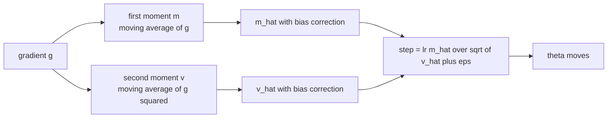
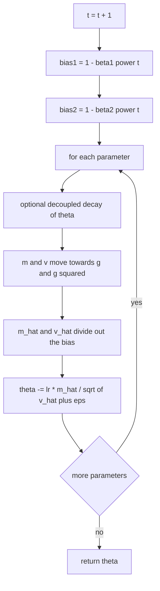
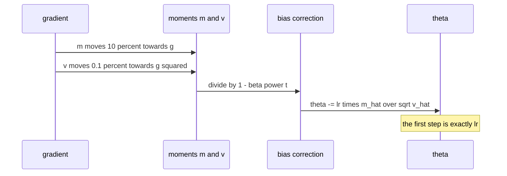

# 517 — Implement Adam optimizer skeleton.

> **Tier:** Advanced · **CTCI chapter:** Beyond — Machine Learning & AI
> **Task spec:** [517-implement-adam-optimizer-skeleton.md](../../../tasks/advanced/517-implement-adam-optimizer-skeleton.md)
> **Solutions:** [Python](../../../solutions/python/advanced/517-implement-adam-optimizer-skeleton/solution.py) ·
> [Java](../../../solutions/java/advanced/517-implement-adam-optimizer-skeleton/Solution.java) ·
> [JavaScript](../../../solutions/javascript/advanced/517-implement-adam-optimizer-skeleton/solution.js) ·
> [C#](../../../solutions/csharp/advanced/517-implement-adam-optimizer-skeleton/Solution.cs)

## 1. Problem restatement

**Input:** a parameter vector `theta`, a gradient vector `g` (one component per parameter), and the
hyperparameters `learning_rate`, `beta1 = 0.9`, `beta2 = 0.999`, `eps = 1e-8`. The task title says
"skeleton", and every solution header states explicitly that the **working optimiser** is
implemented rather than a stub, because the bookkeeping is the interesting part.

**Output:** one `step(gradient)` call advances the state and the parameters:

```text
m     <- beta1 * m + (1 - beta1) * g
v     <- beta2 * v + (1 - beta2) * g * g
m_hat <- m / (1 - beta1 ** t)          # t is the 1-based step counter
v_hat <- v / (1 - beta2 ** t)
theta <- theta - learning_rate * m_hat / (sqrt(v_hat) + eps)
```

The variants the files add are amsgrad (keep the running maximum of `v_hat` in the denominator),
decoupled weight decay / AdamW (`theta -= lr * wd * theta` before the adaptive step, instead of
folding the decay into `g`), a coupled-L2 mode, and a no-bias-correction mode whose only purpose is
to *measure* what the correction does. Plain gradient descent ships alongside as the baseline.

The contract is fixed by exact numbers:

| Call | Result | Why |
| --- | --- | --- |
| `x = 3` on `f = x^2` (`g = 6`), `lr = 0.1` | `x -> 2.9000000001666666` | `m_hat = 6`, `v_hat = 36`, so the step is `lr * g / (abs(g) + eps)` |
| the same step with `beta2` in `{0.9, 0.99, 0.999, 0.9999}` | identical to `1e-12` | bias correction removes the dependence on `beta2` at `t = 1` |
| `40` steps with a constant gradient and `lr` | parameter moves by exactly `40 * lr` | `m_hat = g` and `v_hat = g^2` for every `t` |
| the first step **without** bias correction | magnitude `(1 - beta1) / sqrt(1 - beta2) = 3.1622776601683773` times `lr` | the moments start at zero, so they are far too small |

## 2. Intuition

Plain gradient descent applies the same step size to every coordinate. That is wrong as soon as the
coordinates have different scales: the Java file's badly scaled quadratic has curvatures `1` and
`100`, so the coordinate with curvature `100` multiplies its error by `1 - lr * 100` per step — at
`lr = 0.05` that factor is `-4`, and the run diverges, while `lr = 0.009` (just under the `2 / 100`
stability limit) needs `765` steps to get where Adam arrives in `82`.

Adam fixes this by tracking, for every coordinate independently:

- `m`, an exponential moving average of the gradient, i.e. a smoothed direction;
- `v`, an exponential moving average of the *squared* gradient, i.e. a running estimate of the
  gradient's magnitude.

Dividing the smoothed gradient by the square root of its own magnitude turns the step into
`lr * sign(g)` on the first step, and more generally into a step whose size is set by how *consistent*
the gradient sign has been rather than by how large the gradient happens to be. That is what makes
Adam scale invariant: the JavaScript file scales every gradient by `1000` and the trajectory changes
by at most `1.5e-10`, and the C# file scales the objective by `100` and the trajectory is unchanged
to `1e-5`, while plain gradient descent on the same scaled gradient blows up.

The bias correction is the subtle part. Both moments start at zero, so after one step
`m = (1 - beta1) g` and `v = (1 - beta2) g^2` — both are shrunk by `(1 - beta)`. Their ratio is what
matters: `(1 - beta1) / sqrt(1 - beta2) = 3.1622776601683773`, so an uncorrected first step is more
than three times too large, and the factor peaks at `6.56852025246924` on step 12 before drifting
back toward `1` over thousands of steps. Dividing by `1 - beta1^t` and `1 - beta2^t` restores
`m_hat = g` and `v_hat = g^2` for a constant gradient, which is why `40` constant steps move the
parameter by exactly `40 * lr`.



## 3. Algorithm

1. **Initialise** `theta` from the caller, `m = 0`, `v = 0`, `v_max = 0` (amsgrad) and the step
   counter `t = 0`.
2. **Per step:** increment `t` and precompute the corrections `1 - beta1^t` and `1 - beta2^t` once
   for the whole vector — they are scalars, not per-parameter quantities.
3. **Optional decay first** (AdamW): `theta_i -= lr * wd * theta_i`, applied to the parameter and not
   to `g`, so the moments see the clean gradient.
4. **Update the moments** with the exponential moving averages.
5. **Bias-correct**, optionally replace `v_hat` with the running maximum (amsgrad), and take the step
   `theta_i -= lr * m_hat_i / (sqrt(v_hat_i) + eps)`.
6. **Return** the parameters; a caller loops steps over whatever gradient source it has, exactly as in
   [516-implement-sgd-with-learning-rate-schedule-decay.md](../../../tasks/advanced/516-implement-sgd-with-learning-rate-schedule-decay.md).

```text
procedure step(gradient)
    t ← t + 1
    bias1 ← 1 - beta1 power t
    bias2 ← 1 - beta2 power t
    for index over parameters do
        if weight_decay is not zero then
            theta[index] ← theta[index] - lr * weight_decay * theta[index]
        end
        g ← gradient[index]
        m[index] ← beta1 * m[index] + (1 - beta1) * g
        v[index] ← beta2 * v[index] + (1 - beta2) * g * g
        m_hat ← m[index] / bias1
        v_hat ← v[index] / bias2
        if amsgrad then
            v_max[index] ← maximum(v_max[index], v_hat)
            denominator ← sqrt(v_max[index]) + eps
        else
            denominator ← sqrt(v_hat) + eps
        end
        theta[index] ← theta[index] - lr * m_hat / denominator
    end
    return theta
end
```

Two implementation details that the tests pin down: the correction factors are recomputed from the
step counter on every call (never cached as a running product, which would accumulate error), and
`eps` sits **outside** the square root, added to `sqrt(v_hat)` — the `+ eps` inside the root would
change the scale behaviour the files assert.



## 4. Worked example

Start with the classic Python check: `x = 3` on `f(x) = x^2`, so `g = 6`, with `lr = 0.1`,
`beta1 = 0.9`, `beta2 = 0.999` and `eps = 1e-8`.

| Quantity | Formula | Value |
| --- | --- | --- |
| `m` | `0.1 * 6` | `0.5999999999999999` |
| `v` | `0.001 * 36` | `0.03600000000000003` |
| `bias1`, `bias2` | `1 - 0.9^1`, `1 - 0.999^1` | `0.1`, `0.001` |
| `m_hat` | `0.6 / 0.1` | `6.0` |
| `v_hat` | `0.036 / 0.001` | `36.0` |
| step | `0.1 * 6 / (sqrt(36) + 1e-8)` | `0.09999999983333335` |
| new `x` | `3 - step` | `2.9000000001666666` |

The step equals `lr * abs(g) / (abs(g) + eps)` to the last digit, so the first update is `lr`
regardless of the gradient's size; only the `eps` term in the denominator leaves a trace of the
scale. This is why the first step is identical (to `1e-12`) for `beta2 = 0.9`, `0.99`, `0.999` and
`0.9999`.

Now two steps with the gradient sequence `g1 = 1`, `g2 = 2`, the sequence the JavaScript file
hand-checks:

| Step | `m` | `v` | `m_hat` | `v_hat` | step |
| --- | --- | --- | --- | --- | --- |
| 1 | `0.09999999999999998` | `0.0010000000000000009` | `1.0` | `1.0` | `0.09999999900000002` |
| 2 | `0.2899999999999999` | `0.004999000000000004` | `1.5263157894736843` | `2.50075037518763` | `0.09651820197183368` |

`m_hat` on step 2 is exactly `0.29 / 0.19`, the value quoted in the header: the correction divides
by `1 - 0.9^2 = 0.19`, not by `0.1`. `v` grows roughly ten times between the two steps although the
gradient only doubled, and that is the second moment doing its job — a large `v_hat` relative to
`m_hat` shrinks the step.



Finally, the table that explains why bias correction exists. For a constant gradient the *uncorrected*
step magnitude is `(1 - beta1^t) / sqrt(1 - beta2^t)` times `lr`, while the corrected magnitude is
exactly `1` for every `t`:

| `t` | uncorrected magnitude | corrected magnitude |
| --- | --- | --- |
| 1 | `3.1622776601683773` | `1.0` |
| 2 | `4.249591688004579` | `1.0` |
| 3 | `4.950235347440737` | `1.0` |
| 12 | `6.56852025246924` (the peak) | `1.0` |
| 3000 | `1.0258230833749884` | `1.0` |

## 5. Complexity

Let `d` be the number of parameters.

| Phase | Time | Notes |
| --- | --- | --- |
| One Adam step | `O(d)` | a constant number of arithmetic operations per coordinate |
| amsgrad variant | `O(d)` | one extra `max` per coordinate |
| AdamW variant | `O(d)` | one extra multiply per coordinate |
| Memory | `O(d)` for `theta`, `O(2d)` for `m` and `v`, `O(3d)` with `v_max` | the optimiser state doubles or triples the parameter storage |
| Plain gradient descent | `O(d)` | same asymptotic cost, no state, no adaptivity |
| Newton / IRLS | `O(d^3)` per step | the exact Hessian is what Adam avoids |

Adam's cost per step is the same order as plain gradient descent — it buys its adaptivity with
`O(d)` memory and a constant factor, not with a bigger asymptotic cost. What it buys is robustness:
the Java file documents Adam reaching the minimiser of a condition-number-`100` quadratic in `82`
steps where stable gradient descent needs `765` and an unstable `lr = 0.05` diverges; the C# file
documents Adam at `lr = 2.0` — ten times the `1 / L` stable step, with `L = 4.4142` — still
converging to distance `1e-9` where gradient descent at `2 / L` diverges to distance `3.6`; and the
JavaScript file documents that on `f(w) = 0.5 sum H_i (w_i - a_i)^2` with `H = diag(3, 1, 0.5)` and
`a = (1.5, -2.0, 0.5)`, `3000` steps at `lr = 0.05` reach the minimiser *exactly* (distance `0`).

The non-monotone tail is worth stating as part of the cost model: at `lr = 0.05` on that quadratic the
last steps include `122` increases, each smaller than `1.3e-11`, with the tail minimum at `0`, while
`lr = 0.01` is monotone. Adam converges fast and then jitters at the `eps` scale.

## 6. Pitfalls and edge cases

- **Forgetting the bias correction.** The first step is then `3.1622776601683773` times too large and
  the peak overshoot is `6.56852025246924` times at step 12; both files that implement a
  no-correction mode exist to assert exactly this.
- **`eps` placement.** It must be added to `sqrt(v_hat)`, not inside it. With `eps = 1e-8` the
  denominator is `|g| + 1e-8` on the first step, so the update is `lr * |g| / (|g| + eps)`, which is
  the closed form the tests compare against for three learning rates and three gradient magnitudes.
- **A zero gradient must not move anything.** With `g = 0` the update is `0 / (0 + eps) = 0`, so the
  parameter is untouched; the C# file also checks a gradient of `1e-300` does not overflow (its square
  underflows to zero rather than producing a `NaN`).
- **Coupled versus decoupled decay.** AdamW applies `theta -= lr * wd * theta` to the parameter, so on
  a zero-gradient problem the parameter shrinks by exactly `prod(1 - lr * wd)`; folding the decay into
  the gradient instead also inflates the moments and is a different algorithm. The C# file measures
  the difference (final norm `1.3781` shrinking to `1.3570` with `gamma = 0.05`).
- **`lr = 0` freezes the parameters** (asserted), and `beta1 = beta2 = 0` degenerates to sign descent
  `lr * g / (abs(g) + eps)` — a constant gradient of `2.0` then moves the parameter by `lr * T`
  exactly, to `1e-6`.
- **Step size per coordinate.** In the documented runs the per-coordinate step never exceeds `lr`,
  because `abs(m_hat) / sqrt(v_hat) <= 1` — worth asserting, since a sign or indexing bug that
  mismatches `m` and `v` entries easily breaks it.
- **State is per-run, not global.** `m`, `v`, `v_max` and `t` belong to one optimisation run; reusing
  an optimiser for a second run carries the old moments and the wrong bias correction.
- **Not monotone near the optimum.** `122` of the last steps at `lr = 0.05` raise the loss (by at most
  `1.3e-11` each) on the JavaScript quadratic, so a strict monotonicity assertion would fail even
  though the run is successful.
- **Scale invariance has a limit.** The JavaScript file measures a `1.5e-10` change when every
  gradient is scaled by `1000`; the residual comes from the `eps` term and grows as `|g|` shrinks
  towards `eps`.
- **amsgrad changes the past, not the present.** It keeps `max(v_hat)` seen so far in the
  denominator, so the current step can be smaller than plain Adam's but never larger; a bug that
  resets `v_max` each step silently disables it.

## 7. Variants and follow-ups

- **AdamW and coupled L2.** The JavaScript file ships all three forms (plain Adam, AdamW with
  decoupled decay, classic L2-in-the-gradient) and the C# file adds the gradient-descent baseline, so
  the three update rules can be compared on the same problem.
- **amsgrad.** The Python optimiser takes an `amsgrad` flag and uses `sqrt(v_max) + eps` as the
  denominator; the trajectory is identical to plain Adam until `v_hat` stops growing.
- **An independent reference implementation.** Every file cross-checks the optimiser against a
  straight-line, unrolled version of the same recurrences (the Python `adam_x3_steps` is a five-line
  loop over `f(x) = x^3`): `20` steps match to `1e-15`, and the JavaScript file matches all `10`
  steps and the intermediate moments with a naive longhand implementation.
- **The rate schedule above it.** Adam's `learning_rate` can itself be scheduled; see
  [516-implement-sgd-with-learning-rate-schedule-decay.md](../../../tasks/advanced/516-implement-sgd-with-learning-rate-schedule-decay.md)
  for the decay rules and the Robbins-Monro convergence conditions.
- **The loop that feeds it.** From
  [515-implement-minibatch-gradient-descent-training-loop-for-logistic.md](../../../tasks/advanced/515-implement-minibatch-gradient-descent-training-loop-for-logistic.md)
  the gradient arrives one minibatch at a time, and the hand-written network of
  [514-implement-small-neural-network-forward-backprop-demo-no-librarie.md](../../../tasks/advanced/514-implement-small-neural-network-forward-backprop-demo-no-librarie.md)
  supplies it from backpropagation; swapping its fixed `learning_rate` for this optimiser is a
  one-line change.

## 8. Check yourself

**Q1.** On `f(x) = x^2` from `x = 3` with `lr = 0.1`, why is the first step `0.1` and not something
proportional to the gradient `6`?

<details><summary>Show answer</summary>

After one step `m = (1 - 0.9) * 6 = 0.6` and `v = (1 - 0.999) * 36 = 0.036`; the corrections divide by
`1 - 0.9 = 0.1` and `1 - 0.999 = 0.001`, giving `m_hat = 6` and `v_hat = 36`. The step is therefore
`0.1 * 6 / (sqrt(36) + 1e-8) = 0.09999999983333335`, i.e. `lr` up to the `eps` term.

</details>

**Q2.** What exactly goes wrong without bias correction, and why does the error peak in the middle of
the run rather than at the start?

<details><summary>Show answer</summary>

The moments start at zero, so early estimates are shrunk by `(1 - beta1^t)` and `(1 - beta2^t)`; the
numerator shrinks faster than the square root of the denominator, so the step magnitude is multiplied
by `(1 - beta1^t) / sqrt(1 - beta2^t)`. That factor is `3.16` at `t = 1`, grows to
`6.56852025246924` at `t = 12` (where `1 - beta2^t` has caught up but `1 - beta1^t` has not yet
saturated), and only decays back toward `1` by step `3000`.

</details>

**Q3.** Why is Adam's trajectory nearly unchanged when every gradient is multiplied by `1000`, while
plain gradient descent diverges under the same scaling?

<details><summary>Show answer</summary>

Both `m_hat` and `sqrt(v_hat)` scale linearly with the gradient, so their ratio is scale free; only the
`eps` term in the denominator breaks the invariance, which is why the measured difference is
`1.5e-10` rather than zero. Plain gradient descent has no such ratio: a gradient multiplied by `1000`
is a step `1000` times larger, far beyond the `2 / L` stability limit.

</details>

**Q4.** With a constant gradient and `lr`, how far does the parameter move in `T` steps, and which
identity makes that exact?

<details><summary>Show answer</summary>

Exactly `T * lr`, because after `t` constant steps `m = (1 - beta1^t) g` and `v = (1 - beta2^t) g^2`,
so the corrections give `m_hat = g` and `v_hat = g^2` and the step is `lr * g / (abs(g) + eps) = lr`.
The C# file asserts `40` such steps move the parameter by `40 * lr`.

</details>

**Q5.** What is the difference between AdamW's decay and L2 regularisation, and where does it show up
most clearly?

<details><summary>Show answer</summary>

AdamW subtracts `lr * wd * theta` from the parameter *before* the adaptive step, so the moments only
ever see the data gradient; classic L2 adds `wd * theta` to the gradient, which changes both moments and
therefore changes the effective step size. The cleanest demonstration is a zero-gradient problem: with
decoupled decay the parameter shrinks by exactly `prod(1 - lr * wd)` per step, which is what the
Python and C# files assert.

</details>
