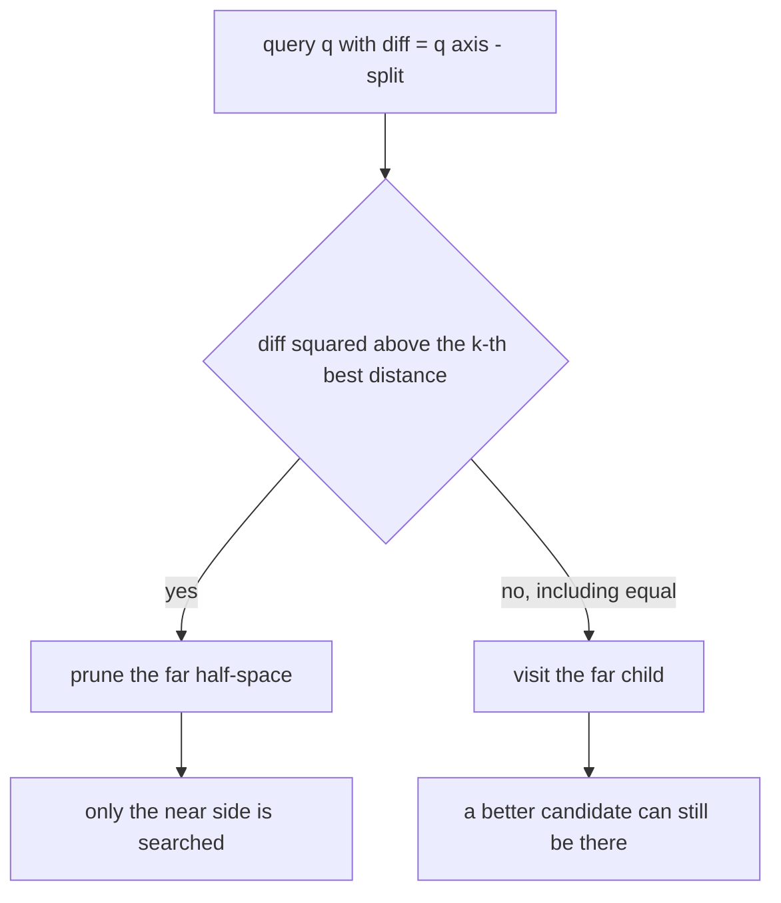
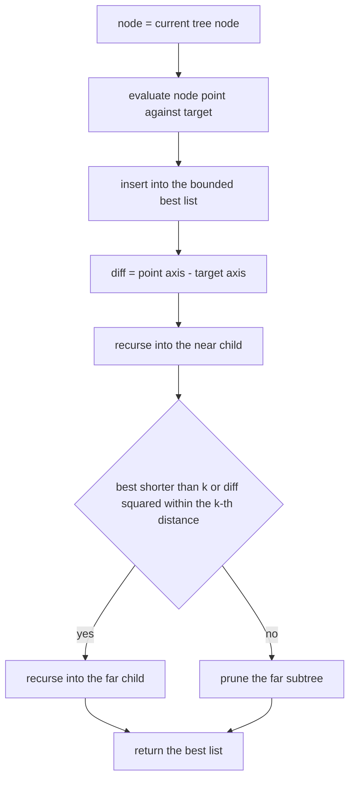
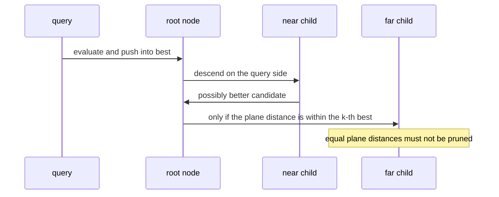

# 518 — Implement k-nearest neighbor classification fast with kd-tree.

> **Tier:** Advanced · **CTCI chapter:** Beyond — Machine Learning & AI
> **Task spec:** [518-implement-k-nearest-neighbor-classification-fast-with-kd-tree.md](../../../tasks/advanced/518-implement-k-nearest-neighbor-classification-fast-with-kd-tree.md)
> **Solutions:** [Python](../../../solutions/python/advanced/518-implement-k-nearest-neighbor-classification-fast-with-kd-tree/solution.py) ·
> [Java](../../../solutions/java/advanced/518-implement-k-nearest-neighbor-classification-fast-with-kd-tree/Solution.java) ·
> [JavaScript](../../../solutions/javascript/advanced/518-implement-k-nearest-neighbor-classification-fast-with-kd-tree/solution.js) ·
> [C#](../../../solutions/csharp/advanced/518-implement-k-nearest-neighbor-classification-fast-with-kd-tree/Solution.cs)

## 1. Problem restatement

**Input:** `n` labelled training points in `d` dimensions, a query point, and `k >= 1`. Every
solution implements **two** neighbour engines that are required to agree exactly:

- **Brute force**: scan all `n` points, form `(squared distance, index)` for each, sort, take the
  first `k`.
- **kd-tree**: a static median-split tree over the same points, searched with pruning.

**Output:** the `k` neighbours as `(squared distance, index)` pairs in that total order — which makes
the answer unique even with duplicated points and exact distance ties — and the classification, a
majority vote over the `k` labels with ties broken towards the smaller label. The Java file also
offers `classifyWeighted`, which votes with weight `1 / (d + 1e-9)` and breaks weight ties when the
difference is at most `1e-12`.

The whole task is the requirement that pruning must not change the answer, and the contract is fixed
by hand-checkable cases:

| Call | Result | Why |
| --- | --- | --- |
| points `[(0,0), (2,0), (10,10)]`, query `(5,5)`, `k = 3` | `[(34.0, 1), (50.0, 0), (50.0, 2)]` | index `2` and index `0` are both at distance `50`; the index tie-break puts `0` first |
| points `[(0,0), (2,0), (10,10)]`, query `(0,0)`, `k = 1` | `[(0.0, 0)]` | the tree prunes the far half-space and evaluates one distance instead of three |
| duplicates `[(1,1), (1,1), (1,1), (5,5)]`, query `(1,1)`, `k = 3` | `[(0.0, 0), (0.0, 1), (0.0, 2)]` | equal distances are still distinct indices, kept in index order |
| the same set with `k = 9 > n` | `[(0.0, 0), (0.0, 1), (0.0, 2), (32.0, 3)]` | `k` larger than `n` returns everything, still sorted |

## 2. Intuition

The brute-force engine costs `O(n d)` distance evaluations per query, which is unacceptable once the
training set is large: the Python test issues `120` queries against `200` points for each of five data
sets and counts `24000` distance evaluations per set for the linear scan.

A kd-tree splits the points at the median of one coordinate and recurses, so each node owns a
half-space. The key fact that makes pruning *safe* is a lower bound: for a query `q` and a split at
`split = point[axis]`, every point on the far side has `|q[axis] - split| <= |q[axis] - p[axis]|`, so
the squared plane offset `diff * diff` is a lower bound on the squared distance to anything in that
half-space. If the current k-th best distance is already smaller than the lower bound, the far side
cannot contain a better neighbour and is skipped.



The subtle part is the boundary case. When the plane offset *equals* the current k-th best distance,
the far side may contain a point at exactly that distance but with a **smaller index**, which would
sort earlier in the `(distance, index)` order. So the test must be `diff * diff <= best_k`, not
`< best_k`: equality has to be visited. The Python solution documents and tests exactly this with four
points all at squared distance `8` from the query `(2, 2)` and `k = 4`.

## 3. Algorithm

**Build** (Python and C#: axes cycle with depth; JavaScript: the split axis is the
widest-spread coordinate, ties broken by the smallest axis index — the two variants differ here and
both are correct):

1. Take the index list of the current subtree and sort it by `(coordinate on the axis, index)`, so the
   tree shape is a pure function of the data and never depends on the input order.
2. Emit the middle element as the node, then recurse on the left and right halves with `depth + 1`.

**Search** (Python and C#: near-child first, recursion; Java: best-first with a priority queue):

3. Maintain a list `best` of at most `k` `(distance, index)` pairs, sorted ascending.
4. At a node, evaluate the node's own point and insert it into `best` if `best` is not yet full or the
   pair is smaller than the current worst entry.
5. Let `diff = point[axis] - target[axis]`; descend into the near child first — the right child when
   `diff < 0`, the left child otherwise.
6. Visit the far child only when `best` is not full, or when `diff * diff <= best[-1][0]`.
7. Answer with `best`; classify by majority vote.

```text
procedure build(indices, depth)
    if indices is empty then return empty end
    axis ← depth mod dimensions
    ordered ← indices sorted by (coordinate on axis, index)
    mid ← length(ordered) // 2
    node.index ← ordered[mid]
    node.axis ← axis
    node.left ← build(ordered[0 .. mid - 1], depth + 1)
    node.right ← build(ordered[mid + 1 ..], depth + 1)
    return node
end

procedure search(node, target, k, best)
    if node is empty then return end
    point ← training[node.index]
    distance ← squared_distance(point, target)
    if length(best) < k or (distance, node.index) < best[last] then
        insert (distance, node.index) into best keeping it sorted
        if length(best) > k then drop the last entry end
    end
    diff ← point[node.axis] - target[node.axis]
    if diff >= 0 then near ← node.left; far ← node.right
    else near ← node.right; far ← node.left end
    search(near, target, k, best)
    if length(best) < k or diff * diff <= best[last].distance then
        search(far, target, k, best)
    end
end
```

The Java file replaces step 4-6 with a priority queue of subtree nodes keyed by the squared distance
from the query to the subtree's axis-aligned bounding box, which is a tighter lower bound than the
single splitting plane, and a bounded max-heap of size `k` for the candidates. The tie rule is the
same: a subtree is expanded when the heap is not full or when its lower bound is *strictly* greater,
so equal bounds are still expanded.



## 4. Worked example

Build a tree over `[(0,0), (2,0), (10,10)]`. Depth `0` splits on axis `x`: sorted by `(x, index)` the
order is index `0` (`x = 0`), index `1` (`x = 2`), index `2` (`x = 10`), so the middle element is
index `1` at `(2, 0)`. Its left child holds index `0` at depth `1` (axis `y`) and its right child
index `2`, also at axis `y`. Even leaf nodes keep the axis of their depth, because the pruning test at
that node still uses it.

Query `(5, 5)` with `k = 3`:

| Step | Node visited | Point | `distance` | `best` after insertion | `diff` | Far side? |
| --- | --- | --- | --- | --- | --- | --- |
| 1 | root, axis `x` | index `1` | `34` | `[(34, 1)]` | `2 - 5 = -3`, near is the right child | `best` is not full, so recurse |
| 2 | index `2`, axis `y` | `(10, 10)` | `50` | `[(34, 1), (50, 2)]` | `10 - 5 = 5` | no children left |
| 3 | index `0`, axis `y` | `(0, 0)` | `50` | `[(34, 1), (50, 0), (50, 2)]` | `0 - 5 = -5` | `best` is full and `25 > 50` is false, so it would be visited |
| 4 | result | | | `[(34.0, 1), (50.0, 0), (50.0, 2)]` | | |

Notice step 3: the tie between indices `0` and `2` at distance `50` is decided by the index, exactly
as in the brute-force scan, because insertion compares the whole pair `(distance, index)`.

Query `(0, 0)` with `k = 1` shows the pruning doing real work:

| Step | Node visited | Point | `distance` | `best` | `diff` | Decision |
| --- | --- | --- | --- | --- | --- | --- |
| 1 | root, axis `x` | index `1` | `4` | `[(4, 1)]` | `2 - 0 = 2`, so the near child is the left one | recurse near |
| 2 | index `0`, axis `y` | `(0, 0)` | `0` | `[(0, 0)]` (the `(4, 1)` entry is dropped) | `0 - 0 = 0` | no far child |
| 3 | back at the root | | | | `diff * diff = 4` against `best[-1][0] = 0` | `4 <= 0` is false, so index `2` is pruned |

One distance evaluation instead of the brute force's three. The same mechanism is what the
Python test measures on a larger scale:

| Data set | Brute-force evaluations | kd-tree evaluations |
| --- | --- | --- |
| uniform 2-D, 200 points, 120 queries, `k = 3` | `24000` | `2261` |
| uniform 3-D, 200 points | `24000` | `3877` |
| clustered 2-D, 200 points | `24000` | `2519` |
| degenerate 1-D line, 150 points | — | at most the linear scan, and only that is asserted |



## 5. Complexity

Let `n` be the training points, `d` the dimensions and `k` the number of neighbours.

| Phase | Time | Notes |
| --- | --- | --- |
| Build | `O(n log^2 n)` | `O(n log n)` sorting per level over `log n` levels (the JavaScript variant picks the widest axis, which costs an extra `O(n d)` scan per level) |
| Tree depth | `floor(log2 n) + 1` | the C# file asserts exactly this for its median splits |
| Brute-force query | `O(n d)` | every point is evaluated |
| kd-tree query, typical | `O(log n)` visited nodes | plus `O(k)` insertion work |
| kd-tree query, worst case | `O(n)` | a degenerate data set prunes nothing |
| Memory | `O(n)` | one node per point |

Pruning is what the counters measure. The Java file records the number of expanded nodes per query
and asserts it stays below `n / 4`, with a measured average of `18.45` nodes per query on `n = 400`
and `k = 1` — `4.6%` of a linear scan's `n` distance evaluations. The C# file requires at least a
factor-2 saving on its 300-point 2-D set (in practice an order of magnitude) while returning
element-wise identical lists, and the Python file requires `tree_checks * 2 < brute_checks` on the
uniform 2-D, uniform 3-D and clustered 2-D sets. The degenerate 1-D line is only required to stay at
or below the linear scan, which documents that a kd-tree is not automatically faster: with all points
on a line, every query hugs the splitting planes and almost nothing can be pruned.

## 6. Pitfalls and edge cases

- **Pruning on equality.** A far subtree must be visited when `diff * diff == best_k`, because a point
  at exactly the k-th distance but with a smaller index belongs earlier in the total order. The Python
  test's four points at squared distance `8` with `k = 4` is precisely this boundary, and the Java
  search expands on equal bounding-box bounds for the same reason.
- **Ties are resolved by index, not by luck.** Both engines sort by the pair `(distance, index)`, and
  the JavaScript file generates integer points so that the distances are exact and no floating-point
  accident can hide an ordering disagreement.
- **Duplicated points.** `k` duplicates at distance `0` must come back as `k` distinct indices in
  ascending order; the `(distance, index)` insertion in the search handles this without special code.
- **`k >= n`.** Every point is returned, still in `(distance, index)` order, and the majority label of
  that set equals the global majority of the training labels.
- **Deterministic tree shape.** Sorting by `(coordinate, index)` makes the split a pure function of
  the data, so rebuilding produces the same tree and the same visit counts; the Python file asserts
  both the identical neighbour lists and the identical `checks` counter for two independently built
  trees.
- **Recursion depth.** The median split keeps the tree balanced, so depth is logarithmic; that is
  what allows the recursive searches. The Java implementation still uses an explicit priority queue
  for the query, and it stores the subtree bounding boxes so the lower bound is tighter than a single
  plane.
- **Axis choice.** Cycling `depth % d` (Python, C#, Java) and picking the widest-spread coordinate
  (JavaScript) are both valid, and both must resolve the axis tie the same way (smallest axis index)
  to stay deterministic.
- **Degenerate shapes.** Points on a line, in a plane, or all identical are still answered correctly —
  just not faster: the all-equal case can only be asserted as "at most as many distance evaluations as
  the linear scan".
- **Invalid input.** The JavaScript file rejects a non-positive `k` and an empty training set;
  `k > n` is *not* an error, it simply returns everything.
- **Query exactly on a training point.** Distance `0` must come first, which the JavaScript file
  asserts; with several duplicates at that point, index order decides.

## 7. Variants and follow-ups

- **Best-first search with bounding boxes.** The Java file replaces the recursive near/far descent with
  a priority queue of subtrees keyed by a bounding-box lower bound, and a bounded max-heap of size `k`
  keyed by `(distance desc, index desc)`; the pruning decision becomes "expand only when the heap is
  not full or the bound is strictly greater".
- **Weighted voting.** `classifyWeighted` votes with `1 / (d + 1e-9)` instead of `1`, which turns the
  neighbour set into a soft classifier; ties in the accumulated weight (within `1e-12`) fall back to
  the smaller label.
- **Other metrics and dimensions.** The correctness comparisons cover 2-D, 3-D and 5-D LCG data plus a
  duplicate-heavy set and a four-way distance tie; the pruning argument uses the coordinate-wise
  squared offset, so it generalises verbatim to any `d` while the tree's advantage shrinks as `d`
  grows.
- **Approximate neighbours for very large data.** When exactness is negotiable, locality-sensitive
  hashing
  ([503-implement-locality-sensitive-hashing-for-cosine-similarity-simha.md](../../../tasks/advanced/503-implement-locality-sensitive-hashing-for-cosine-similarity-simha.md))
  or product quantisation
  ([504-implement-approximate-nearest-neighbor-with-product-quantization.md](../../../tasks/advanced/504-implement-approximate-nearest-neighbor-with-product-quantization.md))
  trade the guarantee of this task for a much better scaling curve.
- **Where the neighbours are used.** The predicted labels feed the metrics of
  [519-implement-confusion-matrix-precision-recall-metrics-calculator.md](../../../tasks/advanced/519-implement-confusion-matrix-precision-recall-metrics-calculator.md),
  and a clustering view of the same data is
  [498-implement-k-means-clustering-kmeans-initialization.md](../../../tasks/advanced/498-implement-k-means-clustering-kmeans-initialization.md).

## 8. Check yourself

**Q1.** Why does the search descend into the near child first instead of sorting both children by
their plane distance?

<details><summary>Show answer</summary>

Descending near-first produces a good candidate k-set early, which makes the k-th best distance small
and prunes the far side often. Sorting both children first would visit nodes that the depth-first
order would have pruned — the near child is always the better first guess by construction.

</details>

**Q2.** The pruning test is `diff * diff <= best_k`. What would break with a strict `<`?

<details><summary>Show answer</summary>

Points sitting exactly at distance `best_k` in the far half-space would be skipped. If such a point
has a smaller index than the current k-th entry, it belongs earlier in the `(distance, index)` order, so
the tree would return a different neighbour list from the brute-force scan — the Python file's
four-point `8`-distance tie test fails immediately with a strict comparison.

</details>

**Q3.** On the worked example query `(0, 0)` with `k = 1`, how many distance evaluations does the tree
perform, and how many does brute force perform?

<details><summary>Show answer</summary>

The tree evaluates `2`: the root `(2, 0)` at distance `4` and index `0` at distance `0`. The third
point, index `2` at `(10, 10)`, is pruned because `diff * diff = 4` exceeds the k-th best distance `0`.
Brute force evaluates all `3`.

</details>

**Q4.** Why is the tree built by sorting on `(coordinate, index)` rather than just the coordinate?

<details><summary>Show answer</summary>

Ties on the coordinate would otherwise be resolved by the input order, so permuting the training data
could change the tree shape, the visit counts and therefore the measured speed-up, even though the
neighbour lists would stay correct. Sorting by the pair makes the tree byte-deterministic, which is
what the "two independently built trees agree on every query and on the visit count" check verifies.

</details>

**Q5.** The degenerate 1-D data set is only asserted to evaluate *at most* as many distances as the
linear scan. Why can a kd-tree fail to speed up at all?

<details><summary>Show answer</summary>

With every point on a line, the splitting planes are all parallel to the query's own direction of
travel and the plane offset to the far side rarely exceeds the current k-th best distance, so almost
every query must descend into both children. Pruning is a best-case optimisation: its guarantee is the
lower bound, never a speed-up.

</details>
