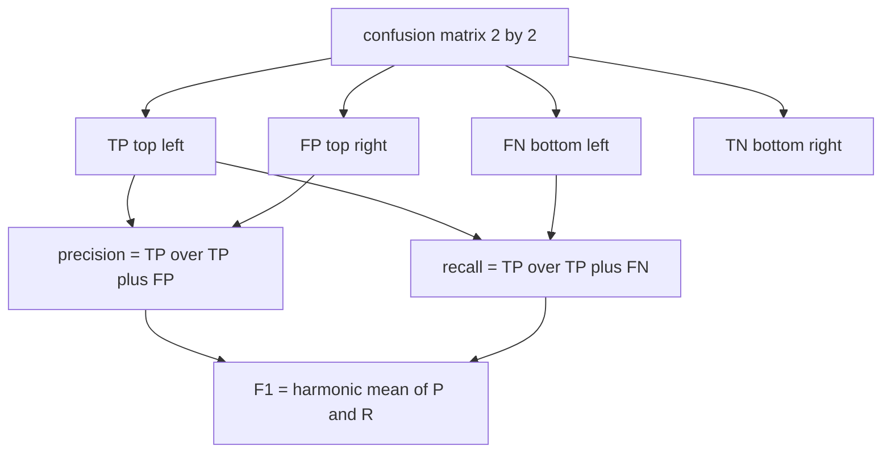
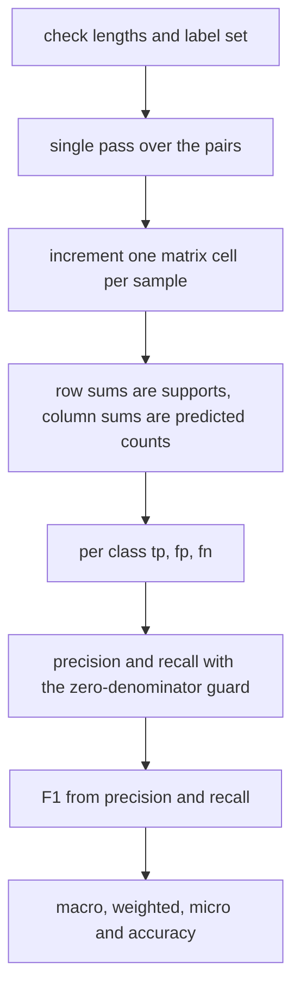
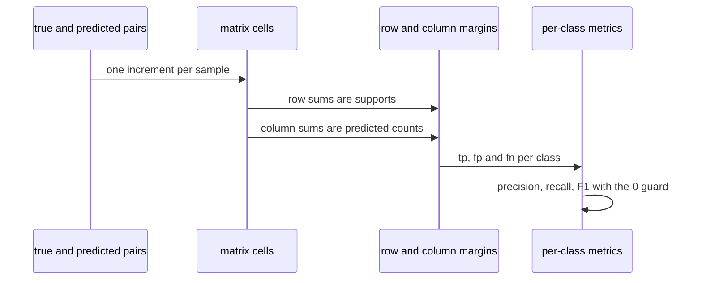

# 519 — Implement confusion matrix + precision/recall metrics calculator.

> **Tier:** Advanced · **CTCI chapter:** Beyond — Machine Learning & AI
> **Task spec:** [519-implement-confusion-matrix-precision-recall-metrics-calculator.md](../../../tasks/advanced/519-implement-confusion-matrix-precision-recall-metrics-calculator.md)
> **Solutions:** [Python](../../../solutions/python/advanced/519-implement-confusion-matrix-precision-recall-metrics-calculator/solution.py) ·
> [Java](../../../solutions/java/advanced/519-implement-confusion-matrix-precision-recall-metrics-calculator/Solution.java) ·
> [JavaScript](../../../solutions/javascript/advanced/519-implement-confusion-matrix-precision-recall-metrics-calculator/solution.js) ·
> [C#](../../../solutions/csharp/advanced/519-implement-confusion-matrix-precision-recall-metrics-calculator/Solution.cs)

## 1. Problem restatement

**Input:** two equally long vectors `y_true` and `y_pred`, plus — in the Python, Java and C# files —
an explicit label set. An explicit set matters: a class that never appears still gets a zero row and a
zero column, which changes the macro averages. The C# file derives the label set from the sorted union
of the observed values when none is supplied, and rejects any value outside a supplied set.

**Output:** the confusion matrix `cm[t][p]` (count of samples whose true label is `labels[t]` and
predicted label is `labels[p]`) together with the derived metrics:

| Level | Metrics |
| --- | --- |
| Per class | `tp`, `fp`, `fn`, `support`, `precision`, `recall`, `f1` |
| Aggregates | `accuracy`, macro / weighted / micro `precision`, `recall`, `f1` |
| Binary extras (Java) | error rate, specificity (TNR), false-positive and false-negative rate, balanced accuracy, Jaccard (IoU), Matthews correlation coefficient, Cohen's kappa, the F-beta family |
| Binary extras (JavaScript) | specificity, balanced accuracy, MCC, kappa, and the identity `min(P, R) <= F1 <= max(P, R)` |

The **documented convention** is the part every implementation shares: any ratio whose denominator is
zero reports `0.0` — never `NaN`, never an exception. The one exception in the Java file is
specificity when the truth set contains no negative instance at all (`tn + fp = 0`), which is `1.0`
because there is nothing to reject. Accuracy of an empty input is `0.0`.

| Call | Result | Why |
| --- | --- | --- |
| hand-computed 6 samples | `cm = [[2, 1], [1, 2]]` | `TP = 2`, `FP = 1`, `FN = 1`, `TN = 2` |
| the same cells | accuracy `4/6`, precision `2/3`, recall `2/3`, F1 `2/3` | all from the four cells |
| the same cells | specificity `2/3`, Jaccard `1/2`, MCC `1/3`, kappa `1/3` | the binary extras |
| hand-computed 3-class table | accuracy `4/7`, macro precision `5/9`, weighted precision `4/7` | see section 4 |

## 2. Intuition

Accuracy alone is a trap. The Python file's third check has a truth vector of `[0, 1, 2]` and a
prediction of `[0, 0, 0]`: the classifier that always answers "class 0" is right once out of three
times, yet classes `1` and `2` have precision and recall `0.0` and F1 `0.0` — the single number
hides the failure completely.

The confusion matrix is the fix: it keeps the four counts that accuracy collapses.
`precision = tp / (tp + fp)` answers "when the model says positive, how often is it right", and
`recall = tp / (tp + fn)` answers "of the real positives, how many did it find". Both can be made
arbitrarily high in isolation by trading one against the other, which is exactly why the harmonic
mean,

```text
F1 = 2 * precision * recall / (precision + recall)
```

is used as the headline: it is at most the arithmetic mean and drops to zero as soon as one of the two
does. The JavaScript file asserts the resulting sandwich bound `min(P, R) <= F1 <= max(P, R)` rather
than assuming it.

For multiclass problems the four counts become a `K x K` matrix, and its margins carry the supports:
row sums are the true class counts, column sums are the predicted class counts, and the trace counts
the correct predictions. The three standard aggregations then differ in what they weight:

- **micro** pools the counts (`tp` over `tp + fp`) and, for single-label data, is exactly the accuracy;
- **macro** is the unweighted mean over the classes, so a never-predicted or never-present class
  counts as `0.0` and pulls the average down;
- **weighted** is the support-weighted mean, so a class with no samples contributes nothing at all.



## 3. Algorithm

1. **Index the label set** and reject duplicates, so the mapping from label to row is unambiguous.
2. **Single pass** over the pairs, incrementing `cm[index[true]][index[pred]]`; reject any label that
   is not in the set and reject length mismatches before the loop starts.
3. **Margins.** For class `i`: `tp = cm[i][i]`, `fp = column_sum(i) - tp`, `fn = row_sum(i) - tp`,
   `support = row_sum(i)`. The row sum is the number of true instances of that class, the column sum
   the number of times it was predicted.
4. **Per-class ratios** with the zero-denominator guard, then `F1` from precision and recall — the
   guard is applied twice, because `precision + recall` can be zero even when neither denominator is.
5. **Aggregate.** `accuracy = trace / n`; micro from the pool; macro as the unweighted mean over the
   label set; weighted as `sum(metric * support) / sum(support)`.
6. **Optional binary extras** (Java, JavaScript): specificity, the error rates derived from it,
   balanced accuracy `(TPR + TNR) / 2`, Jaccard `tp / (tp + fp + fn)`, MCC and Cohen's kappa from the
   marginals.

```text
procedure build_matrix(y_true, y_pred, labels)
    if length(y_true) != length(y_pred) then raise ValueError end
    index ← label to position map, rejecting duplicates
    cm ← K x K zeros
    for position ← 0 to length(y_true) - 1 do
        actual ← y_true[position]
        predicted ← y_pred[position]
        if actual not in index or predicted not in index then raise ValueError end
        cm[index[actual]][index[predicted]] ← cm[index[actual]][index[predicted]] + 1
    end
    return cm
end

procedure report(cm, labels)
    for i over classes do
        tp ← cm[i][i]
        fp ← column_sum(i) - tp
        fn ← row_sum(i) - tp
        support ← row_sum(i)
        precision ← tp / (tp + fp) if tp + fp > 0 else 0.0
        recall ← tp / (tp + fn) if tp + fn > 0 else 0.0
        f1 ← 2 precision recall / (precision + recall) if precision + recall > 0 else 0.0
    end
    return per-class rows plus macro, weighted, micro and accuracy
end
```



## 4. Worked example

Take the hand-computed binary example: `y_true = [1, 1, 0, 0, 1, 0]` and
`y_pred = [1, 0, 0, 0, 1, 1]` with `labels = [0, 1]`, so row `0` means "truth is `0`".

| | predicted `0` | predicted `1` | row sum (support) |
| --- | --- | --- | --- |
| truth `0` | `2` | `1` | `3` |
| truth `1` | `1` | `2` | `3` |
| column sum | `3` | `3` | `6` |

Class `0` (the negative class) and class `1` (the positive class) are symmetric here, which makes the
cells `TP = 2`, `FN = 1`, `FP = 1`, `TN = 2`, and every metric computable by hand:

| Metric | Formula | Value |
| --- | --- | --- |
| accuracy | `(2 + 2) / 6` | `0.6666666667` |
| error rate | `1 - accuracy` | `0.3333333333` |
| precision | `2 / (2 + 1)` | `0.6666666667` |
| recall (TPR) | `2 / (2 + 1)` | `0.6666666667` |
| specificity (TNR) | `2 / (2 + 1)` | `0.6666666667` |
| F1 | `2 * (2/3) * (2/3) / (4/3)` | `0.6666666667` |
| balanced accuracy | `(TPR + TNR) / 2` | `0.6666666667` |
| Jaccard (IoU) | `2 / (2 + 1 + 1)` | `0.5` |
| MCC | `(2*2 - 1*1) / sqrt(3*3*3*3)` | `0.3333333333` |
| Cohen's kappa | `(2/3 - 1/2) / (1 - 1/2)` | `0.3333333333` |
| micro F1 | `tp / (tp + fp)` with `tp = 4`, `fp = 2` | `0.6666666667` |

Kappa deserves a note because it is the least obvious number in the table. The expected agreement under
chance is `pe = [(tp+fp)(tp+fn) + (fn+tn)(fp+tn)] / n^2 = (3*3 + 3*3) / 36 = 0.5`, the observed
agreement is `po = (2 + 2) / 6 = 2/3`, and `kappa = (po - pe) / (1 - pe) = (1/6) / (1/2) = 1/3`.

Now the multiclass case, the C# file's hand-checked example with `truth = [0, 0, 0, 1, 1, 2, 2]` and
`prediction = [0, 2, 0, 1, 0, 2, 1]`:

| | predicted `0` | predicted `1` | predicted `2` | support |
| --- | --- | --- | --- | --- |
| truth `0` | `2` | `0` | `1` | `3` |
| truth `1` | `1` | `1` | `0` | `2` |
| truth `2` | `0` | `1` | `1` | `2` |
| predicted | `3` | `2` | `2` | `7` |

Per class: `tp = (2, 1, 1)` and `fp = fn = (1, 1, 1)`, so precision and recall are `2/3`, `1/2` and
`1/2` for the three classes. The aggregates are then `accuracy = trace / n = 4/7 = 0.5714285714`,
`macro precision = (2/3 + 1/2 + 1/2) / 3 = 5/9 = 0.5555555556` and
`weighted precision = (2/3 * 3 + 1/2 * 2 + 1/2 * 2) / 7 = 4/7 = 0.5714285714`.

Note how macro and weighted disagree here: macro weights each class equally and punishes the two weak
classes, while weighted follows the supports and lands back on the accuracy-like value. Adding an
all-zero row for a class that never appears would dilute macro further — the Python file asserts that
the macro F1 of a perfect two-class run drops to `2/3` when a third, absent class is added to the label
set, while the weighted F1 stays exactly `1.0`.



## 5. Complexity

Let `n` be the number of samples and `K` the number of labels in the set.

| Phase | Time | Notes |
| --- | --- | --- |
| Validate and index labels | `O(n + K)` | one check per sample, one insertion per label |
| Build the matrix | `O(n)` | one increment per sample |
| Per-class metrics | `O(K^2)` | each `fp` needs a column sum |
| Aggregates | `O(K)` | macro, weighted and micro are single loops |
| Whole report | `O(n + K^2)` | dominated by the single pass for realistic `K` |
| Memory | `O(K^2)` | the matrix, which is why `K` must stay modest |
| Independent recount (test) | `O(n K)` | a nested loop over pairs, used as the oracle |

For a 3-class problem the matrix costs nine counters regardless of `n = 150`, and the whole report is
one pass plus a `3 x 3` scan; the brute-force recount in the tests is `O(n K)` but is only there to
prove the matrix is right. The Java file goes further and recomputes every metric from the four `2 x 2`
cells through a second, independent path, asserting that the direct single-pass values match.

## 6. Pitfalls and edge cases

- **Zero denominators everywhere.** No predicted positives makes precision `0.0`; no actual positives
  makes recall `0.0`; no predictions at all makes both `0.0` and F1 `0.0`. All four files state the
  convention and assert it, and the Java file adds the one exception: specificity is `1.0` when there
  is no negative instance at all.
- **Precision and recall both zero.** `F1` needs its own guard, since `precision + recall` can be `0`
  while neither denominator is zero individually — the Python implementation guards the harmonic mean
  separately from the two ratios.
- **Row/column orientation.** `cm[true][pred]`; swapping the two indices silently produces precision
  and recall values that are each other's mirror image, which is easy to miss on a symmetric example
  like the binary table above.
- **Absent classes are not free.** An explicit label set with an unused class dilutes the macro average
  (perfect two-class F1 `1.0` becomes `2/3` with a third class) while leaving weighted and micro
  untouched. The Python file asserts both halves of that statement.
- **Micro equals accuracy only for single-label data.** Each sample contributes to exactly one cell of
  one row, so micro precision, micro recall and micro F1 all collapse to `trace / n`; the JavaScript
  and C# files assert it, but it would fail for multilabel input.
- **Empty input.** `n = 0` is legal: every cell is zero, accuracy is `0.0` and every metric is `0.0`
  with no division error.
- **Invalid input.** Length mismatch, an unknown label, and a duplicated label in the label list are
  all rejected with `ValueError` (JavaScript also rejects unknown prediction labels).
- **Label order is not semantically meaningful.** Permuting `labels` must permute the matrix the same
  way and leave every per-label metric unchanged; the Python file asserts the permutation relation
  cell by cell, and recomputes macro from the permuted rows for good measure.
- **Floating-point equality.** The metrics are rationals, but the files compare them with a `1e-12`
  tolerance and several assertions use exact rationals such as `4.0 / 6.0`, so a subtly different
  formula usually shows up immediately.
- **Kappa and MCC need the marginals.** Both use the row and column sums, not just the diagonal, so an
  implementation that only tracks `tp` cannot compute them; a denominator of zero in MCC (all
  predictions identical) must fall back to the documented convention rather than produce `NaN`.
- **F-beta is not F1.** `F2 = 5 p r / (4 p + r)` weights recall twice as heavily; at `p = r = 2/3` it
  coincidentally equals `2/3` again, which is exactly the kind of coincidence you do not want to rely
  on when testing it.

## 7. Variants and follow-ups

- **Binary family.** The Java file derives accuracy, error rate, specificity, FPR, FNR, F1, the F-beta
  family, balanced accuracy, Jaccard, MCC and kappa from the same four cells, and cross-checks the
  whole family against an independent recomputation from the `2 x 2` matrix.
- **Pooled and averaged multiclass aggregation.** Macro (unweighted), weighted (support-weighted) and
  micro (Sokolova-Zechner pooled counts) are all implemented; the JavaScript file additionally
  recomputes each average with a second loop over the matrix and asserts `min(P, R) <= F1 <= max(P, R)`.
- **Threshold-free evaluation.** A classifier that emits scores rather than labels is better judged by
  the ROC AUC estimator of
  [520-implement-roc-auc-estimator-from-predictions.md](../../../tasks/advanced/520-implement-roc-auc-estimator-from-predictions.md),
  which sweeps thresholds instead of committing to one.
- **Where the labels come from.** The kd-tree classifier of
  [518-implement-k-nearest-neighbor-classification-fast-with-kd-tree.md](../../../tasks/advanced/518-implement-k-nearest-neighbor-classification-fast-with-kd-tree.md)
  and the logistic model of
  [515-implement-minibatch-gradient-descent-training-loop-for-logistic.md](../../../tasks/advanced/515-implement-minibatch-gradient-descent-training-loop-for-logistic.md)
  both produce exactly the `y_pred` vectors this calculator consumes, and both report training
  accuracy with the same definition asserted here.
- **Statistical reliability.** The counts are point estimates; the bootstrap of
  [522-implement-bootstrap-sampling-estimator-for-mean-ci.md](../../../tasks/advanced/522-implement-bootstrap-sampling-estimator-for-mean-ci.md)
  is the natural tool for attaching a confidence interval to them.

## 8. Check yourself

**Q1.** From `cm = [[2, 1], [1, 2]]`, compute precision, recall and specificity of the positive class.

<details><summary>Show answer</summary>

`TP = 2`, `FP = 1`, `FN = 1`, `TN = 2`; `precision = 2/3`, `recall = 2/3`,
`specificity = TN / (TN + FP) = 2/3`. Balanced accuracy is `(2/3 + 2/3) / 2 = 2/3`.

</details>

**Q2.** Why does micro F1 equal accuracy for single-label multiclass data, and when does that stop
being true?

<details><summary>Show answer</summary>

Every sample contributes exactly one count, either to the diagonal (correct) or to a single off-diagonal
cell (which counts as one false positive for the predicted class and one false negative for the true
class). Pooling gives `tp = trace` and `fp = fn = n - trace`, so micro precision, recall and F1 all
equal `trace / n`. With multilabel data a sample can be both a false positive and a false negative, and
the identity fails.

</details>

**Q3.** A model always predicts class `0` on the truth vector `[0, 1, 2]`. What are the per-class
precision, recall and F1, and what is the accuracy?

<details><summary>Show answer</summary>

The matrix is `[[1, 0, 0], [1, 0, 0], [1, 0, 0]]`. Class `0`: `tp = 1`, `fp = 2`, `fn = 0` so precision
`1/3` and recall `1.0`, F1 `1/2`. Classes `1` and `2`: never predicted, so precision `0.0` and recall
`0.0`, F1 `0.0`. Accuracy is `1/3`, and macro precision is `(1/3) / 3 = 1/9`.

</details>

**Q4.** Adding a class that never appears to the label set changes the macro F1 of a perfect classifier
from `1.0` to `2/3`. What happens to the weighted F1 and the accuracy, and why?

<details><summary>Show answer</summary>

Both stay unchanged: weighted F1 multiplies each class metric by its support, and the absent class has
support `0`, so it contributes nothing; accuracy is `trace / n` and neither the trace nor `n` changes.
Only the unweighted macro mean is diluted.

</details>

**Q5.** Why is Cohen's kappa a more informative agreement measure than accuracy on an imbalanced data
set?

<details><summary>Show answer</summary>

Kappa subtracts the agreement expected by chance, `pe`, computed from the marginals:
`kappa = (po - pe) / (1 - pe)`. A classifier that always predicts the majority class can have high
`po` simply because the majority class is common; its `pe` is equally high, so kappa collapses toward
`0`, exposing that the predictions carry no information.

</details>
