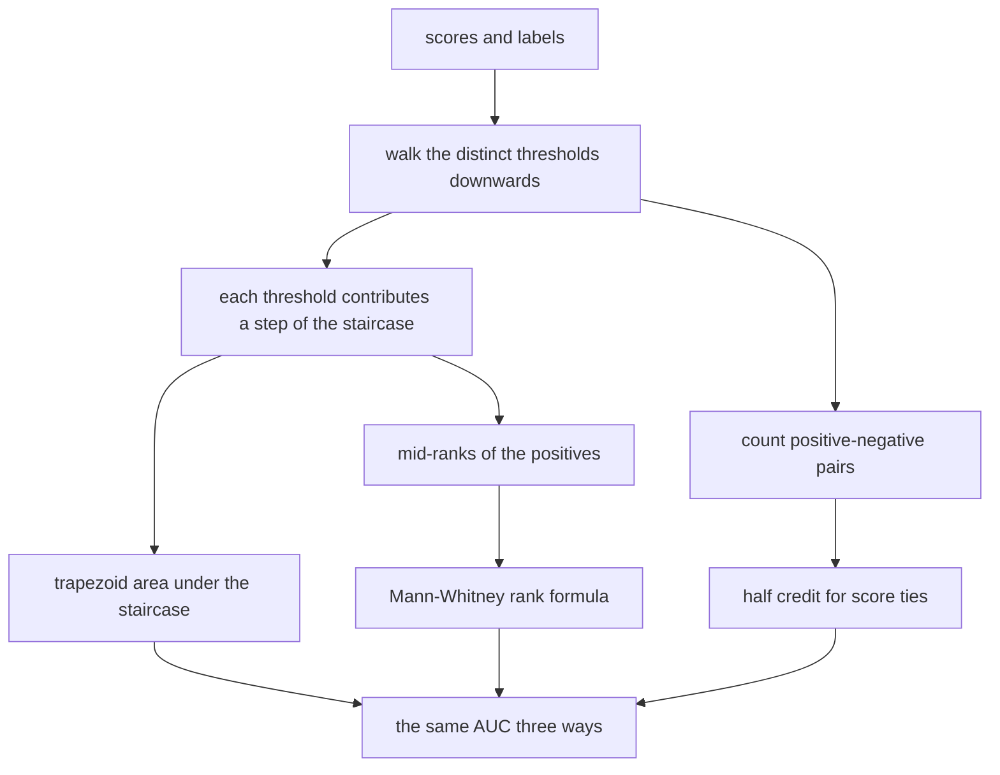
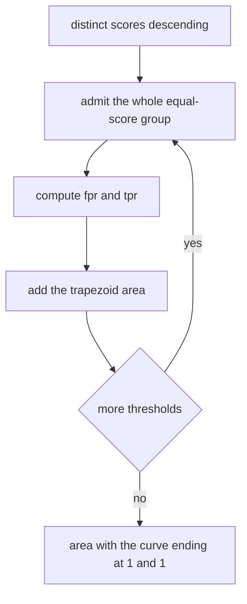
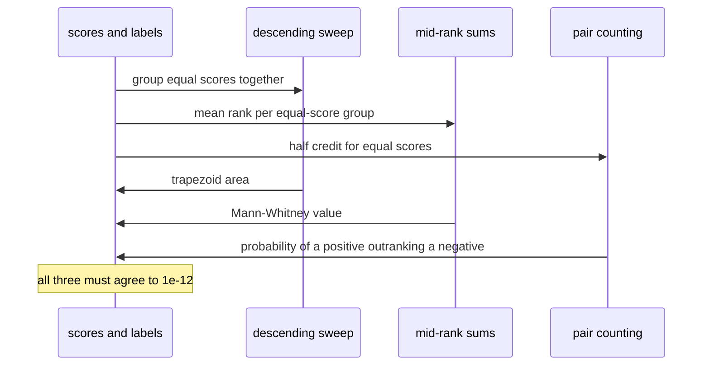

# 520 — Implement ROC AUC estimator from predictions.

> **Tier:** Advanced · **CTCI chapter:** Beyond — Machine Learning & AI
> **Task spec:** [520-implement-roc-auc-estimator-from-predictions.md](../../../tasks/advanced/520-implement-roc-auc-estimator-from-predictions.md)
> **Solutions:** [Python](../../../solutions/python/advanced/520-implement-roc-auc-estimator-from-predictions/solution.py) ·
> [Java](../../../solutions/java/advanced/520-implement-roc-auc-estimator-from-predictions/Solution.java) ·
> [JavaScript](../../../solutions/javascript/advanced/520-implement-roc-auc-estimator-from-predictions/solution.js) ·
> [C#](../../../solutions/csharp/advanced/520-implement-roc-auc-estimator-from-predictions/Solution.cs)

## 1. Problem restatement

**Input:** a vector of real-valued scores and a vector of binary labels (`0` = negative, `1` =
positive), of equal length. The scores are compared **exactly** — no epsilon — so ties are resolved by
explicit half-credit rules rather than by rounding.

**Output:** the area under the ROC curve, computed by several independent estimators that must agree
to `1e-12` on every data set:

| Estimator | Definition |
| --- | --- |
| Trapezoid / curve | sweep the distinct thresholds in descending order, move every item at that score into the predicted-positive set at once, and sum the trapezoid areas under the resulting staircase |
| Rank / Mann-Whitney U | `AUC = (sum of the average ranks of the positives - P (P + 1) / 2) / (P * N)`, with each group of equal scores sharing its mean 1-based rank |
| Pairwise | `P(score_pos > score_neg) + 0.5 * P(score_pos == score_neg)`, counted by an `O(P * N)` double loop |
| Weighted (Java) | the same pair count with weights `w_i w_j`, divided by `W_pos * W_neg`; it must equal the plain AUC for unit weights and the AUC of the row-duplicated data set for integer weights |

The curve itself is also an output in the JavaScript file (its number of points must be the number of
distinct scores plus one, and Youden's statistic `J = max(TPR - FPR)` is compared against a brute-force
search over every candidate threshold), and the C# file builds a *second* curve at each distinct
threshold using the `score >= threshold` rule and asserts the two agree point by point.

| Call | Result |
| --- | --- |
| positives `{0.9, 0.7, 0.3}` against negatives `{0.8, 0.6, 0.2, 0.1}` | `0.75` — `0.9` beats all four, `0.7` beats three, `0.3` beats two: `9 / 12` |
| perfectly separated scores (`0.95, 0.9, 0.85` vs `0.2, 0.1, 0.05`) | `1.0`, and the negated scores give exactly `0.0` |
| a constant score with mixed labels | exactly `0.5`, for all three estimators |
| C#'s four-sample set: positives `0.1, 0.4`, negatives `0.35, 0.8` | `1 / 4` |
| a two-sample 1-vs-0 score tie | `1 / 2` |

## 2. Intuition

Accuracy needs a threshold: pick `0.5` and a model that outputs `0.49` for a positive sample is simply
wrong. The ROC curve removes the threshold by plotting, for **every** threshold, the true-positive rate
against the false-positive rate, and the AUC summarizes the whole curve in one number. Its
probabilistic reading is what makes it useful:

```text
AUC = probability that a randomly drawn positive sample scores
      higher than a randomly drawn negative sample
```

A perfect ranking gives `1.0`, a reversed ranking gives `0.0`, and a coin flip gives `0.5` — which is
also exactly what a constant score must produce, because a constant score carries no ranking
information at all.

That probabilistic definition also dictates the tie rule. If a positive and a negative have the *same*
score, the pair is half a win: `0.5`. Every implementation honours this, and the three estimators must
therefore agree even on data with only a handful of distinct score values — the Python test uses
`[3, 3, 2, 2, 2, 1, 1, 0, 0, 0]`, where all three methods produce `0.6`.



Handling ties *inside* the curve construction is the subtle part. The staircase cannot step right and
up separately for items with equal scores, otherwise the tie would be broken by an arbitrary sort
order. Instead each group of equal scores is admitted at once, which moves the curve diagonally — and
the trapezoid over such a diagonal segment reproduces exactly the `0.5` credit of the pairwise
definition.

## 3. Algorithm

1. **Validate** the input: both classes must be present, otherwise the area is undefined (the Python
   and JavaScript files raise a documented error; the Java file reports `0.5` for a single-class or
   empty input as its documented convention).
2. **Curve.** Collect the distinct scores, sort them descending, and walk the samples accumulating
   `tp` and `fp`. After admitting each whole score group, append the point
   `(fpr, tpr) = (fp / N, tp / P)` and add the trapezoid
   `(fpr - prev_fpr) * (tpr + prev_tpr) / 2`.
3. **Rank.** Sort the sample indices by `(score, index)`, assign every group of equal scores its mean
   1-based rank, sum the ranks of the positives, and apply
   `(rank_sum - P (P + 1) / 2) / (P * N)`.
4. **Pairs.** Nested loop over positives and negatives adding `1.0` for a strict win and `0.5` for a
   tie, then divide by `P * N`.
5. **Assert the estimators agree**, and optionally derive Youden's `J` and the weighted variant.

```text
procedure auc_by_curve(scores, labels)
    positives ← count of labels equal to 1
    negatives ← count of labels equal to 0
    raise an error if either count is 0
    area ← 0
    tp ← 0
    fp ← 0
    previous_fpr ← 0
    previous_tpr ← 0
    for threshold in distinct scores in descending order do
        for each sample with score equal to threshold do
            if its label is 1 then tp ← tp + 1 else fp ← fp + 1 end
        end
        fpr ← fp / negatives
        tpr ← tp / positives
        area ← area + (fpr - previous_fpr) * (tpr + previous_tpr) / 2
        previous_fpr ← fpr
        previous_tpr ← tpr
    end
    return area, the recorded curve points
end

procedure auc_by_rank(scores, labels)
    ranks ← mean 1-based rank of each group of equal scores
    rank_sum ← sum of ranks of the positive samples
    return (rank_sum - positives * (positives + 1) / 2) / (positives * negatives)
end

procedure auc_by_pairs(scores, labels)
    wins ← 0
    for each positive score a and each negative score b do
        if a > b then wins ← wins + 1
        else if a == b then wins ← wins + 0.5
        end
    end
    return wins / (positives * negatives)
end
```



## 4. Worked example

Take the Python hand-checked set: `scores = [0.9, 0.8, 0.7, 0.6, 0.3, 0.2, 0.1]` with
`labels = [1, 0, 1, 0, 1, 0, 0]`, so `P = 3` positives and `N = 4` negatives.

| Threshold | after admitting it | `tpr` | `fpr` | trapezoid added | running area |
| --- | --- | --- | --- | --- | --- |
| `0.9` | `tp = 1` | `1/3` | `0` | `0` | `0` |
| `0.8` | `fp = 1` | `1/3` | `1/4` | `(1/4)(1/3)` | `0.0833333333` |
| `0.7` | `tp = 2` | `2/3` | `1/4` | `0` | `0.0833333333` |
| `0.6` | `fp = 2` | `2/3` | `1/2` | `(1/4)(2/3)` | `0.25` |
| `0.3` | `tp = 3` | `1` | `1/2` | `0` | `0.25` |
| `0.2` | `fp = 3` | `1` | `3/4` | `(1/4)(1)` | `0.5` |
| `0.1` | `fp = 4` | `1` | `1` | `(1/4)(1)` | `0.75` |

The curve is `(0, 0), (0, 1/3), (1/4, 1/3), (1/4, 2/3), (1/2, 2/3), (1/2, 1), (3/4, 1), (1, 1)` — the
eight points the Python implementation returns — and the area is exactly `0.75`.

The rank estimator reaches the same number from the ranks `0.1 -> 1`, `0.2 -> 2`, `0.3 -> 3`,
`0.6 -> 4`, `0.7 -> 5`, `0.8 -> 6`, `0.9 -> 7`. The positives hold ranks `7, 5, 3`, so
`rank_sum = 15` and `AUC = (15 - 3 * 4 / 2) / (3 * 4) = 9 / 12 = 0.75`.

The pairwise estimator counts directly: `0.9` beats all four negatives, `0.7` beats `0.6, 0.2, 0.1`,
and `0.3` beats `0.2, 0.1` — `4 + 3 + 2 = 9` wins out of `12` pairs.

Now the tie-heavy set: `scores = [3, 3, 2, 2, 2, 1, 1, 0, 0, 0]` with
`labels = [1, 0, 1, 1, 0, 1, 0, 1, 0, 0]`, so the positives are `{3, 2, 2, 1, 0}` and the negatives are
`{3, 2, 1, 0, 0}`.

| Positive | beats | ties | credit |
| --- | --- | --- | --- |
| `3` | `2, 1, 0, 0` | `3` | `4.5` |
| `2` | `1, 0, 0` | `2` | `3.5` |
| `2` | `1, 0, 0` | `2` | `3.5` |
| `1` | `0, 0` | `1` | `2.5` |
| `0` | — | `0, 0` | `1.0` |

`15 / 25 = 0.6`, and the grouped curve `(0,0), (0.2,0.2), (0.4,0.6), (0.6,0.8), (1,1)` gives the same
`0.6` — five points, one more than the four distinct scores.



## 5. Complexity

Let `n = P + N` be the number of samples, `T` the number of distinct scores, `P` the positives and `N`
the negatives.

| Estimator | Time | Notes |
| --- | --- | --- |
| Curve, with the per-threshold scan | `O(n T)` worst case | the Python implementation rescans the samples for every distinct score, which is `O(n^2)` when all scores differ |
| Curve, with a single sorting pass | `O(n log n)` | the JavaScript and C# files sort once and sweep in equal-score blocks |
| Rank / Mann-Whitney | `O(n log n)` | dominated by the sort plus the group scan |
| Pairwise | `O(P N)` | `O(n^2)` in the balanced case, but with no allocation and no division until the end |
| Weighted variant | `O(P N)` | same loops, one extra multiply per pair |
| Memory | `O(n)` | scores, labels, ranks, and the `T + 1` curve points |

The three estimators are deliberately redundant: the rank formula is the efficient one, the pairwise
count is the definition, and the curve is the thing you would plot. Agreement between all three on
tie-heavy data is the actual correctness argument, and it is asserted to `1e-12` on twelve LCG data
sets with four distinct score values as well as on continuous scores. Youden's `J`, computed by the
JavaScript file, is an `O(T)` reduction over the same curve.

## 6. Pitfalls and edge cases

- **Ties are half credit, not a coin flip.** Both the curve (grouped thresholds), the rank formula
  (mean ranks) and the pairwise loop must award exactly `0.5`. Implementing any one of them with a
  "break ties by index" rule silently biases the AUC.
- **Constant scores must give exactly `0.5`.** That requires grouping ties in the curve; a threshold
  sweep that admits equal scores one at a time produces an area that depends on the sort order.
- **One class only.** With no positives (or no negatives) the area is undefined: the Python and
  JavaScript files raise a documented error, the Java file reports `0.5` for a single-class input and
  for an empty input. Whichever convention is chosen, it must be documented and asserted — a silent
  `NaN` is the worst outcome.
- **Empty input** is covered by the same convention, since both class counts are zero.
- **Exact score comparison.** The implementations compare scores with `>` and `==` and never add an
  epsilon, because an epsilon would merge genuinely different scores and change the area. Scores are
  expected to be the same doubles on both sides of a comparison.
- **Invariance.** `AUC(-scores) = 1 - AUC(scores)`, and any strictly increasing transform (`3 s^3 + 1`,
  `exp`) leaves the area unchanged. The Python test asserts both; a transform that is only
  non-decreasing would merge distinct scores and could change the result.
- **Curve shape.** The curve starts at `(0, 0)`, ends exactly at `(1, 1)`, is non-decreasing in both
  coordinates, has `T + 1` points, and every point must be reproducible by directly counting the
  samples at or above that threshold.
- **Sparse versus dense threshold grids.** Because only thresholds that occur in the data produce
  points, the area is independent of how the scores are spaced; the Python test checks a sparse and a
  dense grid against each other.
- **Class balance.** AUC is insensitive to how many positives and negatives there are, which is its
  advantage over accuracy on imbalanced data — and also why it says nothing about the calibration of
  the scores, only their ordering.
- **Weighted variant.** Unit weights must collapse to the plain AUC, and integer weights must equal the
  AUC of the row-duplicated data set; both identities are asserted by the Java file, which is what
  makes the weighted code trustworthy rather than merely plausible.

## 7. Variants and follow-ups

- **Weighted AUC.** The Java file's weighted pair sum generalises the estimator to per-sample
  importance; the unit-weight and integer-duplication identities pin it to the plain definition.
- **Youden's J and the decision threshold.** The JavaScript file computes `J = max(TPR - FPR)` over the
  curve and compares it against a brute-force search, which is the natural way to pick a single
  operating point once the curve exists.
- **A second curve construction.** The C# file rebuilds the curve from scratch at every distinct
  threshold with the `score >= threshold` rule and asserts it coincides with the grouped sweep, which
  pins down the tie handling of both.
- **From labels to scores.** The classifier of
  [518-implement-k-nearest-neighbor-classification-fast-with-kd-tree.md](../../../tasks/advanced/518-implement-k-nearest-neighbor-classification-fast-with-kd-tree.md)
  produces neighbour votes and the logistic model of
  [515-implement-minibatch-gradient-descent-training-loop-for-logistic.md](../../../tasks/advanced/515-implement-minibatch-gradient-descent-training-loop-for-logistic.md)
  produces probabilities; both give exactly the score vector this estimator wants.
- **Threshold-dependent metrics.** Once a threshold is fixed, the confusion-matrix family of
  [519-implement-confusion-matrix-precision-recall-metrics-calculator.md](../../../tasks/advanced/519-implement-confusion-matrix-precision-recall-metrics-calculator.md)
  takes over — precision, recall, F1 and kappa all depend on the operating point, which the AUC
  deliberately does not.
- **Confidence in the estimate.** AUC on a finite sample is an estimate; the bootstrap of
  [522-implement-bootstrap-sampling-estimator-for-mean-ci.md](../../../tasks/advanced/522-implement-bootstrap-sampling-estimator-for-mean-ci.md)
  is the standard way to quantify how much it would move on a new sample.

## 8. Check yourself

**Q1.** Three positives score `0.9, 0.7, 0.3` and four negatives score `0.8, 0.6, 0.2, 0.1`. What is the
AUC, and which estimator gives the number fastest by hand?

<details><summary>Show answer</summary>

`0.75`: the pairwise count gives `4 + 3 + 2 = 9` wins out of `3 * 4 = 12` pairs. The rank formula is
just as quick: positive ranks `7, 5, 3` sum to `15`, and `(15 - 3 * 4 / 2) / 12 = 0.75`.

</details>

**Q2.** Why must a constant score produce exactly `0.5` rather than `1.0` or `0.0`?

<details><summary>Show answer</summary>

A constant score gives no information, so every positive-negative pair is a tie and contributes `0.5`;
the curve degenerates to the diagonal from `(0, 0)` to `(1, 1)`, whose area is `0.5`. Getting anything
else means the ties were broken by the sort order.

</details>

**Q3.** Why does the curve group all samples with equal scores into a single step?

<details><summary>Show answer</summary>

Admitting them one at a time would let the arbitrary order inside the group decide whether the curve
moves right or up first, which changes the area. Grouping makes the step diagonal, and the trapezoid
over a diagonal segment yields exactly the `0.5` half credit that the pairwise definition assigns to a
tie.

</details>

**Q4.** The Python curve implementation rescans the samples for every distinct score. When does that
become a real cost, and how do the other files avoid it?

<details><summary>Show answer</summary>

It is `O(n T)`, so with all scores distinct it is `O(n^2)`. The JavaScript and C# files sort the
samples once and sweep them in equal-score blocks, which is `O(n log n)`; the rank estimator is also
`O(n log n)`.

</details>

**Q5.** A single-class data set arrives. What do the implementations do, and why is there no "correct"
value?

<details><summary>Show answer</summary>

Python and JavaScript raise a documented error, Java reports `0.5`, and the empty-input case follows the
same convention in each file. There is no correct value because the probability interpretation needs
both a positive and a negative sample to form a pair; `0.5` is a convention that keeps an aggregate
loop from crashing, not an estimate.

</details>
