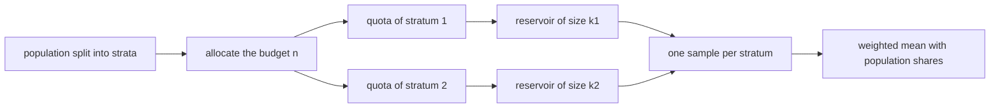
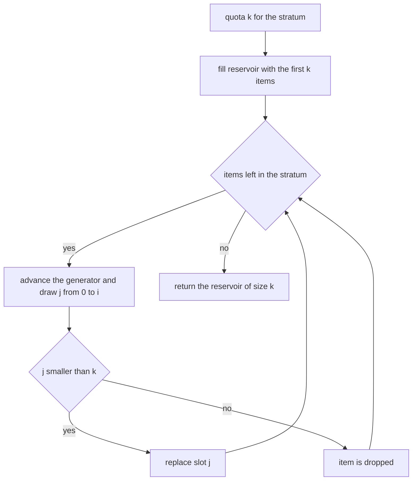
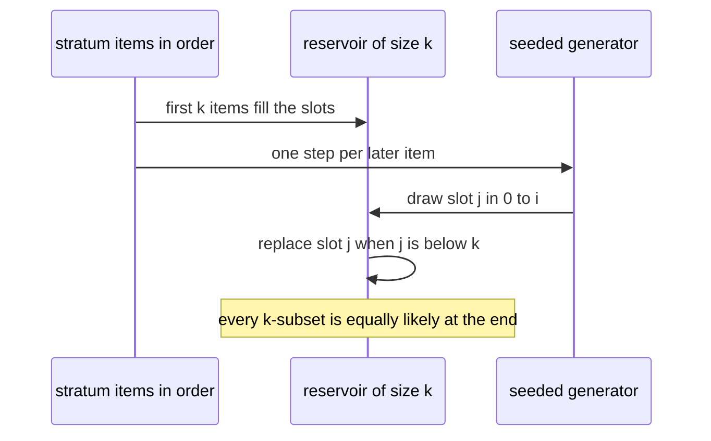

# 521 — Implement reservoir-sampling-based stratified sampling.

> **Tier:** Advanced · **CTCI chapter:** Beyond — Machine Learning & AI
> **Task spec:** [521-implement-reservoir-sampling-based-stratified-sampling.md](../../../tasks/advanced/521-implement-reservoir-sampling-based-stratified-sampling.md)
> **Solutions:** [Python](../../../solutions/python/advanced/521-implement-reservoir-sampling-based-stratified-sampling/solution.py) ·
> [Java](../../../solutions/java/advanced/521-implement-reservoir-sampling-based-stratified-sampling/Solution.java) ·
> [JavaScript](../../../solutions/javascript/advanced/521-implement-reservoir-sampling-based-stratified-sampling/solution.js) ·
> [C#](../../../solutions/csharp/advanced/521-implement-reservoir-sampling-based-stratified-sampling/Solution.cs)

## 1. Problem restatement

**Input:** a population partitioned into named strata `(name, population)` — or, in the JavaScript and
C# files, a flat population plus a key function that defines the strata — a total budget `n`, and a
seed.

**Output:** one sample per stratum, each drawn by **reservoir sampling (Algorithm R)** so the whole
population can be consumed in a single pass with `O(k)` memory per stratum, where `k` is the stratum's
quota. Items are never repeated inside a stratum, and every quota is capped at the stratum size.

The outer layer decides the quotas:

| Rule | Definition |
| --- | --- |
| Equal allocation | `k` per stratum (Java, JavaScript) or the caller's explicit quota map |
| Largest remainder (Hamilton) | `floor(n * size_i / total)` plus one seat each to the largest fractional remainders, ties broken towards the smaller stratum index (Python, C#) |
| Simple random sample | `k >= n` or `k = n` returns the whole population, because a full-budget draw is the population |

The inner layer is the interesting part, and every implementation is checked against exact or near-exact
inclusion frequencies:

| Check | Documented result |
| --- | --- |
| every position of a 10-item stratum enters a 3-item reservoir | about `3/10` over 2000 trials, asserted inside `0.26 .. 0.34` |
| Java, 30000 seeded trials, `n = 6`, `k = 2` | every item's frequency within `0.02` of `k / n = 1/3`, measured max deviation `6.7e-4` |
| C#, `n = 1000`, `k = 8`, 2000 seeds | every item selected at least once, chi-square in `[800, 1200]` against `kT / n = 16`, no count above `45` |
| JavaScript, all `n!` arrival permutations, 5 items, `k = 2` | every item appears in exactly `48` of the `120` permutations |
| stratified mean versus pooled draw, budget 100 | mean absolute error `0.0147` (worst `0.057`) against `22.3` (worst `70.0`) |

## 2. Intuition

A simple random sample of `k` items from a stream of unknown length, with `O(k)` memory, looks
impossible at first: you cannot go back and you do not know how many items are coming. Reservoir
sampling resolves it with a single rule — keep the first `k` items in a reservoir, and when item `i`
arrives draw `j` uniformly from `[0, i]` and, if `j < k`, put item `i` in slot `j`. The argument for
uniformity is an induction: each slot holds a uniformly random item of the prefix, so when the stream
ends every `k`-subset is equally likely.

The JavaScript file proves this *exactly* rather than statistically, which is unusual and worth
noting: for a fixed random stream the algorithm's decision sequence depends only on the stream
positions, not on the values, so if you enumerate all `n!` arrival orders of 5 items with `k = 2`, the
chosen position set is constant across every permutation, and each item therefore appears in exactly
`k * (n-1)! = 48` of the `120` permutations.

Stratification is the outer layer, and it is there for *variance*, not for validity. If the population
is 40 values near `0` and 160 values near `1000`, almost all of the variance is between the strata, and
a pooled 100-item reservoir can accidentally over- or under-sample the small stratum: the Python test
measures a mean absolute error of `22.3` (worst `70.0`) for the pooled draw against `0.0147` (worst
`0.057`) for the stratified estimator at the same budget. Weighting each stratum's sample mean by the
*population* share rather than the sample share is what removes the fluctuation.



## 3. Algorithm

**Allocation** (largest remainder, as in the Python and C# files):

1. Compute the exact quotas `n * size_i / total` with `n` clamped to the population size.
2. Take the floor of each quota; the number of leftover seats is `n - sum(floor)`.
3. Hand one seat each to the strata with the largest fractional remainders, ties resolved by the
   smaller stratum index.

**Sampling** (Algorithm R, one independent reservoir per stratum):

4. Fill the reservoir with the first `k` items of the stratum.
5. For every later item at 0-based position `i`, advance the generator once and draw
   `j = uniform(0 .. i)`; if `j < k`, replace reservoir slot `j` with the new item.
6. Return the reservoir; a quota larger than the stratum returns the stratum in full, an empty
   stratum returns an empty sample, and `k >= n` returns the whole population.

```text
procedure allocate(sizes, n)
    total ← sum of sizes
    if total is 0 then return zeros end
    n ← min(n, total)
    quotas ← exact fractions n * size / total
    seats ← floor of each quota
    leftover ← n - sum(seats)
    order ← stratum indices sorted by fractional remainder descending, index ascending
    for index in first leftover entries of order do seats[index] ← seats[index] + 1 end
    return seats
end

procedure reservoir_sample(stream, k, generator)
    reservoir ← empty list
    for position ← 0 to length(stream) - 1 do
        if position < k then
            append stream[position] to reservoir
        else
            slot ← generator.uniform(0 .. position)
            if slot < k then reservoir[slot] ← stream[position] end
        end
    end
    return reservoir
end

procedure stratified_sample(strata, n, seed)
    quotas ← allocate(sizes of strata, n)
    for each stratum with its quota do
        seed ← next_generator_state(seed)      # one deterministic, distinct stream per stratum
        if quota >= size then emit the whole stratum
        else emit reservoir_sample(stratum, quota, seed) end
    end
end
```

The Python file also implements **Algorithm S** (selection sampling, which decides item by item
whether to take the current item) purely as an independent method: both must produce the same
`k / n` inclusion frequency, and the empirical test runs on both.

Note how the generator is consumed: the Python reservoir advances the LCG exactly once per position
`i >= k`, and one extra step is used to derive a distinct stream per stratum. That makes the draw a
pure function of `(seed, position)`, which is what "same seed replays the same sample" means.



## 4. Worked example

`stream = [0 .. 9]` (10 items), `k = 3`, Python LCG seeded with `2024`. The first three positions fill
the reservoir without consuming randomness; every later position consumes exactly one LCG step and
draws `slot = (seed >> 33) % (position + 1)`.

| Position | Reservoir before | LCG high bits | `slot = draw mod (i+1)` | Decision | Reservoir after |
| --- | --- | --- | --- | --- | --- |
| `0` | `[]` | — | — | fill slot `0` | `[0]` |
| `1` | `[0]` | — | — | fill slot `1` | `[0, 1]` |
| `2` | `[0, 1]` | — | — | fill slot `2` | `[0, 1, 2]` |
| `3` | `[0, 1, 2]` | `771490002` | `2` | `2 < 3`: replace slot `2` | `[0, 1, 3]` |
| `4` | `[0, 1, 3]` | `652990326` | `1` | `1 < 3`: replace slot `1` | `[0, 4, 3]` |
| `5` | `[0, 4, 3]` | `1525425734` | `2` | `2 < 3`: replace slot `2` | `[0, 4, 5]` |
| `6` | `[0, 4, 5]` | `547870995` | `0` | `0 < 3`: replace slot `0` | `[6, 4, 5]` |
| `7` | `[6, 4, 5]` | `1956911498` | `2` | `2 < 3`: replace slot `2` | `[6, 4, 7]` |
| `8` | `[6, 4, 7]` | `892919712` | `3` | `3 < 3` is false: drop | `[6, 4, 7]` |
| `9` | `[6, 4, 7]` | `268289792` | `2` | `2 < 3`: replace slot `2` | `[6, 4, 9]` |

The sample is `{4, 6, 9}` — a uniformly random 3-subset of the 10 items as far as the generator is
concerned, produced with three slots of memory and one pass. The Java file returns the sampled
*positions* sorted so the result is canonical; the Python file returns the reservoir in slot order and
compares sets.

Allocation is the other half. Over strata of sizes `[13, 1, 1, 1]` with a budget of `9` the exact
quotas are `7.3125` and `0.5625` three times, so the floors `[7, 0, 0, 0]` leave two seats for the
largest remainders, which are equal and therefore resolved by stratum index: `[7, 1, 1, 0]`. The
documented cases are `[60, 40] -> [6, 4]`, `[30, 10] -> [8, 2]`, `[10, 10, 10] -> [2, 1, 1]`,
`[100, 1] -> [10, 0]` and `[5, 5]` with a budget of `100` clamped to `[5, 5]`.



## 5. Complexity

Let `N` be the population size, `k` a stratum's quota, `S` the number of strata.

| Phase | Time | Space | Notes |
| --- | --- | --- | --- |
| Allocation | `O(S log S)` | `O(S)` | dominated by sorting the remainders |
| Reservoir per stratum | `O(N_h)` | `O(k)` | one pass, one generator step per item after the first `k` |
| Whole stratified draw | `O(N + S log S)` | `O(sum of quotas)` | the population is visited once |
| `k >= N` short circuit | `O(N)` | `O(N)` | the whole population is copied |
| Algorithm S cross-check | `O(N)` | `O(k)` | same distribution, different decision rule |
| Exhaustive permutation proof (JavaScript) | `O(n! n)` | `O(n)` | `5! = 120` permutations of `n = 5`, `k = 2` |

The memory bound is the whole point of the technique: a stratum of a million items is sampled with a
reservoir of `k` slots, so a quota of `3` costs three slots regardless of the stratum size. The Java
file documents the one statistical caveat of its generator: a draw `j = seed mod (i + 1)` from a
`65537`-period LCG has a modulo bias bounded by `(i + 1) / 65537`, which is why the measured
inclusion frequencies are checked within `0.02` of `1/3` rather than exactly. The Python file avoids
the issue by taking the draw from the top 31 bits of a 64-bit LCG, and the C# file by rejection
sampling for an exactly uniform integer.

## 6. Pitfalls and edge cases

- **Modulo bias is real.** Reducing a small-modulus LCG with `mod (i + 1)` favours the low residues;
  the Python docstring records that a naive `mod-m` of a small-modulus generator "is measurably
  skewed, which the inclusion-frequency check below would detect". The three generators all deal with
  it differently — high bits, larger modulus, or rejection sampling — and the tests are sensitive
  enough to tell.
- **Generator consumption must be deterministic.** The Python reservoir advances the LCG only for
  positions `>= k`, and the stratified loop advances it once more per stratum to give each stratum a
  distinct stream. Changing either detail changes every sample, so the "same seed replays, different
  seed differs" assertions are what guard the protocol.
- **Quota capping.** A quota larger than the stratum, a quota of `0`, an empty stratum and a budget
  larger than the population all have documented answers; the JavaScript file records the cap in its
  result instead of silently returning fewer items.
- **No replacement inside a stratum.** Reservoir sampling replaces slots, never appends, so a sample
  can never contain a duplicate; the tests assert distinctness and membership in the correct stratum.
- **Canonical output order.** The reservoir returns items in slot order, which carries no meaning; the
  Java file sorts the sampled positions so that two runs can be compared exactly, and the Python tests
  compare sorted or set-valued results.
- **Allocation ties.** Equal fractional remainders must be resolved by the smaller stratum index, or
  the allocation stops being a pure function of the sizes: `[13, 1, 1, 1]` with a budget of `9` gives
  `[7, 1, 1, 0]`, and a different tie rule would give a different stratum the seat.
- **`n == total` is a census.** Every stratum's quota equals its size, so the draw is the population
  element-wise and the stratified mean is exact — the Python test asserts the mean to `1e-12`.
- **Stratified weights.** The estimator multiplies each stratum's sample mean by the *population*
  share (`len(population) / total`), not the sample share; using the sample share throws away the whole
  variance reduction and turns the estimator back into a pooled average.
- **Small strata.** A stratum smaller than the quota is included in full in every trial, which is
  correct but means the sample is no longer a strict random subset of that stratum — the Java file
  asserts this behaviour explicitly.
- **Unbiased does not mean low variance.** On a uniform population there is no between-stratum
  variance to remove, and the stratified estimator is merely unbiased: the Python test measures a mean
  absolute error below `4` on a range of `200` over 120 seeds.
- **Invalid quotas.** The JavaScript file rejects a negative quota and an unknown quota key, and an
  empty population returns empty samples rather than dividing by zero.

## 7. Variants and follow-ups

- **Algorithm S as an independent oracle.** `selection_sample` decides item by item whether to take
  the current item, with the same `k / n` inclusion frequency; running the empirical frequency test on
  both samplers is what makes the reservoir implementation trustworthy.
- **Equal versus proportional allocation.** Equal allocation yields exactly `min(k, N_h)` items per
  stratum (Java, JavaScript); largest-remainder allocation (Python, C#) splits a fixed budget
  proportionally while guaranteeing `sum(quotas) = min(n, total)`.
- **Stratified estimation, not just stratified drawing.** `stratified_mean` post-weights by population
  shares and is the reason to stratify: at the same budget it is orders of magnitude closer to the
  truth on a population whose variance is dominated by the between-stratum term.
- **Resampling for uncertainty.** The bootstrap of
  [522-implement-bootstrap-sampling-estimator-for-mean-ci.md](../../../tasks/advanced/522-implement-bootstrap-sampling-estimator-for-mean-ci.md)
  draws with replacement instead of without and answers a different question — how much the estimate
  moves — rather than how to draw a representative subset.
- **Sampling inside a training loop.** Minibatch gradient descent
  ([515-implement-minibatch-gradient-descent-training-loop-for-logistic.md](../../../tasks/advanced/515-implement-minibatch-gradient-descent-training-loop-for-logistic.md))
  is the same idea in the other direction: there the sample feeds a gradient, here it feeds an
  estimate, and both rely on the sample being representative.
- **Reservoir sketches for streams.** The same one-pass, fixed-memory idea appears in the frequency and
  cardinality sketches of
  [465-implement-count-min-sketch-for-frequency-estimation.md](../../../tasks/advanced/465-implement-count-min-sketch-for-frequency-estimation.md).

## 8. Check yourself

**Q1.** Why does Algorithm R give every item probability exactly `k / n` of being in the reservoir?

<details><summary>Show answer</summary>

By induction: after `i` items have been seen, the reservoir is a uniform random `k`-subset of those
`i` items. Item `i + 1` is inserted into a uniformly chosen slot when `j < k` (probability
`k / (i + 1)`) and otherwise discarded, which restores the invariant. At the end, each item is in the
reservoir with probability `k / n`.

</details>

**Q2.** In the worked example, why does position `8` not change the reservoir while position `9` does?

<details><summary>Show answer</summary>

At position `8` the draw is `slot = 3`, and the replacement rule is `slot < k` with `k = 3`, so the item
is dropped — the draw must be able to select a value outside the reservoir for the distribution to be
uniform. At position `9` the draw is `slot = 2`, which is inside the reservoir, so item `9` replaces
slot `2`.

</details>

**Q3.** Allocation over sizes `[13, 1, 1, 1]` with a budget of `9` gives `[7, 1, 1, 0]`. Where do the
last two seats come from?

<details><summary>Show answer</summary>

The exact quotas are `7.3125`, `0.5625`, `0.5625`, `0.5625`, so the floors `[7, 0, 0, 0]` account for
`7` seats and `2` are left. The largest remainders are the three `0.5625` values; the tie is broken by
stratum index, so the first two of them receive a seat each and the last gets none.

</details>

**Q4.** At the same budget of 100, the pooled reservoir has a mean absolute error of `22.3` while the
stratified estimator reaches `0.0147`. Where does the difference come from?

<details><summary>Show answer</summary>

The population is 40 small values and 160 large ones, so nearly all variance is between strata. A
pooled draw of 100 items contains a random number of small items, and any deviation from the expected
40/160 mix translates directly into a large error in the mean. Stratifying fixes the mix at `20` and
`80` and weights each stratum by its exact population share, leaving only the much smaller
within-stratum variance.

</details>

**Q5.** A run with `k = 3` over a 10-item stratum and a different run with `k = 10` are compared. What
does each return, and how much randomness does each consume?

<details><summary>Show answer</summary>

`k = 10` returns the whole stream in order without consuming any randomness, because the quota is not
smaller than the stratum (the Python test asserts `reservoir_sample(stream, 10, 7) == stream`). The
`k = 3` run fills three slots and then consumes exactly one generator step per remaining position,
seven steps in total.

</details>
