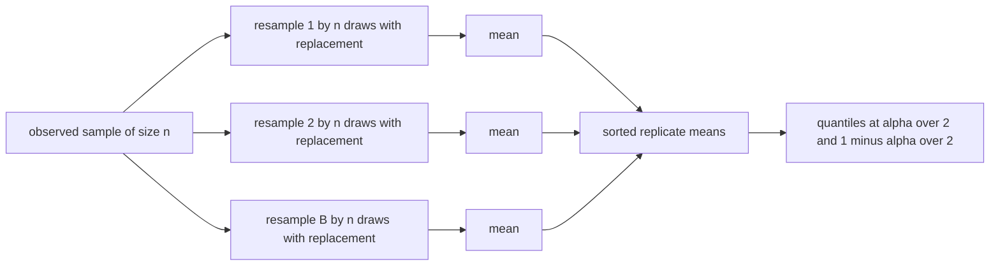
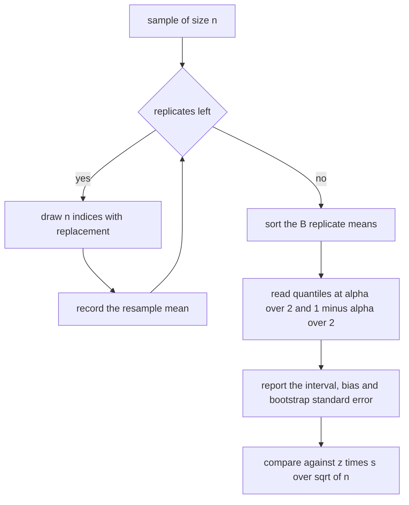
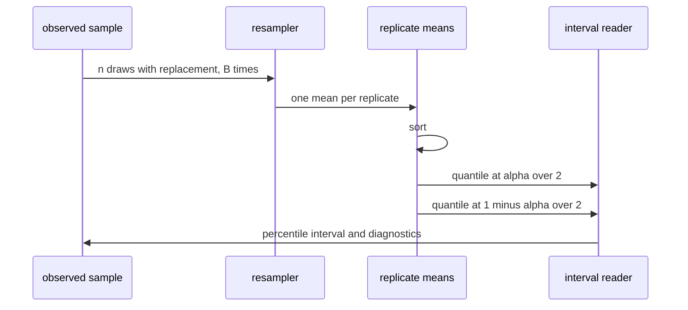

# 522 — Implement bootstrap sampling estimator for mean CI.

> **Tier:** Advanced · **CTCI chapter:** Beyond — Machine Learning & AI
> **Task spec:** [522-implement-bootstrap-sampling-estimator-for-mean-ci.md](../../../tasks/advanced/522-implement-bootstrap-sampling-estimator-for-mean-ci.md)
> **Solutions:** [Python](../../../solutions/python/advanced/522-implement-bootstrap-sampling-estimator-for-mean-ci/solution.py) ·
> [Java](../../../solutions/java/advanced/522-implement-bootstrap-sampling-estimator-for-mean-ci/Solution.java) ·
> [JavaScript](../../../solutions/javascript/advanced/522-implement-bootstrap-sampling-estimator-for-mean-ci/solution.js) ·
> [C#](../../../solutions/csharp/advanced/522-implement-bootstrap-sampling-estimator-for-mean-ci/Solution.cs)

## 1. Problem restatement

**Input:** a one-dimensional sample of `n` observations, a number of bootstrap replicates `B`, a seed
and a confidence level (the Python default is `0.95`).

**Output:** a confidence interval for the population mean, plus the diagnostics that make the interval
interpretable:

| Estimator | Interval |
| --- | --- |
| Percentile (all files) | `[Q(alpha / 2), Q(1 - alpha / 2)]` of the `B` resample means, `alpha = 1 - level` |
| Basic / reverse percentile (JavaScript, C#) | `[2 * mean - Q(1 - alpha/2), 2 * mean - Q(alpha/2)]`, the mirror image of the percentile interval |
| Normal approximation (all files) | `mean +/- z * s / sqrt(n)` with `s` the `n - 1` sample standard deviation |
| Diagnostics | bootstrap bias (`mean of the resample means - sample mean`), bootstrap standard error, and the replicate means themselves |

Every resample is a size-`n` draw **with replacement** from the observed data, so the empirical
distribution stands in for the unknown population. The quantile convention is part of the contract:
the position is `(n - 1) * p`, interpolated linearly between the two neighbouring order statistics,
which the Python helper documents as "the numpy default" and the C# file as the type-7 quantile.

| Call | Result |
| --- | --- |
| `quantile([1, 2, 3, 4, 5], 0.25)` | `2.0` — the position `(5-1) * 0.25 = 1` lands exactly on the second value |
| `quantile([1, 2, 3, 4, 5], 0.3)` | `2.2` — position `1.2` interpolates `2` and `3` |
| `quantile([1, 2, 3, 4, 5], 0.0)` / `(..., 1.0)` | `1.0` / `5.0` — the extremes are returned exactly |
| the two-point sample `{1, 2}` | resample means `1.0` (1 way), `1.5` (2 ways), `2.0` (1 way): probabilities `1/4, 1/2, 1/4` |
| a constant sample | zero-width interval at the constant, `se = 0`, `bias = 0` |
| a one-element sample | zero-width interval at that element, `std_dev = 0` |

## 2. Intuition

The sample mean is easy; the uncertainty of the sample mean is not. If the population were normal, the
textbook answer `mean +/- z s / sqrt(n)` would apply — but the whole point of the bootstrap is to avoid
assuming a distribution. The trick is to pretend that the *empirical* distribution of the data is the
population: draw a new sample of size `n` from it **with replacement**, compute its mean, and repeat `B`
times. The resulting spread of replicate means approximates the sampling distribution of the mean, and
the middle `95%` of that spread is a `95%` confidence interval.

Two details make or break it. Resampling must be *with* replacement, otherwise every resample is just a
permutation of the data and every replicate mean equals the sample mean exactly. And the resample size
must equal `n`, which is what keeps the replicate means on the same `1 / sqrt(n)` scale as the estimate.



The two derived intervals say different things. The percentile interval simply reads the quantiles of
the replicate means. The basic interval reflects them about the sample mean (`2 * mean - q`), which
corrects for a systematic shift of the resample distribution relative to the estimate. The normal
interval replaces the resampling entirely with `z * s / sqrt(n)` and is included as a sanity check:
the Python test measures a bootstrap standard error of `0.0206650302` against the analytic
`0.020899334144075975` on a 400-point sample, a relative difference of about `1%`, and the Java header
documents a measured relative error of `0.062` on a size-40 sample with a `20%` tolerance.

## 3. Algorithm

1. **Validate**: the sample must not be empty, the level must lie strictly inside `(0, 1)`, and the
   quantile probability must lie in `[0, 1]`.
2. **Resample**: for each of `B` replicates, advance the generator once per resampled index, take
   `index = draw mod n`, and accumulate the resampled value into a running mean (the Python file
   accumulates the raw sum and divides once; the Java file keeps both an accumulating and a
   count-based reference implementation that must agree bit for bit).
3. **Sort** the `B` replicate means.
4. **Quantiles**: evaluate `Q(alpha / 2)` and `Q(1 - alpha / 2)` with linear interpolation at position
   `(B - 1) * p`.
5. **Diagnostics**: the bootstrap mean, the bias against the sample mean, the bootstrap standard
   error (the `B - 1` standard deviation of the replicate means) and the analytic normal interval with
   `z` from either a rational approximation of the normal quantile (Python) or the documented constant
   `1.959963984540054` (Java).
6. **Optionally** derive the basic interval from the same sorted means.

```text
procedure bootstrap_means(data, resamples, seed)
    n ← length(data)
    raise an error if n is 0
    means ← empty list
    for replicate ← 1 to resamples do
        total ← 0
        for draw ← 1 to n do
            seed ← next_generator_state(seed)
            index ← uniform_index(seed, n)
            total ← total + data[index]
        end
        append total / n to means
    end
    return means
end

procedure quantile(sorted_values, p)
    position ← (length(sorted_values) - 1) * p
    low ← floor(position)
    high ← min(low + 1, length(sorted_values) - 1)
    weight ← position - low
    return sorted_values[low] * (1 - weight) + sorted_values[high] * weight
end

procedure bootstrap_mean_ci(data, resamples, seed, level)
    means ← bootstrap_means(data, resamples, seed)
    ordered ← sorted(means)
    alpha ← 1 - level
    low ← quantile(ordered, alpha / 2)
    high ← quantile(ordered, 1 - alpha / 2)
    return low, high, mean(means) - mean(data), standard_deviation(means)
end
```



## 4. Worked example

The quantile helper is the piece with no room for interpretation, and it is hand-checkable. On
`sorted_values = [1, 2, 3, 4, 5]` the position is `(5 - 1) * p`:

| `p` | position `4p` | interpolation | result |
| --- | --- | --- | --- |
| `0.0` | `0` | exact element | `1.0` |
| `0.25` | `1` | exact element | `2.0` |
| `0.3` | `1.2` | `0.8 * 2 + 0.2 * 3` | `2.2` |
| `0.5` | `2` | exact element | `3.0` |
| `1.0` | `4` | exact element | `5.0` |

The JavaScript file checks the whole bootstrap distribution on the two-point sample `{1, 2}`, where the
exact resample-mean law can be enumerated: a resample has two independent draws, so the mean is `1.0`
when both draws are `1` (probability `1/4`), `2.0` when both are `2` (probability `1/4`), and `1.5`
otherwise (probability `1/2`). The LCG draws must reproduce those probabilities to within `0.01`,
which pins the generator and the resampling logic at once.

For a realistic case, the Python `lcg_data(400, 2024)` sample with `B = 4000` replicates and seed `7`
at level `0.95` gives:

| Quantity | Value |
| --- | --- |
| sample mean | `0.9863068972190376` |
| percentile low | `0.9453257261` |
| percentile high | `1.0260027608` |
| interval width | `0.0806770347` |
| bootstrap bias | `-0.0003027326` |
| bootstrap standard error | `0.0206650302` |
| analytic standard error `s / sqrt(n)` | `0.020899334144075975` |
| analytic normal interval | `[0.9453359488, 1.0272778456]` |

The percentile and normal intervals agree to about `1%` of the width (the assertion allows `12%`), and
the bias is `3e-4` — the resample means are essentially centred on the estimate. Widening the level
widens the interval strictly, as it must, on the same resample stream: widths `0.027434`, `0.05288`,
`0.069735`, `0.082553`, `0.110956` at levels `0.5, 0.8, 0.9, 0.95, 0.99`. And quadrupling `n` roughly
halves the width — `0.081401` at `n = 400` against `0.041591` at `n = 1600`, a ratio of `1.96` against
the expected `sqrt(4) = 2`.



## 5. Complexity

Let `n` be the sample size, `B` the number of replicates and `E` the number of independent samples in a
coverage experiment.

| Phase | Time | Space | Notes |
| --- | --- | --- | --- |
| One replicate | `O(n)` | `O(1)` | `n` generator steps and `n` additions |
| All replicates | `O(B n)` | `O(B)` | the replicate means are the only thing kept |
| Sorting the means | `O(B log B)` | `O(B)` | needed once for the quantiles |
| Quantile evaluation | `O(1)` | `O(1)` | two interpolations on the sorted vector |
| Analytic normal interval | `O(n)` | `O(1)` | one pass for the mean and the standard deviation |
| Coverage experiment | `O(E B n)` | `O(n)` | JavaScript uses 300 groups, C# uses 100 samples of size 30 |

The resampling loop is the entire cost, which is why the replicate mean is accumulated incrementally:
with `B = 4000` and `n = 400` the run performs `1.6e6` generator steps and keeps `4000` floats. Note that
`B` does not have to grow with `n` — the bootstrap error comes from simulating the sampling
distribution, not from the sample size, which is what the `1 / sqrt(n)` width scaling above shows.

## 6. Pitfalls and edge cases

- **Sampling with replacement.** Drawing without replacement would make every resample mean equal to
  the sample mean and every interval zero-width; the entire method depends on the replacement.
- **Resample size equals `n`.** A different resample size changes the scale of the replicate means, and
  the interval would no longer estimate the standard error of the mean.
- **Quantile convention.** `(n - 1) * p` with linear interpolation is documented and asserted
  (`q(0.25) = 2`, `q(0.3) = 2.2` on `[1..5]`); the "n * p" convention would shift every interval
  slightly, and mixing conventions between the percentile and basic intervals would break their exact
  mirror relation (`basic_low = 2m - pct_high`), which both the JavaScript and C# files assert to
  `1e-12`.
- **`B` too small.** The quantiles of a few hundred replicate means are themselves noisy; the tests use
  `1000` to `4000` replicates, and the coverage experiments replicate the whole procedure many times
  rather than trusting a single interval.
- **Degenerate data.** Constant data and a one-element sample both give a zero-width interval, zero
  standard error and zero bias; `std_dev` of a single point is `0.0` by definition (`n < 2`).
- **Empty sample.** Bootstrapping nothing raises `ValueError`; a level outside `(0, 1)` and a quantile
  probability outside `[0, 1]` are also rejected.
- **Interval ordering.** The interval must contain the sample mean and lie inside `[min, max]` of the
  data, because every replicate mean does; a reversed quantile argument is a classic bug that the
  `low < mean < high` assertions catch.
- **Bootstrap versus analytic standard error.** They agree only asymptotically and only for
  well-behaved data: the documented tolerances are `20%` for the Java size-40 sample (measured `6.2%`),
  `15%` for the Python 400-point sample and `5%` for the JavaScript `n = 50` case, and the C# file
  requires the 95% interval to stay within `0.25 * se` of the normal interval.
- **Coverage is an experiment, not a theorem.** The JavaScript file runs 300 replications on
  uniform `(0, 1)` data with `n = 20` and `B = 400` at a nominal `95%` and asserts the measured
  coverage is in a sensible band; the C# file requires at least `85` of `100` intervals to contain the
  true mean. A single interval either contains the truth or does not — only repeated experiments
  measure coverage.
- **Determinism.** All randomness comes from the seeded generator (`75/74` in Java, JavaScript and C#,
  a 64-bit LCG in Python, with the C# generator discarding three warm-up steps because the raw
  recurrence is correlated with the seed modulo small numbers), so "the same seed replays the same
  resample stream" is an assertion rather than a hope.
- **`z` precision.** The Python file uses the Abramowitz-Stegun rational approximation, documented to
  about `4.5e-4` accuracy and tested with a `1e-3` tolerance against the textbook values `1.644854`,
  `1.959964` and `2.575829`; the Java file uses the constant `1.959963984540054`. The difference is
  irrelevant for an interval whose own error is larger, but it must be documented.

## 7. Variants and follow-ups

- **Percentile versus basic interval.** The basic interval reflects the quantiles about the sample mean
  and corrects for a systematic shift; the two are exact mirrors of each other, which is asserted to
  `1e-12` by both files that implement it.
- **Normal approximation.** `mean +/- z s / sqrt(n)` costs `O(n)` instead of `O(B n)` and is the
  reference the resampled intervals are compared against; it is also the estimator that the bootstrap
  is designed to avoid needing.
- **Coverage studies.** The JavaScript and C# files re-run the whole procedure on many independent
  samples and count how often the interval covers the known truth, which is the only honest way to
  check a confidence procedure.
- **Two independent resamplers.** The Java file keeps a second replicate implementation that first
  builds the per-index resampling counts and then forms `sum(count_i * x_i) / n`, and requires it to
  agree with the accumulating version bit for bit on all `B` replicates.
- **Related resampling.** Stratified sampling
  ([521-implement-reservoir-sampling-based-stratified-sampling.md](../../../tasks/advanced/521-implement-reservoir-sampling-based-stratified-sampling.md))
  draws *without* replacement and answers how to pick a representative subset; the bootstrap draws
  *with* replacement and answers how much an estimate moves.
- **Putting an interval on a metric.** The AUC of
  [520-implement-roc-auc-estimator-from-predictions.md](../../../tasks/advanced/520-implement-roc-auc-estimator-from-predictions.md)
  and the precision/recall values of
  [519-implement-confusion-matrix-precision-recall-metrics-calculator.md](../../../tasks/advanced/519-implement-confusion-matrix-precision-recall-metrics-calculator.md)
  are both point estimates; bootstrapping the sample and recomputing the metric is the standard way to
  attach a confidence interval to either.

## 8. Check yourself

**Q1.** Why must the resample be drawn with replacement, and what would the percentile interval look
like without it?

<details><summary>Show answer</summary>

Without replacement every resample is a permutation of the observed data, so every replicate has
exactly the same mean — the sample mean. The sorted replicate means would be `B` copies of one value
and the interval would collapse to zero width, carrying no uncertainty information at all. Replacement
is what lets the resample differ from the observation.

</details>

**Q2.** The two-point sample `{1, 2}` is resampled. What is the exact distribution of the resample mean
and how likely is each value?

<details><summary>Show answer</summary>

Each draw is `1` or `2` with probability `1/2`, so `mean = 1.0` with probability `1/4` (both draws
`1`), `mean = 2.0` with probability `1/4`, and `mean = 1.5` with probability `1/2`. The JavaScript file
enumerates exactly this distribution and matches the LCG draw against it within `0.01`.

</details>

**Q3.** The interval width was `0.081401` for `n = 400` and `0.041591` for `n = 1600`. What does the
ratio tell you?

<details><summary>Show answer</summary>

The ratio is `1.96`, essentially `sqrt(4) = 2`: quadrupling the sample size halves the width, because
both the bootstrap and the analytic interval scale as `1 / sqrt(n)`. The documented acceptance window
is `[1.4, 2.6]`.

</details>

**Q4.** Why does the Python solution compare the bootstrap standard error against `s / sqrt(n)` instead
of asserting that they are equal?

<details><summary>Show answer</summary>

The bootstrap estimates the sampling distribution from the data itself, while `s / sqrt(n)` is the exact
analytic standard error *if* the sample mean is approximately normal. They agree asymptotically, not
exactly, and only for reasonably behaved data — the documented tolerances are `5%`, `15%` or `20%`
depending on the sample, with measured deviations far smaller than the tolerance.

</details>

**Q5.** A single interval from `B = 400` replicates starts at `0.94` and ends at `1.03`. What additional
experiment would tell you whether the procedure is honest, and why can the single interval not do it?

<details><summary>Show answer</summary>

Repeating the whole procedure on many independent samples from a population with a known mean and
counting how often the interval covers the truth. A single interval either contains the truth or not —
its width and position say nothing about whether the nominal `95%` coverage is actually achieved, which
is why the JavaScript and C# files run 300 and 100 replications respectively.

</details>
