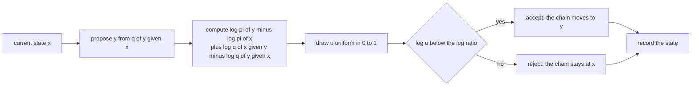
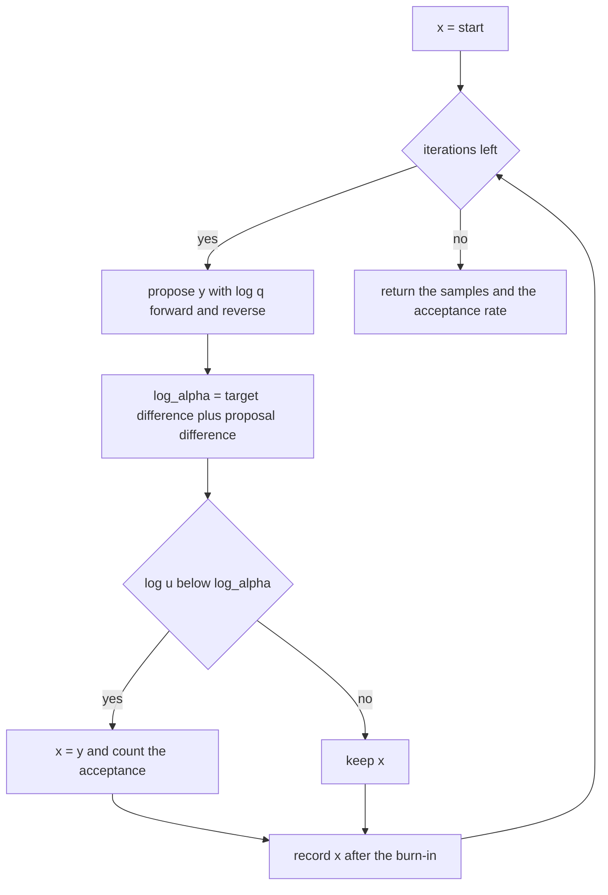
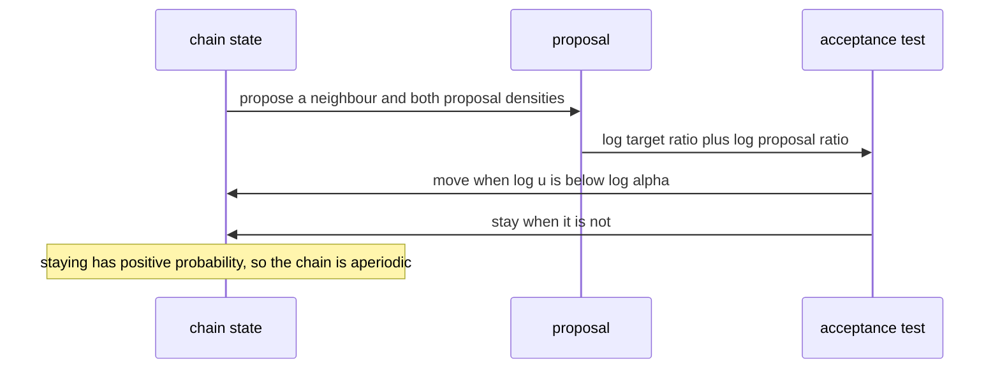

# 523 — Implement simple Markov chain Monte Carlo (Metropolis-Hastings).

> **Tier:** Advanced · **CTCI chapter:** Beyond — Machine Learning & AI
> **Task spec:** [523-implement-simple-markov-chain-monte-carlo-metropolis-hastings.md](../../../tasks/advanced/523-implement-simple-markov-chain-monte-carlo-metropolis-hastings.md)
> **Solutions:** [Python](../../../solutions/python/advanced/523-implement-simple-markov-chain-monte-carlo-metropolis-hastings/solution.py) ·
> [Java](../../../solutions/java/advanced/523-implement-simple-markov-chain-monte-carlo-metropolis-hastings/Solution.java) ·
> [JavaScript](../../../solutions/javascript/advanced/523-implement-simple-markov-chain-monte-carlo-metropolis-hastings/solution.js) ·
> [C#](../../../solutions/csharp/advanced/523-implement-simple-markov-chain-monte-carlo-metropolis-hastings/Solution.cs)

## 1. Problem restatement

**Input:** a target `pi` that may be given unnormalised — a table of weights for a discrete state
space, or a log density for a continuous one — a proposal distribution `q(y | x)`, a starting state,
a number of steps and an optional burn-in.

**Output:** a Markov chain whose long-run visit frequencies approximate `pi`, together with the
acceptance rate. The acceptance rule is the whole algorithm:

```text
alpha(x, y) = min(1, pi(y) q(x | y) / (pi(x) q(y | x)))
```

Only the *ratio* of the target is ever needed, which is exactly why the method is useful: normalising
constants cancel. The files implement three settings and cross-check each against exact theory or an
independent computation:

| Setting | Proposal | Exact check |
| --- | --- | --- |
| Discrete, symmetric | uniform over the neighbours of a path graph (`pi = [1, 2, 4, 8, 4, 2, 1]`, stationary `1/22` times the weights) | empirical frequencies within `0.01`, and transition counts symmetric within `2%` |
| Discrete, asymmetric (Java, JavaScript) | cyclic `q(i+1|i) = 2/3`, `q(i-1|i) = 1/3` | the assembled kernel satisfies `pi_i P_ij = pi_j P_ji` and `pi P = pi` to `1e-15` |
| Continuous | symmetric random walk `x' = x + sigma * N(0, 1)` on `N(0, 1)`, and an asymmetric shifted-exponential increment | mean within `0.03`, variance within `0.08`, acceptance rate within `0.01` of an independent quadrature |

Documented conventions: the first proposal is drawn before any state is recorded, the chain records
every state (no thinning), and the deterministic LCG stream makes the whole trace reproducible.

| Call | Result |
| --- | --- |
| random-walk step `0.25 / 1 / 4` on `N(0, 1)`, 60000 steps | acceptance `0.918 / 0.705 / 0.297` — strictly decreasing in the step size |
| the theoretical acceptance rate for step `1` | `0.704833`, by a 2-D Simpson quadrature that also agrees with a 400k-draw Monte-Carlo estimate |
| asymmetric proposal *with* the Hastings term | mean `-0.0079`, variance `0.9882`, acceptance `0.460` |
| the same proposal *without* the correction | mean `-0.606`, variance `1.154`, `71.6%` negative samples instead of `51.1%` |

## 2. Intuition

Sampling from `pi` directly may be impossible — the normalising constant is often unknown — but
evaluating the *ratio* `pi(y) / pi(x)` is usually easy. Metropolis-Hastings turns that ratio into a
Markov chain: propose a move, accept it with probability `min(1, ratio)`, and otherwise stay where you
are. The stationary distribution of the resulting chain is `pi`, by the detailed-balance identity

```text
pi_i * P(i -> j) = pi_j * P(j -> i)
```

which the discrete solutions verify symbolically on the assembled transition kernel, to `1e-15`.

The correction term `q(x | y) / q(y | x)` is what makes the rule work for *asymmetric* proposals. If
the proposal prefers to move right, then an uncorrected rule would visit right-hand states too often;
dividing by the probability of the reverse move exactly compensates. The evidence in the Python file is
deliberate and dramatic: for a shifted-exponential increment proposal, the correct chain recovers
`N(0, 1)` (mean `-0.0079`, variance `0.9882`) while the same proposal with the naive symmetric rule
converges to a visibly wrong law (mean `-0.606`, variance `1.154`, `71.6%` of samples negative instead
of the true `51.1%`). The JavaScript file shows the same effect on a two-state chain: the naive rule
on `pi = (1/2, 1/2)` settles at `(1/11, 10/11)`.



## 3. Algorithm

1. **Set up.** Work with log densities so that extreme ratios neither overflow nor underflow; the
   proposal closure returns the candidate, the next generator state, and the log densities of both the
   forward move `log q(y | x)` and the reverse move `log q(x | y)`.
2. **Propose** `y` from `q(. | x)` and compute
   `log_alpha = log pi(y) - log pi(x) + log q(x | y) - log q(y | x)`.
3. **Accept** when `log u < log_alpha` for a fresh uniform `u`, otherwise keep `x`. Staying put is a
   real transition with positive probability, which is what makes the chain aperiodic.
4. **Burn in** the first `burn_in` iterations without recording them, then record every subsequent
   state, and count the accepted moves only after the burn-in so the reported rate describes the
   sampled part of the chain.
5. **Diagnose**: empirical mean, variance, quantiles and the empirical CDF against the theoretical
   values; the acceptance rate against an independent quadrature.

```text
procedure metropolis(log_target, propose, start, steps, burn_in)
    x ← start
    accepted ← 0
    samples ← empty list
    for iteration ← 1 to steps + burn_in do
        y, generator_state, log_forward, log_reverse ← propose(x)
        log_alpha ← log_target(y) - log_target(x) + log_reverse - log_forward
        u ← next uniform draw
        if log(u) < log_alpha then
            x ← y
            if iteration > burn_in then accepted ← accepted + 1 end
        end
        if iteration > burn_in then append x to samples end
    end
    return samples, accepted
end
```

Two implementation details carry statistical weight. The uniform is drawn on the **open** interval
(`((seed >> 33) + 1) / 2^31` in Python), so `log(u)` is always finite and Box-Muller never takes the
log of zero. And an impossible reverse move has `log q(x | y) = -infinity`, which makes `log_alpha`
`-infinity` and rejects the move automatically — the correct behaviour when the proposal's support is
one-sided.



## 4. Worked example

Take the discrete target `weights = [1, 2, 4, 8, 4, 2, 1]` on states `0..6`, so the stationary
distribution is `1/22 * weights = [0.045455, 0.090909, 0.181818, 0.363636, 0.181818, 0.090909,
0.045455]`. The proposal flips a fair coin from the LCG and steps left or right on the path graph, so
`q` is symmetric and the acceptance probability is just `min(1, w_y / w_x)`.

Start at state `3` with the LCG seed `2024`:

| Step | Direction | Candidate | `u` | `w_y / w_x` | Decision | State after |
| --- | --- | --- | --- | --- | --- | --- |
| 0 | up | `4` | `0.304072` | `0.5` | accept | `4` |
| 1 | up | `5` | `0.255122` | `0.5` | accept | `5` |
| 2 | up | `6` | `0.415798` | `0.5` | accept | `6` |
| 3 | up | `7` | — | — | outside the state space: rejected outright | `6` |
| 4 | down | `5` | `0.914284` | `2.0` | accept (the ratio exceeds `1`) | `5` |
| 5 | down | `4` | `0.258572` | `2.0` | accept | `4` |
| 6 | down | `3` | `0.776847` | `2.0` | accept | `3` |
| 7 | down | `2` | `0.933968` | `0.5` | reject (`0.934 >= 0.5`) | `3` |

The trace shows the two regimes in one picture: moving towards the mode (ratio `2`) is accepted
eagerly, moving away (ratio `0.5`) is accepted only when the uniform happens to be small, and step `7`
is the first rejection.

Long-run behaviour is checked in two independent ways. First, the visit frequencies over `120000`
steps must match the exact distribution to `0.01` per state. Second, the *transition counts* must be
symmetric, because `flow(i -> j) = N pi_i P_ij = N pi_j P_ji = flow(j -> i)` whenever detailed balance
holds — the measured counts are:

| Edge | `i -> i+1` | `i+1 -> i` |
| --- | --- | --- |
| `0 <-> 1` | `2581` | `2580` |
| `1 <-> 2` | `5433` | `5432` |
| `2 <-> 3` | `11087` | `11087` |
| `3 <-> 4` | `11062` | `11062` |
| `4 <-> 5` | `5476` | `5476` |
| `5 <-> 6` | `2647` | `2647` |

That is the empirical fingerprint of detailed balance, and it is why the checker allows `2%` rather
than requiring exact equality: the counts are random even though their expectations are equal.



## 5. Complexity

Let `S` be the number of states (discrete) or the dimension of the state (continuous), and `N` the
number of iterations including burn-in.

| Phase | Time | Space | Notes |
| --- | --- | --- | --- |
| One proposal | `O(1)` for a random walk, `O(S)` for a full proposal row | `O(1)` | a normal pair costs two uniforms plus a `log`, `sqrt`, `cos` and `sin` |
| One iteration | `O(1)` plus the target evaluation | `O(1)` | one ratio and one uniform |
| Whole run | `O(N)` | `O(N)` for the stored trace, `O(1)` if streamed | `200000` steps in the continuous tests, `120000` in the discrete one |
| Assembling the kernel exactly | `O(S^2)` | `O(S^2)` | then row sums, detailed balance and `pi P = pi` are direct checks |
| Stationary vector by power iteration | `O(K S^2)` | `O(S)` | the C# file uses `200` iterations to reach `1e-9` |
| Independent acceptance quadrature | `O(grid^2)` | `O(1)` | a `240 x 240` Simpson grid reproduces `0.704833` |

The cost per iteration is constant, so the runtime is set entirely by how many samples are needed —
and that is governed by autocorrelation, not by the per-step cost. Two consequences the tests make
visible: a proposal that is too narrow accepts almost always (`0.918` at step `0.25`) but moves so
little that consecutive samples are nearly identical, while a proposal that is too wide rejects almost
everything (`0.297` at step `4`). The useful band is in between, which is why the continuous checks
require the acceptance rate to stay inside intervals such as `[0.55, 0.85]` and `(0.5, 0.9)`.

## 6. Pitfalls and edge cases

- **Omitting the Hastings term.** The single most damaging bug: with an asymmetric proposal the chain
  converges to the wrong distribution (mean `-0.606` instead of `0`, `71.6%` of samples negative
  instead of `51.1%`, and `(1/11, 10/11)` instead of `(1/2, 1/2)` on the two-state example). The
  correction is exactly what makes the sampler target-agnostic.
- **Impossible reverse moves.** When the proposal's support is one-sided, `log q(x | y)` is
  `-infinity` and the move must be rejected; implementing that as a very small number instead invites
  numerically absurd acceptances.
- **Overflowing ratios.** Work with log densities: `pi(y) / pi(x)` can exceed any float range, and the
  quadrature-based acceptance estimate is only meaningful because the ratio is exponentiated *after*
  the comparison.
- **Closed vs open uniforms.** `log(u)` with `u = 0` is `-infinity` and would accept a certain
  rejection; Box-Muller with `u = 0` divides by zero. Both implementations take the uniform from the
  open interval `(0, 1)`.
- **Recorded state after rejection.** A rejected proposal leaves the *old* state in the trace, so
  consecutive samples repeat. That repetition is part of the sample, not a bug: thinning would have to
  be documented, and the Python file explicitly records every state.
- **Burn-in accounting.** The acceptance rate is reported over the recorded steps only; the first
  proposal is drawn before any state is recorded. Mixing from a start 8 standard deviations away is
  asserted separately, and the C# file starts a chain at `x = 20`.
- **Step-size trade-off.** Too small wastes iterations, too large rejects: the documented rates are
  `0.918` at step `0.25`, `0.705` at `1` and `0.297` at `4`. The optimum depends on the target's scale,
  which is why the interval around `0.7` is a rule of thumb rather than a theorem.
- **Reducibility and periodicity.** The proposal must be able to reach every state with positive
  probability, and the chain needs a positive self-loop probability to be aperiodic; the assembled
  kernels are checked for irreducibility and a strictly positive diagonal, and a zero-probability state
  must never be visited.
- **Zero-probability and constant targets.** A state with `pi = 0` has `-infinity` log density, so it is
  never accepted; a constant target accepts every move and the chain just wanders — both are documented
  boundary cases.
- **Determinism.** The LCG makes the trace reproducible, so the tests can compare the first five states
  and the acceptance count of a repeated run exactly. Replacing the generator with an unseeded one
  would invalidate every statistical assertion.
- **Convergence is not checked by a single statistic.** The tests compare the mean, the variance, the
  quantiles, the empirical CDF at several points, the acceptance rate and the frequency of a far-away
  start — a chain can match the mean while being nowhere near the target distribution.

## 7. Variants and follow-ups

- **Asymmetric proposals.** The Java file's cyclic proposal `q(i+1|i) = 2/3`, `q(i-1|i) = 1/3` and the
  Python file's shifted-exponential increments both exercise the Hastings correction; the assembled
  kernel must still satisfy detailed balance to `1e-15` and have `pi` as its stationary distribution.
- **Exact kernels for discrete targets.** For a finite state space the transition matrix
  `P(i, j) = q(j | i) * alpha(i, j)` can be built exactly, so the theory checks (row sums, detailed
  balance, `pi P = pi`, power-iteration stationary vector) replace simulation entirely.
- **General-purpose samplers.** The Python kernel takes `log_target` and `propose` as functions, so the
  same code samples any target with a known log density; the C# file's bounded uniform target is the
  minimal example of a density known only up to a constant.
- **Independent verification of the acceptance rate.** The Python file integrates
  `E[min(1, exp(-(y^2 - x^2)/2))]` with a 2-D Simpson quadrature, checks the quadrature itself against a
  400k-draw Monte-Carlo estimate, and only then compares the simulated rate against it.
- **Other resampling estimators.** Metropolis-Hastings outputs a *dependent* sample; the bootstrap of
  [522-implement-bootstrap-sampling-estimator-for-mean-ci.md](../../../tasks/advanced/522-implement-bootstrap-sampling-estimator-for-mean-ci.md)
  produces independent resamples and answers a different question.
- **Sequential models.** The Markov chains of
  [524-implement-hidden-markov-model-viterbi-algorithm.md](../../../tasks/advanced/524-implement-hidden-markov-model-viterbi-algorithm.md)
  and
  [525-implement-hmm-forward-backward-for-probabilities.md](../../../tasks/advanced/525-implement-hmm-forward-backward-for-probabilities.md)
  are finite and exactly solvable; MCMC is what you use when no exact dynamic program exists.

## 8. Check yourself

**Q1.** Why does Metropolis-Hastings only need the ratio `pi(y) / pi(x)` rather than `pi` itself?

<details><summary>Show answer</summary>

Because the acceptance probability compares the two target values; any normalising constant common to
both cancels in the ratio. That is what allows sampling from a density known only up to a constant,
which is the usual situation in Bayesian inference.

</details>

**Q2.** In the worked example, why is step `7` rejected while step `6` is accepted, even though both
move away from the mode?

<details><summary>Show answer</summary>

Both have ratio `w_y / w_x = 0.5`, but the decision compares a fresh uniform with that ratio: at step `6`
the draw is `0.258572 < 0.5` so the move is accepted, and at step `7` the draw is `0.933968 >= 0.5` so it
is rejected and the chain stays at state `3`.

</details>

**Q3.** What exactly happens if the proposal prefers to move right but the acceptance rule ignores
`q(x | y) / q(y | x)`?

<details><summary>Show answer</summary>

The chain drifts right: away-from-the-mode moves (going left) are accepted at the same rate as if the
proposal were symmetric, so the chain spends too much time on the right. On the two-state example the
naive rule converges to `(1/11, 10/11)` instead of `(1/2, 1/2)`; on the shifted-exponential proposal the
mean shifts to `-0.606` and `71.6%` of samples fall below zero instead of `51.1%`.

</details>

**Q4.** Both a step size of `0.25` (acceptance `0.918`) and `4` (acceptance `0.297`) are "valid"
proposals. Why is neither a good choice?

<details><summary>Show answer</summary>

With a narrow proposal almost every move is accepted but the chain barely moves, so consecutive samples
are highly correlated and the effective sample size is far below the number of iterations. With a wide
proposal the chain usually rejects and sits still, which is equally wasteful. The useful compromise is
around an acceptance rate near `0.7` for a one-dimensional random walk, which is why the tests pin the
rate inside bands such as `[0.55, 0.85]`.

</details>

**Q5.** The discrete chain's transition counts satisfy `flow(i -> j) = flow(j -> i)`. Why is that
equality expected to hold only approximately in the simulation?

<details><summary>Show answer</summary>

Because the counts are random variables whose *expectations* obey `N pi_i P_ij = N pi_j P_ji` under
detailed balance. The observed values differ by a few units out of thousands — the file measures
`2581/2580`, `5433/5432`, `11087/11087`, `11062/11062`, `5476/5476`, `2647/2647` and allows `2%` — which
is exactly the noise you would expect from a finite run.

</details>
