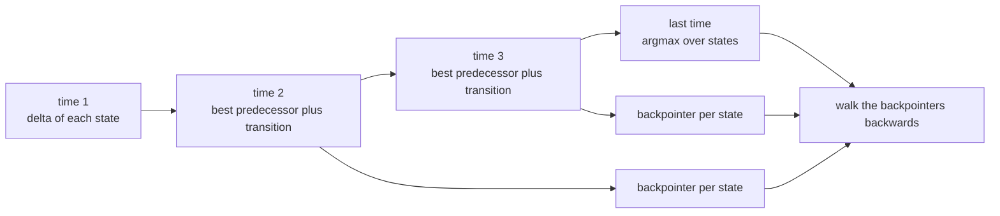
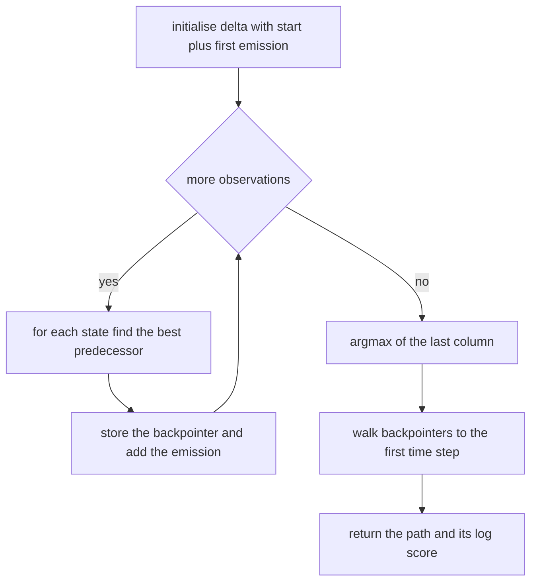
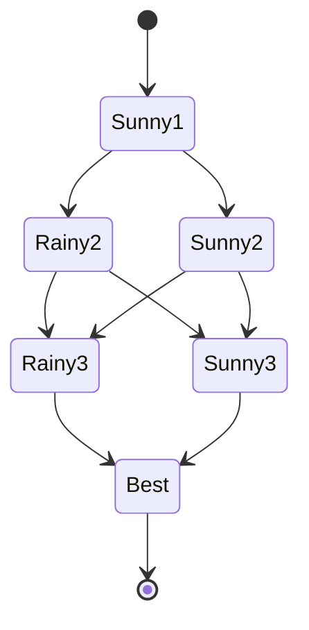
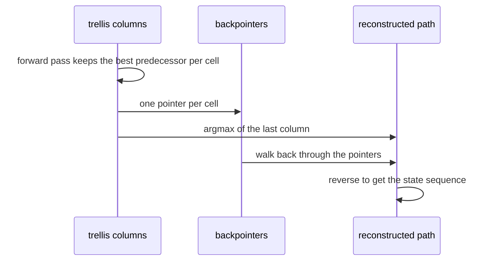

# 524 — Implement Hidden Markov Model Viterbi algorithm.

> **Tier:** Advanced · **CTCI chapter:** Beyond — Machine Learning & AI
> **Task spec:** [524-implement-hidden-markov-model-viterbi-algorithm.md](../../../tasks/advanced/524-implement-hidden-markov-model-viterbi-algorithm.md)
> **Solutions:** [Python](../../../solutions/python/advanced/524-implement-hidden-markov-model-viterbi-algorithm/solution.py) ·
> [Java](../../../solutions/java/advanced/524-implement-hidden-markov-model-viterbi-algorithm/Solution.java) ·
> [JavaScript](../../../solutions/javascript/advanced/524-implement-hidden-markov-model-viterbi-algorithm/solution.js) ·
> [C#](../../../solutions/csharp/advanced/524-implement-hidden-markov-model-viterbi-algorithm/Solution.cs)

## 1. Problem restatement

**Input:** a discrete hidden Markov model — a start distribution `pi` over `S` states, a
row-stochastic transition matrix `A`, a row-stochastic emission matrix `B` over a finite observation
alphabet — and an observation sequence `o_1 .. o_T`.

**Output:** the single state sequence `s_1 .. s_T` that maximises the joint probability

```text
pi[s_1] * B[s_1][o_1] * A[s_1][s_2] * B[s_2][o_2] * ... * A[s_{T-1}][s_T] * B[s_T][o_T]
```

together with that probability (reported as a log). This is *decoding*, not inference: Viterbi takes
the **maximum** over paths while the forward algorithm takes the **sum** — the two share a recursion
shape and answer different questions.

Documented conventions: the recursion runs in log space, zero-probability transitions and emissions
are legal (the Java file uses a `NEG_INF = -1e18` sentinel, Python uses `-infinity`), ties are broken
towards the **smaller state index** because predecessors are scanned in increasing index with a strict
comparison, and that rule makes the answer the lexicographically smallest optimal path.

| Model | Observation | Result |
| --- | --- | --- |
| weather HMM: states Rainy/Sunny, start `(0.6, 0.4)`, transitions Rainy `(0.7, 0.3)` and Sunny `(0.4, 0.6)`, emissions Rainy `(0.1, 0.4, 0.5)` and Sunny `(0.6, 0.3, 0.1)` | `Walk, Shop, Clean` | `Sunny, Rainy, Rainy` with probability `0.01344`; the alternatives `Sunny/Sunny/Rainy` (`0.00864`) and `Rainy/Rainy/Rainy` (`0.00588`) both lose |
| two states, uniform transitions `0.5`, identity emissions | `0, 1, 0` | `[0, 1, 0]` with probability `1/8`: the emissions force the path |
| two states, uniform emissions `0.5`, `A = [[0.7, 0.3], [0.4, 0.6]]`, `pi = (0.6, 0.4)` | `0, 0` | `[0, 0]` with probability `0.105`; the runner-up `[1, 0]` has `0.04` |
| `A = [[2/5, 3/5], [3/5, 2/5]]`, `B = [[4/11, 7/11], [2/5, 3/5]]`, `pi = (3/5, 2/5)` | `1, 1, 1, 1` | Viterbi gives `[0, 1, 0, 1]` with `0.0188937520661157`, while the per-step posterior maximiser is `[0, 1, 0, 0]` with `0.013359218632607061` |

## 2. Intuition

Enumerating all `S^T` state sequences is hopeless for even modest inputs: `2^2000` paths. Viterbi's
insight is that the best path *ending in state j at time t* only ever needs the best prefix ending in
each predecessor state at time `t - 1`. That collapses the search into a dynamic program over a
trellis, `S` values per time step, with one backpointer per cell to remember where the best came from.

The second insight is numerical. A length-2000 sequence has a joint probability far below the smallest
positive double, so the same recursion in the linear domain silently returns zero: the Python test
measures the product DP still finite at `T = 600` (log score `-697.7`) and underflowed to `0.0` by
`T = 1000` (log score about `-1163`), while the log-domain decoder stays finite and returns a full
2000-state path. Working in logs turns multiplication into addition and underflow into nothing worse
than a very negative number.



Ties deserve a moment, because the tie rule is a real part of the contract. When two predecessors give
the same score, the strict `>` comparison while scanning states `0, 1, 2, ...` keeps the first one,
so the chosen path is the lexicographically smallest of the tied optima. A completely symmetric HMM
(A = 0.25 everywhere) has `2^5 = 32` optimal paths of length 5, and the decoder must return
`[0, 0, 0, 0, 0]`, which is exactly what the Python test asserts alongside the count.

## 3. Algorithm

1. **Initialise** `delta[i] = log pi[i] + log B[i][o_1]` for every state (an impossible start or an
   impossible first emission makes that entry `-infinity`).
2. **Recurse** for `t = 2 .. T`: `delta_new[j] = log B[j][o_t] + max over i of (delta[i] + log A[i][j])`,
   recording the maximising `i` as the backpointer of cell `(t, j)`.
3. **Choose** the final state as the argmax of the last column, again with a strict comparison.
4. **Backtrack** from that state through the stored backpointers to recover the full path.
5. **Report** the path and the log score; an independent `log_prob` function recomputes the path's
   probability from the model to confirm the score, and a brute-force enumeration confirms optimality.

```text
function viterbi(A, B, pi, observations)
    if observations is empty then return empty path with score 0 end
    delta[i] ← safe_log(pi[i]) + safe_log(B[i][observations[0]]) for every state i
    backpointers ← empty list
    for t ← 1 to length(observations) - 1 do
        for j over states do
            best ← NEG_INF
            best_state ← 0
            for i over states do
                candidate ← delta[i] + safe_log(A[i][j])
                if candidate > best then          # strict: ties keep the smaller index
                    best ← candidate
                    best_state ← i
                end
            end
            delta_new[j] ← best + safe_log(B[j][observations[t]])
            pointers[j] ← best_state
        end
        delta ← delta_new
        append pointers to backpointers
    end
    last ← argmax of delta with a strict comparison
    path ← [last]
    for t ← length(observations) - 2 down to 0 do
        path.append(backpointers[t][path[last element]])
    end
    reverse(path)
    return path, delta[last]
end
```

`safe_log` is the only place probability zero is handled: it returns `-infinity` instead of raising, so
a forbidden transition or emission simply never wins its `max` — and a sequence whose every path is
forbidden makes the whole final column `-infinity`, which the Java file turns into a null result rather
than a bogus path.



## 4. Worked example

The canonical weather HMM: states `0 = Rainy`, `1 = Sunny`; `pi = (0.6, 0.4)`;
`A = [[0.7, 0.3], [0.4, 0.6]]`; emissions for `Walk = 0`, `Shop = 1`, `Clean = 2` are
`B = [[0.1, 0.4, 0.5], [0.6, 0.3, 0.1]]`; observations `Walk, Shop, Clean`.

| `t` | observation | `delta[0]` (Rainy) | best predecessor of `0` | `delta[1]` (Sunny) | best predecessor of `1` |
| --- | --- | --- | --- | --- | --- |
| `1` | `Walk` | `-2.8134107168` | — | `-1.4271163556` | — |
| `2` | `Shop` | `-3.2596978194` | state `1` | `-3.1419147837` | state `1` |
| `3` | `Clean` | `-4.3095199439` | state `0` | `-5.9553255005` | state `1` |

The first row is `log pi + log B[:, Walk]`: `log 0.6 + log 0.1` and `log 0.4 + log 0.6`. At `t = 2` the
candidates for Rainy are `delta[0] + log 0.7 = -3.1701` and `delta[1] + log 0.4 = -2.3434`, so the best
predecessor is Sunny; adding `log 0.4` gives `-3.2596978194`. At `t = 3` the candidates for Rainy are
`-3.2596978194 + log 0.7 = -3.6164` and `-3.1419147837 + log 0.4 = -4.0582`, so the predecessor is
Rainy itself, and adding `log 0.5` gives `-4.3095199439`. The last column's argmax is Rainy, and the
backtrace is `Rainy <- Rainy <- Sunny`: the path is `Sunny, Rainy, Rainy` with probability
`exp(-4.3095199439) = 0.01344`.

The two competing paths, computed by the file's independent `log_prob`, are `Sunny/Sunny/Rainy` at
`0.00864` and `Rainy/Rainy/Rainy` at `0.00588` — both clearly worse, and the exhaustive enumeration of
all eight paths returns exactly `[1, 0, 0]`. The decoder therefore agrees with brute force on a problem
small enough to check by hand.



Decoding is not the same as per-step posterior inference, and the files document the difference with a
model where the two disagree: `A = [[2/5, 3/5], [3/5, 2/5]]`, `B = [[4/11, 7/11], [2/5, 3/5]]`,
`pi = (3/5, 2/5)` and four observations of symbol `1`. The jointly optimal path is `[0, 1, 0, 1]` with
probability `0.0188937520661157`; the path built from the per-time posterior argmax is `[0, 1, 0, 0]`
with probability `0.013359218632607061`. Maximising each step's marginal separately does not maximise
the whole path — the posterior path is *less* probable than the Viterbi path, which the test asserts.



## 5. Complexity

Let `S` be the number of states and `T` the observation length.

| Phase | Time | Space | Notes |
| --- | --- | --- | --- |
| One trellis column | `O(S^2)` | `O(S)` | `S` candidates for each of `S` states |
| Whole decoding | `O(S^2 T)` | `O(S T)` for the backpointers | the Python test decodes `T = 2000` with 3 states |
| Initialisation and backtrack | `O(S)` and `O(T)` | — | the backtrack is a single chain of lookups |
| Independent score recomputation | `O(T)` | `O(1)` | `log_prob` products the returned path |
| Brute-force oracle | `O(T S^T)` | `O(T)` | only affordable for the `S = 3, T = 8` and `S = 4, T = 5` cases the files use |
| Linear-domain variant | `O(S^2 T)` | `O(S T)` | same shape, but underflows: finite at `T = 600`, `0.0` by `T = 1000` |

The log-domain and product-domain recursions have identical asymptotics, so the whole reason to prefer
one is numerical: the product DP loses every path probability to underflow long before the log version
runs out of exponent range, and the failing behaviour is *silent* — it returns a path with score
`-infinity` rather than an error.

## 6. Pitfalls and edge cases

- **Underflow.** The single most dangerous failure mode, because it is silent: the product DP is
  finite at `T = 600` (log score `-697.7`) and has already collapsed to `0.0` at `T = 1000`
  (log score about `-1163`), while the log-space decoder keeps working at `T = 2000`.
- **`log(0)`.** Zero-probability transitions and emissions are legal parts of a model; the recursion
  must treat them as `-infinity` rather than raising or, worse, clamping them to a tiny positive
  number that could beat a legitimate path.
- **Sentinel arithmetic.** The Java file's `NEG_INF = -1e18` is chosen so that adding a log
  probability to it stays comfortably below any real score; a sentinel close to the normal range would
  make a forbidden path look competitive.
- **Tie rule.** Ties must resolve to the smaller state index (strict `>` while scanning in increasing
  order), which makes the returned path the lexicographically smallest optimum and makes the decoder
  agree with a brute force that keeps the first maximum. A `>=` comparison would return a
  different-but-equally-scoring path and break that agreement.
- **Ambiguous optima.** A symmetric HMM has many optimal paths — `2^5 = 32` for the uniform two-state
  model of length 5 — and the tests count them rather than pretending the optimum is unique.
- **`T = 1`.** The decoder reduces to the argmax of `pi[i] * B[i][o_1]`, and `T = 0` returns an empty
  path with score `0.0`; both are documented boundary cases.
- **Impossible sequences.** If every path through a column is forbidden, the column is entirely
  `-infinity`; the Java implementation returns a null result instead of inventing a path.
- **Input validation.** The JavaScript file rejects an empty observation list, non-stochastic rows and
  dimension mismatches — an unnormalised row is a modelling bug, not a plausible input.
- **Viterbi versus posterior decoding.** The per-time posterior argmax path can be *less* probable than
  the joint optimum (`0.013359218632607061` against `0.0188937520661157` in the documented example), so
  the two procedures are not interchangeable.
- **Score sanity.** The optimal path's probability can never exceed the total probability `P(O)` of the
  observations — the sum over all paths — and the gap is strict whenever more than one path carries
  mass; both facts are asserted against a brute-force sum.
- **Emission indexing.** `B[j][o_t]` is indexed by *state then symbol*; swapping the two indices
  produces a plausible-looking decoder that is simply wrong, which is why the models are checked
  against an independent brute-force enumeration rather than only against a hand example.
- **Determinism.** The LCG-generated models (`seed <- (seed * 75 + 74) mod 65537`, integer weights in
  `[1, 9]` normalised row-wise) make every test case reproducible, and the JavaScript variants use
  powers of two so that path probabilities are exact and "ties" are genuine ties.

## 7. Variants and follow-ups

- **Three decoders, one answer.** The C# file compares log-space Viterbi, the same recurrence in the
  linear domain and an exhaustive enumeration over four LCG models with `T = 5, 6, 7`; the Python file
  compares against brute force for `S = 3, T = 8` and `S = 2, T = 10` and against its own
  linear-domain implementation on short sequences.
- **Ties made explicit.** The JavaScript models use entries that are powers of two, so every path
  probability is exact in binary floating point and a tie is a genuine tie rather than a
  floating-point near-tie.
- **Sum instead of max.** The forward-backward algorithm of
  [525-implement-hmm-forward-backward-for-probabilities.md](../../../tasks/advanced/525-implement-hmm-forward-backward-for-probabilities.md)
  runs the same trellis in the `sum` semiring to obtain `P(O)` and the per-state posteriors; Viterbi's
  score is a lower bound on that total, with equality only when one path carries all the mass.
- **Deterministic models as a degenerate case.** When the transition matrix is a permutation, Viterbi
  recovers the generating state sequence exactly, which the JavaScript file asserts and which makes a
  useful smoke test before trusting statistical checks.
- **Simulated data as an end-to-end test.** Decoding an LCG-simulated observation sequence recovers the
  hidden states at a documented rate, which is the empirical counterpart of the exact brute-force
  agreement.
- **Related inference tasks.** Posterior sampling without an exact dynamic program is the domain of the
  Metropolis-Hastings sampler in
  [523-implement-simple-markov-chain-monte-carlo-metropolis-hastings.md](../../../tasks/advanced/523-implement-simple-markov-chain-monte-carlo-metropolis-hastings.md).

## 8. Check yourself

**Q1.** Why is the Viterbi recursion `max` over predecessors rather than a sum, and what would the sum
version compute instead?

<details><summary>Show answer</summary>

`max` keeps only the best single path ending in each state, which is what "most likely state sequence"
means. Replacing `max` with `sum` gives the forward algorithm: the total probability of the
observation prefix, i.e. `P(o_1 .. o_t)` summed over all state paths — an inference quantity, not a
decoding.

</details>

**Q2.** In the weather example, why does the best path start in Sunny even though the start probability
of Rainy is higher (`0.6` against `0.4`)?

<details><summary>Show answer</summary>

Because the first observation is `Walk`, whose emission probability is `0.6` under Sunny and `0.1` under
Rainy. The initial scores are `log 0.6 + log 0.1 = -2.8134107168` for Rainy and
`log 0.4 + log 0.6 = -1.4271163556` for Sunny: the emission outweighs the start prior, and the rest of
the path follows from the transitions.

</details>

**Q3.** Why is the log-domain recursion preferred when both versions have the same `O(S^2 T)`
complexity?

<details><summary>Show answer</summary>

Because the product version underflows. The joint probability of a long sequence is below the smallest
positive double: the product DP returns a finite score at `T = 600` (log `-697.7`) but exactly `0.0` at
`T = 1000`, and `log(0)` destroys the path information. Logs keep the same arithmetic shape while the
numbers stay comfortably inside the double range.

</details>

**Q4.** Two paths tie at the maximum. Which one does the decoder return, and what guarantees that?

<details><summary>Show answer</summary>

The lexicographically smallest one. Predecessors are scanned in increasing state index with a strict
`candidate > best` comparison, so the first (smallest) index wins a tie; the final argmax uses the same
rule. A symmetric HMM with `2^5 = 32` tied optima therefore returns `[0, 0, 0, 0, 0]`.

</details>

**Q5.** Why is the path built from per-step posterior maxima allowed to be less probable than the
Viterbi path?

<details><summary>Show answer</summary>

Because each step's marginal is maximised independently; the resulting combination need not be a
consistent, high-probability single path. In the documented example the posterior path `[0, 1, 0, 0]`
has probability `0.013359218632607061` while the jointly optimal `[0, 1, 0, 1]` has
`0.0188937520661157`.

</details>
