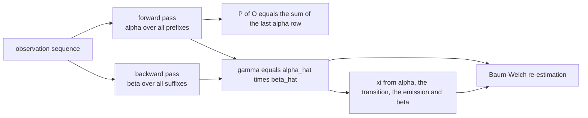
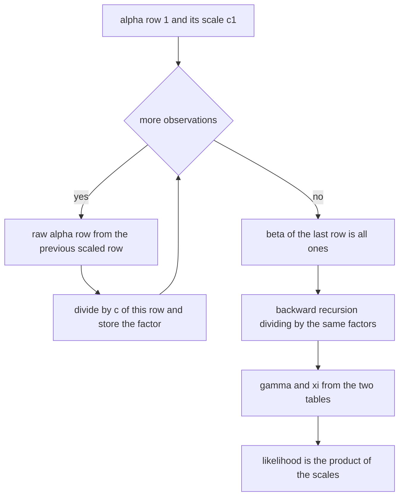
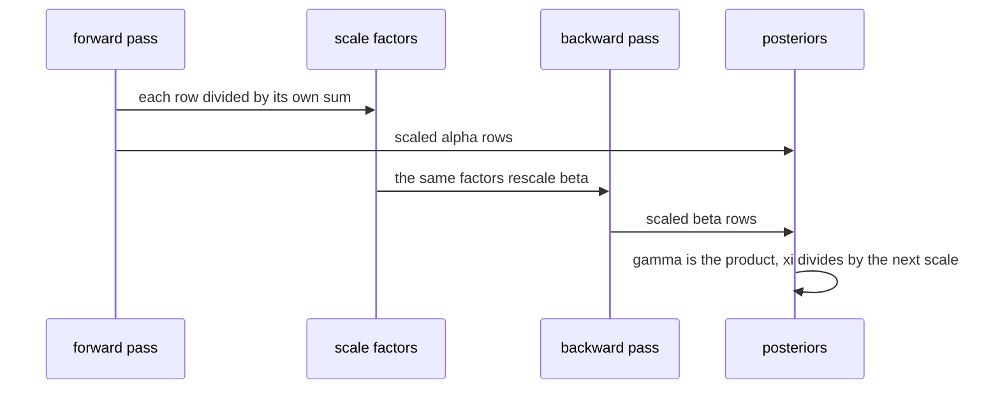

# 525 — Implement HMM forward-backward for probabilities.

> **Tier:** Advanced · **CTCI chapter:** Beyond — Machine Learning & AI
> **Task spec:** [525-implement-hmm-forward-backward-for-probabilities.md](../../../tasks/advanced/525-implement-hmm-forward-backward-for-probabilities.md)
> **Solutions:** [Python](../../../solutions/python/advanced/525-implement-hmm-forward-backward-for-probabilities/solution.py) ·
> [Java](../../../solutions/java/advanced/525-implement-hmm-forward-backward-for-probabilities/Solution.java) ·
> [JavaScript](../../../solutions/javascript/advanced/525-implement-hmm-forward-backward-for-probabilities/solution.js) ·
> [C#](../../../solutions/csharp/advanced/525-implement-hmm-forward-backward-for-probabilities/Solution.cs)

## 1. Problem restatement

**Input:** the same discrete HMM as
[524-implement-hidden-markov-model-viterbi-algorithm.md](../../../tasks/advanced/524-implement-hidden-markov-model-viterbi-algorithm.md)
— start distribution `pi`, transition matrix `A`, emission matrix `B` — and an observation sequence
`o_1 .. o_T`.

**Output:** four related quantities:

| Quantity | Definition |
| --- | --- |
| Likelihood | `P(O) = sum over all state paths of their joint probability`, plus its logarithm |
| Forward variables | `alpha_t(j) = P(o_1 .. o_t, q_t = j)`, rescaled per row as `alpha_hat_t = alpha_t / c_t` |
| Backward variables | `beta_t(i) = P(o_{t+1} .. o_T | q_t = i)`, rescaled with the same `c_t` factors |
| Smoothed posteriors | `gamma_t(i) = alpha_hat_t(i) beta_hat_t(i)` — the scale factors cancel — and the pairwise `xi_t(i, j)` |

The recursion is the *sum* semiring where Viterbi uses the *max* semiring: forward keeps the total
probability of every prefix ending in each state, so `P(O) = sum_i alpha_T(i)`. The files also
implement one **Baum-Welch** re-estimation step from exactly these quantities:
`start_i = gamma_1(i)`, `A_ij = sum_t xi_t(i, j) / sum_t gamma_t(i)`,
`B_j(k) proportional to sum over the times with o_t = k of gamma_t(j)`, with the documented fallback
of keeping the old row when a denominator is zero.

Documented conventions: Rabiner-style per-row scaling with the *same* factors for `alpha` and `beta`,
so `log P(O) = sum_t log c_t`; a zero scale means the observation sequence has probability `0`, in
which case the Java file reports posteriors of `0` and a log-likelihood of `NEG_INF = -1e18`; `T = 0`
returns empty tables and probability `1.0`.

| Model | Observation | Result |
| --- | --- | --- |
| weather HMM (Rainy/Sunny, start `(0.6, 0.4)`, transitions `(0.7, 0.3)` / `(0.4, 0.6)`, emissions Walk/Shop/Clean `(0.1, 0.4, 0.5)` / `(0.6, 0.3, 0.1)`) | `Walk, Shop, Clean` | `P(O) = 0.033612`; Rainy posteriors `0.231702963227`, `0.624062834702`, `0.863977151017` |
| any HMM, `T = 1` | a single symbol | `gamma_1(i) = pi_i B_i(o_1) / P(o_1)`, checked against the closed form |
| a 300-step LCG model | long sequence | the scaled forward stays normalised while the unscaled rows underflow |
| the two-state two-step example | short sequence | path probabilities close-form to `0.42`, and the log-space forward equals the scaled forward |

## 2. Intuition

Viterbi answers "which single path is most likely"; forward-backward answers "how likely is each state
at each time, and how likely is the observation at all". The forward variables accumulate probability
over all prefixes, which is why the recursion adds where Viterbi maximises:

```text
alpha_t(j) = B[j][o_t] * sum_i alpha_{t-1}(i) * A[i][j]
```

Taken alone, `alpha_T` already yields the likelihood: `P(O) = sum_j alpha_T(j)`. The backward
variables supply the other half of every posterior — `beta_t(i)` is the probability of everything that
comes *after* time `t`, given the state at time `t` — and the product of the two halves gives the
smoothed posterior of a state:

```text
gamma_t(i) proportional to alpha_t(i) * beta_t(i) = P(q_t = i, O)
```

Dividing by `P(O)` normalises it, and in the *scaled* formulation the scale factors cancel exactly, so
`gamma_t = alpha_hat_t * beta_hat_t` needs no further correction — a fact worth testing, because it is
easy to believe you need one.

The scaling exists for the same reason as in Viterbi: absolute probabilities shrink exponentially with
`T`. Each row is divided by its own sum `c_t`, which keeps every row a probability distribution and
moves the information into the scale factors; `P(O)` is then the product of the `c_t`. On a 2000-step
sequence both the unscaled `alpha` rows and the product of the scale factors underflow to `0.0`, while
the *accumulated logarithm* of the scale factors still matches an independent log-space forward
recursion to `1e-9`.



## 3. Algorithm

1. **Forward, scaled.** Start with `alpha_1(i) = pi_i B_i(o_1)`, divide the row by its sum `c_1`, and
   for `t = 2 .. T` compute the raw row
   `alpha_t(j) = B_j(o_t) * sum_i alpha_hat_{t-1}(i) A_ij`, divide by `c_t = sum_j alpha_t(j)` and
   store both the scaled row and the factor. A zero `c_t` means the observation sequence is
   impossible.
2. **Likelihood.** `P(O) = prod c_t` and `log P(O) = sum log c_t`; the unscaled recursion
   `sum_j alpha_T(j)` and an independent log-space forward are cross-checks.
3. **Backward, scaled.** `beta_hat_T(i) = 1` and
   `beta_hat_t(i) = (sum_j A_ij B_j(o_{t+1}) beta_hat_{t+1}(j)) / c_{t+1}` — the same factors `c_1 ..
   c_T`, which is what makes `sum_j alpha_hat_t(j) beta_hat_t(j) = P(O)` hold at every `t`.
4. **Posteriors.** `gamma_t(i) = alpha_hat_t(i) beta_hat_t(i)` and
   `xi_t(i, j) = alpha_hat_t(i) A_ij B_j(o_{t+1}) beta_hat_{t+1}(j) / c_{t+1}`.
5. **Optionally re-estimate** (one Baum-Welch step) with `pi' = gamma_1`,
   `A'_ij = sum_t xi_t(i, j) / sum_t gamma_t(i)` and `B'_j(k) = sum over t with o_t = k of gamma_t(j) /
   sum_t gamma_t(j)`, leaving rows unchanged where the denominator is zero.

```text
procedure forward_backward(A, B, pi, observations)
    alpha_hat ← empty list
    scales ← empty list
    row ← pi[i] * B[i][observations[0]] for every state i
    c ← sum(row)
    raise an error if c is 0
    alpha_hat.append(row / c); scales.append(c)
    for t ← 1 to length(observations) - 1 do
        row ← B[j][observations[t]] * sum_i alpha_hat[t-1][i] * A[i][j] for every state j
        c ← sum(row)
        raise an error if c is 0
        alpha_hat.append(row / c); scales.append(c)
    end
    beta_hat ← table of ones for the last time step
    for t ← length(observations) - 2 down to 0 do
        beta_hat[t][i] ← (sum_j A[i][j] * B[j][observations[t+1]] * beta_hat[t+1][j]) / scales[t+1]
    end
    gamma[t][i] ← alpha_hat[t][i] * beta_hat[t][i]
    xi[t][i][j] ← alpha_hat[t][i] * A[i][j] * B[j][observations[t+1]] * beta_hat[t+1][j] / scales[t+1]
    return alpha_hat, beta_hat, scales, product(scales), gamma, xi
end
```



## 4. Worked example

The weather HMM with observations `Walk, Shop, Clean` (states `0 = Rainy`, `1 = Sunny`). The forward
pass produces the scales and the scaled rows; the backward pass reuses exactly those scales.

| `t` | observation | `alpha_hat_t` (Rainy, Sunny) | `c_t` | `beta_hat_t` (Rainy, Sunny) | `gamma_t` (Rainy, Sunny) |
| --- | --- | --- | --- | --- | --- |
| `1` | `Walk` | `(0.2, 0.8)` | `0.3` | `(1.1585148161, 0.960371296)` | `(0.231702963227, 0.768297036773)` |
| `2` | `Shop` | `(0.5317919075, 0.4682080925)` | `0.3460000000000001` | `(1.1735094609, 0.8029275259)` | `(0.624062834702, 0.375937165298)` |
| `3` | `Clean` | `(0.863977151, 0.136022849)` | `0.3238150289017341` | `(1.0, 1.0)` | `(0.863977151017, 0.136022848983)` |

Three facts are visible in that table. First, `gamma_1(0) = 0.2 * 1.1585148161 = 0.231702963227` —
the scaled posteriors are literally the product of the two tables, with no renormalisation, because
the scale factors already cancalled. Second, every `gamma` row sums to `1`. Third, the likelihood is
the product of the scales: `0.3 * 0.3460000000000001 * 0.3238150289017341 = 0.033612`, matching both
the brute-force sum over the eight paths and the backward-side formula
`(sum_i pi_i B_i(o_1) beta_hat_1(i)) * c_2 * c_3 = 0.033611999999999996`.

The pairwise posteriors `xi` for the two transitions:

| `t` | `xi(Rainy, Rainy)` | `xi(Rainy, Sunny)` | `xi(Sunny, Rainy)` | `xi(Sunny, Sunny)` |
| --- | --- | --- | --- | --- |
| `1` | `0.18993216708318456` | `0.041770796144234186` | `0.4341306676187076` | `0.3341663691538735` |
| `2` | `0.5747947161727955` | `0.04926811852909676` | `0.2891824348446983` | `0.08675473045340948` |

Each row of the table sums to `1` over all four `(i, j)` pairs, and the marginal identity holds
exactly: `0.18993216708318456 + 0.041770796144234186 = 0.231702963227 = gamma_1(Rainy)`, and
`0.4341306676187076 + 0.3341663691538735 = 0.768297036773 = gamma_1(Sunny)`.



## 5. Complexity

Let `S` be the number of states and `T` the observation length.

| Phase | Time | Space | Notes |
| --- | --- | --- | --- |
| Forward pass | `O(S^2 T)` | `O(S T)` | `S` candidates for each of `S` states per step |
| Backward pass | `O(S^2 T)` | `O(S T)` | same shape, traversed in reverse |
| `gamma` and `xi` | `O(S^2 T)` | `O(S^2 T)` for `xi` | `xi` is the memory-hungry part |
| Likelihood | `O(T)` | `O(T)` | product and sum of the `T` scale factors |
| Log-space forward (cross-check) | `O(S^2 T)` | `O(S T)` | one `max` plus a log-sum-exp per cell |
| Brute-force oracle | `O(T S^T)` | `O(T)` | only for the short `S = 3, T = 6` cases the tests use |
| One Baum-Welch iteration | `O(S^2 T)` | `O(S^2)` | reuses `gamma` and `xi` without recomputation |

The scaled and unscaled recursions have identical asymptotics; the difference is purely numerical and
the tests measure it directly on a 2000-step sequence, where both the unscaled `alpha` rows and the
product of the scale factors underflow to `0.0` while the sum of the logarithms still matches an
independent log-space forward to `1e-9`. Note also that `xi` stores `S^2` values per time step, so an
implementation that only needs posteriors should compute `xi` one time step at a time.

## 6. Pitfalls and edge cases

- **Underflow.** Absolute probabilities shrink exponentially; a 2000-step sequence drives both the
  unscaled rows and the product of the scales to `0.0`, so `P(O)` must be computed as a product of
  scales (or a sum of logs), never as a raw product of transitions and emissions.
- **Scaling `beta` with the same factors.** Rabiner's trick only works if the backward recursion
  divides by `c_{t+1}`; dividing by an independently computed backward scale breaks the identity
  `sum_j alpha_hat_t(j) beta_hat_t(j) = P(O)`, which the tests assert at every `t`.
- **`xi` and the next scale.** `xi_t` must divide by `c_{t+1}`, not by `c_t` and not by `P(O)`; the
  normalisation is what makes `xi` sum to exactly `1` over all state pairs.
- **`gamma` needs no renormalisation** in the scaled form, but a naive implementation may still divide
  by a normaliser, which then double-corrects. The tests compare the scaled `gamma` against the
  unscaled one and against brute force.
- **Zero-probability sequences.** If a row's sum is zero the sequence is impossible: the Python file
  raises, the Java file reports `NEG_INF` for the log-likelihood and zeros for the posteriors, and the
  documented choice matters because `gamma` is otherwise a distribution.
- **Marginal identity.** `sum_j xi_t(i, j) = gamma_t(i)` for every `t` and `i`; it is the cheapest way
  to catch an off-by-one in the time index of `xi`, which is otherwise easy to miss because both
  tables still sum to `1` individually.
- **`T = 0` and `T = 1`.** An empty observation returns empty tables with probability `1.0`; a single
  observation reduces to `gamma_1(i) = pi_i B_i(o_1) / P(o_1)`, a closed form the tests check directly.
- **Numerical agreement across formulations.** The scaled forward, the unscaled forward, the log-space
  forward, the backward side and the brute-force path sum must all agree on short sequences
  (`1e-12`), because each one has a different failure mode on long ones.
- **Baum-Welch monotonicity.** One EM step must never decrease the log-likelihood (the JavaScript file
  allows at most `1e-9`), must keep every row a probability distribution, and must reduce the residual
  gain to under `1%` of the total gain in the last 10 of 300 iterations.
- **Unvisited states in re-estimation.** A state that is never occupied produces a zero denominator;
  the documented fallback keeps the old row rather than producing `NaN` or an all-zero distribution.
- **Determinism.** The LCG-generated models (`seed <- (seed * 75 + 74) mod 65537`, integer weights in
  `[1, 9]`, normalised row-wise) keep every test case reproducible, including the long-sequence and
  EM checks.

## 7. Variants and follow-ups

- **Max versus sum on the same trellis.** Viterbi
  ([524-implement-hidden-markov-model-viterbi-algorithm.md](../../../tasks/advanced/524-implement-hidden-markov-model-viterbi-algorithm.md))
  replaces the sum in the forward recursion with a max; its score is a lower bound on `P(O)`, with
  equality only when a single path carries all the probability mass.
- **Three formulations of the same likelihood.** The files compute `P(O)` from the scaled forward, from
  the unscaled forward, from a log-space forward with log-sum-exp, from the backward side and from a
  brute-force enumeration over all `S^T` paths — five independent routes to one number.
- **Brute-force posteriors.** Enumerating every path and accumulating the mass through state `i` at
  time `t` gives `gamma` without any recursion, which is how the smoothed posteriors are validated.
- **Baum-Welch (EM).** The same `gamma` and `xi` drive the re-estimation of `pi`, `A` and `B`; a single
  step's monotonicity and row-normalisation are the minimal sanity checks before running a full
  training loop.
- **Soft labels from posteriors.** `gamma` can be used as a per-sample class distribution instead of a
  hard label, after which the metrics of
  [519-implement-confusion-matrix-precision-recall-metrics-calculator.md](../../../tasks/advanced/519-implement-confusion-matrix-precision-recall-metrics-calculator.md)
  apply to the expected counts.
- **When no exact recursion exists.** Forward-backward needs a finite state space; the sampling
  approaches of
  [523-implement-simple-markov-chain-monte-carlo-metropolis-hastings.md](../../../tasks/advanced/523-implement-simple-markov-chain-monte-carlo-metropolis-hastings.md)
  take over when the latent space is continuous.

## 8. Check yourself

**Q1.** Why is the likelihood `sum_j alpha_T(j)` rather than `max_j alpha_T(j)`?

<details><summary>Show answer</summary>

Because `alpha_T(j) = P(o_1 .. o_T, q_T = j)` is the *total* probability of every path that ends in
state `j`. Summing over the final state adds the probabilities of all paths — that is the
observation likelihood. Taking the maximum instead would give the best single path, i.e. the Viterbi
score, which is always at most `P(O)`.

</details>

**Q2.** In the worked example, why does `gamma_1(Rainy)` come out as `0.2 * 1.1585148161` with no
division by `P(O)`?

<details><summary>Show answer</summary>

Because the scaling already happened: `alpha_hat` was divided by `c_t` and `beta_hat` was divided by
the same `c_t` factors, and the two rescalings cancel. So the product
`alpha_hat_t(i) beta_hat_t(i)` is already proportional to `P(q_t = i, O) / P(O) = gamma_t(i)`, which is
why the rows sum to `1` and match the brute-force posteriors to `1e-12`.

</details>

**Q3.** What is the cheapest identity that catches an off-by-one in the time index of `xi`?

<details><summary>Show answer</summary>

`sum_j xi_t(i, j) = gamma_t(i)` for every `t`. A wrong index still leaves each `xi` row summing to `1`
individually, so the row-sum check alone would pass; the marginal identity ties `xi` to `gamma` and
fails immediately.

</details>

**Q4.** What goes wrong if `beta` is rescaled with independently computed factors instead of the
forward `c_t`?

<details><summary>Show answer</summary>

The identity `sum_j alpha_hat_t(j) beta_hat_t(j) = P(O)` no longer holds at every `t`, so `gamma`
stops being a valid posterior distribution — the two rescalings do not cancel any more, and `gamma`
rows drift away from summing to one.

</details>

**Q5.** A model has a state that is never occupied on the training data. What happens to its row during
a Baum-Welch re-estimation, and why is the documented fallback necessary?

<details><summary>Show answer</summary>

Its re-estimation denominator `sum_t gamma_t(i)` is zero, so the row cannot be recomputed. The
documented fallback keeps the previous row; without it the row would become all zeros (or `NaN`),
destroying the row-stochastic property that every other part of the algorithm depends on.

</details>
