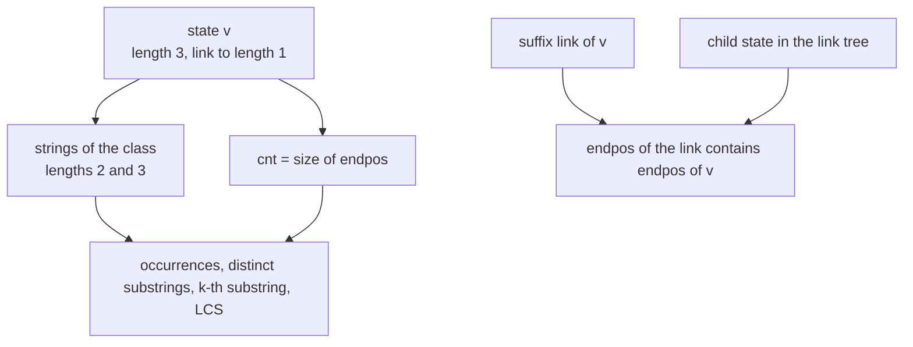
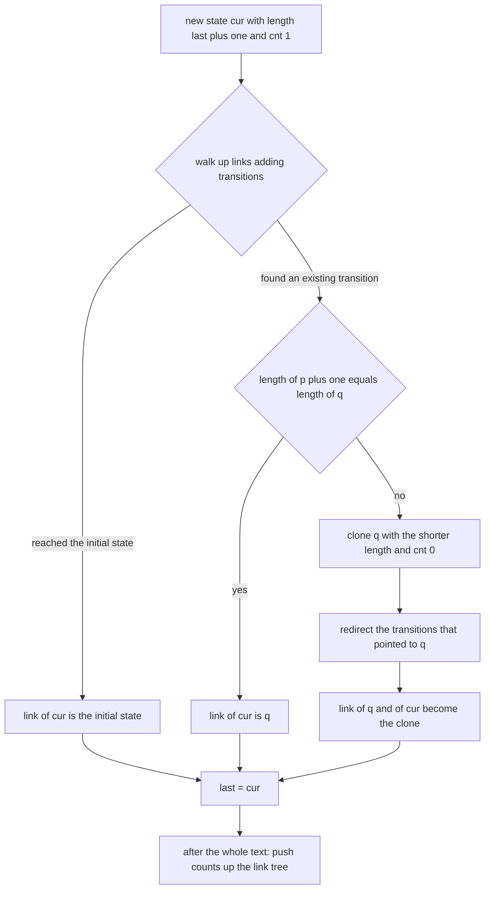
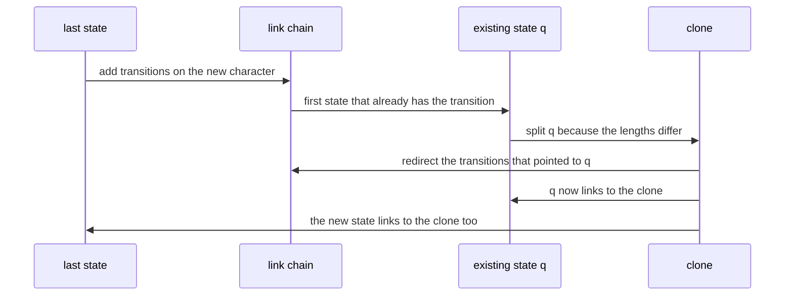

# 526 — Implement suffix automaton with endpos count (advanced).

> **Tier:** Advanced · **CTCI chapter:** Beyond — Advanced Data Structures & Algorithms
> **Task spec:** [526-implement-suffix-automaton-with-endpos-count-advanced.md](../../../tasks/advanced/526-implement-suffix-automaton-with-endpos-count-advanced.md)
> **Solutions:** [Python](../../../solutions/python/advanced/526-implement-suffix-automaton-with-endpos-count-advanced/solution.py) ·
> [Java](../../../solutions/java/advanced/526-implement-suffix-automaton-with-endpos-count-advanced/Solution.java) ·
> [JavaScript](../../../solutions/javascript/advanced/526-implement-suffix-automaton-with-endpos-count-advanced/solution.js) ·
> [C#](../../../solutions/csharp/advanced/526-implement-suffix-automaton-with-endpos-count-advanced/Solution.cs)

## 1. Problem restatement

**Input:** a text `s` of length `n` over some alphabet.

**Output:** a suffix automaton — the minimal deterministic automaton whose language is exactly the set
of substrings (factors) of `s` — together with the **endpos** machinery that makes it useful. Each
state `v` stores:

| Field | Meaning |
| --- | --- |
| `length[v]` | the longest string of the state's endpos-equivalence class |
| `link[v]` | the suffix link: the state of the longest proper suffix of `length[v]`'s string |
| `transitions[v]` | the DFA transitions, so a substring is located by walking from the initial state |
| `cnt[v]` | `abs(endpos(v))` — the number of occurrences of *every* substring in the class |
| `rep_end[v]` | the end index of the class's longest representative |

The substrings of one state are exactly the length interval `(length[link[v]], length[v]]`, and the
counts are obtained by setting `cnt = 1` on each non-clone state (it ends a prefix) and pushing the
counts up the suffix-link tree in decreasing `length` order.

On top of those primitives the files implement pattern search, the number of distinct substrings
`sum_v (length[v] - length[link[v]])`, the number restricted to a fixed length or to substrings with
`cnt >= k`, the lexicographically `k`-th distinct substring, and the longest common substring of two
strings. Documented conventions: the empty pattern occurs `0` times, the `k`-th distinct substring is
**1-based** in ascending lexicographic order, and positions are **0-based end indices**.

| Fact | Value |
| --- | --- |
| `"ababa"` | `9` distinct substrings; `"aba"` occurs `2` times (ending at `2` and `4`); `"bab"` once; the whole string once |
| `"aaaa"` | `4` distinct substrings with occurrence counts `4, 3, 2, 1` |
| size bounds | at most `2n - 1` states and `3n - 4` transitions |
| the family `"a"` followed by `n - 1` copies of `"b"` | attains exactly `2n - 1` states for `n = 6, 8, 12` |

## 2. Intuition

The key structural fact is that two substrings with the *same* set of end positions behave identically
for every query you would want to ask — they always occur together, in the same places — so the
automaton stores them in a single state. Those endpos-equivalence classes are nested: if you take the
longest string of a class and drop its first character, you land in another class, whose endpos set
*contains* the first one. That containment is exactly the suffix-link tree, and it is why counts
aggregate upward: the end positions of a parent are the union of its children's.



Two consequences drive the whole implementation. First, a *clone* is needed whenever a transition would
otherwise force two strings with different endpos sets into one class: the class must split, and the
clone inherits the transitions and the link while starting with `cnt = 0`, because a clone never ends a
prefix by itself. Second, the counting pass must visit states in decreasing `length` order — a state's
suffix link always has a strictly smaller `length`, so a counting sort by length guarantees each
child contributes to its parent before the parent contributes onward.

## 3. Algorithm

**Extending by one character** (the textbook online construction):

1. Create `cur` with `length = length[last] + 1`, `cnt = 1` (it ends the new prefix), and walk up the
   suffix links from `last` adding a transition on the new character to `cur` for every state that
   lacks one.
2. If the walk reaches the initial state, set `link[cur] = initial` and stop.
3. Otherwise `q = transitions[p][c]`. If `length[p] + 1 == length[q]` the class already fits, so
   `link[cur] = q`. Otherwise **clone** `q`: the clone takes `length[p] + 1`, a *copy* of `q`'s
   transitions, `q`'s link and `cnt = 0`; redirect every transition on `c` that pointed to `q` (walking
   up from `p`) to the clone; then set `link[q] = clone` and `link[cur] = clone`.

**Counting** then pushes `cnt[v]` into `cnt[link[v]]` for all states in decreasing `length` order (a
counting sort by length is `O(n)`), which yields `abs(endpos(v))` for every state.

```text
procedure extend(character, position)
    cur ← new state with length = length[last] + 1, cnt = 1, representative end = position
    p ← last
    while p is not the null link and transitions[p] has no character do
        transitions[p][character] ← cur
        p ← link[p]
    end
    if p is the null link then
        link[cur] ← initial state
    else
        q ← transitions[p][character]
        if length[p] + 1 == length[q] then
            link[cur] ← q
        else
            clone ← new state with length = length[p] + 1, cnt = 0, representative end = position
            transitions[clone] ← copy of transitions[q]
            link[clone] ← link[q]
            while p is not the null link and transitions[p][character] == q do
                transitions[p][character] ← clone
                p ← link[p]
            end
            link[q] ← clone
            link[cur] ← clone
        end
    end
    last ← cur
end

procedure count_occurrences()
    order ← states sorted by length ascending (counting sort)
    for index ← length(order) - 1 down to 1 do
        v ← order[index]
        if link[v] is not the initial state and not the null link then
            cnt[link[v]] ← cnt[link[v]] + cnt[v]
        end
    end
    return order
end
```

Queries are then walks: `occurrences(pattern)` is the `cnt` of the state reached by following the
pattern's characters (or `0` if the walk fails), `distinct_substrings` is a sum over states, and the
`k`-th distinct substring descends the DAG using per-state distinct-substring counts.



## 4. Worked example

Build the automaton for `"ababa"`. There are no clones here, so the states are exactly the `n + 1`
prefix classes; each non-clone state has `cnt = 1` before the aggregation.

| State | `length` | `link` | `cnt` before | `cnt` after | transitions | representative |
| --- | --- | --- | --- | --- | --- | --- |
| `0` | `0` | `-1` | `0` | `0` | `a -> 1`, `b -> 2` | — |
| `1` | `1` | `0` | `1` | `3` | `b -> 2` | `"a"` |
| `2` | `2` | `0` | `1` | `2` | `a -> 3` | `"ab"` |
| `3` | `3` | `1` | `1` | `2` | `b -> 4` | `"aba"` |
| `4` | `4` | `2` | `1` | `1` | `a -> 5` | `"abab"` |
| `5` | `5` | `3` | `1` | `1` | — | `"ababa"` |

The aggregation is a single backward sweep in decreasing `length`: state `5` adds its `1` to state `3`
(`cnt[3] = 2`), state `4` adds `1` to state `2` (`cnt[2] = 2`), state `3` adds `2` to state `1`
(`cnt[1] = 3`), and state `2` adds `2` to state `0`, which is ignored. The result matches brute force
on every substring: `"a"` occurs `3` times, `"ab"` and `"aba"` twice, `"abab"` and `"ababa"` once.
Locating `"aba"` walks `0 --a--> 1 --b--> 2 --a--> 3`, and state `3` has `cnt = 2` with
`endpos = {2, 4}` — the two occurrences end at 0-based indices `2` and `4`, exactly as the file
asserts.

Two more queries read straight off the same table: the number of distinct substrings is
`sum (length[v] - length[link[v]]) = 1 + 2 + 2 + 2 + 2 = 9`, and the weighted identity
`sum cnt[v] * (length[v] - length[link[v]]) = 3*1 + 2*2 + 2*2 + 1*2 + 1*2 = 15` equals the number of
`(substring, occurrence)` pairs, which brute force also counts as `3 + 2 + 2 + 2 + 2 + 1 + 1 + 1 + 1`.

A clone appears as soon as the classes must split. Appending one more character to `"abab"` to get
`"ababb"` splits the old state `2`, which used to represent both `"b"` (length `1`) and `"ab"`
(length `2`):

| After | State | `length` | `link` | `cnt` | class |
| --- | --- | --- | --- | --- | --- |
| before | `2` | `2` | `0` | `2` | `"b"`, `"ab"` |
| after | `6` (clone) | `1` | `0` | `3` | `"b"` with `endpos = {1, 3, 4}` |
| after | `2` | `2` | `6` | `2` | `"ab"` with `endpos = {1, 3}` |

The new character `"b"` occurs at an index where `"ab"` does not, so the two strings no longer share an
endpos set. The clone takes `length = length[p] + 1 = 1`, copies state `2`'s transitions, and inherits
`link = 0`; every transition that pointed to state `2` on the character `"b"` — starting from the
initial state — is redirected to the clone, and both `link[2]` and `link[cur]` become the clone. Note
that the clone starts with `cnt = 0` and only reaches `3` through the aggregation, because a clone
never ends a prefix by itself.



## 5. Complexity

Let `n` be the text length, `sigma` the alphabet size and `V`, `E` the state and transition counts.

| Phase | Time | Space | Notes |
| --- | --- | --- | --- |
| One extension | `O(1)` amortised with an array or hash map, `O(log sigma)` per lookup with a balanced tree | `O(1)` | `V <= 2n - 1`, `E <= 3n - 4` |
| Whole build | `O(n)` amortised (`O(n log sigma)` with tree maps) | `O(n)` states plus transitions | the Java file uses a `TreeMap` transition table |
| Count aggregation | `O(n)` | `O(n)` | counting sort by `length` over the range `0..n`, then a backward sweep |
| Endpos sets (diagnostic) | `O(n^2)` worst case | `O(n^2)` | merging real sets up the link tree, used only for testing |
| Pattern occurrence | `O(abs(pattern))` | `O(1)` | a walk over transitions plus one `cnt` lookup |
| Distinct substrings | `O(V)` | `O(1)` | a sum over states |
| `k`-th distinct substring | `O(V sigma)` | `O(V)` | a DAG walk using per-state distinct-substring counts |
| Longest common substring of two strings | `O(n + m)` given both automata built | `O(n)` | run the second text through the first automaton with link fallbacks |
| Brute-force oracle | `O(n^2)` substrings, `O(n^3)` counting | — | only for the short texts the tests use |

The automaton is a storage-cheap alternative to a suffix tree: `O(n)` states and transitions, no edges
per suffix, and every answer is a walk or a sum. The price is that the construction is subtle — the
clone case is where implementations go wrong — which is why the tests compare against a `Set` of all
substrings, against brute-force occurrence counts for *every* substring of a 30-character text, and
against the exact state-count bound `2n - 1` on the family that attains it.

## 6. Pitfalls and edge cases

- **Clone counts start at zero.** A clone never ends a prefix, so `cnt = 0` at creation; setting it to
  `1` inflates every occurrence count that passes through the clone.
- **The clone's transitions are copied, not shared.** Later extensions must not mutate the original
  state's table through the clone; the copy has to happen *after* the transitions added by the current
  extension, which is why the clone sometimes already contains the new character.
- **Redirection must stop at the right place.** The loop walks up from `p` while the transition on `c`
  still points at `q`; a `while true` or a missing condition rewires unrelated states.
- **The `length[p] + 1 == length[q]` shortcut.** Skipping this check creates a clone unnecessarily and
  can break the endpos equivalence classes (and the `2n - 1` bound).
- **Aggregation order.** Counts must be pushed from longer to shorter classes; a plain traversal order
  is wrong because a child can be visited before it has accumulated its own children's counts. The
  Python implementation uses a counting sort by `length`, which is `O(n)` and needs no comparison sort.
- **The initial state's link.** State `0` has `link = -1` and is skipped when propagating; adding `cnt`
  into it is harmless but the guard keeps the code honest about the sentinel.
- **Empty pattern.** The empty string occurs `n + 1` times as an endpos matter of taste, but the files
  document `0` occurrences for it, and `contains("")` is false because there is no state to locate.
- **Degenerate texts.** An empty text, a single character and a unary string `"a" * n` all work: the
  unary case gives exactly `n` distinct substrings with counts `n, n-1, ..., 1`, matching the closed
  form and the `"aaaa"` example.
- **Characters as dictionary keys.** Every implementation indexes transitions by the character itself
  (or by a symbol id), so any alphabet works, including one larger than the text; a fixed `sigma` array
  trades memory for speed.
- **The size bound is tight.** `2n - 1` states is attained, not merely allowed: `"a"` followed by
  `n - 1` copies of `"b"` reaches it for `n = 6, 8, 12`, and the C# file checks those three sizes.
- **Floating-point irrelevant, but memory is not.** Transition tables dominate the memory; storing a
  full `V x sigma` array is a real design choice, not an optimisation detail, which is why the Java
  file documents `O(n log sigma)` for its tree-based table.

## 7. Variants and follow-ups

- **Distinct substrings with a frequency filter.** Restricting the sum
  `sum (length[v] - length[link[v]])` to states with `cnt[v] >= k` counts the distinct substrings
  occurring at least `k` times; the files check `k = 1, 2, 3` against brute force, and the same
  filtered scan yields the longest repeated substring.
- **Lexicographic traversal.** The `k`-th distinct substring (1-based, ascending) descends the DAG with
  per-state distinct-substring counts, which is also how `"aaaa"` yields `a, aa, aaa, aaaa`.
- **Longest common substring of two texts.** Build the automaton of the first text, then run the second
  through it, following suffix links whenever a transition is missing; both texts are processed in
  linear time.
- **Automaton versus suffix array.** The suffix automaton answers occurrence and distinct-substring
  questions with the same asymptotics as the suffix array plus LCP of
  [402-build-lcp-array-from-suffix-array-kasai.md](../../../tasks/advanced/402-build-lcp-array-from-suffix-array-kasai.md)
  and
  [403-use-suffix-array-lcp-for-longest-repeated-substring.md](../../../tasks/advanced/403-use-suffix-array-lcp-for-longest-repeated-substring.md),
  but with a different shape: no `O(n log n)` construction, no LCP array, and a different set of queries
  that are natural.
- **The basic automaton task.** Counting distinct substrings with a suffix automaton without the endpos
  machinery is
  [404-implement-suffix-automaton-and-count-different-substrings.md](../../../tasks/advanced/404-implement-suffix-automaton-and-count-different-substrings.md);
  the endpos aggregation added here is what turns it into an occurrence index.
- **Suffix-prefix variants.** The counting data structures in
  [489-implement-suffix-prefix-automaton-based-string-counting-advanced.md](../../../tasks/advanced/489-implement-suffix-prefix-automaton-based-string-counting-advanced.md)
  reuse the same class-interval idea for a different family of queries.

## 8. Check yourself

**Q1.** Why is the set of substrings represented by a state exactly the length interval
`(length[link[v]], length[v]]`?

<details><summary>Show answer</summary>

Because a state groups all substrings with the same endpos set, and dropping the first character of a
string shortens it by one while enlarging (or keeping) its endpos set. The largest string in the class
has length `length[v]`, the smallest has `length[link[v]] + 1`, and every length in between also has the
same endpos set — otherwise a different state would claim it.

</details>

**Q2.** In the `"ababa"` table, why does state `1` end up with `cnt = 3` while state `2` has `cnt = 2`?

<details><summary>Show answer</summary>

State `1` represents `"a"`, which occurs `3` times (end positions `0, 2, 4`); state `2` represents the
lengths `1..2`, i.e. `"b"` and `"ab"`, and both occur `2` times (end positions `1, 3`). The aggregation
gives state `1` a contribution of `2` from state `3` on top of its own `1`, and gives state `2` a
contribution of `1` from state `4` on top of its own `1`.

</details>

**Q3.** Why does a clone start with `cnt = 0`, and what would `cnt = 1` do to the answers?

<details><summary>Show answer</summary>

A clone is created by splitting an existing class; it does not correspond to a prefix ending at the
current position, so it owns no end position of its own — its positions arrive only from its children in
the link tree. Starting it at `1` would add a phantom occurrence to every string of the class, inflating
all counts that pass through it.

</details>

**Q4.** Why must the counting pass run in decreasing `length` order rather than, say, in state creation
order?

<details><summary>Show answer</summary>

Because a state's count is the sum over its children in the suffix-link tree, and every suffix link
points to a strictly shorter class. Processing longer classes first guarantees that when a state is
visited, all of its descendants have already added their counts; creation order has no such property,
since clones are created after many of the states that link to them.

</details>

**Q5.** In `"ababb"`, why does the class containing `"b"` have to split?

<details><summary>Show answer</summary>

Because the new character `"b"` occurs at position `4`, which is an end position for `"b"` but not for
`"ab"` (there is no `"ab"` ending at `4`). The two strings therefore have different endpos sets —
`{1, 3, 4}` against `{1, 3}` — so they can no longer share a state. The clone takes the shorter class
(`"b"`, `length = 1`) and the original state keeps `"ab"`.

</details>
