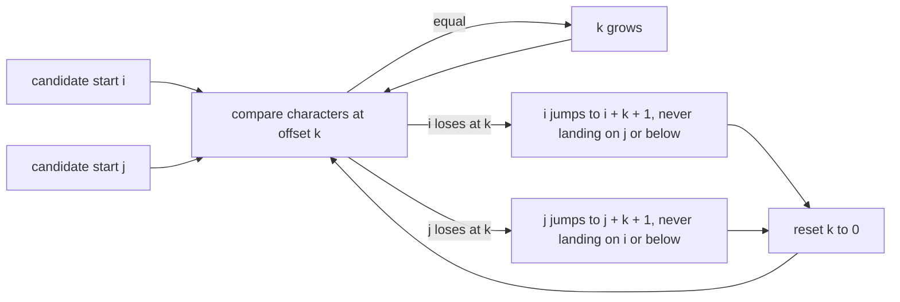
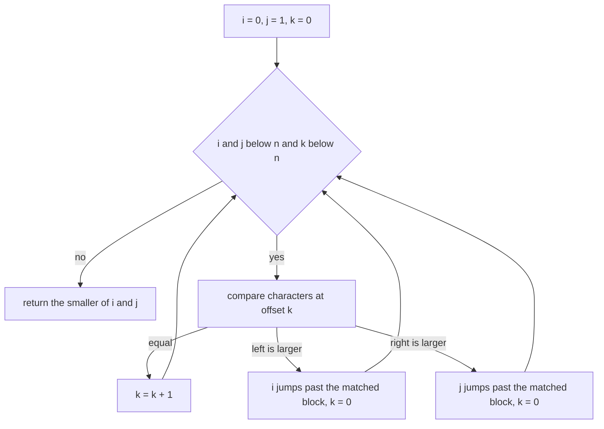
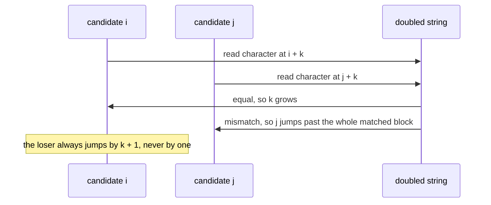

# 527 — Implement minimal rotation (Booth's algorithm).

> **Tier:** Advanced · **CTCI chapter:** Beyond — Advanced Data Structures & Algorithms
> **Task spec:** [527-implement-minimal-rotation-booth-s-algorithm.md](../../../tasks/advanced/527-implement-minimal-rotation-booth-s-algorithm.md)
> **Solutions:** [Python](../../../solutions/python/advanced/527-implement-minimal-rotation-booth-s-algorithm/solution.py) ·
> [Java](../../../solutions/java/advanced/527-implement-minimal-rotation-booth-s-algorithm/Solution.java) ·
> [JavaScript](../../../solutions/javascript/advanced/527-implement-minimal-rotation-booth-s-algorithm/solution.js) ·
> [C#](../../../solutions/csharp/advanced/527-implement-minimal-rotation-booth-s-algorithm/Solution.cs)

## 1. Problem restatement

**Input:** a string `s` of length `n`. A rotation is `s[k:] + s[:k]` for some start index `k`.

**Output:** the start index of the **lexicographically least** rotation, and that rotation. When
several starts produce the same minimal rotation — which happens exactly when the string is a power
`u^m` of a shorter primitive root `u` — the algorithm returns the **smallest** index, which is the
convention the brute-force reference also follows. The empty string is handled as index `0`.

The task is an `O(n)` algorithm with no comparison sort: the naive approach compares all `n` rotations
and costs `O(n^2)` character comparisons, which the Python test can still afford for exhaustive
verification on tiny alphabets but not for real inputs.

| Input | Start | Minimal rotation | Why |
| --- | --- | --- | --- |
| `"banana"` | `5` | `"abanan"` | the only minimal rotation |
| `"baba"` | `1` | `"abab"` | the rotation at index `3` is identical, and the smaller index wins |
| `"cba"` | `2` | `"acb"` | all rotations are distinct, `"acb"` is least |
| `"abacaba"` | `6` | `"aabacab"` | a longer hand-checked case |
| `"mississippi"` | `10` | `"imississipp"` | the last position holds the least character |
| `"aaaa"` | `0` | `"aaaa"` | all four rotations are equal, so index `0` |
| `"abcabcabc"` | `0` | `"abcabcabc"` | starts `0, 3, 6` all achieve the minimum |
| `""` | `0` | `""` | the degenerate case |

## 2. Intuition

The naive scan wastes work: if the rotation starting at `i` and the one starting at `j` agree for `k`
characters and then differ at offset `k`, then every start in the matched block is already known to be
worse than one of the two candidates, and those starts can be skipped wholesale. That is the whole
idea of Booth's algorithm — two candidate starts advance a shared match length, and the loser jumps
past the entire matched block instead of restarting the comparison.



The skip is safe because of two facts. If `s[i..i+k-1] == s[j..j+k-1]` and `s[i+k] > s[j+k]`, then for
every offset `d` in `0 .. k` the rotation starting at `i + d` is beaten by the one starting at `j + d`
— the matched block makes the two windows shift together, so no start inside the block can win.
Jumping `i` to `i + k + 1` therefore discards exactly `k + 1` impossible candidates, not just one, and
the total number of character comparisons telescopes to `O(n)`. The extra `if i <= j: i = j + 1` push
merely guarantees the two candidates never coincide, which would make the comparison vacuous.

Ties need care in the *description* of the answer rather than in the algorithm. For `"abab"` the
minimal rotation is attained at both start `0` and start `2`, for `"abcabcabc"` at `0, 3, 6`, and for
`"aaaa"` at all four starts. The files document the smallest index as the return value, while the
JavaScript file notes that its cross-check against the independent two-pointer minimum-expression
algorithm can return a different index for periodic inputs — the *rotation string* is what must agree
there.

## 3. Algorithm

1. **Guard** the empty string: return index `0` (there is no rotation to compute).
2. **Set** the two candidate starts `i = 0`, `j = 1` and the shared match length `k = 0`.
3. **Compare** `s[(i + k) mod n]` with `s[(j + k) mod n]`, which is the same as comparing positions
   `i + k` and `j + k` of the doubled string `s + s`.
4. **If equal**, increment `k` and compare again.
5. **If the left character is larger**, `i` loses: set `i = i + k + 1`, and if that does not exceed `j`,
   set `i = j + 1`; reset `k = 0`. The symmetric rule applies when the right character is larger.
6. **Stop** when `k == n` (one rotation is a full match of the other) or when either candidate reaches
   `n`; return `min(i, j)`.
7. **Derive** the rotation as `s[k:] + s[:k]`.

```text
function booth(text)
    n ← length(text)
    if n is 0 then return 0 end
    doubled ← text + text                  # or index modulo n
    i ← 0
    j ← 1
    k ← 0
    while i < n and j < n and k < n do
        left ← doubled[i + k]
        right ← doubled[j + k]
        if left == right then
            k ← k + 1
        else if left > right then
            i ← i + k + 1
            if i <= j then i ← j + 1 end
            k ← 0
        else
            j ← j + k + 1
            if j <= i then j ← i + 1 end
            k ← 0
        end
    end
    return minimum(i, j)
end

function minimal_rotation(text)
    start ← booth(text)
    return text[start ..] + text[.. start]
end
```

Two implementation families appear in the solutions. The two-pointer version above needs only the
original string plus two indices, so its extra space is `O(1)` (Java, Python, C#). The C# file also
describes the KMP-flavoured variant, which scans the doubled string with a failure array and *counts*
character comparisons to assert the linear bound; the JavaScript file materialises `s + s`, which costs
`O(n)` space for the same `O(n)` time.



## 4. Worked example

Run the algorithm on `"banana"` (doubled string `"bananabanana"`). Every row is one comparison.

| Step | `i` | `j` | `k` | compare | outcome | new state |
| --- | --- | --- | --- | --- | --- | --- |
| `1` | `0` | `1` | `0` | `b` vs `a` | `i` loses | `i = 2`, `k = 0` |
| `2` | `2` | `1` | `0` | `n` vs `a` | `i` loses | `i = 3`, `k = 0` |
| `3` | `3` | `1` | `0` | `a` vs `a` | equal | `k = 1` |
| `4` | `3` | `1` | `1` | `n` vs `n` | equal | `k = 2` |
| `5` | `3` | `1` | `2` | `a` vs `a` | equal | `k = 3` |
| `6` | `3` | `1` | `3` | `b` vs `n` | `j` loses | `j = 5`, `k = 0` |
| `7` | `3` | `5` | `0` | `a` vs `a` | equal | `k = 1` |
| `8` | `3` | `5` | `1` | `n` vs `b` | `i` loses | `i = 6`, `k = 0` |

The loop then stops because `i = 6` is not below `n = 6`, and the answer is `min(6, 5) = 5`, giving the
rotation `"abanan"`. Note step 6: after matching three characters, the candidate at `j = 1` discovers
`s[1+3] = 'n' > s[3+3] = 'b'`, so it jumps to `j = 5` — skipping starts `2, 3, 4` in one step — instead
of only stepping to the next start.

The same trace on `"cba"` is only two comparisons long:

| Step | `i` | `j` | `k` | compare | outcome | new state |
| --- | --- | --- | --- | --- | --- | --- |
| `1` | `0` | `1` | `0` | `c` vs `b` | `i` loses, and `i + 1 = 1 <= j = 1`, so `i` is pushed to `j + 1` | `i = 2`, `k = 0` |
| `2` | `2` | `1` | `0` | `a` vs `b` | `j` loses | `j = 3`, `k = 0` |

With `j = 3 = n` the loop ends and `min(2, 3) = 2`, so the answer is `"acb"`.

Periodic inputs make the tie rule visible. The number of starts achieving the minimum is
`n / (length of the primitive root)`: `"abab"` returns `0` and has two minimal starts `[0, 2]`,
`"abcabcabc"` returns `0` with `[0, 3, 6]`, and `"aaaa"` returns `0` with all four starts tied. Each of
those minimal rotations is a power `u^k` of a Lyndon word `u` — `"ab"`, `"abc"` and `"a"`
respectively — which is the structural property the Java file verifies with an in-file Duval
factorization plus the test "smaller than all of its proper suffixes".



## 5. Complexity

Let `n` be the string length and `sigma` the alphabet size.

| Approach | Time | Extra space | Notes |
| --- | --- | --- | --- |
| Booth, two pointers | `O(n)` | `O(1)` | every mismatch skips `k + 1` candidates, so comparisons telescope |
| Booth, KMP failure array | `O(n)` | `O(n)` | the C# file counts character comparisons and asserts the bound |
| Booth with `s + s` materialised | `O(n)` | `O(n)` | the JavaScript implementation |
| Brute force over all rotations | `O(n^2)` comparisons | `O(n)` | the reference the answers are checked against |
| Smallest suffix of `s + s` | `O(n log n)` with a suffix sort | `O(n)` | an independent method that may return another tie index |
| Doubling ranks `(rank[i], rank[i + p])` | `O(n log^2 n)` | `O(n)` | the Java file's second reference implementation |
| Duval / Lyndon factorization | `O(n)` | `O(1)` | used to verify the Lyndon-power structure of the answer |

The linear bound is the point of the algorithm, and the skip rule is what achieves it: the loser
advances by `k + 1` after `k` successful matches, so the matched work is charged to discarded
candidates. The exhaustive tests back this up in the strongest way available — every binary string up
to length `12` (`8190` strings), every ternary string up to length `8` (`9840`), and hundreds of LCG
strings, all compared against a brute force that scans all `n` rotations, plus a comparison-sort
reference on inputs up to length `400`.

## 6. Pitfalls and edge cases

- **Skipping by the wrong amount.** The jump is `i + k + 1`, not `i + 1` and not `i + k`: the candidate
  `i + k` itself is already known to lose (its character at the mismatch offset is the larger one), so
  the whole matched block including that start can be discarded. Using `i + 1` degrades the algorithm
  to `O(n^2)` while still being correct.
- **Letting the candidates collide.** After the jump, `i` may equal `j` or fall below it; the push
  `if i <= j: i = j + 1` (and the mirror for `j`) keeps them distinct. Without it the comparison at
  `k = 0` compares a start with itself and `k` never advances.
- **Ties and periodicity.** `"abab"`, `"aaaa"` and `"abcabcabc"` all have several minimal rotations. The
  documented convention is the smallest index, which the brute-force reference reproduces; comparing
  only the rotation *text* would hide an indexing bug, so both are checked.
- **Empty and single-character strings.** `""` returns `0` with the empty rotation, and `"z"` returns
  `0` with `"z"`; the JavaScript file instead *rejects* the empty input, so the empty case is documented
  per file rather than assumed.
- **Doubling versus modular indexing.** Both formulations are equivalent, but a materialised `s + s`
  costs `O(n)` memory while `(i + k) mod n` does not; a bug that indexes the doubled string without the
  extra length can run off the end exactly when `k` approaches `n`.
- **The loop bound `k < n`.** If one candidate's rotation matches the other's for `n` characters, the
  two candidates start identical rotations and either answer is valid; terminating on `k == n` prevents
  an infinite loop on periodic strings such as `"aaaa"`.
- **Index 0 means "already minimal".** Returning `0` is exactly the statement that the input is weakly
  minimal (equal to its own least rotation) — true for `"abc"`, `"abab"` and `"aaaa"`, and strictly true
  for a Lyndon word, which is smaller than all of its proper suffixes.
- **Circular invariance.** Rotating the input by any offset must not change the *rotation string*; the
  C# file asserts this for every shift of every test string, which is the cheapest way to catch an
  indexing mistake that only shows up on some inputs.
- **Alphabet order matters.** Lexicographic comparison is by code point, so a "maximal rotation"
  implementation that maps `c -> 'z' - c` (the C# file's trick) is only valid for the alphabet it
  assumes; applying it to arbitrary Unicode would reverse the wrong order.
- **Character comparisons counted, not assumed.** The C# file instruments the scan and asserts the
  linear bound empirically, because a subtly wrong skip rule still produces correct answers on small
  inputs while running in quadratic time.

## 7. Variants and follow-ups

- **Maximal rotation.** Running the same algorithm on the order-reversing image of the alphabet
  (`c -> 'z' - c`) turns "least" into "greatest" without a second implementation.
- **Smaller or larger suffix of `s + s`.** Taking the lexicographically smallest suffix of the doubled
  string whose start index is below `n` yields a minimal rotation by a completely different argument;
  the index may differ on periodic inputs, so only the rotation text is compared.
- **Doubling ranks.** Sorting rotation indices by the pair `(rank[i], rank[(i + p) mod n])` and doubling
  `p` until all ranks are distinct is the standard `O(n log^2 n)` method — slower, but a genuinely
  independent cross-check of the linear algorithm.
- **Lyndon words and Duval's factorization.** The minimal rotation of a word is a power `u^k` of a single
  Lyndon word `u`; the Java file verifies the factorization and the "smaller than all proper suffixes"
  property in-file, which pins the tie counts to the length of the primitive root.
- **Sorted-rotation structures.** The Burrows-Wheeler transform of
  [409-implement-burrows-wheeler-transform-and-inverse.md](../../../tasks/advanced/409-implement-burrows-wheeler-transform-and-inverse.md)
  needs the *full* sorted order of rotations, which costs more than Booth's single minimum — the
  minimal rotation is the cheap question, the sorted list is the expensive one.
- **Where the substring machinery lives.** Occurrence and distinct-substring queries on the same string
  are the domain of the suffix automaton of
  [526-implement-suffix-automaton-with-endpos-count-advanced.md](../../../tasks/advanced/526-implement-suffix-automaton-with-endpos-count-advanced.md),
  and the suffix-array construction of
  [401-implement-suffix-array-sa-is-or-doubling-for-medium-n.md](../../../tasks/advanced/401-implement-suffix-array-sa-is-or-doubling-for-medium-n.md)
  uses the same doubling idea that the rank-based reference implementation here relies on.

## 8. Check yourself

**Q1.** Why can the losing candidate jump by `k + 1` instead of by one?

<details><summary>Show answer</summary>

Because of the matched block: if `s[i..i+k-1] == s[j..j+k-1]` and `s[i+k] > s[j+k]`, then for every
`d` in `0..k` the rotation starting at `i + d` is beaten by the rotation starting at `j + d` — the two
windows slide together through the match, so no start inside the block can be minimal. Skipping `k + 1`
candidates is what makes the total work linear.

</details>

**Q2.** For `"abab"`, why is the answer start `0` and not start `2`?

<details><summary>Show answer</summary>

Both starts produce the same rotation `"abab"`, so the minimum is attained twice. The documented
convention is the smallest index among the tied minima, and the brute-force reference (scanning all
rotations and keeping the first) returns `0` as well.

</details>

**Q3.** In the `"banana"` trace, what does step `6` accomplish?

<details><summary>Show answer</summary>

Three characters matched between starts `1` and `3` (`"ana"` in both windows), and then
`s[1+3] = 'n'` lost against `s[3+3] = 'b'`. So `j` jumps from `1` to `1 + 3 + 1 = 5`, discarding starts
`2, 3, 4` in a single step; the remaining candidate `5` turns out to be the winner.

</details>

**Q4.** Why does the loop need the condition `k < n`, and what would happen without it?

<details><summary>Show answer</summary>

With `k == n` one candidate's rotation has matched the other's for the entire length, so the two starts
are interchangeable and the comparison can never be decided — for `"aaaa"` the loop would keep
incrementing `k` forever. Bounding `k` by `n` stops the scan and lets `min(i, j)` return `0`.

</details>

**Q5.** A faster-looking implementation returns a *different* index from the brute force on `"abcabcabc"`
but the same rotation string. Is it wrong?

<details><summary>Show answer</summary>

Not necessarily: the minimal rotation is `"abcabcabc"` itself, attained at starts `0`, `3` and `6`, so
any of those indices is "a" correct answer for the rotation. It *would* be wrong for a stated
convention of "smallest index", which is why the files document that convention and the JavaScript file
explicitly notes that its two-pointer cross-check may return another tie index while the rotation string
must match.

</details>
