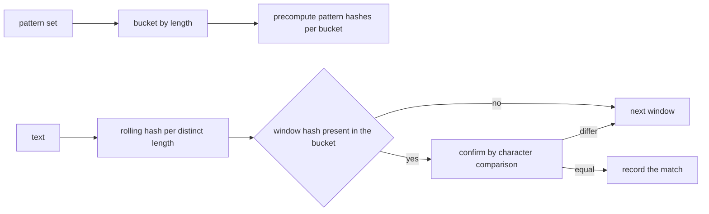
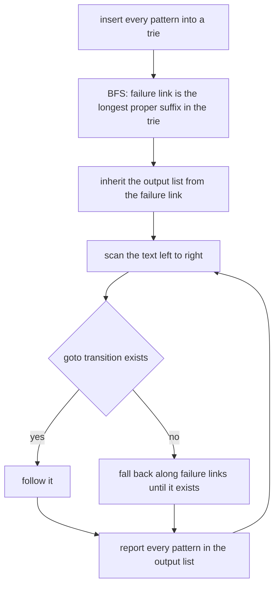
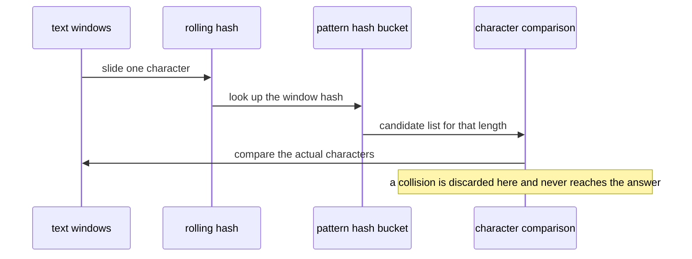

# 528 — Implement Karp-Rabin for many patterns with automaton.

> **Tier:** Advanced · **CTCI chapter:** Beyond — Advanced Data Structures & Algorithms
> **Task spec:** [528-implement-karp-rabin-for-many-patterns-with-automaton.md](../../../tasks/advanced/528-implement-karp-rabin-for-many-patterns-with-automaton.md)
> **Solutions:** [Python](../../../solutions/python/advanced/528-implement-karp-rabin-for-many-patterns-with-automaton/solution.py) ·
> [Java](../../../solutions/java/advanced/528-implement-karp-rabin-for-many-patterns-with-automaton/Solution.java) ·
> [JavaScript](../../../solutions/javascript/advanced/528-implement-karp-rabin-for-many-patterns-with-automaton/solution.js) ·
> [C#](../../../solutions/csharp/advanced/528-implement-karp-rabin-for-many-patterns-with-automaton/Solution.cs)

## 1. Problem restatement

**Input:** a text of length `n` and a set of `m` patterns, with a total pattern length `P = sum |p_i|`.

**Output:** every occurrence of every pattern, as `(start, pattern)` pairs with `0`-based **start**
indices, returned in ascending order. Two exact engines are implemented and cross-checked against a
naive per-pattern scan:

| Engine | Idea | Cost |
| --- | --- | --- |
| Karp-Rabin with length bucketing | group the patterns by length, slide one rolling hash over the text per distinct length, and **confirm every hash hit by comparing characters** | `O(n)` per distinct length plus the verification work |
| Aho-Corasick | a trie of the patterns with BFS failure links and inherited output lists, one linear scan of the text | `O(P)` to build, `O(n + matches)` to search |

Documented conventions: the empty pattern matches at every position `0 .. n` (`n + 1` occurrences) and
is handled outside the hashing loop; duplicate patterns get identical occurrence lists; a pattern
longer than the text has none; the reported match sets of all engines must be identical.

| Case | Result |
| --- | --- |
| `"abracadabra"` with `abra`, `ca`, `dabra`, `a`, `missing`, `abracadabra` | `10` matches: `(0,a) (0,abra) (0,abracadabra) (3,a) (4,ca) (5,a) (6,dabra) (7,a) (7,abra) (10,a)` |
| a deliberately weak filter (`base = 10`, `modulus = 97`) on `"9700"` with pattern `"00"` | the unverified filter reports `(0, "00")` and `(2, "00")` — two candidates, one of them false — while the verified matcher reports only `(2, "00")` |
| the same example's counters | `hashed_windows = 42`, `candidates = verifications = 10` |
| Java's weak modulus (`base = 3`, `modulus = 7`) | the collision counter must be *positive*, which is how the file proves the confirmation path is exercised |

## 2. Intuition

Comparing `m` patterns against every window costs `O(n * P)` comparisons. Hashing removes almost all
of them: precompute one hash per pattern, slide a rolling hash over the text, and only look at the
positions whose window hash matches something. The rolling recurrence makes each window `O(1)`:

```text
h(window[i+1 .. i+L]) = ((h(window[i .. i+L-1]) - s[i] * base^(L-1)) * base + s[i+L]) mod M
```

The subtlety is that hashing is a *filter*, not a decision. Two different windows can produce the same
hash, and a small modulus makes that easy: the Python file demonstrates it with `base = 10`,
`modulus = 97`, where `"97"` and `"00"` collide. So every hash hit is confirmed by comparing the
characters; the collision only costs a wasted comparison, never a wrong answer.



Bucketing by length is what makes the approach multi-pattern friendly: patterns of different lengths
cannot match the same window, so one rolling pass per *distinct length* suffices, and the number of
hashed windows is exactly `sum over distinct L of (n - L + 1)`.

Aho-Corasick solves the same problem without hashing, and it is the exact reference the hashed filter
is checked against. A trie of the patterns plus failure links turns the scan into a deterministic
automaton: at each text position you follow the goto transition, fall back along failure links when it
is missing, and report every pattern in the current state's output list — which includes patterns
inherited from the failure link, so overlapping matches such as `"a"` and `"abra"` at the same
position are all found in one pass.

## 3. Algorithm

**Karp-Rabin multi-pattern search:**

1. Deduplicate the patterns and group them by length; reject empty patterns (they are handled outside
   the loop and match everywhere).
2. Precompute each pattern's hash and store a map from hash to the pattern list of that bucket.
3. For each distinct length `L`, roll a hash over every window of length `L` and increment the hashed
   window counter. For every bucket entry matching the window hash, increment the candidate counter,
   compare the characters, and record a match only when they are equal.
4. Sort the matches; report the counters.

**Aho-Corasick:**

5. Insert every pattern into a trie; mark the terminal node with the pattern.
6. Build failure links in BFS order: the failure of a node is the longest proper suffix of its string
   that is also a trie node; after computing it, inherit its output list.
7. Scan the text once, following gotos and failures, and emit `(position - |pattern| + 1, pattern)` for
   every pattern in the current output list.

```text
procedure karp_rabin_search(text, patterns, base, modulus, verify)
    unique ← distinct patterns, rejecting the empty pattern
    buckets ← patterns grouped by length
    pattern_hashes ← for each length: map from hash to the list of patterns
    matches ← empty list
    for length in ascending distinct lengths do
        for (start, value) in rolling_windows(text, length) do
            hashed_windows ← hashed_windows + 1
            for pattern in pattern_hashes[length].get(value, empty) do
                candidates ← candidates + 1
                if verify and text[start .. start + length - 1] != pattern then
                    continue
                end
                append (start, pattern) to matches
            end
        end
    end
    return sorted(matches), counters
end

procedure rolling_windows(text, length, base, modulus)
    highest ← base power (length - 1) mod modulus
    current ← 0
    for position over the text do
        if position >= length then
            current ← (current - text[position - length] * highest) mod modulus
        end
        current ← (current * base + text[position]) mod modulus
        if position >= length - 1 then emit (position - length + 1, current) end
    end
end
```



## 4. Worked example

Take `text = "abracadabra"` with the patterns `abra`, `ca`, `dabra`, `a`, `missing` and
`abracadabra`. All three engines return the same ten matches:

| Start | Pattern | How it is found |
| --- | --- | --- |
| `0` | `a` | window hash of length `1` matches, characters equal |
| `0` | `abra` | window hash equals the `"abra"` hash `219761636` at offset `0` |
| `0` | `abracadabra` | the whole text matches its own hash |
| `3` | `a` | another length-`1` hash hit |
| `4` | `ca` | the only occurrence of `"ca"` |
| `5` | `a` | |
| `6` | `dabra` | |
| `7` | `a` | |
| `7` | `abra` | the same hash `219761636` appears again at offset `7` |
| `10` | `a` | the final character |

The counters make the work visible: the distinct pattern lengths are `1, 2, 4, 5, 7, 11`, so the number
of hashed windows is `11 + 10 + 8 + 7 + 5 + 1 = 42`, which is exactly `sum (n - L + 1)` over those
lengths. `missing` contributes a bucket of length `7` whose hash never appears, and the two absent
lengths cost hashing but no verification. Every hash hit is real here, so `candidates = verifications =
10 = number of matches`.

Now the collision demonstration, with `base = 10` and `modulus = 97`, using the ordinals the
implementation hashes:

| Window | Codes | Hash | Note |
| --- | --- | --- | --- |
| `"97"` at start `0` | `57, 55` | `(57 * 10 + 55) mod 97 = 43` | equals the pattern hash of `"00"` |
| `"70"` at start `1` | `55, 48` | `(55 * 10 + 48) mod 97 = 16` | no hit |
| `"00"` at start `2` | `48, 48` | `(48 * 10 + 48) mod 97 = 43` | the genuine match |

The difference between the two colliding windows is `9 * 10 + 7 = 97`, i.e. `0 mod 97` — which is why a
small modulus is dangerous. The unverified filter therefore reports `(0, "00")` as well as `(2, "00")`,
while the verified matcher compares characters at both starts and keeps only `(2, "00")`. The same
demonstration appears in the other files with `base = 3, modulus = 7` (Java, where the collision
counter must be positive) and `modulus = 31` on a four-letter benchmark (C#, at least `5` false
positives) — the point being that collisions are *exercised*, not assumed away.



## 5. Complexity

Let `n` be the text length, `m` the number of patterns, `P` their total length, `D` the number of
distinct pattern lengths and `L` a pattern length.

| Phase | Time | Space | Notes |
| --- | --- | --- | --- |
| Karp-Rabin hashing | `O(n D)` | `O(n + P)` | one rolling pass per distinct length, `O(1)` per window |
| Candidate verification | `O(candidates * L)` | — | `candidates = matches + collisions` |
| Whole hashed search | `O(n D + matches * L)` | `O(P)` | plus the `D` hash tables |
| Aho-Corasick build | `O(P)` | `O(P)` | trie nodes plus inherited output lists |
| Aho-Corasick search | `O(n + matches)` | `O(P)` | amortised link fallbacks, one pass |
| Naive oracle | `O(n m)` comparisons | `O(1)` | the answers are validated against it |
| C# trie verification | at most `1/4` of the naive comparisons on its benchmark | `O(P)` | one trie walk rules out every candidate at once |

The two engines trade differently: Karp-Rabin pays `O(n)` hashing per distinct pattern length but then
verifies only candidates, while Aho-Corasick pays `O(P)` once and scans the text in a single pass
regardless of how many patterns there are. For a large pattern set with many distinct lengths, the
automaton is the better choice; for a handful of lengths with few real matches, the hashed filter is
simpler and faster. The C# file's counter instrumentation is what makes the trade measurable: it
asserts that verification through the pattern trie uses at most a quarter of the naive character
comparisons on its benchmark.

## 6. Pitfalls and edge cases

- **A hash hit is a candidate, not a match.** The unverified filter on `"9700"` reports a false
  positive; only the character comparison makes the answer exact. The tests therefore *require*
  collisions on the weak-modulus benchmarks — otherwise the verification path would be dead code.
- **Modular subtraction must stay non-negative.** The rolling step subtracts
  `text[position - length] * base^(L-1)`; the Python implementation uses `%` with the modulus
  immediately, and languages with a negative remainder (C, C#, Java) need `(x % M + M) % M` or an
  explicit adjustment.
- **The highest power matters.** The weight of the leaving character is `base^(L-1) mod M`, precomputed
  once per length; using `base^L` or recomputing inside the loop silently produces wrong hashes (the
  recurrence is verified window by window against a direct recomputation precisely to catch that).
- **Bucketing by length is not optional.** Patterns of different lengths can never match the same
  window, and hashing every pattern against every window would be `O(n m)` — exactly the naive cost the
  hashing was supposed to avoid.
- **The empty pattern lives outside the loop.** It matches at every position `0 .. n` (`n + 1`
  occurrences) and has a zero-length window, which has no hash. The implementations handle it
  separately; the automaton rejects empty patterns outright.
- **Duplicate patterns.** They must produce identical occurrence lists, which is why the pattern set is
  deduplicated first (hashing the same pattern twice would duplicate every match).
- **Patterns longer than the text.** Their bucket has no windows at all (`n - L + 1 <= 0`), so they
  simply produce nothing rather than needing a special case.
- **Ascending output order.** Matches are sorted by `(start, pattern)`; the hashed engine visits windows
  length-bucket by length-bucket, so the order is not naturally sorted and sorting is required for the
  engines to be comparable element by element.
- **Aho-Corasick failures.** The failure link must be the *longest proper suffix* that is a trie node,
  and each node must inherit its failure's outputs — otherwise patterns that end inside other patterns
  (like `"a"` inside `"abra"`) are missed. Building in BFS order is what makes the inheritance safe.
- **Alphabet assumptions.** The Java automaton is built over the 26 lowercase letters; a different
  alphabet needs the trie transitions keyed accordingly. The hashed engine is alphabet-agnostic because
  it hashes code points, but the choice of codes (ordinals versus digit values) changes the hash
  values — the collision demo works either way because the difference is `97 ≡ 0 mod 97`.
- **Modulus size.** `1000000007` (Python, JavaScript can also use `BigInt` with base `131`) makes
  collisions vanishingly unlikely but not impossible; `1000003` is the C# default. Verification is
  what makes the choice a performance decision rather than a correctness one.
- **Counters as evidence.** `hashed_windows` must equal `sum (n - L + 1)` over the distinct lengths,
  `verifications` must equal `candidates` when verification is on, and `candidates == matches` with the
  large prime modulus on the tested data; each of those equalities is asserted, which turns the
  instrumentation into a test.

## 7. Variants and follow-ups

- **Verification through a trie instead of per pattern.** The C# file groups the candidate patterns and
  walks its pattern trie from the match position, so one walk rules out every candidate of that length
  at once instead of comparing them one by one.
- **Weak-modulus collision studies.** `base = 10, modulus = 97` (Python), `base = 3, modulus = 7`
  (Java) and `modulus = 31` (C#) are chosen so collisions actually occur; the verified and unverified
  matchers are then compared to show that only the verified one is exact.
- **Big integers instead of modular arithmetic.** The JavaScript file uses `BigInt` arithmetic with
  base `131` and modulus `1000000007`, which avoids 32-bit overflow entirely at some cost per window.
- **Exact automaton as the reference.** Aho-Corasick gives an independent `O(n + matches)` answer
  without hashing, which is why every hashed result is compared against it as well as against the
  naive scan.
- **Other substring indexes.** Occurrence and distinct-substring queries on a *single* text are the
  domain of the suffix automaton of
  [526-implement-suffix-automaton-with-endpos-count-advanced.md](../../../tasks/advanced/526-implement-suffix-automaton-with-endpos-count-advanced.md),
  and multi-text variants use the generalised suffix array of
  [407-implement-generalized-suffix-array-for-multiple-strings.md](../../../tasks/advanced/407-implement-generalized-suffix-array-for-multiple-strings.md);
  Karp-Rabin wins when the pattern set, not the text, is the fixed object.
- **Rotational problems on the matched text.** Once occurrences are known, the circular structure of the
  same text can be summarised by the minimal rotation of
  [527-implement-minimal-rotation-booth-s-algorithm.md](../../../tasks/advanced/527-implement-minimal-rotation-booth-s-algorithm.md).

## 8. Check yourself

**Q1.** Why is bucketing the patterns by length necessary, and how many hashed windows does the
`"abracadabra"` example use?

<details><summary>Show answer</summary>

Because a window can only match a pattern of the same length, so one rolling pass per distinct length
suffices; hashing all patterns against all windows would cost `O(n m)`, the same as the naive scan. The
example has distinct lengths `1, 2, 4, 5, 7, 11`, giving `11 + 10 + 8 + 7 + 5 + 1 = 42` hashed windows.

</details>

**Q2.** The unverified filter reports `(0, "00")` in `"9700"` with `base = 10, modulus = 97`. Why the
collision, and why is the verified answer still correct?

<details><summary>Show answer</summary>

Both windows hash to the same value: with ordinals, `"97"` gives `(57 * 10 + 55) mod 97 = 43` and `"00"`
gives `(48 * 10 + 48) mod 97 = 43`; the difference between the windows is `9 * 10 + 7 = 97`, a multiple of
the modulus. The verified matcher compares the actual characters at that start, finds `"97" != "00"`, and
discards the candidate, so the answer stays exact.

</details>

**Q3.** Why must Aho-Corasick output lists be *inherited* from the failure link?

<details><summary>Show answer</summary>

Because a pattern can end inside another pattern: at the text position where `"abracadabra"`'s first
`"abra"` ends, the pattern `"a"` also ends. The state reached by the `"abra"` walk has an output for
`"abra"`, and its failure link leads to the state for `"a"`, so inheriting the failure's outputs is what
makes the single scan report both.

</details>

**Q4.** The counters satisfy `candidates == matches` on the large-prime-modulus data and
`candidates > matches` on the collision benchmarks. What do those two relations tell you?

<details><summary>Show answer</summary>

The first says the filter produced no false candidates at all, so every verification succeeded — the
hashing was pure overhead-free filtering. The second proves the collision path is genuinely exercised:
some candidates were rejected by the character comparison, which is exactly the code that keeps the
answer exact.

</details>

**Q5.** A pattern set contains the empty string. Where is it handled, and how many occurrences does it
have in a text of length `n`?

<details><summary>Show answer</summary>

It cannot go through the hashing loop, because a zero-length window has no hash and no rolling step. It
is handled separately and matches at every position `0 .. n`, i.e. `n + 1` occurrences; the
Aho-Corasick implementation rejects empty patterns entirely instead, which the docs record as a
deliberate difference between the two engines.

</details>
